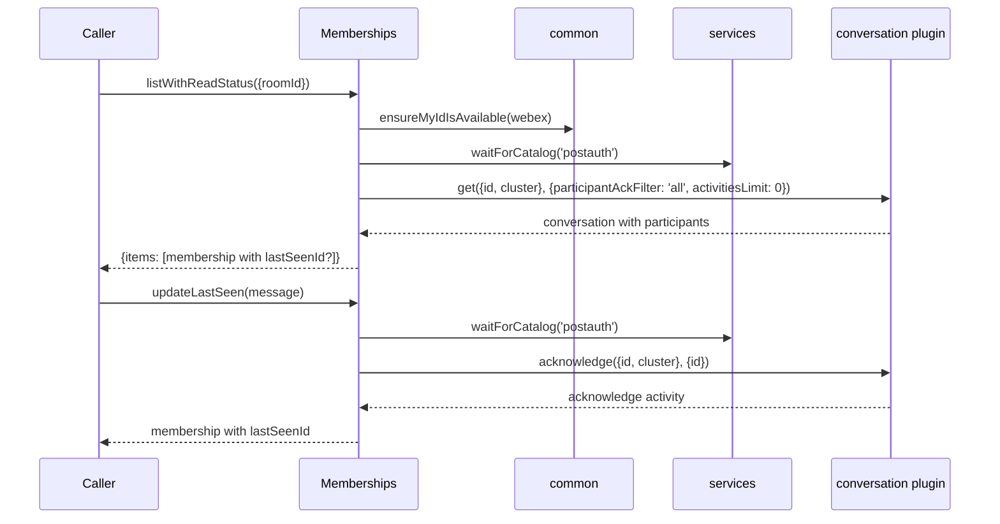
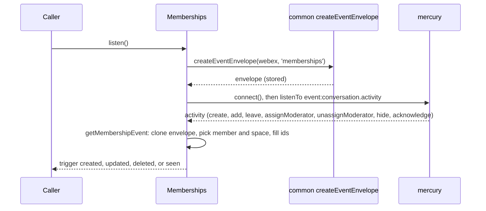
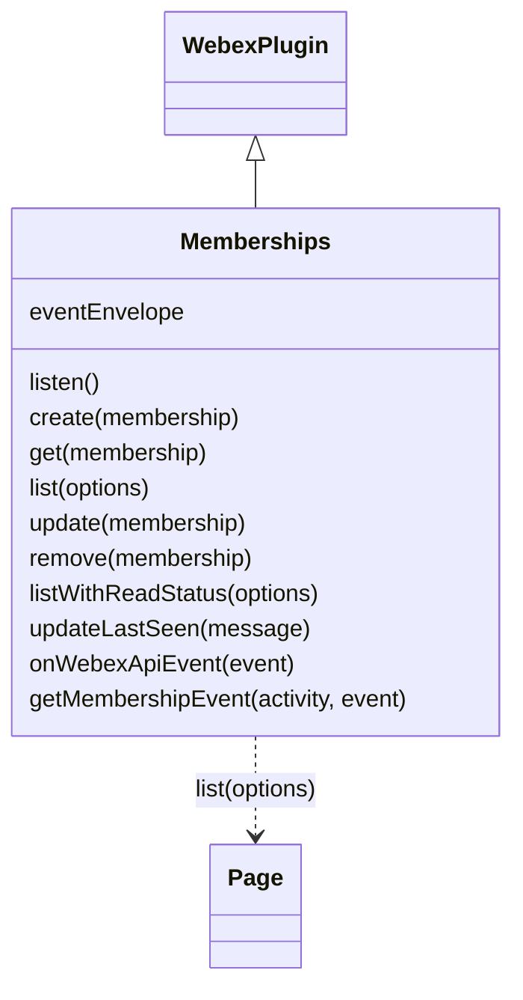

<!-- sdd-generated-metadata
doc_kind: module-spec
generated_from: module-spec@0.3.0
generated_by: claude-code
approved_by: rarajes2@cisco.com
updated_at: 2026-11-12T17:43:13Z
validation_status: pass-with-warnings
-->

# Memberships plugin

This source-local document at `src/docs/README.md` owns the stable specification for **the
Memberships plugin**: the public plugin `webex.memberships`. It adds, reads, lists, updates, and
removes memberships (a person's relationship to a room) through the `memberships` resource of the
Webex REST API (catalog service `hydra`); it reports each member's read status and sends read receipts
through the internal conversation service; and, once `listen()` is called, it turns conversation
activities from the Mercury socket into webhook-shaped `created`, `updated`, `deleted`, and `seen`
events. Ground every claim in package evidence and link to the
[package architecture](../../docs/architecture.md) instead of repeating broader facts. No service
specification exists because this package is a library.

Related context: [documentation index](../../docs/index.md) ·
[package agent instructions](../../AGENTS.md)

## Metadata

| Field             | Value |
| ----------------- | ----- |
| Owner             | @webex/web-sdk |
| Source path       | `src` |
| Resource kind     | package |
| Status            | Draft |
| Last verified     | 2026-11-12 at `46f5268b3a` |
| Module id         | `plugin-memberships` |
| Parent spec       | — |
| Doc kind          | Module spec |
| Coverage score    | 100% assessed 2026-11-12 by the generator — 13 of 13 mandatory fields PRESENT, critical 7 of 7; the package has no unit tests and no `test:unit` script, so no requirement has running test evidence; `test/integration/spec/memberships.js` holds 16 live-service cases (none skipped) that no script runs |
| Validation status | Pass-with-warnings — validator 01a1d0d7-989e-7f62-adca-8631c8de7ccc, assessed 2026-11-12; 0 Blocking, 1 Important. No runnable unit suite; coverage remains Partial |

## Applicability

| Condition ID                         | Status     | Evidence or reason | Owned section |
| ------------------------------------ | ---------- | ------------------ | ------------- |
| `module.has_tiers`                   | N/A        | No tier policy exists in `package.json` or `src/memberships.js` | Tier |
| `module.has_ui`                      | N/A        | `src/memberships.js` returns membership records and emits events; it renders nothing | UI use-case flow |
| `module.crosses_service_boundaries`  | Applicable | `src/memberships.js` calls the Webex REST API memberships resource, the conversation service through internal-plugin-conversation, and listens on the Mercury socket | Cross-boundary use-case flow |
| `module.holds_client_state`          | N/A        | The only instance property `src/memberships.js` sets is the event envelope, recorded under Business rules and invariants; no record is cached | Client state model |
| `module.enforces_domain_rules`       | Applicable | The activity-verb mapping, the member and space roles per verb, and the hidden-space rule in `src/memberships.js` | Business rules and invariants |
| `module.is_concurrent_async`         | Applicable | `src/memberships.js` returns promises, waits for the current user and the postauth catalog, and handles socket events asynchronously | Concurrency and reactive flow |
| `module.owns_persistence`            | N/A        | Nothing is stored; `src/memberships.js` resolves what the services return | Data, schema, and migration discipline |
| `module.stateful_transitions`        | N/A        | No entity moves through states in `src/memberships.js`; moderator and hidden are flags | State machine |
| `module.exposes_wire_protocol`       | Applicable | The memberships requests, the read-status and read-receipt objects, and the webhook-shaped event built in `src/memberships.js` | Protocol and wire format |
| `module.ui_multi_screen`             | N/A        | No UI | UI flow |
| `module.large_data_model`            | N/A        | One membership shape typed only by JSDoc in `src/memberships.js`, plus the objects built from it; covered under Protocol and wire format | Data model |
| `module.returns_caller_errors`       | Applicable | Request, catalog, identity, and conversation failures reject from `src/memberships.js`, and a missing argument throws | Caller-visible failure modes |
| `module.module_specific_conventions` | Applicable | Hydra membership, room, person, and message ids and the webhook-shaped event envelope in `src/memberships.js` | Module-specific rules |
| `module.published_package`           | Applicable | `package.json` names the package @webex/plugin-memberships and defines deploy:npm | Export stability |
| `module.embedded_in_host`            | N/A        | No host theme or embed API | Host integration and theming |
| `module.has_design_tradeoff`         | Applicable | Read status and read receipts from the conversation service and events from the Mercury socket in `src/memberships.js` | Key design trade-off |
| `module.has_submodules`              | N/A        | The src directory has no child module | Sub-modules |

## Evidence register

| Evidence | What it establishes |
| -------- | ------------------- |
| `src/index.js` | Imports `@webex/internal-plugin-conversation` and `@webex/internal-plugin-mercury` for their registration side effects, then `registerPlugin('memberships', Memberships)` with no options; re-exports only the default `Memberships` |
| `src/memberships.js` | `Memberships` extends `WebexPlugin` with `listen`, `create`, `get`, `list`, `listWithReadStatus`, `remove`, `update`, `updateLastSeen`, and the JSDoc-`@private` `onWebexApiEvent` and `getMembershipEvent`; the `MembershipObject` typedef. Its JSDoc and code comments are the only recorded rationale |
| `package.json` | Name, `main` (`dist/index.js`), `devMain` (`src/index.js`), `engines` (`node >=18`), dependencies, peer dependencies on `@webex/plugin-logger`, `@webex/plugin-messages`, `@webex/plugin-people`, and `@webex/plugin-rooms`, and scripts; `build`, `build:src`, `test:style`, `test:browser:broken`, `deploy:npm`, and `test` exist, and `test:unit`, `test:integration`, and `test:browser` do not |
| `test/integration/spec/memberships.js` | 16 live-service cases (none skipped): `create` by id and by email with the `created` event, as moderator, and with a new space; `get`; `list` by room and by person with and without `max`; `listWithReadStatus` before and after a message; `update` of moderator status with `updated` events; `updateLastSeen` with the `seen` event; hiding a one-to-one space with the `updated` event; `remove` with the `deleted` event. No package script runs it (see Verification) |
| `README.md` | Retained npm page; context only. Its one example, `webex.memberships.get(id)`, and its scope notes match the code; see `docs/adr/0001-retain-product-readme.md` |
| Sibling package common, file src/docs/README.md | Module spec consulted, agrees with code. Hydra ids are base64url of `ciscospark://<cluster>/<TYPE>/<id>`, and `PEOPLE` and `ORGANIZATION` ids always use cluster `us` (MOD-006, INV-001); the internal US clusters normalise to `us` (INV-005); `buildHydraMembershipId` encodes `personUUID:spaceUUID`; `ensureMyIdIsAvailable` caches `webex.internal.me`; `createEventEnvelope` resolves `undefined` when the identity lookup fails (MOD-011). The `SDK_EVENT` values, `deconstructHydraId`, and the `'me' in webex.internal` short-circuit were read in the common code, which the spec only names |
| Sibling package webex-core, file src/docs/README.md | Module spec consulted, agrees with code. `registerPlugin` keeps the first registration of a name (MOD-013) and adds `webex.<name>` to later instances (MOD-014); `Page` wraps a list response with Link-header navigation (MOD-054). The spec is silent on the service catalog, so its code was the referee: `services.waitForCatalog('postauth')` waits up to 60 seconds and rejects on timeout, and `getClusterId` reads the cluster of a URL from the catalog |
| Sibling package internal-plugin-mercury, file src/docs/README.md | Module spec consulted, agrees with code. Importing the package registers internal plugin `mercury` (MOD-001); `connect()` shares a connect in flight and resolves at once when connected (MOD-002); an inbound envelope with event type `conversation.activity` is emitted as `event:conversation.activity` (MOD-009). Its code was read to confirm that a listener error is caught and logged by Mercury's `_emit` |
| Sibling package internal-plugin-conversation, file src/conversation.js | No module spec exists, so the code is the referee. `get({id, cluster}, options)` builds the URL from the cluster and id, adds `uuidEntryFormat`, `personRefresh`, and other defaults to the query but drops `includeParticipants` when `participantAckFilter` is passed, rejects with an `Error` when no URL can be found, and resolves one conversation; `acknowledge(conversation, object)` submits an `acknowledge` activity whose object is the given activity id and resolves the submitted activity |
| Observation, no stated WHY | Behavior the code shows without stating a reason is recorded once, under Pitfalls and constraints or Caller-visible failure modes |

## Purpose and boundary

- Responsibility: give applications Webex memberships as Hydra-style records — create, read, list,
  update, delete — plus each member's read status, a way to send a read receipt, and webhook-shaped
  membership events over the existing Mercury socket.
- In scope: registration of `memberships`; the eight public methods; turning a conversation's
  participants into read-status memberships; turning an acknowledge activity into the caller's updated
  membership; turning `create`, `add`, `leave`, `assignModerator`, `unassignModerator`, `hide`, and
  `acknowledge` activities into `created`, `updated`, `deleted`, and `seen` events.
- Out of scope: the request pipeline, authorization, service-catalog resolution, and paging
  (`@webex/webex-core`); Hydra id encoding, the current-user lookup, the event envelope, and the event
  vocabulary (`@webex/common`); the socket connection (`@webex/internal-plugin-mercury`); conversation
  requests, activity submission, and decryption (`@webex/internal-plugin-conversation`); rooms and
  messages themselves (the rooms and messages plugins); caching membership records; what Hydra stores
  or returns.
- Consumers: in this repository `webex` (`src/webex.js`) and `webex-node` (`src/webex-node.js`) import
  the package to register it. No file under another package's `src/` calls `webex.memberships`
  (plugin-people's JSDoc examples do); plugin-teams declares it a peer dependency, and the integration
  specs of plugin-rooms and plugin-teams call it. The workspace samples `docs/samples/browser-socket`
  and `docs/samples/browser-read-status` use `listen`, the events, `listWithReadStatus`, and
  `updateLastSeen`. Applications reach the plugin as `webex.memberships`.

## Structure and key files

| Path | Responsibility |
| ---- | -------------- |
| `src/index.js` | Registers the conversation and Mercury internal plugins by import, registers public plugin `memberships`, and re-exports the class as default |
| `src/memberships.js` | `Memberships`: the record, read-status, read-receipt, and event paths |
| `package.json` | Package name, entry points, scripts, dependencies, and peer dependencies |
| `babel.config.js`, `jest.config.js` | Re-exports of the legacy Babel and Jest configurations; no unit spec uses the Jest one |
| `.eslintrc.js` | Sets `root: true` and extends `@webex/eslint-config-legacy` |
| `process` | Package-root file exporting `{browser: true}`; not imported by `src/` |
| `src/docs/README.md` | This module specification; ignored by the build and by lint |
| `test/integration/spec/memberships.js` | Live-service cases; only `test:browser:broken` would run them |
| dist/ (generated) | Build output of `build:src`; ignored by Git and never edited by hand |

## Public surface

| Surface | Consumer | Compatibility commitment | Source |
| ------- | -------- | ------------------------ | ------ |
| Import side effect: public plugin `memberships`, and internal plugins `conversation` and `mercury` | `webex`, `webex-node` | First registration of the name wins; reached as `webex.memberships` | `src/index.js` |
| `create(membership)`, `get(membership)`, `list(options)`, `update(membership)`, `remove(membership)` | Applications | Hydra membership records; `list` resolves a webex-core `Page` | `src/memberships.js` |
| `listWithReadStatus({roomId})` | Applications; the read-status sample | Read-status memberships in `{items}`; the JSDoc says it may be deprecated when the information is added to the objects `list` returns | `src/memberships.js` |
| `updateLastSeen(message)` | Applications; the read-status sample | Sends a read receipt and resolves the caller's updated membership | `src/memberships.js` |
| `listen()` and the `created`, `updated`, `deleted`, and `seen` events | Applications; both samples | Webhook-shaped events triggered on `webex.memberships`; removed with the inherited `off` and `stopListening` | `src/memberships.js` |
| `onWebexApiEvent(event)`, `getMembershipEvent(activity, event)` | The Mercury listener | Marked `@private`; the JSDoc says SDK users should not call them | `src/memberships.js` |
| Default export `Memberships` | Hosts that mount the class themselves | The entry exports nothing else | `src/index.js` |

Contract ID `memberships-public-sdk` is indexed in the
[package architecture](../../docs/architecture.md#public-and-consumer-surfaces) and registered in
`.sdd/manifest.json`. Export stability is under [Export stability](#export-stability).

## Dependencies

| Dependency | Why it is required | Failure behavior |
| ---------- | ------------------ | ---------------- |
| `@webex/webex-core` plugin host (module spec consulted) | `registerPlugin`, `WebexPlugin` (`webex`, `request`, `logger`, and the event methods `on`, `off`, `trigger`, `listenTo`, `stopListening`), and `Page` | A request rejection rejects the method |
| `@webex/webex-core` services (code consulted) | Resolves `service: 'hydra'`; `waitForCatalog('postauth')` before read status and read receipts; `getClusterId` for cluster strings | A catalog timeout rejects the method |
| `@webex/common` (module spec consulted; code consulted for `SDK_EVENT`, `deconstructHydraId`, and `ensureMyIdIsAvailable`) | `ensureMyIdIsAvailable`, `createEventEnvelope`, the Hydra id builders, `getHydraClusterString`, `getHydraRoomType`, `deconstructHydraId`, and `SDK_EVENT` | See Caller-visible failure modes |
| `@webex/internal-plugin-conversation` (no spec; code consulted) | Registered by import; `conversation.get` supplies read status and `conversation.acknowledge` sends read receipts | Errors reject the method |
| `@webex/internal-plugin-mercury` (module spec consulted) | Registered by import; `mercury.connect()` and the `event:conversation.activity` event | A connect failure rejects `listen()` |
| `@webex/plugin-people` (peer dependency) | `ensureMyIdIsAvailable` and `createEventEnvelope` call `webex.people.get('me')` | See Caller-visible failure modes |
| `@webex/plugin-logger` (peer dependency) | Supplies `webex.logger` used by `getMembershipEvent` | Not imported by `src/` |
| `@webex/plugin-messages`, `@webex/plugin-rooms` (peer dependencies) | Not reached by `src/`; the integration spec imports them to create rooms and messages | — |
| `lodash` | `cloneDeep` of the event envelope and of `create` activities | — |
| `debug` | Namespace `memberships` trace lines for event payloads | Silent unless `DEBUG` enables `memberships`; then it prints full event payloads, emails and ids included |
| Webex REST API memberships resource and the conversation service (external) | Membership records, read status, and read receipts | Errors propagate |

## Requirements

| ID | WHAT | WHY | Source evidence | Test or example evidence | Assumptions or gaps | Confidence |
| -- | ---- | --- | --------------- | ------------------------ | ------------------- | ---------- |
| `MOD-001` | Importing the package first imports `@webex/internal-plugin-conversation` and `@webex/internal-plugin-mercury`, registering both internal plugins, then registers `Memberships` as public plugin `memberships` with no config or other options. The entry re-exports only the default `Memberships`. | `listen()` needs `webex.internal.mercury`, and `listWithReadStatus` and `updateLastSeen` need `webex.internal.conversation` (inferred from those calls); applications reach memberships as `webex.memberships`. | `src/index.js` | `test/integration/spec/memberships.js` imports the package and relies on it, but is not run | WHY inferred | Weak |
| `MOD-002` | `create(membership)` sends `POST memberships` to service `hydra` with `membership` as the body through `this.request` and resolves the response body. | The JSDoc: adds a person to a room by `personId` or `personEmail`, optionally as a moderator. | `src/memberships.js` | `test/integration/spec/memberships.js` create cases (not run) | — | Present |
| `MOD-003` | `get(membership)` takes `membership.id`, else `membership` itself, sends `GET memberships/<id>` to service `hydra`, and resolves `res.body.items` when present, else `res.body`. | The JSDoc: returns a single membership. | `src/memberships.js` | `test/integration/spec/memberships.js` get case (not run) | Why `items` is checked is not stated | Present |
| `MOD-004` | `list(options)` sends `GET memberships` to service `hydra` with `qs: options` and resolves `new Page(res, webex)`. | The JSDoc: lists memberships, in most cases only of rooms the user is in, filtered by `roomId`, `personId`, or `personEmail`; `max` limits the number per page. Paging is the webex-core `Page` (webex-core MOD-054). | `src/memberships.js` | `test/integration/spec/memberships.js` list cases (not run) | — | Present |
| `MOD-005` | `update(membership)` takes `membership.id`, else `membership`, sends `PUT memberships/<id>` to service `hydra` with the whole `membership` as the body, and resolves the response body. | The JSDoc: updates a membership's properties; its examples make a member a moderator and hide a one-to-one space by setting `isRoomHidden`, which produces an `updated` event seen only by that user. | `src/memberships.js` | `test/integration/spec/memberships.js` update and hide cases (not run) | — | Present |
| `MOD-006` | `remove(membership)` takes `membership.id`, else `membership`, sends `DELETE memberships/<id>` to service `hydra`, and resolves `undefined` when the status is 204, else the response body. | The code comment: Firefox has issues with 204s or DELETE, and the handling should move to http-core. | `src/memberships.js` | `test/integration/spec/memberships.js` remove case (not run) | — | Present |
| `MOD-007` | `listWithReadStatus(options)` decodes `options.roomId` with `deconstructHydraId` into `{id, cluster}`, waits for `ensureMyIdIsAvailable(webex)` and then the `postauth` catalog, calls `conversation.get({id, cluster}, {participantAckFilter: 'all', activitiesLimit: 0})`, and resolves `{items}`: one read-status membership per entry of `participants.items`, in that order (`MOD-008`). No other option is read and the result is not paged. | The JSDoc: gives a client the `lastSeenId` of every member for a read-status view; it differs from `list` by taking only a room, ignoring options such as `max`, not paginating, and returning `lastSeenId` and `lastSeenDate`; it should be used only when read status is needed and may be deprecated. The code comments: `participantAckFilter` shows the last acknowledgement of each participant; `activitiesLimit: 0` avoids sending the whole history. | `src/memberships.js` | `test/integration/spec/memberships.js` read-status cases before and after a message (not run) | JSDoc field drift; see Pitfalls | Present |
| `MOD-008` | A read-status membership has `id` (Hydra membership id of the participant `entryUUID` and the conversation id, with the cluster decoded from `roomId`), `roomId` (Hydra room id, same cluster), `personId`, `personEmail` (`entryEmailAddress`, else `entryEmail`), `personDisplayName`, `personOrgId`, `isMonitor: false`, and `roomType` (`direct` or `group` from the conversation tags). It adds `isRoomHidden: true` only on the current user's entry when the conversation tags include `HIDDEN`; `lastSeenId` (Hydra message id of `roomProperties.lastSeenActivityUUID`) and `lastSeenDate` only when `roomProperties` has `lastSeenActivityDate`; and `isModerator` only when `roomProperties` has it. It never has `created`. | The code comments: `isMonitor` is deprecated but included for completeness; `created` is not in the conversation payload. The JSDoc: `lastSeenId` and `lastSeenDate` do not exist when the member has never seen the space. | `src/memberships.js` | `test/integration/spec/memberships.js` checks no `lastSeenId` before a visit and both fields after (not run) | — | Present |
| `MOD-009` | `updateLastSeen(message)` decodes `message.id` into the activity id and `message.roomId` into `{id, cluster}`, waits for the `postauth` catalog, calls `conversation.acknowledge(conversation, {id})`, and resolves `{lastSeenId, id, personId, personEmail, personDisplayName, personOrgId, roomId, roomType, isRoomHidden: false, isMonitor: false, created}` built from the acknowledge activity: `lastSeenId` from its object, the person fields from its actor, `roomId` and `roomType` from its target, `created` from `published`, all with the decoded cluster. It has no `isModerator`. | The JSDoc: sends a read receipt for a message, updating the caller's `lastSeenId` in that message's space. The code comments: any activity unhides a space; `isMonitor` is deprecated and returned for back compatibility. | `src/memberships.js` | `test/integration/spec/memberships.js` updateLastSeen case with the `seen` event (not run) | JSDoc type drift; see Pitfalls | Present |
| `MOD-010` | `listen()` resolves `createEventEnvelope(webex, 'memberships')`, stores it as `this.eventEnvelope`, calls `webex.internal.mercury.connect()`, and then listens on Mercury for `event:conversation.activity`, passing each event to `onWebexApiEvent`. | The JSDoc: an alternative to membership webhooks whose events resemble the webhook JSON without webhook-only fields such as name, secret, and url; it needs the `spark:all` and `spark:kms` scopes. | `src/memberships.js` | `test/integration/spec/memberships.js` event checks (not run) | No guard against a second `listen()`; see Pitfalls | Present |
| `MOD-011` | `onWebexApiEvent(event)` reads `event.data.activity` and maps its verb. `create` triggers one `created` per entry of `activity.object.participants.items`, each converted from a deep clone of the activity whose `target` is a clone of the activity object and whose `object` is a clone of the participant. `add` triggers `created`; `leave` triggers `deleted`; `assignModerator`, `unassignModerator`, and `hide` trigger `updated`; `acknowledge` triggers `seen`. Every other verb is ignored, and an event is triggered only when `getMembershipEvent` returns one. | The JSDoc: internal handler for activity events after `listen()`; SDK users should not call it. The `listen` JSDoc: `seen` is a read receipt with no equivalent webhook. A space created with members reports one membership per member (inferred from the per-participant loop). | `src/memberships.js` | `test/integration/spec/memberships.js` created, updated, deleted, and seen event checks (not run) | — | Present |
| `MOD-012` | `getMembershipEvent(activity, event)` deep-clones the envelope and sets `event`, `data.created` (`activity.published`), and `actorId` (Hydra person id of `activity.actor.entryUUID`). The cluster comes from `activity.target.url`, or from `activity.url` for `hide`. For every verb but `hide`, `data.roomId` and `data.roomType` come from the target and `data.isRoomHidden` is `false`; for `hide`, `data.roomId` comes from `activity.object.id`, `data.roomType` is `direct`, and `data.isRoomHidden` is `true`. For every verb but `acknowledge`, `data.isModerator` is `true` exactly when `activity.object.roomProperties.isModerator` is truthy. The member and space fields are actor and target for `acknowledge` (which also sets `data.lastSeenId` from `activity.object.id`), actor and object for `hide`, and object and target otherwise; from them it sets `data.id`, `personId`, `personEmail` (`emailAddress`, else `entryEmail`), `personDisplayName`, and `personOrgId`. Any error is logged through `webex.logger.error` and returns `null`. | The JSDoc: build the event to match Hydra's memberships webhook data. The code comments: for a read receipt the reader is the actor, the space the target, and the object the last-seen message; for a hide the person is the actor and the space the object; for most events the person is the object and the space the target; any activity unhides a space; the hidden attribute is only set on one-to-one spaces; `isMonitor` is deprecated and not sent in SDK events. | `src/memberships.js` | `test/integration/spec/memberships.js` event field checks (not run) | — | Present |

## Design overview

`Memberships` is a `WebexPlugin` with four paths. The record path sends one Hydra request per call to
the `memberships` resource and resolves what Hydra returns; `list` wraps the response in a webex-core
`Page`.

The read-status path does not use Hydra. It makes sure the current user is known, waits for the
post-authentication service catalog, asks the internal conversation service for one conversation with
every participant's last acknowledgement, and converts each participant into a membership-shaped
object with Hydra ids and, when the member has seen the space, `lastSeenId` and `lastSeenDate`.

The read-receipt path also uses the conversation service: `updateLastSeen` submits an `acknowledge`
activity for a message and converts the submitted activity into the caller's membership.

The event path starts with `listen()`. It builds one webhook-style envelope for the current user,
connects the Mercury socket, and listens for conversation activities. Seven verbs become `created`,
`updated`, `deleted`, or `seen` events with a cloned envelope; the rest are ignored. Nothing is
cached; every call reaches a service.

## Data flow and sequence coverage

Call style: in-process method calls on `webex.memberships`; outbound HTTPS through `webex.request` to
catalog service `hydra` or through the conversation plugin; inbound events from the Mercury socket.
Four operation groups differ in actors and outcome. The two that cross several components and are
used together by the read-status sample have a diagram each; the record path is one request per call,
and the read-receipt path is one conversation call shown inside Diagram 1.

| Operation group | Entry and outcome | Diagram or evidence | Failure and recovery coverage |
| --------------- | ----------------- | ------------------- | ----------------------------- |
| Membership records | `create`, `get`, `list`, `update`, `remove`; one Hydra request each | `src/memberships.js` | The request error rejects; nothing is retried |
| Read status | `listWithReadStatus`; identity wait, catalog wait, conversation request, conversion | Diagram 1; `src/memberships.js` | Identity, catalog, request, and conversion errors reject |
| Read receipt | `updateLastSeen`; catalog wait, acknowledge, conversion | Diagram 1; `src/memberships.js` | Catalog and acknowledge errors reject |
| Membership events | `listen()`; Mercury activities become `created`, `updated`, `deleted`, and `seen` events | Diagram 2; `src/memberships.js` | A connect failure rejects `listen()`; a bad activity is logged and dropped |

Diagram 1 — read status and read receipt:

Diagram 2 — membership events:

## Class and component relationships

## Use cases and flows

| Use case | Actor or caller | Primary steps and outcome | Failure or boundary behavior | Evidence |
| -------- | --------------- | ------------------------- | ---------------------------- | -------- |
| `UC-001` | Application managing room members | `create({roomId, personId or personEmail, isModerator})`, `get`, `update` to change `isModerator`, or `remove` a membership by object or id | The Hydra error rejects | `src/memberships.js` |
| `UC-002` | Application listing members or a person's rooms | `list({roomId})` or `list({personId, max})` resolves a `Page`; `next()` fetches the next page | The request error rejects | `src/memberships.js` |
| `UC-003` | User hiding a one-to-one space | `update(membership)` with `isRoomHidden: true` on their own membership | Only that user receives the `updated` event | `src/memberships.js` |
| `UC-004` | Client showing read status in a space | `listWithReadStatus({roomId})`, then `seen` events to keep it current | A slow catalog delays or rejects; an id the conversation plugin cannot resolve rejects | `src/memberships.js` |
| `UC-005` | Client marking a message read | `updateLastSeen(message)` with the message's `id` and `roomId` | A missing field throws; a catalog or acknowledge failure rejects | `src/memberships.js` |
| `UC-006` | Application replacing membership webhooks | `listen()`, then `on('created')`, `on('updated')`, `on('deleted')`, `on('seen')`; `stopListening()` and `off(...)` to stop | Needs `spark:all` and `spark:kms`; a connect failure rejects `listen()` | `src/memberships.js` |

### Cross-boundary use-case flow

| Boundary | Transport and ordering | Compatibility | Timeout, retry, and recovery |
| -------- | ---------------------- | ------------- | ---------------------------- |
| Webex REST API memberships resource (`UC-001` to `UC-003`) | HTTPS through `webex.request`, catalog service `hydra`, one per call | Requests under Protocol and wire format | No retry or timeout in this module; webex-core interceptors apply |
| Conversation service (`UC-004`, `UC-005`) | Through `webex.internal.conversation`, after the current user (read status only) and the `postauth` catalog are ready | The participant and acknowledge fields read by `MOD-008` and `MOD-009` | The catalog wait rejects after 60 seconds (webex-core services code); no retry here |
| Mercury socket (`UC-006`) | `mercury.connect()`, then events in socket order | The activity fields read by `getMembershipEvent` | Reconnects are Mercury's (internal-plugin-mercury MOD-005); events during a disconnect are not replayed here |

## Business rules and invariants

| ID | Invariant | WHY | Enforcement source | Test evidence |
| -- | --------- | --- | ------------------ | ------------- |
| `INV-001` | Every membership, room, message, person, and organization id the module builds comes from the `@webex/common` Hydra helpers: read status and read receipts use the cluster decoded from the caller's room id, events use `getHydraClusterString` of the activity URL, and person and organization ids always use cluster `us`. | Callers match events and read status to memberships by id (inferred); common MOD-006 and INV-001. | `src/memberships.js` | Only `test/integration/spec/memberships.js`, which compares event and read-status ids with the ids the API returns, and is not run |
| `INV-002` | Only the verbs `create`, `add`, `leave`, `assignModerator`, `unassignModerator`, `hide`, and `acknowledge` produce events, and an activity `getMembershipEvent` cannot convert produces none: the error is logged and the handler moves on. | Events must keep the webhook shape (JSDoc of `getMembershipEvent`); other verbs are not membership changes (inferred). | `src/memberships.js` | None found |
| `INV-003` | Every event is built from a deep clone of the one envelope stored by `listen()`, and a `create` activity is cloned per participant, so one event's fields never leak into the next. | The envelope and the activity are shared across events (inferred from `cloneDeep`). | `src/memberships.js` | None found |
| `INV-004` | `isRoomHidden` is `true` only in `hide` events and in the current user's read-status entry of a hidden space; every other event and every `updateLastSeen` result report `false`. | The code comments: any activity unhides a space, and the hidden attribute is only set on one-to-one spaces. | `src/memberships.js` | Only `test/integration/spec/memberships.js` hide case, which is not run |
| `INV-005` | `seen` events and `updateLastSeen` results carry no `isModerator`; read-status entries carry it only when the conversation reports it; every other event always carries it as a boolean. | A read receipt does not report moderator status (the comments in the integration spec helpers; inferred from the code). | `src/memberships.js` | Only `test/integration/spec/memberships.js`, which skips `isModerator` for `seen`, and is not run |

## Concurrency and reactive flow

- Execution model: one JavaScript event loop; every public method returns a promise or, for a missing
  argument, throws before returning (see Caller-visible failure modes). `onWebexApiEvent` and
  `getMembershipEvent` are synchronous.
- Ordering guarantees: events are triggered in the order Mercury emits activities; a `create` activity
  triggers its `created` events in participant order. `listWithReadStatus` waits for the current user,
  then the catalog, then the conversation, in sequence.
- Parallel work: none; each method is one promise chain.
- Idempotency and retry: `get`, `list`, and `listWithReadStatus` are reads and safe to repeat;
  `create` adds a membership each time and Hydra decides on duplicates; `update`, `remove`, and
  `updateLastSeen` repeat to the same end state on success. Nothing is retried here.
- Fire-and-forget work: none; events are triggered synchronously inside the Mercury listener.
- Shared-state protection: `this.eventEnvelope` is replaced by each `listen()` and read by each event;
  both run on the one event loop.

## Protocol and wire format

| Message or frame | Version | Producer or serializer | Consumer or parser | Compatibility and ordering rule |
| ---------------- | ------- | ---------------------- | ------------------ | ------------------------------- |
| `POST <hydra>/memberships` with the membership body | Unversioned path under the catalog URL | `create` | Webex REST API | Body is the caller's object as given |
| `GET <hydra>/memberships/<id>` | Unversioned | `get` | Webex REST API | The id is interpolated without URL encoding |
| `GET <hydra>/memberships?<options>` | Unversioned | `list` | Webex REST API | Every key of `options` becomes a query parameter; the response is read by `Page` |
| `PUT <hydra>/memberships/<id>` with the membership body | Unversioned | `update` | Webex REST API | The whole object, `id` included, is the body |
| `DELETE <hydra>/memberships/<id>` | Unversioned | `remove` | Webex REST API | A 204 resolves `undefined` |
| Membership object | — | Webex REST API | Callers | The JSDoc typedef names `id`, `roomId`, `personId`, `personEmail`, `isModerator`, `isMonitor`, and `created` |
| Read-status membership `{id, roomId, personId, personEmail, personDisplayName, personOrgId, isMonitor, roomType, isRoomHidden?, lastSeenId?, lastSeenDate?, isModerator?}` | — | `listWithReadStatus` | Callers | A list is `{items}`, unpaged; no `created` (`MOD-008`) |
| Read-receipt result `{lastSeenId, id, personId, personEmail, personDisplayName, personOrgId, roomId, roomType, isRoomHidden, isMonitor, created}` | — | `updateLastSeen` | Callers | `isRoomHidden` and `isMonitor` are `false` (`MOD-009`) |
| Event `{createdBy, orgId, resource, ownedBy, status, created, data, event, actorId}` | — | `createEventEnvelope` plus `getMembershipEvent` | `on('created')`, `on('updated')`, `on('deleted')`, and `on('seen')` listeners | `resource` is `memberships`, `ownedBy` `creator`, `status` `active`; `data` holds `id`, `roomId`, `roomType`, `isRoomHidden`, `personId`, `personEmail`, `personDisplayName`, `personOrgId`, `created`, plus `isModerator` except for `seen` and `lastSeenId` for `seen` only |

## Caller-visible failure modes

| Condition | Signal or result | Caller behavior | Retry or recovery | Evidence |
| --------- | ---------------- | --------------- | ----------------- | -------- |
| `get`, `update`, or `remove` is called with `undefined` or `null` | A `TypeError` is thrown synchronously, not returned as a rejection | Pass a membership or id | — | `src/memberships.js` |
| `listWithReadStatus` gets no options or no `roomId`, or `updateLastSeen` gets a message without `id` or `roomId` | A `TypeError` from `deconstructHydraId` is thrown synchronously, before any wait | Pass a Hydra id | — | `src/memberships.js` |
| A Hydra request fails | `create`, `get`, `list`, `update`, or `remove` rejects with the webex-core request error | Handle the error | Call again | `src/memberships.js` |
| The current-user lookup fails | `listWithReadStatus` rejects with the `webex.people.get('me')` error | Handle the error | Call again | `src/memberships.js` |
| The `postauth` catalog is not ready within 60 seconds | `listWithReadStatus` or `updateLastSeen` rejects with the services timeout error | Handle the error | Call again | `src/memberships.js` |
| The room id is not a Hydra id, so it decodes without a cluster | The conversation plugin finds no URL for the decoded id and throws an `Error` saying it could not find the url from the given id; `listWithReadStatus` and `updateLastSeen` reject with that `Error` | Pass a Hydra room id | — | `src/memberships.js` |
| The decoded cluster has no catalog entry | webex-core services throws `Could not find service for cluster [<cluster>]` while the conversation plugin builds its URL; both methods reject with that `Error` | Pass an id from the user's own deployment | — | `src/memberships.js` |
| The conversation response lacks `participants` or `tags` | The conversion error is caught and `listWithReadStatus` rejects with it | — | — | `src/memberships.js` |
| `mercury.connect()` or the envelope lookup rejects | `listen()` rejects | Handle the error | Call `listen()` again | `src/memberships.js` |
| The current-user lookup inside `createEventEnvelope` fails | The envelope resolves `undefined` (common MOD-011) and `listen()` still resolves; every later activity fails in `getMembershipEvent`, is logged, and produces no event | No signal reaches the caller; watch the logger | Call `listen()` again once `webex.people.get('me')` succeeds | `src/memberships.js` |
| An activity lacks the fields `getMembershipEvent` reads (for example `target.url`) | `webex.logger.error` logs `Unable to generate SDK event from mercury 'socket activity for memberships:<event> event: <message>`; no event | — | — | `src/memberships.js` |
| An event has no `data.activity`, or a `create` activity has no `object.participants.items` | `onWebexApiEvent` throws a `TypeError`; Mercury's `_emit` catches it and logs `error occurred in event handler` | — | — | `src/memberships.js` |

## Pitfalls and constraints

- `update` with a plain id string sends that string as the request body, since the body is always the
  argument as given.
- The `listWithReadStatus` JSDoc says results do not include `isRoomHidden`; the code adds it to the
  current user's entry of a hidden space (`INV-004`). The JSDoc also returns an undefined
  `MembershipObjectList` type.
- The `updateLastSeen` JSDoc types `message` as a string; the code reads `message.id` and
  `message.roomId`.
- Read-status entries build `personId` without a cluster argument and events pass one; the result is
  the same because person ids always use cluster `us` (common INV-001).
- Each `listen()` call adds another Mercury listener, so calling it twice triggers every event twice.
  `stopListening()` with no arguments removes every listener the plugin registered; it does not
  disconnect Mercury.
- The `listen` JSDoc example has unbalanced brackets and logs `membership:created` in its `deleted`
  handler; the `acknowledge` branch's `debug` line says `updated` for a `seen` payload; the logged
  conversion error carries a stray quote before `socket`.
- `test:style` reports 1 warning and no errors (the `require` of `debug`), plus "File ignored" for this
  specification.

## Module-specific rules

- Do: send every membership record request to service `hydra` through `this.request` so webex-core
  interceptors and the catalog apply.
- Do: build ids only with the `@webex/common` Hydra helpers, so `INV-001` holds.
- Do: keep `getMembershipEvent` returning `null` on any error; a throw would reach Mercury's listener
  chain.
- Do not: add fields to an event without deep-cloning the stored envelope first (`INV-003`).
- Do not: change the event names `created`, `updated`, `deleted`, and `seen` or the `resource`
  `memberships`; listeners and the samples rely on them.
- Do not: log person emails, display names, or ids with `webex.logger`; only the conversion error is
  logged today.

## Export stability

| Export or entry point | Consumer | Stability | Versioning and deprecation rule | Declaration or API report |
| --------------------- | -------- | --------- | ------------------------------- | ------------------------- |
| Import side effect: public plugin `memberships` | `webex`, `webex-node` | Public | No rule is declared in the package | `src/index.js` |
| Default export `Memberships`, its eight public methods, and the `created`, `updated`, `deleted`, and `seen` events | Applications | Public | Same; the JSDoc notes `listWithReadStatus` may be deprecated | `src/index.js`, `src/memberships.js` |

The build writes JavaScript only; `package.json` has no `types` entry, so no declarations or API
report are published.

## Key design trade-off

| Chosen trade-off | Preserved invariant or benefit | Cost or limitation | Decision evidence |
| ---------------- | ------------------------------ | ------------------ | ----------------- |
| Read status and read receipts through the internal conversation service, converted to Hydra-style memberships | Per-member `lastSeenId` without a Hydra endpoint for it (`INV-001`, `INV-004`) | Waits for the current user and the `postauth` catalog; one unpaged list; no `created`; `isModerator` only when reported | `src/memberships.js` JSDoc of listWithReadStatus and updateLastSeen |
| Events from the Mercury socket instead of webhooks | No public endpoint needed; webhook-shaped payloads plus a `seen` event that webhooks lack (`INV-002`) | Needs `spark:all` and `spark:kms`; a failed envelope silently drops all events | `src/memberships.js` JSDoc of listen and comments in getMembershipEvent |

## Verification

| Requirement or invariant | Test level | Positive evidence | Negative or boundary evidence | Gap |
| ------------------------ | ---------- | ----------------- | ----------------------------- | --- |
| `MOD-001` | None run | `test/integration/spec/memberships.js` (not run) | None found | No unit case |
| `MOD-002` to `MOD-006` | None run | `test/integration/spec/memberships.js` (not run) | `test/integration/spec/memberships.js` remove case checks the list no longer holds the membership (not run) | No unit case; argument handling has no case |
| `MOD-007`, `MOD-008` | None run | `test/integration/spec/memberships.js` read-status cases (not run) | `test/integration/spec/memberships.js` checks the fields are absent before a visit (not run) | The hidden and moderator fields and the error paths have no case |
| `MOD-009` | None run | `test/integration/spec/memberships.js` updateLastSeen case (not run) | None found | No unit case |
| `MOD-010` to `MOD-012`, `INV-001` to `INV-005` | None run | `test/integration/spec/memberships.js` created, updated, deleted, and seen event checks (not run) | None found | Verb mapping, member and space roles, the `create` fan-out, and the error path have no case |

The package has no unit tests: `package.json` defines no `test:unit` script and there is no
`test/unit` directory. No package script runs `test/integration/spec/memberships.js` either: there is
no `test:integration`, and `test:browser:broken` reported 0 tests on 2026-11-12 because the karma
bundle failed to parse `isbot`, while still exiting 0. The aggregate `test` script exits 1 at the
missing `test:browser`. `build:src` and `test:style` exit 0. A module specification is complete only
when its public surface, invariants, failure modes, and test evidence agree with the implementation.
Generator-side field measurement is complete (100%, assessed 2026-11-12); independent validation has
not run, and the module stays Partial until a unit suite and a characterization baseline exist.
