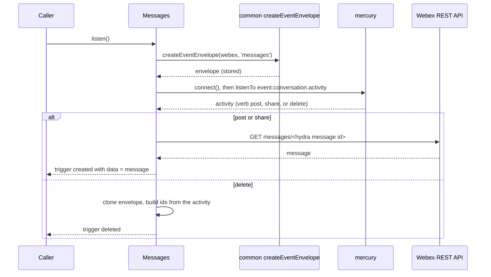
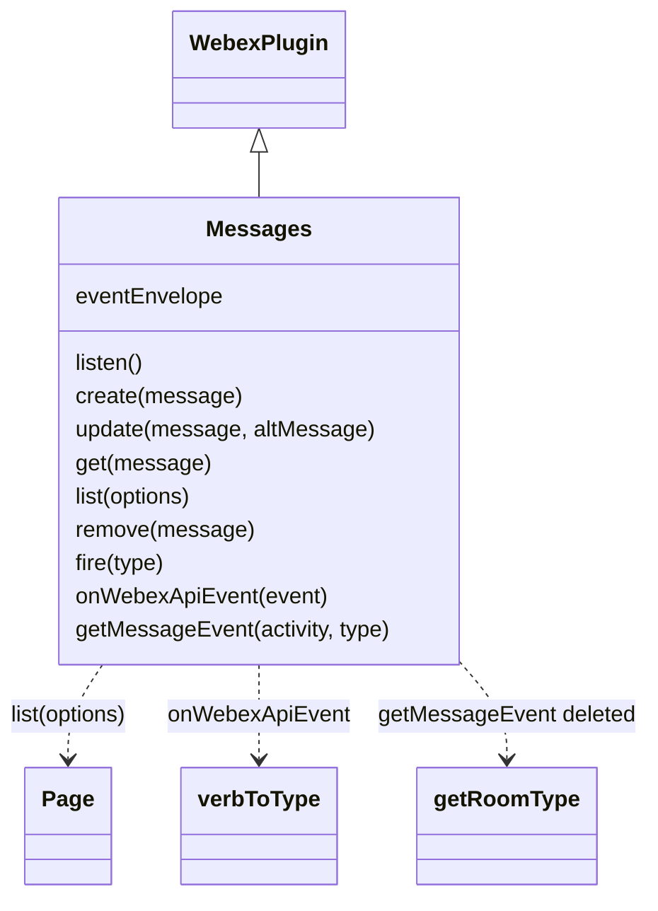

<!-- sdd-generated-metadata
doc_kind: module-spec
generated_from: module-spec@0.3.0
generated_by: claude-code
approved_by: rarajes2@cisco.com
updated_at: 2026-11-12T17:30:10Z
validation_status: pass-with-warnings
-->

# Messages plugin

This source-local document at `src/docs/README.md` owns the stable specification for **the Messages
plugin**: the public plugin `webex.messages`. It posts, edits, reads, lists, and deletes Webex messages
through the `messages` resource of the Webex REST API (catalog service `hydra`), and, once `listen()`
is called, it turns conversation activities from the Mercury socket into webhook-shaped `created` and
`deleted` events. Ground every claim in package evidence and link to the
[package architecture](../../docs/architecture.md) instead of repeating broader facts. No service
specification exists because this package is a library.

Related context: [documentation index](../../docs/index.md) ·
[package agent instructions](../../AGENTS.md)

## Metadata

| Field             | Value |
| ----------------- | ----- |
| Owner             | @webex/web-sdk |
| Source path       | `src` |
| Resource kind     | package |
| Status            | Draft |
| Last verified     | 2026-11-12 at `46f5268b3a` |
| Module id         | `plugin-messages` |
| Parent spec       | — |
| Doc kind          | Module spec |
| Coverage score    | 100% assessed 2026-11-12 by the generator — 13 of 13 mandatory fields PRESENT, critical 7 of 7; the package has no unit tests and no `test:unit` script, so no requirement has running test evidence; `test/integration/spec/messages.js` holds 15 live-service cases, all inside a skipped `describe` |
| Validation status | Pass-with-warnings — Codex desktop, 2026-11-12; 0 Blocking, 1 Important (no unit tests or characterization baseline; all integration cases skipped) |

## Applicability

| Condition ID                         | Status     | Evidence or reason | Owned section |
| ------------------------------------ | ---------- | ------------------ | ------------- |
| `module.has_tiers`                   | N/A        | No tier policy exists in `package.json` or `src/messages.js` | Tier |
| `module.has_ui`                      | N/A        | `src/messages.js` returns message records and emits events; it renders nothing | UI use-case flow |
| `module.crosses_service_boundaries`  | Applicable | `src/messages.js` calls the Webex REST API messages resource and listens on the Mercury socket | Cross-boundary use-case flow |
| `module.holds_client_state`          | N/A        | The only instance property `src/messages.js` sets is the event envelope, recorded under Business rules and invariants; no record is cached | Client state model |
| `module.enforces_domain_rules`       | Applicable | The body or multipart choice, the roomId rule of update, and the activity-verb mapping in `src/messages.js` | Business rules and invariants |
| `module.is_concurrent_async`         | Applicable | `src/messages.js` returns promises and fetches a message for each socket activity it turns into a created event | Concurrency and reactive flow |
| `module.owns_persistence`            | N/A        | Nothing is stored; `src/messages.js` resolves what Hydra returns | Data, schema, and migration discipline |
| `module.stateful_transitions`        | N/A        | No entity moves through states in `src/messages.js` | State machine |
| `module.exposes_wire_protocol`       | Applicable | The messages requests, the multipart upload, and the webhook-shaped event built in `src/messages.js` | Protocol and wire format |
| `module.ui_multi_screen`             | N/A        | No UI | UI flow |
| `module.large_data_model`            | N/A        | One shape, the message object, typed only by the JSDoc MessageObject in `src/messages.js`; covered under Protocol and wire format | Data model |
| `module.returns_caller_errors`       | Applicable | Request failures reject and a missing roomId makes update log and return null in `src/messages.js` | Caller-visible failure modes |
| `module.module_specific_conventions` | Applicable | Hydra message, person, and room ids and the webhook-shaped event envelope in `src/messages.js` | Module-specific rules |
| `module.published_package`           | Applicable | `package.json` names the package @webex/plugin-messages and defines deploy:npm | Export stability |
| `module.embedded_in_host`            | N/A        | No host theme or embed API | Host integration and theming |
| `module.has_design_tradeoff`         | Applicable | Events from the Mercury socket, and a Hydra fetch per created event, in `src/messages.js` | Key design trade-off |
| `module.has_submodules`              | N/A        | The src directory has no child module | Sub-modules |

## Evidence register

| Evidence | What it establishes |
| -------- | ------------------- |
| `src/index.js` | Imports `@webex/internal-plugin-conversation` (code comment: "decrypt mercury activities") and `@webex/internal-plugin-mercury` for their registration side effects, then `registerPlugin('messages', Messages)` with no options; re-exports only the default `Messages` |
| `src/messages.js` | `Messages` extends `WebexPlugin` with `listen`, `create`, `update`, `get`, `list`, `remove`, and the JSDoc-`@private` `fire`, `onWebexApiEvent`, and `getMessageEvent`; the module-level `verbToType` map and `getRoomType` helper; the `MessageObject` typedef. Its JSDoc and code comments are the only recorded rationale |
| `package.json` | Name, `main` (`dist/index.js`), `devMain` (`src/index.js`), `engines` (`node >=18`), dependencies, peer dependencies on `@webex/plugin-logger`, `@webex/plugin-people`, and `@webex/plugin-rooms`, and scripts; `build`, `build:src`, `test:style`, `test:integration`, `test:browser`, `deploy:npm`, and `test` exist, and `test:unit` does not |
| `test/integration/spec/messages.js` | 15 live-service cases inside `describe.skip` (a code comment names tracker id SPARK-413317): `create` with text, an EU user, a file URL, a blob (browser only), a buffer (flaky), a file with text, and an adaptive card, each checking the `created` event; two `update` cases; `remove` with the `deleted` event; `get`; `list` with and without `max`, paging, and `parentId` threads. No case runs (see Verification) |
| `README.md` | Retained npm page; context only. Its one example, `webex.messages.get(id)`, and its scope note for `listen()` match the code; see `docs/adr/0001-retain-product-readme.md` |
| Sibling package common, file src/docs/README.md | Module spec consulted, agrees with code. Hydra ids are base64url of `ciscospark://<cluster>/<TYPE>/<id>` and `PEOPLE` ids always use cluster `us` (MOD-006, INV-001); the internal US clusters normalise to `us` (INV-005); `createEventEnvelope` resolves `undefined` when the identity lookup fails (MOD-011). The code was read for the `SDK_EVENT` values the plugin uses (verbs `post`, `share`, `delete`; tag `ONE_ON_ONE`; events `created`, `deleted`; resource `messages`), for `buildHydraMessageId`, and for `getHydraClusterString`, which throws below three cluster parts |
| Sibling package webex-core, file src/docs/README.md | Module spec consulted, agrees with code. `registerPlugin` keeps the first registration of a name (MOD-013) and adds `webex.<name>` to later instances (MOD-014); `Page` wraps a list response with Link-header navigation (MOD-054); `WebexPlugin` supplies `webex`, `logger`, and the event methods. The spec is silent on the service catalog, so `src/lib/services/services.js` was the referee for `getClusterId` |
| Sibling package internal-plugin-mercury, file src/docs/README.md | Module spec consulted, agrees with code on what this package uses. Importing the package registers internal plugin `mercury` (MOD-001); `connect()` shares a connect in flight and resolves at once when connected (MOD-002); an inbound envelope with event type `conversation.activity` is emitted as `event:conversation.activity` (MOD-009). Its code was read to confirm that `_emit` catches and logs a listener error. The spec's description of sessions is stale against `src/mercury.js` but this package passes no session |
| Sibling package internal-plugin-conversation, file src/index.js | No module spec exists, so the code is the referee. Importing it registers internal plugin `conversation` with payload-transformer predicates, one of which transforms (decrypts) any inbound event that has an `activity`; this plugin calls no conversation method |
| Sibling package http-core, file src/request/docs/README.md | Module spec consulted, agrees with code. The browser transport serialises `formData` as `FormData`, converting `ArrayBuffer` entries to `Blob` (MOD-019); the Node transport delegates to the `request` library |
| Observation, no stated WHY | Behavior the code shows without stating a reason is recorded once, under Pitfalls and constraints or Caller-visible failure modes |

## Purpose and boundary

- Responsibility: give applications Webex messages as Hydra-style records — post, edit, read, list,
  delete, with file attachments sent as multipart — plus webhook-shaped message events over the
  existing Mercury socket.
- In scope: registration of `messages`; the six public methods; the choice between a JSON body and a
  multipart upload; turning `post`, `share`, and `delete` activities into `created` and `deleted`
  events.
- Out of scope: the request pipeline, authorization, service-catalog resolution, and paging
  (`@webex/webex-core`); the multipart encoding itself (`@webex/http-core`); Hydra id encoding, the
  event envelope, and the event vocabulary (`@webex/common`); the socket connection
  (`@webex/internal-plugin-mercury`); decrypting activities (`@webex/internal-plugin-conversation`);
  rooms, memberships, and card actions (the rooms, memberships, and attachment-actions plugins);
  caching message records; what Hydra stores or returns.
- Consumers: in this repository `webex` (`src/webex.js`) and `webex-node` (`src/webex-node.js`) import
  the package to register it, and `@webex/test-webex-node` calls `webex.messages.create`. The
  attachment-actions and memberships plugins call it only in JSDoc examples; the integration spec of
  plugin-rooms and plugin-attachment-actions call it; the workspace samples
  `docs/samples/browser-socket` and `docs/samples/browser-read-status` use `listen` and the `created`
  and `deleted` events. Applications reach the plugin as `webex.messages`.

## Structure and key files

| Path | Responsibility |
| ---- | -------------- |
| `src/index.js` | Registers the conversation and Mercury internal plugins by import, registers public plugin `messages`, and re-exports the class as default |
| `src/messages.js` | `Messages`, the verb-to-event map, and the room-type helper |
| `package.json` | Package name, entry points, scripts, dependencies, and peer dependencies |
| `babel.config.js`, `jest.config.js` | Re-exports of the legacy Babel and Jest configurations; no unit spec uses the Jest one |
| `.eslintrc.js` | Sets `root: true` and extends `@webex/eslint-config-legacy` |
| `process` | Package-root file exporting `{browser: true}`; not imported by `src/` |
| `src/docs/README.md` | This module specification; ignored by the build and by lint |
| `test/integration/spec/messages.js` | Live-service cases, all skipped |
| dist/ (generated) | Build output of `build:src`; ignored by Git and never edited by hand |

## Public surface

| Surface | Consumer | Compatibility commitment | Source |
| ------- | -------- | ------------------------ | ------ |
| Import side effect: public plugin `messages`, and internal plugins `conversation` and `mercury` | `webex`, `webex-node` | First registration of the name wins; reached as `webex.messages` | `src/index.js` |
| `create(message)`, `update(message, altMessage)`, `get(message)`, `list(options)`, `remove(message)` | Applications; `@webex/test-webex-node` | Hydra message records; `list` resolves a webex-core `Page` | `src/messages.js` |
| `listen()` and the `created` and `deleted` events | Applications; the socket and read-status samples | Webhook-shaped events triggered on `webex.messages`; removed with the inherited `off` and `stopListening` | `src/messages.js` |
| `fire(type)`, `onWebexApiEvent(event)`, `getMessageEvent(activity, type)` | The Mercury listener | Marked `@private`; the JSDoc says SDK users should not call the last two | `src/messages.js` |
| Default export `Messages` | Hosts that mount the class themselves | The entry exports nothing else | `src/index.js` |

Contract ID `messages-public-sdk` is indexed in the
[package architecture](../../docs/architecture.md#public-and-consumer-surfaces) and registered in
`.sdd/manifest.json`. Export stability is under [Export stability](#export-stability).

## Dependencies

| Dependency | Why it is required | Failure behavior |
| ---------- | ------------------ | ---------------- |
| `@webex/webex-core` plugin host (module spec consulted) | `registerPlugin`, `WebexPlugin` (`webex`, `request`, `logger`, and the event methods `on`, `off`, `trigger`, `listenTo`, `stopListening`), and `Page` | A request rejection rejects the method |
| `@webex/webex-core` services (code consulted) | Resolves `service: 'hydra'`; `getClusterId` for cluster strings | An unknown cluster makes `getHydraClusterString` throw; see Caller-visible failure modes |
| `@webex/http-core` (module spec consulted; reached through webex-core, not imported) | Encodes the `formData` option as a multipart upload | Upload errors reject the method |
| `@webex/common` (module spec consulted; code consulted for `SDK_EVENT`) | `createEventEnvelope`, `buildHydraMessageId`, `buildHydraPersonId`, `buildHydraRoomId`, `getHydraClusterString`, and `SDK_EVENT` | See Caller-visible failure modes |
| `@webex/internal-plugin-conversation` (no spec; code consulted) | Registered by import; its inbound payload transformer decrypts socket activities | Not called directly |
| `@webex/internal-plugin-mercury` (module spec consulted) | Registered by import; `mercury.connect()` and the `event:conversation.activity` event | A connect failure rejects `listen()` |
| `@webex/internal-plugin-device` (declared dependency) | Not imported by `src/`; the integration spec imports it, and `mercury.connect()` registers the device itself (internal-plugin-mercury MOD-002) | — |
| `@webex/plugin-people` (peer dependency) | `createEventEnvelope` calls `webex.people.get('me')` to fill the envelope | The envelope comes back `undefined`; see Caller-visible failure modes |
| `@webex/plugin-logger` (peer dependency) | Supplies `webex.logger` used by `create` and `update` | Not imported by `src/` |
| `@webex/plugin-rooms` (peer dependency) | Not imported by `src/`; the JSDoc examples and the integration spec create rooms with it | — |
| `lodash` | `cloneDeep` of the event envelope; `isArray` | — |
| Webex REST API messages resource (external) | Message records | Errors propagate |

## Requirements

| ID | WHAT | WHY | Source evidence | Test or example evidence | Assumptions or gaps | Confidence |
| -- | ---- | --- | --------------- | ------------------------ | ------------------- | ---------- |
| `MOD-001` | Importing the package first imports `@webex/internal-plugin-conversation` and `@webex/internal-plugin-mercury`, registering both internal plugins, then registers `Messages` as public plugin `messages` with no config or other options. The entry re-exports only the default `Messages`. | The code comment: the conversation import is there to decrypt Mercury activities; `listen()` needs `webex.internal.mercury` (inferred from that call); applications reach messages as `webex.messages`. | `src/index.js` | `test/integration/spec/messages.js` imports the package and relies on it (skipped) | WHY of the Mercury import inferred | Present |
| `MOD-002` | `create(message)` first replaces a deprecated `message.file` with `message.files = [message.file]`, deleting `file` and logging a `webex.logger.warn` deprecation line. It sends `POST messages` to service `hydra` through `this.request`, with `message` as `formData` when `message.files` is an array holding at least one non-string entry, else as `body`, and resolves the response body. | The warning text: supply a `files` array instead of a single `file`. The JSDoc: post a new message and/or media content; URL strings go as JSON while blobs and buffers need a multipart upload (inferred from the type test). | `src/messages.js` | `test/integration/spec/messages.js` create cases with text, URL, blob, buffer, and card (skipped) | — | Present |
| `MOD-003` | `update(message, altMessage)` takes `message.id`, else `message`, as the id. It applies the same `file` replacement and the same body-or-`formData` choice as `create`, both to `message`. When neither `altMessage.roomId` nor `message.roomId` is set it logs a `webex.logger.error` line and returns `null` without a request. Otherwise it sets `altMessage.roomId` to `message.roomId` when missing, sends `PUT messages/<id>` to service `hydra` with `altMessage` as the payload, and resolves the response body. | The code comment: the REST API requires `roomId` in the update body, although the author expected the id in the path to be enough. The JSDoc: put an updated message in place of an existing one. | `src/messages.js` | `test/integration/spec/messages.js` update cases (skipped; see Pitfalls) | Why the `file` handling reads `message` and not `altMessage` is not stated | Present |
| `MOD-004` | `get(message)` takes `message.id`, else `message`, sends `GET messages/<id>` to service `hydra`, and resolves `res.body.items` when present, else `res.body`. | The JSDoc: returns a single message. | `src/messages.js` | `test/integration/spec/messages.js` get case and the 404 after remove (skipped) | Why `items` is checked is not stated | Present |
| `MOD-005` | `list(options)` sends `GET messages` to service `hydra` with `qs: options` and resolves `new Page(res, webex)`. | The JSDoc: returns messages, in most cases only those in rooms the user is a member of; `roomId` and `max` are the documented options. Paging is the webex-core `Page` (webex-core MOD-054). | `src/messages.js` | `test/integration/spec/messages.js` list cases with `max`, paging, and `parentId` (skipped) | — | Present |
| `MOD-006` | `remove(message)` takes `message.id`, else `message`, sends `DELETE messages/<id>` to service `hydra`, and resolves `undefined` when the status is 204, else the response body. | The code comment: Firefox has issues with 204s or DELETE, and the handling should move to http-core. The JSDoc: room members are notified, and users can generally delete only their own messages. | `src/messages.js` | `test/integration/spec/messages.js` remove case expects an empty body (skipped) | — | Present |
| `MOD-007` | `listen()` resolves `createEventEnvelope(webex, 'messages')`, stores it as `this.eventEnvelope`, calls `webex.internal.mercury.connect()`, and then listens on Mercury for `event:conversation.activity`, passing each event to `onWebexApiEvent`. | The JSDoc: an alternative to messages webhooks with webhook-like payloads; it needs the `spark:all` and `spark:kms` scopes. | `src/messages.js` | `test/integration/spec/messages.js` event checks (skipped) | No guard against a second `listen()`; see Pitfalls | Present |
| `MOD-008` | `onWebexApiEvent(event)` reads `event.data.activity` and maps its verb: `post` and `share` give `created`, `delete` gives `deleted`, and every other verb, `update` included, is ignored. For a mapped verb it triggers the event on `webex.messages` when `getMessageEvent` resolves. | The JSDoc: internal handler for activity events after `listen()`; SDK users should not call it. `post` is a text message and `share` a message with content (inferred from the integration cases). | `src/messages.js` | None found | — | Present |
| `MOD-009` | For `deleted`, `getMessageEvent(activity, type)` deep-clones the envelope, sets `event`, and resolves without a request: `actorId` and `data.personId` are the Hydra person id of `activity.actor.entryUUID`; `data.id` is the Hydra message id of `activity.object.id`; `data.personEmail` is `activity.actor.emailAddress`, else the actor's `entryUUID`; `data.roomId` is the Hydra room id of `activity.target.id`; `data.roomType` is `direct` when `activity.target.tags` includes `ONE_ON_ONE`, else `group`. Every id uses the cluster of `activity.target.url`. | The code comment: a deleted message cannot be fetched, so the Mercury event is converted to a Hydra event. The JSDoc: match Hydra's webhook data for messages. | `src/messages.js` | `test/integration/spec/messages.js` deleted-event check (skipped) | — | Present |
| `MOD-010` | For `created`, `getMessageEvent` deep-clones the envelope, sets `event`, calls `get` with the Hydra message id of `activity.id` (cluster of `activity.target.url`), and resolves the envelope with `actorId` set to the fetched `personId` and `data` set to the fetched message. | The JSDoc of `listen`: events should look like the webhook JSON; fetching gives the full message (inferred, since the code fetches instead of reading the activity). | `src/messages.js` | `test/integration/spec/messages.js` created-event checks compare `data` with the posted message (skipped) | The `listen` JSDoc describes a different source for the fields; see Pitfalls | Present |

## Design overview

`Messages` is a `WebexPlugin` with two paths. The record path sends one Hydra request per call to the
`messages` resource and resolves what Hydra returns; `list` wraps the response in a webex-core `Page`.
`create` and `update` send a JSON body, or a multipart upload when the files array holds a blob or
buffer.

The event path starts with `listen()`. It builds one webhook-style envelope for the current user,
connects the Mercury socket, and listens for conversation activities, which the conversation plugin
decrypts on the way in. A `post` or `share` activity becomes a `created` event whose `data` is the
message fetched again from Hydra; a `delete` activity becomes a `deleted` event built from the activity
alone, because the message can no longer be fetched. Other verbs are ignored. Nothing is cached; every
call reaches a service.

## Data flow and sequence coverage

Call style: in-process method calls on `webex.messages`; outbound HTTPS through `webex.request` to
catalog service `hydra`; inbound events from the Mercury socket. Two operation groups differ in actors
and outcome. The event group crosses several components and has a diagram; the record group is one
request per call.

| Operation group | Entry and outcome | Diagram or evidence | Failure and recovery coverage |
| --------------- | ----------------- | ------------------- | ----------------------------- |
| Message records | `create`, `update`, `get`, `list`, `remove`; one Hydra request each | `src/messages.js` | The request error rejects; `update` without a `roomId` sends nothing; nothing is retried |
| Message events | `listen()`; Mercury activities become `created` and `deleted` events | Diagram 1; `src/messages.js` | A connect failure rejects `listen()`; a failed fetch or a bad activity drops the event |

Diagram 1 — message events:

## Class and component relationships

## Use cases and flows

| Use case | Actor or caller | Primary steps and outcome | Failure or boundary behavior | Evidence |
| -------- | --------------- | ------------------------- | ---------------------------- | -------- |
| `UC-001` | Application posting a message | `create({roomId, text})`, or with `markdown`, `files`, `parentId`, or `attachments` | The Hydra error rejects | `src/messages.js` |
| `UC-002` | Application uploading a file | `create({roomId, files: [blob or buffer]})` sends a multipart upload | Upload errors reject | `src/messages.js` |
| `UC-003` | Application editing a message | `update(message, {text})` or `update(id, {roomId, text})` | Without any `roomId` it logs and returns `null` | `src/messages.js` |
| `UC-004` | Application reading messages | `get(id)`, or `list({roomId, max, parentId})` with `next()` for more pages | The request error rejects; a removed message is status 404 | `src/messages.js` |
| `UC-005` | Application deleting a message | `remove(message)` resolves `undefined` on 204 | The request error rejects | `src/messages.js` |
| `UC-006` | Application replacing messages webhooks | `listen()`, then `on('created')` and `on('deleted')`; `stopListening()` and `off(...)` to stop | Needs `spark:all` and `spark:kms`; a connect failure rejects `listen()` | `src/messages.js` |

### Cross-boundary use-case flow

| Boundary | Transport and ordering | Compatibility | Timeout, retry, and recovery |
| -------- | ---------------------- | ------------- | ---------------------------- |
| Webex REST API messages resource (`UC-001` to `UC-005`, and each `created` event) | HTTPS through `webex.request`, catalog service `hydra`, one per call | Requests under Protocol and wire format | No retry or timeout in this module; webex-core interceptors apply |
| Mercury socket (`UC-006`) | `mercury.connect()`, then events in socket order | The activity fields read by `getMessageEvent` | Reconnects are Mercury's (internal-plugin-mercury MOD-005); events during a disconnect are not replayed here |

## Business rules and invariants

| ID | Invariant | WHY | Enforcement source | Test evidence |
| -- | --------- | --- | ------------------ | ------------- |
| `INV-001` | `create` and `update` send a multipart `formData` payload exactly when the `files` array holds at least one entry that is not a string; URL strings alone go in a JSON `body`. | Blobs and buffers cannot be sent as JSON (inferred from the type test); http-core MOD-019 encodes `formData`. | `src/messages.js` | Only `test/integration/spec/messages.js`, which is skipped |
| `INV-002` | `update` never sends a request without a `roomId` in the payload. | The code comment: the REST API requires `roomId` in the update body. | `src/messages.js` | None found |
| `INV-003` | Only the verbs `post`, `share`, and `delete` produce events, and the only events are `created` and `deleted`. | Events keep the webhook shape (JSDoc of `getMessageEvent`); other verbs are not message posts or deletions (inferred). | `src/messages.js` | None found |
| `INV-004` | Event ids are Hydra ids built with the cluster of `activity.target.url`, so they have the form the messages resource returns; person ids always use cluster `us`. | Callers match events to messages and rooms by id (inferred); common MOD-006 and INV-005. | `src/messages.js` | Only `test/integration/spec/messages.js`, which compares event ids with posted ids, and is skipped |
| `INV-005` | Every event is built from a deep clone of the one envelope stored by `listen()`, so one event's fields never leak into the next. | The envelope is shared across events (inferred from `cloneDeep`). | `src/messages.js` | None found |

## Concurrency and reactive flow

- Execution model: one JavaScript event loop; every public method except a `roomId`-less `update`
  returns a promise. `onWebexApiEvent` is synchronous and starts a promise through `getMessageEvent`.
- Ordering guarantees: none across events. A `created` event waits for its Hydra fetch while a
  `deleted` event resolves at once, so a `deleted` event can be triggered before a `created` event for
  an earlier activity, and two `created` events are triggered in the order their fetches finish.
- Parallel work: each mapped activity starts its own fetch; nothing waits for another.
- Idempotency and retry: `get` and `list` are reads and safe to repeat; `create` posts a new message
  each time; `update` and `remove` repeat to the same end state on success. Nothing is retried here.
- Fire-and-forget work: the event promise started by `onWebexApiEvent` has no rejection handler.
- Shared-state protection: `this.eventEnvelope` is replaced by each `listen()` and read by each event;
  both run on the one event loop.

## Protocol and wire format

| Message or frame | Version | Producer or serializer | Consumer or parser | Compatibility and ordering rule |
| ---------------- | ------- | ---------------------- | ------------------ | ------------------------------- |
| `POST <hydra>/messages` with the message as JSON body or multipart `formData` | Unversioned path under the catalog URL | `create` | Webex REST API | The caller's object as given, after the `file` replacement |
| `PUT <hydra>/messages/<id>` with `altMessage` as JSON body or multipart `formData` | Unversioned | `update` | Webex REST API | `altMessage.roomId` is filled from `message.roomId` when missing |
| `GET <hydra>/messages/<id>` | Unversioned | `get`, and `getMessageEvent` for `created` | Webex REST API | The id is interpolated without URL encoding |
| `GET <hydra>/messages?<options>` | Unversioned | `list` | Webex REST API | Every key of `options` becomes a query parameter; the response is read by `Page` |
| `DELETE <hydra>/messages/<id>` | Unversioned | `remove` | Webex REST API | A 204 resolves `undefined` |
| Message object | — | Webex REST API | Callers | The JSDoc typedef names `id`, `personId`, `personEmail`, `roomId`, `text`, `markdown`, `files`, and `created` |
| Event `{createdBy, orgId, resource, ownedBy, status, created, data, event, actorId}` | — | `createEventEnvelope` plus `getMessageEvent` | `on('created')` and `on('deleted')` listeners | `resource` is `messages`, `ownedBy` `creator`, `status` `active`; for `created`, `data` is the fetched message; for `deleted`, `data` holds `id`, `personEmail`, `personId`, `roomId`, and `roomType` |

## Caller-visible failure modes

| Condition | Signal or result | Caller behavior | Retry or recovery | Evidence |
| --------- | ---------------- | --------------- | ----------------- | -------- |
| A Hydra request fails | `create`, `update`, `get`, `list`, or `remove` rejects with the webex-core request error; a missing message is status 404 | Handle the error | Call again | `src/messages.js` |
| `update` gets no `roomId` in either argument | `webex.logger.error` logs `Error: RoomID is mandatory for message update call in one of the parameter, message or altMessage`; the method returns `null`, not a promise, so a chained `.then` throws a `TypeError` | Pass `roomId` in `message` or `altMessage` | Call again with a `roomId` | `src/messages.js` |
| `update` is called without `altMessage` | Throws a `TypeError` synchronously when it reads `altMessage.roomId` | Pass both arguments | — | `src/messages.js` |
| `mercury.connect()` rejects | `listen()` rejects | Handle the error | Call `listen()` again | `src/messages.js` |
| The current-user lookup inside `createEventEnvelope` fails | The envelope resolves `undefined` (common MOD-011) and `listen()` still resolves; every later mapped activity throws a `TypeError` in `getMessageEvent`, which Mercury's `_emit` catches and logs as `error occurred in event handler`; no event | No signal reaches the caller; watch the logger | Call `listen()` again once `webex.people.get('me')` succeeds | `src/messages.js` |
| The fetch for a `created` event rejects | No event; the rejection is unhandled and nothing is logged by this plugin | — | — | `src/messages.js` |
| An activity lacks `actor`, `object`, or `target`, a `delete` activity lacks `target.tags`, or the target URL has no known cluster | `getMessageEvent` throws synchronously; Mercury's `_emit` catches and logs it; no event | — | — | `src/messages.js` |
| An event has no `data.activity` | `onWebexApiEvent` throws a `TypeError`; Mercury's `_emit` catches and logs it | — | — | `src/messages.js` |

## Pitfalls and constraints

- `create` and `update` mutate the object the caller passed: the deprecated `file` is deleted and
  `files` is written, and `update` writes `roomId` into `altMessage`.
- `update` reads `file` and `files` from `message` but sends `altMessage`: a `file` or blob placed in
  `altMessage` is sent as JSON, and a blob in `message.files` switches the `altMessage` payload to
  multipart.
- No `updated` event exists. `update` activities are not in the verb map, while both `update`
  integration cases wait for `updated`. Those cases also call `update({message, altMessage})` with one
  argument, reassign a `const`, and declare `beforeEach` inside `it`; they are skipped.
- The `listen` JSDoc says `text`, `markdown`, and `files` come from the socket activity and that `html`
  needs a manual request; the code fetches every `created` message from Hydra and uses the response as
  `data`.
- Each `listen()` call adds another Mercury listener, so calling it twice triggers every event twice.
  `stopListening()` with no arguments removes every listener the plugin registered; it does not
  disconnect Mercury.
- `getRoomType` repeats `getHydraRoomType` from `@webex/common` instead of importing it.
- JSDoc drift: the class comment says a message holds "a single file attachment" while `files` is an
  array; `get` types its argument as `RoomObject|string`; `onWebexApiEvent` calls itself a membership
  handler; `remove` declares `{Promise}}`.
- `test:style` reports no warning for the source files; it prints "File ignored" for this
  specification.

## Module-specific rules

- Do: send every message request to service `hydra` through `this.request` so webex-core interceptors
  and the catalog apply.
- Do: build ids only with the `@webex/common` Hydra helpers and the cluster from
  `getHydraClusterString`, so `INV-004` holds.
- Do: keep the body-or-`formData` test identical in `create` and `update` (`INV-001`).
- Do not: add fields to an event without deep-cloning the stored envelope first (`INV-005`).
- Do not: change the event names `created` and `deleted` or the `resource` `messages`; listeners and
  the samples rely on them.
- Do not: log message text, files, ids, or email addresses with `webex.logger`; only the two fixed
  warning and error lines are logged today.

## Export stability

| Export or entry point | Consumer | Stability | Versioning and deprecation rule | Declaration or API report |
| --------------------- | -------- | --------- | ------------------------------- | ------------------------- |
| Import side effect: public plugin `messages` | `webex`, `webex-node` | Public | No rule is declared in the package | `src/index.js` |
| Default export `Messages`, its six public methods, and the `created` and `deleted` events | Applications | Public | Same; the single `file` property is deprecated at run time by a logged warning, with no removal date | `src/index.js`, `src/messages.js` |

The build writes JavaScript only; `package.json` has no `types` entry, so no declarations or API
report are published.

## Key design trade-off

| Chosen trade-off | Preserved invariant or benefit | Cost or limitation | Decision evidence |
| ---------------- | ------------------------------ | ------------------ | ----------------- |
| Events from the Mercury socket instead of webhooks | No public endpoint needed; webhook-shaped payloads (`INV-003`, `INV-005`) | Needs `spark:all` and `spark:kms`; no `updated` event; a failed envelope silently drops all events | `src/messages.js` JSDoc of listen |
| A Hydra fetch for each `created` event, the activity alone for `deleted` | `created` data has the same shape as `get` (`INV-004`) | One extra request per message; events can arrive out of order; a failed fetch drops the event without a log | `src/messages.js` comment in getMessageEvent |

## Verification

| Requirement or invariant | Test level | Positive evidence | Negative or boundary evidence | Gap |
| ------------------------ | ---------- | ----------------- | ----------------------------- | --- |
| `MOD-001` | None run | `test/integration/spec/messages.js` (skipped) | None found | No unit case |
| `MOD-002`, `INV-001` | None run | `test/integration/spec/messages.js` create cases (skipped) | None found | The `file` replacement and the body-or-multipart choice have no case |
| `MOD-003`, `INV-002` | None run | `test/integration/spec/messages.js` update cases (skipped and broken) | None found | The `roomId` rule and the `null` return have no case |
| `MOD-004` to `MOD-006` | None run | `test/integration/spec/messages.js` (skipped) | `test/integration/spec/messages.js` remove case expects 404 on a later get (skipped) | No unit case |
| `MOD-007` to `MOD-010`, `INV-003` to `INV-005` | None run | `test/integration/spec/messages.js` created and deleted event checks (skipped) | None found | Verb mapping, the delete conversion, and the error paths have no case |

The package has no unit tests: `package.json` defines no `test:unit` script and there is no
`test/unit` directory. `test:integration` runs mocha over `test/integration/spec/messages.js` and
reported 0 passing and 14 pending on 2026-11-12 under Node 22.14, because the whole spec is inside
`describe.skip`. `test:browser` reported 0 tests the same day because the karma bundle failed to parse
`isbot`, while still exiting 0. The aggregate `test` script exits 1 at the missing `test:unit`.
`build:src` and `test:style` exit 0. A module specification is complete only when its public surface,
invariants, failure modes, and test evidence agree with the implementation. Generator-side field
measurement is complete (100%, assessed 2026-11-12); independent validation passed with warnings on 2026-11-12 (0 Blocking, 1 Important); the module
stays Partial until a unit suite and a characterization baseline exist.
