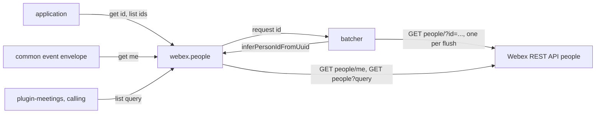
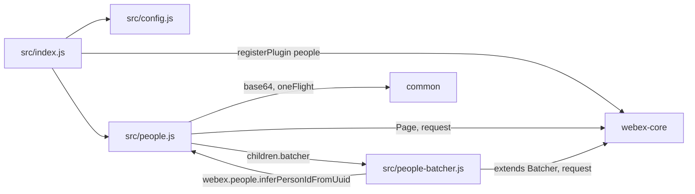
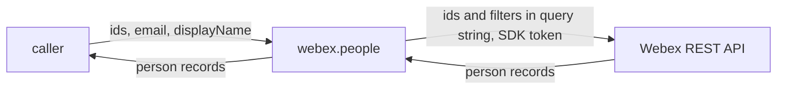

<!-- sdd-generated-metadata
doc_kind: standing-doc
generated_from: architecture@0.3.0
generated_by: claude-code
approved_by: rarajes2@cisco.com
updated_at: 2026-11-12T16:20:06Z
validation_status: pass-with-warnings
-->

# @webex/plugin-people architecture

Canonical architecture for this package. Flow behavior lives in the
[People plugin specification](../src/docs/README.md). This page owns package boundaries, the plugin
registration, the contract index, and how the package meets the rest of the SDK.

Related context: [specification registry](specs/README.md) ·
[package agent instructions](../AGENTS.md)

## Applicability

| Condition ID                         | Status     | Evidence or reason | Owned section |
| ------------------------------------ | ---------- | ------------------ | ------------- |
| `repo.owns_datastore`                | N/A        | No database, file store, or migration in `src/people.js` | Repository data and schema |
| `repo.holds_client_state`            | N/A        | `src/people.js` keeps no cache or session property; pending lookups belong to the webex-core Batcher | Client state model |
| `repo.components_interact`           | Applicable | `src/people.js` mounts the batcher child, and `src/people-batcher.js` calls back into the plugin for id inference | Dependency and interaction topology |
| `repo.domain_data_across_components` | Applicable | Person records pass from the Webex REST API through `src/people-batcher.js` to callers in other packages | Object and data ownership |
| `repo.caches_data`                   | N/A        | Nothing is kept after a call settles; `src/people.js` uses oneFlight without caching | Caching catalog |
| `repo.observability_convention`      | N/A        | No log line, metric, or trace in `src/people.js` or `src/people-batcher.js` | Observability patterns |
| `repo.deploys_to_infra`              | N/A        | Library published to npm (`package.json`). No service runtime | Runtime and infrastructure |
| `repo.shared_base_libs`              | Applicable | Extends WebexPlugin and Batcher and uses the legacy build, lint, and test stack (`babel.config.js`, `jest.config.js`, `.eslintrc.js`) | Shared and base libraries |
| `repo.is_monorepo`                   | N/A        | This SDD root is one package. The workspace around it is out of scope | Package map and inter-package dependencies |
| `repo.multi_platform`                | N/A        | `src/people.js` has no platform branch; `process` declares {browser: true} and is not imported | Platform matrix |
| `repo.published_package`             | Applicable | `package.json` name is @webex/plugin-people and deploy:npm publishes it | Release and versioning |
| `repo.embedded_in_host`              | N/A        | No host theme or embed API in `src/people.js` | Host integration and theming |
| `repo.exposes_commands_or_artifacts` | Applicable | build:src in `package.json` writes dist | Commands and generated artifacts |
| `repo.cross_repo_deps_material`      | Applicable | Behavior depends on the Webex REST API people resource (`src/people.js`, `src/people-batcher.js`) | Cross-repository topology |
| `repo.security_arch_warranted`       | Applicable | Person ids, emails, and display names go into request query strings, and person records hold personal data (`src/people.js`) | Security architecture |

## Design overview

`@webex/plugin-people` is a published JavaScript library with one module. Importing it registers
`People` as the public plugin `people`, reached as `webex.people`. The `webex` and `webex-node` bundles
and `@webex/recipe-private-web-client` import it to register it, and three workspace packages call it:
`@webex/common` for the current user, and `@webex/plugin-meetings` and `@webex/calling` for filtered
lists.

A person is a Webex user record served by the `people` resource of the Webex REST API, which the SDK
reaches as catalog service `hydra`. The plugin answers "person for this id" through a batcher that sends
one request for every id asked in a short window, "the current user" through a direct request shared by
concurrent callers, and "persons matching this filter" through a paged query. Ids are normalized
locally: a uuid is turned into the base64url hydra id with no request.

The package serves no routes, caches nothing, and persists nothing.

## Resource inventory and responsibilities

| Resource | Kind | Responsibility | Owner | Source | Detailed specification |
| -------- | ---- | -------------- | ----- | ------ | ---------------------- |
| People plugin | package (one module) | Registration; person lookup by id with batching; current user; filtered lists | @webex/web-client, @webex/web-sdk | src | [`src/docs/README.md`](../src/docs/README.md) |

## Interaction and execution flows

Representative end-to-end flow: an application renders several persons by id while an SDK package
fetches the current user.

| From | To | Interaction or transport | Purpose | Failure or compatibility behavior |
| ---- | -- | ------------------------ | ------- | --------------------------------- |
| Application or SDK package | `webex.people` | In-process calls | Person records | Rejections propagate |
| `People` | `PersonUUIDRequestBatcher` | `children` map; `batcher.request` | Batched lookup by id | See the module specification's failure modes |
| `PersonUUIDRequestBatcher` | `People` | Call through `webex.people` | Id normalization | Requires the plugin to be mounted as `people` |
| `People`, `PersonUUIDRequestBatcher` | Webex REST API | HTTPS through `webex.request` | Lookup by ids, current user, filtered list | No retry here |

## Dependency topology

| Dependency | Type | Used by | Purpose | Version, failure, or fallback policy |
| ---------- | ---- | ------- | ------- | ------------------------------------ |
| `@webex/webex-core` | Internal | `src/index.js`, `src/people.js`, `src/people-batcher.js` | Registration, plugin base, `Batcher`, `Page`, `webex.request` | `workspace:*` in `package.json` |
| `@webex/common` | Internal | `src/people.js` | `base64`, `oneFlight` | `workspace:*` |
| `@webex/internal-plugin-mercury` | Internal | No file under `src/`; `test/integration/spec/people.js` only | Registered by the integration spec | `workspace:*`; declared in `dependencies`, not `devDependencies` |
| Webex REST API people resource | External service | `src/people.js`, `src/people-batcher.js` | Person records | Resolved through the service catalog as `hydra` |

No import cycle exists: neither `@webex/webex-core` nor `@webex/common` imports this package.
`@webex/common` calls `webex.people.get('me')` at run time without importing the package.

## Public and consumer surfaces

| Surface | Type | Owner | Consumers | Compatibility policy | Source |
| ------- | ---- | ----- | --------- | -------------------- | ------ |
| `people-public-sdk` — package @webex/plugin-people, `webex.people` with `get`, `list`, and the config | SDK, published to npm, public | People plugin | `webex`, `webex-node`, `@webex/recipe-private-web-client` (registration); `@webex/common`, `@webex/plugin-meetings`, `@webex/calling` (calls); applications | No versioning or deprecation rule is declared in the package | `package.json`, `src/index.js`, `src/people.js`, `src/config.js` |

The lookup requests are a protocol this package speaks with the Webex REST API, described under
*Protocol and wire format* in the
[module specification](../src/docs/README.md#protocol-and-wire-format). The other contracts this
package requires are registered in `.sdd/manifest.json` `contract_catalog`.

## Cross-cutting architecture

### Security

- Trust boundaries and identity flow: see [Security architecture](#security-architecture).
- Sensitive surfaces and data classes: person ids, emails, display names, and the person records
  returned.
- Encryption and secret boundaries: see [Security architecture](#security-architecture).

### Observability and operations

- Logging and correlation: the package logs nothing. On a failed batch the webex-core `Batcher` logs one
  error line with the request error. Request tracking comes from the webex-core interceptors.
- Metrics, traces, and audit signals: none.
- Ownership and operational entry points: `.github/CODEOWNERS` at the workspace root assigns
  `packages/@webex/plugin-people` to `@webex/web-client` and `@webex/web-sdk`. No dashboards or
  runbooks are recorded in this package.

### Quality attributes

- Compatibility: callers rely on the registered name `people`, `get('me')`, the person object fields,
  and `list(query).items`.
- Efficiency: lookups by id from all callers in a flush window become one request of up to 10 ids
  (`INV-001` in the module specification).
- Test confidence: 5 unit cases cover the `get` guard, the fingerprint, one request, and response
  dispatch; registration, `get('me')`, `list`, batching, and the HTTP error path have no unit case, and
  the integration spec is not run by any script. No coverage threshold is enforced.

## Dependency and interaction topology

| From | To | Kind | Purpose | Ordering or failure boundary |
| ---- | -- | ---- | ------- | ---------------------------- |
| `src/index.js` | webex-core | Call at import | Register `people` | First registration wins |
| `src/people.js` | `src/people-batcher.js` | `children` map | Mount `batcher` | Created with each `People` instance |
| `src/people-batcher.js` | `src/people.js` | Call through `webex.people` | Fingerprint ids | Fails if the plugin is mounted under another name |
| `src/people.js` | common | Import | `base64`, `oneFlight` | Decode errors are caught |

## Object and data ownership

| Object or state | System of record | May write | May read | Movement or lifecycle |
| --------------- | ---------------- | --------- | -------- | --------------------- |
| Person record (`id`, `emails`, `displayName`, `created`, and more) | Webex REST API | Not this package | Any caller, through `get` and `list` | Fetched per call; never kept here |
| Hydra person id | Webex REST API; computed locally from a uuid by `inferPersonIdFromUuid` | Not this package | The batcher and callers | Derived per call |
| Pending lookups | webex-core `Batcher` | `batcher.request` | `handleHttpSuccess` | Dropped when each lookup settles |

## Shared and base libraries

| Library | Inherited responsibility | Consumers | Version floor | Compatibility rule |
| ------- | ------------------------ | --------- | ------------- | ------------------ |
| `@webex/webex-core` `WebexPlugin` | `webex`, `children`, `config`, `logger`, `request` | `People` | `workspace:*` | Keep the registered name `people` and the namespace `People` |
| `@webex/webex-core` `Batcher` | Fingerprint de-duplication, capped debounce, deferred bookkeeping, failure fan-out | `PersonUUIDRequestBatcher` | `workspace:*` | The `people` config must keep the three batcher timing keys |
| `@webex/babel-config-legacy`, `@webex/eslint-config-legacy`, `@webex/jest-config-legacy`, `@webex/legacy-tools` | Build, lint, and test stack through one-line config files | Package tooling | `workspace:*` | Do not fork the config locally |

## Release and versioning

| Artifact | Publish target | Versioning rule | Deprecation window | Changelog or migration obligation |
| -------- | -------------- | --------------- | ------------------ | --------------------------------- |
| @webex/plugin-people | npm through `deploy:npm` | None declared in the package | None declared | None declared in the package; the workspace owns changelog generation |

## Commands and generated artifacts

| Command or artifact | Owner | Inputs | Output or side effect | Compatibility boundary |
| ------------------- | ----- | ------ | --------------------- | ---------------------- |
| `yarn build:src` | Package scripts | `src` | Writes `dist/` (JavaScript and source maps) through `webex-legacy-tools` | `dist/` is generated and never edited by hand |
| `yarn build` | Package scripts | `src` | Runs `build:src` | Same output |
| `yarn test:unit` | Package scripts | `test/unit/spec`, `dist/` | Jest run | Run `build:src` first |
| `yarn test:style` | Package scripts | `src` | ESLint run | The shared config ignores `docs/**` and `*.md` |

## Cross-repository topology

| Repository or external system | Relationship | Exchanged contract or artifact | Owner | Sequencing constraint |
| ----------------------------- | ------------- | ------------------------------ | ----- | --------------------- |
| `@webex/webex-core` (workspace sibling; module spec consulted) | Consumes | `registerPlugin`, `WebexPlugin`, `Batcher`, `Page`, `request` | @webex/web-sdk | Registered before the first instance |
| `@webex/common` (workspace sibling; module spec consulted) | Consumes | `base64`, `oneFlight` | @webex/web-sdk | None |
| `webex`, `webex-node`, `@webex/recipe-private-web-client` (workspace siblings) | Consumed by | The plugin registration | @webex/web-sdk | None |
| `@webex/common`, `@webex/plugin-meetings`, `@webex/calling` (workspace siblings) | Consumed by | `get('me')`; `list(query).items` | @webex/web-sdk and the calling and meetings owners | `people` registered on the instance |
| Webex REST API people resource | Consumes | Lookup by ids, current user, filtered list | Not recorded in this repository | None |

## Security architecture

- This package holds no credential and no key. Every request carries the SDK authorization added by
  webex-core.
- Person ids, emails, and display names travel in query strings, so they appear in request URLs. The
  package itself logs none of them; the one log line on its failure path is described under
  [Observability and operations](#observability-and-operations).
- What a caller may see is decided by the service for the authorized user; the package passes records
  through unchanged and keeps no copy.

## Domain language

| Term | Repository-specific meaning | Authoritative source |
| ---- | --------------------------- | -------------------- |
| Hydra | The Webex REST API, reached as catalog service `hydra` | `src/people.js` |
| Hydra person id | base64url of `ciscospark://us/PEOPLE/<uuid>`; the `id` of a person record | `src/people.js` |
| `me` | The current user, fetched from `people/me` instead of by id | `src/people.js` |
| Flush | One batcher send of every id queued since the last one, up to `batcherMaxCalls` | `src/people-batcher.js` |
| `showAllTypes` | Config flag sent with every batched lookup so Hydra returns non-person types too | `src/config.js` |
| `notFoundIds` | Response list of requested ids Hydra did not find | `src/people-batcher.js` |

## References and maintenance

- Decisions: [adr/](adr/index.md)
- Instantiated specifications and routing: [specs/README.md](specs/README.md)
- Repository rules and patterns: [package agent instructions](../AGENTS.md)
- Update this document in the same change that alters package boundaries, resource ownership,
  cross-resource interaction, or cross-cutting architecture.
