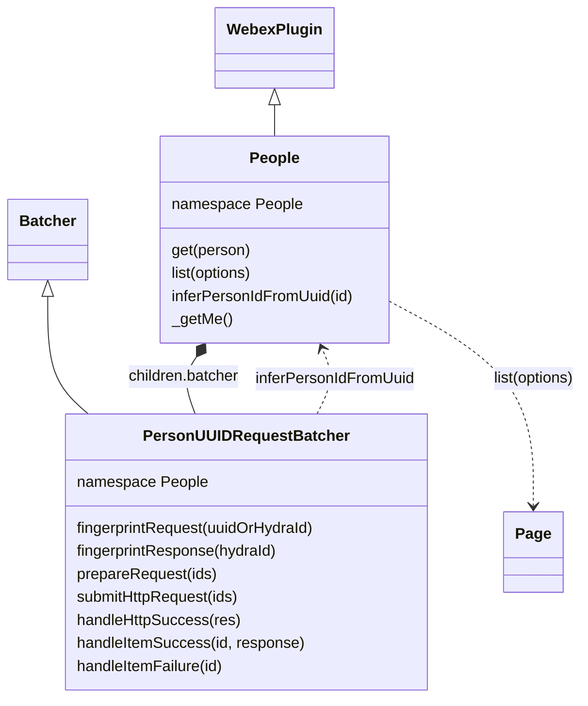

<!-- sdd-generated-metadata
doc_kind: module-spec
generated_from: module-spec@0.3.0
generated_by: claude-code
approved_by: rarajes2@cisco.com
updated_at: 2026-11-12T16:20:06Z
validation_status: pass-with-warnings
-->

# People plugin

This source-local document at `src/docs/README.md` owns the stable specification for **the People
plugin**: the public plugin `webex.people` and its `batcher` child. It reads person records from the
`people` resource of the Webex REST API (catalog service `hydra`): one person by id, the current user
(`'me'`), many persons by id, or a filtered, paged list. Lookups by id from all callers in a short
window go out as one request, and person ids are normalized locally so a uuid and its hydra id are the
same lookup. Ground every claim in package evidence and link to the
[package architecture](../../docs/architecture.md) instead of repeating broader facts. No service
specification exists because this package is a library.

Related context: [documentation index](../../docs/index.md) ·
[package agent instructions](../../AGENTS.md)

## Metadata

| Field             | Value |
| ----------------- | ----- |
| Owner             | @webex/web-client, @webex/web-sdk |
| Source path       | `src` |
| Resource kind     | package |
| Status            | Draft |
| Last verified     | 2026-11-12 at `a83f8c3185` |
| Module id         | `plugin-people` |
| Parent spec       | — |
| Doc kind          | Module spec |
| Coverage score    | 100% assessed 2026-11-12 by the generator — 13 of 13 mandatory fields PRESENT, critical 7 of 7; `test:unit` runs 5 passing cases in `test/unit/spec/people.js` and `test/unit/spec/people-batcher.js`, which cover the `get` guard, the request fingerprint, the `submitHttpRequest` options, and `handleHttpSuccess` dispatch; no unit case covers registration, the config defaults, `get('me')`, `list`, `inferPersonIdFromUuid` itself, batching, or the HTTP error path |
| Validation status | Pass with warnings — independently validated 2026-11-12; one Important coverage follow-up remains while the module stays Partial |

## Applicability

| Condition ID                         | Status     | Evidence or reason | Owned section |
| ------------------------------------ | ---------- | ------------------ | ------------- |
| `module.has_tiers`                   | N/A        | No tier policy exists in `package.json` or `src/people.js` | Tier |
| `module.has_ui`                      | N/A        | `src/people.js` returns person records; it renders nothing | UI use-case flow |
| `module.crosses_service_boundaries`  | Applicable | `src/people.js` and `src/people-batcher.js` call the Webex REST API people resource through webex.request | Cross-boundary use-case flow |
| `module.holds_client_state`          | N/A        | `src/people.js` keeps no cache or session property; pending lookups and in-flight calls are held by the webex-core Batcher and the common oneFlight decorator | Client state model |
| `module.enforces_domain_rules`       | Applicable | The person guard and id reduction in `src/people.js`; the uuid-to-hydra-id rule in inferPersonIdFromUuid | Business rules and invariants |
| `module.is_concurrent_async`         | Applicable | `src/people-batcher.js` debounces lookups into batches; `src/people.js` de-duplicates concurrent me calls with oneFlight | Concurrency and reactive flow |
| `module.owns_persistence`            | N/A        | Nothing is stored; `src/people.js` resolves what the service returns | Data, schema, and migration discipline |
| `module.stateful_transitions`        | N/A        | No entity moves through states in `src/people.js` or `src/people-batcher.js` | State machine |
| `module.exposes_wire_protocol`       | Applicable | The people/?id= request and the items and notFoundIds response read in `src/people-batcher.js`; the hydra id format built in `src/people.js` | Protocol and wire format |
| `module.ui_multi_screen`             | N/A        | No UI | UI flow |
| `module.large_data_model`            | N/A        | One person shape, typed only by a JSDoc typedef in `src/people.js`; covered under Protocol and wire format | Data model |
| `module.returns_caller_errors`       | Applicable | Guard, lookup, not-found, and request failures reject from `src/people.js` and `src/people-batcher.js` | Caller-visible failure modes |
| `module.module_specific_conventions` | Applicable | The hydra id format and the comma-joined id list in `src/people.js` and `src/people-batcher.js` | Module-specific rules |
| `module.published_package`           | Applicable | `package.json` names the package @webex/plugin-people and defines deploy:npm | Export stability |
| `module.embedded_in_host`            | N/A        | No host theme or embed API | Host integration and theming |
| `module.has_design_tradeoff`         | Applicable | Batched id lookups in `src/people-batcher.js` and the local id inference in `src/people.js` | Key design trade-off |
| `module.has_submodules`              | N/A        | The src directory has no child module | Sub-modules |

## Evidence register

| Evidence | What it establishes |
| -------- | ------------------- |
| `src/index.js` | `registerPlugin('people', People, {config})` at import time; re-exports only the default `People` |
| `src/people.js` | `People` extends `WebexPlugin` in namespace `People` with child `batcher`; `get`, `list`, `inferPersonIdFromUuid`, and the `oneFlight`-decorated `_getMe`; the `PersonObject` typedef; its JSDoc and one code comment are the only recorded rationale |
| `src/people-batcher.js` | `PersonUUIDRequestBatcher` extends the webex-core `Batcher` in namespace `People`: fingerprints, the comma-joined request, the `people/?id=` call with `showAllTypes`, and item success and not-found handling |
| `src/config.js` | The default `people` config: batcher timings and `showAllTypes`, whose comment states its purpose and marks it private |
| `package.json` | Name, `main` (`dist/index.js`), `devMain` (`src/index.js`), `engines` (`node >=18`), dependencies, and scripts; `test:unit` and `test:browser:broken` exist, `test:integration` and `test:browser` do not |
| `test/unit/spec/people.js` | 1 case: `get()` with no argument rejects with the guard message |
| `test/unit/spec/people-batcher.js` | 4 cases: the request fingerprint, the `submitHttpRequest` options for one id, and `handleHttpSuccess` dispatch to stubbed item handlers with and without `notFoundIds` |
| `test/integration/spec/people.js` | 13 live-service cases (1 skipped) for `get` by uuid, hydra id, and `'me'`, `list` by ids, email, and name, `showAllTypes`, batching into one or three requests, and `inferPersonIdFromUuid`; no package script runs it (see Verification) |
| `README.md` | Retained npm page; context only. Its one example, `webex.people.get(id)`, matches the code; see `docs/adr/0001-retain-product-readme.md` |
| Sibling package webex-core, file src/docs/README.md | Module spec consulted, agrees with code. `registerPlugin` keeps the first registration of a name (MOD-013) and merges `config` into the defaults (MOD-008); `WebexPlugin.config` is the lowercased namespace key (MOD-044); `Batcher` de-duplicates by fingerprint (MOD-050), flushes on a capped debounce from three config keys its subclass must provide (MOD-051), and on a failed flush without a request body rejects every queued deferred (MOD-052); `Page` wraps a list response with Link-header navigation (MOD-054). The batcher code was read to confirm that the queue holds items as callers passed them |
| Sibling package common, file src/docs/README.md | Module spec consulted, agrees with code. `oneFlight` shares the in-flight promise and evicts it on settle (MOD-002); hydra ids for `PEOPLE` always use cluster `us` (MOD-006). The spec is silent on decode errors, so the base64 code was the referee: `decode` is base64url over `urlsafe-base64` |
| Sibling package internal-plugin-mercury, file src/docs/README.md | Module spec consulted: importing the package registers internal plugin `mercury` (MOD-001). This package's source never imports it; only the integration spec does |
| Observation, no stated WHY | Behavior the code shows without stating a reason is recorded once, under Pitfalls and constraints or Caller-visible failure modes |

## Purpose and boundary

- Responsibility: give applications and SDK packages Webex person records by id, for the current user,
  or by a filter, with as few REST calls as possible for bursts of id lookups.
- In scope: registration of `people` and its config; `get`, `list`, `inferPersonIdFromUuid`, and the
  underscore-prefixed `_getMe`; the `batcher` child (`PersonUUIDRequestBatcher`) and its request and
  response handling.
- Out of scope: batching mechanics, the request pipeline, authorization, service-catalog resolution,
  and paging (`@webex/webex-core`); base64url and the `oneFlight` decorator (`@webex/common`); creating,
  updating, or deleting persons; caching person records; what Hydra stores or returns.
- Consumers: in this repository `webex` (`src/webex.js`, `src/meetings.js`), `webex-node`, and
  `@webex/recipe-private-web-client` import the package to register it. `@webex/common` calls
  `get('me')` when building event envelopes, `@webex/plugin-meetings` calls `list({email})` or
  `list({id})` in meeting-info `utilv2` and reads `items[0]`, and `@webex/calling` calls
  `list({displayName})` to resolve a caller id. Applications reach the plugin as `webex.people`.

## Structure and key files

| Path | Responsibility |
| ---- | -------------- |
| `src/index.js` | Registers public plugin `people` with its config and re-exports the class as default |
| `src/people.js` | `People`: `get`, `list`, `inferPersonIdFromUuid`, `_getMe`, and the `batcher` child |
| `src/people-batcher.js` | `PersonUUIDRequestBatcher`: groups id lookups into one `GET people/?id=` and maps the response back to each caller |
| `src/config.js` | The `people` config defaults |
| `package.json` | Package name, entry points, scripts, and dependencies |
| `babel.config.js`, `jest.config.js` | Re-exports of the legacy Babel and Jest configurations |
| `.eslintrc.js` | Sets `root: true` and extends `@webex/eslint-config-legacy` |
| `process` | Package-root file exporting `{browser: true}`; not imported by `src/` |
| `src/docs/README.md` | This module specification; ignored by the build and by lint |
| `test/unit/spec/people.js`, `test/unit/spec/people-batcher.js` | Unit cases run by `test:unit` |
| `test/integration/spec/people.js` | Live-service cases; only `test:browser:broken` would run them |
| dist/ (generated) | Build output of `build:src`; ignored by Git and never edited by hand |

## Public surface

| Surface | Consumer | Compatibility commitment | Source |
| ------- | -------- | ------------------------ | ------ |
| Import side effect: public plugin `people` with the `people` config | `webex`, `webex-node`, `@webex/recipe-private-web-client` | First registration of the name wins; reached as `webex.people` | `src/index.js`, `src/config.js` |
| `get(person)` | Applications; `@webex/common` (`get('me')`) | Resolves one person object; `'me'` resolves the current user | `src/people.js` |
| `list(options)` | Applications; `@webex/plugin-meetings`, `@webex/calling` | An array of ids resolves an array of persons; a query object resolves a webex-core `Page` whose `items` consumers read | `src/people.js` |
| `inferPersonIdFromUuid(id)` | The batcher; the integration spec | Marked `@private` in its JSDoc; reachable on the instance | `src/people.js` |
| `batcher` child | The unit specs; the integration spec spies on it | Reachable on the instance; not documented for callers | `src/people.js`, `src/people-batcher.js` |
| `_getMe()` | `get('me')` | Underscore-prefixed and marked `@private`; not a supported entry | `src/people.js` |
| Default export `People` | The unit specs; hosts that mount the class themselves | The entry exports nothing else; `config` is not exported | `src/index.js` |

Contract ID `people-public-sdk` is indexed in the
[package architecture](../../docs/architecture.md#public-and-consumer-surfaces) and registered in
`.sdd/manifest.json`. Export stability is under [Export stability](#export-stability).

## Dependencies

| Dependency | Why it is required | Failure behavior |
| ---------- | ------------------ | ---------------- |
| `@webex/webex-core` plugin host (module spec consulted) | `registerPlugin`, `WebexPlugin` (`webex`, `children`, namespaced config, `logger`, `request`), and `webex.request` | A request rejection rejects the method |
| `@webex/webex-core` `Batcher` (module spec and code consulted) | Base of `PersonUUIDRequestBatcher`: fingerprint de-duplication, capped debounce, deferred bookkeeping, and failure fan-out | See Caller-visible failure modes |
| `@webex/webex-core` `Page` (module spec consulted) | Wraps the `list(options)` response with `items` and Link-header navigation | `next` and `previous` reject with the request error |
| `@webex/webex-core` services (resolved through `service: 'hydra'`) | Maps `service: 'hydra'` with a resource to the Webex REST API URL | A missing catalog entry rejects the request |
| `@webex/common` (module spec consulted; code consulted for `base64`) | `base64.encode` and `base64.decode` for hydra ids; `oneFlight` for `_getMe` | Decode errors are caught in `inferPersonIdFromUuid` |
| `@webex/internal-plugin-mercury` (module spec consulted) | Declared in `package.json` `dependencies`, but no file under `src/` imports it; only `test/integration/spec/people.js` imports it for registration | Not applicable to `src/` |
| Webex REST API people resource (external) | Person lookup by ids, by query, and for the current user | Errors propagate |

## Requirements

| ID | WHAT | WHY | Source evidence | Test or example evidence | Assumptions or gaps | Confidence |
| -- | ---- | --- | --------------- | ------------------------ | ------------------- | ---------- |
| `MOD-001` | Importing the package registers `People` as public plugin `people` with `config` from `src/config.js`, so the plugin is `webex.people`. The entry re-exports only the default `People`. | Applications and SDK packages reach person lookups as `webex.people` (inferred from the consumers' calls). | `src/index.js` | The unit specs import the package by name but mount the class through a MockWebex children map, so registration is not asserted; `test/integration/spec/people.js` relies on it but is not run | WHY inferred | Weak |
| `MOD-002` | The default config is `people: {batcherWait: 100, batcherMaxCalls: 10, batcherMaxWait: 1500, showAllTypes: false}`. `People` and `PersonUUIDRequestBatcher` both use namespace `People`, so both read `config.people`. | The config comment: `showAllTypes` is an optional flag that makes Hydra send every type field even if the type is not "person" (for example SX10 or webhook_integration), marked private. The webex-core `Batcher` takes its timings from the subclass namespace (webex-core MOD-051). | `src/config.js`, `src/people.js`, `src/people-batcher.js` | `test/unit/spec/people-batcher.js` sets `showAllTypes: false` itself; `test/integration/spec/people.js` checks the false default but is not run | The batcher timings carry no comment | Present |
| `MOD-003` | `People` declares child `batcher: PersonUUIDRequestBatcher`, created with each `People` instance. | Each webex instance gets its own batch queue (inferred from the per-instance child). | `src/people.js` | `test/unit/spec/people-batcher.js` reaches `webex.people.batcher` | WHY inferred | Present |
| `MOD-004` | `get(person)` rejects with `Error('A person with an id is required')` when `person` is falsy. When `person` is the string `'me'` it returns `_getMe()` (`MOD-005`). Otherwise it takes `person.personId`, else `person.id`, else `person` itself, and returns `batcher.request` of that value. | The JSDoc: returns a single person by id and accepts a person object, a uuid, or a string. | `src/people.js` | `test/unit/spec/people.js` guard case; `test/integration/spec/people.js` covers uuid, hydra id, and `'me'` but is not run | — | Present |
| `MOD-005` | `_getMe()` sends `GET people/me` to service `hydra` through `webex.request` and resolves the response body. It is decorated with bare `oneFlight`, so concurrent calls share one request and nothing is kept after it settles. | The JSDoc: fetches the current user from the `/people/me` endpoint. `oneFlight` collapses concurrent calls (common MOD-002). | `src/people.js` | No unit case; `test/integration/spec/people.js` `'me'` cases are not run | — | Present |
| `MOD-006` | `list(options)` with an array calls `batcher.request` for each element and resolves `Promise.all` of the results: a plain array of persons in input order. With anything else it sends `GET people` to service `hydra` with `qs: options` through `this.request` and resolves `new Page(res, webex)`. | The JSDoc: returns a list of people for an array of uuids, or for options `email` and `displayName`, each matching people whose value contains the string. | `src/people.js` | No unit case; `test/integration/spec/people.js` list-by-ids and list-by-email cases are not run, and list-by-name is skipped | The JSDoc examples disagree with the array result; see Pitfalls | Present |
| `MOD-007` | `inferPersonIdFromUuid(id)` returns `id` unchanged when `base64.decode(id)` contains `ciscospark://`, and swallows any decode error. Otherwise it returns the base64url encoding of `ciscospark://us/PEOPLE/<id>`. It makes no request. | The JSDoc: converts a uuid to a hydra id without a network dip. The code comment: `base64.validate` seems to return true for uuids, so a different check is needed. Cluster `us` matches common MOD-006. | `src/people.js` | `test/unit/spec/people-batcher.js` compares the fingerprint with this function's own output; `test/integration/spec/people.js` checks it against a fetched id but is not run | No unit case pins the encoded value | Present |
| `MOD-008` | The batcher fingerprints a request item as `inferPersonIdFromUuid(item)` and a response item (a hydra id) as itself, so a uuid and its hydra id share one pending lookup (webex-core MOD-050). | Hydra responses carry hydra ids, so request keys must be normalized to match them (inferred from the two fingerprints). | `src/people-batcher.js` | `test/unit/spec/people-batcher.js` fingerprint case | The case is tautological; see Pitfalls | Present |
| `MOD-009` | `prepareRequest` joins the queued items, as callers passed them, with commas, and `submitHttpRequest` sends `GET people/?id=<joined>&showAllTypes=<config.showAllTypes>` to service `hydra` through `webex.request`. A flush carries at most `batcherMaxCalls` (10) items (webex-core MOD-051). | One request for every id in a flush (inferred from the join). | `src/people-batcher.js` | `test/unit/spec/people-batcher.js` request case for one id; `test/integration/spec/people.js` batching cases are not run | `prepareRequest` has no unit case | Present |
| `MOD-010` | `handleHttpSuccess(res)` resolves the pending lookup of each `res.body.items` entry, keyed by the entry's `id`, with the entry. When `res.body.notFoundIds` is present it calls `handleItemFailure` for each id, which rejects that lookup with the id string; those calls are not part of the promise `handleHttpSuccess` returns. | Every id named in the response settles its caller (inferred). | `src/people-batcher.js` | `test/unit/spec/people-batcher.js` item success and item failure cases, with both handlers stubbed | The discarded `concat` result; see Caller-visible failure modes | Present |
| `MOD-011` | The batcher does not override `handleHttpError`. When the request fails with a `WebexHttpError`, the `GET` has no request body, so the base handler logs `http error handler called without a WebexHttpError object` with the error and rejects; any other error skips the handler. Either way the base flush rejects every queued lookup with the original error (webex-core MOD-052). | Every caller in a failed batch gets a rejection (inferred from the base-class behavior). | `src/people-batcher.js` | No case | Behavior comes from the webex-core base class; the log text is misleading for a real WebexHttpError | Weak |

## Design overview

`People` is a `WebexPlugin` with two read paths. Lookups by id go through the `batcher` child, which
collects ids from every caller for up to 1.5 seconds (100 ms after the last one, or at 10 ids) and sends
them as one `GET people/?id=a,b,c`. Before queuing, each id is fingerprinted as a hydra id, computed
locally from a uuid, so a uuid and the hydra id of the same person share one lookup and the response,
which names hydra ids, can be matched back.

The other path is a direct request. `get('me')` calls `people/me` and shares one request among
concurrent callers, and `list` with a query object calls `people` with that object as the query string
and wraps the answer in a webex-core `Page`. Nothing is cached; every call that is not already in
flight reaches the service.

## Data flow and sequence coverage

Call style: in-process method calls on `webex.people`; outbound HTTPS through `webex.request` to
catalog service `hydra`. Two operation groups differ in actors and outcome; the batched one has a
diagram, and the direct one is a single request.

| Operation group | Entry and outcome | Diagram or evidence | Failure and recovery coverage |
| --------------- | ----------------- | ------------------- | ----------------------------- |
| Look up persons by id | `get(id)` or `list([ids])`; ids are normalized, batched, sent as one request, and matched back by hydra id | Diagram 1; `src/people.js`, `src/people-batcher.js` | Guard rejects first; an HTTP error rejects every caller in the flush; a not-found id rejects with that id |
| Direct request | `get('me')` resolves the current person; `list({...})` resolves a `Page` | `src/people.js` | The request error rejects; nothing is retried |

Diagram 1 — look up persons by id:

```mermaid
sequenceDiagram
  participant C as Callers
  participant P as People
  participant B as batcher
  participant H as Hydra people
  C->>P: get(uuid), get(hydraId), list([ids])
  P->>B: request(id) per id
  B->>B: fingerprint = inferPersonIdFromUuid(id)
  Note over B: same fingerprint shares one pending lookup
  B->>H: GET people/?id=id1,id2,...&showAllTypes=false (one per flush)
  H-->>B: {items: [person], notFoundIds}
  B-->>P: resolve each lookup by person.id; reject not-found ids
  P-->>C: person, or array of persons
```

## Class and component relationships



## Use cases and flows

| Use case | Actor or caller | Primary steps and outcome | Failure or boundary behavior | Evidence |
| -------- | --------------- | ------------------------- | ---------------------------- | -------- |
| `UC-001` | Application or SDK package needing one person | `get(uuidOrHydraIdOrPerson)` resolves the person record | Falsy argument rejects; not-found id rejects | `src/people.js`, `test/unit/spec/people.js` |
| `UC-002` | Event envelope builder in `@webex/common` | `get('me')` resolves the current user, which the caller stores itself | The request error rejects | `src/people.js` |
| `UC-003` | Application rendering many persons | Many `get` calls, or `list([ids])`, inside one flush window become one request | One not-found id rejects `list` as a whole | `src/people-batcher.js` |
| `UC-004` | `@webex/plugin-meetings`, `@webex/calling` | `list({email})`, `list({id})`, or `list({displayName})` resolves a `Page`; the caller reads `items[0]` | An empty result leaves `items` empty; the caller handles it | `src/people.js` |

### Cross-boundary use-case flow

| Boundary | Transport and ordering | Compatibility | Timeout, retry, and recovery |
| -------- | ---------------------- | ------------- | ---------------------------- |
| Webex REST API, lookup by ids (`UC-001`, `UC-003`) | HTTPS `GET` through `webex.request`, catalog service `hydra`, one per batcher flush | Request and response under Protocol and wire format | No retry or timeout in this module; webex-core interceptors apply |
| Webex REST API, current user (`UC-002`) | HTTPS `GET people/me`, one per concurrent group | Response is one person | No retry; the next call after a failure sends a new request |
| Webex REST API, query (`UC-004`) | HTTPS `GET people` with the caller's query object | Paged response read by `Page` (webex-core MOD-054) | No retry |

## Business rules and invariants

| ID | Invariant | WHY | Enforcement source | Test evidence |
| -- | --------- | --- | ------------------ | ------------- |
| `INV-001` | Every lookup by id other than `'me'` goes through the batcher, so concurrent lookups produce one request per flush of up to `batcherMaxCalls` ids, and a repeated id in flight shares one lookup. | Fewer REST calls for bursts of lookups; the integration spec titles say get requests are batched into one. | `src/people.js`, `src/people-batcher.js`, `src/config.js` | Only `test/integration/spec/people.js`, which is not run, asserts one request for six gets and three requests at `batcherMaxCalls: 2` |
| `INV-002` | A uuid and the hydra id `base64url(ciscospark://us/PEOPLE/<uuid>)` are the same lookup key, and the key is always computed with cluster `us`. | Responses carry hydra ids; `PEOPLE` ids always use cluster `us` (common MOD-006). | `src/people.js`, `src/people-batcher.js` | `test/unit/spec/people-batcher.js` fingerprint case (tautological) |
| `INV-003` | `get('me')` never goes through the batcher, concurrent calls share one request, and no result is kept, so each later call requests again. | `people/me` is not an id lookup (inferred); `oneFlight` evicts on settle (common MOD-002). | `src/people.js` | None found in the unit specs |
| `INV-004` | A falsy `person` rejects before any request or queueing. | The JSDoc requires a person with an id. | `src/people.js` | `test/unit/spec/people.js` guard case |

## Concurrency and reactive flow

- Execution model: one JavaScript event loop; every public method returns a promise.
  `inferPersonIdFromUuid` is synchronous.
- Ordering guarantees: `list([ids])` resolves persons in the order of its input, whatever order the
  response lists them in, because each id has its own pending lookup.
- Parallel work: id lookups queue in the batcher and flush after `batcherWait` (100 ms) of quiet, at
  most `batcherMaxWait` (1500 ms) after the first, or at `batcherMaxCalls` (10) ids (webex-core
  MOD-051); more ids flush in further requests.
- Idempotency and retry: every call is a read and safe to repeat; nothing is retried here.
- Fire-and-forget work: the `notFoundIds` rejections inside `handleHttpSuccess` (`MOD-010`).
- Shared-state protection: the batcher's fingerprint map and `oneFlight` serialize duplicate work; both
  are touched only from promise callbacks on the one event loop.

## Protocol and wire format

| Message or frame | Version | Producer or serializer | Consumer or parser | Compatibility and ordering rule |
| ---------------- | ------- | ---------------------- | ------------------ | ------------------------------- |
| `GET <hydra>/people/?id=<id1,id2,...>&showAllTypes=<true or false>` | Unversioned path under the catalog URL | `submitHttpRequest` (ids from `prepareRequest`) | Webex REST API | Ids are the callers' raw values, uuids or hydra ids, joined with commas and interpolated without URL encoding; at most `batcherMaxCalls` per request |
| Response body `{items: [person], notFoundIds?: [id]}` | Unversioned | Webex REST API | `handleHttpSuccess` | Each item is matched to its caller by `item.id`, a hydra id; each `notFoundIds` value is matched as given |
| `GET <hydra>/people?<options>` | Unversioned | `list(options)` through `this.request` | Webex REST API | Every key of `options` becomes a query parameter; the response is read by `Page` |
| `GET <hydra>/people/me` | Unversioned | `_getMe` | Webex REST API | The body is one person |
| Hydra person id | — | `inferPersonIdFromUuid` | Webex REST API and callers | base64url of `ciscospark://us/PEOPLE/<uuid>`; `@webex/calling` and `@webex/plugin-meetings` decode it to get the uuid |
| Person object | — | Webex REST API | Callers | The JSDoc typedef names `id`, `emails`, `displayName`, and `created`; consumers in this repository also read `orgId` |

## Caller-visible failure modes

| Condition | Signal or result | Caller behavior | Retry or recovery | Evidence |
| --------- | ---------------- | --------------- | ----------------- | -------- |
| `person` is missing or falsy | `get` rejects with `A person with an id is required` before any request | Pass an id, a person object, or `'me'` | Call again with it | `src/people.js`, `test/unit/spec/people.js` |
| The id is in `notFoundIds` | That lookup rejects with the id string, not an `Error` (`MOD-010`); `list([ids])` rejects as a whole | Treat a string rejection as not found | — | `src/people-batcher.js`, `src/people.js` |
| The response leaves a requested id out of both `items` and `notFoundIds` | That lookup never settles; the batcher has no timeout | Add a caller-side timeout if needed | — | `src/people-batcher.js` |
| A `notFoundIds` value does not equal the hydra-id fingerprint of a pending lookup | `handleItemFailure` rejects inside `handleHttpSuccess` with `Could not find pending request for received response`; the result of `concat` is discarded, so nothing observes that rejection, and the caller's lookup never settles | — | — | `src/people-batcher.js` |
| The batch request fails | Every caller in that flush rejects with the original request error; a `WebexHttpError` also produces a webex-core log line (`MOD-011`) | Handle the error; it is the webex-core error object | Call again | `src/people-batcher.js` |
| `get('me')` or `list(options)` fails | Rejects with the request error | Handle the error | Call again; `'me'` sends a new request | `src/people.js` |
| `get` gets an object with neither `personId` nor `id` | The object itself is queued: its fingerprint encodes `[object Object]` and the request carries `[object Object]` | Pass an id or an object that has one | — | `src/people.js` |

## Pitfalls and constraints

- The `list` JSDoc array example reads `people.items[0]`, but the array path resolves a plain array with
  no `items`. The JSDoc also documents a `showAllTypes` parameter that `list` does not take; the batcher
  reads `config.people.showAllTypes`, and the query-object path forwards whatever keys it is given.
- `PersonUUIDRequestBatcher.handleItemSuccess` names its first parameter `email`, but it receives a
  hydra id.
- `inferPersonIdFromUuid` is marked `@private`, but the batcher calls it on `this.webex.people`, so the
  batcher works only when the plugin is mounted as `people`.
- `test/unit/spec/people-batcher.js` compares the fingerprint with `inferPersonIdFromUuid`'s own output,
  so it would pass for any encoding.
- In `test/integration/spec/people.js`, the two `showAllTypes` cases pass the result of an `assert`
  call to `then`, so they assert before the request resolves, and the second one sets the shared
  `config.people.showAllTypes` to `true` without resetting it.
- `test:style` reports 3 warnings and no errors (missing JSDoc on `handleItemFailure`, `prepareRequest`,
  and `_getMe`), plus "File ignored" for this specification.

## Module-specific rules

- Do: keep `fingerprintRequest` and `fingerprintResponse` producing the same hydra id for the same
  person (`INV-002`); a mismatch leaves callers waiting forever.
- Do: route every lookup by id through the batcher so `INV-001` holds; do not call `webex.request` for
  `people/?id=` directly.
- Do: keep `ciscospark://us/PEOPLE/` as the id prefix; it matches `constructHydraId` in `@webex/common`.
- Do not: change what `list(options)` resolves for a query object; consumers read `items`.
- Do not: log person ids, emails, or display names; the package logs nothing today.

## Export stability

| Export or entry point | Consumer | Stability | Versioning and deprecation rule | Declaration or API report |
| --------------------- | -------- | --------- | ------------------------------- | ------------------------- |
| Import side effect: public plugin `people` and its config | `webex`, `webex-node`, `@webex/recipe-private-web-client` | Public | No rule is declared in the package | `src/index.js` |
| Default export `People` and its public methods `get` and `list` | Applications and SDK packages | Public | Same | `src/index.js`, `src/people.js` |

The build writes JavaScript only; `package.json` has no `types` entry, so no declarations or API
report are published.

## Key design trade-off

| Chosen trade-off | Preserved invariant or benefit | Cost or limitation | Decision evidence |
| ---------------- | ------------------------------ | ------------------ | ----------------- |
| Batch id lookups for all callers through the webex-core `Batcher` | One request per flush for many ids (`INV-001`) | Each lookup waits up to 1.5 seconds for its batch | `src/people-batcher.js`, `src/config.js` |
| Infer the hydra id from a uuid locally, with a fixed cluster | No request to normalize ids; uuid and hydra id share one lookup (`INV-002`) | A string that is neither a uuid nor a hydra id is encoded as one anyway | `src/people.js` JSDoc and code comment on inferPersonIdFromUuid |
| Fetch `'me'` directly with `oneFlight` and keep nothing | The current user is always fresh (`INV-003`) | Every non-concurrent call is a request; callers such as `@webex/common` cache it themselves | `src/people.js` |

## Verification

| Requirement or invariant | Test level | Positive evidence | Negative or boundary evidence | Gap |
| ------------------------ | ---------- | ----------------- | ----------------------------- | --- |
| `MOD-001`, `MOD-002` | None run | `test/integration/spec/people.js` (not run) | None found | Registration and the config defaults have no unit case |
| `MOD-003` | Unit (indirect) | `test/unit/spec/people-batcher.js` reaches the batcher | None found | — |
| `MOD-004`, `INV-004` | Unit | `test/integration/spec/people.js` (not run) | `test/unit/spec/people.js` guard case | The id reduction and the `'me'` branch have no unit case |
| `MOD-005`, `INV-003` | None run | `test/integration/spec/people.js` (not run) | None found | No unit case |
| `MOD-006` | None run | `test/integration/spec/people.js` (not run) | None found | Neither list path has a unit case |
| `MOD-007`, `MOD-008`, `INV-002` | Unit | `test/unit/spec/people-batcher.js` fingerprint case | None found | The encoded value is never pinned |
| `MOD-009`, `INV-001` | Unit (one id) | `test/unit/spec/people-batcher.js` request case | None found | Joining and batching are asserted only in the unrun integration spec |
| `MOD-010` | Unit | `test/unit/spec/people-batcher.js` item success case | `test/unit/spec/people-batcher.js` item failure case | The handlers are stubbed, so the rejection value and the discarded `concat` are not observed |
| `MOD-011` | None | None found | None found | Untested |

`yarn test:unit`, run from the package directory, passed 5 cases on 2026-11-12 under Node 22.14 after
`build:src`. The unit specs import `@webex/plugin-people` by name, so they test `dist/`; run `build:src`
first. No package script runs `test/integration/spec/people.js`: `package.json` has no
`test:integration`, and `test:browser:broken` reported 0 tests on 2026-11-12 because the karma bundle
failed to parse `isbot`, while still exiting 0. The aggregate `test` script exits 1 at the missing
`test:integration`. A module specification is complete only when its public surface, invariants,
failure modes, and test evidence agree with the implementation. Generator-side field measurement is
complete (100%, assessed 2026-11-12); independent validation passed with warnings on 2026-11-12. One
Important coverage follow-up remains, and the module stays Partial pending characterization and
coverage review.
