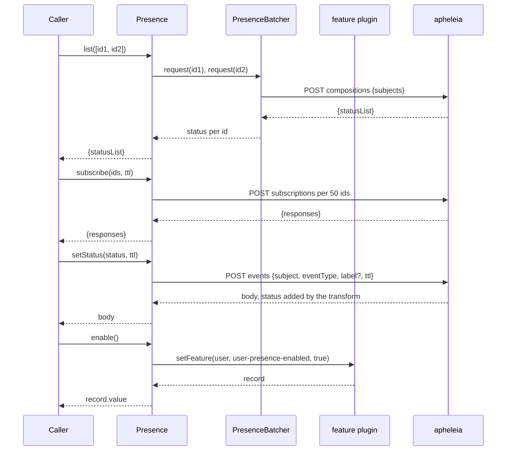
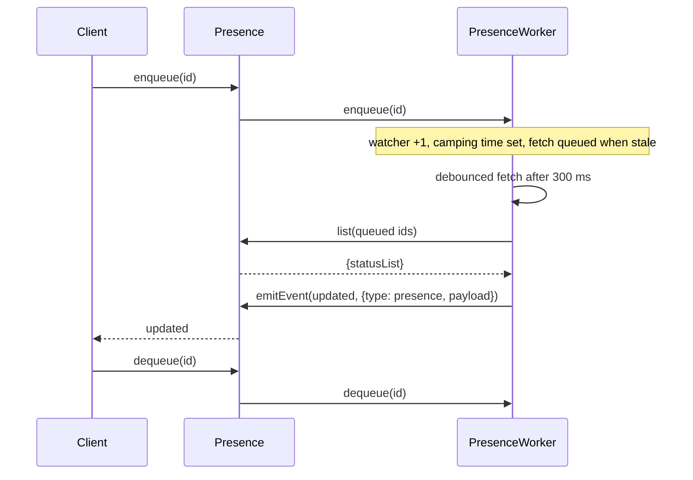
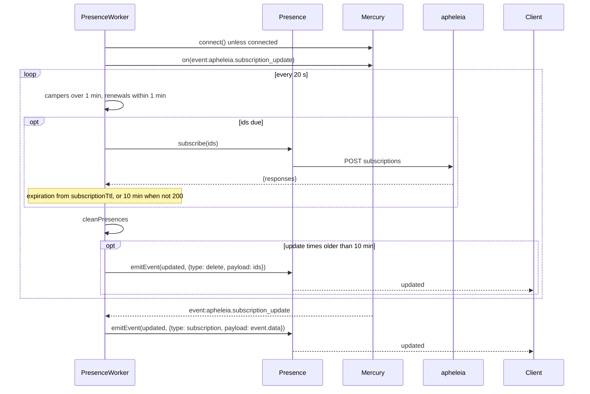
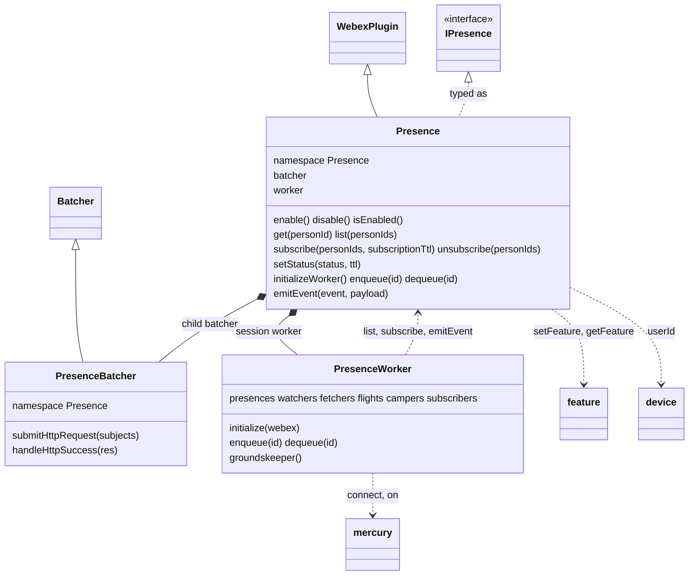
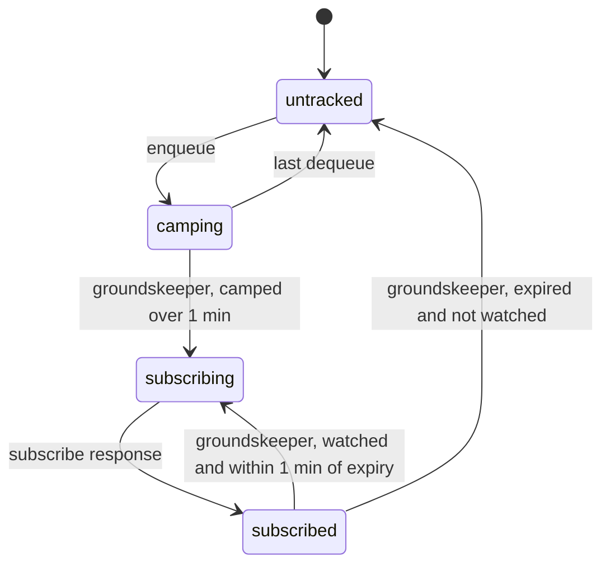

<!-- sdd-generated-metadata
doc_kind: module-spec
generated_from: module-spec@0.3.0
generated_by: claude-code
approved_by: rarajes2@cisco.com
updated_at: 2026-11-12T13:45:00Z
validation_status: pass-with-warnings
-->

# Presence plugin

This source-local document at `src/docs/README.md` owns the stable specification for **the Presence
plugin**: the public plugin `webex.presence`, written in TypeScript. It reads, subscribes to, and sets
user presence on the presence service (catalog service `apheleia`), turns the presence feature toggle
on and off through the feature plugin, and runs an optional worker that fetches and subscribes to the
presence of the users a client is showing and reports changes as `updated` events. Ground every claim
in package evidence and link to the [package architecture](../../docs/architecture.md) instead of
repeating broader facts. No service specification exists because this package is a library.

Related context: [documentation index](../../docs/index.md) ·
[package agent instructions](../../AGENTS.md)

## Metadata

| Field             | Value |
| ----------------- | ----- |
| Owner             | @webex/web-sdk |
| Source path       | `src` |
| Resource kind     | package |
| Status            | Draft |
| Last verified     | 2026-11-12 at `b8bc13e042` |
| Module id         | `plugin-presence` |
| Parent spec       | — |
| Doc kind          | Module spec |
| Coverage score    | 100% assessed 2026-11-12 by the generator — 15 of 15 mandatory fields PRESENT, critical 8 of 8; `test:unit` runs 29 of 29 cases passing |
| Validation status | Pass with warnings — validator runtime `01a1cff7-a8f6-7912-803f-b7cabdeaa0bf`, 2026-11-12; 0 Blocking, 1 Important. VAL-B11-CMD-001 (command-source traceability for four command entries) is accepted as a warning |

## Applicability

| Condition ID                         | Status     | Evidence or reason | Owned section |
| ------------------------------------ | ---------- | ------------------ | ------------- |
| `module.has_tiers`                   | N/A        | No tier policy exists in `package.json` or `src/presence.ts` | Tier |
| `module.has_ui`                      | N/A        | `src/presence.ts` and `src/presence-worker.ts` send requests and emit events; they render nothing | UI use-case flow |
| `module.crosses_service_boundaries`  | Applicable | `src/presence.ts` and `src/presence-batcher.ts` call the presence service; `src/presence-worker.ts` listens to Mercury; `src/presence.ts` calls the feature plugin | Cross-boundary use-case flow |
| `module.holds_client_state`          | Applicable | `src/presence-worker.ts` keeps six per-user maps; `src/presence-batcher.ts` keeps pending lookups | Client state model |
| `module.enforces_domain_rules`       | Applicable | The 50-subject batch limit and the dnd label rule in `src/presence.ts`; the fetch, subscribe, renew, and expiry timings in `src/constants.ts` | Business rules and invariants |
| `module.is_concurrent_async`         | Applicable | Every request method returns a promise; `src/presence-worker.ts` runs a debounced fetch and a 20-second interval | Concurrency and reactive flow |
| `module.owns_persistence`            | N/A        | `src/presence-worker.ts` keeps maps in memory only; nothing is stored | Data, schema, and migration discipline |
| `module.stateful_transitions`        | Applicable | A watched user moves from camping to subscribed, renewed, and expired in `src/presence-worker.ts` | State machine |
| `module.exposes_wire_protocol`       | Applicable | The compositions, subscriptions, and events requests in `src/presence.ts` and `src/presence-batcher.ts`; the Mercury event and the updated envelope in `src/presence-worker.ts` | Protocol and wire format |
| `module.ui_multi_screen`             | N/A        | No UI | UI flow |
| `module.large_data_model`            | N/A        | `src/interface.ts` declares ten small types; the presence status object is the service's response, covered under Protocol and wire format | Data model |
| `module.returns_caller_errors`       | Applicable | Argument checks and request failures reject the methods of `src/presence.ts`; `src/presence-worker.ts` throws on a missing webex | Caller-visible failure modes |
| `module.module_specific_conventions` | Applicable | The updated event and its three envelope types in `src/constants.ts` | Module-specific rules |
| `module.published_package`           | Applicable | `package.json` names the package @webex/plugin-presence, declares types, and defines deploy:npm | Export stability |
| `module.embedded_in_host`            | N/A        | No host theme or embed API | Host integration and theming |
| `module.has_design_tradeoff`         | Applicable | The one-minute camping delay, the batched lookups, and the timestamp-only worker in `src/presence-worker.ts` and `src/presence-batcher.ts` | Key design trade-off |
| `module.has_submodules`              | N/A        | The src directory has no child module | Sub-modules |

## Evidence register

| Evidence | What it establishes |
| -------- | ------------------- |
| `src/index.ts` | Imports `@webex/internal-plugin-device`, then `registerPlugin('presence', Presence, {payloadTransformer, config})` at import time; default-exports `Presence`. The comment on the predicate names the events endpoint |
| `src/presence.ts` | `Presence` extends `WebexPlugin` in namespace `Presence`, typed as `IPresence`, with child `batcher` and session property `worker`; methods `initialize`, `initializeWorker`, `emitEvent`, `enable`, `disable`, `isEnabled`, `get`, `list`, `subscribe`, `unsubscribe`, `setStatus`, `enqueue`, `dequeue`. The JSDoc, including the `PresenceStatusObject` typedef, and the batch-limit comment are recorded rationale |
| `src/presence-batcher.ts` | `PresenceBatcher` extends the webex-core `Batcher` in namespace `Presence`: ids are their own fingerprints, the flush POSTs `compositions` with `{subjects}`, and each `statusList` entry resolves the lookup with the same `subject` |
| `src/presence-worker.ts` | `PresenceWorker`: the six maps, Mercury wiring, the debounced fetch, and the groundskeeper. Its comments state why each step runs ("Subscribe if they've been camping for a minute", "Renew subscription if they're about to expire", "Tells client to delete it too") |
| `src/interface.ts` | The TypeScript types: `PresenceStatus`, `IPresenceStatusObject`, `IEventPayload`, `IPresence`, `IWebex`, `IGenericKeyValue`, `IPresenceBatcher`, `IResponse`, `IPredicate`, `ITransform` |
| `src/constants.ts` | Timings (20 s interval, 300 ms fetch delay, 1 min staleness, 10 min expiry, 1 min camping, 1 min renewal margin, 10 min fallback subscription), the Mercury event name, the `updated` event name, and the envelope types |
| `src/config.ts` | Defaults `presence.batcherWait`, `presence.batcherMaxCalls`, `presence.batcherMaxWait` |
| `package.json` | Name, `main` (`dist/index.js`), `types` (`dist/types/index.d.ts`), `devMain`, `engines` (`node >=18`), dependencies, and scripts; `build` runs `tsc` for declarations, `build:docs` runs typedoc; `test:unit` exists, `test:integration` and `test:browser` do not |
| `tsconfig.json` | Includes `src`; typedoc options take `src/interface.ts` as the entry point and name the output "Presence (@webex/plugin-presence)" |
| `test/unit/spec/presence.ts` | 10 running cases for the argument checks, the 50-id subscribe batching, the `dnd` label rule, and `initializeWorker` |
| `test/unit/spec/presence-worker.ts` | 19 running cases for `initialize`, `enqueue`, `dequeue`, `checkFetchers`, `checkCampers`, `checkSubscriptions`, `cleanPresences`, and `groundskeeper` |
| `test/integration/spec/presence.ts` | Live-service cases for every method and the Mercury update; `describe.skip` with the ticket SPARK-413317 |
| `README.md` | Retained npm page; context only. Its Usage block shows a placeholder member and no method; see `docs/adr/0001-retain-product-readme.md` |
| Sibling package webex-core, files src/docs/README.md, src/lib/batcher.js | Module spec consulted, agrees with code. `registerPlugin` ignores a second registration of a name unless `replace` is set (MOD-013); registration `config` and `payloadTransformer` entries are merged into the module-level default config (MOD-008); `transform` runs every matching predicate and named transform (MOD-037); `Batcher.request` shares one promise per fingerprint (MOD-050) and flushes on a capped debounce of at most `batcherMaxCalls` items (MOD-051). Source: a WebexHttpError flush failure falls back to rejecting every queued lookup when `options.body` has no `map`, and an unmatched response subject throws `Could not find pending request for received response` |
| Sibling package webex-core, files src/interceptors/docs/README.md, src/interceptors/payload-transformer.js | Interceptors spec consulted, agrees with code: every inbound response, and every inbound error, passes through `transform('inbound', …)` unless the request sets `disableTransform` (INT-018) |
| Sibling package webex-core, file src/lib/services/docs/README.md | Services spec consulted, agrees with code: `api` maps to `service` and the resource is joined to the catalog URL (SVC-022), so `api: 'apheleia'` and `service: 'apheleia'` address the same service |
| Sibling package internal-plugin-mercury, files src/docs/README.md, src/mercury.js | Module spec consulted. It agrees with code that `connect` resolves at once when connected and that an envelope with a dotted `data.eventType` is emitted as `event:<eventType>` (MOD-009). Its session-suffixed connection model is stale; `src/mercury.js` has one `connect(webSocketUrl)` that registers the device first, and is the referee |
| Sibling package internal-plugin-feature, files src/docs/README.md, src/feature.js | Module spec consulted, agrees with code. `getFeature` resolves the value or `null` (MOD-003, MOD-004); `setFeature` POSTs `{key, mutable: true, val}` and resolves the merged record (MOD-006) |
| Sibling package internal-plugin-device, files src/docs/README.md, src/device.js | Spec consulted: `userId` is a registration DTO property set from the WDM body |
| Sibling package test-helper-mock-webex, file src/index.js | `presence` is in its `nonInternalPlugins` list, so `new MockWebex({children: {presence}})` mounts the plugin at `webex.presence`, where these unit cases call it; its default `request` resolves `{statusCode: 200, body: {}}` |
| Sibling package internal-plugin-presence, files src/docs/README.md, src/index.js | Module spec consulted, agrees with this code line for line apart from the registration call and the TypeScript types: the same requests, transform name, config, worker, and constants, registered as internal plugin `presence` |
| Workspace search for consumers | No workspace package depends on or imports `@webex/plugin-presence`; `webex`, `webex-node`, and `@webex/recipe-private-web-client` load `@webex/internal-plugin-presence` instead. The workspace root `build:docs` script runs this package's `build:docs`, and its typedoc output is committed under the workspace `docs/presence/` |
| Observation, no stated WHY | Behavior the code shows without stating a reason is recorded once, under Pitfalls and constraints |

## Purpose and boundary

- Responsibility: let a Webex client read and set user presence, subscribe to presence changes, and
  switch the presence feature on or off; and, through the worker, keep the presence of the users the
  client is showing fresh with as few lookups and subscriptions as possible, telling the client what
  changed through `updated` events. It ships TypeScript declarations for that surface.
- In scope: registration of `presence`, its batcher defaults, and its inbound response transform;
  `enable`, `disable`, `isEnabled`; `get`, `list`, `subscribe`, `unsubscribe`, `setStatus`;
  `emitEvent`; the worker's start, watch counting, fetch, subscription, renewal, and expiry; the types
  in `src/interface.ts`.
- Out of scope: what the presence service stores or composes; the request coalescing and flush timing
  of the webex-core `Batcher`; Mercury's socket and event dispatch (`@webex/internal-plugin-mercury`);
  feature-toggle storage (`@webex/internal-plugin-feature` and the device plugin); device registration
  and `userId` (`@webex/internal-plugin-device`); authorization, service-catalog resolution, and the
  transform pipeline (webex-core); keeping the presence objects themselves, which the client does; the
  internal plugin `webex.internal.presence` (`@webex/internal-plugin-presence`).
- Consumers: applications that install `@webex/plugin-presence` from npm and import it beside
  `@webex/webex-core`. No workspace package imports it.

## Structure and key files

| Path | Responsibility |
| ---- | -------------- |
| `src/index.ts` | Imports the device plugin, registers public plugin `presence` with its transform and config, and exports the class as default |
| `src/presence.ts` | `Presence`: the feature toggle, the presence service requests, `emitEvent`, and the worker entry points |
| `src/presence-batcher.ts` | `PresenceBatcher`: batches `list` lookups into `compositions` requests |
| `src/presence-worker.ts` | `PresenceWorker`: watch counting, fetches, subscriptions, renewal, expiry, and `updated` envelopes |
| `src/interface.ts` | TypeScript types of the plugin, the batcher, the status object, and the transform; the typedoc entry |
| `src/constants.ts` | Worker timings, event names, and envelope types |
| `src/config.ts` | Defaults under `presence` |
| `package.json` | Package name, entry points, declarations path, scripts, and dependencies |
| `tsconfig.json` | Extends the workspace TypeScript config, includes `src`, and holds the typedoc options |
| `babel.config.js`, `jest.config.js` | Re-exports of the legacy Babel and Jest configurations |
| `.eslintrc.js` | Sets `root: true` and extends `@webex/eslint-config-legacy` |
| `process` | Package-root file exporting `{browser: true}`; not imported by `src/` |
| `src/docs/README.md` | This module specification; ignored by the build and by lint |
| `test/unit/spec/presence.ts`, `test/unit/spec/presence-worker.ts` | Unit cases run by `test:unit`; all 29 run |
| `test/integration/spec/presence.ts` | Live-service cases; skipped, and no script runs them |
| dist/ (generated) | Build output of `build:src` and, for `dist/types/`, of `build`; ignored by Git and never edited by hand |

## Public surface

| Surface | Consumer | Compatibility commitment | Source |
| ------- | -------- | ------------------------ | ------ |
| Import side effect: public plugin `presence` with the defaults of `MOD-002` and the transform of `MOD-003`, plus the device plugin | npm applications | First registration of the name wins; reached as `webex.presence` | `src/index.ts`, `src/config.ts` |
| `enable()`, `disable()`, `isEnabled()` | Applications | Resolve the `user-presence-enabled` toggle value | `src/presence.ts` |
| `get(personId)`, `list(personIds)` | Applications; the worker calls `list` | Resolve a presence status object, or `{statusList}` in input order | `src/presence.ts` |
| `subscribe(personIds, subscriptionTtl)`, `unsubscribe(personIds)` | Applications; the worker calls `subscribe` | Resolve `{responses}`, or the raw unsubscribe response | `src/presence.ts` |
| `setStatus(status, ttl)` | Applications | Resolves the events response body | `src/presence.ts` |
| `initializeWorker()`, `enqueue(id)`, `dequeue(id)` | Applications | Drive the worker of `MOD-012` to `MOD-017` | `src/presence.ts` |
| Event `updated` on `webex.presence` with `{type, payload}` | Applications | Envelope types `subscription`, `presence`, `delete` | `src/presence-worker.ts`, `src/constants.ts` |
| Declarations `dist/types/index.d.ts`: default `Presence` typed as `IPresence` | TypeScript applications | Generated by `build` (`MOD-018`) | `package.json`, `src/interface.ts` |
| `emitEvent(event, payload)`, `batcher`, `worker` | The worker; tests | Reachable on the instance but not a supported entry | `src/presence.ts` |
| Default export `Presence` | Applications that mount the class themselves | The entry exports nothing else | `src/index.ts` |

Contract ID `presence-public-sdk` is indexed in the
[package architecture](../../docs/architecture.md#public-and-consumer-surfaces) and registered in
`.sdd/manifest.json`. Export stability is under [Export stability](#export-stability).

## Dependencies

| Dependency | Why it is required | Failure behavior |
| ---------- | ------------------ | ---------------- |
| `@webex/webex-core` plugin host (module spec consulted) | `registerPlugin`, `WebexPlugin` (`webex`, `config`, `trigger`), `webex.request`, `webex.ready`, and the `ready` event | A request rejection rejects the method |
| `@webex/webex-core` `Batcher` (module spec consulted; code consulted) | Coalesces `list` lookups for `MOD-007` | A failed flush rejects every lookup in it |
| `@webex/webex-core` transform pipeline and services (interceptors and services specs consulted) | Runs the `MOD-003` transform on inbound responses; resolves `apheleia` from the catalog | See Pitfalls for the global scope of the transform |
| `@webex/internal-plugin-mercury` (module spec consulted, stale on sessions; code used) | `connected`, `connect()`, and the `event:apheleia.subscription_update` event for `MOD-012` and `MOD-015` | Declared in `package.json` but not imported by `src/`; a `connect` rejection leaves the worker without updates (see Pitfalls) |
| `@webex/internal-plugin-feature` (module spec consulted) | `setFeature` and `getFeature` for `MOD-004` | Not declared in `package.json` or imported; the host must register it |
| `@webex/internal-plugin-device` (spec consulted) | Imported for registration; `userId` for `MOD-010` | An unset `userId` is sent as is |
| `lodash` | `has` for the transform predicate; `debounce` for the worker fetch | Not applicable |
| Presence service (external, catalog name `apheleia`) | Compositions, subscriptions, and events | Errors propagate |

`package.json` also lists four `@webex/test-helper-*` packages under `dependencies`; `src/` imports
none of them. The specs import them.

## Requirements

| ID | WHAT | WHY | Source evidence | Test or example evidence | Assumptions or gaps | Confidence |
| -- | ---- | --- | --------------- | ------------------------ | ------------------- | ---------- |
| `MOD-001` | Importing the package first imports `@webex/internal-plugin-device`, then registers `Presence` as public plugin `presence` with the transform of `MOD-003` and the config of `MOD-002`, so the plugin is `webex.presence`; a second registration of the name is ignored (webex-core MOD-013). | `setStatus` reads `webex.internal.device.userId`, so the device plugin must be registered with this one (inferred from the import and the read; no comment states it). | `src/index.ts` | None found | WHY inferred from code; registration untested | Weak |
| `MOD-002` | Default config `presence` is `{batcherWait: 50, batcherMaxCalls: 50, batcherMaxWait: 150}`. `initializeWorker` has no default. | The webex-core `Batcher` reads its flush timing from its namespace's config and has no defaults of its own (webex-core MOD-051). | `src/config.ts` | `test/unit/spec/presence-worker.ts` builds its mock from these defaults | No case asserts the values | Present |
| `MOD-003` | The inbound predicate `normalizeSingleStatusResponse` matches any response whose `body` has both `eventType` and `subject`, and its transform sets `body.status` to `body.eventType`. | The comment names the events endpoint: its response reports the status as `eventType`, and the transform gives it the `status` field of a presence status object (inferred from the typedef; no comment states the second half). | `src/index.ts` | None found | WHY partly inferred; untested | Weak |
| `MOD-004` | `enable()` and `disable()` call `webex.internal.feature.setFeature('user', 'user-presence-enabled', true or false)` and resolve the merged record's `value`; `isEnabled()` resolves `getFeature('user', 'user-presence-enabled')`, which is the value or `null`. | The JSDoc: these enable and disable the presence feature and report whether it is enabled. | `src/presence.ts` | `test/integration/spec/presence.ts` enable, disable, and isEnabled cases (skipped) | No unit case | Weak |
| `MOD-005` | `get(personId)` rejects with `A person id is required` when `personId` is falsy; otherwise sends `GET` to service `apheleia`, resource `compositions?userId=<personId>`, and resolves the response body. | The JSDoc: it gets the current presence status of one person. | `src/presence.ts` | `test/unit/spec/presence.ts` #get() missing-id case; `test/integration/spec/presence.ts` #get() (skipped) | Success path has no running case | Present |
| `MOD-006` | `list(personIds)` rejects with `An array of person ids is required` unless `personIds` is an array; otherwise it requests each id through `batcher.request` and resolves `{statusList}` with the results in input order. | The JSDoc: it gets the presence statuses of many people as `statusList`. | `src/presence.ts` | `test/unit/spec/presence.ts` #list() missing and non-array cases; `test/integration/spec/presence.ts` #list() (skipped) | Success path has no running case | Present |
| `MOD-007` | `PresenceBatcher` uses each id as its own request and response fingerprint, so duplicate ids share one pending lookup; a flush sends `POST` with `api: 'apheleia'`, resource `compositions`, body `{subjects: <ids>}`, and resolves each pending id with the `statusList` entry whose `subject` matches it. The flush timing and size follow `MOD-002` (webex-core MOD-050, MOD-051). | Collapses lookups made close together into one request (webex-core spec, MOD-050 and MOD-051). | `src/presence-batcher.ts` | `test/integration/spec/presence.ts` batching case (skipped) | No unit case | Weak |
| `MOD-008` | `subscribe(personIds, subscriptionTtl = 600)` rejects with `A person id is required` when `personIds` is falsy; it takes one id or an array, splits it into batches of 50, sends one `POST` per batch with `api: 'apheleia'`, resource `subscriptions`, body `{subjects, subscriptionTtl, includeStatus: true}`, all at once, and resolves `{responses}` with each batch's `body.responses` concatenated in batch order. | The JSDoc: updates then arrive as the Mercury event `apheleia.subscription_update`, and the TTL is in seconds; the comment: at most 50 ids per request. | `src/presence.ts` | `test/unit/spec/presence.ts` #subscribe(), including 100 ids in two requests; `test/integration/spec/presence.ts` #subscribe (skipped) | None | Present |
| `MOD-009` | `unsubscribe(personIds)` rejects with `A person id is required` when `personIds` is falsy; otherwise sends one `POST` with `api: 'apheleia'`, resource `subscriptions`, body `{subjects, subscriptionTtl: 0, includeStatus: true}`, without batching, and resolves the whole HTTP response. | The JSDoc: it unsubscribes from one person or a group; a zero TTL ends the subscription (inferred from the body). | `src/presence.ts` | `test/unit/spec/presence.ts` #unsubscribe() missing-id case; `test/integration/spec/presence.ts` #unsubscribe (skipped) | WHY of the zero TTL inferred | Present |
| `MOD-010` | `setStatus(status, ttl)` rejects with `A status is required` when `status` is falsy; otherwise sends `POST` with `api: 'apheleia'`, resource `events`, body `{subject: device.userId, eventType: status, label: device.userId, ttl}`, leaving out `label` when `status` is `'dnd'`, and resolves the response body as normalized by `MOD-003`. | The JSDoc: it sets the current user's status, one of `active`, `inactive`, `ooo`, `dnd`, for `ttl` seconds. No comment states why `dnd` has no label. | `src/presence.ts` | `test/unit/spec/presence.ts` #setStatus() missing, label, and no-label cases | WHY of the `dnd` rule unknown; see Pitfalls for the integration expectation | Present |
| `MOD-011` | `emitEvent(event, payload)` triggers `event` on the plugin with `payload` only when `payload.type` and `payload.payload` are both truthy. The worker emits `updated` with `{type: 'subscription' or 'presence' or 'delete', payload}`. | Gives the client one event with a typed envelope for every worker change (inferred from the constants; no comment states it). | `src/presence.ts`, `src/constants.ts` | `test/unit/spec/presence-worker.ts` checkFetchers and cleanPresences cases stub emitEvent and assert its arguments | WHY inferred; the drop rule is untested | Weak |
| `MOD-012` | On the webex `ready` event, `initialize` starts the worker when `config.initializeWorker` is truthy. `initializeWorker()` starts it now when `webex.ready`, else on `ready`. Starting it throws `Must initialize Presence Worker with webex!` when webex or `webex.internal` is missing; otherwise it calls `mercury.connect()` unless `mercury.connected`, then listens to `event:apheleia.subscription_update`, and starts the groundskeeper of `MOD-016` every 20 seconds. | The JSDoc: the worker connects to Mercury for presence and starts. | `src/presence.ts`, `src/presence-worker.ts` | `test/unit/spec/presence.ts` #initializeWorker(); `test/unit/spec/presence-worker.ts` #initialize() | Mercury wiring and the interval have no case | Present |
| `MOD-013` | `enqueue(id)` adds one watcher for `id`. When `id` has a truthy subscription expiration it stops there. Otherwise it records the first camping time for `id`, and when no fetch is in flight for `id` and its last update is missing or older than one minute, it queues `id` and schedules a fetch 300 ms after the last such call. `dequeue(id)` removes one watcher; at zero it also drops `id`'s watcher count, queued fetch, and camping time. | The JSDoc: enqueue retrieves and subscribes to a user's presence, and dequeue retracts it; the comment lists when a fetch is needed. | `src/presence-worker.ts`, `src/constants.ts` | `test/unit/spec/presence-worker.ts` #enqueue() and #dequeue() | None | Present |
| `MOD-014` | A fetch moves the queued ids to in flight and calls `presence.list(ids)`. When it resolves, each returned `subject` leaves in flight and gets an update time of now, and the worker emits `updated` with `{type: 'presence', payload: <list result>}`. | The JSDoc: it retrieves users' presences. | `src/presence-worker.ts` | `test/unit/spec/presence-worker.ts` #checkFetchers() | Rejected lookup untested | Present |
| `MOD-015` | On `event:apheleia.subscription_update`, the worker sets the update time of `event.data.subject` to now and emits `updated` with `{type: 'subscription', payload: event.data}`. | The JSDoc: it triggers a subscription update event. | `src/presence-worker.ts` | `test/integration/spec/presence.ts` Mercury event case (skipped) | No unit case | Weak |
| `MOD-016` | Every 20 seconds the groundskeeper subscribes ids that have camped more than one minute (marking them with a `null` expiration) and renews ids that are still watched and expire within one minute; it deletes expired subscriptions that are not renewed. It calls `presence.subscribe(ids)` with the default TTL when any id is due; for each response with `responseCode` 200 it sets the expiration to now plus `subscriptionTtl` seconds and the update time of `status.subject` to now, and for any other code it sets the expiration to now plus 10 minutes. It then runs `MOD-017`. | The comments: subscribe after camping for a minute, renew when about to expire, and give a failed subscription an expiration "so we clean it out eventually". | `src/presence-worker.ts`, `src/constants.ts` | `test/unit/spec/presence-worker.ts` #checkCampers(), #checkSubscriptions(), #groundskeeper() | None | Present |
| `MOD-017` | `cleanPresences` deletes every update time older than 10 minutes and, when any was deleted, emits `updated` with `{type: 'delete', payload: <ids>}`. | The comments: remove stale presence objects and tell the client to delete them too. | `src/presence-worker.ts`, `src/constants.ts` | `test/unit/spec/presence-worker.ts` #cleanPresences() | No case for the empty-trash branch | Present |
| `MOD-018` | `build` runs `tsc` with declarations into `dist/types/` and then `build:src`; `package.json` `types` points to `dist/types/index.d.ts`, which declares the default `Presence` as `IPresence`. The entry exports no other type; `build:docs` renders `src/interface.ts` with typedoc. | TypeScript applications get typed method signatures; the typedoc options name `src/interface.ts` as the documented surface. | `package.json`, `tsconfig.json`, `src/interface.ts`, `src/presence.ts` | None found | `build:src` alone writes no declarations; see Pitfalls for the gaps between the types and the code | Weak |

## Design overview

`Presence` is a `WebexPlugin` with two parts. The first is a set of thin requests to the presence
service: read one user, read many users through a batcher, subscribe, unsubscribe, and set the
current user's status. The presence feature toggle goes through the feature plugin.

The second part is `PresenceWorker`, created per plugin instance but started only on request. A client
calls `enqueue(id)` when it starts showing a user and `dequeue(id)` when it stops. The worker fetches
that user's presence soon, subscribes once the user has been shown for a minute, renews the
subscription while the user is still shown, and lets it lapse otherwise. It keeps only times and
counts, never the presence objects; each change goes to the client as an `updated` event, and the
client keeps the data.

Registration also adds one inbound transform to the SDK's global transform pipeline, so the events
response carries a `status` field like the other presence responses. `src/interface.ts` types the
plugin for TypeScript callers.

## Data flow and sequence coverage

Call style: in-process method calls on `webex.presence`; outbound HTTPS through `webex.request`;
inbound Mercury events; outbound plugin events. Three operation groups differ in actors and outcome,
and each has a diagram.

| Operation group | Entry and outcome | Diagram or evidence | Failure and recovery coverage |
| --------------- | ----------------- | ------------------- | ----------------------------- |
| Direct requests | `get`, `list`, `subscribe`, `unsubscribe`, `setStatus`, and the feature toggle resolve service results | Diagram 1; `src/presence.ts`, `src/presence-batcher.ts` | Argument checks and request errors reject |
| Worker watch and fetch | `enqueue` leads to a batched lookup and an `updated` presence envelope | Diagram 2; `src/presence-worker.ts` | A failed lookup is not caught (see Pitfalls) |
| Worker subscription upkeep | The groundskeeper subscribes, renews, expires, and Mercury delivers updates | Diagram 3; `src/presence-worker.ts` | A failed subscribe is not caught; a non-200 code gets a fallback expiration |

Diagram 1 — direct requests:

Diagram 2 — worker watch and fetch:

Diagram 3 — worker subscription upkeep:

## Class and component relationships

## Use cases and flows

| Use case | Actor or caller | Primary steps and outcome | Failure or boundary behavior | Evidence |
| -------- | --------------- | ------------------------- | ---------------------------- | -------- |
| `UC-001` | Application showing a list of people | `initializeWorker()` once; `enqueue(id)` per shown person, `dequeue(id)` when hidden; handle `updated` envelopes | The worker reports nothing for an id whose lookup or subscription fails | `src/presence.ts`, `src/presence-worker.ts` |
| `UC-002` | Application reading presence directly | `get(id)` or `list(ids)` | Argument checks and request errors reject | `src/presence.ts` |
| `UC-003` | Application managing its own subscriptions | `subscribe(ids, ttl)`, then Mercury `event:apheleia.subscription_update`; `unsubscribe(ids)` | Request errors reject; Mercury must be connected by the application | `src/presence.ts` |
| `UC-004` | Application setting the user's status | `setStatus('dnd', ttl)` and other statuses | Request errors reject | `src/presence.ts` |
| `UC-005` | Application switching the presence feature | `enable()`, `disable()`, `isEnabled()` | Requires the feature plugin | `src/presence.ts` |

### Cross-boundary use-case flow

| Boundary | Transport and ordering | Compatibility | Timeout, retry, and recovery |
| -------- | ---------------------- | ------------- | ---------------------------- |
| Presence service (`UC-001` to `UC-004`) | HTTPS through `webex.request`, service `apheleia` from the catalog; subscribe batches run concurrently | Bodies under Protocol and wire format | No retry or timeout in this module; webex-core interceptors apply |
| Mercury (`UC-001`, `UC-003`) | One listener for `event:apheleia.subscription_update` per started worker | Event name from `src/constants.ts` | Mercury owns reconnects; the worker re-subscribes only through renewal |
| Feature plugin (`UC-005`) | In-process call; it POSTs to the feature service | `user` key type, key `user-presence-enabled` | Its rejection rejects the method |

## Client state model

| State or slice | Owner | Initial state | Transition triggers | Reset or persistence boundary |
| -------------- | ----- | ------------- | ------------------- | ----------------------------- |
| `watchers` (count per id) | `PresenceWorker` | Empty | `enqueue` adds, `dequeue` removes (`MOD-013`) | In memory for the life of the plugin |
| `campers` (first camping time per id) | `PresenceWorker` | Empty | `enqueue` sets; groundskeeper or last `dequeue` removes (`MOD-013`, `MOD-016`) | Same |
| `fetchers`, `flights` (queued and in-flight lookups) | `PresenceWorker` | Empty | `enqueue` queues; fetch moves to flight; a returned subject leaves flight (`MOD-014`) | Same |
| `subscribers` (expiration per id, or `null` while subscribing) | `PresenceWorker` | Empty | Groundskeeper sets, renews, and deletes (`MOD-016`) | Same; not cleared by `dequeue` |
| `presences` (last update time per id) | `PresenceWorker` | Empty | Fetch, subscription response, Mercury event; expiry deletes (`MOD-014` to `MOD-017`) | Same |
| `deferreds`, `queue` | `PresenceBatcher` (webex-core `Batcher`) | Empty | `list` lookups and flushes | Entries removed when a lookup settles |
| `config.presence` | webex-core config, defaults from `src/config.ts` | `MOD-002` | Host config at construction | For the life of the SDK instance |

## Business rules and invariants

| ID | Invariant | WHY | Enforcement source | Test evidence |
| -- | --------- | --- | ------------------ | ------------- |
| `INV-001` | A `subscribe` request carries at most 50 subjects. | The code comment limits batches to 50 ids per request. | `src/presence.ts` | `test/unit/spec/presence.ts` |
| `INV-002` | A `compositions` request carries at most `batcherMaxCalls` subjects. | Bounds the payload of a batched lookup (webex-core MOD-051). | `src/presence-batcher.ts`, `src/config.ts` | None found |
| `INV-003` | `setStatus` sends `label` exactly when `status` is not `'dnd'`. | Stated only by the code and its unit cases; no reason is given. | `src/presence.ts` | `test/unit/spec/presence.ts` |
| `INV-004` | `enqueue` never queues a lookup for an id with a truthy subscription expiration, or for an id already in flight. | Subscribed users get updates from Mercury, and one lookup at a time is enough (inferred from the comment listing when to fetch). | `src/presence-worker.ts` | `test/unit/spec/presence-worker.ts` |
| `INV-005` | The worker emits `updated` only through `emitEvent`, and `emitEvent` drops an envelope without both `type` and `payload`. | The client handles one typed envelope shape (inferred from `MOD-011`). | `src/presence.ts`, `src/presence-worker.ts` | None found |
| `INV-006` | Argument checks of `get`, `list`, `subscribe`, `unsubscribe`, and `setStatus` reject the returned promise instead of throwing. | Callers handle every failure on the promise (inferred from the uniform `Promise.reject`). | `src/presence.ts` | `test/unit/spec/presence.ts` |

## Concurrency and reactive flow

- Execution model: one JavaScript event loop; every request method returns a promise; the worker
  runs a lodash `debounce` of 300 ms for lookups and a `setInterval` of 20 seconds for upkeep.
- Ordering guarantees: `list` resolves in input order. `subscribe` sends its batches at once and
  concatenates the results in batch order. Within a flush, the batcher sends lookups in request order.
- Idempotency and retry: nothing is retried here. Duplicate ids within one batching window share one
  lookup (`MOD-007`). A lapsed subscription is renewed only while the id is watched.
- Fire-and-forget work: the worker's fetch, subscribe, and Mercury connect promises are not awaited;
  their failure effects are under Pitfalls and constraints.
- Shared-state protection: none beyond the event loop. A fetch, a groundskeeper run, and a Mercury
  event can each update `presences` for the same id in any order.

## State machine

The subscription life of one id in the worker. `camping` holds a camping time; `subscribing` holds a
`null` expiration; `subscribed` holds an expiration, from `subscriptionTtl` on a 200 response or
10 minutes on any other code. A renewal keeps the old expiration until its response arrives. Watch
counting (`MOD-013`) and the presence update time (`MOD-017`) run alongside: `dequeue` never leaves
`subscribing` or `subscribed`, and the update time expires on its own clock.

## Protocol and wire format

| Message or frame | Version | Producer or serializer | Consumer or parser | Compatibility and ordering rule |
| ---------------- | ------- | ---------------------- | ------------------ | ------------------------------- |
| `GET <apheleia>/compositions?userId=<personId>` | Unversioned | `get` | Presence service | Response body: one presence status object (`url`, `subject`, `status`, `statusTime`, `lastActive`, `expires`, `expiresTTL`, `expiresTime`, `vectorCounters`, `suppressNotifications`, `lastSeenDeviceUrl`, per the JSDoc typedef) |
| `POST <apheleia>/compositions`, body `{subjects: [<id>]}` | Unversioned | `PresenceBatcher` | Presence service | Response `{statusList: [<status object>]}`, matched to requests by `subject` |
| `POST <apheleia>/subscriptions`, body `{subjects, subscriptionTtl, includeStatus: true}` | Unversioned | `subscribe`; `unsubscribe` with `subscriptionTtl: 0` | Presence service | Response `{responses: [{subject, responseCode, subscriptionTtl, status}]}`; the worker reads these four fields |
| `POST <apheleia>/events`, body `{subject, eventType, label, ttl}` | Unversioned | `setStatus` | Presence service | `label` absent for `dnd` (`INV-003`); the response body gets `status` from `eventType` (`MOD-003`) |
| Mercury envelope, `data.eventType` `apheleia.subscription_update` | Unversioned | Presence service through Mercury | `PresenceWorker` | Reads `data.subject`; passes `data` on unchanged |
| Plugin event `updated`, `{type, payload}` | Unversioned | `PresenceWorker` through `emitEvent` | Application | `type` is `subscription` (payload: the Mercury `data`), `presence` (payload: the `list` result), or `delete` (payload: an array of ids) |
| Feature toggle `user` / `user-presence-enabled` | Unversioned | `enable`, `disable` through the feature plugin | Feature service | Value `true` or `false` |

## Caller-visible failure modes

| Condition | Signal or result | Caller behavior | Retry or recovery | Evidence |
| --------- | ---------------- | --------------- | ----------------- | -------- |
| Missing person id, non-array `list` argument, or missing status | Rejects with `A person id is required`, `An array of person ids is required`, or `A status is required` | Pass the argument | Call again | `src/presence.ts` |
| The presence service rejects a request | The `webex.request` rejection, unchanged; one failed `subscribe` batch rejects the whole call | Handle the HTTP error | Call again | `src/presence.ts` |
| A `compositions` flush fails | Every lookup in the flush rejects with the same error | Handle the error per `list` call | Call again | `src/presence-batcher.ts` |
| A requested id is missing from a `statusList` | That lookup never settles, so its `list` call never resolves | Do not rely on `list` settling | None | `src/presence-batcher.ts` |
| A flush response has no `statusList` | `handleHttpSuccess` throws `TypeError` reading `map`, so the flush fails as above | Handle the error per `list` call | Call again | `src/presence-batcher.ts` |
| `webex.internal.feature` is not registered | `enable`, `disable`, and `isEnabled` throw `TypeError` synchronously | Register the feature plugin | None | `src/presence.ts` |
| The worker is started without webex | `Must initialize Presence Worker with webex!` thrown synchronously | Start it through `initializeWorker()` | None | `src/presence-worker.ts` |

## Pitfalls and constraints

- The worker starts only when an application calls `initializeWorker()` or sets
  `config.presence.initializeWorker` (`MOD-012`); no workspace package does either.
- Each start adds another Mercury listener and another 20-second interval, and nothing removes them;
  the plugin has no stop or logout hook, so calling `initializeWorker()` twice emits every
  `subscription` envelope twice and runs the groundskeeper twice as often.
- The worker does not catch its own promises. A rejected lookup leaves its ids in flight, so `enqueue`
  never fetches them again; a rejected `subscribe` leaves the newly subscribing ids with a `null`
  expiration, which renewal and expiry skip, until a later `enqueue` makes them camp again; a rejected
  Mercury `connect` means no listener is added.
- A `statusList` entry for an id that is not pending makes the batcher throw
  `Could not find pending request for received response`, which rejects every lookup in that flush.
  `PresenceBatcher.handleItemFailure` is never called, so no single item is treated as failed.
- The `MOD-003` transform is registered in the SDK-wide pipeline, so it rewrites `body.status` on any
  inbound response or error with `body.eventType` and `body.subject`, not only presence responses.
  `@webex/internal-plugin-presence`, which the `webex` package loads, registers a predicate and
  transform with the same name into the same default config; an application that loads both runs the
  transform more than once, with the same result.
- `get` addresses `service: 'apheleia'` and the other requests `api: 'apheleia'`; both resolve the
  same catalog entry. `get` puts `personId` into the query string without encoding it.
- The declarations disagree with the code in four places: `IPresence` types the `unsubscribe` result
  as `{responses: any}`, while `MOD-009` resolves the whole HTTP response; `IPresence` has no
  `initializeWorker`, so a TypeScript caller of `dist/types/index.d.ts` cannot call it without a cast;
  `IPresenceStatusObject` has no `expires`, `expiresTime`, or `lastSeenDeviceUrl`, which the JSDoc
  typedef lists; and `setStatus` types `ttl` as required although the code sends whatever it gets.
  The entry exports none of the `src/interface.ts` types, `PresenceStatus` included.
- `dist/types/` comes only from `build`. The workspace publish job runs `build:publish`, which runs
  the workspace tooling build and `build:src` for each package; neither runs `tsc`, so this repository
  shows no step that puts the declarations named by `types` into the published package.
- The integration case for `setStatus('dnd', …)` expects the response to have a `label` property,
  although `INV-003` leaves `label` out of a `dnd` request; the case is skipped, so the conflict is
  untested.
- The `setStatus` JSDoc lists `inactive`, while a comment in the integration spec says the service no
  longer accepts it; the code sends any string.

## Module-specific rules

- Do: report worker changes only through `emitEvent(PRESENCE_UPDATE, {type: ENVELOPE_TYPE.…, payload})`
  so the client sees one event and three envelope types (`INV-005`).
- Do: keep subscribe batches at 50 subjects (`INV-001`) and return argument failures as rejected
  promises (`INV-006`).
- Do: keep the worker storing times and counts only; the client owns presence objects.
- Do: change `src/interface.ts` in the same change as a method, argument, or result shape in
  `src/presence.ts`, because the published declarations come from it.
- Do not: log presence data, statuses, or user ids; the package has no log line today.

## Export stability

| Export or entry point | Consumer | Stability | Versioning and deprecation rule | Declaration or API report |
| --------------------- | -------- | --------- | ------------------------------- | ------------------------- |
| Import side effect: public plugin `presence`, its config defaults, and its inbound transform | npm applications | Public | None declared in the package | `src/index.ts`, `package.json` |
| Default export `Presence`, its request and worker methods, and the `updated` event | npm applications | Public | None declared in the package | `src/index.ts`, `src/presence.ts`, `src/interface.ts` |
| Declarations at `dist/types/index.d.ts` | TypeScript applications | Public, generated | Generated from `src/interface.ts` by `build` | `package.json`, `src/interface.ts` |

No API report is generated. The typedoc pages that the workspace `build:docs` produces from
`src/interface.ts` are the only published reference.

## Key design trade-off

| Chosen trade-off | Preserved invariant or benefit | Cost or limitation | Decision evidence |
| ---------------- | ------------------------------ | ------------------ | ----------------- |
| Subscribe only after a user has been watched for a minute | Users shown briefly never get a subscription | For the first minute the client sees only the fetched presence, with no live updates | `src/presence-worker.ts`, `src/constants.ts` |
| Batch `list` lookups through the webex-core `Batcher` | Fewer `compositions` requests; duplicate ids share one lookup | Up to 150 ms of added latency, and a missing subject never settles (see Caller-visible failure modes) | `src/presence-batcher.ts`, `src/config.ts` |
| Keep times and counts in the worker, not presence objects | One owner of presence data, the client, fed by `updated` envelopes | The client must merge `presence` and `subscription` envelopes and honor `delete` | `src/presence-worker.ts` |

## Verification

| Requirement or invariant | Test level | Positive evidence | Negative or boundary evidence | Gap |
| ------------------------ | ---------- | ----------------- | ----------------------------- | --- |
| `MOD-001`, `MOD-003`, `MOD-018` | None | None found | None found | Registration, transform, and declarations untested |
| `MOD-002` | Unit (indirect) | `test/unit/spec/presence-worker.ts` mock config | None found | Values not asserted |
| `MOD-004` | Integration (skipped) | `test/integration/spec/presence.ts` | None found | No unit case |
| `MOD-005`, `MOD-006`, `INV-006` | Unit | None found | `test/unit/spec/presence.ts` argument cases | Success paths untested |
| `MOD-007`, `INV-002` | Integration (skipped) | `test/integration/spec/presence.ts` batching case | None found | No unit case |
| `MOD-008`, `INV-001` | Unit | `test/unit/spec/presence.ts` 100-id case | `test/unit/spec/presence.ts` missing-id case | Result concatenation not asserted |
| `MOD-009` | Unit | None found | `test/unit/spec/presence.ts` missing-id case | Request body untested |
| `MOD-010`, `INV-003` | Unit | `test/unit/spec/presence.ts` label case | `test/unit/spec/presence.ts` dnd and missing-status cases | Integration expectation conflicts (see Pitfalls) |
| `MOD-011`, `INV-005` | Unit (indirect) | `test/unit/spec/presence-worker.ts` emitEvent assertions | None found | `emitEvent` drop rule untested |
| `MOD-012` | Unit | `test/unit/spec/presence.ts` #initializeWorker() | `test/unit/spec/presence-worker.ts` #initialize() | Mercury wiring and interval untested |
| `MOD-013`, `INV-004` | Unit | `test/unit/spec/presence-worker.ts` #enqueue() and #dequeue() | `test/unit/spec/presence-worker.ts` in-flight and recent-presence cases | None |
| `MOD-014` | Unit | `test/unit/spec/presence-worker.ts` #checkFetchers() | None found | Rejected lookup untested |
| `MOD-015` | Integration (skipped) | `test/integration/spec/presence.ts` Mercury case | None found | No unit case |
| `MOD-016` | Unit | `test/unit/spec/presence-worker.ts` #checkCampers(), #checkSubscriptions(), #groundskeeper() | `test/unit/spec/presence-worker.ts` non-200 and expiry cases | Rejected subscribe untested |
| `MOD-017` | Unit | `test/unit/spec/presence-worker.ts` #cleanPresences() | None found | Empty-trash branch untested |

`yarn workspace @webex/plugin-presence test:unit` ran 2 suites and 29 cases on 2026-11-12 under Node
22.14 after `build:src`; all 29 passed and the run exited zero. The unit specs import the package by
name, so they load `dist/`; run `build:src` first. After the suites finished, the run printed an
unhandled `TypeError` from `dist/presence-batcher.js` `handleHttpSuccess`: the `#enqueue()` cases
schedule the real 300 ms debounced fetch, which calls `list` through the batcher against the mock
`request`, whose body has no `statusList`. The batcher rejects the lookups with that error and
`checkFetchers` does not catch the rejected `list` (see Pitfalls). No case asserts on that fetch, so it
does not fail the run.
No script runs `test/integration/spec/presence.ts`: `package.json` has `test:browser:broken` but no
`test:browser` or `test:integration`, the spec is `describe.skip` (SPARK-413317), and the aggregate
`test` script stops at the missing `test:integration`. In this checkout `test:style` exits 1 before
linting: the package-local `node_modules/@humanwhocodes/object-schema` (1.2.1) that its ESLint 8.24.0
loads has no `dist/`. The workspace-root ESLint 8.57.1 run with the same config over `./src/**/*.*`
reported 0 errors and four `require-jsdoc` warnings (three on the transform functions in
`src/index.ts`, one on the `worker` default in `src/presence.ts`). A module specification is complete
only when its public surface, invariants, failure modes, and test evidence agree with the
implementation. Generator-side field measurement is complete (100%, assessed 2026-11-12); independent
semantic validation passed with warnings on 2026-11-12. VAL-B11-CMD-001, the command-source traceability
of the workspace-qualified command form for `compile`, `lint`, `docs`, and `deploy`, is an accepted
warning recorded in `.sdd/manifest.json` `modules[0].coverage_evidence`. A characterization baseline
remains pending.
