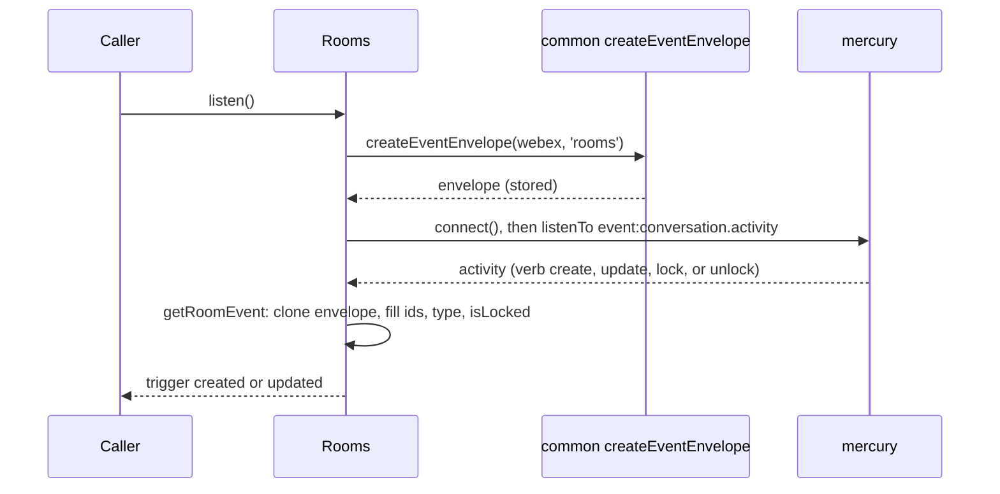
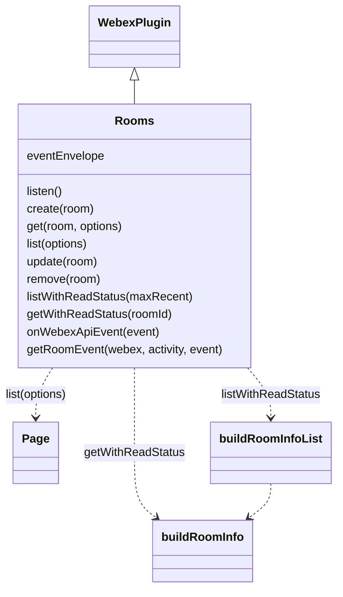

<!-- sdd-generated-metadata
doc_kind: module-spec
generated_from: module-spec@0.3.0
generated_by: claude-code
approved_by: rarajes2@cisco.com
updated_at: 2026-11-12T17:06:43Z
validation_status: pass-with-warnings
-->

# Rooms plugin

This source-local document at `src/docs/README.md` owns the stable specification for **the Rooms
plugin**: the public plugin `webex.rooms`. It creates, reads, lists, updates, and deletes Webex rooms
(spaces) through the `rooms` resource of the Webex REST API (catalog service `hydra`); it reports per-room
read status from the internal conversation service; and, once `listen()` is called, it turns
conversation activities from the Mercury socket into webhook-shaped `created` and `updated` events.
Ground every claim in package evidence and link to the
[package architecture](../../docs/architecture.md) instead of repeating broader facts. No service
specification exists because this package is a library.

Related context: [documentation index](../../docs/index.md) ·
[package agent instructions](../../AGENTS.md)

## Metadata

| Field             | Value |
| ----------------- | ----- |
| Owner             | @webex/web-client, @webex/web-sdk |
| Source path       | `src` |
| Resource kind     | package |
| Status            | Draft |
| Last verified     | 2026-11-12 at `30598f6e9b` |
| Module id         | `plugin-rooms` |
| Parent spec       | — |
| Doc kind          | Module spec |
| Coverage score    | 100% assessed 2026-11-12 by the generator — 13 of 13 mandatory fields PRESENT, critical 7 of 7; the package has no unit tests and no `test:unit` script, so no requirement has running test evidence; `test/integration/spec/rooms.js` holds 11 live-service cases (1 skipped) that no script runs |
| Validation status | Pass with warnings — independently validated 2026-11-12; one Important coverage follow-up remains while the module stays Partial |

## Applicability

| Condition ID                         | Status     | Evidence or reason | Owned section |
| ------------------------------------ | ---------- | ------------------ | ------------- |
| `module.has_tiers`                   | N/A        | No tier policy exists in `package.json` or `src/rooms.js` | Tier |
| `module.has_ui`                      | N/A        | `src/rooms.js` returns room records and emits events; it renders nothing | UI use-case flow |
| `module.crosses_service_boundaries`  | Applicable | `src/rooms.js` calls the Webex REST API rooms resource, the conversation service through internal-plugin-conversation, and listens on the Mercury socket | Cross-boundary use-case flow |
| `module.holds_client_state`          | N/A        | The only instance property `src/rooms.js` sets is the event envelope, recorded under Business rules and invariants; no record is cached | Client state model |
| `module.enforces_domain_rules`       | Applicable | The maxRecent check, the read-status shape, and the activity-verb mapping in `src/rooms.js` | Business rules and invariants |
| `module.is_concurrent_async`         | Applicable | `src/rooms.js` returns promises, waits for the postauth catalog, and handles socket events asynchronously | Concurrency and reactive flow |
| `module.owns_persistence`            | N/A        | Nothing is stored; `src/rooms.js` resolves what the services return | Data, schema, and migration discipline |
| `module.stateful_transitions`        | N/A        | No entity moves through states in `src/rooms.js`; locked is a flag read from tags | State machine |
| `module.exposes_wire_protocol`       | Applicable | The rooms requests, the read-status object, and the webhook-shaped event built in `src/rooms.js` | Protocol and wire format |
| `module.ui_multi_screen`             | N/A        | No UI | UI flow |
| `module.large_data_model`            | N/A        | Two shapes, the room object and the read-status object, typed only by JSDoc in `src/rooms.js`; covered under Protocol and wire format | Data model |
| `module.returns_caller_errors`       | Applicable | The maxRecent rejection, request failures, and read-status failures reject from `src/rooms.js` | Caller-visible failure modes |
| `module.module_specific_conventions` | Applicable | Hydra room and person ids and the webhook-shaped event envelope in `src/rooms.js` | Module-specific rules |
| `module.published_package`           | Applicable | `package.json` names the package @webex/plugin-rooms and defines deploy:npm | Export stability |
| `module.embedded_in_host`            | N/A        | No host theme or embed API | Host integration and theming |
| `module.has_design_tradeoff`         | Applicable | Read status from the conversation service and events from the Mercury socket in `src/rooms.js` | Key design trade-off |
| `module.has_submodules`              | N/A        | The src directory has no child module | Sub-modules |

## Evidence register

| Evidence | What it establishes |
| -------- | ------------------- |
| `src/index.js` | Imports `@webex/internal-plugin-conversation` and `@webex/internal-plugin-mercury` for their registration side effects, then `registerPlugin('rooms', Rooms)` with no options; re-exports only the default `Rooms` |
| `src/rooms.js` | `Rooms` extends `WebexPlugin` with `listen`, `create`, `get`, `list`, `listWithReadStatus`, `getWithReadStatus`, `remove`, `update`, and the JSDoc-`@private` `onWebexApiEvent` and `getRoomEvent`; the module-level helpers `buildRoomInfo` and `buildRoomInfoList`; the `RoomObject` typedef. Its JSDoc and code comments are the only recorded rationale |
| `package.json` | Name, `main` (`dist/index.js`), `devMain` (`src/index.js`), `engines` (`node >=18`), dependencies, peer dependencies on `@webex/plugin-logger` and `@webex/plugin-people`, and scripts; `build`, `build:src`, `test:style`, `test:browser:broken`, `deploy:npm`, and `test` exist, and `test:unit`, `test:integration`, and `test:browser` do not |
| `test/integration/spec/rooms.js` | 11 live-service cases (1 skipped): `create` with the `created` event, a one-to-one space type, `get`, `list` with and without `max` and paging, `getWithReadStatus` and `listWithReadStatus` for two users, `update` with the `updated` event (skipped), and `remove`; no package script runs it (see Verification) |
| `README.md` | Retained npm page; context only. Its one example, `webex.rooms.get(id)`, and its scope note for `listen()` match the code; see `docs/adr/0001-retain-product-readme.md` |
| Sibling package common, file src/docs/README.md | Module spec consulted, agrees with code. Hydra ids are base64url of `ciscospark://<cluster>/<TYPE>/<id>` and `PEOPLE` ids always use cluster `us` (MOD-006, INV-001); the internal US clusters normalise to `us` (INV-005); `getHydraClusterString` throws below three cluster parts; `getHydraRoomType` maps the `ONE_ON_ONE` tag to `direct`, else `group`; `createEventEnvelope` resolves `undefined` when the identity lookup fails (MOD-011). The `SDK_EVENT` values and `deconstructHydraId` were read in the common code, which the spec only names |
| Sibling package webex-core, file src/docs/README.md | Module spec consulted, agrees with code. `registerPlugin` keeps the first registration of a name (MOD-013) and adds `webex.<name>` to later instances (MOD-014); `Page` wraps a list response with Link-header navigation (MOD-054). The spec is silent on the service catalog, so its code was the referee: `services.waitForCatalog('postauth')` waits up to 60 seconds and rejects on timeout, and `getClusterId` reads the cluster of a URL from the catalog |
| Sibling package internal-plugin-mercury, file src/docs/README.md | Module spec consulted, agrees with code. Importing the package registers internal plugin `mercury` (MOD-001); `connect()` shares a connect in flight and resolves at once when connected (MOD-002); an inbound envelope with event type `conversation.activity` is emitted as `event:conversation.activity` (MOD-009). Its code was read to confirm that a listener error is caught and logged by Mercury's `_emit` |
| Sibling package internal-plugin-conversation, file src/conversation.js | No module spec exists, so the code is the referee. `list(options)` sends the options as the query string of the conversation service and resolves an array of conversations; `get({id, cluster}, options)` builds the URL from the cluster and id, adds `uuidEntryFormat`, `personRefresh`, and other defaults to the query, rejects with an `Error` when no URL can be found, and resolves one conversation |
| Observation, no stated WHY | Behavior the code shows without stating a reason is recorded once, under Pitfalls and constraints or Caller-visible failure modes |

## Purpose and boundary

- Responsibility: give applications Webex rooms as Hydra-style records — create, read, list, update,
  delete — plus a per-room read status and webhook-shaped room events over the existing Mercury socket.
- In scope: registration of `rooms`; the eight public methods; turning conversations into read-status
  objects; turning `create`, `update`, `lock`, and `unlock` activities into `created` and `updated`
  events.
- Out of scope: the request pipeline, authorization, service-catalog resolution, and paging
  (`@webex/webex-core`); Hydra id encoding, the event envelope, and the event vocabulary
  (`@webex/common`); the socket connection (`@webex/internal-plugin-mercury`); conversation requests and
  decryption (`@webex/internal-plugin-conversation`); room membership and messages (the memberships and
  messages plugins); caching room records; what Hydra stores or returns.
- Consumers: in this repository `webex` (`src/webex.js`) and `webex-node` (`src/webex-node.js`) import
  the package to register it. No file under another package's `src/` calls `webex.rooms`; the
  integration specs of plugin-memberships, plugin-teams, and the `webex` package call it, and the
  workspace samples `docs/samples/browser-socket` and `docs/samples/browser-read-status` use `listen`
  and the read-status methods. Applications reach the plugin as `webex.rooms`.

## Structure and key files

| Path | Responsibility |
| ---- | -------------- |
| `src/index.js` | Registers the conversation and Mercury internal plugins by import, registers public plugin `rooms`, and re-exports the class as default |
| `src/rooms.js` | `Rooms` and the read-status helpers `buildRoomInfo` and `buildRoomInfoList` |
| `package.json` | Package name, entry points, scripts, dependencies, and peer dependencies |
| `babel.config.js`, `jest.config.js` | Re-exports of the legacy Babel and Jest configurations; no unit spec uses the Jest one |
| `.eslintrc.js` | Sets `root: true` and extends `@webex/eslint-config-legacy` |
| `process` | Package-root file exporting `{browser: true}`; not imported by `src/` |
| `src/docs/README.md` | This module specification; ignored by the build and by lint |
| `test/integration/spec/rooms.js` | Live-service cases; only `test:browser:broken` would run them |
| dist/ (generated) | Build output of `build:src`; ignored by Git and never edited by hand |

## Public surface

| Surface | Consumer | Compatibility commitment | Source |
| ------- | -------- | ------------------------ | ------ |
| Import side effect: public plugin `rooms`, and internal plugins `conversation` and `mercury` | `webex`, `webex-node` | First registration of the name wins; reached as `webex.rooms` | `src/index.js` |
| `create(room)`, `get(room, options)`, `list(options)`, `update(room)`, `remove(room)` | Applications | Hydra room records; `list` resolves a webex-core `Page` | `src/rooms.js` |
| `listWithReadStatus(maxRecent)`, `getWithReadStatus(roomId)` | Applications; the read-status sample | Read-status objects; the JSDoc says each may be deprecated when the information is added to the room objects | `src/rooms.js` |
| `listen()` and the `created` and `updated` events | Applications; the socket sample | Webhook-shaped events triggered on `webex.rooms`; removed with the inherited `off` and `stopListening` | `src/rooms.js` |
| `onWebexApiEvent(event)`, `getRoomEvent(webex, activity, event)` | The Mercury listener | Marked `@private`; the JSDoc says SDK users should not call them | `src/rooms.js` |
| Default export `Rooms` | Hosts that mount the class themselves | The entry exports nothing else | `src/index.js` |

Contract ID `rooms-public-sdk` is indexed in the
[package architecture](../../docs/architecture.md#public-and-consumer-surfaces) and registered in
`.sdd/manifest.json`. Export stability is under [Export stability](#export-stability).

## Dependencies

| Dependency | Why it is required | Failure behavior |
| ---------- | ------------------ | ---------------- |
| `@webex/webex-core` plugin host (module spec consulted) | `registerPlugin`, `WebexPlugin` (`webex`, `request`, `logger`, and the event methods `on`, `off`, `trigger`, `listenTo`, `stopListening`), and `Page` | A request rejection rejects the method |
| `@webex/webex-core` services (code consulted) | Resolves `service: 'hydra'`; `waitForCatalog('postauth')` before read status; `getClusterId` for cluster strings | A catalog timeout rejects the read-status method |
| `@webex/common` (module spec consulted; code consulted for `SDK_EVENT` and `deconstructHydraId`) | `createEventEnvelope`, the Hydra id builders, `getHydraClusterString`, `getHydraRoomType`, `deconstructHydraId`, and `SDK_EVENT` | See Caller-visible failure modes |
| `@webex/internal-plugin-conversation` (no spec; code consulted) | Registered by import; `conversation.list` and `conversation.get` supply read status | Errors reject the read-status method |
| `@webex/internal-plugin-mercury` (module spec consulted) | Registered by import; `mercury.connect()` and the `event:conversation.activity` event | A connect failure rejects `listen()` |
| `@webex/plugin-people` (peer dependency) | `createEventEnvelope` calls `webex.people.get('me')` to fill the envelope | The envelope comes back `undefined`; see Caller-visible failure modes |
| `@webex/plugin-logger` (peer dependency) | Supplies `webex.logger` used by `getRoomEvent` | Not imported by `src/` |
| `lodash` | `cloneDeep` of the event envelope | — |
| `debug` | Namespace `rooms` trace lines for event payloads | Silent unless `DEBUG` enables `rooms`; then it prints full event payloads, room and person ids included |
| Webex REST API rooms resource and the conversation service (external) | Room records and read status | Errors propagate |

## Requirements

| ID | WHAT | WHY | Source evidence | Test or example evidence | Assumptions or gaps | Confidence |
| -- | ---- | --- | --------------- | ------------------------ | ------------------- | ---------- |
| `MOD-001` | Importing the package first imports `@webex/internal-plugin-conversation` and `@webex/internal-plugin-mercury`, registering both internal plugins, then registers `Rooms` as public plugin `rooms` with no config or other options. The entry re-exports only the default `Rooms`. | `listen()` needs `webex.internal.mercury` and the read-status methods need `webex.internal.conversation` (inferred from those calls); applications reach rooms as `webex.rooms`. | `src/index.js` | `test/integration/spec/rooms.js` imports the package and relies on it, but is not run | WHY inferred | Weak |
| `MOD-002` | `create(room)` sends `POST rooms` to service `hydra` with `room` as the body through `this.request` and resolves the response body. | The JSDoc: creates a room and adds the authenticated user as a member. | `src/rooms.js` | `test/integration/spec/rooms.js` create case (not run) | — | Present |
| `MOD-003` | `get(room, options)` takes `room.id`, else `room` itself, sends `GET rooms/<id>` to service `hydra` with `qs: options`, and resolves `res.body.items` when present, else `res.body`. | The JSDoc: returns a single room. | `src/rooms.js` | `test/integration/spec/rooms.js` get case (not run) | Why `items` is checked is not stated | Present |
| `MOD-004` | `list(options)` sends `GET rooms/` to service `hydra` with `qs: options` and resolves `new Page(res, webex)`. | The JSDoc: returns rooms, in most cases only those the user is a member of; `max` limits the number per page. Paging is the webex-core `Page` (webex-core MOD-054). | `src/rooms.js` | `test/integration/spec/rooms.js` list cases (not run) | — | Present |
| `MOD-005` | `update(room)` sends `PUT rooms/<room.id>` to service `hydra` with the whole `room` as the body and resolves the response body. | The JSDoc: updates a single room's properties. | `src/rooms.js` | `test/integration/spec/rooms.js` update case, skipped | — | Present |
| `MOD-006` | `remove(room)` takes `room.id`, else `room`, sends `DELETE rooms/<id>` to service `hydra`, and resolves `undefined` when the status is 204, else the response body. | The code comment: Firefox has issues with 204s or DELETE, and the handling should move to http-core. | `src/rooms.js` | `test/integration/spec/rooms.js` remove case (not run) | — | Present |
| `MOD-007` | `listWithReadStatus(maxRecent = 0)` calls `conversation.list` with `activitiesLimit: 0`, `computeTitleIfEmpty: true`, `conversationsLimit: 1000`, and `isActive: true`. When `maxRecent > 0` it sets `conversationsLimit` to `maxRecent` and `sinceDate` to the epoch milliseconds of 14 days ago. Otherwise a negative `maxRecent` rejects before any request (the unreachable `> 100` check is under Pitfalls). It first waits for the `postauth` catalog, and it resolves `{items}`, one read-status object per conversation (`MOD-009`), sorted by `lastActivityDate`, newest first. | The JSDoc: clients need read status on startup; all spaces up to 1000 can take time, so `maxRecent` (recommended 30, at most 100) returns only spaces active in the last two weeks; only `id`, `type`, `lastActivityDate`, and `lastSeenDate` are guaranteed, and `title` usually is. After startup, clients should track message and membership `seen` events. | `src/rooms.js` | `test/integration/spec/rooms.js` read-status cases for two users (not run) | JSDoc field-name drift; see Pitfalls | Present |
| `MOD-008` | `getWithReadStatus(roomId)` decodes `roomId` with `deconstructHydraId`, waits for the `postauth` catalog, calls `conversation.get({id, cluster}, {computeTitleIfEmpty: true, activitiesLimit: 0})`, and resolves the read-status object of that conversation (`MOD-009`). | The JSDoc: lets a client fetch one room "just in time" when an event names a room that was not in the original list; the code comment on `activitiesLimit`: do not send the whole activity history. | `src/rooms.js` | `test/integration/spec/rooms.js` read-status cases (not run) | — | Present |
| `MOD-009` | A read-status object is `{id, type, title?, lastActivityDate?, lastSeenActivityDate}`: `id` is the Hydra room id of the conversation id with the cluster from `getHydraClusterString` of the conversation URL; `type` is `direct` or `group` from the conversation tags; `title` is added when `displayName` or `computedTitle` is set, with the value of `displayName`; `lastActivityDate` is `lastReadableActivityDate`, else `lastRelevantActivityDate`, added only when set; `lastSeenActivityDate` is the conversation's value, else `new Date(0).toISOString()`. | The code comment: a user who has never been seen gets a date "a long time ago"; the JSDoc: a room whose `lastActivityDate` is after its last-seen date can be considered unread. | `src/rooms.js` | `test/integration/spec/rooms.js` read-status cases (not run) | The `title` value when only `computedTitle` is set; see Pitfalls | Present |
| `MOD-010` | `listen()` resolves `createEventEnvelope(webex, 'rooms')`, stores it as `this.eventEnvelope`, calls `webex.internal.mercury.connect()`, and then listens on Mercury for `event:conversation.activity`, passing each event to `onWebexApiEvent`. | The JSDoc: an alternative to rooms webhooks; it needs the `spark:all` and `spark:kms` scopes. | `src/rooms.js` | `test/integration/spec/rooms.js` create case checks a `created` event (not run) | No guard against a second `listen()`; see Pitfalls | Present |
| `MOD-011` | `onWebexApiEvent(event)` reads `event.data.activity`. Verb `create` triggers `created`; verbs `update`, `lock`, and `unlock` trigger `updated`; every other verb is ignored. An event is triggered only when `getRoomEvent` returns one. | The JSDoc: internal handler for activity events after `listen()`; SDK users should not call it. | `src/rooms.js` | None found | — | Present |
| `MOD-012` | `getRoomEvent(webex, activity, event)` deep-clones the envelope and sets `event`, `data.created` (`activity.published`), `actorId` (Hydra person id of `activity.actor.entryUUID`), and `data.id` (Hydra room id of `activity.object.id`, else `activity.target.id`), using the cluster of `activity.url`. For `created` it also sets `data.creatorId` to the actor and `data.lastActivity` to `activity.published`. For `updated` it reads the tags from `activity.target.tags` when the verb is `update`, else from `activity.object.tags`, and sets `data.creatorId` when `activity.object.creatorUUID` is present. It then sets `data.type` from the tags and `data.isLocked` to whether the tags include `LOCKED`. Any error is logged through `webex.logger.error` and returns `null`. | The JSDoc: build the event to match Hydra's webhook data. The code comments: tags are not in the object for an update; `creatorUUID` appears in lock and unlock but not update activities; `lastActivity` is not set for updates because the activity lacks `lastReadableActivityDate`. | `src/rooms.js` | `test/integration/spec/rooms.js` created and updated event checks (not run; the updated one is skipped) | — | Present |

## Design overview

`Rooms` is a `WebexPlugin` with three paths. The record path sends one Hydra request per call to the
`rooms` resource and resolves what Hydra returns; `list` wraps the response in a webex-core `Page`.

The read-status path does not use Hydra. It waits for the post-authentication service catalog, asks
the internal conversation service for one conversation or up to 1000, and converts each conversation
into a small object with a Hydra room id, a type, and the last-activity and last-seen dates.

The event path starts with `listen()`. It builds one webhook-style envelope for the current user,
connects the Mercury socket, and listens for conversation activities. Activities with the verbs
`create`, `update`, `lock`, and `unlock` become `created` or `updated` events with a cloned envelope;
the rest are ignored. Nothing is cached; every call reaches a service.

## Data flow and sequence coverage

Call style: in-process method calls on `webex.rooms`; outbound HTTPS through `webex.request` to catalog
service `hydra` or through the conversation plugin; inbound events from the Mercury socket. Three
operation groups differ in actors and outcome. The two that cross several components have a diagram;
the record path is one request per call.

| Operation group | Entry and outcome | Diagram or evidence | Failure and recovery coverage |
| --------------- | ----------------- | ------------------- | ----------------------------- |
| Room records | `create`, `get`, `list`, `update`, `remove`; one Hydra request each | `src/rooms.js` | The request error rejects; nothing is retried |
| Read status | `listWithReadStatus`, `getWithReadStatus`; catalog wait, conversation request, conversion | Diagram 1; `src/rooms.js` | A negative `maxRecent` rejects first; catalog, request, and conversion errors reject |
| Room events | `listen()`; Mercury activities become `created` and `updated` events | Diagram 2; `src/rooms.js` | A connect failure rejects `listen()`; a bad activity is logged and dropped |

Diagram 1 — read status:

```mermaid
sequenceDiagram
  participant C as Caller
  participant R as Rooms
  participant S as services
  participant V as conversation plugin
  C->>R: listWithReadStatus(maxRecent) or getWithReadStatus(roomId)
  R->>S: waitForCatalog('postauth')
  R->>V: list(options) or get({id, cluster}, options)
  V-->>R: conversation(s)
  R->>R: buildRoomInfo per conversation; sort newest first
  R-->>C: {items: [roomInfo]} or roomInfo
```

Diagram 2 — room events:



## Class and component relationships



## Use cases and flows

| Use case | Actor or caller | Primary steps and outcome | Failure or boundary behavior | Evidence |
| -------- | --------------- | ------------------------- | ---------------------------- | -------- |
| `UC-001` | Application managing rooms | `create`, `get`, `update`, or `remove` a room by object or id | The Hydra error rejects; `get` of a removed room rejects with status 404 | `src/rooms.js` |
| `UC-002` | Application listing rooms | `list({max, teamId, ...})` resolves a `Page`; `next()` fetches the next page | The request error rejects | `src/rooms.js` |
| `UC-003` | Client building an unread view at startup | `listWithReadStatus(30)`, then `listWithReadStatus()` for all spaces | A negative `maxRecent` rejects; a slow catalog or service delays or rejects | `src/rooms.js` |
| `UC-004` | Client receiving an event for an unknown room | `getWithReadStatus(roomId)` resolves that room's read status | An id that cannot be resolved to a conversation URL rejects | `src/rooms.js` |
| `UC-005` | Application replacing rooms webhooks | `listen()`, then `on('created')` and `on('updated')`; `stopListening()` and `off(...)` to stop | Needs `spark:all` and `spark:kms`; a connect failure rejects `listen()` | `src/rooms.js` |

### Cross-boundary use-case flow

| Boundary | Transport and ordering | Compatibility | Timeout, retry, and recovery |
| -------- | ---------------------- | ------------- | ---------------------------- |
| Webex REST API rooms resource (`UC-001`, `UC-002`) | HTTPS through `webex.request`, catalog service `hydra`, one per call | Requests under Protocol and wire format | No retry or timeout in this module; webex-core interceptors apply |
| Conversation service (`UC-003`, `UC-004`) | Through `webex.internal.conversation`, after the `postauth` catalog is ready | The conversation fields read by `buildRoomInfo` | The catalog wait rejects after 60 seconds (webex-core services code); no retry here |
| Mercury socket (`UC-005`) | `mercury.connect()`, then events in socket order | The activity fields read by `getRoomEvent` | Reconnects are Mercury's (internal-plugin-mercury MOD-005); events during a disconnect are not replayed here |

## Business rules and invariants

| ID | Invariant | WHY | Enforcement source | Test evidence |
| -- | --------- | --- | ------------------ | ------------- |
| `INV-001` | A negative `maxRecent` rejects before the catalog wait or any request. | The JSDoc: `maxRecent` must be an integer between 1 and 100. | `src/rooms.js` | None found |
| `INV-002` | Every read-status object has `id`, `type`, and `lastSeenActivityDate`; `lastSeenActivityDate` is never empty. | The JSDoc guarantees `id`, `type`, and the dates; the code comment sets an unseen room to a date long ago. | `src/rooms.js` | Only `test/integration/spec/rooms.js`, which is not run |
| `INV-003` | Read-status and event ids are Hydra ids built with the cluster of the conversation or activity URL, so they have the same form as the ids the rooms resource returns; person ids always use cluster `us`. | Callers match events and read status to rooms by id (inferred); common MOD-006 and INV-005. | `src/rooms.js` | Only `test/integration/spec/rooms.js`, which compares event ids with created room ids, and is not run |
| `INV-004` | Only the verbs `create`, `update`, `lock`, and `unlock` produce events, and an activity that cannot be converted produces none: the error is logged and the handler returns. | Events must keep the webhook shape (JSDoc of `getRoomEvent`); other verbs are not room changes (inferred). | `src/rooms.js` | None found |
| `INV-005` | Every event is built from a deep clone of the one envelope stored by `listen()`, so one event's fields never leak into the next. | The envelope is shared across events (inferred from `cloneDeep`). | `src/rooms.js` | None found |

## Concurrency and reactive flow

- Execution model: one JavaScript event loop; every public method returns a promise.
  `onWebexApiEvent` and `getRoomEvent` are synchronous.
- Ordering guarantees: events are triggered in the order Mercury emits activities. `listWithReadStatus`
  resolves only after every conversation is converted, sorted newest first.
- Parallel work: `buildRoomInfoList` converts every conversation and waits for all of them with
  `Promise.all`.
- Idempotency and retry: `get`, `list`, and the read-status methods are reads and safe to repeat;
  `create` makes a new room each time; `update` and `remove` repeat to the same end state on success.
  Nothing is retried here.
- Fire-and-forget work: none; events are triggered synchronously inside the Mercury listener.
- Shared-state protection: `this.eventEnvelope` is replaced by each `listen()` and read by each event;
  both run on the one event loop.

## Protocol and wire format

| Message or frame | Version | Producer or serializer | Consumer or parser | Compatibility and ordering rule |
| ---------------- | ------- | ---------------------- | ------------------ | ------------------------------- |
| `POST <hydra>/rooms` with the room body | Unversioned path under the catalog URL | `create` | Webex REST API | Body is the caller's object as given |
| `GET <hydra>/rooms/<id>?<options>` | Unversioned | `get` | Webex REST API | The id is interpolated without URL encoding |
| `GET <hydra>/rooms/?<options>` | Unversioned | `list` | Webex REST API | Every key of `options` becomes a query parameter; the response is read by `Page` |
| `PUT <hydra>/rooms/<id>` with the room body | Unversioned | `update` | Webex REST API | The whole object, `id` included, is the body |
| `DELETE <hydra>/rooms/<id>` | Unversioned | `remove` | Webex REST API | A 204 resolves `undefined` |
| Room object | — | Webex REST API | Callers | The JSDoc typedef names `id`, `title`, `teamId`, and `created` |
| Read-status object `{id, type, title?, lastActivityDate?, lastSeenActivityDate}` | — | `buildRoomInfo` | Callers | `type` is `direct` or `group`; dates are the conversation's strings; a list is `{items}` |
| Event `{createdBy, orgId, resource, ownedBy, status, created, data, event, actorId}` | — | `createEventEnvelope` plus `getRoomEvent` | `on('created')` and `on('updated')` listeners | `resource` is `rooms`, `ownedBy` `creator`, `status` `active`; `data` holds `id`, `created`, `type`, `isLocked`, and for `created` also `creatorId` and `lastActivity`; for `updated`, `creatorId` only when the activity carries `creatorUUID` |

## Caller-visible failure modes

| Condition | Signal or result | Caller behavior | Retry or recovery | Evidence |
| --------- | ---------------- | --------------- | ----------------- | -------- |
| `maxRecent` is negative | `listWithReadStatus` rejects with `rooms.listWithReadStatus: optional maxRecent parameter must be an integer between 1 and 100` | Pass 0 or a positive number | Call again | `src/rooms.js` |
| A Hydra request fails | `create`, `get`, `list`, `update`, or `remove` rejects with the webex-core request error; a missing room is status 404 | Handle the error | Call again | `src/rooms.js` |
| The `postauth` catalog is not ready within 60 seconds | The read-status method rejects with the services timeout error | Handle the error | Call again | `src/rooms.js` |
| `roomId` does not decode to a conversation the client can locate | `getWithReadStatus` rejects; when no URL can be built the conversation plugin rejects with an `Error` naming the missing URL | Pass a Hydra room id | — | `src/rooms.js` |
| A conversation URL has no known cluster | `getHydraClusterString` throws and the read-status method rejects with `Unable to determine cluster for convo` | — | — | `src/rooms.js` |
| `mercury.connect()` or the envelope lookup rejects | `listen()` rejects | Handle the error | Call `listen()` again | `src/rooms.js` |
| The current-user lookup inside `createEventEnvelope` fails | The envelope resolves `undefined` (common MOD-011) and `listen()` still resolves; every later activity fails in `getRoomEvent`, is logged, and produces no event | No signal reaches the caller; watch the logger | Call `listen()` again once `webex.people.get('me')` succeeds | `src/rooms.js` |
| An activity lacks the fields `getRoomEvent` reads (for example tags) | `webex.logger.error` logs `Unable to generate SDK event from mercury socket activity for rooms:<event> event: <message>`; no event | — | — | `src/rooms.js` |
| An event has no `data.activity` | `onWebexApiEvent` throws a `TypeError`; Mercury's `_emit` catches it and logs `error occurred in event handler` | — | — | `src/rooms.js` |

## Pitfalls and constraints

- The `maxRecent > 100` check sits in the `else` branch of `maxRecent > 0`, so a value above 100 is
  sent as `conversationsLimit` instead of rejecting; a value that is not a number (such as `'abc'`)
  matches neither branch and lists up to 1000 spaces.
- `sinceDate` is the number returned by `Date.prototype.setDate`, epoch milliseconds, not a date string.
- `buildRoomInfo` adds `title` when `displayName` or `computedTitle` is set but always copies
  `displayName`, so a conversation with only `computedTitle` gets a `title` key whose value is
  `undefined`.
- The `listWithReadStatus` and `getWithReadStatus` JSDoc name the field `lastSeenDate`; the object
  carries `lastSeenActivityDate`.
- Each `listen()` call adds another Mercury listener, so calling it twice triggers every event twice.
  `stopListening()` with no arguments removes every listener the plugin registered; it does not
  disconnect Mercury.
- The `update` JSDoc example calls `update({title})` where it means `create`; the `list` JSDoc types
  `options.max` as an object.
- `test:style` reports 3 warnings and no errors (the `require` of `debug`, and `buildRoomInfoList` and
  `buildRoomInfo` used before they are defined), plus "File ignored" for this specification.

## Module-specific rules

- Do: send every room record request to service `hydra` through `this.request` so webex-core
  interceptors and the catalog apply.
- Do: build ids only with the `@webex/common` Hydra helpers and the cluster from
  `getHydraClusterString`, so `INV-003` holds.
- Do: keep `getRoomEvent` returning `null` on any error; a throw would reach Mercury's listener chain.
- Do not: add fields to an event without deep-cloning the stored envelope first (`INV-005`).
- Do not: change the event names `created` and `updated` or the `resource` `rooms`; listeners and the
  samples rely on them.
- Do not: log room titles or ids with `webex.logger`; only the conversion error is logged today.

## Export stability

| Export or entry point | Consumer | Stability | Versioning and deprecation rule | Declaration or API report |
| --------------------- | -------- | --------- | ------------------------------- | ------------------------- |
| Import side effect: public plugin `rooms` | `webex`, `webex-node` | Public | No rule is declared in the package | `src/index.js` |
| Default export `Rooms`, its eight public methods, and the `created` and `updated` events | Applications | Public | Same; the JSDoc notes the two read-status methods may be deprecated | `src/index.js`, `src/rooms.js` |

The build writes JavaScript only; `package.json` has no `types` entry, so no declarations or API
report are published.

## Key design trade-off

| Chosen trade-off | Preserved invariant or benefit | Cost or limitation | Decision evidence |
| ---------------- | ------------------------------ | ------------------ | ----------------- |
| Read status from the internal conversation service, converted to Hydra ids | Unread state without a Hydra endpoint for it (`INV-002`, `INV-003`) | Waits for the `postauth` catalog; up to 1000 spaces with no paging; only some fields are guaranteed | `src/rooms.js` JSDoc of listWithReadStatus |
| Events from the Mercury socket instead of webhooks | No public endpoint needed; webhook-shaped payloads (`INV-004`) | Needs `spark:all` and `spark:kms`; `lastActivity` is missing from `updated`; a failed envelope silently drops all events | `src/rooms.js` JSDoc of listen and comments in getRoomEvent |

## Verification

| Requirement or invariant | Test level | Positive evidence | Negative or boundary evidence | Gap |
| ------------------------ | ---------- | ----------------- | ----------------------------- | --- |
| `MOD-001` | None run | `test/integration/spec/rooms.js` (not run) | None found | No unit case |
| `MOD-002` to `MOD-006` | None run | `test/integration/spec/rooms.js` (not run; the update case is skipped) | `test/integration/spec/rooms.js` remove case expects 404 on a later get (not run) | No unit case |
| `MOD-007` to `MOD-009`, `INV-001`, `INV-002` | None run | `test/integration/spec/rooms.js` (not run) | None found | The `maxRecent` checks and the object shape have no case |
| `MOD-010` to `MOD-012`, `INV-003` to `INV-005` | None run | `test/integration/spec/rooms.js` created and updated event checks (not run; updated skipped) | None found | Verb mapping, lock and unlock, and the error path have no case |

The package has no unit tests: `package.json` defines no `test:unit` script and there is no
`test/unit` directory. No package script runs `test/integration/spec/rooms.js` either: there is no
`test:integration`, and `test:browser:broken` reported 0 tests on 2026-11-12 because the karma bundle
failed to parse `isbot`, while still exiting 0. The aggregate `test` script exits 1 at the missing
`test:unit`. `build:src` and `test:style` exit 0. A module specification is complete only when its
public surface, invariants, failure modes, and test evidence agree with the implementation.
Generator-side field measurement is complete (100%, assessed 2026-11-12); independent validation has
not run, and the module stays Partial until a unit suite and a characterization baseline exist.
