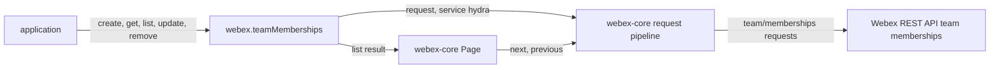
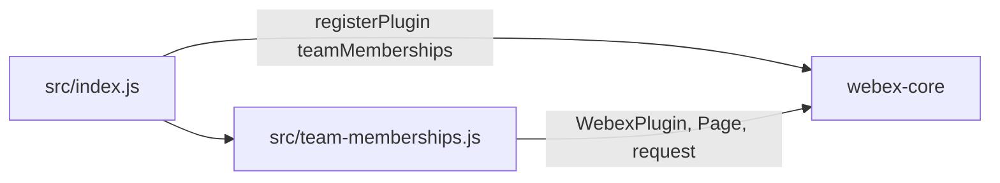
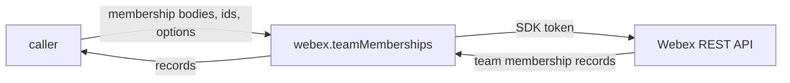

<!-- sdd-generated-metadata
doc_kind: standing-doc
generated_from: architecture@0.3.0
generated_by: claude-code
approved_by: rarajes2@cisco.com
updated_at: 2026-11-12T17:50:02Z
validation_status: pass
-->

# @webex/plugin-team-memberships architecture

Canonical architecture for this package. Flow behavior lives in the
[Team Memberships plugin specification](../src/docs/README.md). This page owns package boundaries, the
plugin registration, the contract index, and how the package meets the rest of the SDK.

Related context: [specification registry](specs/README.md) ·
[package agent instructions](../AGENTS.md)

## Applicability

| Condition ID                         | Status     | Evidence or reason | Owned section |
| ------------------------------------ | ---------- | ------------------ | ------------- |
| `repo.owns_datastore`                | N/A        | No database, file store, or migration in `src/team-memberships.js` | Repository data and schema |
| `repo.holds_client_state`            | N/A        | `src/team-memberships.js` sets no instance property and caches no record | Client state model |
| `repo.components_interact`           | Applicable | `src/index.js` registers the class from `src/team-memberships.js`, which extends the webex-core plugin base | Dependency and interaction topology |
| `repo.domain_data_across_components` | Applicable | Team membership records pass from Hydra through `src/team-memberships.js` to callers | Object and data ownership |
| `repo.caches_data`                   | N/A        | Nothing is kept after a call settles in `src/team-memberships.js` | Caching catalog |
| `repo.observability_convention`      | N/A        | `src/team-memberships.js` logs nothing and emits no metric or trace | Observability patterns |
| `repo.deploys_to_infra`              | N/A        | Library published to npm (`package.json`). No service runtime | Runtime and infrastructure |
| `repo.shared_base_libs`              | Applicable | Extends WebexPlugin and uses the legacy build and lint stack (`babel.config.js`, `.eslintrc.js`) | Shared and base libraries |
| `repo.is_monorepo`                   | N/A        | This SDD root is one package. The workspace around it is out of scope | Package map and inter-package dependencies |
| `repo.multi_platform`                | N/A        | `src/team-memberships.js` has no platform branch; `process` declares {browser: true} and is not imported | Platform matrix |
| `repo.published_package`             | Applicable | `package.json` name is @webex/plugin-team-memberships and deploy:npm publishes it | Release and versioning |
| `repo.embedded_in_host`              | N/A        | No host theme or embed API in `src/team-memberships.js` | Host integration and theming |
| `repo.exposes_commands_or_artifacts` | Applicable | build:src in `package.json` writes dist | Commands and generated artifacts |
| `repo.cross_repo_deps_material`      | Applicable | Behavior depends on the Webex REST API team memberships resource (`src/team-memberships.js`) | Cross-repository topology |
| `repo.security_arch_warranted`       | Applicable | Person emails, person ids, and team ids pass through `src/team-memberships.js` with the SDK authorization | Security architecture |

## Design overview

`@webex/plugin-team-memberships` is a published JavaScript library with one module. Importing it
registers `TeamMemberships` as the public plugin `teamMemberships`, reached as
`webex.teamMemberships`. The `webex` and `webex-node` bundles import it to register it; no other
workspace package calls it from its source.

A team membership is a person's relationship to a Webex team, served to applications by the
`team/memberships` resource of the Webex REST API, which the SDK reaches as catalog service `hydra`.
The plugin adds a person to a team (by person id or email, optionally as a moderator), reads and lists
memberships, changes a membership's moderator flag, and removes a person from a team. Each method is
one request that passes the caller's object to the service and the service's answer back.

The package serves no routes, caches nothing, persists nothing, and logs nothing.

## Resource inventory and responsibilities

| Resource | Kind | Responsibility | Owner | Source | Detailed specification |
| -------- | ---- | -------------- | ----- | ------ | ---------------------- |
| Team Memberships plugin | package (one module) | Registration; team membership records | @webex/web-sdk | src | [`src/docs/README.md`](../src/docs/README.md) |

## Interaction and execution flows

Representative end-to-end flow: an application adds a person to a team, lists the team's members page
by page, and later removes the person.

| From | To | Interaction or transport | Purpose | Failure or compatibility behavior |
| ---- | -- | ------------------------ | ------- | --------------------------------- |
| Application | `webex.teamMemberships` | In-process calls | Team membership records | Rejections propagate; a missing argument throws |
| `TeamMemberships` | Webex REST API | HTTPS through `webex.request`, service `hydra` | Team membership records | No retry here |
| `TeamMemberships` | webex-core `Page` | `new Page(res, webex)` | Paging of `list` | Page requests reject on failure |

## Dependency topology

| Dependency | Type | Used by | Purpose | Version, failure, or fallback policy |
| ---------- | ---- | ------- | ------- | ------------------------------------ |
| `@webex/webex-core` | Internal | `src/index.js`, `src/team-memberships.js` | Registration, plugin base, `Page`, `webex.request` | `workspace:*` in `package.json` |
| `@webex/internal-plugin-device` | Internal | The integration spec only | Registers `webex.internal.device` for the live tests | `workspace:*` dependency; not imported by `src/` |
| `@webex/plugin-teams`, `@webex/plugin-rooms`, `@webex/plugin-logger` | Internal peer | The integration spec only | Team and room setup and the logger for the live tests | Peer dependencies; not imported by `src/` |
| Webex REST API team memberships resource | External service | `src/team-memberships.js` | Team membership records | Resolved through the service catalog |

No import cycle exists: `@webex/webex-core` does not import this package.

## Public and consumer surfaces

| Surface | Type | Owner | Consumers | Compatibility policy | Source |
| ------- | ---- | ----- | --------- | -------------------- | ------ |
| `team-memberships-public-sdk` — package @webex/plugin-team-memberships, `webex.teamMemberships` with its five methods | SDK, published to npm, public | Team Memberships plugin | `webex`, `webex-node` (registration); applications (calls) | No versioning or deprecation rule is declared in the package | `package.json`, `src/index.js`, `src/team-memberships.js` |

The team memberships requests are a protocol this package speaks, described under *Protocol and wire
format* in the [module specification](../src/docs/README.md#protocol-and-wire-format). The other
contracts this package requires are registered in `.sdd/manifest.json` `contract_catalog`.

## Cross-cutting architecture

### Security

- Trust boundaries, scopes, and identity flow: see [Security architecture](#security-architecture).
- Sensitive surfaces and data classes: person emails, person and team ids, and the moderator flag.

### Observability and operations

- Logging and correlation: the package logs nothing. Request tracking comes from the webex-core
  interceptors.
- Metrics, traces, and audit signals: none.
- Ownership and operational entry points: `.github/CODEOWNERS` at the workspace root has no line for
  this package, so its default `*` rule assigns it to `@webex/web-sdk`. No dashboards or runbooks are
  recorded in this package.

### Quality attributes

- Compatibility: callers rely on the registered name `teamMemberships`, the Hydra team membership
  object, `list()` resolving a `Page`, and `remove` resolving `undefined` on 204.
- Latency: one request per call; `list` returns one page at a time, sized by `max`.
- Test confidence: the package has no unit tests, and the integration spec is not run by any script.
  No coverage threshold is enforced.

## Dependency and interaction topology

| From | To | Kind | Purpose | Ordering or failure boundary |
| ---- | -- | ---- | ------- | ---------------------------- |
| `src/index.js` | webex-core | Call at import | Register `teamMemberships` | First registration wins |
| `src/team-memberships.js` | webex-core | Import and inheritance | Plugin base, `request`, `Page` | Request errors reject the method |

## Object and data ownership

| Object or state | System of record | May write | May read | Movement or lifecycle |
| --------------- | ---------------- | --------- | -------- | --------------------- |
| Team membership (`id`, `teamId`, `personId`, `personEmail`, `isModerator`, `created`) | Webex REST API | Callers, through `create`, `update`, `remove` | Callers, through `get` and `list` | Fetched per call; never kept here |

## Shared and base libraries

| Library | Inherited responsibility | Consumers | Version floor | Compatibility rule |
| ------- | ------------------------ | --------- | ------------- | ------------------ |
| `@webex/webex-core` `WebexPlugin` | `webex` and `request` | `TeamMemberships` | `workspace:*` | Keep the registered name `teamMemberships` |
| `@webex/babel-config-legacy`, `@webex/eslint-config-legacy`, `@webex/jest-config-legacy`, `@webex/legacy-tools` | Build, lint, and test stack through one-line config files | Package tooling | `workspace:*` | Do not fork the config locally |

## Release and versioning

| Artifact | Publish target | Versioning rule | Deprecation window | Changelog or migration obligation |
| -------- | -------------- | --------------- | ------------------ | --------------------------------- |
| @webex/plugin-team-memberships | npm through `deploy:npm` | None declared in the package | None declared | None declared in the package; the workspace owns changelog generation |

## Commands and generated artifacts

| Command or artifact | Owner | Inputs | Output or side effect | Compatibility boundary |
| ------------------- | ----- | ------ | --------------------- | ---------------------- |
| `yarn build:src` | Package scripts | `src` | Writes `dist/` (JavaScript and source maps) through `webex-legacy-tools` | `dist/` is generated and never edited by hand |
| `yarn build` | Package scripts | `src` | Runs `build:src` | Same output |
| `yarn test:style` | Package scripts | `src` | ESLint run | The shared config ignores `docs/**` and `*.md` |

## Cross-repository topology

| Repository or external system | Relationship | Exchanged contract or artifact | Owner | Sequencing constraint |
| ----------------------------- | ------------- | ------------------------------ | ----- | --------------------- |
| `@webex/webex-core` (workspace sibling; module spec consulted) | Consumes | `registerPlugin`, `WebexPlugin`, `Page`, `request` | @webex/web-sdk | Registered before the first instance |
| `webex`, `webex-node` (workspace siblings) | Consumed by | The plugin registration | @webex/web-sdk | None |
| `@webex/plugin-teams`, `@webex/plugin-rooms` (workspace siblings; teams code and rooms spec consulted) | Test setup only | `teams.create`, `rooms.create` in the integration spec | @webex/web-sdk (teams); @webex/web-client and @webex/web-sdk (rooms) | None |
| Webex REST API team memberships resource | Consumes | Team membership records | Not recorded in this repository | None |

## Security architecture

- This package holds no credential and no key. Every request carries the SDK authorization added by
  webex-core. Neither the package nor its README names the OAuth scopes the team memberships resource
  needs.
- Membership ids go into request paths, options into query strings, and membership objects, with
  person emails, into request bodies. Logging is described under
  [Observability and operations](#observability-and-operations).
- What a caller may see or change is decided by the service for the authorized user: the JSDoc says the
  user must be a member of a team to list its memberships or invite people. The package passes records
  through and keeps no copy.

## Domain language

| Term | Repository-specific meaning | Authoritative source |
| ---- | --------------------------- | -------------------- |
| Team | A Webex group of rooms and people; created through `@webex/plugin-teams` | `src/team-memberships.js` |
| Team membership | A person's relationship to a team, with a moderator flag | `src/team-memberships.js` |
| Moderator | A team member whose `isModerator` is `true` | `src/team-memberships.js` |
| Hydra | The Webex REST API, reached as catalog service `hydra` | `src/team-memberships.js` |

## References and maintenance

- Decisions: [adr/](adr/index.md)
- Instantiated specifications and routing: [specs/README.md](specs/README.md)
- Repository rules and patterns: [package agent instructions](../AGENTS.md)
- Update this document in the same change that alters package boundaries, resource ownership,
  cross-resource interaction, or cross-cutting architecture.
