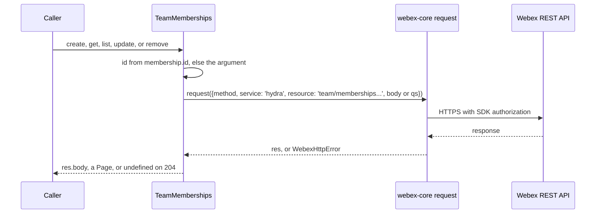
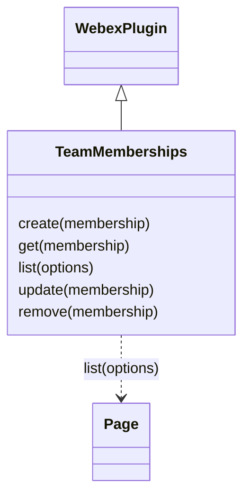

<!-- sdd-generated-metadata
doc_kind: module-spec
generated_from: module-spec@0.3.0
generated_by: claude-code
approved_by: rarajes2@cisco.com
updated_at: 2026-11-12T17:50:02Z
validation_status: pass
-->

# Team Memberships plugin

This source-local document at `src/docs/README.md` owns the stable specification for **the Team
Memberships plugin**: the public plugin `webex.teamMemberships`. It adds people to Webex teams, reads,
lists, and updates their team memberships, and removes them, through the `team/memberships` resource of
the Webex REST API (catalog service `hydra`). Each method sends one request and resolves what the
service returns; nothing is validated, cached, or persisted here. Ground every claim in package evidence
and link to the [package architecture](../../docs/architecture.md) instead of repeating broader facts.
No service specification exists because this package is a library.

Related context: [documentation index](../../docs/index.md) ·
[package agent instructions](../../AGENTS.md)

## Metadata

| Field             | Value |
| ----------------- | ----- |
| Owner             | @webex/web-sdk |
| Source path       | `src` |
| Resource kind     | package |
| Status            | Draft |
| Last verified     | 2026-11-12 at `46f5268b3a` |
| Module id         | `plugin-team-memberships` |
| Parent spec       | — |
| Doc kind          | Module spec |
| Coverage score    | 100% assessed 2026-11-12 by the generator — 13 of 13 mandatory fields PRESENT, critical 7 of 7; the package has no unit tests and no `test:unit` script, so no requirement has running test evidence; `test/integration/spec/team-memberships.js` holds 8 live-service cases that no script runs |
| Validation status | Pass — validator runtime 01a1d0de-3a7e-7e50-a7bb-141639802749, 2026-11-12; no findings |

## Applicability

| Condition ID                         | Status     | Evidence or reason | Owned section |
| ------------------------------------ | ---------- | ------------------ | ------------- |
| `module.has_tiers`                   | N/A        | No tier policy exists in `package.json` or `src/team-memberships.js` | Tier |
| `module.has_ui`                      | N/A        | `src/team-memberships.js` returns membership records; it renders nothing | UI use-case flow |
| `module.crosses_service_boundaries`  | Applicable | `src/team-memberships.js` calls the Webex REST API team memberships resource | Cross-boundary use-case flow |
| `module.holds_client_state`          | N/A        | `src/team-memberships.js` sets no instance property and caches no record | Client state model |
| `module.enforces_domain_rules`       | Applicable | The membership-or-id rule and the 204 handling in `src/team-memberships.js` | Business rules and invariants |
| `module.is_concurrent_async`         | Applicable | Every method in `src/team-memberships.js` returns a promise of a network request | Concurrency and reactive flow |
| `module.owns_persistence`            | N/A        | Nothing is stored; `src/team-memberships.js` resolves what the service returns | Data, schema, and migration discipline |
| `module.stateful_transitions`        | N/A        | No entity moves through states in `src/team-memberships.js`; moderator is a flag the caller sets | State machine |
| `module.exposes_wire_protocol`       | Applicable | The five team memberships requests built in `src/team-memberships.js` | Protocol and wire format |
| `module.ui_multi_screen`             | N/A        | No UI | UI flow |
| `module.large_data_model`            | N/A        | One shape, the team membership object, typed only by JSDoc in `src/team-memberships.js`; covered under Protocol and wire format | Data model |
| `module.returns_caller_errors`       | Applicable | Request failures reject, and a missing argument throws, from `src/team-memberships.js` | Caller-visible failure modes |
| `module.module_specific_conventions` | Applicable | Service hydra, the team/memberships resource, and the object-or-id argument in `src/team-memberships.js` | Module-specific rules |
| `module.published_package`           | Applicable | `package.json` names the package @webex/plugin-team-memberships and defines deploy:npm | Export stability |
| `module.embedded_in_host`            | N/A        | No host theme or embed API | Host integration and theming |
| `module.has_design_tradeoff`         | Applicable | Caller objects pass to Hydra unchanged and Hydra results pass back unchanged in `src/team-memberships.js` | Key design trade-off |
| `module.has_submodules`              | N/A        | The src directory has no child module | Sub-modules |

## Evidence register

| Evidence | What it establishes |
| -------- | ------------------- |
| `src/index.js` | `registerPlugin('teamMemberships', TeamMemberships)` with no options; re-exports only the default `TeamMemberships`; imports nothing but `@webex/webex-core` and the class |
| `src/team-memberships.js` | `TeamMemberships` extends `WebexPlugin` with `create`, `get`, `list`, `remove`, and `update`, and imports `WebexPlugin` and `Page` from `@webex/webex-core`; the `TeamMembershipObject` typedef. Its JSDoc and one code comment are the only recorded rationale |
| `package.json` | Name, `main` (`dist/index.js`), `devMain` (`src/index.js`), `engines` (`node >=18`), dependencies on `@webex/webex-core` and `@webex/internal-plugin-device`, peer dependencies on `@webex/plugin-logger`, `@webex/plugin-rooms`, and `@webex/plugin-teams`, and scripts; `build`, `build:src`, `test:style`, `test:browser`, `deploy:npm`, and `test` exist, and `test:unit` and `test:integration` do not |
| `test/integration/spec/team-memberships.js` | 8 live-service cases: `create` by person id, by email, and as moderator; `get`; `list` for a team and with `max: 1` and paging; `update` of the moderator flag; `remove`. It imports the device, logger, rooms, and teams plugins, which `src/` does not. No package script runs it (see Verification) |
| `README.md` | Retained npm page; context only. Its Usage block is not valid JavaScript; see `docs/adr/0001-retain-product-readme.md` |
| Sibling package webex-core, file src/docs/README.md | Module spec consulted, agrees with code. `registerPlugin` keeps the first registration of a name (MOD-013) and adds `webex.<name>` to later instances (MOD-014); one request function is the entry for all plugin HTTP traffic (MOD-028); status failures become `WebexHttpError` (MOD-027) whose message names the method, service, and resource (MOD-048); `WebexPlugin.webex` resolves the root instance (MOD-043); `Page` stores the body items and Link headers and pages with `next` (MOD-054) |
| Sibling package plugin-rooms, file src/docs/README.md | Module spec consulted for a peer dependency the integration spec uses: `webex.rooms.create(room)` POSTs the body to the rooms resource (MOD-002), which the spec uses to add a room to the test team |
| Sibling package plugin-teams, file src/teams.js | No module spec exists, so the code is the referee. Importing it registers public plugin `teams`; `create(team)` POSTs the body to resource `teams` of service `hydra` and resolves the body. The integration spec creates its team with it |
| Sibling packages internal-plugin-device and plugin-logger, file src/docs/README.md of each | Module specs consulted. Importing internal-plugin-device registers internal plugin `device` (device MOD-001); importing plugin-logger registers `logger` with `replace: true` (logger MOD-001). Only the integration spec imports them |
| Sibling package test-helper-chai, file src/assertions/schemas.js | No module spec exists, so the code is the referee. `assert.isTeamMembership` requires `id`, `teamId`, `personId`, `personEmail`, `isModerator`, and `created`, Hydra ids for the three ids, an email, and an ISO date |
| Observation, no stated WHY | Behavior the code shows without stating a reason is recorded once, under Pitfalls and constraints or Caller-visible failure modes |

## Purpose and boundary

- Responsibility: give applications Webex team memberships as Hydra-style records — add a person to a
  team, read one membership, list memberships, change a membership (the moderator flag), and remove a
  person from a team.
- In scope: registration of `teamMemberships`; the five public methods; resolving a membership id from
  an object or a string.
- Out of scope: the request pipeline, authorization, service-catalog resolution, error types, and
  paging (`@webex/webex-core`); teams themselves (`@webex/plugin-teams`); room memberships
  (`@webex/plugin-memberships`); checking who may add or remove members, which the service decides;
  validating or caching membership records; what Hydra stores or returns.
- Consumers: in this repository `webex` (`src/webex.js`) and `webex-node` (`src/webex-node.js`) import
  the package to register it, and the `webex` integration spec `commonjs.js` checks that
  `webex.teamMemberships` exists. `@webex/test-helper-mock-webex` lists `teamMemberships` among its
  public plugin names. No file under another package's `src/` and no workspace sample calls
  `webex.teamMemberships`. Applications reach the plugin as `webex.teamMemberships`.

## Structure and key files

| Path | Responsibility |
| ---- | -------------- |
| `src/index.js` | Registers public plugin `teamMemberships` and re-exports the class as default |
| `src/team-memberships.js` | `TeamMemberships` and the `TeamMembershipObject` typedef |
| `package.json` | Package name, entry points, scripts, dependencies, and peer dependencies |
| `babel.config.js`, `jest.config.js` | Re-exports of the legacy Babel and Jest configurations; no unit spec uses the Jest one |
| `.eslintrc.js` | Sets `root: true` and extends `@webex/eslint-config-legacy` |
| `process` | Package-root file exporting `{browser: true}`; not imported by `src/` |
| `src/docs/README.md` | This module specification; ignored by the build and by lint |
| `test/integration/spec/team-memberships.js` | Live-service cases; only `test:browser` would run them |
| dist/ (generated) | Build output of `build:src`; ignored by Git and never edited by hand |

## Public surface

| Surface | Consumer | Compatibility commitment | Source |
| ------- | -------- | ------------------------ | ------ |
| Import side effect: public plugin `teamMemberships` | `webex`, `webex-node` | First registration of the name wins; reached as `webex.teamMemberships` | `src/index.js` |
| `create(membership)`, `get(membership)`, `update(membership)`, `remove(membership)` | Applications | Hydra team membership records; `remove` resolves `undefined` on 204 | `src/team-memberships.js` |
| `list(options)` | Applications | Resolves a webex-core `Page` of team membership records | `src/team-memberships.js` |
| Default export `TeamMemberships` | Hosts that mount the class themselves | The entry exports nothing else | `src/index.js` |

Contract ID `team-memberships-public-sdk` is indexed in the
[package architecture](../../docs/architecture.md#public-and-consumer-surfaces) and registered in
`.sdd/manifest.json`. Export stability is under [Export stability](#export-stability).

## Dependencies

| Dependency | Why it is required | Failure behavior |
| ---------- | ------------------ | ---------------- |
| `@webex/webex-core` (module spec consulted) | `registerPlugin`, `WebexPlugin` (`webex`, `request`), `Page`, and the request pipeline that resolves `service: 'hydra'` and adds authorization | A request rejection rejects the method |
| `@webex/internal-plugin-device` (dependency; module spec consulted) | Listed in `dependencies`, but no file under `src/` imports it; only the integration spec imports it to register `webex.internal.device` | — |
| `@webex/plugin-teams`, `@webex/plugin-rooms`, `@webex/plugin-logger` (peer dependencies; teams code consulted, rooms and logger specs consulted) | No file under `src/` imports or calls them; the integration spec uses `webex.teams.create` and `webex.rooms.create` to build its test team and imports the logger | — |
| Webex REST API team memberships resource (external) | Membership records and the membership rules | Errors propagate |

## Requirements

| ID | WHAT | WHY | Source evidence | Test or example evidence | Assumptions or gaps | Confidence |
| -- | ---- | --- | --------------- | ------------------------ | ------------------- | ---------- |
| `MOD-001` | Importing the package registers `TeamMemberships` as public plugin `teamMemberships` with no config or other options. The entry re-exports only the default `TeamMemberships`. | Applications reach team memberships as `webex.teamMemberships`, and the `webex` and `webex-node` bundles register it by import (inferred from `registerPlugin` and those imports; webex-core MOD-013, MOD-014). | `src/index.js` | `test/integration/spec/team-memberships.js` imports the package and relies on it, but is not run | WHY inferred | Weak |
| `MOD-002` | `create(membership)` sends `POST team/memberships` to service `hydra` with `membership` as the body through `this.request` and resolves the response body. | The JSDoc: add someone to a team by person id or email address, optionally making them a moderator. | `src/team-memberships.js` | `test/integration/spec/team-memberships.js` create cases by person id, by email, and as moderator (not run) | — | Present |
| `MOD-003` | `get(membership)` takes `membership.id`, else `membership` itself, sends `GET team/memberships/<id>` to service `hydra` with no query, and resolves `res.body.items` when present, else `res.body`. | The JSDoc: get details for a membership by id. | `src/team-memberships.js` | `test/integration/spec/team-memberships.js` get case (not run) | Why `items` is checked is not stated | Present |
| `MOD-004` | `list(options)` sends `GET team/memberships` to service `hydra` with `qs: options` and resolves `new Page(res, webex)`. | The JSDoc: lists team memberships, by default those of the teams the authenticated user belongs to. Paging is the webex-core `Page` (webex-core MOD-054). | `src/team-memberships.js` | `test/integration/spec/team-memberships.js` list cases for a team, and with `max: 1` paging through three memberships (not run) | — | Present |
| `MOD-005` | `update(membership)` takes `membership.id`, else `membership`, sends `PUT team/memberships/<id>` to service `hydra` with the whole `membership` as the body, and resolves the response body. | The JSDoc: updates properties for a membership; the integration spec uses it to turn the moderator flag on and off. | `src/team-memberships.js` | `test/integration/spec/team-memberships.js` update case (not run) | A string argument is sent as the body; see Caller-visible failure modes | Present |
| `MOD-006` | `remove(membership)` takes `membership.id`, else `membership`, sends `DELETE team/memberships/<id>` to service `hydra`, and resolves `undefined` when the status is 204, else the response body. | The code comment: Firefox has issues with 204s or DELETE, and the handling should move to http-core. | `src/team-memberships.js` | `test/integration/spec/team-memberships.js` remove case expects an empty result and the membership gone from a later list (not run) | — | Present |

## Design overview

`TeamMemberships` is a `WebexPlugin` with five methods and no state. Each method sends one request to
the `team/memberships` resource of catalog service `hydra` through `this.request`, so the webex-core
interceptors add authorization and resolve the service URL. The caller's object is the request body as
given, and the response body is the result; `list` wraps the response in a webex-core `Page`, and
`remove` turns a 204 into `undefined`.

`get`, `update`, and `remove` accept a membership object or its id. Who may list, add, change, or
remove members is decided by the service: the JSDoc says that, as in the Webex app, you must be a
member of the team to list its memberships or invite people. Nothing is cached; every call reaches the
service.

## Data flow and sequence coverage

Call style: in-process method calls on `webex.teamMemberships`; outbound HTTPS through `webex.request`
to catalog service `hydra`. There is one operation group, and every method has the same shape: one
request per call, as Diagram 1 shows.

| Operation group | Entry and outcome | Diagram or evidence | Failure and recovery coverage |
| --------------- | ----------------- | ------------------- | ----------------------------- |
| Team membership records | `create`, `get`, `list`, `update`, `remove`; one Hydra request each | Diagram 1; `src/team-memberships.js` | The request error rejects; nothing is retried |

Diagram 1 — one team membership call:

## Class and component relationships

## Use cases and flows

| Use case | Actor or caller | Primary steps and outcome | Failure or boundary behavior | Evidence |
| -------- | --------------- | ------------------------- | ---------------------------- | -------- |
| `UC-001` | Application adding a person to a team | `create({teamId, personId})` or `create({teamId, personEmail})`, optionally with `isModerator: true`; resolves the new membership | The Hydra error rejects; the plugin checks no field | `src/team-memberships.js` |
| `UC-002` | Application listing team members | `list({teamId, max})` resolves a `Page`; `hasNext()` and `next()` fetch further pages | The request error rejects | `src/team-memberships.js` |
| `UC-003` | Application reading one membership | `get(membership)` or `get(id)` resolves the membership | The request error rejects; a missing argument throws | `src/team-memberships.js` |
| `UC-004` | Application making someone a moderator, or not | Set `isModerator` on the membership object and `update(membership)`; resolves the updated membership | The request error rejects | `src/team-memberships.js` |
| `UC-005` | Application removing a person from a team | `remove(membership)` or `remove(id)`; resolves `undefined` on 204 | The request error rejects | `src/team-memberships.js` |

### Cross-boundary use-case flow

| Boundary | Transport and ordering | Compatibility | Timeout, retry, and recovery |
| -------- | ---------------------- | ------------- | ---------------------------- |
| Webex REST API team memberships resource (`UC-001` to `UC-005`) | HTTPS through `webex.request`, catalog service `hydra`, one request per call | Requests and the membership object under Protocol and wire format | No retry or timeout in this module; webex-core interceptors apply |

## Business rules and invariants

| ID | Invariant | WHY | Enforcement source | Test evidence |
| -- | --------- | --- | ------------------ | ------------- |
| `INV-001` | Every request goes through `this.request` to service `hydra` and a resource under `team/memberships`. | One request function carries all plugin HTTP traffic, so authorization, the service catalog, and error conversion apply (webex-core MOD-027, MOD-028). | `src/team-memberships.js` | Only `test/integration/spec/team-memberships.js`, which is not run |
| `INV-002` | `get`, `update`, and `remove` use `membership.id` as the id when it is truthy, and otherwise the argument itself. | The JSDoc types the `get` and `remove` argument as a membership object or a string; `update` is typed as an object only. | `src/team-memberships.js` | Only `test/integration/spec/team-memberships.js`, which passes objects, and is not run |
| `INV-003` | A 204 answer to `remove` resolves `undefined`, never a body. | The code comment on Firefox and 204 or DELETE responses. | `src/team-memberships.js` | Only `test/integration/spec/team-memberships.js`, which asserts an empty result, and is not run |
| `INV-004` | The plugin sends the caller's object as the body unchanged and returns the response unchanged; it adds, removes, and checks no field. | Membership rules belong to the service: the JSDoc says you must be a member of a team to list its memberships or invite people (inferred: the plugin does not repeat them). | `src/team-memberships.js` | None found |

## Concurrency and reactive flow

- Execution model: one JavaScript event loop; every public method returns the promise of one request.
- Ordering guarantees: none across calls; each call settles independently, in the order the service
  answers.
- Parallel work: none inside a method; callers may run several calls at once, as the integration spec
  does with `Promise.all`.
- Idempotency and retry: `get` and `list` are reads and safe to repeat; `update` with the same body
  repeats to the same end state; `remove` of a removed membership is answered by the service. `create`
  sends a new request each time; what Hydra answers for a person already in the team is not recorded in
  this repository. Nothing is retried here.
- Fire-and-forget work: none.
- Shared-state protection: the plugin holds no state.

## Protocol and wire format

| Message or frame | Version | Producer or serializer | Consumer or parser | Compatibility and ordering rule |
| ---------------- | ------- | ---------------------- | ------------------ | ------------------------------- |
| `POST <hydra>/team/memberships` with the membership body | Unversioned path under the catalog URL | `create` | Webex REST API | Body is the caller's object as given |
| `GET <hydra>/team/memberships/<id>` | Unversioned | `get` | Webex REST API | No query is sent; the id is interpolated without URL encoding |
| `GET <hydra>/team/memberships?<options>` | Unversioned | `list` | Webex REST API | Every key of `options` becomes a query parameter; the response is read by `Page` |
| `PUT <hydra>/team/memberships/<id>` with the membership body | Unversioned | `update` | Webex REST API | The whole argument, `id` included, is the body |
| `DELETE <hydra>/team/memberships/<id>` | Unversioned | `remove` | Webex REST API | A 204 resolves `undefined` |
| Team membership object `{id, teamId, personId, personEmail, isModerator, created}` | — | Webex REST API | Callers | The JSDoc typedef names these fields and marks `id` and `created` as server generated; the test assertion `isTeamMembership` expects Hydra ids for `id`, `teamId`, and `personId`, an email, and an ISO `created` date |

## Caller-visible failure modes

| Condition | Signal or result | Caller behavior | Retry or recovery | Evidence |
| --------- | ---------------- | --------------- | ----------------- | -------- |
| A Hydra request fails, for example when the caller is not a member of the team or the membership does not exist | The method rejects with the webex-core `WebexHttpError`, whose message names the method, service, and resource (webex-core MOD-027, MOD-048) | Handle the error | Call again | `src/team-memberships.js` |
| `get`, `update`, or `remove` is called with `null` or `undefined` | Reading `membership.id` throws a `TypeError` synchronously; no promise is returned and no request is sent | Pass a membership object or id | — | `src/team-memberships.js` |
| `get`, `update`, or `remove` is called with an object that has no `id` | The object itself becomes the id, so the path ends in `[object Object]`, and the service's error rejects the method | Pass an object with `id`, or the id | — | `src/team-memberships.js` |
| `update` is called with an id string | The id is right, but the string is also sent as the request body; what Hydra answers is not recorded in this repository | Pass the membership object | — | `src/team-memberships.js` |
| `create` is called without `teamId`, or without both `personId` and `personEmail` | The plugin sends the body anyway; the service's error rejects the method | Pass the fields the JSDoc names | — | `src/team-memberships.js` |

## Pitfalls and constraints

- `get` accepts no options, unlike `list`, so a query cannot be added to a single read.
- The `list` JSDoc types `options.max` as a string and its return as the placeholder `[type]`; the
  method resolves a `Page`, whose `length` and `items` the JSDoc example reads.
- The `get` JSDoc example asserts that the fetched membership deep-equals the created one, while the
  integration spec skips that assertion because the `created` dates do not match.
- `update` is the only method without a JSDoc example.
- The integration spec's `max: 1` case expects exactly three memberships in its team (the team creator
  plus two added users), so it depends on the team creator being listed as a member.
- `test:style` reports no warning or error for `src/index.js` and `src/team-memberships.js`, plus "File
  ignored" for this specification.

## Module-specific rules

- Do: send every request to service `hydra` through `this.request` so webex-core interceptors, the
  catalog, and error conversion apply (`INV-001`).
- Do: keep accepting a membership object or its id in `get`, `update`, and `remove` (`INV-002`).
- Do: keep resolving `undefined` for a 204 from `remove` until http-core handles it, as the code comment
  asks (`INV-003`).
- Do not: add client-side checks or field rewriting without a change request; callers rely on the body
  passing through unchanged (`INV-004`).
- Do not: change the registered name `teamMemberships`; `webex`, `webex-node`, and their integration
  spec rely on it.
- Do not: log person emails, person ids, or team ids through `webex.logger`; the plugin logs nothing
  today.

## Export stability

| Export or entry point | Consumer | Stability | Versioning and deprecation rule | Declaration or API report |
| --------------------- | -------- | --------- | ------------------------------- | ------------------------- |
| Import side effect: public plugin `teamMemberships` | `webex`, `webex-node` | Public | No rule is declared in the package | `src/index.js` |
| Default export `TeamMemberships` and its five public methods | Applications | Public | Same | `src/index.js`, `src/team-memberships.js` |

The build writes JavaScript only; `package.json` has no `types` entry, so no declarations or API
report are published.

## Key design trade-off

| Chosen trade-off | Preserved invariant or benefit | Cost or limitation | Decision evidence |
| ---------------- | ------------------------------ | ------------------ | ----------------- |
| A thin pass-through: the caller's object is the body and the service's answer is the result, with no client-side check | One request per call, and the service stays the only judge of membership rules (`INV-001`, `INV-004`) | Bad input reaches the network, or throws synchronously when the argument is missing; field names are typed only by JSDoc | `src/team-memberships.js` |

## Verification

| Requirement or invariant | Test level | Positive evidence | Negative or boundary evidence | Gap |
| ------------------------ | ---------- | ----------------- | ----------------------------- | --- |
| `MOD-001` | None run | `test/integration/spec/team-memberships.js` (not run) | None found | No unit case |
| `MOD-002` to `MOD-006` | None run | `test/integration/spec/team-memberships.js` (not run) | `test/integration/spec/team-memberships.js` remove case expects an empty result (not run) | No unit case for any request or result |
| `INV-001` to `INV-004` | None run | `test/integration/spec/team-memberships.js` (not run) | None found | The id rule, the 204 branch, and the missing-argument throw have no case |

The package has no unit tests: `package.json` defines no `test:unit` script and there is no `test/unit`
directory. No package script runs `test/integration/spec/team-memberships.js` either: there is no
`test:integration`, and `test:browser` reported 0 tests on 2026-11-12 because the karma bundle failed
to parse `isbot`, while still exiting 0. The aggregate `test` script exits 1 at the missing
`test:unit`. `build:src` and `test:style` exit 0. A module specification is complete only when its
public surface, invariants, failure modes, and test evidence agree with the implementation.
Generator-side field measurement is complete (100%, assessed 2026-11-12); independent validation
passed on 2026-11-12 under validator runtime 01a1d0de-3a7e-7e50-a7bb-141639802749, with no findings. The module stays Partial
until a unit suite, a characterization baseline, and promotion review are complete.
