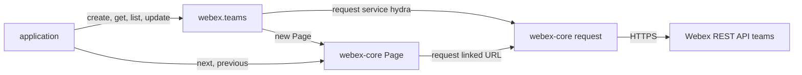
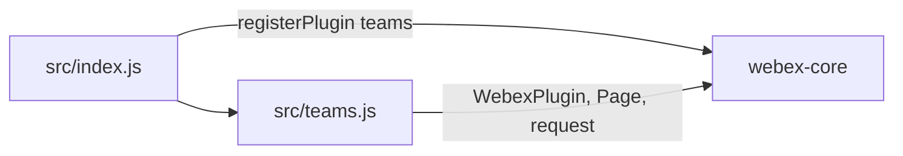

<!-- sdd-generated-metadata
doc_kind: standing-doc
generated_from: architecture@0.3.0
generated_by: claude-code
approved_by: rarajes2@cisco.com
updated_at: 2026-11-12T17:50:28Z
validation_status: pass-with-warnings
-->

# @webex/plugin-teams architecture

Canonical architecture for this package. Flow behavior lives in the
[Teams plugin specification](../src/docs/README.md). This page owns package boundaries, the plugin
registration, the contract index, and how the package meets the rest of the SDK.

Related context: [specification registry](specs/README.md) ·
[package agent instructions](../AGENTS.md)

## Applicability

| Condition ID                         | Status     | Evidence or reason | Owned section |
| ------------------------------------ | ---------- | ------------------ | ------------- |
| `repo.owns_datastore`                | N/A        | No database, file store, or migration in `src/teams.js` | Repository data and schema |
| `repo.holds_client_state`            | N/A        | `src/teams.js` sets no instance property and caches no team record | Client state model |
| `repo.components_interact`           | Applicable | `src/index.js` imports `src/teams.js` and registers it through webex-core, whose request and Page the plugin calls | Dependency and interaction topology |
| `repo.domain_data_across_components` | Applicable | Team records pass from Hydra through webex-core and `src/teams.js` to callers | Object and data ownership |
| `repo.caches_data`                   | N/A        | Nothing is kept after a call settles in `src/teams.js` | Caching catalog |
| `repo.observability_convention`      | N/A        | `src/teams.js` logs nothing and emits no metric or trace | Observability patterns |
| `repo.deploys_to_infra`              | N/A        | Library published to npm (`package.json`). No service runtime | Runtime and infrastructure |
| `repo.shared_base_libs`              | Applicable | Extends WebexPlugin and uses the legacy build and lint stack (`babel.config.js`, `.eslintrc.js`) | Shared and base libraries |
| `repo.is_monorepo`                   | N/A        | This SDD root is one package. The workspace around it is out of scope | Package map and inter-package dependencies |
| `repo.multi_platform`                | N/A        | `src/teams.js` has no platform branch; `process` declares {browser: true} and is not imported | Platform matrix |
| `repo.published_package`             | Applicable | `package.json` name is @webex/plugin-teams and deploy:npm publishes it | Release and versioning |
| `repo.embedded_in_host`              | N/A        | No host theme or embed API in `src/teams.js` | Host integration and theming |
| `repo.exposes_commands_or_artifacts` | Applicable | build:src in `package.json` writes dist | Commands and generated artifacts |
| `repo.cross_repo_deps_material`      | Applicable | Behavior depends on the Webex REST API teams resource (`src/teams.js`) | Cross-repository topology |
| `repo.security_arch_warranted`       | N/A        | `src/teams.js` handles no credential, scope, or identity, and `README.md` names no scope; the security notes under Cross-cutting architecture are enough | Security architecture |

## Design overview

`@webex/plugin-teams` is a published JavaScript library with one module. Importing it registers `Teams`
as the public plugin `teams`, reached as `webex.teams`. The `webex` and `webex-node` bundles require it
to register it; no other workspace package calls it from its source.

A team is a named Webex record that rooms can belong to: the integration spec creates rooms with
`teamId` through `webex.rooms`, and plugin-team-memberships adds people to a team. The Webex REST API
serves teams through its `teams` resource, which the SDK reaches as catalog service `hydra`. The plugin offers four calls on that
resource — create, get, list, and update — and returns what the service answers. Rooms inside a team
belong to `webex.rooms` (with `teamId`) and team membership to plugin-team-memberships.

The package serves no routes, caches nothing, persists nothing, and emits no events.

## Resource inventory and responsibilities

| Resource | Kind | Responsibility | Owner | Source | Detailed specification |
| -------- | ---- | -------------- | ----- | ------ | ---------------------- |
| Teams plugin | package (one module) | Registration; team records | @webex/web-sdk | src | [`src/docs/README.md`](../src/docs/README.md) |

## Interaction and execution flows

Representative end-to-end flow: an application creates a team, renames it, and lists its teams page by
page.

| From | To | Interaction or transport | Purpose | Failure or compatibility behavior |
| ---- | -- | ------------------------ | ------- | --------------------------------- |
| Application | `webex.teams` | In-process calls | Team records | Rejections propagate; a missing argument to `get` or `update` throws |
| `Teams` | Webex REST API | HTTPS through `webex.request`, service `hydra` | Team records | No retry here |
| Application | webex-core `Page` | `next()`, `previous()`, iteration | Further pages of `list` | Rejections propagate |

## Dependency topology

| Dependency | Type | Used by | Purpose | Version, failure, or fallback policy |
| ---------- | ---- | ------- | ------- | ------------------------------------ |
| `@webex/webex-core` | Internal | `src/index.js`, `src/teams.js` | Registration, plugin base, `Page`, `webex.request` | `workspace:*` in `package.json` |
| `@webex/internal-plugin-device`, `lodash` | Internal; external library | The integration spec only | Declared in `dependencies` but not imported by `src/` | `workspace:*`; `^4.17.21` |
| `@webex/plugin-rooms`, `@webex/plugin-memberships`, `@webex/plugin-logger` | Internal peer | The integration spec only | Rooms in a team and the skipped leave case | Peer dependencies; not reached by `src/` |
| Webex REST API teams resource | External service | `src/teams.js` | Team records | Resolved through the service catalog |

No import cycle exists: `@webex/webex-core` does not import this package.

## Public and consumer surfaces

| Surface | Type | Owner | Consumers | Compatibility policy | Source |
| ------- | ---- | ----- | --------- | -------------------- | ------ |
| `teams-public-sdk` — package @webex/plugin-teams, `webex.teams` with its four methods | SDK, published to npm, public | Teams plugin | `webex`, `webex-node` (registration); applications and the plugin-team-memberships integration spec (calls) | No versioning or deprecation rule is declared in the package | `package.json`, `src/index.js`, `src/teams.js` |

The teams requests and the team object are a protocol this package speaks, described under
*Protocol and wire format* in the
[module specification](../src/docs/README.md#protocol-and-wire-format). The other contracts this
package requires are registered in `.sdd/manifest.json` `contract_catalog`.

## Cross-cutting architecture

### Security

- Trust boundaries, scopes, and identity flow: this package holds no credential and no key. Every
  request carries the SDK authorization that webex-core adds; neither the README nor the JSDoc names
  the scopes the teams resource requires. What a caller may see or change is decided by the service for
  the authorized user.
- Sensitive surfaces and data classes: team names and team ids. Ids go into request paths and options
  into query strings; the package logs none of them.

### Observability and operations

- Logging and correlation: the package logs nothing. Request tracking comes from the webex-core
  interceptors, and a failed request's `WebexHttpError` message names the method, service, and
  resource.
- Metrics, traces, and audit signals: none.
- Ownership and operational entry points: `.github/CODEOWNERS` at the workspace root has no line for
  `packages/@webex/plugin-teams`, so its default rule assigns it to `@webex/web-sdk`. No dashboards or
  runbooks are recorded in this package.

### Quality attributes

- Compatibility: callers rely on the registered name `teams`, `get` accepting an object or an id, the
  team object as the service returns it, and `list().items` through `Page`.
- Latency: one request per call; `list` returns one page at a time.
- Test confidence: the package has no unit tests, and the integration spec is not run by any script.
  No coverage threshold is enforced.

## Dependency and interaction topology

| From | To | Kind | Purpose | Ordering or failure boundary |
| ---- | -- | ---- | ------- | ---------------------------- |
| `src/index.js` | `src/teams.js` | Import | The plugin class | — |
| `src/index.js` | webex-core | Call at import | Register `teams` | First registration wins |
| `src/teams.js` | webex-core | Import and calls | Base class, request, paging | Request failures reject the method |

## Object and data ownership

| Object or state | System of record | May write | May read | Movement or lifecycle |
| --------------- | ---------------- | --------- | -------- | --------------------- |
| Team record (`id`, `name`, `created`, and other fields) | Webex REST API | Callers, through `create` and `update` | Callers, through `get` and `list` | Fetched per call; never kept here; never deleted through this package |
| Page of teams | webex-core `Page` held by the caller | Not this package | Callers | Built per `list` or `next()` call |

## Shared and base libraries

| Library | Inherited responsibility | Consumers | Version floor | Compatibility rule |
| ------- | ------------------------ | --------- | ------------- | ------------------ |
| `@webex/webex-core` `WebexPlugin` | `webex` and `request` | `Teams` | `workspace:*` | Keep the registered name `teams` |
| `@webex/babel-config-legacy`, `@webex/eslint-config-legacy`, `@webex/jest-config-legacy`, `@webex/legacy-tools` | Build, lint, and test stack through one-line config files | Package tooling | `workspace:*` | Do not fork the config locally |

## Release and versioning

| Artifact | Publish target | Versioning rule | Deprecation window | Changelog or migration obligation |
| -------- | -------------- | --------------- | ------------------ | --------------------------------- |
| @webex/plugin-teams | npm through `deploy:npm` | None declared in the package | None declared | None declared in the package; the workspace owns changelog generation |

## Commands and generated artifacts

| Command or artifact | Owner | Inputs | Output or side effect | Compatibility boundary |
| ------------------- | ----- | ------ | --------------------- | ---------------------- |
| `yarn build:src` | Package scripts | `src` | Writes `dist/` (JavaScript and source maps) through `webex-legacy-tools` | `dist/` is generated and never edited by hand |
| `yarn build` | Package scripts | `src` | Runs `build:src` | Same output |
| `yarn test:style` | Package scripts | `src` | ESLint run | The shared config ignores `docs/**` and `*.md` |

## Cross-repository topology

| Repository or external system | Relationship | Exchanged contract or artifact | Owner | Sequencing constraint |
| ----------------------------- | ------------- | ------------------------------ | ----- | --------------------- |
| `@webex/webex-core` (workspace sibling; module spec consulted) | Consumes | `registerPlugin`, `WebexPlugin`, `Page`, `request` | @webex/web-client, @webex/web-sdk | Registered before the first instance |
| `webex`, `webex-node` (workspace siblings) | Consumed by | The plugin registration | @webex/web-sdk | None |
| `@webex/plugin-team-memberships` (workspace sibling) | Consumed by, in its integration spec only | `webex.teams.create` | @webex/web-sdk | None |
| Webex REST API teams resource | Consumes | Team records | Not recorded in this repository | None |

## Domain language

| Term | Repository-specific meaning | Authoritative source |
| ---- | --------------------------- | -------------------- |
| Team | A named Webex record that rooms join through `teamId` | `test/integration/spec/teams.js` |
| Hydra | The Webex REST API, reached as catalog service `hydra` | `src/teams.js` |
| Team object | The record the teams resource returns; the JSDoc names `id`, `name`, and `created` | `src/teams.js` |
| Page | The webex-core wrapper `list` resolves, with `items`, `hasNext`, and `next` | `src/teams.js` |

## References and maintenance

- Decisions: [adr/](adr/index.md)
- Instantiated specifications and routing: [specs/README.md](specs/README.md)
- Repository rules and patterns: [package agent instructions](../AGENTS.md)
- Update this document in the same change that alters package boundaries, resource ownership,
  cross-resource interaction, or cross-cutting architecture.
