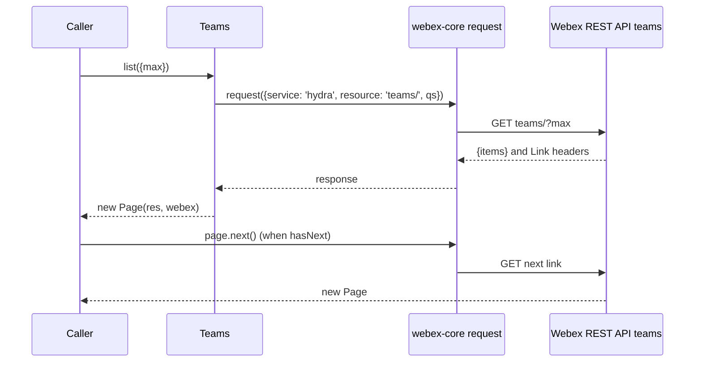
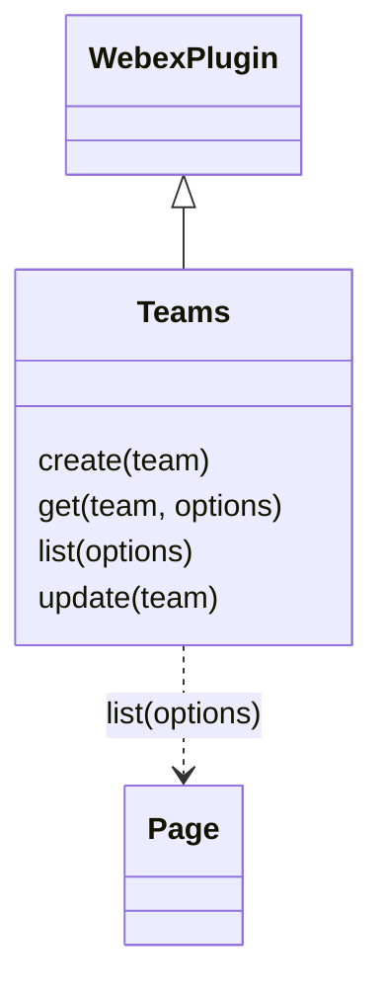

<!-- sdd-generated-metadata
doc_kind: module-spec
generated_from: module-spec@0.3.0
generated_by: claude-code
approved_by: rarajes2@cisco.com
updated_at: 2026-11-12T17:50:28Z
validation_status: pass-with-warnings
-->

# Teams plugin

This source-local document at `src/docs/README.md` owns the stable specification for **the Teams
plugin**: the public plugin `webex.teams`. It creates, reads, lists, and updates Webex teams through the
`teams` resource of the Webex REST API (catalog service `hydra`). Each method sends one request and
resolves what the service returns. Ground every claim in package evidence and link to the
[package architecture](../../docs/architecture.md) instead of repeating broader facts. No service
specification exists because this package is a library.

Related context: [documentation index](../../docs/index.md) ·
[package agent instructions](../../AGENTS.md)

## Metadata

| Field             | Value |
| ----------------- | ----- |
| Owner             | @webex/web-sdk |
| Source path       | `src` |
| Resource kind     | package |
| Status            | Draft |
| Last verified     | 2026-11-12 at `46f5268b3a` |
| Module id         | `plugin-teams` |
| Parent spec       | — |
| Doc kind          | Module spec |
| Coverage score    | 100% assessed 2026-11-12 by the generator — 11 of 11 mandatory fields PRESENT, critical 6 of 6; the package has no unit tests and no `test:unit` script, so no requirement has running test evidence; `test/integration/spec/teams.js` holds 9 live-service cases (2 skipped) that no script runs |
| Validation status | Pass with warnings — 2026-11-12; validator runtime `01a1d0dc-f5ef-76b0-8766-2a81183f4462`; 0 Blocking, 0 Important, 0 Medium, 1 Minor. Code and spec match; no runnable unit suite, and the integration suite currently runs no cases. |

## Applicability

| Condition ID                         | Status     | Evidence or reason | Owned section |
| ------------------------------------ | ---------- | ------------------ | ------------- |
| `module.has_tiers`                   | N/A        | No tier policy exists in `package.json` or `src/teams.js` | Tier |
| `module.has_ui`                      | N/A        | `src/teams.js` returns team records; it renders nothing | UI use-case flow |
| `module.crosses_service_boundaries`  | Applicable | `src/teams.js` calls the Webex REST API teams resource through webex.request | Cross-boundary use-case flow |
| `module.holds_client_state`          | N/A        | `src/teams.js` sets no instance property and caches no record | Client state model |
| `module.enforces_domain_rules`       | N/A        | `src/teams.js` checks no argument and enforces no rule; it forwards the caller's object to the service, which is the referee | Business rules and invariants |
| `module.is_concurrent_async`         | Applicable | Every method in `src/teams.js` returns the promise of a request | Concurrency and reactive flow |
| `module.owns_persistence`            | N/A        | Nothing is stored; `src/teams.js` resolves what the service returns | Data, schema, and migration discipline |
| `module.stateful_transitions`        | N/A        | No entity moves through states in `src/teams.js` | State machine |
| `module.exposes_wire_protocol`       | Applicable | The four teams requests and the team object passed through `src/teams.js` | Protocol and wire format |
| `module.ui_multi_screen`             | N/A        | No UI | UI flow |
| `module.large_data_model`            | N/A        | One shape, the team object, typed only by the JSDoc typedef in `src/teams.js`; covered under Protocol and wire format | Data model |
| `module.returns_caller_errors`       | Applicable | Request failures reject, and a missing argument throws, in `src/teams.js` | Caller-visible failure modes |
| `module.module_specific_conventions` | Applicable | Every request goes through this.request with service hydra and a teams resource path in `src/teams.js` | Module-specific rules |
| `module.published_package`           | Applicable | `package.json` names the package @webex/plugin-teams and defines deploy:npm | Export stability |
| `module.embedded_in_host`            | N/A        | No host theme or embed API | Host integration and theming |
| `module.has_design_tradeoff`         | N/A        | Each method in `src/teams.js` is one request; neither code nor comments state a design choice to preserve | Key design trade-off |
| `module.has_submodules`              | N/A        | The src directory has no child module | Sub-modules |

## Evidence register

| Evidence | What it establishes |
| -------- | ------------------- |
| `src/index.js` | `registerPlugin('teams', Teams)` with no options; re-exports only the default `Teams` |
| `src/teams.js` | `Teams` extends `WebexPlugin` with `create`, `get`, `list`, and `update`; the `TeamObject` typedef (`id`, `name`, `created`). Its JSDoc is the only recorded rationale |
| `package.json` | Name, `main` (`dist/index.js`), `devMain` (`src/index.js`), `engines` (`node >=16`), dependencies, peer dependencies on `@webex/plugin-logger`, `@webex/plugin-memberships`, and `@webex/plugin-rooms`, and scripts; `build`, `build:src`, `test:style`, `test:browser:broken`, `deploy:npm`, and `test` exist, and `test:unit`, `test:integration`, and `test:browser` do not |
| `test/integration/spec/teams.js` | 9 live-service cases (2 skipped): `create`, `get` with a team object, `list` with and without `max` and paging, `update` of the name, and rooms created in a team through `webex.rooms` (create skipped, get, a skipped leave-the-general-room case, list); no package script runs it (see Verification) |
| `README.md` | Retained npm page; context only. Its one example, `webex.teams.get(id)`, matches the code; see `docs/adr/0001-retain-product-readme.md` |
| Sibling package webex-core, file src/docs/README.md | Module spec consulted, agrees with code. `registerPlugin` keeps the first registration of a name (MOD-013) and adds `webex.<name>` to later instances (MOD-014); a plugin's `this.request({service, resource})` passes through the interceptor chain, and a failure rejects with a `WebexHttpError` carrying the options and body (UC-004, MOD-048); `Page` stores the body `items` and the parsed Link headers, and `next`, `previous`, `hasNext`, and `hasPrevious` follow them (MOD-054, MOD-055). Its file src/lib/page.js was read to confirm the constructor reads `res.body.items` and `res.headers.link` |
| Sibling package plugin-rooms, file src/docs/README.md | Module spec consulted, for the integration spec only: `create` sends the body as given (MOD-002) and `list` sends every option as a query parameter (MOD-004), so `teamId` reaches the rooms resource |
| Sibling package test-helper-chai, file src/assertions/schemas.js | No spec; code read. `isTeam` asserts `id` is a Hydra id, `name` a string, and `created` an ISO date; `isTeamRoom` asserts a room that has `teamId` |
| Observation, no stated WHY | Behavior the code shows without stating a reason is recorded once, under Pitfalls and constraints or Caller-visible failure modes |

## Purpose and boundary

- Responsibility: give applications Webex teams as Hydra records — create, read, list, and update.
- In scope: registration of `teams`; the four public methods; turning a team object or an id into a
  request path.
- Out of scope: the request pipeline, authorization, service-catalog resolution, and paging
  (`@webex/webex-core`); rooms inside a team (`webex.rooms` with `teamId`, plugin-rooms); team
  membership (plugin-team-memberships); deleting a team, which this plugin does not offer; validating
  team bodies; caching team records; what Hydra stores or returns.
- Consumers: in this repository `webex` (`src/webex.js`) and `webex-node` (`src/webex-node.js`) require
  the package to register it. No file under another package's `src/` calls `webex.teams`;
  plugin-team-memberships names it only in JSDoc examples, and its integration spec calls it. No
  workspace sample uses it. Applications reach the plugin as `webex.teams`.

## Structure and key files

| Path | Responsibility |
| ---- | -------------- |
| `src/index.js` | Registers public plugin `teams` and re-exports the class as default |
| `src/teams.js` | `Teams` and the `TeamObject` typedef |
| `package.json` | Package name, entry points, scripts, dependencies, and peer dependencies |
| `babel.config.js`, `jest.config.js` | Re-exports of the legacy Babel and Jest configurations; no unit spec uses the Jest one |
| `.eslintrc.js` | Sets `root: true` and extends `@webex/eslint-config-legacy` |
| `process` | Package-root file exporting `{browser: true}`; not imported by `src/` |
| `src/docs/README.md` | This module specification; ignored by the build and by lint |
| `test/integration/spec/teams.js` | Live-service cases; only `test:browser:broken` would run them |
| dist/ (generated) | Build output of `build:src`; ignored by Git and never edited by hand |

## Public surface

| Surface | Consumer | Compatibility commitment | Source |
| ------- | -------- | ------------------------ | ------ |
| Import side effect: public plugin `teams` | `webex`, `webex-node` | First registration of the name wins; reached as `webex.teams` | `src/index.js` |
| `create(team)`, `get(team, options)`, `list(options)`, `update(team)` | Applications | Hydra team records; `list` resolves a webex-core `Page` | `src/teams.js` |
| Default export `Teams` | Hosts that mount the class themselves | The entry exports nothing else | `src/index.js` |

The plugin triggers no event. Contract ID `teams-public-sdk` is indexed in the
[package architecture](../../docs/architecture.md#public-and-consumer-surfaces) and registered in
`.sdd/manifest.json`. Export stability is under [Export stability](#export-stability).

## Dependencies

| Dependency | Why it is required | Failure behavior |
| ---------- | ------------------ | ---------------- |
| `@webex/webex-core` plugin host (module spec consulted) | `registerPlugin`, `WebexPlugin` (`webex` and `request`), and `Page` | A request failure rejects the method with a `WebexHttpError` |
| `@webex/webex-core` services (through `request`) | Resolves `service: 'hydra'` to the catalog URL | A catalog failure rejects the request |
| `@webex/internal-plugin-device` | Declared in `dependencies`; not imported by `src/`, only by the integration spec | — |
| `lodash` | Declared in `dependencies`; not imported by `src/`, only by the integration spec (`find`) | — |
| `@webex/plugin-rooms`, `@webex/plugin-memberships`, `@webex/plugin-logger` (peer dependencies) | Imported only by the integration spec, for rooms in a team and the skipped leave case; `src/` never reaches `webex.rooms`, `webex.memberships`, or `webex.logger` | — |
| Webex REST API teams resource (external) | Team records | Errors propagate |

## Requirements

| ID | WHAT | WHY | Source evidence | Test or example evidence | Assumptions or gaps | Confidence |
| -- | ---- | --- | --------------- | ------------------------ | ------------------- | ---------- |
| `MOD-001` | Importing the package registers `Teams` as public plugin `teams` with no config or other options. The entry re-exports only the default `Teams`. | Applications reach teams as `webex.teams`, as the README usage shows; the `webex` and `webex-node` bundles require the package for this registration (inferred). | `src/index.js` | `test/integration/spec/teams.js` imports the package and calls `webex.teams`, but is not run | WHY inferred | Weak |
| `MOD-002` | `create(team)` sends `POST teams` to service `hydra` with `team` as the body through `this.request` and resolves the response body. | The JSDoc: create a new team; its example expects `id`, `name`, and `created` back. | `src/teams.js` | `test/integration/spec/teams.js` create case asserts `isTeam` (not run) | — | Present |
| `MOD-003` | `get(team, options)` takes `team.id`, else `team` itself, sends `GET teams/<id>` to service `hydra` with `qs: options`, and resolves `res.body.items` when present, else `res.body`. | The JSDoc: returns a single team, given a `TeamObject` or a string. | `src/teams.js` | `test/integration/spec/teams.js` get case passes `{id}` and compares the result with the created team (not run) | Why `items` is checked is not stated; a body carrying `items` resolves that array instead of a team | Present |
| `MOD-004` | `list(options)` sends `GET teams/` to service `hydra` with `qs: options` and resolves `new Page(res, this.webex)`. | The JSDoc: list teams; `max` limits the number of teams in the response. Paging is the webex-core `Page` (webex-core MOD-054). | `src/teams.js` | `test/integration/spec/teams.js` list cases, with `max: 1` paging through `next()` (not run) | — | Present |
| `MOD-005` | `update(team)` sends `PUT teams/<team.id>` to service `hydra` with the whole `team` as the body and resolves the response body. | The JSDoc: update a team; its example changes `name` on a team returned by `create` and sends it back. | `src/teams.js` | `test/integration/spec/teams.js` update case asserts the new name (not run) | — | Present |

## Design overview

`Teams` is a `WebexPlugin` with four methods and no state. Each method builds the options of one
request to the `teams` resource of catalog service `hydra` and calls `this.request`, which webex-core
resolves to a URL, authorizes, and sends. `create`, `get`, and `update` resolve the response body
(`get` prefers `body.items`); `list` wraps the response in a webex-core `Page`, so the caller pages with
`next()` and `previous()`.

The plugin adds no validation, no defaults, and no transformation: the caller's object is the body and
the caller's options are the query. Nothing is cached; every call reaches the service.

## Data flow and sequence coverage

Call style: in-process method calls on `webex.teams`; outbound HTTPS through `webex.request` to catalog
service `hydra`. All four methods are one request each; `list` is the only one that continues past the
first response, through `Page`, so it has the diagram.

| Operation group | Entry and outcome | Diagram or evidence | Failure and recovery coverage |
| --------------- | ----------------- | ------------------- | ----------------------------- |
| Team records | `create`, `get`, `update`; one Hydra request each, resolving the body | `src/teams.js` | The request error rejects; nothing is retried |
| Team listing | `list`; one Hydra request resolving a `Page`; each `next()` is one more request | Diagram 1; `src/teams.js` | The request error rejects; paging errors reject the `next()` promise |

Diagram 1 — listing and paging:

## Class and component relationships

## Use cases and flows

| Use case | Actor or caller | Primary steps and outcome | Failure or boundary behavior | Evidence |
| -------- | --------------- | ------------------------- | ---------------------------- | -------- |
| `UC-001` | Application creating and renaming a team | `create({name})` resolves the team; `update({...team, name})` resolves the updated team | The Hydra error rejects | `src/teams.js` |
| `UC-002` | Application reading one team | `get(team)` or `get(id)` resolves the team | The Hydra error rejects; no argument throws (see Caller-visible failure modes) | `src/teams.js` |
| `UC-003` | Application listing its teams | `list({max})` resolves a `Page`; `hasNext()` and `next()` fetch further pages | The request error rejects | `src/teams.js` |

### Cross-boundary use-case flow

| Boundary | Transport and ordering | Compatibility | Timeout, retry, and recovery |
| -------- | ---------------------- | ------------- | ---------------------------- |
| Webex REST API teams resource (`UC-001` to `UC-003`) | HTTPS through `webex.request`, catalog service `hydra`, one per call | Requests under Protocol and wire format | No retry or timeout in this module; webex-core interceptors apply |

## Concurrency and reactive flow

- Execution model: one JavaScript event loop; each method returns the promise of `this.request`,
  apart from the synchronous throw recorded under Caller-visible failure modes.
- Ordering guarantees: none across calls; each promise settles when its own response arrives.
- Parallel work: none inside a call. Callers may run calls in parallel; the integration spec creates its
  two `list` fixtures one after the other because its paging assertions rely on order.
- Idempotency and retry: `get` and `list` are reads and safe to repeat; `create` makes a new team each
  time; `update` repeats to the same end state on success. Nothing is retried here.
- Fire-and-forget work: none.
- Shared-state protection: not needed; the plugin keeps no state.

## Protocol and wire format

| Message or frame | Version | Producer or serializer | Consumer or parser | Compatibility and ordering rule |
| ---------------- | ------- | ---------------------- | ------------------ | ------------------------------- |
| `POST <hydra>/teams` with the team body | Unversioned path under the catalog URL | `create` | Webex REST API | Body is the caller's object as given |
| `GET <hydra>/teams/<id>?<options>` | Unversioned | `get` | Webex REST API | The id is interpolated without URL encoding |
| `GET <hydra>/teams/?<options>` | Unversioned | `list` | Webex REST API | Every key of `options` becomes a query parameter; the response is read by `Page` |
| `PUT <hydra>/teams/<id>` with the team body | Unversioned | `update` | Webex REST API | The whole object, `id` included, is the body |
| Team object | — | Webex REST API | Callers | The JSDoc typedef names `id`, `name`, and `created` (server-generated `id` and `created`); the test-helper-chai `isTeam` assertion expects a Hydra `id`, a string `name`, and an ISO `created`. Other fields pass through unchanged |

## Caller-visible failure modes

| Condition | Signal or result | Caller behavior | Retry or recovery | Evidence |
| --------- | ---------------- | --------------- | ----------------- | -------- |
| A Hydra request fails | `create`, `get`, `list`, or `update` rejects with the webex-core `WebexHttpError`, whose message names the method, service, and resource (webex-core MOD-048) | Handle the error | Call again | `src/teams.js` |
| `get` or `update` is called with `undefined` or `null` | A `TypeError` is thrown synchronously while reading `id`; no promise is returned and no request is sent | Pass a team object or, for `get`, an id | — | `src/teams.js` |
| `get` is passed an object without `id` | The object itself is interpolated, so the request goes to `teams/[object Object]` and the service error rejects | Pass `{id}` or the id string | — | `src/teams.js` |
| `update` is passed an object without `id` | The request goes to `teams/undefined` and the service error rejects | Pass the team returned by `create`, `get`, or `list` | — | `src/teams.js` |
| `next()` is called on a `Page` with no next link | `Page.next()` requests an undefined URI; webex-core does not specify the result (its Verification lists `next()` without a link as a gap) | Check `hasNext()` before `next()`, as the integration spec does | — | `test/integration/spec/teams.js` |

## Pitfalls and constraints

- The integration spec creates teams and leaves each one behind, because the plugin offers no delete
  (see Purpose and boundary).
- JSDoc drift: the `list` JSDoc types `options.max` as an object and names its example variable
  `createdRooms`; the `get` JSDoc does not describe `options`.
- `test:style` reports no warnings and no errors for `src/`, plus "File ignored" for this
  specification.

## Module-specific rules

- Do: send every team request to service `hydra` through `this.request` so webex-core interceptors
  and the catalog apply.
- Do: keep `get` accepting both a team object and an id string; the README and the integration spec use
  both forms.
- Do: keep `list` resolving a webex-core `Page`, so callers keep `hasNext()`, `next()`, and iteration.
- Do not: cache team records or reshape responses; callers receive what the service returns
  (`MOD-002` to `MOD-005`).
- Do not: log team names or ids with `webex.logger`; the plugin logs nothing today.

## Export stability

| Export or entry point | Consumer | Stability | Versioning and deprecation rule | Declaration or API report |
| --------------------- | -------- | --------- | ------------------------------- | ------------------------- |
| Import side effect: public plugin `teams` | `webex`, `webex-node` | Public | No rule is declared in the package | `src/index.js` |
| Default export `Teams` and its four public methods | Applications | Public | Same | `src/index.js`, `src/teams.js` |

The build writes JavaScript only; `package.json` has no `types` entry, so no declarations or API
report are published.

## Verification

| Requirement or invariant | Test level | Positive evidence | Negative or boundary evidence | Gap |
| ------------------------ | ---------- | ----------------- | ----------------------------- | --- |
| `MOD-001` | None run | `test/integration/spec/teams.js` (not run) | None found | No unit case |
| `MOD-002`, `MOD-003`, `MOD-005` | None run | `test/integration/spec/teams.js` create, get, and update cases (not run) | None found | No unit case; the `items` branch of `get`, the id-or-object argument, and the missing-argument throw have no case |
| `MOD-004` | None run | `test/integration/spec/teams.js` list cases with paging (not run) | None found | No unit case for the request options or the `Page` result |

The package has no unit tests: `package.json` defines no `test:unit` script and there is no
`test/unit` directory. No package script runs `test/integration/spec/teams.js` either: there is no
`test:integration`, and `test:browser:broken` reported 0 tests on 2026-11-12 because the karma bundle
failed to parse `isbot`, while still exiting 0. The aggregate `test` script exits 1 at the missing
`test:unit`. `build:src` and `test:style` exit 0. A module specification is complete only when its
public surface, failure modes, and test evidence agree with the implementation. Generator-side field
measurement is complete (100%, assessed 2026-11-12); independent validation passed with warnings on 2026-11-12 (0 Blocking, 0 Important, 0 Medium, 1 Minor); the
module stays Partial until a unit suite and a characterization baseline exist.
