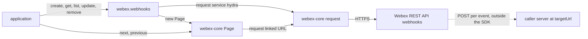
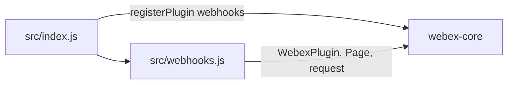
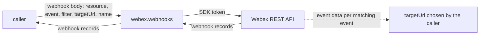

<!-- sdd-generated-metadata
doc_kind: standing-doc
generated_from: architecture@0.3.0
generated_by: claude-code
approved_by: rarajes2@cisco.com
updated_at: 2026-11-13T02:40:15Z
validation_status: pass
-->

# @webex/plugin-webhooks architecture

Canonical architecture for this package. Flow behavior lives in the
[Webhooks plugin specification](../src/docs/README.md). This page owns package boundaries, the plugin
registration, the contract index, and how the package meets the rest of the SDK.

Related context: [specification registry](specs/README.md) ·
[package agent instructions](../AGENTS.md)

## Applicability

| Condition ID                         | Status     | Evidence or reason | Owned section |
| ------------------------------------ | ---------- | ------------------ | ------------- |
| `repo.owns_datastore`                | N/A        | No database, file store, or migration in `src/webhooks.js` | Repository data and schema |
| `repo.holds_client_state`            | N/A        | `src/webhooks.js` sets no instance property and caches no webhook record | Client state model |
| `repo.components_interact`           | Applicable | `src/index.js` imports `src/webhooks.js` and registers it through webex-core, whose request and Page the plugin calls | Dependency and interaction topology |
| `repo.domain_data_across_components` | Applicable | Webhook records pass from Hydra through webex-core and `src/webhooks.js` to callers | Object and data ownership |
| `repo.caches_data`                   | N/A        | Nothing is kept after a call settles in `src/webhooks.js` | Caching catalog |
| `repo.observability_convention`      | N/A        | `src/webhooks.js` logs nothing and emits no metric or trace | Observability patterns |
| `repo.deploys_to_infra`              | N/A        | Library published to npm (`package.json`). No service runtime | Runtime and infrastructure |
| `repo.shared_base_libs`              | Applicable | Extends WebexPlugin and uses the legacy build and lint stack (`babel.config.js`, `.eslintrc.js`) | Shared and base libraries |
| `repo.is_monorepo`                   | N/A        | This SDD root is one package. The workspace around it is out of scope | Package map and inter-package dependencies |
| `repo.multi_platform`                | N/A        | `src/webhooks.js` has no platform branch; `process` declares {browser: true} and is not imported | Platform matrix |
| `repo.published_package`             | Applicable | `package.json` name is @webex/plugin-webhooks and deploy:npm publishes it | Release and versioning |
| `repo.embedded_in_host`              | N/A        | No host theme or embed API in `src/webhooks.js` | Host integration and theming |
| `repo.exposes_commands_or_artifacts` | Applicable | build:src in `package.json` writes dist | Commands and generated artifacts |
| `repo.cross_repo_deps_material`      | Applicable | Behavior depends on the Webex REST API webhooks resource (`src/webhooks.js`) | Cross-repository topology |
| `repo.security_arch_warranted`       | Applicable | A webhook created through `src/webhooks.js` makes the service send Webex event data to a caller-chosen targetUrl outside the SDK, and the plugin checks neither the URL nor the filter | Security architecture |

## Design overview

`@webex/plugin-webhooks` is a published JavaScript library with one module. Importing it registers
`Webhooks` as the public plugin `webhooks`, reached as `webex.webhooks`. The `webex` and `webex-node`
bundles require it to register it; no other workspace package calls it from its source or tests.

A webhook is a registration held by the Webex REST API: it names a `resource` (for example
`messages`), an `event` (for example `created`), a `filter` that scopes it (for example
`roomId=<id>`), and a `targetUrl`. When a matching event happens, the service sends an HTTP POST to
that URL. The SDK reaches the `webhooks` resource as catalog service `hydra`. The plugin offers five
calls on that resource — create, get, list, remove, and update — and returns what the service answers.

The package serves no routes and never receives the event deliveries: those go from the service to the
caller's own server. It caches nothing, persists nothing, and emits no SDK events.

## Resource inventory and responsibilities

| Resource | Kind | Responsibility | Owner | Source | Detailed specification |
| -------- | ---- | -------------- | ----- | ------ | ---------------------- |
| Webhooks plugin | package (one module) | Registration; webhook records | @webex/web-sdk | src | [`src/docs/README.md`](../src/docs/README.md) |

## Interaction and execution flows

Representative end-to-end flow: an application registers a webhook for new messages in a room, lists
its webhooks page by page, and removes the webhook; meanwhile the service delivers events to the
target URL.

| From | To | Interaction or transport | Purpose | Failure or compatibility behavior |
| ---- | -- | ------------------------ | ------- | --------------------------------- |
| Application | `webex.webhooks` | In-process calls | Webhook records | Rejections propagate; a missing argument to `get`, `remove`, or `update` throws |
| `Webhooks` | Webex REST API | HTTPS through `webex.request`, service `hydra` | Webhook records | No retry here |
| Application | webex-core `Page` | `next()`, `previous()`, iteration | Further pages of `list` | Rejections propagate |
| Webex REST API | Caller's server at `targetUrl` | HTTP POST per matching event | Event delivery | Not seen by this package |

## Dependency topology

| Dependency | Type | Used by | Purpose | Version, failure, or fallback policy |
| ---------- | ---- | ------- | ------- | ------------------------------------ |
| `@webex/webex-core` | Internal | `src/index.js`, `src/webhooks.js` | Registration, plugin base, `Page`, `webex.request` | `workspace:*` in `package.json` |
| `@webex/internal-plugin-device` | Internal | The integration spec only | Declared in `dependencies` but not imported by `src/` | `workspace:*` |
| `@webex/plugin-rooms`, `@webex/plugin-logger` | Internal peer | The integration spec only | The room its webhooks filter on | Peer dependencies; not reached by `src/` |
| Webex REST API webhooks resource | External service | `src/webhooks.js` | Webhook records and event delivery | Resolved through the service catalog |

No import cycle exists: `@webex/webex-core` does not import this package.

## Public and consumer surfaces

| Surface | Type | Owner | Consumers | Compatibility policy | Source |
| ------- | ---- | ----- | --------- | -------------------- | ------ |
| `webhooks-public-sdk` — package @webex/plugin-webhooks, `webex.webhooks` with its five methods | SDK, published to npm, public | Webhooks plugin | `webex`, `webex-node` (registration); applications (calls) | No versioning or deprecation rule is declared in the package | `package.json`, `src/index.js`, `src/webhooks.js` |

The webhooks requests and the webhook object are a protocol this package speaks, described under
*Protocol and wire format* in the
[module specification](../src/docs/README.md#protocol-and-wire-format). The other contracts this
package requires are registered in `.sdd/manifest.json` `contract_catalog`.

## Cross-cutting architecture

### Security

- Trust boundaries, scopes, and identity flow: see [Security architecture](#security-architecture).
- Sensitive surfaces and data classes: target URLs, filters (which can carry room ids), webhook names,
  and webhook ids.

### Observability and operations

- Logging and correlation: the package logs nothing. Request tracking comes from the webex-core
  interceptors, and a failed request's `WebexHttpError` message names the method, service, and
  resource.
- Metrics, traces, and audit signals: none.
- Ownership and operational entry points: `.github/CODEOWNERS` at the workspace root has no line for
  `packages/@webex/plugin-webhooks`, so its default rule assigns it to `@webex/web-sdk`. No dashboards
  or runbooks are recorded in this package.

### Quality attributes

- Compatibility: callers rely on the registered name `webhooks`, `get` and `remove` accepting an object
  or an id, the webhook object as the service returns it, `list().items` through `Page`, and `remove`
  resolving `undefined` on a 204.
- Latency: one request per call; `list` returns one page at a time.
- Test confidence: the package has no unit tests, and the integration spec is skipped and not run by
  any script. No coverage threshold is enforced.

## Dependency and interaction topology

| From | To | Kind | Purpose | Ordering or failure boundary |
| ---- | -- | ---- | ------- | ---------------------------- |
| `src/index.js` | `src/webhooks.js` | Import | The plugin class | — |
| `src/index.js` | webex-core | Call at import | Register `webhooks` | First registration wins |
| `src/webhooks.js` | webex-core | Import and calls | Base class, request, paging | Request failures reject the method |

## Object and data ownership

| Object or state | System of record | May write | May read | Movement or lifecycle |
| --------------- | ---------------- | --------- | -------- | --------------------- |
| Webhook record (`id`, `resource`, `event`, `filter`, `targetUrl`, `name`, `created`, and other fields) | Webex REST API | Callers, through `create`, `update`, and `remove` | Callers, through `get` and `list` | Fetched per call; never kept here |
| Page of webhooks | webex-core `Page` held by the caller | Not this package | Callers | Built per `list` or `next()` call |
| Event delivery | Webex REST API | The service | The caller's server at `targetUrl` | Never passes through this package |

## Shared and base libraries

| Library | Inherited responsibility | Consumers | Version floor | Compatibility rule |
| ------- | ------------------------ | --------- | ------------- | ------------------ |
| `@webex/webex-core` `WebexPlugin` | `webex` and `request` | `Webhooks` | `workspace:*` | Keep the registered name `webhooks` |
| `@webex/babel-config-legacy`, `@webex/eslint-config-legacy`, `@webex/jest-config-legacy`, `@webex/legacy-tools` | Build, lint, and test stack through one-line config files | Package tooling | `workspace:*` | Do not fork the config locally |

## Release and versioning

| Artifact | Publish target | Versioning rule | Deprecation window | Changelog or migration obligation |
| -------- | -------------- | --------------- | ------------------ | --------------------------------- |
| @webex/plugin-webhooks | npm through `deploy:npm` | None declared in the package | None declared | None declared in the package; the workspace owns changelog generation |

## Commands and generated artifacts

| Command or artifact | Owner | Inputs | Output or side effect | Compatibility boundary |
| ------------------- | ----- | ------ | --------------------- | ---------------------- |
| `yarn build:src` | Package scripts | `src` | Writes `dist/` (JavaScript and source maps) through `webex-legacy-tools` | `dist/` is generated and never edited by hand |
| `yarn build` | Package scripts | `src` | Runs `build:src` | Same output |
| `yarn test:style` | Package scripts | `src` | ESLint run | The shared config ignores `docs/**` and `*.md` |

## Cross-repository topology

| Repository or external system | Relationship | Exchanged contract or artifact | Owner | Sequencing constraint |
| ----------------------------- | ------------- | ------------------------------ | ----- | --------------------- |
| `@webex/webex-core` (workspace sibling; module spec consulted) | Consumes | `registerPlugin`, `WebexPlugin`, `Page`, `request` | @webex/web-client, @webex/web-sdk | Registered before the first instance |
| `webex`, `webex-node` (workspace siblings) | Consumed by | The plugin registration | @webex/web-sdk | None |
| Webex REST API webhooks resource | Consumes | Webhook records | Not recorded in this repository | None |
| The caller's server at `targetUrl` | Receives deliveries the service sends for webhooks made here | Event POSTs | The application | Must be reachable by the service; not checked here |

## Security architecture

- This package holds no credential and no key. Every request carries the SDK authorization that
  webex-core adds; neither the README nor the JSDoc names the scopes the webhooks resource requires.
  What a caller may register, see, or change is decided by the service for the authorized user.
- A webhook opens a data path that does not pass through the SDK: the service sends event data to the
  `targetUrl` in the body. The plugin forwards `targetUrl`, `filter`, and every other field unchanged,
  so it neither restricts the URL's scheme or host nor narrows the filter; that is the caller's and
  the service's responsibility.
- The package does not receive deliveries, so it offers no way to authenticate them; a caller's server
  must verify deliveries by its own means.
- Webhook ids go into request paths and options into query strings. The package logs none of them
  through `webex.logger`; its logging is described under
  [Observability and operations](#observability-and-operations).

## Domain language

| Term | Repository-specific meaning | Authoritative source |
| ---- | --------------------------- | -------------------- |
| Webhook | A Hydra registration that makes the service POST to `targetUrl` when a matching event occurs | `src/webhooks.js` |
| Resource | The Hydra resource type a webhook watches, for example `messages` | `src/webhooks.js` |
| Event | The event type a webhook watches, for example `created`; not an SDK event | `src/webhooks.js` |
| Filter | The query-style scope of a webhook, for example `roomId=<id>` | `src/webhooks.js` |
| Target URL | The URL that receives a POST for each matching event | `src/webhooks.js` |
| Hydra | The Webex REST API, reached as catalog service `hydra` | `src/webhooks.js` |
| Page | The webex-core wrapper `list` resolves, with `items`, `length`, `hasNext`, and `next` | `src/webhooks.js` |

## References and maintenance

- Decisions: [adr/](adr/index.md)
- Instantiated specifications and routing: [specs/README.md](specs/README.md)
- Repository rules and patterns: [package agent instructions](../AGENTS.md)
- Update this document in the same change that alters package boundaries, resource ownership,
  cross-resource interaction, or cross-cutting architecture.
