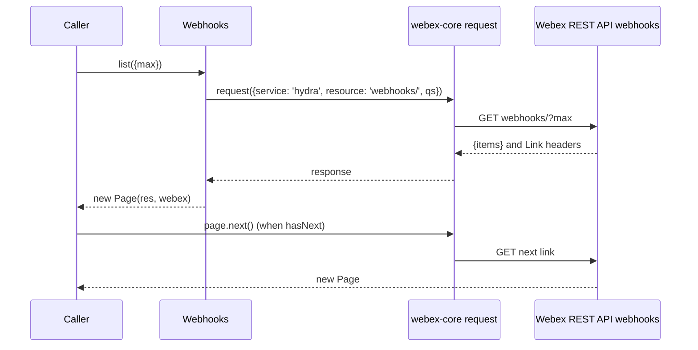
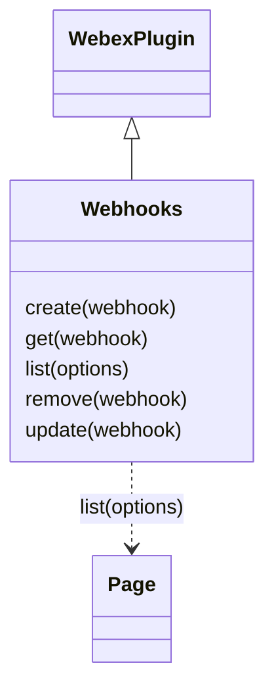

<!-- sdd-generated-metadata
doc_kind: module-spec
generated_from: module-spec@0.3.0
generated_by: claude-code
approved_by: rarajes2@cisco.com
updated_at: 2026-11-13T02:40:15Z
validation_status: pass
-->

# Webhooks plugin

This source-local document at `src/docs/README.md` owns the stable specification for **the Webhooks
plugin**: the public plugin `webex.webhooks`. It creates, reads, lists, deletes, and updates Webex
webhook registrations through the `webhooks` resource of the Webex REST API (catalog service `hydra`).
Each method sends one request and resolves what the service returns. The plugin only manages
registrations: the service delivers events to each webhook's `targetUrl` directly, and nothing in this
package receives them. Ground every claim in package evidence and link to the
[package architecture](../../docs/architecture.md) instead of repeating broader facts. No service
specification exists because this package is a library.

Related context: [documentation index](../../docs/index.md) ·
[package agent instructions](../../AGENTS.md)

## Metadata

| Field             | Value |
| ----------------- | ----- |
| Owner             | @webex/web-sdk |
| Source path       | `src` |
| Resource kind     | package |
| Status            | Draft |
| Last verified     | 2026-11-13 at `c22331c97b` |
| Module id         | `plugin-webhooks` |
| Parent spec       | — |
| Doc kind          | Module spec |
| Coverage score    | 100% assessed 2026-11-13 by the generator — 12 of 12 mandatory fields PRESENT, critical 6 of 6; the package has no unit tests and no `test:unit` script, so no requirement has running test evidence; `test/integration/spec/webhooks.js` holds 7 live-service cases, all inside `describe.skip`, that no script runs |
| Validation status | Pass — independent validation on 2026-11-13; 0 Blocking, 0 warnings; runtime 01a1d2c3-25b2-7a93-a84a-c3d3b83a8df1 |

## Applicability

| Condition ID                         | Status     | Evidence or reason | Owned section |
| ------------------------------------ | ---------- | ------------------ | ------------- |
| `module.has_tiers`                   | N/A        | No tier policy exists in `package.json` or `src/webhooks.js` | Tier |
| `module.has_ui`                      | N/A        | `src/webhooks.js` returns webhook records; it renders nothing | UI use-case flow |
| `module.crosses_service_boundaries`  | Applicable | `src/webhooks.js` calls the Webex REST API webhooks resource through webex.request | Cross-boundary use-case flow |
| `module.holds_client_state`          | N/A        | `src/webhooks.js` sets no instance property and caches no record | Client state model |
| `module.enforces_domain_rules`       | N/A        | `src/webhooks.js` checks no argument and enforces no rule; it forwards the caller's object to the service, which is the referee | Business rules and invariants |
| `module.is_concurrent_async`         | Applicable | Every method in `src/webhooks.js` returns the promise of a request | Concurrency and reactive flow |
| `module.owns_persistence`            | N/A        | Nothing is stored; `src/webhooks.js` resolves what the service returns | Data, schema, and migration discipline |
| `module.stateful_transitions`        | N/A        | No entity moves through states in `src/webhooks.js` | State machine |
| `module.exposes_wire_protocol`       | Applicable | The five webhooks requests and the webhook object passed through `src/webhooks.js` | Protocol and wire format |
| `module.ui_multi_screen`             | N/A        | No UI | UI flow |
| `module.large_data_model`            | N/A        | One shape, the webhook object, typed only by the JSDoc typedef in `src/webhooks.js`; covered under Protocol and wire format | Data model |
| `module.returns_caller_errors`       | Applicable | Request failures reject, and a missing argument throws, in `src/webhooks.js` | Caller-visible failure modes |
| `module.module_specific_conventions` | Applicable | Every request goes through this.request with service hydra and a webhooks resource path in `src/webhooks.js` | Module-specific rules |
| `module.published_package`           | Applicable | `package.json` names the package @webex/plugin-webhooks and defines deploy:npm | Export stability |
| `module.embedded_in_host`            | N/A        | No host theme or embed API | Host integration and theming |
| `module.has_design_tradeoff`         | Applicable | The comment in remove of `src/webhooks.js` records a local 204 workaround that it says belongs in http-core | Key design trade-off |
| `module.has_submodules`              | N/A        | The src directory has no child module | Sub-modules |

## Evidence register

| Evidence | What it establishes |
| -------- | ------------------- |
| `src/index.js` | `registerPlugin('webhooks', Webhooks)` with no options; re-exports only the default `Webhooks` |
| `src/webhooks.js` | `Webhooks` extends `WebexPlugin` with `create`, `get`, `list`, `remove`, and `update`; the `WebhookObject` typedef (`id`, `resource`, `event`, `filter`, `targetUrl`, `name`, `created`); the class JSDoc stating that webhooks notify an app over HTTP when an event occurs; the comment in `remove` on Firefox and 204s. Its JSDoc and that comment are the only recorded rationale |
| `package.json` | Name, `main` (`dist/index.js`), `devMain` (`src/index.js`), `engines` (`node >=18`), dependencies, peer dependencies on `@webex/plugin-logger` and `@webex/plugin-rooms`, and scripts; `build`, `build:src`, `test:style`, `test:browser`, `deploy:npm`, and `test` exist, and `test:unit` and `test:integration` do not |
| `test/integration/spec/webhooks.js` | 7 live-service cases inside `describe.skip` (comment `SPARK-413317`): `create`, `get` by id, `list` with and without `max` and paging, `update` of the target URL and of the name, and `remove` followed by a `get` that must reject with `NotFound`; an `after` hook removes every webhook the suite created. No package script runs it (see Verification) |
| `README.md` | Retained npm page; context only. Its one example, `webex.webhooks.get(id)`, matches the code; see `docs/adr/0001-retain-product-readme.md` |
| Sibling package webex-core, file src/docs/README.md | Module spec consulted, agrees with code. `registerPlugin` keeps the first registration of a name (MOD-013) and adds `webex.<name>` to later instances (MOD-014); a plugin's `this.request({service, resource})` passes through the interceptor chain, and a failure rejects with a `WebexHttpError` carrying the options and body (UC-004, MOD-048); `Page` stores the body `items` and the parsed Link headers, and `next`, `previous`, `hasNext`, and `hasPrevious` follow them (MOD-054, MOD-055). Its file src/lib/page.js was read to confirm the constructor reads `res.body.items` and `res.headers.link` and that `length` is `items.length` |
| Sibling package http-core, file src/lib/xhr.js | Read for the 204 comment: the browser transport reports an XHR status of 1223 as 204; the http-core spec says nothing about 204 or DELETE bodies, so its code is the referee |
| Sibling package plugin-rooms, file src/docs/README.md | Module spec consulted, for the integration spec only: `create` sends the body as given (MOD-002) and `remove` resolves `undefined` on a 204 (MOD-006); the same handling here is covered under Key design trade-off |
| Sibling package test-helper-chai, file src/assertions/schemas.js | No spec; code read. `isWebhook` asserts `id` is a Hydra id and `resource`, `event`, `filter`, `targetUrl`, and `name` are strings (its `created` check is under Pitfalls and constraints) |
| Observation, no stated WHY | Behavior the code shows without stating a reason is recorded once, under Pitfalls and constraints or Caller-visible failure modes |

## Purpose and boundary

- Responsibility: give applications Webex webhook registrations as Hydra records — create, read, list,
  delete, and update.
- In scope: registration of `webhooks`; the five public methods; turning a webhook object or an id into
  a request path; resolving `undefined` for a 204 delete.
- Out of scope: receiving, authenticating, or parsing the HTTP POSTs the service sends to `targetUrl`
  (that happens in the caller's own server, outside the SDK); the request pipeline, authorization,
  service-catalog resolution, and paging (`@webex/webex-core`); the rooms, messages, and other resources
  a webhook's `resource` and `filter` name; validating webhook bodies or target URLs; caching webhook
  records; what Hydra stores, accepts, or returns.
- Consumers: in this repository `webex` (`src/webex.js`) and `webex-node` (`src/webex-node.js`) require
  the package to register it. No file under another package's `src/` or test directory calls
  `webex.webhooks`, and no workspace sample uses it. Applications reach the plugin as `webex.webhooks`.

## Structure and key files

| Path | Responsibility |
| ---- | -------------- |
| `src/index.js` | Registers public plugin `webhooks` and re-exports the class as default |
| `src/webhooks.js` | `Webhooks` and the `WebhookObject` typedef |
| `package.json` | Package name, entry points, scripts, dependencies, and peer dependencies |
| `babel.config.js`, `jest.config.js` | Re-exports of the legacy Babel and Jest configurations; no unit spec uses the Jest one |
| `.eslintrc.js` | Sets `root: true` and extends `@webex/eslint-config-legacy` |
| `process` | Package-root file exporting `{browser: true}`; not imported by `src/` |
| `src/docs/README.md` | This module specification; ignored by the build and by lint |
| `test/integration/spec/webhooks.js` | Live-service cases inside `describe.skip`; only `test:browser` would load them |
| dist/ (generated) | Build output of `build:src`; ignored by Git and never edited by hand |

## Public surface

| Surface | Consumer | Compatibility commitment | Source |
| ------- | -------- | ------------------------ | ------ |
| Import side effect: public plugin `webhooks` | `webex`, `webex-node` | First registration of the name wins; reached as `webex.webhooks` | `src/index.js` |
| `create(webhook)`, `get(webhook)`, `list(options)`, `remove(webhook)`, `update(webhook)` | Applications | Hydra webhook records; `list` resolves a webex-core `Page`; `remove` resolves `undefined` on a 204 | `src/webhooks.js` |
| Default export `Webhooks` | Hosts that mount the class themselves | The entry exports nothing else | `src/index.js` |

The plugin triggers no SDK event; the `event` field of a webhook names the Webex event the service
watches, not an event of this plugin. Contract ID `webhooks-public-sdk` is indexed in the
[package architecture](../../docs/architecture.md#public-and-consumer-surfaces) and registered in
`.sdd/manifest.json`. Export stability is under [Export stability](#export-stability).

## Dependencies

| Dependency | Why it is required | Failure behavior |
| ---------- | ------------------ | ---------------- |
| `@webex/webex-core` plugin host (module spec consulted) | `registerPlugin`, `WebexPlugin` (`webex` and `request`), and `Page` | A request failure rejects the method with a `WebexHttpError` |
| `@webex/webex-core` services (through `request`) | Resolves `service: 'hydra'` to the catalog URL | A catalog failure rejects the request |
| `@webex/internal-plugin-device` | Declared in `dependencies`; not imported by `src/`, only by the integration spec | — |
| `@webex/plugin-rooms`, `@webex/plugin-logger` (peer dependencies) | Imported only by the integration spec, which creates and removes the room its webhooks filter on; `src/` never reaches `webex.rooms` or `webex.logger` | — |
| Webex REST API webhooks resource (external) | Webhook records; the service also sends the event deliveries to `targetUrl` | Errors propagate |

## Requirements

| ID | WHAT | WHY | Source evidence | Test or example evidence | Assumptions or gaps | Confidence |
| -- | ---- | --- | --------------- | ------------------------ | ------------------- | ---------- |
| `MOD-001` | Importing the package registers `Webhooks` as public plugin `webhooks` with no config or other options. The entry re-exports only the default `Webhooks`. | Applications reach webhooks as `webex.webhooks`, as the README usage shows; the `webex` and `webex-node` bundles require the package for this registration (inferred). | `src/index.js` | `test/integration/spec/webhooks.js` imports the package and calls `webex.webhooks`, but is skipped | WHY inferred | Weak |
| `MOD-002` | `create(webhook)` sends `POST webhooks` to service `hydra` with `webhook` as the body through `this.request` and resolves the response body. | The class JSDoc: an app registers a webhook to be notified over HTTP when an event occurs, for example a new message in a room; the `create` example expects `id`, `resource`, `event`, `filter`, `targetUrl`, and `name` back. | `src/webhooks.js` | `test/integration/spec/webhooks.js` create case asserts isWebhook (skipped) | — | Present |
| `MOD-003` | `get(webhook)` takes `webhook.id`, else `webhook` itself, sends `GET webhooks/<id>` to service `hydra` with no query, and resolves `res.body.items` when present, else `res.body`. | The JSDoc: shows details for a webhook, given a webhook or a string. | `src/webhooks.js` | `test/integration/spec/webhooks.js` get case passes the id and compares the result with the created webhook (skipped) | Why `items` is checked is not stated; a body carrying `items` resolves that array instead of a webhook (see Caller-visible failure modes) | Present |
| `MOD-004` | `list(options)` sends `GET webhooks/` to service `hydra` with `qs: options` and resolves `new Page(res, this.webex)`. | The JSDoc: lists all webhooks; `max` limits the number of webhooks in the response. Paging is the webex-core `Page` (webex-core MOD-054). | `src/webhooks.js` | `test/integration/spec/webhooks.js` list cases, with max 1 paging through next() (skipped) | — | Present |
| `MOD-005` | `remove(webhook)` takes `webhook.id`, else `webhook`, sends `DELETE webhooks/<id>` to service `hydra`, and resolves `undefined` when the status is 204, else the response body. | The code comment: Firefox has issues with 204s or DELETE, and the handling should move to http-core (see Key design trade-off). | `src/webhooks.js` | `test/integration/spec/webhooks.js` remove case expects a falsy body and a later get rejecting with WebexHttpError.NotFound (skipped) | What a non-204 success body carries is not recorded | Present |
| `MOD-006` | `update(webhook)` sends `PUT webhooks/<webhook.id>` to service `hydra` with the whole `webhook` as the body and resolves the response body. | The JSDoc: update a webhook; its example changes `targetUrl` on a webhook returned by `create` and sends it back. | `src/webhooks.js` | `test/integration/spec/webhooks.js` update cases change `targetUrl` and `name` and compare the result (skipped) | — | Present |

## Design overview

`Webhooks` is a `WebexPlugin` with five methods and no state. Each method builds the options of one
request to the `webhooks` resource of catalog service `hydra` and calls `this.request`, which
webex-core resolves to a URL, authorizes, and sends. `create`, `get`, and `update` resolve the response
body (`get` prefers `body.items`); `remove` resolves `undefined` for a 204 and the body otherwise; `list`
wraps the response in a webex-core `Page`, so the caller pages with `next()` and `previous()`.

The plugin adds no validation, no defaults, and no transformation: the caller's object is the body and
the caller's options are the query. Nothing is cached; every call reaches the service. Once a webhook
exists, the service sends each matching event to its `targetUrl` without involving the SDK.

## Data flow and sequence coverage

Call style: in-process method calls on `webex.webhooks`; outbound HTTPS through `webex.request` to
catalog service `hydra`. All five methods are one request each; `list` is the only one that continues
past the first response, through `Page`, so it has the diagram.

| Operation group | Entry and outcome | Diagram or evidence | Failure and recovery coverage |
| --------------- | ----------------- | ------------------- | ----------------------------- |
| Webhook records | `create`, `get`, `update`, `remove`; one Hydra request each, resolving the body, or `undefined` for a 204 `remove` | `src/webhooks.js` | The request error rejects; nothing is retried |
| Webhook listing | `list`; one Hydra request resolving a `Page`; each `next()` is one more request | Diagram 1; `src/webhooks.js` | The request error rejects; paging errors reject the `next()` promise |

Diagram 1 — listing and paging:

## Class and component relationships

## Use cases and flows

| Use case | Actor or caller | Primary steps and outcome | Failure or boundary behavior | Evidence |
| -------- | --------------- | ------------------------- | ---------------------------- | -------- |
| `UC-001` | Application registering for an event | `create({resource, event, filter, targetUrl, name})` resolves the webhook; the service then POSTs matching events to `targetUrl` | The Hydra error rejects | `src/webhooks.js` |
| `UC-002` | Application reading one webhook | `get(webhook)` or `get(id)` resolves the webhook | The Hydra error rejects; no argument throws (see Caller-visible failure modes) | `src/webhooks.js` |
| `UC-003` | Application listing its webhooks | `list({max})` resolves a `Page`; `hasNext()` and `next()` fetch further pages | The request error rejects | `src/webhooks.js` |
| `UC-004` | Application retargeting or renaming a webhook | `update({...webhook, targetUrl})` resolves the updated webhook | The Hydra error rejects | `src/webhooks.js` |
| `UC-005` | Application unregistering a webhook | `remove(webhook)` or `remove(id)` resolves `undefined` on 204 | The Hydra error rejects | `src/webhooks.js` |

### Cross-boundary use-case flow

| Boundary | Transport and ordering | Compatibility | Timeout, retry, and recovery |
| -------- | ---------------------- | ------------- | ---------------------------- |
| Webex REST API webhooks resource (`UC-001` to `UC-005`) | HTTPS through `webex.request`, catalog service `hydra`, one per call | Requests under Protocol and wire format | No retry or timeout in this module; webex-core interceptors apply |

## Concurrency and reactive flow

- Execution model: one JavaScript event loop; each method returns the promise of `this.request`,
  apart from the synchronous throw recorded under Caller-visible failure modes.
- Ordering guarantees: none across calls; each promise settles when its own response arrives.
- Parallel work: none inside a call. Callers may run calls in parallel; the integration spec's `after`
  hook removes every webhook it created with `Promise.all`.
- Idempotency and retry: `get` and `list` are reads and safe to repeat; `create` registers a new webhook
  each time; `update` repeats to the same end state on success; a repeated `remove` of the same id
  reaches the service again, which decides the result. Nothing is retried here.
- Fire-and-forget work: none.
- Shared-state protection: not needed; the plugin keeps no state.

## Protocol and wire format

| Message or frame | Version | Producer or serializer | Consumer or parser | Compatibility and ordering rule |
| ---------------- | ------- | ---------------------- | ------------------ | ------------------------------- |
| `POST <hydra>/webhooks` with the webhook body | Unversioned path under the catalog URL | `create` | Webex REST API | Body is the caller's object as given |
| `GET <hydra>/webhooks/<id>` | Unversioned | `get` | Webex REST API | The id is interpolated without URL encoding; no query is sent |
| `GET <hydra>/webhooks/?<options>` | Unversioned | `list` | Webex REST API | Every key of `options` becomes a query parameter; the response is read by `Page` |
| `DELETE <hydra>/webhooks/<id>` | Unversioned | `remove` | Webex REST API | A 204 resolves `undefined`; any other success resolves the body |
| `PUT <hydra>/webhooks/<id>` with the webhook body | Unversioned | `update` | Webex REST API | The whole object, `id` included, is the body |
| Webhook object | — | Webex REST API | Callers | The JSDoc typedef names `id` and `created` (server-generated), `resource`, `event`, `filter`, `targetUrl`, and `name`; the test-helper-chai `isWebhook` assertion expects a Hydra `id` and string `resource`, `event`, `filter`, `targetUrl`, and `name`. Other fields pass through unchanged |
| Event delivery to `targetUrl` | — | Webex REST API | The caller's server | Not produced or parsed by this package; the JSDoc says only that `targetUrl` receives POST requests for each event |

## Caller-visible failure modes

| Condition | Signal or result | Caller behavior | Retry or recovery | Evidence |
| --------- | ---------------- | --------------- | ----------------- | -------- |
| A Hydra request fails | `create`, `get`, `list`, `remove`, or `update` rejects with the webex-core `WebexHttpError`, whose message names the method, service, and resource (webex-core MOD-048) | Handle the error | Call again | `src/webhooks.js` |
| `get`, `remove`, or `update` is called with `undefined` or `null` | A `TypeError` is thrown synchronously while reading `id`; no promise is returned and no request is sent | Pass a webhook object or, for `get` and `remove`, an id | — | `src/webhooks.js` |
| `get` or `remove` is passed an object without `id` | The object itself is interpolated, so the request goes to `webhooks/[object Object]` and the service error rejects | Pass `{id}` or the id string | — | `src/webhooks.js` |
| `get` is passed an empty string | The path becomes `webhooks/`, the list path, so `get` resolves the `items` array of the first list page instead of a webhook | Pass a non-empty id | — | `src/webhooks.js` |
| `remove` is passed an empty string | The request is `DELETE webhooks/`; the service decides the result, which this repository does not record | Pass a non-empty id | — | `src/webhooks.js` |
| `update` is passed an object without `id` | The request goes to `webhooks/undefined` and the service error rejects | Pass the webhook returned by `create`, `get`, or `list` | — | `src/webhooks.js` |
| `next()` is called on a `Page` with no next link | `Page.next()` requests an undefined URI; webex-core does not specify the result (its Verification lists `next()` without a link as a gap) | Check `hasNext()` before `next()`, as the integration spec does | — | `test/integration/spec/webhooks.js` |

## Pitfalls and constraints

- JSDoc drift: the `@returns` tags name a `Webhook` type while the typedef is `WebhookObject`; the
  `create` parameter is typed `WebhookObject`, whose `id` and `created` are server-generated; the `get`
  JSDoc does not mention the `items` branch.
- The `isWebhook` assertion of test-helper-chai does not check `created`: the line is commented out
  ("waiting on completion of COLLAB-159"), so no test, even when enabled, pins that field.
- `test:style` reports no warnings and no errors for `src/`, plus "File ignored" for this
  specification.

## Module-specific rules

- Do: send every webhook request to service `hydra` through `this.request` so webex-core interceptors
  and the catalog apply.
- Do: keep `get` and `remove` accepting both a webhook object and an id string; the README uses the id
  form and the integration spec uses both.
- Do: keep `list` resolving a webex-core `Page`, so callers keep `hasNext()`, `next()`, `length`, and
  iteration.
- Do: keep `remove` resolving `undefined` on a 204 until the handling moves to http-core (`MOD-005`).
- Do not: cache webhook records or reshape responses; callers receive what the service returns
  (`MOD-002` to `MOD-006`).
- Do not: log webhook bodies, target URLs, filters, or ids with `webex.logger`; the plugin logs nothing
  today.

## Export stability

| Export or entry point | Consumer | Stability | Versioning and deprecation rule | Declaration or API report |
| --------------------- | -------- | --------- | ------------------------------- | ------------------------- |
| Import side effect: public plugin `webhooks` | `webex`, `webex-node` | Public | No rule is declared in the package | `src/index.js` |
| Default export `Webhooks` and its five public methods | Applications | Public | Same | `src/index.js`, `src/webhooks.js` |

The build writes JavaScript only; `package.json` has no `types` entry, so no declarations or API
report are published.

## Key design trade-off

| Chosen trade-off | Preserved invariant or benefit | Cost or limitation | Decision evidence |
| ---------------- | ------------------------------ | ------------------ | ----------------- |
| `remove` maps a 204 to `undefined` itself instead of relying on the transport | Callers get one result for a successful delete in every browser, whatever body the transport reports for a 204 (`MOD-005`) | The code comment says the handling should move to http-core; until it does, the same branch and comment are repeated in plugin-rooms, plugin-memberships, and plugin-messages, and a non-204 success still resolves whatever body the service sent | `src/webhooks.js` comment in remove |

## Verification

| Requirement or invariant | Test level | Positive evidence | Negative or boundary evidence | Gap |
| ------------------------ | ---------- | ----------------- | ----------------------------- | --- |
| `MOD-001` | None run | `test/integration/spec/webhooks.js` (skipped) | None found | No unit case |
| `MOD-002`, `MOD-003`, `MOD-006` | None run | `test/integration/spec/webhooks.js` create, get, and update cases (skipped) | None found | No unit case; the `items` branch of `get`, the id-or-object argument, the empty-string path, and the missing-argument throw have no case |
| `MOD-004` | None run | `test/integration/spec/webhooks.js` list cases with paging (skipped) | None found | No unit case for the request options or the `Page` result; the unbounded list case assigns each listed item to the outer `webhook` variable, so its `assert.include` checks the last listed item rather than the webhook it created |
| `MOD-005` | None run | `test/integration/spec/webhooks.js` remove case (skipped) | Same case: a later get must reject with WebexHttpError.NotFound (skipped) | No unit case for the 204 branch or the non-204 body |

The package has no unit tests: `package.json` defines no `test:unit` script and there is no
`test/unit` directory. The integration spec is wrapped in `describe.skip`, and no package script would
run it anyway: there is no `test:integration`, and `test:browser` reported 0 tests on 2026-11-13
because the karma bundle failed to parse `isbot`, while still exiting 0. The aggregate `test` script
exits 1 at the missing `test:unit`. `build:src` and `test:style` exit 0. A module specification is
complete only when its public surface, failure modes, and test evidence agree with the implementation.
Generator-side field measurement is complete (100%, assessed 2026-11-13); independent validation passed on 2026-11-13 (0 Blocking, 0 warnings; runtime 01a1d2c3-25b2-7a93-a84a-c3d3b83a8df1); the module stays Partial until a unit suite and a
characterization baseline exist.
