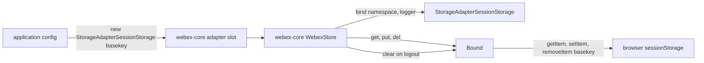
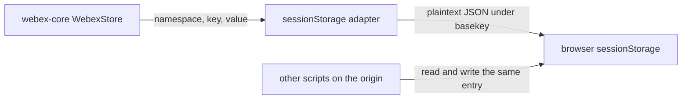

<!-- sdd-generated-metadata
doc_kind: standing-doc
generated_from: architecture@0.3.0
generated_by: claude-code
approved_by: rarajes2@cisco.com
updated_at: 2026-11-13T06:13:09Z
validation_status: pass
-->

# @webex/storage-adapter-session-storage architecture

Canonical architecture for this package. Behavior lives in the
[sessionStorage adapter specification](../src/docs/README.md). This page owns package boundaries,
the contract index, and how the package meets the webex-core storage layer.

Related context: [specification registry](specs/README.md) ·
[package agent instructions](../AGENTS.md)

## Applicability

| Condition ID                         | Status     | Evidence or reason | Owned section |
| ------------------------------------ | ---------- | ------------------ | ------------- |
| `repo.owns_datastore`                | Applicable | `src/index.js` owns the layout of the JSON document under the basekey in sessionStorage | Repository data and schema |
| `repo.holds_client_state`            | N/A        | `src/index.js` keeps only per-binding namespace and logger in WeakMaps | Client state model |
| `repo.components_interact`           | N/A        | One source file, `src/index.js` | Dependency and interaction topology |
| `repo.domain_data_across_components` | N/A        | One resource owns the only data shape | Object and data ownership |
| `repo.caches_data`                   | N/A        | Every get, put, and del re-reads storage in `src/index.js` | Caching catalog |
| `repo.observability_convention`      | Applicable | Every call logs one info line with the session-storage-store-adapter prefix in `src/index.js` | Observability patterns |
| `repo.deploys_to_infra`              | N/A        | Library published to npm (`package.json`); no service runtime | Runtime and infrastructure |
| `repo.shared_base_libs`              | Applicable | `babel.config.js`, `.eslintrc.js`, and `jest.config.js` re-export the shared legacy configs | Shared and base libraries |
| `repo.is_monorepo`                   | N/A        | This SDD root is one package; the workspace around it is out of scope | Package map and inter-package dependencies |
| `repo.multi_platform`                | N/A        | Browser only: `src/index.js` uses the sessionStorage global with no platform branch | Platform matrix |
| `repo.published_package`             | Applicable | `package.json` name and deploy:npm | Release and versioning |
| `repo.embedded_in_host`              | Applicable | The instance is placed in a webex-core storage adapter slot and driven by WebexStore | Host integration and theming |
| `repo.exposes_commands_or_artifacts` | Applicable | build:src in `package.json` writes dist | Commands and generated artifacts |
| `repo.cross_repo_deps_material`      | N/A        | Depends only on workspace packages and the browser; no external service or repository | Cross-repository topology |
| `repo.security_arch_warranted`       | Applicable | Host state is stored as plaintext readable by origin scripts, and a caller-chosen namespace can pollute a built-in prototype (`src/index.js`) | Security architecture |

## Design overview

`@webex/storage-adapter-session-storage` is a published JavaScript library with one module. It
default-exports `StorageAdapterSessionStorage`, a webex-core storage adapter backed by the browser
`sessionStorage` API. An application constructs it with a basekey and assigns the instance to a
webex-core adapter slot; webex-core `WebexStore` then binds one namespace per plugin and calls `get`,
`put`, `del`, and `clear` on the bindings.

All namespaces of one instance share one JSON document under the basekey. The package registers no
plugin and has no side effects on import. No workspace package configures it; webex-core's two
adapter slots default to its in-memory adapter, and the `webex` browser bundle wires the localStorage
sibling instead.

## Resource inventory and responsibilities

| Resource | Kind | Responsibility | Owner | Source | Detailed specification |
| -------- | ---- | -------------- | ----- | ------ | ---------------------- |
| sessionStorage adapter | package (one module) | Store webex-core namespaces in one sessionStorage JSON document per basekey | @webex/web-client | src | [`src/docs/README.md`](../src/docs/README.md) |

## Interaction and execution flows

Representative flow: an application configures the adapter, a plugin's persisted state is written
and read back, and logout purges it.

| From | To | Interaction or transport | Purpose | Failure or compatibility behavior |
| ---- | -- | ------------------------ | ------- | --------------------------------- |
| Application | webex-core config | Assigns the instance to `storage.boundedAdapter` or `storage.unboundedAdapter` | Select this adapter | None of its own; the slot is read on each use |
| `WebexStore` | `bind` | In-process call inside a promise executor | One binding per namespace per store | Rejections and the logger throw reject `_getBinding` |
| `WebexStore` | `get`, `put`, `del`, `clear` | In-process calls | Read, write, delete, purge | Errors pass through; `clear` can throw synchronously without the global |
| Binding | `sessionStorage` | Synchronous Web Storage calls on one key | Persist the document | Parse, quota, and missing-global errors; see the module failure-mode table |

## Dependency topology

| Dependency | Type | Used by | Purpose | Version, failure, or fallback policy |
| ---------- | ---- | ------- | ------- | ------------------------------------ |
| `@webex/webex-core` | Internal, runtime | `src/index.js` | `NotFoundError` for absent keys; the host that drives the adapter | `workspace:*`; storage spec consulted (src/lib/storage/docs/README.md) |
| Browser `sessionStorage` | Platform | `src/index.js` | Backing store | No feature detection; absent in Node |
| `@webex/storage-adapter-spec` | Internal, declared runtime, used by tests only | `test/unit/spec` | Shared adapter contract suite | `workspace:*`; spec consulted (src/docs/README.md) |
| `@webex/test-helper-mocha` | Internal, declared runtime and dev, used by tests only | `test/unit/spec` | `skipInNode` | `workspace:*` |
| `@webex/babel-config-legacy`, `@webex/eslint-config-legacy`, `@webex/jest-config-legacy`, `@webex/legacy-tools` | Internal, dev | Package tooling | Build, lint, and test stack | `workspace:*` |
| `@webex/test-helper-chai`, `@webex/test-helper-mock-webex`, `@webex/test-helper-test-users` | Internal, dev | Declared only | None imported by this package's files | `workspace:*` |

No import cycle exists: webex-core does not import this package.

## Public and consumer surfaces

| Surface | Type | Owner | Consumers | Compatibility policy | Source |
| ------- | ---- | ----- | --------- | -------------------- | ------ |
| `storage-adapter-session-storage-sdk`: default export `StorageAdapterSessionStorage` and its `bind`, `get`, `put`, `del`, `clear` shape | SDK, published to npm | sessionStorage adapter | Applications configuring webex-core adapter slots; no workspace package | No package rule declared; see Release and versioning | `package.json`, `src/index.js` |
| `session-storage-bounded-document`: the JSON document under the basekey | File (at rest), internal | sessionStorage adapter | This module only | No version field; see Repository data and schema | `src/index.js` |

The contracts this package requires, `webex-core-store-adapter-interface` and
`webex-core-storage-errors`, are registered in `.sdd/manifest.json` `contract_catalog`.

## Repository data and schema

| Datastore or schema | Owning resource | Source of truth | Migration and compatibility rule |
| ------------------- | --------------- | --------------- | -------------------------------- |
| `sessionStorage[basekey]`, one JSON document of namespaces and keys | sessionStorage adapter | `src/index.js` | None declared: no version field, migration, or schema check. Details in the module specification's [Data, schema, and migration discipline](../src/docs/README.md#data-schema-and-migration-discipline) |

## Cross-cutting architecture

### Security

- Trust boundaries and identity flow: see [Security architecture](#security-architecture).
- Sensitive surfaces and data classes: whatever the host persists through the slot; in the bounded
  slot that includes `@persist` state such as credentials.
- Encryption and secret boundaries: see [Security architecture](#security-architecture).

### Observability and operations

- Logging and correlation: see [Observability patterns](#observability-patterns).
- Metrics, traces, and audit signals: none.
- Ownership and operational entry points: the workspace `.github/CODEOWNERS` line for
  `packages/@webex/storage-adapter-session-storage` assigns `@webex/web-client`. No dashboards or
  runbooks are recorded in this package.

### Quality attributes

- Compatibility: hosts rely on the constructor signature, the adapter method shape, the
  `NotFoundError` type for absent keys, and the bind error messages the shared suite matches.
- Latency: every operation is synchronous main-thread work; writes cost the size of the whole
  document.
- Test confidence: no test route executes a case (unit tier skips all 21, karma completes 0); no
  coverage threshold exists.

## Observability patterns

| Signal  | Convention or required fields | Propagation or naming rule | Primary evidence |
| ------- | ----------------------------- | -------------------------- | ---------------- |
| Logs    | One `info` line per `bind`, `get`, `put`, `del`, and `clear` through the logger passed to `bind`; the key name is included for get, put, and del; values are never logged | Messages start `session-storage-store-adapter:` | `src/index.js` |
| Metrics | None | — | `src/index.js` |
| Traces  | None | — | `src/index.js` |
| Audit   | None | — | `src/index.js` |

## Shared and base libraries

| Library | Inherited responsibility | Consumers | Version floor | Compatibility rule |
| ------- | ------------------------ | --------- | ------------- | ------------------ |
| `@webex/webex-core` storage errors | `NotFoundError` (built on `StorageError`) | `src/index.js` | `workspace:*` | Keep rejecting absent keys with this type |
| `@webex/babel-config-legacy`, `@webex/eslint-config-legacy`, `@webex/jest-config-legacy`, `@webex/legacy-tools` | Build, lint, and test through one-line config files | Package tooling | `workspace:*` | Do not fork the configs locally |

## Release and versioning

| Artifact | Publish target | Versioning rule | Deprecation window | Changelog or migration obligation |
| -------- | -------------- | --------------- | ------------------ | --------------------------------- |
| @webex/storage-adapter-session-storage | npm through `deploy:npm` | None declared in the package; the workspace release pipeline sets versions | None declared | None in the package; the workspace owns changelog generation |

## Host integration and theming

| Host or integration | Mount or entry contract | Required providers or peers | Theming and accessibility constraints |
| ------------------- | ----------------------- | --------------------------- | ------------------------------------- |
| webex-core storage layer | An instance in `config.storage.boundedAdapter` or `config.storage.unboundedAdapter`; `WebexStore` calls `bind(namespace, {logger})` | `@webex/webex-core` exporting `NotFoundError`; a logger with `info`; a browser context | None; the module renders nothing. Details in the module specification's [Host integration and theming](../src/docs/README.md#host-integration-and-theming) |

## Commands and generated artifacts

| Command or artifact | Owner | Inputs | Output or side effect | Compatibility boundary |
| ------------------- | ----- | ------ | --------------------- | ---------------------- |
| `yarn build:src` | Package scripts | `src` | Writes `dist/` (JavaScript and source map) through `webex-legacy-tools` | `dist/` is generated and ignored by Git |
| `yarn build` | Package scripts | `src` | Runs `build:src` | Same output |
| `yarn test:unit` | Package scripts | `test/unit/spec` | Jest through `webex-legacy-tools`; the spec loads `dist/` | Currently skips every case under Node |
| `yarn test:style` | Package scripts | `src` | ESLint run | The shared config ignores `docs/**` and `*.md` |
| `yarn test:browser` | Package scripts | `test/unit/spec` | Karma in headless Chrome and Firefox | Currently completes 0 tests and exits 0 |

## Security architecture

- The adapter holds no credential and performs no encryption. Values are stored as plaintext JSON,
  readable and writable by any script that shares the origin's session storage area.
- Input from the storage area is trusted without validation, so content written by another script
  can fabricate reads or swallow writes (module `MOD-017`).
- The namespace reaches `bind` from the host; namespace `__proto__` pollutes a built-in prototype
  (module `MOD-016`). Its exposure and the needed fix are recorded once, in the module
  specification's [Pitfalls and constraints](../src/docs/README.md#pitfalls-and-constraints).
- Logs carry key names, never values (see [Observability patterns](#observability-patterns)).

## Domain language

| Term | Repository-specific meaning | Authoritative source |
| ---- | --------------------------- | -------------------- |
| Basekey | The sessionStorage key under which one adapter instance keeps its whole document | `src/index.js` |
| Namespace | A host-chosen partition inside the document; webex-core uses one per plugin | `src/index.js` |
| Binding (`Bound`) | The object `bind` resolves, tied to one namespace and logger | `src/index.js` |
| Adapter slot | `storage.boundedAdapter` or `storage.unboundedAdapter` in webex-core config | Sibling package webex-core, src/config.js |

## References and maintenance

- Decisions: [adr/](adr/index.md)
- Instantiated specifications and routing: [specs/README.md](specs/README.md)
- Repository rules and patterns: [package agent instructions](../AGENTS.md)
- Update this document in the same change that alters package boundaries, resource ownership,
  cross-resource interaction, or cross-cutting architecture.
