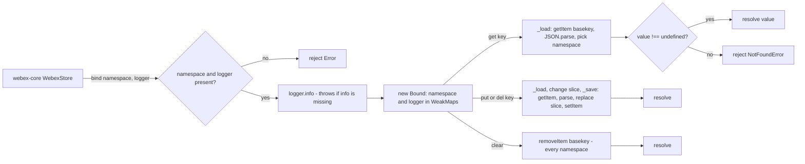
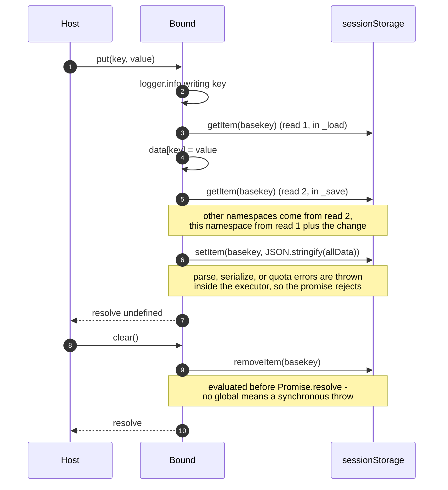
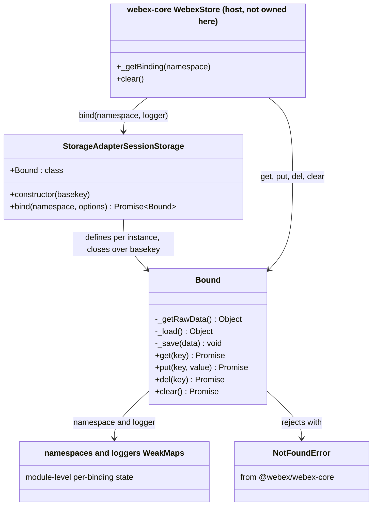

<!-- sdd-generated-metadata
doc_kind: module-spec
generated_from: module-spec@0.3.0
generated_by: claude-code
approved_by: rarajes2@cisco.com
updated_at: 2026-11-13T06:13:09Z
validation_status: pass
-->

# storage-adapter-session-storage `src`

This source-local document at `src/docs/README.md` owns the stable specification for the
**sessionStorage storage adapter**. Ground every claim in repository evidence and link to the
[repository architecture](../../docs/architecture.md) instead of repeating broader facts.

Related context: [documentation index](../../docs/index.md) ·
[documentation agent instructions](../../AGENTS.md)

## Metadata

| Field         | Value                                                        |
| ------------- | ------------------------------------------------------------ |
| Owner         | `@webex/web-client`, assigned by the workspace `.github/CODEOWNERS` line for this package |
| Source path   | `src`                                                        |
| Resource kind | package (published npm library)                              |
| Status        | Active                                                       |
| Last verified | 2026-11-13 at `b124d9842e`                                   |
| Module id     | `src`                                                        |
| Parent spec   | —                                                            |
| Doc kind      | Module spec                                                  |
| Coverage score | 100% (15/15 fields PRESENT) assessed 2026-11-13; test evidence is the weakest area because no route executes a case |
| Validation status | Pass — 2026-11-13; validator runtime `01a1d386-b645-7461-9a36-8a91051caadd`; 0 Blocking, 0 Important, 0 Medium, 0 Minor findings |

## Applicability

Sections preceded by an `Include if` comment are conditional. Retain a conditional section only when
source evidence or a confirmed developer answer satisfies its condition. Record `Unresolved` instead
of guessing.

| Condition ID                         | Status     | Evidence or reason | Owned section                 |
| ------------------------------------ | ---------- | ------------------ | ----------------------------- |
| `module.has_tiers`                   | N/A        | No tier annotation or SLO configuration exists; CODEOWNERS assigns an owner but no tier | Tier |
| `module.has_ui`                      | N/A        | `src/index.js` declares no component, template, or style | UI use-case flow |
| `module.crosses_service_boundaries`  | N/A        | No HTTP, RPC, or event client; the only external call target is the browser sessionStorage API in the same context | Cross-boundary use-case flow |
| `module.holds_client_state`          | N/A        | `src/index.js` keeps only binding metadata (namespace and logger) in WeakMaps, not application state | Client state model |
| `module.enforces_domain_rules`       | Applicable | `src/index.js` validates bind arguments and fixes the absent-key and namespace rules | Business rules and invariants |
| `module.is_concurrent_async`         | Applicable | `src/index.js` returns promises from every public method and does read-modify-write on a shared document | Concurrency and reactive flow |
| `module.owns_persistence`            | Applicable | `src/index.js` owns the layout of the JSON document stored under the basekey | Data, schema, and migration |
| `module.stateful_transitions`        | N/A        | No lifecycle field, status enum, or transition guard in `src/index.js` | State machine |
| `module.exposes_wire_protocol`       | N/A        | The at-rest JSON encoding is the only serialized form and is specified once, under Data, schema, and migration discipline | Protocol and wire format |
| `module.ui_multi_screen`             | N/A        | No user interface | UI flow |
| `module.large_data_model`            | N/A        | One two-level document shape with no entity relationships | Data model |
| `module.returns_caller_errors`       | Applicable | `src/index.js` rejects bind misuse and absent keys, and lets storage and parse errors through | Caller-visible failure modes |
| `module.module_specific_conventions` | Applicable | `.eslintrc.js`, the browser lint directive in `src/index.js`, and the `process` shim | Module-specific rules |
| `module.published_package`           | Applicable | `package.json` declares main, devMain, and deploy:npm | Export stability |
| `module.embedded_in_host`            | Applicable | The class is built to be placed in a webex-core storage adapter slot and driven by WebexStore (webex-core storage spec, Public surface) | Host integration and theming |
| `module.has_design_tradeoff`         | Applicable | `src/index.js`: one document per basekey, a closure-held basekey, and a Promise API over synchronous storage | Key design trade-off |
| `module.has_submodules`              | N/A        | Computed by scripts/module_tree.py: the manifest has one module and no child of src | Sub-modules |

## Evidence register

List the code, tests, schemas, configuration, and prior decisions used to verify this specification.
Mark unresolved statements as gaps; do not infer missing behavior.

| Evidence         | What it establishes |
| ---------------- | ------------------- |
| `src/index.js` | The whole implementation: the constructor, `bind`, and the inner `Bound` class with `get`, `put`, `del`, `clear` and the private `_getRawData`, `_load`, `_save`. |
| `package.json` | Package identity, entry points (main dist/index.js, devMain src/index.js), scripts, and dependencies. |
| `test/unit/spec/storage-adapter-session-storage.js` | The only test file. It imports the package by name (so it loads dist/index.js), and wraps the shared suite in `skipInNode`. |
| `README.md` | The npm page. Its one-line description calls the package a localStorage adapter; routed as context only (ADR-0001). |
| `.eslintrc.js`, `babel.config.js`, `jest.config.js`, `process` | Package-local lint root and thin re-exports of the shared legacy babel and jest configs; `process` exports {browser: true} for the browserify envify transform declared in `package.json`. |
| Sibling package storage-adapter-spec, spec src/docs/README.md, then source src/index.js | The shared abstract adapter contract (21 declared cases) this module is run against. Its spec records the suite gaps this document relies on: namespace isolation is never awaited (its MOD-010), `put(undefined)` is not isolated (its MOD-013), clear scope and signature are unspecified (its MOD-014), and the suite calls the Jest `beforeAll` global. |
| Sibling package webex-core, spec src/lib/storage/docs/README.md, then source src/lib/storage/make-webex-store.js | How a host drives an adapter: the adapter slot is read on each use (its MOD-017), each namespace is bound once per store behind `oneFlight` (its MOD-018), `put(undefined)` becomes `del` (its MOD-020), and the store's `clear()` reaches only bindings it created (its MOD-022). The source confirms `_getBinding` calls `adapter.bind` inside a promise executor and `clear()` calls each binding's `clear` directly. |
| Sibling package webex-core, source src/lib/storage/errors.js (storage spec consulted first) | `NotFoundError` is the rejection type this module imports from the package entry. |
| Sibling package webex-core, source src/webex-core.js and src/config.js (storage spec consulted first) | `logout()` clears both stores inside a promise chain; both adapter slots default to `MemoryStoreAdapter`. |
| Workspace search, 2026-11-13 | No workspace package configures this adapter. The only references outside the package are the root jest project list, the root `@legacy` script, CODEOWNERS, the deprecated `@ciscospark/` name in tooling/lint-package-names.sh, and other packages' SDD docs. |
| Measured command runs, 2026-11-13, Node v22.14.0 | `build:src` and `build` exit 0 (1 file); `test:unit` exits 0 with 21 skipped and 0 run; `test:style` exits 0; `test:browser` exits 0 with "0 tests completed" after `ReferenceError: beforeAll is not defined` in Firefox 160 and Chrome Headless 157; the aggregate `test` exits 1 at the missing `test:integration`. |
| Ad-hoc behavior probe, 2026-11-13, Node v22.14.0 | Characterization of the freshly built dist/index.js against a sessionStorage stand-in and with no global: storage access counts, log levels, logger and global failures, values, clear scope, Object.prototype names, `__proto__` pollution per stored root, corrupt and non-conforming documents, sibling round trips, and concurrent writes. Not committed and not a regression guard; it confirms what reading `src/index.js` implies. |

## Purpose and boundary

- Responsibility: persist webex-core storage namespaces in the browser `sessionStorage` API,
  presenting the asynchronous storage-adapter interface (`bind`, then `get`, `put`, `del`, `clear`)
  over one JSON document per adapter instance.
- In scope: the `sessionStorage[basekey]` document layout; namespace partitioning inside that
  document; JSON encoding of values; argument checks in `bind`; the not-found rejection; per-operation
  logging through the logger supplied at bind time.
- Out of scope: choosing which adapter a webex instance uses (host configuration of
  `storage.boundedAdapter` or `storage.unboundedAdapter`); the binding cache and when `clear()` runs
  (webex-core `WebexStore`); encryption, expiry, quota handling, change notification, and how long the
  browser keeps session data. None of these is implemented here.
- Consumers: no workspace package configures this adapter (Evidence register, workspace search). Its
  consumers are applications that construct it and assign the instance to a webex-core adapter slot,
  after which webex-core `WebexStore` is the only caller of its methods.

## Structure and key files

| Path     | Responsibility                     |
| -------- | ---------------------------------- |
| `src/index.js` | The whole module. Default-exports `StorageAdapterSessionStorage`; its constructor closes over `basekey` and defines the inner `Bound` class, so every binding of one adapter shares that key. |
| `package.json` | The ecosystem-native declaration of the published contract, plus the scripts. |
| `.eslintrc.js` | Package lint root (`root: true`) extending `@webex/eslint-config-legacy`. |
| `babel.config.js` | Re-exports `@webex/babel-config-legacy` for `build:src`. |
| `jest.config.js` | Re-exports `@webex/jest-config-legacy`, which runs unit specs in a Node environment. |
| `process` | One-line CommonJS module exporting `{browser: true}` for the envify transform. |
| `test/unit/spec/storage-adapter-session-storage.js` | Runs the shared abstract suite against `new StorageAdapterSessionStorage('test')`, skipped under Node. |

## Public surface

Describe exported APIs, events, commands, files, or UI boundaries. Link exact schemas or
declarations instead of copying them.

| Surface  | Consumer   | Compatibility commitment | Source   |
| -------- | ---------- | ------------------------ | -------- |
| `StorageAdapterSessionStorage` (default export) | Applications configuring a webex-core adapter slot | Published npm surface; the constructor signature and the adapter shape below are what host configuration depends on | `package.json`, implemented in `src/index.js` |
| `new StorageAdapterSessionStorage(basekey)` | Host configuration code | `basekey` names the one sessionStorage entry holding every namespace of this instance (`MOD-001`); a different basekey cannot see earlier data | `src/index.js` |
| `adapter.bind(namespace, options)` | webex-core `WebexStore._getBinding` | Resolves a new binding without touching storage (`MOD-004`); rejects on a falsy namespace or a missing logger (`MOD-002`, `MOD-003`); throws synchronously when the logger has no `info` method (`MOD-015`) | `src/index.js` |
| `bound.get(key)` | `WebexStore.get` | Resolves any stored value, falsey values included (`MOD-005`); rejects `NotFoundError` for an absent key (`MOD-006`), within the preconditions of `MOD-016` and `MOD-017` | `src/index.js` |
| `bound.put(key, value)` | `WebexStore.put` | Stores a JSON-serializable value and resolves with no value (`MOD-007`); rewrites the whole document (`MOD-012`, `INV-003`) | `src/index.js` |
| `bound.del(key)` | `WebexStore.del` | Removes one key of the bound namespace (`MOD-009`) | `src/index.js` |
| `bound.clear()` | `WebexStore.clear` | Removes the whole basekey entry, every namespace (`MOD-010`); takes no parameter (`MOD-011`) | `src/index.js` |

`.sdd/manifest.json` registers this surface as contract `storage-adapter-session-storage-sdk`
(published, source `package.json`) and the at-rest document as
`session-storage-bounded-document` (internal). The module requires
`webex-core-store-adapter-interface` and `webex-core-storage-errors`.

## Dependencies

| Dependency            | Why it is required | Failure behavior                    |
| --------------------- | ------------------ | ----------------------------------- |
| `@webex/webex-core` | Supplies `NotFoundError`, imported from the package entry at the top of `src/index.js`; the host's hydration paths treat that type as "nothing stored" (webex-core storage spec MOD-016, MOD-027) | Workspace dependency resolved at build time; another error type would turn a cold start into a hydration failure in the host |
| Browser `sessionStorage` global | The only backing store: read in `_getRawData`, written in `_save`, removed in `clear` | Absent in Node. `bind` still resolves; `get`, `put`, `del` reject and `clear` throws synchronously (`MOD-015`, failure-mode table) |
| Caller-supplied `options.logger` | Captured at bind time; `bind` and all four operations call its `info` method only | A missing logger rejects at bind (`MOD-003`); a logger without `info` throws synchronously at bind (`MOD-015`). A logger that binds successfully satisfies every later call |
| `@webex/storage-adapter-spec` | The shared contract suite the test file runs | Listed under `dependencies` in `package.json` although only the test file imports it; neither test route runs it (Verification) |
| `@webex/test-helper-mocha` | Supplies `skipInNode` to the test file | Listed under both `dependencies` and `devDependencies` in `package.json`; not imported by `src/` |

## Requirements

Separate source evidence, test/example evidence, assumptions, and gaps so a future contributor can
distinguish verified behavior from approved unknowns. Every WHY below is derived from code, from the
host code that calls this module, or from the shared contract suite; where none of these states a
reason, the row says so.

| ID        | WHAT | WHY | Source evidence | Test or example evidence | Assumptions or gaps | Confidence |
| --------- | ---- | --- | --------------- | ------------------------ | ------------------- | ---------- |
| `MOD-001` | All namespaces of one adapter instance live in a single sessionStorage entry named by the constructor `basekey`, as one JSON document. | One entry lets `clear()` drop the instance's whole dataset with one `removeItem` and lets each binding reach its namespace with one parse. | `src/index.js` | None executing | No test pins the entry name or layout | Present |
| `MOD-002` | `bind()` rejects with `Error` and the message `` `namespace` is required `` when `namespace` is falsy. | The shared contract requires this wording (storage-adapter-spec MOD-001); a falsy namespace would file data under a key such as `undefined`. | `src/index.js` | `test/unit/spec/storage-adapter-session-storage.js` declares it through the suite; not executed | — | Present |
| `MOD-003` | `bind()` rejects with `Error` and the message `` `options.logger` is required `` when no logger is supplied; a missing `options` is treated as `{}`. | Required by the shared contract (storage-adapter-spec MOD-002); every operation calls the logger unconditionally. | `src/index.js` | Declared through the suite; not executed | — | Present |
| `MOD-004` | `bind()` touches no storage and resolves a new `Bound` on every call; the module caches no binding. | Caching is the host's job: `WebexStore` binds each namespace once per store behind `oneFlight` (webex-core storage spec MOD-018). | `src/index.js` | None executing. Probe 2026-11-13: two binds of one namespace gave two distinct objects; bind made no storage call | Harmless to repeat, because all data lives in the shared document | Present |
| `MOD-005` | `get()` resolves any value that is not `undefined`, including `0`, `false`, `null`, and `''`. | The shared contract declares falsey primitives as legitimate stored values (storage-adapter-spec MOD-005); the test is `typeof value !== 'undefined'`, not truthiness. | `src/index.js` | Declared through the suite (0, false, null); not executed. Probe 2026-11-13: all four round-tripped | — | Present |
| `MOD-006` | `get()` rejects with `NotFoundError` and the message `No value found for <key>` (key unquoted) when the key is absent, provided the key is not an `Object.prototype` property name (`MOD-016`) and the document conforms (`MOD-017`). | Host hydration treats `NotFoundError` as "nothing stored, continue" and any other rejection as a fault (webex-core storage spec MOD-016, MOD-027). | `src/index.js` | Declared through the suite; not executed. Probe 2026-11-13: the rejection was an instance of NotFoundError | The suite uses ordinary key names only | Present |
| `MOD-007` | Within `MOD-017`, `put()` stores the value under the bound namespace and resolves with no value, for JSON-serializable values. `undefined`, a `Symbol`, or a function resolve but store nothing; a `BigInt` or a cyclic value rejects `TypeError` before `setItem`; a throwing `toJSON` rejects with that error. | The host treats resolution as a write acknowledgement and supplies its own resolved value (webex-core storage spec MOD-019). | `src/index.js` | Declared through the suite; not executed. Probe 2026-11-13 for each value class | Resolution does not prove storage for the omitted value classes | Present |
| `MOD-008` | `put(key, undefined)` leaves the key absent, so a following `get` rejects `NotFoundError` unless the key is an `Object.prototype` name (`MOD-016`). | `_save` encodes with `JSON.stringify`, which drops `undefined` members; there is no explicit branch. Through the host this path is rare, because `WebexStore.put` turns `undefined` into `del` (webex-core storage spec MOD-020). | `src/index.js` | The suite case also calls del or clear afterwards, so it would not isolate this even if it ran (storage-adapter-spec MOD-013) | Emergent from the encoding; would change silently with it | Present |
| `MOD-009` | Within `MOD-017`, `del()` removes one key from the bound namespace and resolves; an absent key is not an error. | Deleting one record must not touch other keys or namespaces in the shared document. | `src/index.js` | Declared through the suite; not executed | The rewrite carries the `INV-003` round-trip limit | Present |
| `MOD-010` | `clear()` removes the whole basekey entry, so every namespace of the instance is gone, not only the bound one. | Inferred from code: `WebexStore.clear()` reaches only bindings created in its own store (webex-core storage spec MOD-022), so a basekey-wide purge also removes namespaces written earlier in the same browser session and not bound since. The identical code in the localStorage sibling has the same behavior. No comment in this package states the intent. | `src/index.js` | The suite writes and checks one key per case, so namespace-wide scope is never observed (storage-adapter-spec MOD-014). Probe 2026-11-13: another namespace's key was gone after clear | `README.md` says nothing about scope | Present |
| `MOD-011` | `clear()` takes no parameter; an argument is ignored. | The host calls `clear()` with none (webex-core make-webex-store.js); the purge is basekey-wide (`MOD-010`), so a key would select nothing. | `src/index.js` | Probe 2026-11-13: clear with a key argument removed every namespace, like clear with none | The JSDoc declares `@param {string} key`, which the code does not use. The suite calls `clear` both with and without an argument; both work because it is ignored | Present |
| `MOD-012` | Logically, `get`, `put`, and `del` address only `allData[namespace]`, so two bindings can hold the same key with different values. Physically, all three parse the whole document, and `put` and `del` rewrite it. `bind` touches no storage, and `clear` only calls `removeItem`. | Namespaces are the host's isolation unit (one per plugin); the physical scope is why write cost grows with the whole document. | `src/index.js` | The suite's isolation case is never awaited (storage-adapter-spec MOD-010). Probe 2026-11-13: same key in two namespaces held two values; get used 1 getItem, put and del 2 getItem and 1 setItem, clear 1 removeItem | Holds only within `MOD-016` and `MOD-017` | Present |
| `MOD-013` | Only JSON-serializable data round-trips: values go through `JSON.stringify` on write and `JSON.parse` on read, and each `get` returns a new copy. | sessionStorage holds strings only. | `src/index.js` | Probe 2026-11-13: a Date came back as an ISO string, a Map as an empty object, and two gets of one object returned distinct objects | Nothing warns about lossy values (`MOD-007`) | Present |
| `MOD-014` | Every call logs one line at `info` through the logger captured at bind: `bind` ("returning binding"), `get` ("reading"), `put` ("writing"), `del` ("deleting"), each with the key in backticks, and `clear` ("clearing sessionStorage"). All lines start `session-storage-store-adapter:`. Values are never logged. | Makes storage traffic traceable through the host logger. No comment states why every line is `info` (the localStorage sibling logs reads and writes at `debug`). | `src/index.js` | None executing. Probe 2026-11-13 recorded all five lines at info level | — | Present |
| `MOD-015` | The promise contract has two synchronous-throw exits. Without a sessionStorage global, `get`, `put`, and `del` reject `ReferenceError` but `clear()` throws it synchronously. A logger without `info` makes `bind` throw `TypeError` synchronously, although a missing logger rejects. | `get`, `put`, and `del` work inside a `new Promise` executor, which turns a throw into a rejection; `clear` evaluates `sessionStorage.removeItem(basekey)` as the argument of `Promise.resolve`, and `bind` calls `options.logger.info` outside any promise. | `src/index.js` | None executing. Probe 2026-11-13 in a Node process | Through the host the bind throw becomes a rejection, because `_getBinding` calls `adapter.bind` inside a promise executor; the clear throw escapes `WebexStore.clear()` synchronously (webex-core make-webex-store.js) | Present |
| `MOD-016` | Lookups do not test own properties, so `Object.prototype` names act as stored data. With nothing stored, `get('toString')` and `get('constructor')` resolve inherited functions, and `bind('toString').get('name')` resolves `'toString'`. Namespace `__proto__` makes `_load` return the stored root's prototype: an ordinary-key `put` then adds an own property to that prototype (`Object.prototype` for an absent or object root, `Array.prototype` for an array root) and stores nothing. With key `__proto__` as well, the write tries to re-parent that prototype: rejected for `Object.prototype`, successful for `Array.prototype`. A `null` root rejects `TypeError`; a root with an own `__proto__` key absorbs the write instead. Callers must not use `Object.prototype` names as keys or namespaces. | Records current behavior, not intent: the defaults are `{}` literals, `JSON.parse` returns ordinary objects, and nothing uses an own-property test or a null-prototype object. | `src/index.js` | None executing. Probe 2026-11-13: each case above, per stored root | No test pins any of it. A fix has to cover the namespace lookup in `_load`, the key lookup in `get`, the assignment in `_save`, and the objects `JSON.parse` returns | Present (observed behavior) |
| `MOD-017` | The adapter assumes a document shaped `{ "<namespace>": { "<key>": <json-value> } }` and key and namespace names outside `Object.prototype`, and checks neither. Behavior outside this precondition is unspecified: a read may resolve a value never stored, a write may resolve and call `setItem` without storing the value, and a rejection may be a `TypeError` instead of a documented error. `clear()` is outside the precondition because it parses nothing. | Any script on the origin can write the entry, and the code applies only `allData[namespace] \|\| {}`. Stating a precondition rather than enumerating outcomes keeps observed accidents out of the contract. | `src/index.js` | None executing. Probe 2026-11-13: examples below | No validation decision exists | Present (precondition) |

Non-normative examples of input outside the `MOD-017` precondition, observed in the 2026-11-13 probe
of the built dist. No test or code guarantees them:

- A string namespace slice `{"ns":"hi"}`: `get('0')` resolved `"h"` and `get('length')` resolved `2`;
  `put` rejected `TypeError` with no `setItem` call.
- An array namespace slice `{"ns":[7,8]}`: `put('0', 1)` wrote `{"ns":[1,8]}`; `put('name', 'v')`
  resolved and called `setItem` once, and the value was not stored.
- A primitive root `5` made `put` reject `TypeError`; a falsy slice `{"ns":0}` was replaced, so
  `put('x', 1)` wrote `{"ns":{"x":1}}`.

## Design overview

The module is one file that presents webex-core's asynchronous adapter interface on top of the
synchronous, string-only `sessionStorage` API (`src/index.js`).

The outer `StorageAdapterSessionStorage` class is a factory. Its constructor takes `basekey` and
defines the inner `Bound` class in a closure over it. `basekey` is never an instance property, so
every binding made by one adapter is tied to the same entry and nothing can repoint it later. The
cost is one `Bound` class object per adapter instance.

Per-binding state, the namespace and the logger, lives in two module-level `WeakMap`s filled by the
`Bound` constructor. A binding therefore has no enumerable own properties (probe: `Object.keys` was
empty), and the entries go away with the binding.

Document access differs by method. `_getRawData` reads the entry and parses it, or returns `{}`
when the entry is absent; `_load` narrows that to the binding's namespace, or `{}`; `_save` reads
and parses the document again, replaces this namespace's slice, and writes the whole document back.

| Method | `getItem` and parse | `setItem` and serialize | `removeItem` |
| ------ | ------------------- | ----------------------- | ------------ |
| `bind` | no | no | no |
| `get` | once (`_load`) | no | no |
| `put`, `del` | twice (`_load`, then `_save`) | once, whole document | no |
| `clear` | no | no | once, on the basekey |

`get`, `put`, and `del` run inside `new Promise(executor)`; `clear` returns
`Promise.resolve(<expression>)` and `bind` calls the logger before creating any promise. That shape
is why the synchronous-throw exits of `MOD-015` exist.

## Data flow and sequence coverage

The transport is the synchronous same-origin `sessionStorage` API, called directly; there is no
network, worker, or IPC boundary. The four operation groups differ in how they touch the document.

| Operation group | Entry and outcome | Diagram or evidence | Failure and recovery coverage |
| --------------- | ----------------- | ------------------- | ----------------------------- |
| Bind | `bind(namespace, options)` resolves a `Bound`, or rejects on a missing argument | Diagram 1; `src/index.js` | Argument rejections; synchronous throw for a logger without `info` (`MOD-015`); no storage access, so a missing global cannot fail it |
| Read | `get(key)` resolves the value or rejects `NotFoundError` | Diagram 1 and Diagram 2; `src/index.js` | Absent key; parse errors and a missing global reject inside the executor; inherited names resolve (`MOD-016`) |
| Write and delete | `put(key, value)` or `del(key)` resolves after rewriting the document | Diagram 1 and Diagram 2; `src/index.js` | Parse, serialization, quota, and missing-global errors reject inside the executor; no retry |
| Purge | `clear()` removes the basekey entry | Diagram 1 and Diagram 2; `src/index.js` | Works on a corrupt document because it parses nothing; throws synchronously without the global (`MOD-015`) |

**Diagram 1 — operation branches**

**Diagram 2 — write, then purge, with the failure exits**

## Class and component relationships

## Use cases and flows

| Use case | Actor or caller | Primary steps and outcome     | Failure or boundary behavior | Evidence                  |
| -------- | --------------- | ----------------------------- | ---------------------------- | ------------------------- |
| `UC-001` | An application configuring webex | Constructs `new StorageAdapterSessionStorage(basekey)` and assigns the instance to `storage.boundedAdapter` or `storage.unboundedAdapter`; webex-core reads the slot on each use | No workspace package does this today; outside a browser every storage call fails (`MOD-015`) | `src/index.js`; webex-core storage spec MOD-017 |
| `UC-002` | webex-core `WebexStore._getBinding` | On the first operation for a namespace, calls `bind(namespace, {logger: webex.logger})` and caches the binding | Bind rejections and the logger throw reject `_getBinding`, which does not cache a failed bind | `src/index.js`; webex-core make-webex-store.js |
| `UC-003` | `@persist` state and host rehydration (when this adapter is in the bounded slot) | Writes go through `WebexStore.put`, which serializes the value; reads at start-up call `get`, and `NotFoundError` means "nothing stored" | Falsey values survive (`MOD-005`); any other rejection is treated as a fault by the host | `src/index.js`; webex-core storage spec MOD-016, MOD-021 |
| `UC-004` | webex-core `logout()` | `WebexStore.clear()` calls `clear()` on every cached binding; the first call removes the whole basekey, the rest find nothing to remove | All namespaces of the instance are removed (`MOD-010`) | `src/index.js`; webex-core make-webex-store.js and webex-core.js |

## Business rules and invariants

| ID        | Invariant                            | WHY         | Enforcement source | Test evidence |
| --------- | ------------------------------------ | ----------- | ------------------ | ------------- |
| `INV-001` | Every binding that exists has a truthy namespace and a logger with a callable `info`. | `bind` rejects without either, and its own `logger.info` call throws before a `Bound` is built when `info` is missing; so no later operation can fail on the logger. | `src/index.js` | Declared through the suite (argument cases only); not executed |
| `INV-002` | No stored value is ever reported absent: only `undefined` at `data[key]` means absent. The reverse does not hold for inherited names (`MOD-016`) or non-conforming documents (`MOD-017`). | Keeps `0`, `false`, `null`, and `''` from degrading to `NotFoundError`. | `src/index.js` | Declared through the suite; not executed |
| `INV-003` | A write in one namespace keeps a sibling namespace's value if and only if that value survives a `JSON.parse` then `JSON.stringify` round trip. Byte layout is not kept. | `put` and `del` re-serialize the whole document. Probe 2026-11-13: an externally written `{"neg":-0,"big":1e400,"exp":1e3}` came back as `{"neg":0,"big":null,"exp":1000}` after a write elsewhere. | `src/index.js` | None |
| `INV-004` | Within `MOD-017`, and while `JSON.stringify` is unmodified in the realm (no callable `toJSON` reachable from the root), whatever `_save` passes to `setItem` is valid JSON. A write neither repairs nor reliably preserves a non-conforming document. | `_save` serializes a parsed document or an object literal and validates nothing; the `MOD-017` examples show a falsy slice replaced and an array slice kept. | `src/index.js` | None |

## Concurrency and reactive flow

- Execution model: the browser event loop. Each public method returns a promise on its normal path
  (except the synchronous exits in `MOD-015`), but all storage work inside it is synchronous; there is
  no `await` or callback between a read and the matching write (`src/index.js`).
- Ordering guarantees: within one JavaScript context each `put` or `del` cycle runs to completion
  without interleaving, so concurrent writes to one key end last-write-wins and concurrent writes to
  different namespaces both survive. Probe 2026-11-13: three concurrent `put`s to one key left the
  third value; concurrent `put`s in two namespaces kept both.
- Idempotency and retry: `put`, `del`, and `clear` are idempotent for the same arguments. The module
  retries nothing; the host de-duplicates only binding (`oneFlight` on `_getBinding`).
- Shared-state protection: none that detects a conflict. `_save` re-reads the document but compares
  nothing, takes sibling namespaces from that second read, and writes this namespace from the first.
  Contexts that share one sessionStorage area, such as same-origin frames in one tab, can interleave
  cycles, and the later `setItem` wins; nothing here detects it.
- Blocking restrictions: sessionStorage calls block the main thread. `put` and `del` cost grows with
  the size of the whole document; `get` pays the parse half; `bind` and `clear` pay neither.

## Data, schema, and migration discipline

| Store or schema | Owned entities or keys | Source of truth | Migration and compatibility rule |
| --------------- | ---------------------- | --------------- | -------------------------------- |
| `sessionStorage[basekey]`: one JSON document `{ "<namespace>": { "<key>": <json-value> } }` | Every namespace a host binds through one adapter instance; the keys and values are the host's (for the bounded slot, `@persist` state such as credentials) | `src/index.js` | Registered as contract `session-storage-bounded-document` (internal). No version field, migration step, or schema check exists, and no compatibility rule is declared in the package. Because `_load` returns `{}` for anything missing, a layout change would surface as missing values on read, not as a detected incompatibility. |

Retention, deletion, backfill, rollback, and cache behavior:

- Retention: the module sets no expiry. Data stays until `del`, `clear`, or the browser drops the
  session storage area; how long the browser keeps it is outside this package.
- Deletion: `del(key)` removes one key of one namespace; `clear()` removes the whole entry
  (`MOD-010`).
- Backfill and rollback: none. A write is in place immediately and nothing keeps the prior value.
- Cache: none. `get`, `put`, and `del` re-read the entry every time, so a value written by another
  script in the same storage area is visible on the next read (probe 2026-11-13). The module registers
  no `storage` event listener, so nothing tells a holder of an older value that it changed. The host
  caches binding objects, not values.

## Caller-visible failure modes

| Condition   | Signal or result | Caller behavior | Retry or recovery | Evidence |
| ----------- | ---------------- | --------------- | ----------------- | -------- |
| Falsy `namespace` passed to `bind` | Rejects ``Error('`namespace` is required')`` | Fix the call site | Not retryable | `src/index.js` |
| No `options.logger` | Rejects ``Error('`options.logger` is required')`` | Supply the host logger | Not retryable | `src/index.js` |
| Logger without an `info` method | `bind` throws `TypeError: options.logger.info is not a function` synchronously; through `WebexStore._getBinding` it arrives as a rejection | Supply a logger with `info`; `bind().catch()` alone does not catch a direct call | Not retryable | `src/index.js` |
| Absent key on `get` (not an `Object.prototype` name) | Rejects `NotFoundError`, `No value found for <key>` | Treat as never stored | Expected cold-start path | `src/index.js` |
| `Object.prototype` name as key or namespace | `get` resolves an inherited member instead of rejecting; namespace reads return properties of that member | A not-found branch never runs | Avoid these names (`MOD-016`) | `src/index.js` |
| Namespace `__proto__`, ordinary key, root without an own `__proto__` key | `put` resolves; the key becomes an own property of the root's prototype (`Object.prototype` for an absent or object root, `Array.prototype` for an array root); storage is unchanged | Every object inheriting from that prototype sees the property; the write acknowledgement is false | Not recoverable here: `clear()` removes the entry but not the prototype property (probe 2026-11-13) | `src/index.js` |
| Namespace `__proto__` and key `__proto__` | Object value: rejects `TypeError` for an absent or object root; for an array root, resolves and re-parents `Array.prototype`. `null` or string values resolve with no stored change | The resolving cases look like successful writes | Not recoverable here (`MOD-016`) | `src/index.js` |
| No sessionStorage global, on `get`, `put`, `del` | Rejects `ReferenceError: sessionStorage is not defined` | The adapter is running outside a browser; use `MemoryStoreAdapter` | Not retryable | `src/index.js` |
| No sessionStorage global, on `clear` | Throws `ReferenceError` synchronously; escapes `WebexStore.clear()` synchronously | Use `try`/`catch`, not `.catch()` | Not retryable | `src/index.js` |
| Entry is not valid JSON | `get`, `put`, `del` reject `SyntaxError` | Call `clear()` | `clear()` removes the entry without parsing, after which writes succeed (probe 2026-11-13); every namespace is lost | `src/index.js` |
| Entry is valid JSON outside the `MOD-017` shape | Either a `TypeError` rejection, or no signal at all (a read of a value never stored, a write that stores nothing) | The silent case cannot be detected from the result | `clear()` removes the document | `src/index.js` |
| Value not JSON-serializable | `undefined`, `Symbol`, function: resolves and stores nothing. `BigInt`, cyclic: rejects `TypeError`. Throwing `toJSON`: rejects with that error | Serialize to JSON-safe data first (`MOD-007`, `MOD-013`) | Not retryable | `src/index.js` |
| Storage quota exceeded | The browser's error from `setItem` rejects `put` or `del` unchanged | Not handled here | None implemented | `src/index.js` |

## Pitfalls and constraints

- Two adapter instances with the same `basekey` share one document, so one instance's `clear()`
  removes the other's namespaces too (`MOD-001`, `MOD-010`).
- Behavior that passes with the default `MemoryStoreAdapter` can lose data here: its `clear` is
  binding-scoped and it stores references without encoding (webex-core storage spec MOD-031), while
  this adapter purges the basekey and returns encoded copies (`MOD-010`, `MOD-013`).
- `README.md` describes the package as a localStorage adapter; the code uses `sessionStorage`
  (`src/index.js`). Treat this specification as the reference (ADR-0001).
- Logging every read and write at `info` with the key (`MOD-014`) can be noisy at host log levels
  that show `info`; changing a level is an observable change to host logs.
- Security: values are stored as plaintext JSON readable by any script on the origin that shares the
  storage area. Placed in the bounded slot, the adapter would hold `@persist` state such as
  credentials. The module performs no encryption.
- Security: the `__proto__` namespace path is prototype pollution (CWE-1321) reachable through a
  caller-chosen namespace (`MOD-016`). There is no known exploit path in this repository, because
  webex-core supplies fixed plugin namespaces and no workspace package configures this adapter, but
  the module has no guard. This warrants a code fix with tests, not only this entry.

## Module-specific rules

- Do: keep `basekey` in the constructor closure; an instance property would let callers repoint an
  adapter after bindings exist (`src/index.js`).
- Do: keep per-binding state in the module-level `WeakMap`s so bindings expose no own properties.
- Do: keep the `/* eslint-env browser */` directive at the top of `src/index.js`; the module depends
  on the browser global and does no feature detection.
- Do: keep the `session-storage-store-adapter:` log prefix and the `info` level unless a change
  request covers host log output (`MOD-014`).
- Do: run `yarn build:src` before `yarn test:unit`; the test file imports the package by name, which
  resolves to `dist/index.js`.
- Do not: add a `test:unit` case that needs `sessionStorage` without providing one; the shared jest
  config runs in a Node environment, which is why the suite is wrapped in `skipInNode`.
- Do not: decide presence by truthiness; only `typeof value !== 'undefined'` keeps falsey values
  (`INV-002`).
- Do not: give `clear()` a key parameter or make it namespace-scoped without a change request; host
  logout relies on one call removing everything (`MOD-010`, `MOD-011`).
- Do not: change the document layout or encoding without handling documents already in the session
  storage area (Data, schema, and migration discipline).

## Export stability

| Export or entry point | Consumer   | Stability | Versioning and deprecation rule | Declaration or API report |
| --------------------- | ---------- | --------- | ------------------------------- | ------------------------- |
| Default export `StorageAdapterSessionStorage` | Applications configuring webex-core adapter slots | Stable published surface | No package-level rule is declared; the workspace release pipeline versions it. Changing the constructor or the `bind`, `get`, `put`, `del`, `clear` shape breaks every consumer | `package.json` (main dist/index.js) |
| `src/index.js` through `devMain` | Workspace builds from source | Internal to the workspace | Same source; not a separate compatibility surface | `package.json` (devMain) |
| Built `dist/index.js` and its source map | npm consumers | Build output of `build:src` | Not version-controlled; regenerated at publish | `package.json` (build:src) |

The package ships no `.d.ts` and no API report, so `package.json` is its only machine-readable
declaration. `package.json` `description` is empty.

## Host integration and theming

- Mount or entry contract: the host receives an instance, not the class, in
  `config.storage.boundedAdapter` or `config.storage.unboundedAdapter`. `WebexStore` reads the slot on
  each use and calls `adapter.bind(namespace, {logger: webex.logger})` (webex-core storage spec
  MOD-017, MOD-018). Both slots default to `MemoryStoreAdapter` (webex-core `src/config.js`).
- Required providers, peers, or host versions: a workspace `@webex/webex-core` that exports
  `NotFoundError`; a host logger with `info`; a browser context with `sessionStorage`.
- Theme and design-token contract: not applicable; the module renders nothing.
- Accessibility and lifecycle obligations: none of its own. The host owns binding lifetime and when
  `clear()` runs; the module registers no listener and needs no teardown.

## Key design trade-off

| Chosen trade-off | Preserved invariant or benefit | Cost or limitation | Decision evidence |
| ---------------- | ------------------------------ | ------------------ | ----------------- |
| One sessionStorage entry holds every namespace as one JSON document | `clear()` purges the instance with one `removeItem` (`MOD-010`); isolation needs no key-naming scheme | Every read parses all namespaces and every write re-serializes them; one corrupt entry breaks every namespace | `src/index.js` |
| `basekey` held in a constructor closure | Fixed after construction | One `Bound` class object per adapter instance | `src/index.js` |
| Synchronous storage behind a Promise interface | Matches the shared adapter interface, so the host treats all adapters alike | The asynchrony is nominal: the main thread blocks, and `clear` and `bind` leak synchronous throws (`MOD-015`) | `src/index.js` |
| Presence tested with `typeof value !== 'undefined'` | Falsey values round-trip (`INV-002`) | A stored `undefined` cannot be told from absence (`MOD-008`) | `src/index.js` |

## Verification

| Requirement or invariant | Test level | Positive evidence | Negative or boundary evidence | Gap |
| ------------------------ | ---------- | ----------------- | ----------------------------- | --- |
| `MOD-001` | — | none found | none found | No test pins the entry name or layout |
| `MOD-002`, `MOD-003`, `INV-001` | Contract (declared, not executed) | `test/unit/spec/storage-adapter-session-storage.js` (shared suite) | same | Neither route runs the suite; no case covers a logger without `info` |
| `MOD-004` | — | none found | none found | Not covered |
| `MOD-005`, `INV-002` | Contract (declared, not executed) | `test/unit/spec/storage-adapter-session-storage.js` (shared suite) | none found | `''` is not among the declared falsey cases |
| `MOD-006`, `MOD-007`, `MOD-009` | Contract (declared, not executed) | `test/unit/spec/storage-adapter-session-storage.js` (shared suite) | none found | Non-JSON values and inherited names are not covered |
| `MOD-008` | — | none found | none found | The suite case also deletes, so it could not isolate this |
| `MOD-010`, `MOD-011` | — | none found | none found | One key per case; scope never observed; `clear` called both with and without an argument |
| `MOD-012`, `INV-003` | — | none found | none found | The isolation case is never awaited; round-trip loss is untested |
| `MOD-013`, `INV-004` | — | none found | none found | Not covered |
| `MOD-014` | — | none found | none found | Logging is not observed |
| `MOD-015` | — | none found | none found | Missing global and incomplete logger are not covered |
| `MOD-016`, `MOD-017` | — | none found | none found | No case uses an `Object.prototype` name or a non-conforming document |

No route executes a case for this module. Measured 2026-11-13 with Node v22.14.0:

- `yarn test:unit` exits 0 with 21 skipped and 0 run: the jest environment is Node, and the test
  file wraps the suite in `skipInNode`.
- `yarn test:browser` runs karma over `test/unit/spec` (`--unit --runner karma`), reports
  `ReferenceError: beforeAll is not defined` in Firefox 160 and Chrome Headless 157, prints
  "0 tests completed", and exits 0. The shared suite calls the Jest `beforeAll` global, which the
  mocha runner does not define, so the suite throws while being declared.
- The aggregate `test` script runs `test:style` and `test:unit`, then exits 1 because
  `test:integration` is not defined.

A green unit run and a zero-exit karma run therefore verify nothing. Closing the gap needs a
mocha-compatible hook in `@webex/storage-adapter-spec` or a browser-capable unit route here; both are
code changes outside this specification. Until then the module stays `Partial`.

Open items found while specifying, recorded and not fixed (each is a code or product-doc change):

1. No executing test coverage, as measured above.
2. The aggregate `test` script names a missing `test:integration` script.
3. `README.md` calls the package a localStorage adapter (ADR-0001).
4. The `clear()` JSDoc declares an unused `key` parameter (`MOD-011`).
5. The `__proto__` namespace pollution path has no guard (`MOD-016`).
6. `@webex/storage-adapter-spec` and `@webex/test-helper-mocha` are runtime `dependencies` although
   only the test file imports them.
