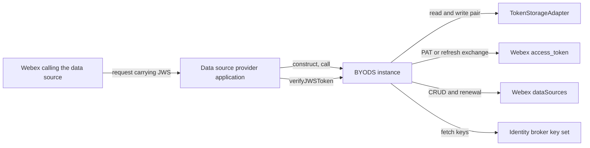
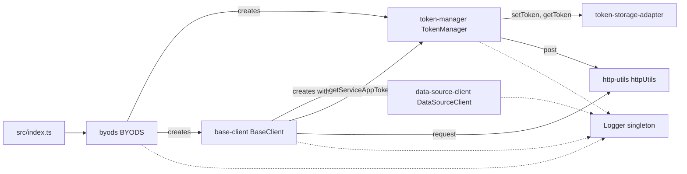
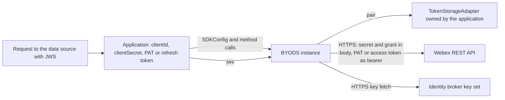

<!-- sdd-generated-metadata
doc_kind: standing-doc
generated_from: architecture@0.3.0
generated_by: claude-code
approved_by: rarajes2@cisco.com
updated_at: 2026-11-13T13:41:05Z
validation_status: pass
-->

# @webex/byods architecture

Canonical architecture for this package. Module behavior lives in the
[BYoDS SDK specification](../src/docs/README.md). This page owns package boundaries, the contract
index, and how the package meets Webex and the rest of the workspace.

Related context: [specification registry](specs/README.md) ·
[package agent instructions](../AGENTS.md)

## Applicability

| Condition ID                         | Status     | Evidence or reason | Owned section |
| ------------------------------------ | ---------- | ------------------ | ------------- |
| `repo.owns_datastore`                | N/A        | No database or file store; the default token adapter is in memory (`src/token-storage-adapter/index.ts`) | Repository data and schema |
| `repo.holds_client_state`            | Applicable | Token pair, key-set cache, renewal timers, and log level (`src/byods/index.ts`, `src/Logger/index.ts`) | Client state model |
| `repo.components_interact`           | Applicable | `src/byods/index.ts` wires the token manager, base client, and data source client, which call `src/http-utils/index.ts` | Dependency and interaction topology |
| `repo.domain_data_across_components` | Applicable | The token pair is written by `src/token-manager/index.ts` and consumed by `src/base-client/index.ts` | Object and data ownership |
| `repo.caches_data`                   | Applicable | `src/byods/index.ts` passes a key-set cache to jose with a 10-minute maximum age | Caching catalog |
| `repo.observability_convention`      | Applicable | `src/Logger/index.ts` defines one line format and level scheme used by every component | Observability patterns |
| `repo.deploys_to_infra`              | N/A        | Library published to npm; no service runtime, container, or deployment descriptor in `package.json` | Runtime and infrastructure |
| `repo.shared_base_libs`              | Applicable | Build, test, and lint come from workspace legacy configuration (`babel.config.js`, `jest.config.js`, `tsconfig.json`) | Shared and base libraries |
| `repo.is_monorepo`                   | N/A        | This SDD root is one package. The workspace around it is out of scope. | Package map and inter-package dependencies |
| `repo.multi_platform`                | N/A        | Node.js only: `src/constants.ts` reads `os` and `process.version`, and `jest.config.js` uses the node test environment | Platform matrix |
| `repo.published_package`             | Applicable | `package.json` names the package `@webex/byods` and defines `deploy:npm` | Release and versioning |
| `repo.embedded_in_host`              | N/A        | No host theme or embed API | Host integration and theming |
| `repo.exposes_commands_or_artifacts` | Applicable | `package.json` scripts write `dist/` and typedoc output | Commands and generated artifacts |
| `repo.cross_repo_deps_material`      | Applicable | Behavior depends on the Webex REST API and identity broker (`src/constants.ts`) | Cross-repository topology |
| `repo.security_arch_warranted`       | Applicable | The package holds Service App secrets and tokens and verifies inbound JWS tokens (`src/token-manager/index.ts`, `src/byods/index.ts`) | Security architecture |

## Design overview

`@webex/byods` is a published Node.js library with one module. A data source provider constructs
`BYODS` once per Webex organization; the instance acquires and stores a Service App token pair,
registers and updates data sources through the Webex `/dataSources` API, keeps a registration's JWS
fresh on a timer, and verifies JWS tokens that Webex presents to the data source. The package runs
no server and owns no durable data: token storage is pluggable, and every record it manages lives in
Webex.

The shape is a facade over small components (see Dependency and interaction topology). Tokens are
refreshed only when read, every Webex call goes through one transport, and logging goes through
one process-wide logger. The module specification records two behaviors that matter at package
level: a failed renewal tick ends the host process (module spec `MOD-016`), and the `main` entry
field names a file no build script writes (module spec `MOD-020`).

## Resource inventory and responsibilities

| Resource | Kind | Responsibility | Owner | Source | Detailed specification |
| -------- | ---- | -------------- | ----- | ------ | ---------------------- |
| BYoDS SDK | module | Token lifecycle, data source API calls, JWS renewal and verification, logging | @webex/web-sdk | `src/index.ts` | `src/docs/README.md` |
| Published package | package | npm entry fields, files list, scripts, runtime dependencies | @webex/web-sdk | `package.json` | `docs/architecture.md` |

## Interaction and execution flows

| From | To | Interaction or transport | Purpose | Failure or compatibility behavior |
| ---- | -- | ------------------------ | ------- | --------------------------------- |
| Application | `BYODS` | In-process construction and calls | Configure one organization | Missing configuration throws at construction |
| `BYODS` | Token storage adapter | Promise calls | Hold the token pair | Adapter rejections propagate |
| `BYODS` | Webex `/access_token` | HTTPS POST | Obtain or refresh the pair | Non-2xx or 30 s timeout rejects; no retry |
| `BYODS` | Webex `/dataSources` | HTTPS with bearer token | Register, read, update, delete, renew | Errors reject; a renewal failure ends the process (module spec `MOD-016`) |
| `BYODS` | Identity broker | HTTPS GET via jose | Public keys for verification | Resolves an invalid result |

## Dependency topology

| Dependency | Type | Used by | Purpose | Version, failure, or fallback policy |
| ---------- | ---- | ------- | ------- | ------------------------------------ |
| `jose` | External | `src` | Remote key set, JWS verification, JWT decoding | Exact pin in `package.json`; key-set fetch timeout 5 s (jose default) |
| `node-fetch` | External | `src` | HTTP transport, loaded by dynamic `import()` | Exact pin in `package.json`; 30 s abort per request |
| `@types/node-fetch` | External | type checking | Type declarations; listed under `dependencies` | Exact pin |
| Webex REST API | External service | `src` | `/access_token` and `/dataSources` | Host chosen by `BYODS_ENVIRONMENT` |
| Webex identity broker | External service | `src` | Key set for `verifyJWSToken` | Host chosen by `BYODS_ENVIRONMENT` |
| `@webex/legacy-tools`, `@webex/jest-config-legacy`, `@webex/babel-config-legacy`, `@webex/test-helper-chai` | Internal (development) | scripts and tests | Build, test, and assertion helpers | Workspace versions; `@webex/babel-config-legacy` and `jest-html-reporters` are used by config files but not declared in `package.json` and resolve through the workspace |

No `@webex` runtime dependency exists. No dependency cycle exists inside the package.

## Public and consumer surfaces

| Surface | Type | Owner | Consumers | Compatibility policy | Source |
| ------- | ---- | ----- | --------- | -------------------- | ------ |
| `byods-sdk` (published) | SDK | BYoDS SDK | Node.js data source providers; sibling private workspace byods-demo-server | See Release and versioning | `package.json` |
| `webex-access-token-http` (required) | API | Webex | BYoDS SDK | External; field names fixed in code | `src/token-manager/index.ts` |
| `webex-datasources-http` (required) | API | Webex | BYoDS SDK | External | `src/data-source-client/index.ts` |
| `webex-idbroker-jwks` (required) | API | Webex identity broker | BYoDS SDK | External | `src/constants.ts` |
| `jose-jwt` (required) | SDK | npm `jose` | BYoDS SDK | Exact version pin | `package.json` |
| `node-fetch-http` (required) | SDK | npm `node-fetch` | BYoDS SDK | Exact version pin | `package.json` |

`byods-sdk` entry fields: `main` is `dist/module/index.js` and `types` is `dist/types/index.d.ts`;
`files` publishes `dist` only. The package serves no HTTP API, so `api-specs/openapi.yaml` is
omitted.

## Client state model

The module specification's Client state model is canonical for each slice. At package level the
slices differ by scope:

| State or slice | Owner | Transition triggers | Persistence or reset boundary |
| -------------- | ----- | ------------------- | ----------------------------- |
| Per-instance state: token pair and key-set cache | One `BYODS` instance and its adapter | Token exchanges, reads past expiry, verification | Ends with the instance unless a caller adapter persists the pair |
| Process-wide state: log level and live renewal timers | The logger singleton and each schedule's handle | Any constructor; schedule, cancel, tick failure | Process lifetime; shared by every instance |

## Cross-cutting architecture

### Security

- Trust boundaries and identity flow: see Security architecture.
- Sensitive surfaces and data classes: Service App client secret, personal access token, access and
  refresh tokens, and data source JWS tokens; handling is in Security architecture.
- Encryption and secret boundaries: transport encryption only; see Security architecture.

### Observability and operations

- Logging and correlation: see Observability patterns.
- Metrics, traces, and audit signals: N/A — none emitted.
- Ownership and operational entry points: no runtime to operate; owners are in References and
  maintenance.

### Quality attributes

- Compatibility: the exported classes and the `TokenStorageAdapter` contract are relied on by
  applications; Node.js only.
- Footprint: three runtime dependencies, all exact pins.
- Resilience: no retries; each request aborts after 30 s; a failed renewal tick ends the process
  (module spec `MOD-016`).
- Test gate: `jest.config.js` thresholds (getting-started Tests).

## Dependency and interaction topology

| From | To | Kind | Purpose | Ordering or failure boundary |
| ---- | -- | ---- | ------- | ---------------------------- |
| `BYODS` | `TokenManager` | Call | Construct with configuration | Construction throws first on bad configuration |
| `BYODS` | `BaseClient` | Call | Construct and keep its `dataSource` | — |
| `BaseClient` | `TokenManager` | Call | Access token per request | Failure rejects before any request is sent |
| `DataSourceClient` | `BaseClient` | Call through `HttpClient` | Authenticated requests | Errors propagate unchanged |
| `TokenManager`, `BaseClient` | `httpUtils` | Call | Transport | 30 s abort |
| Every component | Logger | Import of a singleton | Log lines | Each constructor resets the shared level |

## Object and data ownership

| Object or state | System of record | May write | May read | Movement or lifecycle |
| --------------- | ---------------- | --------- | -------- | --------------------- |
| Service App token pair | The configured `TokenStorageAdapter` | `TokenManager` only | `TokenManager`; `BaseClient` through `getServiceAppToken` | Written on exchange, replaced on refresh, removed by `deleteToken` |
| Data source registration | Webex | `DataSourceClient` (create, update, delete, renewal tick) | Application through `DataSourceClient` | Returned to callers; not cached |
| Identity broker key set | Webex identity broker | jose, into the instance cache | `verifyJWSToken` | See Caching catalog |
| SDK configuration | `BYODS` constructor | Constructor only | `TokenManager`, `BaseClient`, `DataSourceClient` | Fixed per instance; `BYODS_ENVIRONMENT` read once |

## Caching catalog

| Cache | Owner | Backend | Contents | TTL or bound | Invalidation trigger | Failure behavior |
| ----- | ----- | ------- | -------- | ------------ | -------------------- | ---------------- |
| Key-set cache | `BYODS` instance | In-memory object handed to jose as its `jwksCache` | JWKS document and fetch time | 10 minutes maximum age | Age, or an unknown key ID once the 30 s cooldown has passed | A failed fetch makes `verifyJWSToken` resolve invalid |

The token pair is stored, not cached; it is the adapter's record (Object and data ownership).

## Observability patterns

| Signal | Convention or required fields | Propagation or naming rule | Primary evidence |
| ------ | ----------------------------- | -------------------------- | ---------------- |
| Logs | `BYoDS NodeJS SDK: <UTC time>: [LEVEL]: file:<module> - method:<method> - message:<text>`; errors add `!error!` before the message. Levels `error` < `warn` < `log` < `info` < `trace`, default `error`. Written with `console.log`, `console.warn`, `console.error`, or `console.trace`. Messages carry error text and data source IDs, never token values. | `file` is one of the module names in `src/constants.ts`; the level is process-wide (module spec `MOD-019`) | `src/Logger/index.ts` |
| Request correlation | Each request carries `Trackingid: BYoDS NodeJS SDK_<uuid>` | The tracking ID is not logged, so a log line cannot be matched to a request | `src/http-utils/index.ts` |
| Metrics | None | — | `src/index.ts` |
| Traces | None | — | `src/index.ts` |
| Audit | None | — | `src/index.ts` |

## Shared and base libraries

| Library | Inherited responsibility | Consumers | Version floor | Compatibility rule |
| ------- | ------------------------ | --------- | ------------- | ------------------ |
| `@webex/babel-config-legacy` | Babel base config; `babel.config.js` replaces its presets with preset-env (current Node.js) and preset-typescript | `build:src`, Jest transform | workspace | Change upstream unless the override is package-specific |
| `@webex/jest-config-legacy` | Jest base settings, extended by `jest.config.js` | `test:unit` | workspace | Package settings override the base by spread |
| `@webex/legacy-tools` | `webex-legacy-tools build` and `test` runners | `build:src`, `test:unit` | workspace | Scripts call it; do not replace locally |
| Workspace root `tsconfig.json` | Compiler options, extended by `tsconfig.json` | `build`, typedoc | workspace | `emitDeclarationOnly` comes from the root |
| Workspace root `.eslintrc.js` | Lint rules for `test:style` | `test:style`, `fix:lint` | workspace | No package-level eslint config exists |

## Release and versioning

| Artifact | Publish target | Versioning rule | Deprecation window | Changelog or migration obligation |
| -------- | -------------- | --------------- | ------------------ | --------------------------------- |
| `@webex/byods` | npm, through `deploy:npm`, run by the workspace Deploy CD workflow on pushes to `next` for changed packages | Independent 1.x line: the workspace manual-deploy workflow excludes this package so its version line is not overwritten. `package.json` in the repository has no `version` field; workspace tooling sets it at publish. `BYODS_SDK_VERSION` in `src/constants.ts` (`0.0.1`) is not used. | None declared in code | No package-local changelog; workspace tooling owns it |

The publish build is the workspace `build:publish` script, which runs this package's `build:src`.
That build writes `dist/index.js` and `dist/types`, not the `dist/module/index.js` named by `main`
(module spec `MOD-020`); nothing in the repository writes that path.

## Commands and generated artifacts

| Command or artifact | Owner | Inputs | Output or side effect | Compatibility boundary |
| ------------------- | ----- | ------ | --------------------- | ---------------------- |
| `yarn build:src` | package | `src/` (`.js`, `.ts`) | `dist/` JavaScript with source maps, then runs `yarn build` | Markdown under `src/` is not processed |
| `yarn build` | package | `src/` through `tsconfig.json` | `dist/types` declarations | Type errors fail it |
| `yarn prebuild` | package | — | Deletes `dist/` | Yarn 3 does not run it before `build`, so stale files survive rebuilds unless it is run |
| `yarn test:unit` | package | `test/unit/spec/` | Jest result, `coverage/`, `junit.xml` | Fails below the coverage threshold |
| `yarn test:style` | package | `src/**/*.ts` | eslint result | Markdown is outside the glob |
| `yarn test` | package | — | `test:style` then `test:unit` | — |
| `yarn docs` | package | `src/index.ts` | typedoc check, no output | Warnings do not fail it |
| `yarn build:docs` | package | `src/index.ts` | typedoc site written to the workspace `docs/byods` folder | Writes outside this package |
| `yarn fix:lint`, `yarn fix:prettier` | package | `src/**/*.ts` | Rewrites source files | Review the diff |
| `yarn deploy:npm` | package | `dist/`, `package.json` | Publishes to npm | Release pipeline only |

## Cross-repository topology

| Repository or external system | Relationship | Exchanged contract or artifact | Owner | Sequencing constraint |
| ----------------------------- | ------------ | ------------------------------ | ----- | --------------------- |
| Webex REST API (`webexapis.com`, `integration.webexapis.com`) | Consumes | `webex-access-token-http`, `webex-datasources-http` | Webex | A token pair must exist before data source calls |
| Webex identity broker (`idbroker.webex.com`, `idbrokerbts.webex.com`) | Consumes | `webex-idbroker-jwks` | Webex | None |
| Sibling workspace byods-demo-server | Provides | `byods-sdk` (imports the source path directly) | @webex/web-sdk (CODEOWNERS default rule) | None |

## Security architecture

Threats addressed: Service App credentials or tokens reaching a host other than Webex, requests
sent under a caller-chosen identity, and accepting a request that Webex did not sign.

Controls and boundaries:

- Hosts are fixed: the API and key-set URLs are constants chosen as a pair by `BYODS_ENVIRONMENT`
  (module spec `INV-004`); no caller input changes them. Transport security is HTTPS through
  node-fetch and jose.
- The client secret is sent only to `/access_token`, in the request body. The PAT is sent only as
  the bearer header of the PAT exchange.
- Data source requests always carry the stored Service App token; caller headers cannot replace it
  (module spec `INV-001`). Caller headers on the two token exchanges are merged last and can replace
  their headers (module spec Pitfalls).
- Tokens are kept in memory by the default adapter. A caller adapter decides where they are
  persisted and how they are protected; the SDK does not encrypt them.
- Log lines carry no token or secret values (Observability patterns).
- Inbound verification checks the signature against the Webex key set and the `exp` and `nbf`
  claims, but not issuer, audience, or subject (module spec `MOD-018`). An application that must
  ensure a JWS was issued for its own data source has to check those claims itself.
- The renewal tick decodes the JWS it receives from Webex without verifying it and writes its claims
  back to Webex (module spec `MOD-015`); the data came over the authenticated API connection.

No security policy file exists in this package or at the workspace root; Stage 0 creates none.

## Domain language

| Term | Repository-specific meaning | Authoritative source |
| ---- | --------------------------- | -------------------- |
| BYoDS | Bring Your Own Data Source: Webex calling a provider-hosted data source | `README.md` |
| Service App | The Webex application whose client ID and secret configure the SDK | `src/types.ts` |
| Service App token pair | Access token, refresh token, and their absolute expiry times (`ServiceAppToken`) | `src/types.ts` |
| Service App ID | Base64 of the application ID prefix plus the client ID | `src/token-manager/index.ts` |
| Data source | A Webex registration of the provider's endpoint: schema, URL, audience, subject, nonce, token lifetime, status | `src/data-source-client/types.ts` |
| JWS token | The signed token Webex issues for a data source and presents on requests to it | `src/data-source-client/types.ts` |
| JWS renewal | The recurring update that refreshes a data source's JWS (`scheduleJWSTokenRefresh`) | `src/data-source-client/index.ts` |
| Environment | `production` or `integration`, from `BYODS_ENVIRONMENT` | `src/byods/index.ts` |

## References and maintenance

- Decisions: [adr/](adr/), including [ADR 0001](adr/0001-retain-product-readme.md)
- Instantiated specifications and routing: [specs/README.md](specs/README.md)
- Module spec: `src/docs/README.md`
- Owner: `@webex/web-sdk` through the monorepo `.github/CODEOWNERS` default rule
- Manifest: `.sdd/manifest.json`
- Update this document in the same change that alters package boundaries, contracts, or
  cross-cutting behavior.
