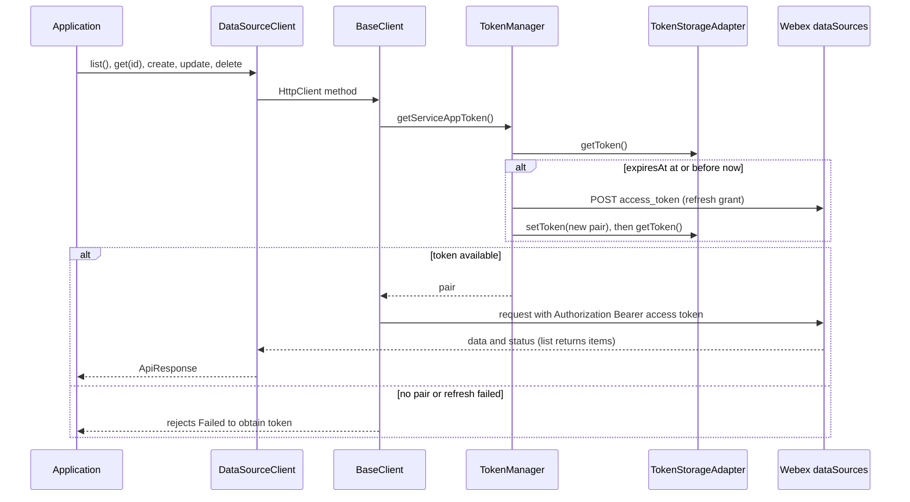
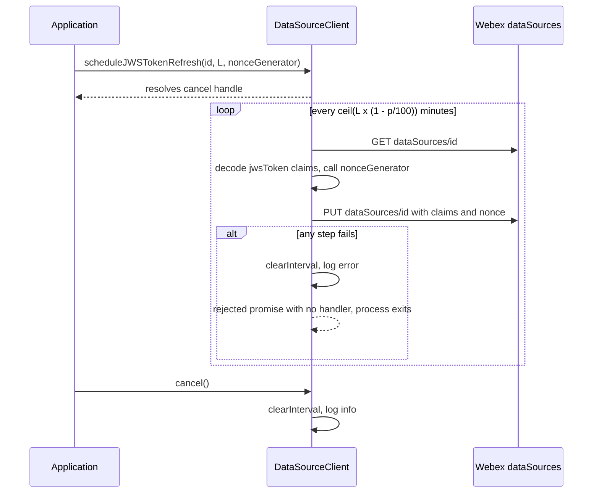
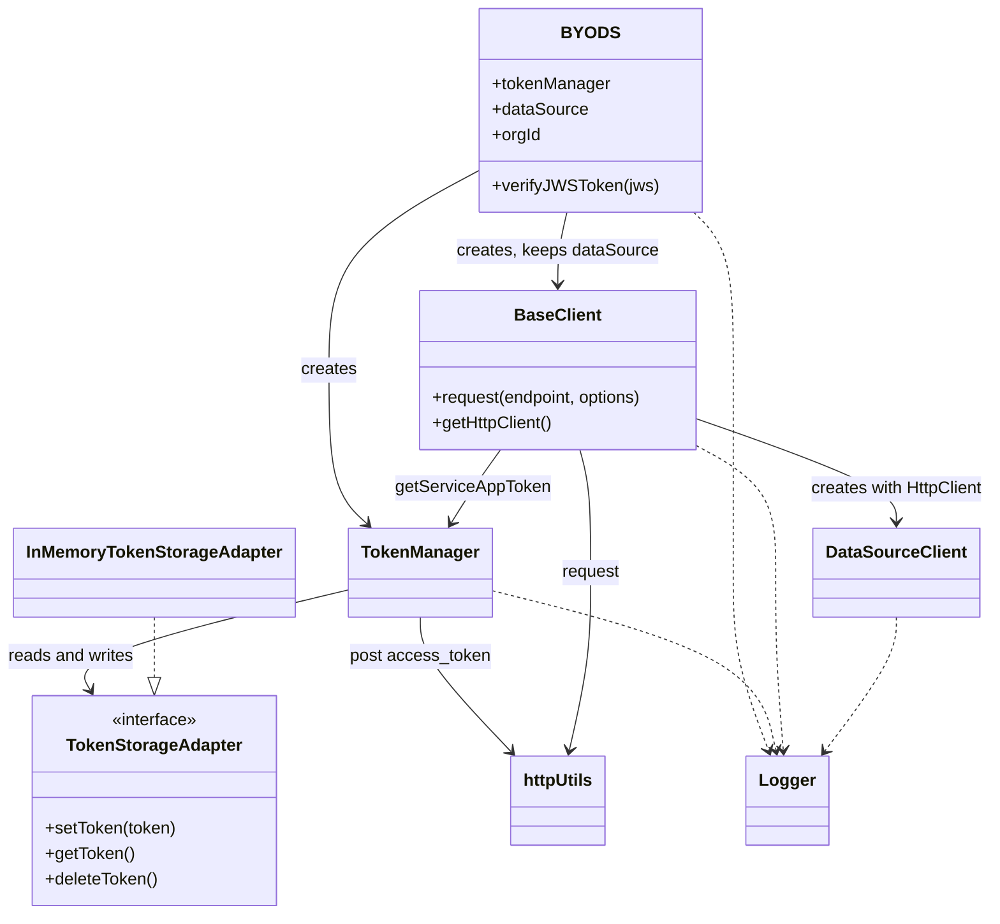
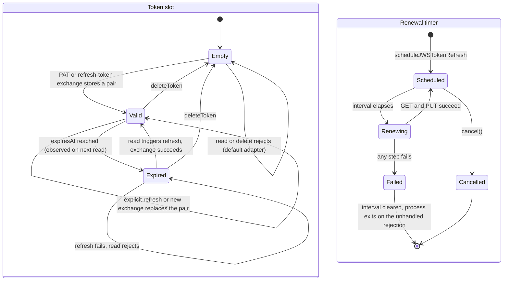

<!-- sdd-generated-metadata
doc_kind: module-spec
generated_from: module-spec@0.3.0
generated_by: claude-code
approved_by: rarajes2@cisco.com
updated_at: 2026-11-13T13:41:05Z
validation_status: pass
-->

# BYoDS SDK

This source-local document at `src/docs/README.md` owns the stable specification for **the BYoDS
SDK**: the Node.js library that manages a Webex Service App token pair for one organization, calls
the Webex `/dataSources` REST API with that token, schedules recurring data source JWS renewal, and
verifies JWS tokens against the Webex identity broker key set. Ground every claim in package
evidence and link to the [package architecture](../../docs/architecture.md) instead of repeating
broader facts. No service specification exists because this package is a library.

Related context: [documentation index](../../docs/index.md) ·
[package agent instructions](../../AGENTS.md)

## Metadata

| Field             | Value |
| ----------------- | ----- |
| Owner             | @webex/web-sdk (CODEOWNERS default rule) |
| Source path       | `src` |
| Resource kind     | package |
| Status            | Draft |
| Last verified     | 2026-11-13 at `7feffdcb2e` |
| Module id         | `byods` |
| Parent spec       | — |
| Doc kind          | Module spec |
| Coverage score    | 100% assessed 2026-11-13 — 18 of 18 mandatory fields PRESENT, critical 7 of 7. `MOD-016`, `MOD-017`, and `MOD-020` rest only on a generator behavior probe (listed under Verification) |
| Validation status | Pass — 2026-11-13; validator runtime `01a1d521-829f-75f0-b109-9b44c29a9ae4`; 0 Blocking, 0 Important, 0 Medium, 0 Minor findings. The module remains Partial pending characterization tests for probe-only requirements `MOD-016`, `MOD-017`, and `MOD-020`, and the exact `MOD-015` renewal payload. |

## Applicability

| Condition ID                         | Status     | Evidence or reason | Owned section |
| ------------------------------------ | ---------- | ------------------ | ------------- |
| `module.has_tiers`                   | N/A        | No tier policy exists in this package or its `package.json` | Tier |
| `module.has_ui`                      | N/A        | No view or screen; the module is a Node.js library | UI use-case flow |
| `module.crosses_service_boundaries`  | Applicable | `src/http-utils/index.ts` sends HTTPS requests to the Webex REST API, and `src/byods/index.ts` fetches the identity broker key set | Cross-boundary use-case flow |
| `module.holds_client_state`          | Applicable | `src/token-storage-adapter/index.ts` holds the token pair, `src/byods/index.ts` the key-set cache, `src/data-source-client/index.ts` the renewal timers, and `src/Logger/index.ts` the process-wide log level | Client state model |
| `module.enforces_domain_rules`       | Applicable | `src/token-manager/index.ts` fixes one organization and refreshes expired tokens; `src/base-client/index.ts` forces the stored bearer token | Business rules and invariants |
| `module.is_concurrent_async`         | Applicable | Every network call is a promise, and `src/data-source-client/index.ts` runs renewal on a recurring timer | Concurrency and reactive flow |
| `module.owns_persistence`            | N/A        | The default adapter keeps the token pair in memory; durable storage belongs to a caller-supplied adapter (`src/token-storage-adapter/types.ts`) | Data, schema, and migration discipline |
| `module.stateful_transitions`        | Applicable | The token slot moves between empty, valid, and expired, and each renewal timer between scheduled and stopped (`src/token-manager/index.ts`, `src/data-source-client/index.ts`) | State machine |
| `module.exposes_wire_protocol`       | Applicable | Request and response bodies for the Webex endpoints are declared in `src/types.ts` and `src/data-source-client/types.ts` | Protocol and wire format |
| `module.ui_multi_screen`             | N/A        | No UI | UI flow |
| `module.large_data_model`            | N/A        | Four request and response shapes, all mirrors of Webex API payloads | Data model |
| `module.returns_caller_errors`       | Applicable | Constructors throw on missing configuration and every network method rejects (`src/token-manager/index.ts`, `src/http-utils/index.ts`) | Caller-visible failure modes |
| `module.module_specific_conventions` | Applicable | Module-level logger singleton, ExtendedError log records, and the httpUtils object indirection that tests stub (`src/Logger/index.ts`, `src/http-utils/index.ts`) | Module-specific rules |
| `module.published_package`           | Applicable | `package.json` names the package @webex/byods and its deploy:npm script publishes it | Export stability |
| `module.embedded_in_host`            | N/A        | No host theme or embed API | Host integration and theming |
| `module.has_design_tradeoff`         | Applicable | Lazy refresh on read, a shared module-level logger, and a jittered renewal interval (`src/token-manager/index.ts`, `src/Logger/index.ts`, `src/data-source-client/index.ts`) | Key design trade-off |
| `module.has_submodules`              | N/A        | Computed false by the Repo Annotation module_tree.py script: the manifest has one module | Sub-modules |

## Evidence register

| Evidence | What it establishes |
| -------- | ------------------- |
| `src/index.ts` | The six value exports and three type exports of the package entry |
| `src/byods/index.ts` | `BYODS` construction, environment selection, the remote key set, and `verifyJWSToken` |
| `src/token-manager/index.ts` | Configuration validation, the Service App ID, PAT and refresh-token exchanges, expiry-driven refresh, and token deletion |
| `src/token-storage-adapter/index.ts`, `src/token-storage-adapter/types.ts` | The `TokenStorageAdapter` contract and the one-slot in-memory default |
| `src/base-client/index.ts` | Authenticated request assembly and the `HttpClient` handed to the data source client |
| `src/http-utils/index.ts` | The node-fetch transport: timeout, default headers, error mapping, and 204 handling |
| `src/data-source-client/index.ts`, `src/data-source-client/types.ts`, `src/data-source-client/constants.ts` | `/dataSources` CRUD, the renewal timer, and the payload shapes |
| `src/http-client/types.ts` | `ApiResponse` and `HttpClient` |
| `src/types.ts` | `SDKConfig`, `TokenResponse`, `ServiceAppToken`, `JWSTokenVerificationResult` |
| `src/constants.ts` | Base URLs, key-set URLs, the application ID prefix, the User-Agent string, and module names |
| `src/Logger/index.ts`, `src/Logger/types.ts` | The logger singleton, its levels, and its line format |
| `src/Errors/types.ts`, `src/Errors/catalog/ExtendedError.ts` | Error type names used in log records |
| `test/unit/spec/byods/index.ts` | Organization validation, environment selection, PAT and list calls per environment, and verification results |
| `test/unit/spec/token-manager/index.ts` | Token manager construction, exchanges, expiry refresh, deletion, and failure propagation |
| `test/unit/spec/token-storage-adapter/index.ts` | In-memory adapter behavior |
| `test/unit/spec/base-client/index.ts` | Header precedence, the bound client, and the no-token path |
| `test/unit/spec/http-utils/index.ts` | Transport success, 204, and non-OK handling |
| `test/unit/spec/data-source-client/index.ts` | CRUD paths, scheduling, cancellation, and the renewal tick |
| `test/unit/spec/Logger/index.ts` | Level filtering |
| `package.json` | Name, `main`, `types`, `files`, scripts, and the three runtime dependencies |
| `jest.config.js` | Jest settings and the coverage threshold |
| `tsconfig.json` | Declaration build input and typedoc entry |
| `README.md` | Retained npm page; not the behavioral authority. See ADR 0001. |
| jose 5.8.0, files dist/node/cjs/jwks/remote.js and dist/node/cjs/lib/jwt_claims_set.js (package-local install) | Key-set fetch timeout (5 s), cooldown and cache-age semantics, and which claims `jwtVerify` checks without options |
| Sibling workspace byods-demo-server, file src/server.ts | The in-repo consumer: imports `@webex/byods/src/index`, passes its own nonce generator |
| Generator behavior probe of the built output, 2026-11-13 (scratch scripts against a local HTTP server; not committed) | Entry resolution, constructor log lines, concurrent refresh, exact renewal payload, the default nonce generator failure, and process exit on a failed renewal tick |

## Purpose and boundary

- Responsibility: give a Node.js data source provider one object that holds a Webex Service App
  token pair for one organization, performs data source registration calls with it, keeps a data
  source JWS fresh on a timer, and verifies JWS tokens that Webex sends to the data source.
- In scope: everything under `src/`: the `BYODS` facade, `TokenManager`, the token storage contract
  and its in-memory default, `BaseClient` and the node-fetch transport, `DataSourceClient`, the
  logger, and the error type names.
- Out of scope: the Webex REST API and identity broker behavior, durable token storage (a caller
  adapter's job), obtaining the personal access token or initial refresh token, and serving the
  data source endpoint itself. The sibling workspace byods-demo-server is a sample application,
  not part of this module.
- Consumers: Node.js applications that install `@webex/byods` from npm; in this workspace, the
  private sample byods-demo-server, which imports the source directly.

## Structure and key files

| Path | Responsibility |
| ---- | -------------- |
| `src/index.ts` | Package entry: exports `BYODS`, `TokenManager`, `BaseClient`, `DataSourceClient`, `LOGGER`, `InMemoryTokenStorageAdapter`, and the types `TokenStorageAdapter`, `SDKConfig`, `ServiceAppToken` |
| `src/byods/index.ts` | Facade: builds the token manager, the data source client, and the remote key set; `verifyJWSToken` |
| `src/token-manager/index.ts` | Service App token lifecycle against `/access_token` |
| `src/token-storage-adapter/index.ts` | `InMemoryTokenStorageAdapter` |
| `src/token-storage-adapter/types.ts` | `TokenStorageAdapter` interface |
| `src/base-client/index.ts` | Bearer-token request wrapper and `getHttpClient` |
| `src/http-utils/index.ts` | `httpUtils` transport over node-fetch |
| `src/data-source-client/index.ts` | `/dataSources` CRUD and `scheduleJWSTokenRefresh` |
| `src/data-source-client/types.ts` | Data source request, update, response, list, and `Cancellable` shapes |
| `src/Logger/index.ts` | Module-level logger instance |
| `src/constants.ts` | URLs, prefixes, User-Agent, module names, default logger config |
| `src/Errors/catalog/ExtendedError.ts` | `Error` subclass carrying an `ERROR_TYPE`, used only in log calls |

## Public surface

Declarations live in `src/index.ts` and the files it re-exports; the declaration build writes
`dist/types/index.d.ts`. This section summarises them and does not restate signatures.

| Surface | Consumer | Compatibility commitment | Source |
| ------- | -------- | ------------------------ | ------ |
| `BYODS` class: constructor, `tokenManager`, `dataSource`, `orgId`, `verifyJWSToken` | Applications | Construction per `MOD-001` and `MOD-002`; verification per `MOD-018` | `src/byods/index.ts` |
| `TokenManager` class | Applications through `sdk.tokenManager`, or directly | Methods per `MOD-003` to `MOD-009` | `src/token-manager/index.ts` |
| `TokenStorageAdapter` type and `InMemoryTokenStorageAdapter` class | Applications supplying storage | `setToken`, `getToken`, `deleteToken`, all promise-returning (`MOD-010`) | `src/token-storage-adapter/types.ts` |
| `DataSourceClient` class | Applications through `sdk.dataSource` | CRUD per `MOD-013`; renewal per `MOD-014` to `MOD-017` | `src/data-source-client/index.ts` |
| `BaseClient` class | Advanced callers | Authenticated requests per `MOD-011` | `src/base-client/index.ts` |
| `LOGGER` enum | Applications setting `SDKConfig.logger.level` | Values `error`, `warn`, `info`, `log`, `trace` (`MOD-019`) | `src/Logger/types.ts` |
| `SDKConfig` and `ServiceAppToken` types | TypeScript callers | Field names and types | `src/types.ts` |
| Environment variable `BYODS_ENVIRONMENT` | Deployments | `integration` selects integration hosts; anything else selects production (`MOD-001`) | `src/byods/index.ts` |
| Package entry fields `main`, `types`, `files` | Package managers | See `MOD-020` | `package.json` |

Contract `byods-sdk` is published with native artifact `package.json`. Required contracts:
`webex-access-token-http`, `webex-datasources-http`, `webex-idbroker-jwks`, `jose-jwt`, and
`node-fetch-http`.

## Dependencies

| Dependency | Why it is required | Failure behavior |
| ---------- | ------------------ | ---------------- |
| Webex `/access_token` (`webex-access-token-http`) | PAT exchange (`MOD-004`) and refresh-token exchange (`MOD-005`) | Non-2xx becomes a rejected `HTTP Error Response` error; nothing is stored |
| Webex `/dataSources` (`webex-datasources-http`) | Data source CRUD and the renewal tick (`MOD-013`, `MOD-015`) | Rejection propagates to the caller, or ends the renewal timer (`MOD-016`) |
| Identity broker key set (`webex-idbroker-jwks`) | Public keys for `verifyJWSToken` (`MOD-018`) | A fetch failure or timeout becomes `{isValid: false, error}` |
| `jose` 5.8.0 (`jose-jwt`) | `createRemoteJWKSet`, `jwtVerify`, `decodeJwt`, `jwksCache` | Errors are caught by `verifyJWSToken` or by the renewal tick |
| `node-fetch` 3.3.2 (`node-fetch-http`) | HTTP transport, loaded with a dynamic `import()` on each request | An import or network failure rejects the request |
| Caller `TokenStorageAdapter` | Holds the token pair | Its rejections propagate through every token read and request |
| Node.js built-ins `os`, `crypto`, `Buffer`, `AbortController`, timers | User-Agent, tracking IDs, Service App ID, request timeout, renewal timer | The default nonce generator fails on Node.js 22.14 (`MOD-017`) |

## Requirements

| ID | WHAT | WHY | Source evidence | Test or example evidence | Assumptions or gaps | Confidence |
| -- | ---- | --- | --------------- | ------------------------ | ------------------- | ---------- |
| `MOD-001` | `new BYODS(config)` fills defaults (`InMemoryTokenStorageAdapter`, logger level `error`), reads `process.env.BYODS_ENVIRONMENT` once, and selects the integration API base URL and integration key-set URL when it equals `integration`, otherwise the production pair. It then builds one `TokenManager`, stores `orgId` trimmed, takes `dataSource` from a `BaseClient` that sends the SDK User-Agent, and creates a remote key set with a 10-minute cache age, a 30-second cooldown, and a per-instance cache object. | One construction call yields a ready client for one environment; the in-code comment states that `production` is the default. | `src/byods/index.ts`, `src/constants.ts` | `test/unit/spec/byods/index.ts` "keeps PAT acquisition and DataSource CRUD in the configured organization" for unset, `production`, `integration`, and an invalid value; "exposes one data source client and one token manager" | — | Present |
| `MOD-002` | Construction throws `clientId and clientSecret are required` when either is falsy and `orgId is required` when `orgId` is not a string with non-blank content. `BYODS` gets these errors from `TokenManager` before it reads `orgId`. | Rejects an instance that cannot authenticate or target an organization. | `src/token-manager/index.ts`, `src/byods/index.ts` | `test/unit/spec/byods/index.ts` "rejects a missing organization" (four values); `test/unit/spec/token-manager/index.ts` "requires an organization at construction", "requires Service App credentials" | — | Present |
| `MOD-003` | `getServiceAppId()` returns the base64 encoding of `ciscospark://us/APPLICATION/` followed by the client ID. | Gives callers the Hydra-style application ID for the Service App. | `src/token-manager/index.ts`, `src/constants.ts` | `test/unit/spec/token-manager/index.ts` "returns the encoded Service App ID" | No code path in the module uses the value | Present |
| `MOD-004` | `getServiceAppTokenUsingPAT(pat, headers)` POSTs JSON `{targetOrgId, clientId, clientSecret}` to `<base>/access_token` with `Authorization: Bearer <pat>` and `Content-Type: application/json`; caller headers are merged last. `targetOrgId` is the trimmed construction-time organization. On success it stores the pair (`MOD-006`); on failure it logs and rethrows, leaving storage unchanged. | The Service App owner's PAT yields the app's token pair for the configured organization. | `src/token-manager/index.ts` | `test/unit/spec/token-manager/index.ts` "uses the configured organization for PAT acquisition", "uses the default API endpoint and trims the configured organization", "preserves stored credentials when PAT acquisition fails" | See Pitfalls for caller header precedence | Present |
| `MOD-005` | `saveServiceAppRegistrationData(refreshToken, headers)` POSTs a form-encoded body `grant_type=refresh_token`, `client_id`, `client_secret`, `refresh_token` to `<base>/access_token` and stores the returned pair; on failure it logs a `registration_error` record and rethrows. | The in-code link cites the Webex access-token endpoint format; this is the only refresh path. | `src/token-manager/index.ts` | `test/unit/spec/token-manager/index.ts` "accepts a supplied refresh token without PAT acquisition" | The log record names the method `saveServiceAppRegistration` | Present |
| `MOD-006` | `updateServiceAppToken(response)` writes one `ServiceAppToken`: both tokens plus `expiresAt` and `refreshAccessTokenExpiresAt` computed as now plus `expires_in` and `refresh_token_expires_in` seconds, through one `setToken` call. | Absolute expiry times let a later read decide whether to refresh. | `src/token-manager/index.ts` | `test/unit/spec/token-manager/index.ts` "stores the token pair and both expiry times" | No margin is subtracted from `expires_in` | Present |
| `MOD-007` | `getServiceAppToken()` reads the adapter; when `expiresAt` is at or before now it runs `MOD-005` with the stored refresh token and reads the adapter again. Read or refresh failures are logged and rethrown. The refresh-token expiry is not checked. | Callers always receive an access token that was unexpired when read. | `src/token-manager/index.ts` | `test/unit/spec/token-manager/index.ts` "refreshes at expiry and stores the rotated pair in the same slot", "propagates refresh failures instead of returning an expired access token", "rejects getServiceAppToken without stored credentials" | Relies on the adapter returning `Date` values (README and `INV-003`) | Present |
| `MOD-008` | `refreshServiceAppAccessToken(headers)` reads the adapter (logging and rethrowing a read failure), throws `Refresh token was not found` when the stored refresh token is empty, and otherwise runs `MOD-005` with the caller headers. | Explicit refresh independent of expiry. | `src/token-manager/index.ts` | `test/unit/spec/token-manager/index.ts` "refreshes the stored pair explicitly with custom headers", "rejects an explicit refresh without a refresh token" | — | Present |
| `MOD-009` | `deleteToken()` delegates to the adapter's `deleteToken`. | Lets the application drop the pair, for example on offboarding. | `src/token-manager/index.ts` | `test/unit/spec/token-manager/index.ts` "deletes the stored pair" | — | Present |
| `MOD-010` | `InMemoryTokenStorageAdapter` holds one optional pair, set by the constructor or `setToken` (which replaces it); `getToken` and `deleteToken` reject `Service App token not found` when it is empty. | One SDK instance has one organization and one pair. | `src/token-storage-adapter/index.ts` | `test/unit/spec/token-storage-adapter/index.ts` (all cases) | State is lost when the process exits | Present |
| `MOD-011` | `BaseClient.request(endpoint, options)` gets the access token through `MOD-007`, then calls the transport with `<base><endpoint>` and headers built in this order: instance headers, caller headers, then `Authorization: Bearer <token>`. When the token cannot be obtained it logs and rejects `Failed to obtain token` without sending. `post`, `put`, and `patch` send `JSON.stringify(body)` with `Content-Type: application/json` (caller headers may replace it); `get` and `delete` send no body. `getHttpClient()` returns those five methods bound to the instance without their header parameters. | Every API call carries the Service App token and cannot be pointed at another identity by a caller header. | `src/base-client/index.ts` | `test/unit/spec/base-client/index.ts` "sends METHOD with the stored access token" and "provides a bound METHOD method through getHttpClient" for five methods; "keeps the configured access token when request headers supply another bearer"; "does not send a request when no valid access token is available" | The original token error is replaced by the generic message | Present |
| `MOD-012` | `httpUtils.request(url, options)` imports node-fetch, aborts after `options.timeout` or 30 000 ms, and sends default headers `Trackingid: BYoDS NodeJS SDK_<uuid>` and `User-Agent` (package name, OS type, platform, arch, Node.js version) that caller headers override. A non-2xx response rejects `HTTP Error Response: <status> <statusText>` without reading the body; 204 resolves `{data: {}, status: 204}`; any other response resolves the parsed JSON body with its status. | One transport gives every call a timeout, a tracking ID, and a uniform result shape. An in-code comment links a node-fetch issue as the reason for the dynamic import. | `src/http-utils/index.ts`, `src/constants.ts` | `test/unit/spec/http-utils/index.ts` "should throw an error for non-OK HTTP response", "should handle 204 no content", "should make an HTTP request" | No caller in the module sets `timeout`; a non-JSON 2xx body rejects from `response.json()` | Present |
| `MOD-013` | `DataSourceClient` maps `create(payload)` to POST `/dataSources`, `get(id)` to GET `/dataSources/<id>`, `list()` to GET `/dataSources` with `data` replaced by the response's `items`, `update(id, payload)` to PUT `/dataSources/<id>`, and `delete(id)` to DELETE `/dataSources/<id>`. The ID is inserted without encoding; errors propagate unchanged. | Thin typed wrappers over the Webex data source API. | `src/data-source-client/index.ts`, `src/data-source-client/constants.ts` | `test/unit/spec/data-source-client/index.ts` CRUD and "should handle errors when ..." cases | `list` reads one page only; no pagination parameters exist | Present |
| `MOD-014` | `scheduleJWSTokenRefresh(id, tokenLifetimeMinutes = 60, nonceGenerator)` starts one `setInterval` with period `ceil(L × (1 − p/100))` minutes, where `p` is drawn uniformly from 5 to 10 per schedule, and resolves `{cancel}`. The first renewal runs after one period. `cancel()` clears the interval and logs at info. `L` is not validated. | Renews before the token lifetime ends; the jitter spreads renewals of many sources. | `src/data-source-client/index.ts` | `test/unit/spec/data-source-client/index.ts` "should schedule JWS token refresh and return a cancelable object", "should clear the interval when the cancel function is called", "should handle errors when scheduling JWS token refresh" | The JSDoc range 1 to 1440 is not enforced | Present |
| `MOD-015` | Each renewal tick GETs the data source, requires `data.jwsToken`, decodes it without verifying it, and PUTs `{schemaId, tokenLifetimeMinutes, url, subject, audience, nonce, status}` where `url`, `subject`, and `audience` are the token's `com.cisco.datasource.url`, `sub`, and `aud` claims, `schemaId` and `status` come from the GET, and `nonce` is the generator's result. `errorMessage` is not carried over. Success logs at info. | The method JSDoc calls this refreshing the data source token; reusing the current claims keeps the registration otherwise unchanged. | `src/data-source-client/index.ts` | `test/unit/spec/data-source-client/index.ts` "should start auto-refresh and return a timer" (GET and PUT called); exact body confirmed by the generator probe | The probe, not a test, pins the body | Present |
| `MOD-016` | When any step of a tick fails (GET, missing token, decode, nonce generator, PUT), the tick clears its interval, logs a `start_auto_refresh_error` record, and its async callback returns a rejected promise that no code handles. Under Node.js's default unhandled-rejection mode this ends the process with exit code 1. | Records current behavior; no comment states the intent of the rejection. | `src/data-source-client/index.ts` | Generator probe: a 500 from GET and a failing nonce generator each ended Node.js 22.14 with exit code 1 | No unit test reaches a failing tick (see Verification); see Pitfalls | Present |
| `MOD-017` | The default `nonceGenerator` is the unbound global `crypto.randomUUID`. Calling it throws `ERR_INVALID_THIS` on Node.js 22.14, so a schedule created without a generator fails at its first tick (`MOD-016`). | Records current behavior. | `src/data-source-client/index.ts` | Generator probe on Node.js 22.14; every unit test passes its own generator | The fallback `crypto.randomUUID()` call in the tick is unreachable while the parameter has a default | Present |
| `MOD-018` | `verifyJWSToken(jws)` runs `jwtVerify` against the instance key set with no options: it checks the signature with a matching key and the `exp` and `nbf` claims when present, and checks no issuer, audience, subject, or algorithm allow-list. It resolves `{isValid: true}`, or logs and resolves `{isValid: false, error}` with the error message or `Unknown error`. It never rejects. | A data source can accept or refuse a Webex request from one boolean. | `src/byods/index.ts` | `test/unit/spec/byods/index.ts` "verifies a JWS using the remote Webex key set", "returns an invalid result when verification fails" (three cases) | Claim checks come from jose 5.8.0 defaults | Present |
| `MOD-019` | One logger instance serves the whole process. Each `BYODS`, `TokenManager`, `BaseClient`, and `DataSourceClient` constructor calls `setLogger(level, module)`, which sets the shared level (an unknown level means `error`) and always writes one `Logger initialized` line through `console.log`. Lines read `BYoDS NodeJS SDK: <UTC time>: [LEVEL]: file:<module> - method:<method> - message:<text>`; levels order `error` < `warn` < `log` < `info` < `trace`. | One switch controls SDK logging; the format names the module and method. | `src/Logger/index.ts`, `src/Logger/types.ts`, `src/byods/index.ts` | `test/unit/spec/Logger/index.ts` (level filtering); constructor lines confirmed by the generator probe (four lines per `BYODS`) | — | Present |
| `MOD-020` | The entry exports the six values and three types listed under Public surface. `package.json` `main` is `dist/module/index.js`, which no script in the package writes: `build:src` writes `dist/index.js` and `build` writes `dist/types`. Resolving `@webex/byods` against a workspace build therefore fails with `MODULE_NOT_FOUND`; `types` resolves. | Records current behavior of the published entry fields. | `package.json`, `src/index.ts` | Generator probe: `require.resolve('@webex/byods')` from the package directory failed after `build:src` | How the npm tarball is built is not in this repository (see Release and versioning in the architecture) | Present |

## Design overview

`BYODS` is a facade that wires three collaborators once, in its constructor: a `TokenManager` bound
to one organization and one storage adapter, a `BaseClient` whose `dataSource` property is the only
part the facade keeps, and a remote key set (`MOD-001`). After construction the facade adds only
`verifyJWSToken` (`MOD-018`).

Token state lives in the adapter, not in `TokenManager`. The manager reads the pair on every use and
refreshes lazily: an expired access token is exchanged only when a caller asks for it (`MOD-007`).
`BaseClient` asks for it on every request and puts it last in the header merge (`MOD-011`), so
`DataSourceClient` never handles a token; it receives an `HttpClient` and maps methods to
`/dataSources` paths (`MOD-013`).

The transport is a module-level `httpUtils` object whose methods call each other through the object
(`MOD-012`); tests replace them with stubs. Logging goes through one module-level instance whose
level each constructor resets (`MOD-019`). Errors are logged as `ExtendedError` records with an
`ERROR_TYPE`, but callers receive plain `Error` objects or the original rejection.

Renewal is the only background activity: `scheduleJWSTokenRefresh` returns a cancel handle around a
`setInterval` whose callback reads the registration, decodes its JWS, and writes it back with a new
nonce (`MOD-014`, `MOD-015`).

## Data flow and sequence coverage

Transport: HTTPS through node-fetch to the Webex REST API host selected in `MOD-001`, and HTTPS
through jose to the identity broker key-set URL. All calls are promise-based; renewal is driven by
`setInterval`.

| Operation group | Entry and outcome | Diagram or evidence | Failure and recovery coverage |
| --------------- | ----------------- | ------------------- | ----------------------------- |
| Token acquisition | `getServiceAppTokenUsingPAT` or `saveServiceAppRegistrationData` → POST `/access_token` → adapter `setToken` | Diagram 1 | Non-2xx or timeout rejects; storage unchanged |
| Authenticated request | `dataSource.*` → `BaseClient.request` → `getServiceAppToken` (refresh when expired) → transport | Diagram 2 | No token or failed refresh rejects `Failed to obtain token`; HTTP errors reject (`MOD-012`) |
| JWS renewal | `scheduleJWSTokenRefresh` → timer → GET → decode → PUT, repeated | Diagram 3 | Any failure stops the timer and ends the process (`MOD-016`) |
| JWS verification | `verifyJWSToken` → key set (cached or fetched) → `jwtVerify` | `src/byods/index.ts` | All failures resolve `{isValid: false}` |

**Diagram 1 — token acquisition**

```mermaid
sequenceDiagram
  participant App as Application
  participant TM as TokenManager
  participant HU as httpUtils
  participant API as Webex access_token
  participant Store as TokenStorageAdapter
  App->>TM: getServiceAppTokenUsingPAT(pat) or saveServiceAppRegistrationData(refreshToken)
  TM->>HU: post base/access_token (JSON with PAT, or form with refresh token)
  HU->>API: POST with Trackingid and User-Agent
  alt 2xx
    API-->>HU: TokenResponse JSON
    HU-->>TM: data and status
    TM->>Store: setToken(pair with absolute expiry times)
    TM-->>App: resolves
  else non-2xx, network error, or 30 s timeout
    HU-->>TM: rejects
    TM-->>App: logs, rethrows; storage unchanged
  end
```

**Diagram 2 — authenticated request with lazy refresh**



**Diagram 3 — JWS renewal timer**



## Class and component relationships



| Component | Relationship |
| --------- | ------------ |
| `BYODS` | Owns one `TokenManager`, one key set, and the `dataSource` of one `BaseClient` |
| `TokenManager` | Uses the adapter it was given; never caches the pair itself |
| `BaseClient` | Builds the `DataSourceClient` it exposes and supplies the bearer token |
| `DataSourceClient` | Knows only the `HttpClient` interface |
| `httpUtils` | Module-level object; the only network call site besides jose |
| Logger | Module-level singleton shared by every instance in the process |

## Use cases and flows

| Use case | Actor or caller | Primary steps and outcome | Failure or boundary behavior | Evidence |
| -------- | --------------- | ------------------------- | ---------------------------- | -------- |
| `UC-001` | Data source provider with a stored refresh token | `new BYODS({clientId, clientSecret, orgId})`, then `tokenManager.saveServiceAppRegistrationData(refreshToken)`, then `dataSource.list()` | A refresh failure rejects; no pair is stored | `README.md`, `src/token-manager/index.ts` |
| `UC-002` | Service App owner with a PAT | `tokenManager.getServiceAppTokenUsingPAT(pat)` stores the pair for the configured organization | Rejects on a non-2xx response | `test/unit/spec/token-manager/index.ts` |
| `UC-003` | Provider registering a data source | `dataSource.create(request)`, then `scheduleJWSTokenRefresh(id, lifetime, generator)` | A tick failure ends the process (`MOD-016`); omitting the generator guarantees it (`MOD-017`) | `src/data-source-client/index.ts`, byods-demo-server file src/server.ts |
| `UC-004` | Data source endpoint receiving a Webex request | `verifyJWSToken(jws)` and branch on `isValid` | Key-set fetch failure resolves invalid | `src/byods/index.ts` |
| `UC-005` | Provider with durable storage | Passes `tokenStorageAdapter` in `SDKConfig`; one adapter and record per instance | Adapter errors propagate | `src/types.ts`, `test/unit/spec/token-manager/index.ts` "uses the custom token storage adapter" |
| `UC-006` | Integration testing | Sets `BYODS_ENVIRONMENT=integration` before construction | Any other value selects production | `src/byods/index.ts` |

### Cross-boundary use-case flow

| Boundary | Transport | Ordering | Timeout | Retry and recovery | Compatibility |
| -------- | --------- | -------- | ------- | ------------------ | ------------- |
| Webex `/access_token` | HTTPS POST via node-fetch | One request per call; concurrent callers are not deduplicated (Concurrency) | 30 s abort | None; the caller retries | Body shapes in Protocol and wire format |
| Webex `/dataSources` | HTTPS GET, POST, PUT, DELETE via node-fetch | Per call; renewal ticks run GET then PUT | 30 s abort per request | None; a failed tick stops renewal (`MOD-016`) | Same |
| Identity broker key set | HTTPS GET via jose | Single in-flight fetch per key set | 5 s (jose default) | jose refetches on an unknown key after the 30 s cooldown; cache age 10 minutes | JWKS JSON, owned by Webex |

## Client state model

| State or slice | Owner | Initial state | Transition triggers | Reset or persistence boundary |
| -------------- | ----- | ------------- | ------------------- | ----------------------------- |
| Token pair | The configured `TokenStorageAdapter` | Empty for the default adapter, or the constructor's pair | `setToken` from `MOD-006`; refresh in `MOD-007` and `MOD-008`; `deleteToken` | Default adapter: process lifetime, one slot per instance. Caller adapters: their own |
| Key-set cache | `BYODS` instance (`jwksCache` object passed to jose) | Empty | First verification; refetch after 10 minutes or on an unknown key after the cooldown | Instance lifetime; not shared between instances |
| Renewal timers | Each `scheduleJWSTokenRefresh` call | None | Schedule, tick, `cancel`, tick failure | Not tracked by the client; only the returned handle can cancel one |
| Log level | Logger singleton | `error` | Every constructor's `setLogger` call | Process lifetime, shared by all instances |

## Business rules and invariants

| ID | Invariant | WHY | Enforcement source | Test evidence |
| -- | --------- | --- | ------------------ | ------------- |
| `INV-001` | Every `BaseClient` request carries `Authorization: Bearer` with the access token read through `getServiceAppToken`; caller headers cannot replace it. | Requests act only as the configured Service App. | `src/base-client/index.ts` | `test/unit/spec/base-client/index.ts` "keeps the configured access token when request headers supply another bearer" |
| `INV-002` | An expired access token is never returned or sent: an expired read triggers a refresh, and a failed refresh rejects instead of falling back. | Webex would reject the stale token; failing early is clearer. | `src/token-manager/index.ts`, `src/base-client/index.ts` | `test/unit/spec/token-manager/index.ts` "propagates refresh failures instead of returning an expired access token"; `test/unit/spec/base-client/index.ts` "does not send a request when no valid access token is available" |
| `INV-003` | One instance serves one organization and one token slot. `orgId` is fixed and trimmed at construction, and each write replaces the pair. The adapter must return `Date` expiry values. | The adapter JSDoc and README require one adapter per instance; a string expiry would never compare as expired. | `src/token-manager/index.ts`, `src/token-storage-adapter/types.ts` | `test/unit/spec/byods/index.ts` "keeps PAT acquisition and DataSource CRUD in the configured organization"; `test/unit/spec/token-manager/index.ts` "refreshes at expiry and stores the rotated pair in the same slot" |
| `INV-004` | The API base URL and the key-set URL always come from the same environment. | Prevents verifying production tokens with integration keys, or the reverse. | `src/byods/index.ts` | `test/unit/spec/byods/index.ts` environment cases assert both URLs |
| `INV-005` | `verifyJWSToken` resolves and never rejects. | Callers branch on `isValid` without a try block. | `src/byods/index.ts` | `test/unit/spec/byods/index.ts` "returns an invalid result when verification fails" |

## Concurrency and reactive flow

- Execution model: the Node.js event loop. Every network method returns a promise; renewal runs in
  `setInterval` callbacks.
- Ordering guarantees: none across calls. Within one tick, GET completes before PUT.
- Idempotency and retry: no retries anywhere. Two concurrent `getServiceAppToken` calls on an
  expired pair each send a refresh request and each write a pair; the last write wins (generator
  probe: two POSTs, two different access tokens returned). Whether Webex accepts reuse of the same
  refresh token is outside this package.
- Shared-state protection: none. The adapter is the only shared token state; scheduling the same
  data source twice starts two independent timers.
- Blocking restrictions: none observed; the only synchronous work is header and payload assembly. A
  live renewal timer keeps the process running until it is cancelled or fails.

## State machine



`Expired` is not stored anywhere; it is the comparison `expiresAt <= now` made on each read. A
`cancel()` call while a tick is in flight clears the interval but does not stop that tick's GET and
PUT.

## Protocol and wire format

| Message or frame | Version | Producer or serializer | Consumer or parser | Compatibility and ordering rule |
| ---------------- | ------- | ---------------------- | ------------------ | ------------------------------- |
| PAT exchange request: JSON `targetOrgId`, `clientId`, `clientSecret` | Webex `/v1` | `src/token-manager/index.ts` | Webex `/access_token` | Field names fixed in code |
| Refresh exchange request: form `grant_type=refresh_token`, `client_id`, `client_secret`, `refresh_token` | Webex `/v1` | `src/token-manager/index.ts` | Webex `/access_token` | OAuth refresh grant |
| `TokenResponse`: `access_token`, `expires_in`, `refresh_token`, `refresh_token_expires_in`, `token_type` | Webex `/v1` | Webex | `src/token-manager/index.ts` | Seconds-based lifetimes; `token_type` is ignored |
| `DataSourceRequest`: `schemaId`, `url`, `audience`, `subject`, `nonce`, `tokenLifetimeMinutes` | Webex `/v1` | Caller via `src/base-client/index.ts` | Webex `/dataSources` | Sent as given; no client-side validation |
| `DataSourceUpdateRequest`: request fields plus `status` (`active` or `disabled`) and optional `errorMessage` | Webex `/v1` | Caller or renewal tick | Webex `/dataSources/<id>` | The tick omits `errorMessage` (`MOD-015`) |
| `DataSourceResponse` and list `{items}` | Webex `/v1` | Webex | `src/data-source-client/index.ts` | `list` unwraps `items` |
| Data source JWS claims `com.cisco.datasource.url`, `sub`, `aud` | Webex | Webex | `src/data-source-client/index.ts` (decode only) | Missing claims become `undefined` in the PUT |
| Request headers `Trackingid`, `User-Agent`, `Authorization` | — | `src/http-utils/index.ts`, `src/base-client/index.ts` | Webex | Tracking ID prefix `BYoDS NodeJS SDK_` |

The Webex endpoints are external contracts; this module declares no version negotiation.

## Caller-visible failure modes

| Condition | Signal or result | Caller behavior | Retry or recovery | Evidence |
| --------- | ---------------- | --------------- | ----------------- | -------- |
| Missing `clientId` or `clientSecret` | Synchronous throw `clientId and clientSecret are required` | Fix configuration | — | `src/token-manager/index.ts` |
| Missing or blank `orgId` | Synchronous throw `orgId is required` | Fix configuration | — | `src/token-manager/index.ts` |
| No stored pair (default adapter) | `getServiceAppToken` and `deleteToken` reject `Service App token not found`; data source calls reject `Failed to obtain token` | Acquire a pair first (`UC-001`, `UC-002`) | — | `src/token-storage-adapter/index.ts`, `src/base-client/index.ts` |
| Empty stored refresh token | `refreshServiceAppAccessToken` throws `Refresh token was not found` | Acquire a new pair | — | `src/token-manager/index.ts` |
| Webex responds non-2xx | Rejects `HTTP Error Response: <status> <statusText>`; the response body is discarded | Inspect status text only | Caller retries | `src/http-utils/index.ts` |
| Request exceeds 30 s | Rejects with node-fetch's abort error | — | Caller retries | `src/http-utils/index.ts` |
| Expired pair and refresh fails | Data source calls reject `Failed to obtain token`; the cause is only logged | Re-acquire with a PAT or refresh token | — | `src/base-client/index.ts` |
| JWS invalid, expired, or key set unreachable | Resolves `{isValid: false, error}` | Reject the inbound request | — | `src/byods/index.ts` |
| Renewal tick fails, or no nonce generator was given | Error log line, then the process exits with code 1 (`MOD-016`, `MOD-017`) | Pass a nonce generator; install a process-level `unhandledRejection` handler if the process must survive | Re-schedule after a failure | `src/data-source-client/index.ts` |
| Package resolved through `main` | `MODULE_NOT_FOUND` against a workspace build (`MOD-020`) | Import the build output path or source | — | `package.json` |

## Pitfalls and constraints

- A renewal failure is fatal to the host process, not to the caller's promise: the promise returned
  by `scheduleJWSTokenRefresh` has already resolved by the time a tick fails (`MOD-016`).
- Two instances in one process cannot log at different levels, and constructing an instance prints
  four lines to stdout even at level `error` (`MOD-019`).
- `BYODS_ENVIRONMENT` must be set before construction; changing it later does not move an existing
  instance (`MOD-001`).
- Once the refresh token's lifetime has passed, the next expired read fails at the Webex exchange
  rather than earlier, because the stored refresh expiry is never consulted (`MOD-007`).
- Treat `isValid: true` as proof that Webex signed the token, not that it was issued for this data
  source (`MOD-018`; architecture Security architecture).
- Caller headers passed to `getServiceAppTokenUsingPAT` or `saveServiceAppRegistrationData` are
  merged after the SDK's own, so they can replace `Authorization` or `Content-Type` (`MOD-004`,
  `MOD-005`).
- The test named "should reject with an error during auto-refresh when update method fails" passes
  because the previous test's `setInterval` spy, which throws, is still installed (`clearMocks` does
  not restore implementations); it does not exercise a failing tick (Verification).

## Module-specific rules

- Do: route every network call through `httpUtils` and call sibling methods as `httpUtils.request`,
  so unit tests can stub the object (`test/unit/spec/http-utils/index.ts` relies on it).
- Do: log through the module logger with `{file, method}` context and an `ExtendedError` carrying an
  `ERROR_TYPE`; rethrow the original error or a plain `Error` to the caller.
- Do: keep the bearer token last in the `BaseClient` header merge (`INV-001`).
- Do: add a unit case in the matching `test/unit/spec/<component>/index.ts` for each behavior change;
  the coverage threshold in `jest.config.js` fails the run below 85% lines, functions, and statements
  or 75% branches.
- Do not: log token values or secrets; current log calls carry none.
- Do not: store token state on `TokenManager`; the adapter is the single place (`INV-003`).

## Export stability

| Export or entry point | Consumer | Stability | Versioning and deprecation rule | Declaration or API report |
| --------------------- | -------- | --------- | ------------------------------- | ------------------------- |
| `BYODS`, `TokenManager`, `DataSourceClient`, `BaseClient`, `InMemoryTokenStorageAdapter`, `LOGGER` | Applications | Public | Independent 1.x line (architecture Release and versioning); removal or signature change is breaking | `src/index.ts` |
| `TokenStorageAdapter`, `SDKConfig`, `ServiceAppToken` types | TypeScript callers | Public | Adding a required member is breaking | `src/index.ts` |
| Data source request and response types, `ApiResponse`, `HttpClient`, `JWSTokenVerificationResult`, `LoggerConfig`, `Cancellable` | TypeScript callers through method signatures | Public by reference only; not exported from the entry | Reachable only through deep `dist/types` paths | `src/data-source-client/types.ts` |
| `main`, `types`, `files` | Package managers | Public | `main` currently points at a path the package build does not produce (`MOD-020`) | `package.json` |

The declaration build writes `dist/types/index.d.ts`; no API report exists.

## Key design trade-off

| Chosen trade-off | Preserved invariant or benefit | Cost or limitation | Decision evidence |
| ---------------- | ------------------------------ | ------------------ | ----------------- |
| Refresh lazily when an expired token is read | No background token timer; any adapter works (`INV-002`) | The first request after expiry pays a refresh round trip, and concurrent requests refresh more than once | `src/token-manager/index.ts` |
| One module-level logger | A single place to filter and format SDK output | Instances cannot have separate levels (`MOD-019`) | `src/Logger/index.ts` |
| Jittered renewal period 5–10% below the lifetime | Renewal happens before the JWS lapses and is spread across sources | Period granularity is whole minutes; the first renewal waits one full period | `src/data-source-client/index.ts` |
| Verification resolves a result object | Simple branching for callers (`INV-005`) | The error is a message string only | `src/byods/index.ts` |

## Verification

| Requirement or invariant | Test level | Positive evidence | Negative or boundary evidence | Gap |
| ------------------------ | ---------- | ----------------- | ----------------------------- | --- |
| `MOD-001`, `INV-004` | Unit | `test/unit/spec/byods/index.ts` environment cases | Invalid environment value case | Cache object identity per instance not asserted |
| `MOD-002` | Unit | `test/unit/spec/token-manager/index.ts` | `test/unit/spec/byods/index.ts` four blank-organization values | Non-string `orgId` other than `null` not tested |
| `MOD-003` | Unit | `test/unit/spec/token-manager/index.ts` | none found | none |
| `MOD-004`, `MOD-005`, `MOD-006` | Unit | `test/unit/spec/token-manager/index.ts` | "preserves stored credentials when PAT acquisition fails" | Header override of `Authorization` not tested |
| `MOD-007`, `MOD-008`, `INV-002` | Unit | `test/unit/spec/token-manager/index.ts` | Refresh failure and missing refresh token cases | Concurrent refresh not tested |
| `MOD-009`, `MOD-010`, `INV-003` | Unit | `test/unit/spec/token-storage-adapter/index.ts` | Empty-slot rejections | Non-`Date` expiry from a custom adapter not tested |
| `MOD-011`, `INV-001` | Unit | `test/unit/spec/base-client/index.ts` | No-token case | none |
| `MOD-012` | Unit | `test/unit/spec/http-utils/index.ts` | Non-OK and 204 cases | Timeout and non-JSON body not tested |
| `MOD-013` | Unit | `test/unit/spec/data-source-client/index.ts` | Error propagation cases | Unencoded ID not tested |
| `MOD-014` | Unit | `test/unit/spec/data-source-client/index.ts` | Scheduling rejection case | Interval period and jitter not asserted |
| `MOD-015` | Unit and probe | `test/unit/spec/data-source-client/index.ts` "should start auto-refresh and return a timer" | none found | PUT body asserted only as any object; exact body from the generator probe |
| `MOD-016`, `MOD-017` | Probe only | Generator probe, Node.js 22.14 | none found | No unit test runs a failing tick or the default generator (see Pitfalls) |
| `MOD-018`, `INV-005` | Unit | `test/unit/spec/byods/index.ts` with jose replaced by stubs | Three failure cases | Real key-set fetch and claim checks not tested |
| `MOD-019` | Unit and probe | `test/unit/spec/Logger/index.ts` | none found | Shared level across instances and constructor lines not asserted |
| `MOD-020` | Probe only | Generator probe | none found | No test of the published entry fields |

Unit checks run with `yarn test:unit` from the package directory: 7 suites and 83 tests pass, with
the coverage reported in [Getting started](../../docs/getting-started.md). No integration specs
exist. A characterization test that pins `MOD-016`, `MOD-017`, and `MOD-020` is the first follow-up
before any change to the renewal timer or the entry fields.
