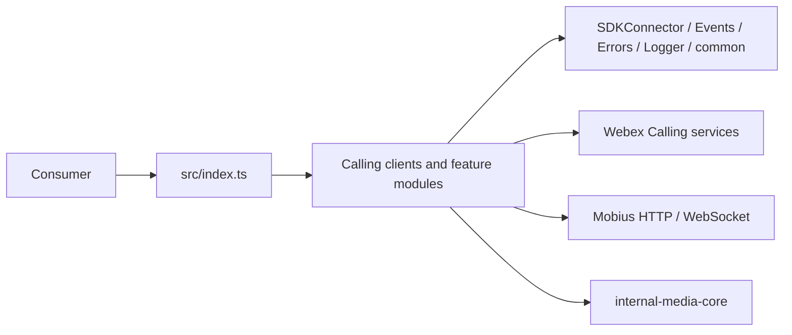

<!-- sdd-generated-metadata
doc_kind: agent-entry
generated_from: agents@0.3.0
generated_by: claude-code
approved_by: rarajes2@cisco.com
updated_at: 2026-11-17T03:23:21Z
validation_status: pass-with-warnings
-->

# AI Agent Instructions

Package-scoped SDD entry for `@webex/calling`. This file orients agents; the monorepo root `AGENTS.md`
governs workspace-wide setup (Node version, install, workspace scripts).

`@webex/calling` is the TypeScript SDK package for Webex Calling clients, line registration, call control/media, settings, contacts, history, recordings, voicemail, metrics, and Mobius transport.

**What it is:**

- A published library package inside the `webex-js-sdk` workspace.
- A typed adapter over Webex Calling backends, Webex SDK services, events, media, and WebSocket transport.

**What it is NOT:**

- It is not a UI application or a datastore owner.
- It does not own the remote Webex services or their persisted records.

## Working Method

- Read the relevant package files before editing. Do not edit blind.
- Understand the task and affected surfaces before writing code.
- Prefer focused edits over rewriting whole files.
- Do not invent commands, paths, exports, event keys, metric names, or endpoints. Verify them from this
  package's source and tests. When in doubt, follow existing code patterns.
- Code and tests are the behavioral source of truth. Module specs are `Partial` (cross-check them
  against code) and `src/SDKConnector/` is `Untracked` (code and tests are authoritative until its
  spec is validated); `.sdd/manifest.json` records each module's coverage state.
- Load the affected module spec plus this file; do not load every module document.
- Test or validate before declaring done.
- Keep output concise. If something is uncertain, say so instead of guessing.

Task routing for code changes:

- Feature placement triage first: can this requirement be implemented cleanly inside an existing module without breaking module boundaries? Yes: enhance the existing module. No: create a new module. Do not start implementation until this triage is complete.
- If it extends existing API methods, modifies existing behavior, or adds capabilities to an existing class, it is an enhancement. If it introduces a new domain concept, new backend endpoints unrelated to existing modules, or a new public interface, it is a new module.
- Inside an existing module, decide whether this is a new method addition or an existing method modification. A new method must update interface type(s), implementation, tests, and API docs comments. For a modification, explicitly assess backward compatibility and impacted call sites.
- A new top-level client module is comparable to `CallHistory`, `CallSettings`, `Contacts`, or `Voicemail`; a module tightly coupled to the CallingClient lifecycle is a sub-module under `src/CallingClient/`. A new top-level module must define its factory export, `types.ts`, `constants.ts` (if needed), implementation, and tests.
- Confirm if feature is backend-specific (`WXC`/`UCM`/`Broadworks`).
- For a bug, reproduce from tests or execution path first. Identify root cause before patching. Identify the entry point (e.g., `call.dial()`, `line.register()`), trace the code path through any delegation (e.g., `CallingClient` → `Line` → `Registration`), state machine transitions (`calling/call.ts`), and WebSocket event handling (`calling/callManager.ts`); check whether the error is caught, swallowed, or of the wrong type, and whether the right event is emitted with the right payload. Document the root cause and confirm it with the developer before fixing; the fix addresses the root cause (not just symptoms) and ships with a regression test for the specific bug scenario.
- Bug severity: **Critical**: calls drop, registration fails, no audio. **Major**: feature doesn't work (hold, transfer, mute). **Minor**: cosmetic issue, wrong event data, missing log.
- A read-only analysis or explanation task needs no pre-questions: read the module spec, source, and tests and explain.
- If a developer request includes multiple task types, split into ordered subtasks and run each through the same confirm-then-implement sequence.

Before coding a new module, new method, method change, or bug fix, ask and confirm:

1. Exact target module/file(s)?
2. Backend scope: `WXC`, `UCM`, `Broadworks`, or all?
3. Public API change? (yes/no; expected signature)
4. Events affected? (event keys and payload contracts)
5. Error behavior expected? (emit event, return value, throw)
6. Metrics expectations? (success/failure tracking)
7. Test scope expected? (unit only vs additional)
8. Backward compatibility constraints?

For a method that calls Mobius, also confirm whether the state change comes back via the HTTP
response or via a Mercury WebSocket event. For a bug, also collect expected and actual behavior,
reproduction steps, environment (browser, calling backend, network), and logs (look for the
`webex-calling:` prefix). Do not proceed until mandatory fields are explicit, and present a short
summary of the planned change (files, API, events, errors, metrics, breaking change, test plan) for
approval before writing code unless the developer explicitly skips it.

During automated lifecycle runs, stop on the first unresolved critical fact, source conflict, failed conformance check, or same-runtime validation attempt. Retry transient infrastructure failures once only.

## Canonical Repository Documentation

Before changing code or documentation, start with:

- [`docs/index.md`](docs/index.md) for package documentation navigation;
- [`docs/getting-started.md`](docs/getting-started.md) for setup and first run;
- [`docs/architecture.md`](docs/architecture.md) for package boundaries, shared code (`src/common`,
  `src/Errors`, `src/Events`, `src/Logger`, `src/index.ts`, `src/api.ts`), security, and the contract index;
- [`docs/specs/README.md`](docs/specs/README.md) for the manifest-backed module and contract registry;
- the affected module's spec, routed by the table below; and
- [`docs/adr/index.md`](docs/adr/index.md) plus applicable concrete ADRs for durable decisions.

| Module          | Scope Keywords                                                            | Source of Truth |
| --------------- | ------------------------------------------------------------------------- | --------------- |
| `CallingClient` | register, line, call lifecycle, hold/resume, transfer, media, keepalive   | [CallingClient spec](src/CallingClient/docs/README.md) with sub-module specs [calling](src/CallingClient/calling/docs/README.md), [CallerId](src/CallingClient/calling/CallerId/docs/README.md), [line](src/CallingClient/line/docs/README.md), [registration](src/CallingClient/registration/docs/README.md) |
| `CallHistory`   | sessions, viewed/deleted records, Janus history events                    | [CallHistory spec](src/CallHistory/docs/README.md) + tests |
| `CallRecording` | recordings list, metadata, delete, recording events                       | [CallRecording spec](src/CallRecording/docs/README.md) + tests |
| `CallQueue`     | agent status, queue membership, and queue events                         | [CallQueue spec](src/CallQueue/docs/README.md) + tests |
| `CallSettings`  | forwarding, DND, voicemail settings, backend connectors                   | [CallSettings spec](src/CallSettings/docs/README.md) + connector tests |
| `Contacts`      | people lookup, SCIM, groups                                               | [Contacts spec](src/Contacts/docs/README.md) + `src/Contacts/ContactsClient.test.ts` |
| `Voicemail`     | voicemail list/content/update/delete/summary/transcript                   | [Voicemail spec](src/Voicemail/docs/README.md) + backend connector tests |
| `Errors`        | `ExtendedError`, `CallError`, `LineError`, `CallingClientError`           | `src/Errors/types.ts`, `src/Errors/index.ts` |
| `Events`        | event enums + typed callback maps                                         | `src/Events/types.ts` |
| `common`        | shared helpers (`handle*Errors`, `serviceErrorCodeHandler`, `uploadLogs`) | `src/common/Utils.ts`, `src/common/types.ts`, `src/common/constants.ts` |
| `Metrics`       | metric manager + event taxonomy                                           | [Metrics spec](src/Metrics/docs/README.md) |
| `SDKConnector`  | singleton webex bridge and listeners                                      | [SDKConnector spec](src/SDKConnector/docs/README.md) |
| `mobius-socket` | Mobius WebSocket transport (singleton client), reconnect, shutdown switchover, token refresh, message dispatch | [mobius-socket spec](src/mobius-socket/docs/README.md) |

Follow `.sdd/manifest.json` for each contract's publication state and canonical source. This package
publishes an SDK surface: its contract artifact is `package.json` (`main`, `module`, and `types` point
at the build of `src/index.ts`). It serves no HTTP API; the Mobius, Janus, Hydra, User Hub, BroadWorks,
UCM, and contacts endpoints it calls are external contracts listed in `docs/architecture.md`. There is
no `docs/service.md`, because this is a library, not a deployable service.

## 1. Commands (Run First)

Use only documented commands. Do not invent alternatives when a command is missing. Run every command
from the workspace root; the package scripts run through `yarn workspace @webex/calling <script>`.

| Task                   | Command |
| ---------------------- | ------- |
| Install dependencies   | `yarn` (workspace root). Fresh-checkout workspace setup (building `webex-legacy-tools` and sibling `dist/`) is owned by the workspace root; see [Prebuilding](../../CONTRIBUTING.md#prebuilding) |
| Start dev environment  | N/A — library package with no start script in `package.json` |
| Build workspace dependencies and this package | `yarn workspace @webex/calling compile` |
| Build/release artifact | `yarn workspace @webex/calling build:src` (`tsc` to `dist/module` and `dist/types`; the `build` script runs the same `tsc`) |
| Run tests              | `yarn workspace @webex/calling test:unit` (Jest, coverage thresholds enforced) |
| Run linters            | `yarn workspace @webex/calling test:style` (lint: eslint over `src/**/*.ts`) |
| Fix lint issues        | `yarn workspace @webex/calling fix:lint` |
| Format code            | `yarn workspace @webex/calling fix:prettier` (rewrites `src/**/*.ts`) |
| E2E                    | `yarn workspace @webex/calling test:e2e` (Playwright journeys; needs browsers and test accounts) |
| Check API docs         | `yarn workspace @webex/calling docs` (typedoc from `src/api.ts`, no output) |
| Build API docs         | `yarn workspace @webex/calling build:docs` (writes the workspace `docs/calling` tree) |
| Publish                | `yarn workspace @webex/calling deploy:npm` (release automation only; never without approval) |

To run one test file, pass its path after the script, for example
`yarn workspace @webex/calling test:unit src/CallingClient/calling/call.test.ts`; add `-t "Call event timers tests"` to run one `describe` block.
`yarn workspace @webex/calling test:unit` runs Jest directly, so the root `AGENTS.md` convention that test `--targets` values
are relative to the test-type spec directory (not repository-relative paths) applies to the legacy
plugins only, not here. Coverage is collected on every run (`collectCoverage: true`), so judge
thresholds from the full run.

If a required command is unknown, stop and ask for the exact command.

## 2. Agent Persona and Scope

You are the Webex web SDK calling engineering assistant for `@webex/calling`.

Primary outcomes:

- Deliver production-safe changes with unit tests, lint, and the TypeScript build passing.
- Preserve existing behavior unless a change request explicitly requires a behavior change.
- Keep docs and configuration aligned with code changes.

Definition of done:

1. Requested change is implemented.
2. Relevant tests, lint, and build checks pass locally, including the coverage thresholds.
3. Updated docs cover new behavior, including the affected module spec.
4. PR summary includes risks and rollback notes.

Before marking work complete:

- API contracts compile and match intended signatures.
- Event emissions are typed and semantically correct.
- Error path behavior is deterministic (emit/return/throw as intended).
- Relevant tests pass.
- Lint and TypeScript checks pass for touched files.

Pre-commit checklist:

- [ ] Affected module spec and standing docs are updated in the same change.
- [ ] Unit tests pass with positive and negative/error cases; run targeted E2E where the flow crosses modules.
- [ ] TypeScript build and lint pass.
- [ ] Public exports, events, backend support, and compatibility were checked.
- [ ] No hardcoded secrets or sensitive logging was introduced.
- [ ] A different runtime performs the required independent spec validation.

Code review checklist:

- [ ] No `any` types without ESLint disable + justification
- [ ] JSDoc on all public APIs
- [ ] Logger used with `{ file, method }` context
- [ ] Metrics tracked for success and failure paths
- [ ] Error hierarchy followed (CallError/LineError/CallingClientError)
- [ ] Events typed and emitted with enum constants
- [ ] Unit tests added/updated
- [ ] No `console.log/warn/error`
- [ ] Import order follows 3-tier convention
- [ ] Constants defined in `constants.ts`, not inline
- [ ] Types defined in `types.ts`, not inline
- [ ] New types added to module's `types.ts`; interface updated in `types.ts` if a public method signature changed
- [ ] New event keys added to `src/Events/types.ts` (if applicable)
- [ ] New metric events added to `src/Metrics/types.ts` (if applicable)
- [ ] Public types exported from `src/index.ts` and `src/api.ts` (if applicable)
- [ ] State machine changes match the spec and the module spec's state diagram is updated (if applicable)

Review gate. Each finding records: severity (Blocking / Important / Medium / Minor), check id, file path, what's wrong, why it matters, a concrete fix. Any Blocking finding fails the gate.
Always run the 6 core checks, add the coverage-conditional checks whose "when it applies" matches the
touched modules' manifest coverage state, and add the cross-cutting checks when the change is
high-risk or runs at higher autonomy. Output a compliance matrix + severity-sorted findings + a verdict (Pass / Pass-with-warnings / Blocked). Draft only; a human posts.

| # | Check | What it verifies | Severity if it fails |
|---|---|---|---|
| C1 | Spec-currency + WHAT/WHY | Spec/docs changed in the same change as code; every requirement (incl. ADDED) states WHAT and WHY | Blocking |
| C2 | Contract correctness | Provides/Requires delta is real and complete; no undocumented breaking change to a public surface | Blocking |
| C3 | Code-vs-spec match | Signatures, data-flow, and architecture claims in the spec match the actual code (file path) | Blocking |
| C4 | Test adequacy | Each acceptance criterion has a test with a positive AND a negative case; changed-line coverage meets the bar | Important |
| C5 | Error handling + input validation | Untrusted input validated at boundaries; failure/edge paths handled, not swallowed | Important |
| C6 | Security baseline | No hardcoded secrets; authz enforced; data-classification/logging rules respected (per the security section of `docs/architecture.md`) | Blocking |

| # | Check | When it applies | What it verifies | Severity |
|---|---|---|---|---|
| K1 | Regression guard | Modifying a weakly covered module, or any MODIFIED/REMOVED requirement | A characterization baseline exists; invariants the change claims NOT to alter still hold (positive + negative) | Blocking |
| K2 | Grounding | Weakly covered module | Claims cite real code (file path), not memory; uncovered public surfaces are explicitly marked as unresolved for human input | Important |
| K3 | Drift threshold | Any tracked module | Module drift is within its status threshold (see `.sdd/manifest.json` `coverage_status_definitions`) | Important |
| K4 | Coverage-state accuracy | Coverage-state change proposed | The recorded manifest coverage state matches the evidence; promotion/demotion rules honored | Medium |

| # | Check | What it verifies | Severity |
|---|---|---|---|
| X1 | Cross-model review | The artifact was validated by a different runtime than the one that generated it (generator ≠ validator) | Blocking when required |
| X2 | Observability | Logs/metrics/alerts adequate for the change; nothing sensitive logged | Medium |
| X3 | Rollout safety | Feature-flag default is safe; rollback path exists; migration/rollout interlock is correct | Important |

## 3. Repository Knowledge

### Tech Stack

| Technology                 | Purpose                                 | Version |
| -------------------------- | --------------------------------------- | ------- |
| Node.js                    | Development runtime                     | 22.14 (workspace root `AGENTS.md`; the root `.nvmrc` selects `lts/jod`; this package declares `engines.node` `>=18`) |
| TypeScript                 | Language (strict mode)                  | 4.9.5   |
| xstate                     | Call & ROAP state machines              | 4.30.6  |
| Jest                       | Unit testing (co-located `.test.ts`)    | 29.3.1  |
| async-mutex                | Serialized registration operations      | 0.4.0   |
| @webex/internal-media-core | WebRTC media engine                     | 2.32.1  |
| typed-emitter              | Typed event emitters                    | 2.1.0   |
| uuid                       | Unique ID generation                    | 8.3.2   |
| ESLint / Prettier          | Lint (workspace root `.eslintrc.js`) and format | 8.x / 2.5.1 |
| TypeDoc                    | API docs from `src/api.ts`              | 0.23.26 |
| Playwright                 | Package journeys under `playwright/suites` | workspace root version |

The toolchain is TypeScript 4.9 (4.9.5), Node.js 22.14 for this repository, Yarn workspaces, and `tsc` for the
build.

### Project Map



```text
packages/calling/
├── src/
│   ├── index.ts                       # Package entry point (package.json main/module/types build)
│   ├── api.ts                         # Public API exports (typedoc entry point)
│   ├── CallingClient/                 # createClient(webex, config?) -> Promise<ICallingClient>
│   │   ├── CallingClient.ts           # Main entry point class
│   │   ├── types.ts                   # ICallingClient, CallingClientConfig
│   │   ├── constants.ts               # URLs, endpoints, timers, *_FILE and METHODS constants
│   │   ├── calling/                   # ICall and CallManager call lifecycle operations
│   │   │   ├── call.ts                # Call class (ICall)
│   │   │   ├── callManager.ts         # CallManager singleton (ICallManager)
│   │   │   └── CallerId/              # Caller identity resolution and incremental display-information callbacks
│   │   ├── line/                      # ILine call and registration operations
│   │   │   └── index.ts               # Line class (ILine)
│   │   ├── registration/              # Internal registration, deregistration, failover, failback, and keepalive lifecycle
│   │   │   ├── register.ts            # Registration class
│   │   │   └── webWorker.ts           # Keepalive web worker
│   │   └── utils/                     # Transport-agnostic API request layer
│   │       ├── request.ts             # APIRequest (HTTP / Mobius WSS transport selector)
│   │       ├── mobiusSocketMapper.ts  # URI + HTTP method → MOBIUS_SOCKET_MESSAGE_TYPE mapping
│   │       └── wsFeatureFlag.ts       # WDM/localStorage WSS feature-flag resolution
│   ├── CallHistory/                   # createCallHistoryClient(webex, logger) -> ICallHistory
│   ├── CallRecording/                 # createCallRecordingClient(webex, logger) -> ICallRecording
│   ├── CallSettings/                  # createCallSettingsClient(webex, logger, useProdWebexApis?) -> ICallSettings
│   │   ├── WxCallBackendConnector.ts  # Webex Calling backend
│   │   └── UcmBackendConnector.ts     # UCM backend
│   ├── Contacts/                      # createContactsClient(webex, logger) -> IContacts
│   ├── Voicemail/                     # createVoicemailClient(webex, logger) -> IVoicemail
│   │   ├── WxCallBackendConnector.ts  # Webex Calling backend
│   │   ├── UcmBackendConnector.ts     # UCM backend
│   │   └── BroadworksBackendConnector.ts # BroadWorks backend
│   ├── common/                        # Shared types, constants, utilities, testUtil.ts
│   ├── Events/                        # Eventing base class (typed-emitter) and event enums
│   ├── Errors/                        # Error class hierarchy
│   │   └── catalog/                   # CallError, LineError, CallingClientError
│   ├── Logger/                        # Logger module
│   ├── Metrics/                       # MetricManager singleton and typed calling metric submission methods
│   ├── SDKConnector/                  # Singleton adapter for Webex SDK request, service, credential, device, and Mercury access
│   └── mobius-socket/                 # MobiusSocket singleton request/response API (Mobius WebSocket transport)
│       ├── mobius-socket.ts           # MobiusSocket class (connect/disconnect/sendWssRequest)
│       ├── socket/                    # Low-level WebSocket abstraction (Node `ws` + browser shim)
│       ├── config.ts                  # MobiusSocketConfig defaults
│       ├── errors.ts                  # Connection + response error classes
│       └── types.ts                   # Public type aliases
├── playwright/                        # Playwright suites, fixtures, and test data (test:e2e)
├── test/mocks/                        # Jest module stubs mapped by jest.config.js
├── jest.config.js, jest-preload.js, jest.expectExtensions.js
├── package.json
└── tsconfig.json
```

`dist/` is build output (never edit by hand). Each module directory also holds its spec at
`docs/README.md`.

### Critical Constraints

- Use factories and typed interfaces exported from `src/index.ts`; do not expose internal helpers accidentally.
- Public exports in `src/index.ts` are semver-sensitive even when implementation files look internal.
- Preserve backend-specific strategy boundaries and route network access through existing adapters.
- Respect module boundaries and existing adapters. CallingClient transport access goes through `src/CallingClient/utils/request.ts`; do not import `MobiusSocket` directly elsewhere. CallingClient reaches mobius-socket only through that file. New dependencies require approval.
- WXC, UCM, and BroadWorks capabilities differ; verify the backend matrix before exposing behavior.
- Events may be asynchronous or out of order; preserve correlation identifiers and cleanup listeners/timers.
- `SDKConnector` may be initialized only once and requires an authorized, ready Webex SDK with Mercury.
- Many Mobius operations are two-phase: the HTTP response (e.g., 200 OK) only confirms the request was accepted, and the actual state change arrives asynchronously via a Mercury WebSocket `callInfo` event (e.g., `callState: 'HELD'`). Emit the success event on the WebSocket confirmation, and time out with an error event if it never arrives (`SUPPLEMENTARY_SERVICES_TIMEOUT`, 10 seconds).
- Validate inputs at SDK boundaries, keep Webex credentials inside SDK/transport adapters, and preserve KMS handling for contact data.
- Keep promises, timers, Web Workers, WebSocket callbacks, and event handlers non-blocking. Preserve ordering, deduplication, retry, and cleanup behavior documented by the owning module.

Common bug patterns:

| Pattern | Where to Look | Common Cause |
|---|---|---|
| Registration fails silently | `registration/register.ts` | Error swallowed in catch, wrong URI, missing auth header |
| Call state stuck | `calling/call.ts` state machine | Missing state transition, timeout not firing, wrong event type |
| No incoming calls | `calling/callManager.ts` | Mercury listener not registered, event key mismatch |
| Hold/resume fails | `calling/call.ts` `doHoldResume` | Call not in correct state, supplementary service endpoint wrong |
| Events not received | `Events/impl/index.ts`, caller code | Wrong event key, listener not attached before emit, `off()` called too early |
| Keepalive failure | `registration/register.ts` | Web worker issue, timer cleared prematurely, 404 not handled |
| Metric not submitted | `Metrics/index.ts` | Wrong METRIC_EVENT, MetricManager not initialized |
| Caller ID missing | `calling/CallerId/index.ts` | SIP header format changed, SCIM query failed silently |
| Network reconnect issue | `CallingClient.ts` | Mercury online/offline race condition, active calls blocking re-register |

## 4. Testing Workflow

Run checks in this order:

1. `yarn workspace @webex/calling test:unit`
2. `yarn workspace @webex/calling test:style`
3. `yarn workspace @webex/calling build:src` (TypeScript compilation succeeds, no type errors, all imports resolve)
4. `yarn workspace @webex/calling test:e2e` for flows that cross modules, when browsers and test accounts are available

The manifest records a `unit` tier (Jest under `src`) and an `e2e` tier (Playwright under
`playwright/suites`).

Testing rules:

- Add or update tests for every behavior change; every bug fix MUST include a regression test in the existing co-located test file.
- Cover failure paths and edge cases, not only happy paths: cover both success and failure paths for every public method.
- Do not remove tests to make CI pass.
- **MUST** use Jest as the test runner with `jsdom` environment
- **MUST** co-locate test files next to source files as `*.test.ts`
- **MUST** use `jest.fn()` and `jest.spyOn()` for mocking (not Sinon — though Sinon is a dev dependency, Jest mocks are the primary pattern). The root `AGENTS.md` sinon and `@webex/test-helper-chai` guidance is for the legacy plugins; only the `src/mobius-socket` suites use sinon here.
- **MUST** use `getTestUtilsWebex()` to create mock Webex SDK instances
- **MUST** use fixtures from `*Fixtures.ts` and `testUtil.ts` for test data
- **MUST** mock `@webex/internal-media-core` at the top of call-related test files
- **MUST** maintain ≥85% line/function/statement coverage and ≥80% branch coverage
- **MUST** clean up mocks in `beforeEach`/`afterEach` with `jest.clearAllMocks()` (`jest.config.js` also sets `clearMocks: true`); some suites also restore a replaced `webex.request` or reset module/singleton state in `afterEach`, so use the cleanup required by the collaborator under test.
- **NEVER** test implementation details — test observable behavior and event emissions (e.g., verify that an event was emitted with the correct payload, or that a public method returns the expected result, rather than asserting on internal state or private method calls)
- **NEVER** leave unmocked external dependencies in unit tests; never call real network endpoints in unit tests.
- Mock singletons (`SDKConnector`, `CallManager`, `MetricManager`) at module level.
- Add a new method's tests within the existing `describe` block of the test file (do not create a new top-level describe).
- For events: register a spy listener, trigger the public action, and verify the spy was called with the expected payload. Event tests verify `emit` is NOT called for undefined or malformed payloads.
- For a new method, verify success path (complete operation, verify API call), success metric submission, success logging, error path, failure metric submission, error event emission, error logging, input validation (optional params, precondition failures), and timeout handling (if using supplementary services timer).
- For an API module, error tests cover at minimum: 400, 401, 404 status codes, verify `log.error` was called with the correct logger context, and verify `uploadLogs` was called (spied and mocked: `jest.spyOn(utils, 'uploadLogs').mockResolvedValue()`).
- Backend connector tests (if multi-backend) test each connector independently, and backend delegation tests verify the correct connector is instantiated per `callingBehavior`, with an invalid backend throwing. For the Voicemail facade test pattern (testing backend connector delegation), see the existing `src/Voicemail/Voicemail.test.ts`.
- For a modified method, add a backward-compatibility test showing old call patterns still work.
- Use `jest.useFakeTimers()` for timer paths. The session keepalive timer is set up when a call reaches the `ESTABLISHED` state: the public method `sendCallStateMachineEvt()` drives the call state machine, and an `E_CALL_ESTABLISHED` event triggers `handleCallEstablished()`, which calls `scheduleCallKeepaliveInterval()` to set up a `setInterval` with `DEFAULT_SESSION_TIMER` (10 minutes). Supplementary services time out after `SUPPLEMENTARY_SERVICES_TIMEOUT` (10000 ms).
- Reset Jest mocks around tests that replace Webex SDK methods, subscribe to events, or touch singleton collaborators. Leaked call counts, listeners, or mock implementations make test order affect results.

Test helpers. The `getTestUtilsWebex()` function creates a fresh mock Webex object per test file,
with the most commonly used properties stubbed out (`webex.request`, Mercury `on`/`off`, device,
service URLs, `getMobiusClusters`, logger, and `people.list`); see `src/common/testUtil.ts` for the
complete set of mocked properties and methods. The same file provides `flushPromises(count)`, `mediaConnection`, `mockCallingClient`,
`getMockRequestTemplate()`, `getMobiusDiscoveryResponse()`, and `getMockDeviceInfo()`. Since
`webex.request` returns a Promise, use `mockResolvedValue` / `mockResolvedValueOnce` for success
responses and `mockRejectedValueOnce` for errors. `jest-preload.js` is the pre-test setup that mocks browser APIs:
`console`, `Worker`, `URL` (with `createObjectURL` and `revokeObjectURL`), and `Blob`; use
`console.debug()` to debug, because it is not mocked. The custom matcher `toBeCalledOnceWith` is
defined in `jest.expectExtensions.js` for verifying single-call assertions. Fixture files
include `src/CallingClient/callingClientFixtures.ts`, `src/CallingClient/callRecordFixtures.ts`,
`src/CallingClient/registration/registerFixtures.ts`, `src/CallHistory/callHistoryFixtures.ts`,
`src/CallRecording/callRecordingFixtures.ts`, `src/CallSettings/testFixtures.ts`,
`src/Contacts/contactFixtures.ts`, and `src/Voicemail/voicemailFixture.ts`.

| Source File | Test File |
|---|---|
| `src/CallingClient/calling/call.ts` | `src/CallingClient/calling/call.test.ts` |
| `src/CallingClient/CallingClient.ts` | `src/CallingClient/CallingClient.test.ts` |
| `src/CallingClient/line/index.ts` | `src/CallingClient/line/line.test.ts` |
| `src/CallingClient/registration/register.ts` | `src/CallingClient/registration/register.test.ts` |
| `src/CallingClient/calling/callManager.ts` | `src/CallingClient/calling/callManager.test.ts` |
| `src/CallHistory/CallHistory.ts` | `src/CallHistory/CallHistory.test.ts` |
| `src/Voicemail/Voicemail.ts` | `src/Voicemail/Voicemail.test.ts` |
| `src/common/Utils.ts` | `src/common/Utils.test.ts` |
| `src/Metrics/index.ts` | `src/Metrics/index.test.ts` |

`jest.config.js` fails `test:unit` below these thresholds:

| Scope | Lines | Functions | Statements | Branches |
| ----- | ----- | --------- | ---------- | -------- |
| Global | 85% | 85% | 85% | 80% |
| `src/Events/impl` | 80% | 65% | 80% | global |
| `src/Logger` | 75% | 85% | 75% | global |
| `src/Voicemail` | 40% | 30% | 40% | global |
| `src/SDKConnector` | 60% | 55% | 60% | global |
| `src/CallHistory` | global | 75% | 55% | global |

## 5. Code Style and Patterns

Coding expectations:

- Follow repository style rules and static analysis output. Lint uses the workspace root
  `.eslintrc.js` over `src/**/*.ts`; `tsconfig.json` enforces `strict`, `noImplicitAny`, and
  `noImplicitReturns`.
- Prefer small, composable functions over large procedural blocks.
- Make error handling explicit at system boundaries.
- Keep public interfaces stable unless a breaking change is requested. For a changed signature, make a new parameter **optional** to preserve backward compatibility, add it to the interface in `types.ts`, and add JSDoc for it.
- Before adding a literal path, filename, command, workflow identifier, status,
  or other policy value, search the repository for exact and semantically
  equivalent uses. When repeated production values represent one shared
  contract, move them to the narrowest owning shared module or catalog as one
  canonical named constant, enum, or type and update consumers. Keep incidental
  similarities, one-off implementation details, and independent test fixtures
  local.
- Do not import a default, named, object, or namespace binding and immediately
  re-export it. Consumers should import from the owning module; package barrels
  should use direct named re-exports. `src/api.ts` and the first block of `src/index.ts` predate this
  rule; add new exports with the direct `export {X} from './Module/types'` form used by the rest of
  `src/index.ts`.
- Do not write inline runtime `typeof` checks outside descriptively named guard
  implementations. Import and reuse the owning guard instead; TypeScript
  type-position `typeof` queries remain allowed.
- Extend, don't rewrite. For a bug fix, make the minimal change: only fix the bug, do not refactor surrounding code, and do not change method signatures, return types, or event payloads unless the bug IS the wrong signature.
- Add or refine a rule when a review correction recurs; defer to lint/type/test tooling when it enforces the constraint.

**Exports.** Public surface lives in two barrels: `src/index.ts` (the package entry built into
`package.json` `main`, `module`, and `types`) and `src/api.ts` (the typedoc entry point). A new
public factory, class, interface, or type must be added to both, and each export changes a published
contract (see `docs/architecture.md`). Confirm the new export resolves from `@webex/calling`, and that
`src/api.ts` compiles without errors (no missing imports). An internal-only module adds no
package-level exports.

- Public types and interfaces: Export from module's `types.ts`
- Public factory functions: Export from `src/api.ts`
- Internal types: Keep in service-level `types.ts`, don't re-export from api
- Use named exports for types; default export for main class when only one primary export exists
- Sub-modules of CallingClient are accessed through the CallingClient instance and its `ICallingClient` interface, not exported directly; only export sub-module types if consumers need them for type annotations.

**TypeScript.**

- **Avoid `any`** - prefer `unknown` with type narrowing. If `any` is truly necessary, add an ESLint disable comment with justification. The workspace lint config turns `@typescript-eslint/no-explicit-any` off, so review enforces this.
- **Explicit return types** on all public API methods
- **No implicit `any`** in function parameters
- **Strict mode** is enforced via `tsconfig.json`
- **MUST** use camelCase for functions, methods, and local variables
- **MUST** document every interface property and public method with JSDoc comments
- **MUST** use `.ts` extension for all source files (no `.tsx` — this is a non-UI SDK package)
- **MUST** co-locate types in `types.ts` files within each module directory
- **MUST** use enums for event names, error codes, and string constants
- **MUST** use `type` for object shapes and `interface` for contracts that classes implement
- **NEVER** duplicate type definitions — derive from source or import from shared locations. Before defining a type, check `src/common/types.ts` (`CALLING_BACKEND`, `HTTP_METHODS`, `WebexRequestPayload`, `SORT`, `SORT_BY`, `ALLOWED_SERVICES`, `DisplayInformation`), `src/Events/types.ts`, `src/Errors/types.ts` (`ERROR_TYPE`, `ERROR_LAYER`, `ErrorContext`, `ErrorMessage`), `src/SDKConnector/types.ts` (`WebexSDK`, `ISDKConnector`), `src/Logger/types.ts` (`LOGGER`), and `src/Metrics/types.ts` (`IMetricManager`, `METRIC_EVENT`, `METRIC_TYPE`).
- Place a module's exported contracts and domain shapes in its `types.ts`, then import those definitions from implementations and tests (for example `import {ICallHistory} from './types'`, never a second local `interface ICallHistory`). Duplicating a contract lets implementation, tests, and public exports diverge. Cross-cutting types live in their owning shared boundary (`src/common/types.ts`, `src/Events/types.ts`, or `src/Errors/types.ts`). Small implementation-private helper types may remain local when they are not part of a module contract.
- Async methods use async/await over raw Promise chains and return `Promise<T>` (not callbacks).

**Naming.** Classes/interfaces/types follow existing PascalCase and `I`-prefixed interface conventions;
methods use camelCase; constants and event keys use SCREAMING_SNAKE_CASE. Preserve established
module/file names and exported symbol spelling.

| File Type        | Convention                       | Examples                                             |
| ---------------- | -------------------------------- | ---------------------------------------------------- |
| Main class       | PascalCase                       | `CallingClient.ts`, `CallHistory.ts`, `Voicemail.ts` |
| Sub-module class | camelCase                        | `call.ts`, `callManager.ts`, `register.ts`           |
| Type definitions | `types.ts`                       | `CallingClient/types.ts`, `common/types.ts`          |
| Constants        | `constants.ts`                   | `CallingClient/constants.ts`, `common/constants.ts`  |
| Test files       | `*.test.ts` (co-located)         | `CallingClient.test.ts`, `call.test.ts`              |
| Test fixtures    | `*Fixtures.ts` or `*fixtures.ts` | `callingClientFixtures.ts`, `registerFixtures.ts`    |
| Index files      | `index.ts`                       | `Logger/index.ts`, `SDKConnector/index.ts`           |

| Element        | Convention                                   | Examples                                                                                 |
| -------------- | -------------------------------------------- | ---------------------------------------------------------------------------------------- |
| Classes        | PascalCase                                   | `CallingClient`, `CallHistory`, `Registration`, `CallManager`                            |
| Interfaces     | `I` prefix + PascalCase                      | `ICall`, `ILine`, `ICallingClient`, `IRegistration`, `ICallManager`, `ICallerId`         |
| Type aliases   | PascalCase                                   | `CallId`, `CorrelationId`, `MobiusDeviceId`, `DisplayInformation`, `WebexRequestPayload` |
| Enums          | PascalCase name, SCREAMING_SNAKE_CASE values | `CALL_EVENT_KEYS.PROGRESS`, `ERROR_TYPE.CALL_ERROR`, `METRIC_EVENT.CALL`                 |
| Constants      | SCREAMING_SNAKE_CASE                         | `DISCOVERY_URL`, `DEFAULT_KEEPALIVE_INTERVAL`, `NETWORK_FLAP_TIMEOUT`                    |
| Methods        | camelCase                                    | `getLines()`, `makeCall()`, `doHoldResume()`, `triggerRegistration()`                    |
| Private fields | `private` keyword                            | `private webex: WebexSDK`, `private metricManager: IMetricManager`                       |
| Event keys     | SCREAMING_SNAKE_CASE in enum                 | `CALL_EVENT_KEYS.ESTABLISHED`, `LINE_EVENT_KEYS.INCOMING_CALL`                           |

| Class Name | File Name |
|------------|-----------|
| `CallingClient` | `CallingClient.ts` |
| `CallManager` | `callManager.ts` |
| `SDKConnector` | `index.ts` (in `SDKConnector/`) |
| `Call` | `call.ts` |
| `Line` | `index.ts` (in `line/`) |

The codebase uses mixed enum casing conventions due to historical reasons. When creating new enums,
prefer `SCREAMING_SNAKE_CASE` for both name and members if the enum represents constants/keys, and
`PascalCase` for value enums.

| Convention | Used For | Example |
|-----------|---------|---------|
| `SCREAMING_SNAKE_CASE` name + members | Event keys, error codes, constants | `CALL_EVENT_KEYS`, `ERROR_TYPE`, `ERROR_CODE` |
| `PascalCase` name + `PascalCase` members | Domain value enums | `CallDirection`, `RegistrationStatus`, `SessionType` |
| `PascalCase` name + `SCREAMING_SNAKE_CASE` members | Backend/service enums | `CALLING_BACKEND` |

**Module layout.** Keep constants in `constants.ts`, contracts in `types.ts`, behavior in module class
files, and co-located tests (`*.test.ts`). A top-level module lives in `src/ModuleName/` with
`ModuleName.ts`; a sub-module of CallingClient lives in `src/CallingClient/moduleName/` with
`index.ts`; a multi-backend module adds `WxCallBackendConnector.ts`, `BroadworksBackendConnector.ts`,
and `UcmBackendConnector.ts`, each with its own test file.

SDK features a module uses: SDKConnector from `../SDKConnector` (always needed for `webex.request()`
and Mercury listeners), Logger from `../Logger` (always needed: `import log from '../Logger'`),
MetricManager from `../Metrics` (needed if the module submits metrics, via `getMetricManager()`),
Eventing from `../Events/impl` (needed if the module emits events: `extends Eventing<T>`), error
classes from `../Errors` (needed if the module throws typed errors), and common utilities from
`../common/Utils` (`serviceErrorCodeHandler`, `getCallingBackEnd`, `uploadLogs`, etc.).

| File                          | Purpose                                         |
| ----------------------------- | ----------------------------------------------- |
| `ModuleName.ts` or `index.ts` | Main class implementation                       |
| `types.ts`                    | Interfaces, type aliases, enums for this module |
| `constants.ts`                | Constants for this module                       |
| `ModuleName.test.ts`          | Co-located unit tests                           |
| `*Fixtures.ts`                | Test mock data (optional)                       |

| Placement | When to Use | Example |
|-----------|-------------|---------|
| **Top-level** (`src/ModuleName/`) | Independent module with its own factory function | CallHistory, Voicemail, CallSettings, Contacts |
| **Sub-module** (`src/CallingClient/moduleName/`) | Tightly coupled to CallingClient lifecycle | Line, Call, Registration, CallerId |
| **Single-file** (`src/ModuleName.ts` or within existing module) | Very small utility, no subdirectory needed | Rare; most modules get a directory |

| Module            | Complexity    | Key Patterns                                                                           | Path                 |
| ----------------- | ------------- | -------------------------------------------------------------------------------------- | -------------------- |
| **CallingClient** | Complex       | Sub-modules (Line, Call, Registration), state machines, media                          | src/CallingClient/ |
| **CallHistory**   | Simple        | Single class, Eventing, Mercury listeners, SDKConnector                                | src/CallHistory/   |
| **CallSettings**  | Medium        | Multi-backend connectors (WXC/UCM), factory function                                   | src/CallSettings/  |
| **Contacts**      | Simple        | Single class, SDKConnector, SCIM/People API                                            | src/Contacts/      |
| **Voicemail**     | Multi-backend | WxCallBackendConnector, BroadworksBackendConnector, UcmBackendConnector, MetricManager | src/Voicemail/     |

Use Contacts as the reference for a simple data-fetch module (no backends, no events), CallHistory for
a simple module with events, Voicemail for a multi-backend module, and `src/CallingClient/calling/` or
`src/CallingClient/line/` for a sub-module of CallingClient.

Before adding a constant, determine the correct location using this priority table. Do not re-declare
`SUCCESS_MESSAGE`, `FAILURE_MESSAGE`, `METHOD_START_MESSAGE`, `STATUS_CODE`, or `USER_SESSIONS`, and
keep endpoint path segments as individual constants (not concatenated inline).

| Priority | Location | What Goes Here | Examples |
|----------|----------|---------------|----------|
| 1 | `src/CallingClient/constants.ts` | CallingClient-specific constants | `REPO_NAME`, `VERSION`, `METRIC_FILE` |
| 2 | `src/common/constants.ts` | Constants shared across 2+ modules | `SUCCESS_MESSAGE`, `FAILURE_MESSAGE`, `METHOD_START_MESSAGE`, `STATUS_CODE`, `USER_SESSIONS` |
| 3 | `src/Events/types.ts` | Event key enums shared across modules | `COMMON_EVENT_KEYS`, `MOBIUS_EVENT_KEYS`, `CALL_EVENT_KEYS` |
| 4 | `src/Metrics/types.ts` | Metric event names and action enums | `METRIC_EVENT`, `VOICEMAIL_ACTION` |
| 5 | `src/ModuleName/constants.ts` | Module-specific constants | File name, endpoint paths, default values, METHODS |

**Factories and singletons.** Every top-level module exposes a typed arrow-function factory:
`createClient(webex, config?)` returns `Promise<ICallingClient>`; `createCallHistoryClient`,
`createCallRecordingClient`, `createContactsClient`, and `createVoicemailClient` take
`(webex, logger)`; `createCallSettingsClient` takes `(webex, logger, useProdWebexApis?)`. A new
module follows `createModuleNameClient(webex: WebexSDK, logger: LoggerInterface): IModuleName`.
`SDKConnector`, `CallManager` (`getCallManager(webex, indicator, iceGatheringConfig?)`), and
`MetricManager` (`getMetricManager(webex?, indicator?)`) are module-level singletons that are not
exported from `src/api.ts`.

- Module constructors assign `this.sdkConnector = SDKConnector`, guard `SDKConnector.setWebex(webex)` with `if (!this.sdkConnector.getWebex())` (a second `setWebex` throws), assign `this.webex = this.sdkConnector.getWebex()`, call `log.setLogger(logger.level, MODULE_NAME_FILE)`, and register Mercury listeners with `this.sdkConnector.registerListener(...)` when needed. Never bypass SDKConnector with `this.webex = webex`.
- Multi-backend modules resolve the backend with `getCallingBackEnd(webex)` and switch over `CALLING_BACKEND`; an unidentified backend throws `Calling backend is not identified, exiting....`. Every public facade method delegates to `this.backendConnector`.
- API response types follow `{ statusCode: number; data: {...}; message: string | null }`, and each module `types.ts` defines `LoggerInterface` with `level: LOGGER` for its constructor signature.
- Client-side caching follows the Voicemail pattern (`storeVoicemailList` / `fetchVoicemailList` in `src/common/Utils.ts`); describe what is cached and the invalidation strategy before adding a cache.

| Backend | Enum Value | When Used |
|---------|-----------|-----------|
| Webex Calling (WXC) | `CALLING_BACKEND.WXC` | User has WXC entitlement |
| Broadworks | `CALLING_BACKEND.BWRKS` | User has Broadworks connector entitlement |
| UCM (Unified CM) | `CALLING_BACKEND.UCM` | User's calling behavior is NATIVE_SIP_CALL_TO_UCM |

**Logging.** Use the Logger module (`src/Logger/index.ts`, `import log from '../Logger'`), never
`console.*`; the workspace `no-console` lint rule still allows `console.warn` and `console.error`, so
review enforces the rest. Always provide file and method names in logger context: every log call takes a message
string and a `{file, method}` object built from the predefined `*_FILE` constants in
`src/CallingClient/constants.ts` (`CALLING_CLIENT_FILE`, `LINE_FILE`, `CALL_FILE`,
`CALL_MANAGER_FILE`, `REGISTRATION_FILE`, `METRIC_FILE`, `CALLER_ID_FILE`) or the module's own
constant, and the `METHODS` object (`src/CallingClient/constants.ts` for CallingClient code, otherwise
the module's own `constants.ts`; add one entry per new public or significant private method, and the
handler method name too for a state-machine method). Log method entry with `log.info` and
`METHOD_START_MESSAGE`, success details with `log.log` (including the response tracking ID), and caught
errors with `log.error`. Never use string literals instead of constants in the context, and never use
the contact-center `LoggerProxy` pattern.

Log format: `webex-calling: {timestamp}: [LEVEL]: file:{file} - method:{method} - message:{message}`,
where the timestamp is UTC.

| Level   | Numeric | Purpose                  |
| ------- | ------- | ------------------------ |
| `error` | 1       | Errors only              |
| `warn`  | 2       | Warnings + errors        |
| `log`   | 3       | General messages + above |
| `info`  | 4       | Informational + above    |
| `trace` | 5       | Full stack trace + above |

The Logger module (`src/Logger/index.ts`) defines five log levels via the `LOGGING_LEVEL` enum with a cumulative threshold. Log levels are cumulative — setting level `n` means all levels from 1 through `n` are logged. The default level is `error` (1). During SDK initialization, users can set the log level via `setLogger(level, module)`, which determines which log messages they will see at runtime.

| Level       | Use For                                                                                    | Example                                                                                     |
| ----------- | ------------------------------------------------------------------------------------------ | ------------------------------------------------------------------------------------------- |
| `log.info`  | Method entry and exit points — marks the start and completion of significant operations    | `log.info('makeCall initiated', {file: CALL_FILE, method: 'makeCall'});`                    |
| `log.log`   | API success details and important action outcomes — the substantive result of an operation | `log.log('Call connected successfully', {file: CALL_FILE, method: 'dial'});`                |
| `log.error` | Blocking failures that prevent an operation from completing                                | `log.error('Registration failed', {file: REGISTRATION_FILE, method: 'register'});`          |
| `log.warn`  | Non-blocking errors — something failed but execution can continue or a fallback was used   | `log.warn('Keepalive missed, will retry', {file: REGISTRATION_FILE, method: 'keepalive'});` |
| `log.trace` | Verbose debugging detail — full state dumps, raw payloads, internal decision paths         | `log.trace('ROAP offer details', {file: CALL_FILE, method: 'sendRoapOffer'});`              |

Never log credentials, tokens, raw PII, or sensitive media/contact payloads; log that a token was
received, not its value.

**Events.** All event emitters extend `Eventing<T>` from `src/Events/impl/index.ts`, which wraps
`typed-emitter`; a class that emits no events does not extend it.

- **Always use enum constants** for event keys, never raw string literals
- **Type all event payloads** via event type maps (for example `CallEventTypes`, where each event key maps to a typed callback signature)
- **Use `on/off/emit`** from the `Eventing` base class
- **Log all emitted events** (handled automatically by `Eventing.emit()`)
- Preserve typed payload contracts.
- Add a supplementary service to `SUPPLEMENTARY_SERVICES` in `src/Events/types.ts` only if needed; hold, resume, divert, and transfer already exist.
- New event keys and their type maps go in `src/Events/types.ts`, never in a module's `constants.ts`; Mercury event filters go in `MOBIUS_EVENT_KEYS`.

| Enum                        | Scope            | Key Values |
| --------------------------- | ---------------- | ---------- |
| `CALL_EVENT_KEYS`           | Call events      | `ALERTING`, `CONNECT`, `ESTABLISHED`, `HELD`, `RESUMED`, `DISCONNECT`, `REMOTE_MEDIA`, `CALLER_ID`, `CALL_ERROR`, `HOLD_ERROR`, `RESUME_ERROR`, `TRANSFER_ERROR`, `PROGRESS` |
| `LINE_EVENT_KEYS`           | Line events      | `INCOMING_CALL` |
| `CALLING_CLIENT_EVENT_KEYS` | Client events    | `ERROR`, `OUTGOING_CALL`, `USER_SESSION_INFO`, `ALL_CALLS_CLEARED`, `MOBIUS_SOCKET_CONNECTED`, `MOBIUS_SOCKET_DISCONNECTED` |
| `COMMON_EVENT_KEYS`         | Shared events    | `CB_VOICEMESSAGE_CONTENT_GET`, `CALL_HISTORY_USER_SESSION_INFO`, `CALL_HISTORY_USER_VIEWED_SESSIONS`, `CALL_HISTORY_USER_SESSIONS_DELETED`, `CALL_RECORDING_CREATED`, `CALL_RECORDING_UPDATED`, `CALL_RECORDING_DELETED` |
| `MOBIUS_EVENT_KEYS`         | WebSocket events | `SERVER_EVENT_INCLUSIVE`, `CALL_SESSION_EVENT_INCLUSIVE`, `CALL_SESSION_EVENT_LEGACY`, `CALL_SESSION_EVENT_VIEWED`, `CALL_SESSION_EVENT_DELETED`, `RECORDING_EVENT_CREATED`, `RECORDING_EVENT_UPDATED`, `RECORDING_EVENT_DELETED` |

**Errors.** Use typed errors from `src/Errors/`, log with context, and emit/reject through the owning
module contract. `ExtendedError` is the base of `CallError` (call-level errors, with `correlationId`
and `errorLayer`), `LineError` (line/registration errors, with `RegistrationStatus`), and
`CallingClientError` (client-level errors, with `RegistrationStatus`). Create them with
`createCallError`, `createLineError`, and `createClientError` (not `new Error()`), classified by
`ERROR_TYPE` and, for calls, `ERROR_LAYER` (`CALL_CONTROL`, `MEDIA`) from `src/Errors/types.ts`.

- Never swallow errors silently - always log with context
- Always emit error events so consumers can react
- Use the appropriate error class for the scope (CallError for calls, LineError for lines, CallingClientError for client-level)
- Include `file` and `method` in error context
- For calling flows, prefer the helper handlers in `src/common/Utils.ts` (`handleCallErrors` and siblings) when HTTP status codes must map to specific error types.
- Raw `Error` is currently used in some non-event precondition/failure paths; follow local module pattern unless the task explicitly requires normalization.
- Call-flow failure chain: log the error, create the typed error, submit the failure metric, emit the error event, then throw or recover the state machine (for example back to `E_CALL_ESTABLISHED`).
- Request/response modules (CallHistory, CallRecording, CallSettings, Contacts, and the Voicemail connectors): catch with `err: unknown`, `log.error` with `JSON.stringify(err)`, `await uploadLogs()`, and return the `serviceErrorCodeHandler(errorInfo, loggerContext)` result instead of a hand-built error object. No unhandled promise rejections: all API errors are caught and returned as structured error responses.

**Metrics.** Use the singleton `MetricManager` (`src/Metrics/index.ts`) via `getMetricManager(webex,
indicator)`; inside a class that already holds `this.metricManager`, use the instance property and
keep `getMetricManager()` for utility functions such as `src/common/Utils.ts`. `METRIC_TYPE` is
`OPERATIONAL` (internal system events such as keepalive and reconnect) or `BEHAVIORAL` (user-initiated
actions such as hold, transfer, and dial). Most new methods reuse `METRIC_EVENT.CALL` /
`METRIC_EVENT.CALL_ERROR`; add a new member only for a genuinely new category, named
`web-calling-sdk-{module-name}` and `web-calling-sdk-{module-name}-error`. Use `submitVoicemailMetric`
only for voicemail domains; if no method fits, add a domain-specific method to `IMetricManager` in
`src/Metrics/types.ts` and implement it in `src/Metrics/index.ts`.

| Event                 | Purpose                           |
| --------------------- | --------------------------------- |
| `REGISTRATION`        | Successful registration           |
| `REGISTRATION_ERROR`  | Registration failure              |
| `KEEPALIVE_ERROR`     | Keepalive failure                 |
| `CALL`                | Call control event                |
| `CALL_ERROR`          | Call control error                |
| `MEDIA`               | Media event                       |
| `MEDIA_ERROR`         | Media error                       |
| `CONNECTION_ERROR`    | Connection event                  |
| `VOICEMAIL`           | Voicemail operation               |
| `VOICEMAIL_ERROR`     | Voicemail error                   |
| `UPLOAD_LOGS_SUCCESS` | Log upload success                |
| `UPLOAD_LOGS_FAILED`  | Log upload failure                |
| `MOBIUS_DISCOVERY`    | Mobius server discovery           |
| `MOBIUS_SOCKET`       | Mobius socket event               |
| `MOBIUS_SOCKET_ERROR` | Mobius socket error               |
| `BNR_ENABLED`         | Background noise removal enabled  |
| `BNR_DISABLED`        | Background noise removal disabled |

| Method                           | Purpose                      |
| -------------------------------- | ---------------------------- |
| `setDeviceInfo(...)`             | Device info for later metrics |
| `submitRegistrationMetric(...)`  | Registration success/failure |
| `submitCallMetric(...)`          | Call control events          |
| `submitMediaMetric(...)`         | Media events                 |
| `submitConnectionMetrics(...)`   | Network connection events    |
| `submitVoicemailMetric(...)`     | Voicemail operations         |
| `submitUploadLogsMetric(...)`    | Log upload events            |
| `submitBNRMetric(...)`           | Background noise removal     |
| `submitRegionInfoMetric(...)`    | Region discovery             |
| `submitMobiusServersMetric(...)` | Mobius server discovery      |
| `submitMobiusSocketMetric(...)`  | Mobius socket events         |

- Submit metrics for both success and failure paths
- Include contextual IDs (tracking/correlation/callId) where applicable.
- Include `callId` and `correlationId` for call-related metrics
- Include `trackingId` for registration metrics
- Set device info via `setDeviceInfo()` after registration

**Imports.** Follow the 3-tier import order: external packages (`xstate`, `async-mutex`, `uuid`), then
internal `@webex` packages (`@webex/internal-media-core`), then relative imports (parent → sibling →
child). Import the logger as `import log from '../Logger'` (not a named import or an `/index` path).
Avoid circular imports.

**JSDoc.** All public APIs must have JSDoc. Required tags for public methods:

- `@example` with code snippet
- `@param` for each parameter
- `@returns` describing the return value
- `@throws` if the method can throw (optional)
- `@public` for explicitly public APIs

**Lifecycle and state machines.** Always clean up resources when lines or calls are torn down: remove
event listeners, clear timers and intervals, and close connections. A public method that needs
state machine coordination (hold, resume, transfer) sends a call state machine event and lets a
private handler make the Mobius request; a simple query or direct action is implemented on the class
and declared in its interface. New states, transitions, and actions go into the `createMachine`
definitions in `src/CallingClient/calling/call.ts`, with their event types in `CallEvent` in
`src/Events/types.ts`.

Pattern example:

```text
Preferred:
- Log entry with log.info(METHOD_START_MESSAGE, {file: CALL_FILE, method: METHODS.X}).
- Submit success and failure metrics through this.metricManager with METRIC_EVENT and METRIC_TYPE enums.
- Create typed errors with createCallError / createLineError, emit the error event, then throw or recover.
- Add new exports to both src/index.ts and src/api.ts with direct named re-exports.

Avoid:
- console.* calls, string-literal event keys, or hard-coded metric action strings.
- Importing MobiusSocket outside src/CallingClient/utils/request.ts.
- Bypassing SDKConnector or calling setWebex without the getWebex() guard.
```

## 6. Git Workflow

- Branch naming: no convention is defined in this package or in the workspace `CONTRIBUTING.md`.
- Commit format: Conventional Commits, which the workspace `CONTRIBUTING.md` requires for pull
  requests; `package.json` `commitlint` extends `@commitlint/config-conventional` and allows
  lower-case or PascalCase scopes.
- Keep commits focused and reversible.

PR checklist (`pull_request_template.md`):

- What changed and why, with the associated issue or tracking link.
- For a bug fix: symptom, root cause, and fix.
- Tests run and results, including coverage.
- Risk and impact, including affected backends (WXC, UCM, BroadWorks), public exports, and events.
- Rollback approach.

## 7. Boundaries and Escalation

### Always

- Prefer existing patterns over introducing new architecture.
- Keep changes minimal for the requested scope.
- Call out assumptions and unknowns explicitly.
- May proceed with read-only analysis and approved, low-risk implementation inside an already confirmed module boundary.
- Add or update positive and negative tests with behavior changes; keep docs/specs current in the same merge.
- Update the affected module spec when usage, data flow, state machines, or the public surface change;
  `docs/architecture.md` when shared code or a contract changes; this file when task routing or rules
  change. When a module is added, add the new module to the module routing table in this file
  (`packages/calling/AGENTS.md`); for significant modules, create the module spec at `docs/README.md`
  within the module directory; and register it in `docs/specs/README.md` and `.sdd/manifest.json`. Only reference docs
  and paths that exist in this package.
- Use `src/Logger/`; never add `console.log` or log tokens, credentials, PII, or raw sensitive payloads.
- Use typed error/event contracts from `Errors/` and `Events/`; never silently swallow failures.

### Ask First

- Ask first for public exports/events, backend contracts, security, transport, performance, or irreversible operations.
- Changing public exports in `src/index.ts` or `src/api.ts`, event keys or payloads, or method signatures.
- Changing backend contracts or backend-specific behavior (`WXC`, `UCM`, `Broadworks`).
- Security-sensitive flows: credentials, KMS encryption of contact data, token refresh.
- Performance-critical transport behavior in `src/mobius-socket/` or `src/CallingClient/utils/request.ts`.
- Adding new dependencies or external services.
- Large refactors, or a breaking change without a confirmed migration path.

### Never

- Never commit secrets, disable quality gates, overwrite protected specs, deploy, push, or publish without explicit approval.
- Never hardcode or commit secrets, tokens, keys, or connection strings (API keys, passwords or authentication data, private keys or certificates). Obtain them through the host Webex SDK or approved runtime configuration and never log them.
- Never push, publish, deploy, delete data, or post externally without explicit approval.
- Bypass required checks by disabling tests or linters.
- Rewrite history on shared branches.
- Change unrelated files "while here" without clear need.
- Edit `dist/` build output by hand.
- Add a `.sdd/templates` directory, a copy of the templates, or a link to them in this package. The
  templates live once at the monorepo root, `../../.sdd/templates/repo-standards`, and
  `.sdd/manifest.json` refers to them through `layout.monorepo_package.templates_root_path`.
