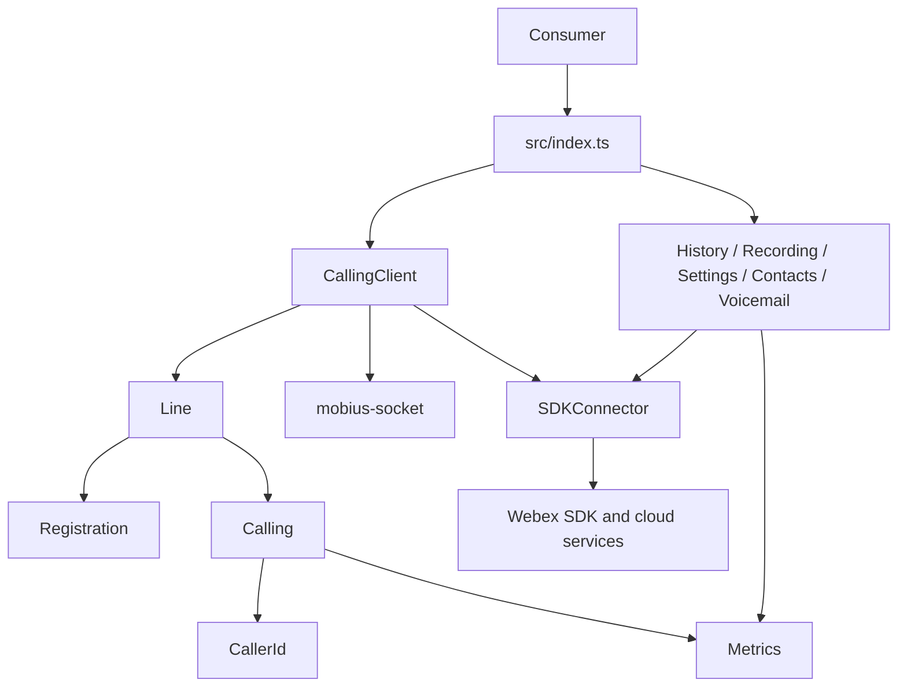
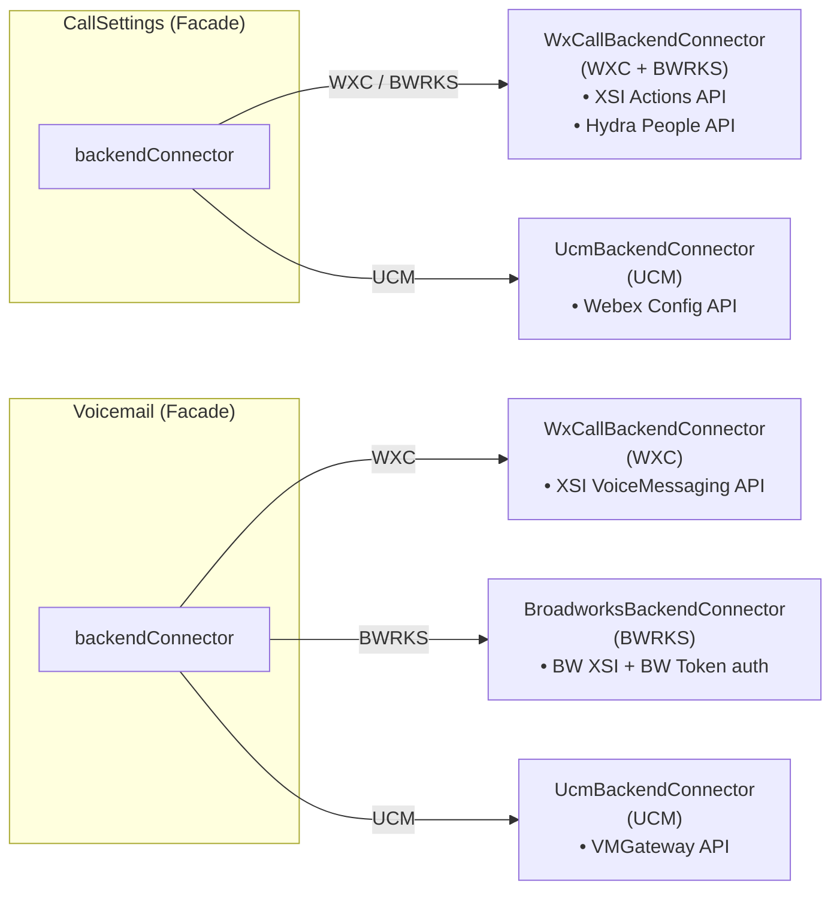
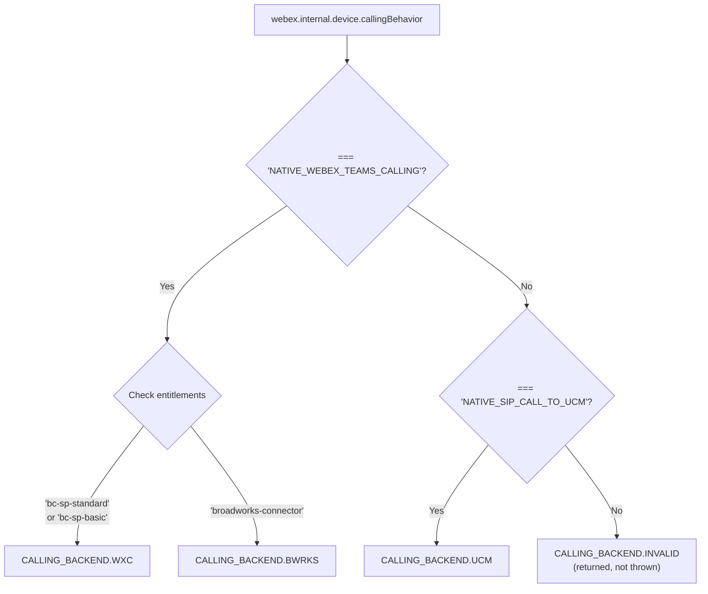
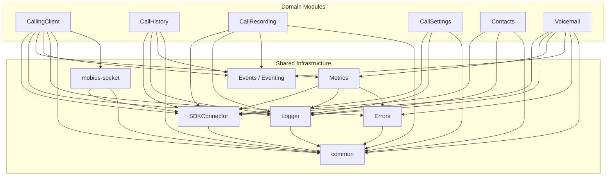
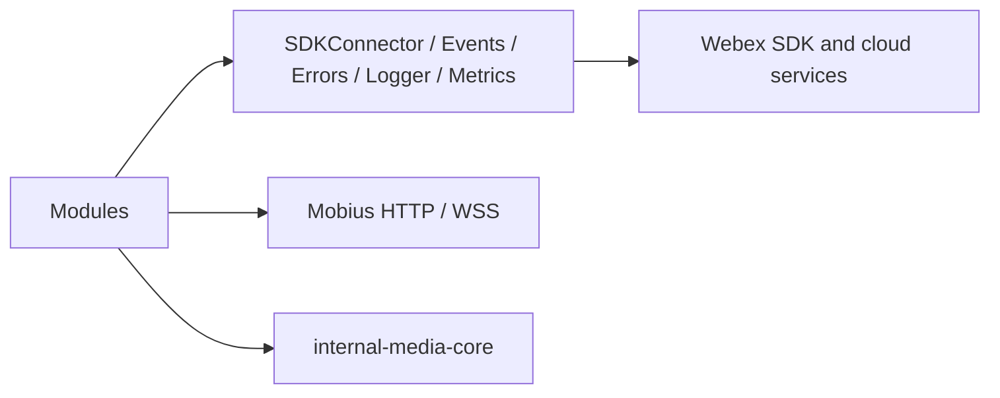
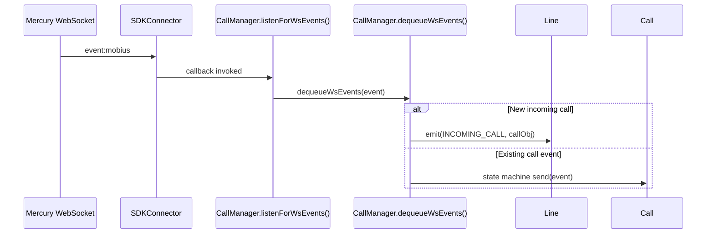
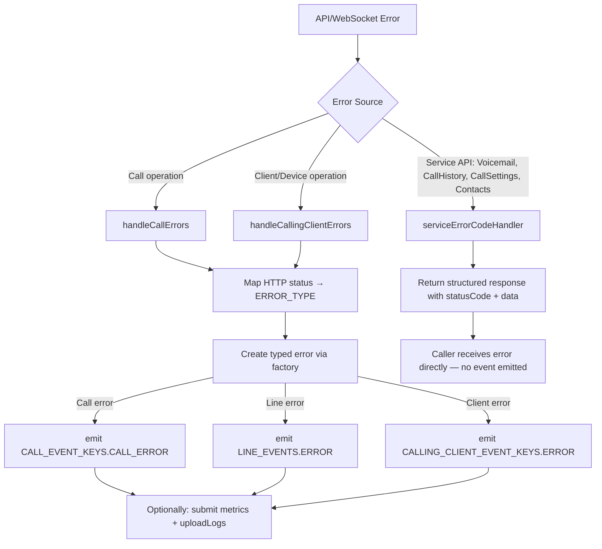
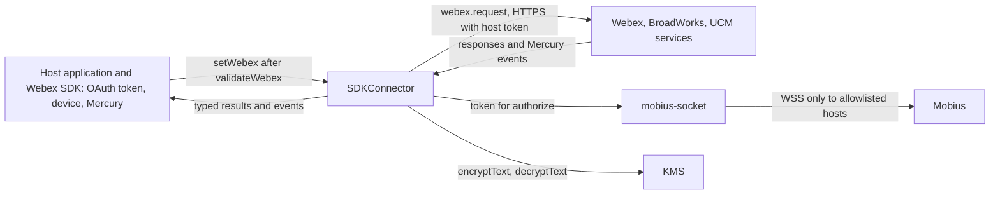

<!-- sdd-generated-metadata
doc_kind: standing-doc
generated_from: architecture@0.3.0
generated_by: claude-code
approved_by: rarajes2@cisco.com
updated_at: 2026-11-17T03:23:21Z
validation_status: pass-with-warnings
-->

# @webex/calling architecture

Canonical architecture for this package. It owns package boundaries, the contract index, the shared
code that has no module spec (`src/common`, `src/Errors`, `src/Events`, `src/Logger`, `src/index.ts`,
`src/api.ts`), and how the package meets Webex and the rest of the workspace. Module behavior lives in
the module specifications listed in the [specification registry](specs/README.md).

Related context: [specification registry](specs/README.md) ·
[package agent instructions](../AGENTS.md) · [documentation index](index.md)

## Applicability

| Condition ID                         | Status     | Evidence or reason | Owned section |
| ------------------------------------ | ---------- | ------------------ | ------------- |
| `repo.owns_datastore`                | N/A        | No database or schema. Calling data lives in Webex services; browser storage holds only the registration failover state and cached voicemail pages (`src/CallingClient/registration/register.ts`, `src/common/Utils.ts`) | Repository data and schema |
| `repo.holds_client_state`            | Applicable | Line registry, registration status, active-call collection, and module caches are held in memory (`src/CallingClient/CallingClient.ts`, `src/CallingClient/calling/callManager.ts`) | Client state model |
| `repo.components_interact`           | Applicable | `src/CallingClient/CallingClient.ts` wires Line, Registration, CallManager, Metrics, and mobius-socket; every module reaches Webex through `src/SDKConnector/index.ts` | Dependency and interaction topology |
| `repo.domain_data_across_components` | Applicable | Registration state is written by `src/CallingClient/registration/register.ts` and read by Line and CallingClient; event payload types in `src/Events/types.ts` are shared by every emitter | Object and data ownership |
| `repo.caches_data`                   | Applicable | Contacts and groups cache, voicemail page cache, and the Mobius async-event dedup map (`src/Contacts/ContactsClient.ts`, `src/common/Utils.ts`, `src/mobius-socket/mobius-socket.ts`) | Caching catalog |
| `repo.observability_convention`      | Applicable | One log line format and level scheme (`src/Logger/index.ts`) and one metric submission path (`src/Metrics/index.ts`) | Observability patterns |
| `repo.deploys_to_infra`              | Applicable | The library deploys nothing itself, but its behavior depends on Webex Calling infrastructure (Mobius clusters, Mercury, Janus, User Hub, KMS) resolved through the host SDK service catalog (`src/CallingClient/CallingClient.ts`) | Runtime and infrastructure |
| `repo.shared_base_libs`              | Applicable | Every module inherits the in-package base code (`src/Events/impl/index.ts`, `src/Errors/catalog/ExtendedError.ts`, `src/Logger/index.ts`) and the workspace Jest base (`jest.config.js`) | Shared and base libraries |
| `repo.is_monorepo`                   | Applicable | The package is one workspace of the webex-js-sdk Yarn monorepo and depends on sibling workspaces through workspace ranges (`package.json`) | Package map and inter-package dependencies |
| `repo.multi_platform`                | Applicable | Browser builds swap the Mobius socket implementation for a shim through the browser field (`package.json`, `src/mobius-socket/socket/socket.shim.ts`) | Platform matrix |
| `repo.published_package`             | Applicable | `package.json` names the package @webex/calling, publishes dist, and defines the deploy:npm script | Release and versioning |
| `repo.embedded_in_host`              | N/A        | The package runs inside a host application's Webex SDK instance but exposes no UI, mount point, or theme (`src/index.ts`) | Host integration and theming |
| `repo.exposes_commands_or_artifacts` | Applicable | `package.json` scripts write dist and typedoc output | Commands and generated artifacts |
| `repo.cross_repo_deps_material`      | Applicable | Behavior depends on Webex Calling, BroadWorks, and UCM services and on sibling workspace packages (`package.json`, `src/common/Utils.ts`) | Cross-repository topology |
| `repo.security_arch_warranted`       | Applicable | The host bearer token reaches Mobius over WSS only for allowlisted hosts, and contact fields are KMS-encrypted (`src/common/constants.ts`, `src/mobius-socket/socket/socket-base.ts`, `src/Contacts/ContactsClient.ts`) | Security architecture |

## Design overview

`@webex/calling` is a modular client library that exposes factory functions for calling, call history,
call recording, call settings, contacts, and voicemail. `CallingClient` coordinates line registration
and call control, while the other feature modules provide focused facades over their corresponding
Webex services and backend-specific connectors.

`@webex/calling` is a browser-based TypeScript SDK for Webex Calling services. It provides a unified API
surface for line registration, real-time call control, call history, call settings, contacts
management, and voicemail — working transparently across three calling backends: **Webex Calling
(WxC)**, **Broadworks (BWRKS)**, and **Unified Communications Manager (UCM)**. Call recording is the
exception: its only connector serves the WXC backend (Interaction and execution flows).

The package is organized as a modular monolith inside `packages/calling/src/`. Each subdirectory owns a
domain concern and exposes its contract through TypeScript interfaces. Shared infrastructure (SDK
bridge, logging, metrics, eventing, errors) is consumed by all domain modules.

The package shares infrastructure for Webex SDK access, logging, metrics, typed events, errors, and
common types and utilities. `CallingClient` delegates registration and active-call behavior to its
Line, Registration, and Calling submodules and uses `mobius-socket` for Mobius request and event
transport.

Detailed interfaces, configuration fields, state machines, wire formats, and module-specific behavior
are documented in the source-local module specifications routed through the
[specification registry](specs/README.md). Public SDK surfaces are indexed in Public and consumer
surfaces below.

Package-wide architecture rules:

- **MUST** use factory functions (`createClient`, `createCallHistoryClient`, etc.) to instantiate top-level clients
- **MUST** use singleton pattern for `SDKConnector`, `CallManager`, and `MetricManager`
- **MUST** extend `Eventing<T>` for any class that emits events
- **MUST** use `SDKConnector` for all Webex SDK interactions (requests, Mercury listeners)
- **MUST** separate backend-specific logic into connector classes (WxCall, UCM, Broadworks)
- **MUST** keep types co-located in `types.ts` within each module
- **MUST** export the consumer-facing API through `src/index.ts`, and add the classes, interfaces, and
  types the API reference needs to `src/api.ts` (used for typeDoc documentation generation)
- **NEVER** instantiate `CallingClient`, `CallManager`, or `SDKConnector` directly — use factories/singletons
- **NEVER** access `webex` SDK directly from call/line classes — go through `SDKConnector`
- **NEVER** create more than one `SDKConnector` instance

Factories. All client module instances are created via factory functions. This is the **only**
supported instantiation path. All top-level clients are created through factory functions that handle
initialization internally, and consumers receive a fully initialized instance; only `createClient` is
async.

**Important**: `createClient` is `async` and calls `init()` internally. Consumers must `await` the result
and should **not** call `init()` separately.

**Important differences from `createClient`**: The other client module factories
(`createCallHistoryClient`, `createCallSettingsClient`, `createContactsClient`,
`createVoicemailClient`) are **synchronous** and take a `LoggerInterface` as their second argument —
not a `CallingClientConfig`. `LoggerInterface` is defined as `{ level: LOGGER }` (where `LOGGER` is the
string enum from `src/Logger/types.ts`). `createCallSettingsClient` additionally accepts an optional
`useProdWebexApis?: boolean` third argument. `createCallRecordingClient` follows the same synchronous
`(webex, logger)` shape. All other client modules (`CallHistory`, `CallSettings`, `Contacts`,
`Voicemail`) accept `{ level: LOGGER }` as their logger configuration, and so does `CallRecording`.

Every factory internally calls `SDKConnector.setWebex(webex)` if not already initialized.

Use a package factory for a consumer-facing client so initialization, backend selection, and logging
setup stay behind the public contract. This is an architectural convention; formatting and import
ordering remain governed by `.eslintrc.js` and Prettier. Direct construction couples consumers to an
implementation class and can bypass factory-owned initialization behavior. The factory convention
appears in:

- `src/CallHistory/CallHistory.ts`
- `src/CallRecording/CallRecording.ts`
- `src/CallSettings/CallSettings.ts`
- `src/Contacts/ContactsClient.ts`
- `src/Voicemail/Voicemail.ts`

Internal objects such as `Call` may use an internal factory with a larger orchestration-specific
signature. Singleton infrastructure follows its documented accessor or frozen-instance pattern instead
of the top-level client factory shape. The internal call factory `createCall` takes the active Mobius
URL, the Webex instance, direction, device ID, line ID, a delete callback, the service indicator, an
optional destination, and an optional ICE gathering configuration (`src/CallingClient/calling/call.ts`).

Singletons. Used for shared infrastructure that must have exactly one instance across the package.

- `SDKConnector`: Frozen singleton that wraps the Webex SDK instance. Set once, used everywhere. It
  provides a centralized way to make HTTP requests (`request()`) and register/unregister Mercury
  WebSocket listeners.
- `CallManager`: Module-level singleton obtained via `getCallManager()`. Manages the collection of
  active calls and dispatches incoming WebSocket events to the appropriate call instance.
  `getCallManager(webex, indicator, iceGatheringConfig?)` creates it on first call only.
- `MetricManager`: Same singleton pattern as CallManager. Collects and submits telemetry/metrics for
  calling operations. `getMetricManager(webex?, indicator?)` creates it on first call only.

Naming. When defining new classes and their interfaces, follow this convention:

| Element | Convention | Example |
|---------|-----------|---------|
| Class name | PascalCase | `CallingClient`, `CallManager`, `SDKConnector` |
| Interface for class | `I` prefix + PascalCase | `ICallingClient`, `ICallManager`, `ISDKConnector` |
| Interface file location | Co-located `types.ts` | `CallingClient/types.ts` |

The interface defines the public contract; the class implements it: for example `CallingClient`
extends `Eventing<CallingClientEventTypes>` and implements `ICallingClient`, which is declared in
`src/CallingClient/types.ts`.

## Resource inventory and responsibilities

All resources are TypeScript modules inside the one published package and are owned by
`@webex/web-sdk` (CODEOWNERS default rule). Each module row links its module specification.

| Component | Responsibility | Docs |
|---|---|---|
| `src/CallHistory/` | createCallHistoryClient(webex, logger) -> ICallHistory | [call-history spec](../src/CallHistory/docs/README.md) |
| `src/CallRecording/` | createCallRecordingClient(webex, logger) -> ICallRecording | [call-recording spec](../src/CallRecording/docs/README.md) |
| `src/CallSettings/` | createCallSettingsClient(webex, logger, useProdWebexApis?) -> ICallSettings | [call-settings spec](../src/CallSettings/docs/README.md) |
| `src/CallingClient/` | createClient(webex, config?) -> Promise of ICallingClient | [calling-client spec](../src/CallingClient/docs/README.md) |
| `src/CallingClient/calling/` | ICall and CallManager call lifecycle operations | [calling spec](../src/CallingClient/calling/docs/README.md) |
| `src/CallingClient/calling/CallerId/` | Caller identity resolution and incremental display-information callbacks | [caller-id spec](../src/CallingClient/calling/CallerId/docs/README.md) |
| `src/CallingClient/line/` | ILine call and registration operations | [line spec](../src/CallingClient/line/docs/README.md) |
| `src/CallingClient/registration/` | Internal registration, deregistration, failover, failback, and keepalive lifecycle | [registration spec](../src/CallingClient/registration/docs/README.md) |
| `src/Contacts/` | createContactsClient(webex, logger) -> IContacts | [contacts spec](../src/Contacts/docs/README.md) |
| `src/Metrics/` | MetricManager singleton and typed calling metric submission methods | [metrics spec](../src/Metrics/docs/README.md) |
| `src/SDKConnector/` | Singleton adapter for Webex SDK request, service, credential, device, and Mercury access | [sdk-connector spec](../src/SDKConnector/docs/README.md) |
| `src/Voicemail/` | createVoicemailClient(webex, logger) -> IVoicemail | [voicemail spec](../src/Voicemail/docs/README.md) |
| `src/mobius-socket/` | MobiusSocket singleton request/response API | [mobius-socket spec](../src/mobius-socket/docs/README.md) |
| `src/index.ts`, `src/api.ts` | Consumer export barrel and API-reference export barrel | Public and consumer surfaces |
| `src/common/`, `src/Errors/`, `src/Events/`, `src/Logger/` | Shared code with no module spec | Shared and base libraries |

Key files, as they stand in the source tree:

```text
src/
├── index.ts                    # Public exports (factory functions, interfaces, types)
├── api.ts                      # API reference exports (adds the concrete classes)
├── CallingClient/              # Orchestrator: registration + call control
│   ├── CallingClient.ts        # Main class, creates Lines, discovers Mobius servers
│   ├── types.ts                # ICallingClient, CallingClientConfig, IceGatheringConfig
│   ├── constants.ts            # Mobius URLs, timeouts, version, REPO_NAME
│   ├── utils/                  # APIRequest transport, WebSocket feature flag, constants
│   ├── calling/                # Call management sub-module
│   │   ├── call.ts             # Call class with XState FSMs
│   │   ├── callManager.ts      # CallManager singleton, Mobius event router
│   │   ├── types.ts            # ICall interface
│   │   └── CallerId/           # Caller ID resolution
│   ├── line/                   # Line management sub-module
│   │   ├── index.ts            # Line class (registration + call bridge)
│   │   └── types.ts            # ILine, LINE_EVENTS
│   └── registration/           # Device registration sub-module
│       ├── register.ts         # Registration class (Mobius device lifecycle)
│       ├── webWorker.ts        # Keepalive Web Worker logic
│       ├── webWorkerStr.ts     # Worker source inlined as a string
│       └── types.ts            # IRegistration
├── CallHistory/                # Call history records (Janus API)
├── CallRecording/              # Converged recordings (User Hub), WXC connector
├── CallSettings/               # Call settings facade + WxCall and UCM connectors
├── Contacts/                   # Contacts and groups with KMS encryption
├── Voicemail/                  # Voicemail facade + WxCall, Broadworks, UCM connectors
├── SDKConnector/               # Webex SDK bridge (frozen singleton), validateWebex()
├── Metrics/                    # MetricManager singleton, METRIC_EVENT, METRIC_TYPE
├── mobius-socket/              # MobiusSocket WebSocket client and socket shim
├── Logger/                     # Log functions and LOGGER, LOGGING_LEVEL, LOG_PREFIX
├── Events/                     # Eventing<T> base class and event type maps
├── Errors/                     # ExtendedError, CallError, LineError, CallingClientError
└── common/                     # Shared types, constants, Utils, callUtils, testUtil
```

## Interaction and execution flows



A consumer creates a typed client, the module resolves backend/service configuration through
SDKConnector, performs HTTP/WebSocket/media work through its owning adapter, then returns a typed
result or emits an event. Failure paths use typed errors, logging, metrics, retries, or backend
fallbacks defined by the owning module.

Network communication. All HTTP traffic flows through the Webex JS SDK's `request()` method on the
instance held by `SDKConnector`. When the `webrtc-calling-over-ws-CALL-219562` flag is on, the
CallingClient request path (`src/CallingClient/utils/request.ts`) sends Mobius calls over the Mobius
WebSocket instead. The SDK handles:

- OAuth token management and refresh
- Service URL catalog resolution (by service name, e.g., `mobius`, `janus`)
- Retry and circuit-breaking

Real-time events arrive through Mercury (Cisco's WebSocket service). Modules register for specific
event scopes:

| Scope | Consumer | Events |
|---|---|---|
| `event:mobius` | CallManager, only while Mobius traffic uses HTTP | Call setup, progress, connect, disconnect, call info |
| `event:janus.user_recent_sessions` | CallHistory, CallingClient | New/updated call history records |
| `event:janus.user_sessions` | CallHistory | Older session event name (`CALL_SESSION_EVENT_LEGACY`), handled like recent sessions |
| `event:janus.user_viewed_sessions` | CallHistory | Missed call read state changes |
| `event:janus.user_sessions_deleted` | CallHistory | Deleted call records |
| `event:convergedRecordings.created`, `.updated`, `.deleted` | CallRecording WXC connector | Recording lifecycle, including AI summary availability as an update |
| `event:ucm.voicemail_download_complete` | Voicemail UCM connector | Voicemail content ready for download |

Backend selection. The `CallSettings` and `Voicemail` modules use the Strategy pattern to handle three
distinct calling backends through a unified interface:



`CallRecording` uses the same facade shape with a single `WxcCallRecordingConnector`; any other backend
makes its constructor throw `Calling backend is not identified, exiting....`.

Different calling backends share the same interface but have platform-specific implementations. The
appropriate connector is selected based on `CALLING_BACKEND`; `ServiceIndicator` selects the Mobius
service type (calling, contact center, guest calling), not the connector. Connector availability varies
by module:

| Module | WxCallBackendConnector | UcmBackendConnector | BroadworksBackendConnector |
|--------|----------------------|--------------------|--------------------------:|
| CallSettings | Yes | Yes | No |
| Voicemail | Yes | Yes | Yes |
| CallRecording | Yes (`WxcCallRecordingConnector`) | No | No |

Certain client modules (`CallSettings`, `Voicemail`, `CallRecording`) need to determine the user's
calling backend at instantiation time so they can select the appropriate backend connector (Strategy
pattern). `CallHistory` also detects it, to enrich UCM sessions with line data. `CallingClient` does not
detect the backend.

Backend detection is performed by the `getCallingBackEnd(webex)` function in `common/Utils.ts`. It uses a
two-level branching approach: `getCallingBackEnd` passes `webex.internal.device` to the exported
`resolveCallingBackend(device)`, which does the branching.

1. **First level**: Check `webex.internal.device.callingBehavior`
2. **Second level**: If the behavior is `NATIVE_WEBEX_TEAMS_CALLING`, check user entitlements to distinguish WXC from BWRKS

The detection uses a two-level branching: first on `callingBehavior`, then on entitlements:



| Backend | callingBehavior | Entitlement | Enum |
|---|---|---|---|
| Webex Calling | `NATIVE_WEBEX_TEAMS_CALLING` | `bc-sp-standard` or `bc-sp-basic` | `CALLING_BACKEND.WXC` |
| Broadworks | `NATIVE_WEBEX_TEAMS_CALLING` | `broadworks-connector` | `CALLING_BACKEND.BWRKS` |
| UCM | `NATIVE_SIP_CALL_TO_UCM` | (not checked) | `CALLING_BACKEND.UCM` |

A native-calling device with neither entitlement also resolves to `CALLING_BACKEND.INVALID`. The enum
values are `WEBEX_CALLING`, `BROADWORKS_CALLING`, `UCM_CALLING`, and the message string used for
`INVALID` (`src/common/types.ts`).

The `CallSettings` and `Voicemail` modules use the detected backend to select the appropriate backend
connector class at construction time. The `CallingClient` module always communicates with the Mobius
service regardless of backend.

## Dependency topology

| Dependency | Type | Used by | Purpose | Version, failure, or fallback policy |
| ---------- | ---- | ------- | ------- | ------------------------------------ |
| `@webex/internal-media-core` | External | Call | WebRTC media connection and ROAP engine | Exact pin `2.32.1` in `package.json`; Jest transforms it from source |
| `@webex/media-helpers` | Internal (workspace) | Call, package exports | Microphone stream and noise reduction effect | `workspace:*`; re-exported from `src/index.ts` |
| `@webex/internal-plugin-metrics` | Internal (workspace) | Metrics (through `webex.internal.metrics`), Call, mobius-socket | Metric transport behind `webex.internal.metrics` | `workspace:*`; Jest maps it to `test/mocks/internal-plugin-metrics-stub.js` |
| `@webex/internal-plugin-device`, `@webex/internal-plugin-feature` | Internal (workspace) | mobius-socket; every module reads the device through SDKConnector | WDM device, entitlements, and feature toggles | `workspace:*` |
| `@webex/common`, `@webex/common-timers` | Internal (workspace) | mobius-socket | Webex utilities and timers | `workspace:*` |
| `xstate` | External | Call | Call and media state machines | Exact pin `4.30.6` |
| `async-mutex` | External | CallingClient, Line, Registration | Shared registration mutex | Exact pin `0.4.0` |
| `ws` | External | mobius-socket (Node builds) | WebSocket transport; the browser build uses the socket shim | Exact pin `8.17.1` |
| `backoff`, `lodash`, `uuid`, `buffer`, `platform`, `@types/platform` | External | mobius-socket (`backoff`, `lodash`), Call, Line, and the request path (`uuid`), Call and mobius-socket (`buffer`), shared code (`platform`) | Reconnect backoff, utilities, IDs, binary payloads, platform detection | Exact pins except `lodash` (`^4.17.21`) |
| `typed-emitter` | External (development) | `src/Events/impl/index.ts` | Compile-time event typing only | Exact pin `2.1.0` under `devDependencies`; no runtime code |

No module imports a sibling package's source; all workspace packages resolve through `workspace:*`.
Shared code and `CallingClient` import each other: `src/Logger/index.ts` and `src/Metrics/index.ts`
read `src/CallingClient/constants.ts`, and `src/Events/types.ts` imports line, call, and constant
types from `src/CallingClient`, so the shared layer and `CallingClient` form an import cycle that
TypeScript resolves because the shared imports are constants and types.

Every module-level requirement below is keyed by the catalog contract it consumes (Public and consumer
surfaces).

| Dependency | What is consumed | Detail link | Availability assumption | Fallback on failure | Version floor |
|---|---|---|---|---|---|
| Webex request client and Janus call-history APIs | Consumed by `src/CallHistory/` through `janus-http` | [call-history spec](../src/CallHistory/docs/README.md) | Remote/service availability or package compatibility | Owning module retry/fallback/error behavior | `package.json` or Webex service contract |
| Mercury real-time events | Consumed by `src/CallHistory/` through `mercury-events` | [call-history spec](../src/CallHistory/docs/README.md) | Remote/service availability or package compatibility | Owning module retry/fallback/error behavior | `package.json` or Webex service contract |
| UCM Lines API for line enrichment | Consumed by `src/CallHistory/` through `ucm-gateway-http` | [call-history spec](../src/CallHistory/docs/README.md) | Remote/service availability or package compatibility | Owning module retry/fallback/error behavior | `package.json` or Webex service contract |
| Webex User Hub converged recording endpoints | Consumed by `src/CallRecording/` through `userhub-recordings-http` | [call-recording spec](../src/CallRecording/docs/README.md) | Remote/service availability or package compatibility | Owning module retry/fallback/error behavior | `package.json` or Webex service contract |
| Mercury recording lifecycle events | Consumed by `src/CallRecording/` through `mercury-events` | [call-recording spec](../src/CallRecording/docs/README.md) | Remote/service availability or package compatibility | Owning module retry/fallback/error behavior | `package.json` or Webex service contract |
| Calling-backend resolution | Consumed by `src/CallRecording/` through shared `src/common/Utils.ts` | [call-recording spec](../src/CallRecording/docs/README.md) | Remote/service availability or package compatibility | Owning module retry/fallback/error behavior | `package.json` or Webex service contract |
| Webex Calling XSI/Hydra services | Consumed by `src/CallSettings/` through `hydra-http` | [call-settings spec](../src/CallSettings/docs/README.md) | Remote/service availability or package compatibility | Owning module retry/fallback/error behavior | `package.json` or Webex service contract |
| Webex UC config API for UCM call forward always (not the UCM management gateway) | Consumed by `src/CallSettings/` through `webex-uc-config-http` | [call-settings spec](../src/CallSettings/docs/README.md) | Remote/service availability or package compatibility | Owning module retry/fallback/error behavior | `package.json` or Webex service contract |
| Calling-backend resolution | Consumed by `src/CallSettings/` through shared `src/common/Utils.ts` | [call-settings spec](../src/CallSettings/docs/README.md) | Remote/service availability or package compatibility | Owning module retry/fallback/error behavior | `package.json` or Webex service contract |
| SDKConnector and Webex device/feature/service plugins | Consumed by `src/CallingClient/` through `sdk-connector-internal`, `webex-sdk-host` | [calling-client spec](../src/CallingClient/docs/README.md) | Remote/service availability or package compatibility | Owning module retry/fallback/error behavior | `package.json` or Webex service contract |
| Calling, Line, Registration, Metrics, and mobius-socket modules | Consumed by `src/CallingClient/` through `line-sdk`, `registration-internal`, `metrics-internal`, `mobius-socket-internal` | [calling-client spec](../src/CallingClient/docs/README.md) | Remote/service availability or package compatibility | Owning module retry/fallback/error behavior | `package.json` or Webex service contract |
| WebRTC media helpers | Consumed by `src/CallingClient/` through `media-helpers` | [calling-client spec](../src/CallingClient/docs/README.md) | Remote/service availability or package compatibility | Owning module retry/fallback/error behavior | `package.json` or Webex service contract |
| Mobius signaling through APIRequest | Consumed by `src/CallingClient/calling/` through `mobius-http` | [calling spec](../src/CallingClient/calling/docs/README.md) | Remote/service availability or package compatibility | Owning module retry/fallback/error behavior | `package.json` or Webex service contract |
| @webex/internal-media-core ROAP/media engine | Consumed by `src/CallingClient/calling/` through `internal-media-core` | [calling spec](../src/CallingClient/calling/docs/README.md) | Remote/service availability or package compatibility | Owning module retry/fallback/error behavior | `package.json` or Webex service contract |
| CallerId, Metrics, Logger, and SDKConnector | Consumed by `src/CallingClient/calling/` through `caller-id-internal`, `metrics-internal`, `sdk-connector-internal` | [calling spec](../src/CallingClient/calling/docs/README.md) | Remote/service availability or package compatibility | Owning module retry/fallback/error behavior | `package.json` or Webex service contract |
| Mobius SIP-style identity headers | Consumed by `src/CallingClient/calling/CallerId/` through Mobius call payloads passed in by `Call` | [caller-id spec](../src/CallingClient/calling/CallerId/docs/README.md) | Remote/service availability or package compatibility | Owning module retry/fallback/error behavior | `package.json` or Webex service contract |
| SCIM people lookup through the Webex SDK | Consumed by `src/CallingClient/calling/CallerId/` through `contacts-service-http` | [caller-id spec](../src/CallingClient/calling/CallerId/docs/README.md) | Remote/service availability or package compatibility | Owning module retry/fallback/error behavior | `package.json` or Webex service contract |
| Registration and Calling submodules | Consumed by `src/CallingClient/line/` through `registration-internal`, `call-sdk` | [line spec](../src/CallingClient/line/docs/README.md) | Remote/service availability or package compatibility | Owning module retry/fallback/error behavior | `package.json` or Webex service contract |
| SDKConnector event bridge | Consumed by `src/CallingClient/line/` through `sdk-connector-internal` | [line spec](../src/CallingClient/line/docs/README.md) | Remote/service availability or package compatibility | Owning module retry/fallback/error behavior | `package.json` or Webex service contract |
| Mobius registration APIs through APIRequest | Consumed by `src/CallingClient/registration/` through `mobius-http` | [registration spec](../src/CallingClient/registration/docs/README.md) | Remote/service availability or package compatibility | Owning module retry/fallback/error behavior | `package.json` or Webex service contract |
| Web Worker keepalive timer | Consumed by `src/CallingClient/registration/` through browser `Worker` | [registration spec](../src/CallingClient/registration/docs/README.md) | Remote/service availability or package compatibility | Owning module retry/fallback/error behavior | `package.json` or Webex service contract |
| Browser localStorage and metrics | Consumed by `src/CallingClient/registration/` through `metrics-internal` | [registration spec](../src/CallingClient/registration/docs/README.md) | Remote/service availability or package compatibility | Owning module retry/fallback/error behavior | `package.json` or Webex service contract |
| Webex contacts service | Consumed by `src/Contacts/` through `contacts-service-http` | [contacts spec](../src/Contacts/docs/README.md) | Remote/service availability or package compatibility | Owning module retry/fallback/error behavior | `package.json` or Webex service contract |
| Webex KMS encryption | Consumed by `src/Contacts/` through `kms-encryption` | [contacts spec](../src/Contacts/docs/README.md) | Remote/service availability or package compatibility | Owning module retry/fallback/error behavior | `package.json` or Webex service contract |
| SCIM people lookup | Consumed by `src/Contacts/` through `contacts-service-http` | [contacts spec](../src/Contacts/docs/README.md) | Remote/service availability or package compatibility | Owning module retry/fallback/error behavior | `package.json` or Webex service contract |
| @webex/internal-plugin-metrics through Webex SDK | Consumed by `src/Metrics/` through `webex-metrics-plugin` | [metrics spec](../src/Metrics/docs/README.md) | Remote/service availability or package compatibility | Owning module retry/fallback/error behavior | `package.json` or Webex service contract |
| Calling error/event types | Consumed by `src/Metrics/` through shared `src/Errors/` and `src/Events/` | [metrics spec](../src/Metrics/docs/README.md) | Remote/service availability or package compatibility | Owning module retry/fallback/error behavior | `package.json` or Webex service contract |
| Initialized and authorized WebexSDK instance with Mercury | Consumed by `src/SDKConnector/` through `webex-sdk-host`, `mercury-events` | [sdk-connector spec](../src/SDKConnector/docs/README.md) | Remote/service availability or package compatibility | Owning module retry/fallback/error behavior | `package.json` or Webex service contract |
| Webex Calling, BroadWorks, and UCM voicemail services | Consumed by `src/Voicemail/` through `hydra-http`, `broadworks-http`, `ucm-gateway-http` | [voicemail spec](../src/Voicemail/docs/README.md) | Remote/service availability or package compatibility | Owning module retry/fallback/error behavior | `package.json` or Webex service contract |
| Contacts resolution and Metrics | Consumed by `src/Voicemail/` through `metrics-internal`, SCIM through `src/common/Utils.ts` | [voicemail spec](../src/Voicemail/docs/README.md) | Remote/service availability or package compatibility | Owning module retry/fallback/error behavior | `package.json` or Webex service contract |
| WebSocket implementation | Consumed by `src/mobius-socket/` through `mobius-websocket` | [mobius-socket spec](../src/mobius-socket/docs/README.md) | Remote/service availability or package compatibility | Owning module retry/fallback/error behavior | `package.json` or Webex service contract |
| Webex credentials, device feature settings, and Mobius discovery | Consumed by `src/mobius-socket/` through `sdk-connector-internal` | [mobius-socket spec](../src/mobius-socket/docs/README.md) | Remote/service availability or package compatibility | Owning module retry/fallback/error behavior | `package.json` or Webex service contract |

## Public and consumer surfaces

This section is the contract index (`layout.contract_index_path`). Every catalog contract is listed with
its publication state, owner, and source; exact definitions stay in the native declarations.

| Surface | Type | Owner | Consumers | Compatibility policy | Source |
| ------- | ---- | ----- | --------- | -------------------- | ------ |
| `calling-client-sdk` (published) | SDK | [CallingClient](../src/CallingClient/docs/README.md) | Host applications | Semver; see Release and versioning | `package.json`, declarations in `src/CallingClient/types.ts` |
| `line-sdk` (published) | SDK | [line](../src/CallingClient/line/docs/README.md) | Host applications, CallingClient | Semver | `package.json`, declarations in `src/CallingClient/line/types.ts` |
| `call-sdk` (published) | SDK | [calling](../src/CallingClient/calling/docs/README.md) | Host applications, Line | Semver | `package.json`, declarations in `src/CallingClient/calling/types.ts` |
| `call-history-sdk` (published) | SDK | [CallHistory](../src/CallHistory/docs/README.md) | Host applications | Semver | `package.json`, declarations in `src/CallHistory/types.ts` |
| `call-recording-sdk` (published) | SDK | [CallRecording](../src/CallRecording/docs/README.md) | Host applications | Semver | `package.json`, declarations in `src/CallRecording/types.ts` |
| `call-settings-sdk` (published) | SDK | [CallSettings](../src/CallSettings/docs/README.md) | Host applications | Semver | `package.json`, declarations in `src/CallSettings/types.ts` |
| `contacts-sdk` (published) | SDK | [Contacts](../src/Contacts/docs/README.md) | Host applications | Semver | `package.json`, declarations in `src/Contacts/types.ts` |
| `voicemail-sdk` (published) | SDK | [Voicemail](../src/Voicemail/docs/README.md) | Host applications | Semver | `package.json`, declarations in `src/Voicemail/types.ts` |
| `sdk-connector-sdk` (published) | SDK | [SDKConnector](../src/SDKConnector/docs/README.md) | Host applications (type `WDMDevice`) | Semver | `package.json`, declarations in `src/SDKConnector/types.ts` |
| `registration-internal` (internal) | SDK | [registration](../src/CallingClient/registration/docs/README.md) | Line, CallingClient | Internal; not exported | `src/CallingClient/registration/types.ts` |
| `caller-id-internal` (internal) | SDK | [caller-id](../src/CallingClient/calling/CallerId/docs/README.md) | Call | Internal; only `CallerIdDisplay` is exported | `src/CallingClient/calling/CallerId/types.ts` |
| `metrics-internal` (internal) | SDK | [Metrics](../src/Metrics/docs/README.md) | CallingClient, Registration, Call, Voicemail, shared code | Internal; metric names are operationally sensitive | `src/Metrics/types.ts` |
| `sdk-connector-internal` (internal) | SDK | [SDKConnector](../src/SDKConnector/docs/README.md) | Every module | Internal; coordinate package-wide changes | `src/SDKConnector/types.ts` |
| `mobius-socket-internal` (internal) | SDK | [mobius-socket](../src/mobius-socket/docs/README.md) | CallingClient request path | Internal; disconnect event types are exported | `src/mobius-socket/types.ts` |
| `webex-sdk-host` (required) | SDK | Host application and Webex JS SDK | Every module through SDKConnector | External; validated by `validateWebex` | Host WebexSDK instance |
| `mobius-http` (required) | API | Webex Calling | CallingClient, Registration, Call | External | Mobius REST, services catalog key mobius |
| `mobius-websocket` (required) | RPC | Webex Calling | mobius-socket | External; allowlisted hosts only | Mobius WebSocket endpoint |
| `mercury-events` (required) | Event | Webex platform | CallManager, CallHistory, CallingClient, CallRecording, Voicemail, SDKConnector | External | webex.internal.mercury |
| `janus-http` (required) | API | Webex | CallHistory | External | Janus, services catalog key janus |
| `userhub-recordings-http` (required) | API | Webex | CallRecording | External | User Hub, service name webex-user-hub-service |
| `hydra-http` (required) | API | Webex | CallSettings, Voicemail | External | Hydra, services catalog key hydra |
| `broadworks-http` (required) | API | Cisco BroadWorks | Voicemail | External | BroadWorks XSI URL from WDM device settings |
| `ucm-gateway-http` (required) | API | Cisco UCM | CallHistory, Voicemail | External | Services catalog key ucmgmt-gateway |
| `webex-uc-config-http` (required) | API | Webex | CallSettings | External; production, integration, and FedRAMP `/v1/uc/config` hosts | Webex UC config API; base URLs in `src/common/constants.ts` |
| `contacts-service-http` (required) | API | Webex | Contacts, CallerId | External | Services catalog key contactsService and SCIM |
| `kms-encryption` (required) | SDK | Webex platform | Contacts | External | webex.internal.encryption |
| `webex-metrics-plugin` (required) | SDK | internal-plugin-metrics package | Metrics | Workspace version | `package.json` |
| `internal-media-core` (required) | SDK | Webex media team | Call | Exact pin | `package.json` |
| `media-helpers` (required) | SDK | media-helpers package | Call, package exports | Workspace version | `package.json` |

Exact language-native API names/types remain authoritative in `src/index.ts`, `src/api.ts`, and
`src/Events/types.ts`.

- Package exports: `src/index.ts`; TypeDoc exports: `src/api.ts`; event payloads: `src/Events/types.ts`.
- Operation behavior, errors, backend support, and sequencing live in each owning module specification.

The package has two export files:

- `src/index.ts`: This is the primary entry point for external consumers. Factory functions for
  creating client module instances: `createClient`, `createCallHistoryClient`,
  `createCallSettingsClient`, `createContactsClient`, `createVoicemailClient`,
  `createCallRecordingClient`, and the `Logger` singleton. Media-related re-exports from
  `@webex/media-helpers`: `createMicrophoneStream`, `NoiseReductionEffect`, and
  `LocalMicrophoneStream`. Key interfaces and types re-exported are listed in the table below.
- `src/api.ts`: `api.ts` is used for API reference documentation generation. It re-exports concrete
  classes (`CallingClient`, `CallHistory`, `CallSettings`, `ContactsClient`, `Voicemail`,
  `CallRecording`) in addition to interfaces and factory functions. It is **not** an entry point for
  external consumers — use `index.ts` for all consumer-facing imports.

The rows below are generated from the actual `src/index.ts` export list. Internal package collaborators
are cataloged separately and are not semver promises to package consumers. Symbol rows belong to the
catalog contract of their owner: `CallingClient` rows to `calling-client-sdk`, `ILine` and `LINE_EVENTS`
to `line-sdk`, `ICall` and `TransferType` to `call-sdk`, and each feature module to its `*-sdk`
contract. Rows owned by `Logger`, `Errors`, `Events`, `common`, and `@webex/media-helpers` are package
exports of shared code that no module contract names.

| Contract ID | Owner module/package | Symbol | Signature / kind | Purpose | Stability / deprecation | Native definition | Exported at |
|---|---|---|---|---|---|---|---|
| export.createclient | `CallingClient` | `createClient` | `createClient(webex, config?): Promise<ICallingClient>` | Top-level calling-client factory. | Semver-controlled | `src/CallingClient/CallingClient.ts` | `src/index.ts` |
| export.createcallhistoryclient | `CallHistory` | `createCallHistoryClient` | `createCallHistoryClient(webex, logger): ICallHistory` | Call-history client factory. | Semver-controlled | `src/CallHistory/CallHistory.ts` | `src/index.ts` |
| export.createcallsettingsclient | `CallSettings` | `createCallSettingsClient` | `createCallSettingsClient(webex, logger, useProdWebexApis?): ICallSettings` | Call-settings client factory. | Semver-controlled | `src/CallSettings/CallSettings.ts` | `src/index.ts` |
| export.createcontactsclient | `Contacts` | `createContactsClient` | `createContactsClient(webex, logger): IContacts` | Contacts client factory. | Semver-controlled | `src/Contacts/ContactsClient.ts` | `src/index.ts` |
| export.createmicrophonestream | `@webex/media-helpers` | `createMicrophoneStream` | media-helper factory | Public microphone/media helper surface re-exported by the package. | Semver-controlled | external `@webex/media-helpers` | `src/index.ts` |
| export.createvoicemailclient | `Voicemail` | `createVoicemailClient` | `createVoicemailClient(webex, logger): IVoicemail` | Voicemail client factory. | Semver-controlled | `src/Voicemail/Voicemail.ts` | `src/index.ts` |
| export.createcallrecordingclient | `CallRecording` | `createCallRecordingClient` | `createCallRecordingClient(webex, logger): ICallRecording` | Call-recording client factory. | Semver-controlled | `src/CallRecording/CallRecording.ts` | `src/index.ts` |
| export.logger | `Logger` | `Logger` | language-native export | Public package type/value `Logger`. | Semver-controlled | `src/Logger/index.ts` | `src/index.ts` |
| export.noisereductioneffect | `@webex/media-helpers` | `NoiseReductionEffect` | language-native export | Public microphone/media helper surface re-exported by the package. | Semver-controlled | external `@webex/media-helpers` | `src/index.ts` |
| export.error-layer | `Errors` | `ERROR_LAYER` | language-native export | Public typed error contract `ERROR_LAYER`. | Semver-controlled | `src/Errors/types.ts` | `src/index.ts` |
| export.error-type | `Errors` | `ERROR_TYPE` | language-native export | Public typed error contract `ERROR_TYPE`. | Semver-controlled | `src/Errors/types.ts` | `src/index.ts` |
| export.icallingclient | `CallingClient` | `ICallingClient` | language-native export | Public TypeScript interface `ICallingClient`. | Semver-controlled | `src/CallingClient/types.ts` | `src/index.ts` |
| export.icallhistory | `CallHistory` | `ICallHistory` | language-native export | Public TypeScript interface `ICallHistory`. | Semver-controlled | `src/CallHistory/types.ts` | `src/index.ts` |
| export.janusresponseevent | `CallHistory` | `JanusResponseEvent` | language-native export | Public event key or payload contract `JanusResponseEvent`. | Semver-controlled | `src/CallHistory/types.ts` | `src/index.ts` |
| export.icallrecording | `CallRecording` | `ICallRecording` | language-native export | Public TypeScript interface `ICallRecording`. | Semver-controlled | `src/CallRecording/types.ts` | `src/index.ts` |
| export.recording | `CallRecording` | `Recording` | language-native export | Public call-recording contract `Recording`. | Semver-controlled | `src/CallRecording/types.ts` | `src/index.ts` |
| export.recordinglistresponse | `CallRecording` | `RecordingListResponse` | language-native export | Public call-recording contract `RecordingListResponse`. | Semver-controlled | `src/CallRecording/types.ts` | `src/index.ts` |
| export.recordingmetadata | `CallRecording` | `RecordingMetadata` | language-native export | Public call-recording contract `RecordingMetadata`. | Semver-controlled | `src/CallRecording/types.ts` | `src/index.ts` |
| export.recordingmetadataresponse | `CallRecording` | `RecordingMetadataResponse` | language-native export | Public call-recording contract `RecordingMetadataResponse`. | Semver-controlled | `src/CallRecording/types.ts` | `src/index.ts` |
| export.recordingresponse | `CallRecording` | `RecordingResponse` | language-native export | Public call-recording contract `RecordingResponse`. | Semver-controlled | `src/CallRecording/types.ts` | `src/index.ts` |
| export.recordingstatus | `CallRecording` | `RecordingStatus` | language-native export | Public call-recording contract `RecordingStatus`. | Semver-controlled | `src/CallRecording/types.ts` | `src/index.ts` |
| export.recordingdeleteresponse | `CallRecording` | `RecordingDeleteResponse` | language-native export | Public call-recording contract `RecordingDeleteResponse`. | Semver-controlled | `src/CallRecording/types.ts` | `src/index.ts` |
| export.deleterecordingoptions | `CallRecording` | `DeleteRecordingOptions` | language-native export | Public call-recording contract `DeleteRecordingOptions`. | Semver-controlled | `src/CallRecording/types.ts` | `src/index.ts` |
| export.getrecordingsoptions | `CallRecording` | `GetRecordingsOptions` | language-native export | Public call-recording contract `GetRecordingsOptions`. | Semver-controlled | `src/CallRecording/types.ts` | `src/index.ts` |
| export.recordingrequesttype | `CallRecording` | `RecordingRequestType` | language-native export | Public call-recording contract `RecordingRequestType`. | Semver-controlled | `src/CallRecording/types.ts` | `src/index.ts` |
| export.getcallrecordingrequest | `CallRecording` | `GetCallRecordingRequest` | language-native export | Public call-recording contract `GetCallRecordingRequest`. | Semver-controlled | `src/CallRecording/types.ts` | `src/index.ts` |
| export.recordingresponsefor | `CallRecording` | `RecordingResponseFor` | language-native export | Public call-recording contract `RecordingResponseFor`. | Semver-controlled | `src/CallRecording/types.ts` | `src/index.ts` |
| export.getremoteparty | `CallRecording` | `getRemoteParty` | recording-party utility | Resolve a recording party into its normalized remote-party representation. | Semver-controlled | `src/CallRecording/utils.ts` | `src/index.ts` |
| export.callforwardsetting | `CallSettings` | `CallForwardSetting` | language-native export | Public package type/value `CallForwardSetting`. | Semver-controlled | `src/CallSettings/types.ts` | `src/index.ts` |
| export.callforwardalwayssetting | `CallSettings` | `CallForwardAlwaysSetting` | language-native export | Public package type/value `CallForwardAlwaysSetting`. | Semver-controlled | `src/CallSettings/types.ts` | `src/index.ts` |
| export.callsettingresponse | `CallSettings` | `CallSettingResponse` | language-native export | Public package type/value `CallSettingResponse`. | Semver-controlled | `src/CallSettings/types.ts` | `src/index.ts` |
| export.icallsettings | `CallSettings` | `ICallSettings` | language-native export | Public TypeScript interface `ICallSettings`. | Semver-controlled | `src/CallSettings/types.ts` | `src/index.ts` |
| export.togglesetting | `CallSettings` | `ToggleSetting` | language-native export | Public package type/value `ToggleSetting`. | Semver-controlled | `src/CallSettings/types.ts` | `src/index.ts` |
| export.voicemailsetting | `CallSettings` | `VoicemailSetting` | language-native export | Public package type/value `VoicemailSetting`. | Semver-controlled | `src/CallSettings/types.ts` | `src/index.ts` |
| export.contact | `Contacts` | `Contact` | language-native export | Public package type/value `Contact`. | Semver-controlled | `src/Contacts/types.ts` | `src/index.ts` |
| export.contactresponse | `Contacts` | `ContactResponse` | language-native export | Public package type/value `ContactResponse`. | Semver-controlled | `src/Contacts/types.ts` | `src/index.ts` |
| export.grouptype | `Contacts` | `GroupType` | language-native export | Public package type/value `GroupType`. | Semver-controlled | `src/Contacts/types.ts` | `src/index.ts` |
| export.icontacts | `Contacts` | `IContacts` | language-native export | Public TypeScript interface `IContacts`. | Semver-controlled | `src/Contacts/types.ts` | `src/index.ts` |
| export.ivoicemail | `Voicemail` | `IVoicemail` | language-native export | Public TypeScript interface `IVoicemail`. | Semver-controlled | `src/Voicemail/types.ts` | `src/index.ts` |
| export.summaryinfo | `Voicemail` | `SummaryInfo` | language-native export | Public package type/value `SummaryInfo`. | Semver-controlled | `src/Voicemail/types.ts` | `src/index.ts` |
| export.voicemailresponseevent | `Voicemail` | `VoicemailResponseEvent` | language-native export | Public event key or payload contract `VoicemailResponseEvent`. | Semver-controlled | `src/Voicemail/types.ts` | `src/index.ts` |
| export.iline | `CallingClient` | `ILine` | language-native export | Public TypeScript interface `ILine`. | Semver-controlled | `src/CallingClient/line/types.ts` | `src/index.ts` |
| export.line-events | `CallingClient` | `LINE_EVENTS` | language-native export | Public event key or payload contract `LINE_EVENTS`. | Semver-controlled | `src/CallingClient/line/types.ts` | `src/index.ts` |
| export.calling-client-event-keys | `Events` | `CALLING_CLIENT_EVENT_KEYS` | language-native export | Public event key or payload contract `CALLING_CLIENT_EVENT_KEYS`. | Semver-controlled | `src/Events/types.ts` | `src/index.ts` |
| export.call-event-keys | `Events` | `CALL_EVENT_KEYS` | language-native export | Public event key or payload contract `CALL_EVENT_KEYS`. | Semver-controlled | `src/Events/types.ts` | `src/index.ts` |
| export.calleriddisplay | `Events` | `CallerIdDisplay` | language-native export | Public package type/value `CallerIdDisplay`. | Semver-controlled | `src/Events/types.ts` | `src/index.ts` |
| export.disposition | `Events` | `Disposition` | language-native export | Public package type/value `Disposition`. | Semver-controlled | `src/Events/types.ts` | `src/index.ts` |
| export.line-event-keys | `Events` | `LINE_EVENT_KEYS` | language-native export | Public event key or payload contract `LINE_EVENT_KEYS`. | Semver-controlled | `src/Events/types.ts` | `src/index.ts` |
| export.common-event-keys | `Events` | `COMMON_EVENT_KEYS` | language-native export | Public event key or payload contract `COMMON_EVENT_KEYS`. | Semver-controlled | `src/Events/types.ts` | `src/index.ts` |
| export.mobius-socket-disconnect-reason | `Events` | `MOBIUS_SOCKET_DISCONNECT_REASON` | language-native export | Public package type/value `MOBIUS_SOCKET_DISCONNECT_REASON`. | Semver-controlled | `src/Events/types.ts` | `src/index.ts` |
| export.mobiussocketdisconnectedevent | `Events` | `MobiusSocketDisconnectedEvent` | language-native export | Public event key or payload contract `MobiusSocketDisconnectedEvent`. | Semver-controlled | `src/Events/types.ts` | `src/index.ts` |
| export.usersession | `Events` | `UserSession` | language-native export | Public package type/value `UserSession`. | Semver-controlled | `src/Events/types.ts` | `src/index.ts` |
| export.calldetails | `common` | `CallDetails` | language-native export | Public package type/value `CallDetails`. | Semver-controlled | `src/common/types.ts` | `src/index.ts` |
| export.calldirection | `common` | `CallDirection` | language-native export | Public package type/value `CallDirection`. | Semver-controlled | `src/common/types.ts` | `src/index.ts` |
| export.calltype | `common` | `CallType` | language-native export | Public package type/value `CallType`. | Semver-controlled | `src/common/types.ts` | `src/index.ts` |
| export.calling-backend | `common` | `CALLING_BACKEND` | language-native export | Public package type/value `CALLING_BACKEND`. | Semver-controlled | `src/common/types.ts` | `src/index.ts` |
| export.displayinformation | `common` | `DisplayInformation` | language-native export | Public package type/value `DisplayInformation`. | Semver-controlled | `src/common/types.ts` | `src/index.ts` |
| export.sort | `common` | `SORT` | language-native export | Public package type/value `SORT`. | Semver-controlled | `src/common/types.ts` | `src/index.ts` |
| export.sort-by | `common` | `SORT_BY` | language-native export | Public package type/value `SORT_BY`. | Semver-controlled | `src/common/types.ts` | `src/index.ts` |
| export.resolvecallingbackend | `common` | `resolveCallingBackend` | backend-resolution function | Resolve the active calling backend from SDK/device context. | Semver-controlled | `src/common/Utils.ts` | `src/index.ts` |
| export.wdmdevice | `SDKConnector` | `WDMDevice` | language-native export | Public package type/value `WDMDevice`. | Semver-controlled | `src/SDKConnector/types.ts` | `src/index.ts` |
| export.callerror | `Errors` | `CallError` | language-native export | Public typed error contract `CallError`. | Semver-controlled | `src/Errors/index.ts` | `src/index.ts` |
| export.lineerror | `Errors` | `LineError` | language-native export | Public typed error contract `LineError`. | Semver-controlled | `src/Errors/index.ts` | `src/index.ts` |
| export.icall | `CallingClient` | `ICall` | language-native export | Public TypeScript interface `ICall`. | Semver-controlled | `src/CallingClient/calling/types.ts` | `src/index.ts` |
| export.transfertype | `CallingClient` | `TransferType` | language-native export | Public package type/value `TransferType`. | Semver-controlled | `src/CallingClient/calling/types.ts` | `src/index.ts` |
| export.logger-level | `Logger` | `LOGGER` | language-native export | Public package type/value `LOGGER`. | Semver-controlled | `src/Logger/types.ts` | `src/index.ts` |
| export.localmicrophonestream | `@webex/media-helpers` | `LocalMicrophoneStream` | language-native export | Public microphone/media helper surface re-exported by the package. | Semver-controlled | external `@webex/media-helpers` | `src/index.ts` |
| export.callingclientconfig | `CallingClient` | `CallingClientConfig` | language-native export | Public package type/value `CallingClientConfig`. | Semver-controlled | `src/CallingClient/types.ts` | `src/index.ts` |
| export.serviceindicator | `common` | `ServiceIndicator` | language-native export | Public package type/value `ServiceIndicator`. | Semver-controlled | `src/common/types.ts` | `src/index.ts` |
| export.icegatheringconfig | `CallingClient` | `IceGatheringConfig` | language-native export | Public ICE gathering options accepted by `CallingClientConfig`. | Semver-controlled | `src/CallingClient/types.ts` | `src/index.ts` |

Interface roles, with the native declaration of each:

- `ICallingClient`: Top-level orchestrator for line registration and calling — provides APIs to manage
  lines, track active calls, and access the media engine. Defined in `src/CallingClient/types.ts`.
- `ICallHistory`: Provides APIs for retrieving, updating, and deleting recent call history records via
  the Janus service. Defined in `src/CallHistory/types.ts`.
- `ICallSettings`: Provides APIs to retrieve and update user call settings — call waiting, DND, call
  forwarding, and voicemail configuration. Uses the Strategy pattern to select a backend-specific
  connector (WXC or UCM). Defined in `src/CallSettings/types.ts`.
- `IContacts`: Provides APIs for fetching, creating, and deleting user contacts and contact groups.
  Defined in `src/Contacts/types.ts`.
- `IVoicemail`: Provides APIs for retrieving and managing voicemail — listing, playback content,
  read/unread state, deletion, summary counts, and transcription. Uses the Strategy pattern to select a
  backend-specific connector (WXC, BWRKS, or UCM). Defined in `src/Voicemail/types.ts`.
- `ISDKConnector`: Singleton bridge to the Webex JS SDK — provides access to the `webex` instance for
  HTTP requests and manages Mercury WebSocket listener registration/unregistration. Defined in
  `src/SDKConnector/types.ts`.

`CallingClientConfig` controls the `CallingClient` client module (`src/CallingClient/types.ts`). Each
field is optional and serves a specific purpose:

- **`logger`**: `{ level: LOGGER }` (`'error' | 'warn' | 'info' | 'log' | 'trace'`). Controls the verbosity of log output. Defaults to minimal logging if not set (the `error` level). See the logging levels in Observability patterns for the level hierarchy.
- **`discovery`**: `{ country, region }`. Provides geographic hints so the SDK can discover the closest Mobius servers for optimal call quality and latency.
- **`serviceData`**: `{ indicator, domain? }`. Identifies the calling service type. The `indicator` determines which Mobius service endpoints are used. Standard calling uses `'calling'`, contact center agents use `'contactcenter'`, and guest/anonymous callers use `'guestcalling'`. An invalid indicator makes the constructor throw.
- **`jwe`**: A JWE token for guest calling scenarios where the caller does not have a Webex account. Required only when `serviceData.indicator` is `'guestcalling'`; `CallingClient` passes it to the registration.
- **`iceGathering`** (`IceGatheringConfig`) tunes ICE candidate gathering, and **`localAudioStream`** is a microphone stream used to discover the host IP addresses reported to Mobius at registration.

Events published to consumers:

| Contract ID | Owner module | Event/topic family | Direction | Payload/key source | Delivery guarantees | Compatibility | Exported at |
|---|---|---|---|---|---|---|---|
| events.calling-client | `CallingClient` | `CALLING_CLIENT_EVENT_KEYS` | publish | `src/Events/types.ts` | synchronous EventEmitter callback after module state update | enum values/payload types are semver-sensitive | `src/index.ts` |
| events.call | `CallingClient/calling` | `CALL_EVENT_KEYS` | publish | `src/Events/types.ts` | synchronous EventEmitter callback; remote ordering follows Mobius/ROAP | enum values/payload types are semver-sensitive | `src/index.ts` |
| events.line | `CallingClient/line` | `LINE_EVENTS`, `LINE_EVENT_KEYS` | publish | `src/CallingClient/line/types.ts`; `src/Events/types.ts` | synchronous EventEmitter callback after line/registration transition | enum values/payload types are semver-sensitive | `src/index.ts` |
| events.common | `CallHistory`, `CallRecording`, `Voicemail` | `COMMON_EVENT_KEYS` | publish/consume | `src/Events/types.ts` | remote delivery/order follows Mercury; local forwarding is synchronous | enum values/payload types are semver-sensitive | `src/index.ts` |
| events.mobius-disconnect | `mobius-socket` integration | `MOBIUS_SOCKET_DISCONNECT_REASON`, `MobiusSocketDisconnectedEvent` | publish | `src/Events/types.ts` | emitted through CallingClient integration, not a public MobiusSocket class | additive payload evolution only | `src/index.ts` |

Internal package surfaces. These are cross-module implementation contracts. They are not exported from
`src/index.ts` and are not package-consumer semver surfaces.

| Contract ID | Owner | Internal surface | Used by | Defined at | Stability |
|---|---|---|---|---|---|
| internal.sdk-connector | `SDKConnector` | frozen singleton: `setWebex`, `get`, `getWebex`, `request`, Mercury listener bridge | calling package modules | `src/SDKConnector/index.ts` | internal; coordinate package-wide changes |
| internal.metric-manager | `Metrics` | `getMetricManager` / `IMetricManager` submissions | CallingClient, Registration, Call, Voicemail, the request path, and `uploadLogs` | `src/Metrics/index.ts`; `src/Metrics/types.ts` | internal; metric contracts remain operationally sensitive |
| internal.caller-id | `CallingClient/calling/CallerId` | `createCallerId` / `ICallerId` | `Call` | `src/CallingClient/calling/CallerId/index.ts`; `types.ts` | internal |
| internal.call-manager | `CallingClient/calling` | `getCallManager` / `ICallManager` | CallingClient, Line, Registration | `src/CallingClient/calling/callManager.ts`; `types.ts` | internal |
| internal.registration | `CallingClient/registration` | `Registration` / `IRegistration` | Line, CallingClient | `src/CallingClient/registration/index.ts`; `types.ts` | internal |
| internal.mobius-socket | `mobius-socket` | `getMobiusSocketInstance`, `MobiusSocket`, reset and transport events | APIRequest / CallingClient | `src/mobius-socket/index.ts`; `mobius-socket.ts` | internal; only disconnect enum/payload types are re-exported |

The internal rows map to catalog contracts `sdk-connector-internal`, `metrics-internal`,
`caller-id-internal`, `registration-internal`, and `mobius-socket-internal`; `CallManager` is part of
the `call-sdk` module and has no separate catalog contract.

## Client state model

- `CallingClient` owns the in-memory line registry (`lineDict`, keyed by `lineId`) and session-listener lifecycle for an initialized client.
- Each `Line` owns its registration status and delegates active-call membership to `CallManager`.
- `Call` owns signaling and media state machines; `Registration` owns registration, retry, failover, and keepalive state.
- `Contacts`, `Voicemail`, and `mobius-socket` keep client-side caches whose ownership and invalidation rules remain module-local (Caching catalog).

Evidence: `src/CallingClient/CallingClient.ts`; `src/CallingClient/line/index.ts`;
`src/CallingClient/calling/call.ts`; `src/CallingClient/registration/register.ts`;
`src/Contacts/ContactsClient.ts`; `src/common/Utils.ts`; `src/mobius-socket/mobius-socket.ts`.

Persistence boundaries: almost all state is process memory and ends with the page. Two slices outlive
it in browser storage: the registration failover state in `localStorage` and the voicemail page cache in
`sessionStorage` (Caching catalog). The `SDKConnector` Webex reference and the `Logger` level are
process-wide: the first is set once, and every `setLogger` call replaces the shared level.

## Cross-cutting architecture

### Security

- Trust boundaries and identity flow: see Security architecture.
- Sensitive surfaces and data classes: host access tokens, KMS key URIs, contact and caller PII, and
  call/media metadata; classification and handling rules are in Security architecture.
- Encryption and secret boundaries: TLS/WSS for transport, KMS for contact fields, and the Mobius WSS
  host allowlist; see Security architecture.

### Observability and operations

- Logging and correlation: see Observability patterns.
- Metrics, traces, and audit signals: see Observability patterns; no traces are emitted.
- Ownership and operational entry points: the package runs inside host applications and has no
  dashboards or alerts of its own. Failures surface as typed events, logs, metrics, and uploaded logs.
  This guide maps common symptoms to causes:

| Symptom | Likely Cause | Investigation |
|---|---|---|
| `SDKConnector.getWebex()` returns undefined | Factory not called, or `setWebex()` called with invalid SDK | Check that `createClient()` or module factory was called before accessing other modules |
| Registration fails with 403 | Invalid/expired token, or user not entitled for calling | Verify user entitlements; check `webex.credentials` token state |
| Registration fails with 429 | Too many registration attempts | Registration retries after the `Retry-After` interval through `handle429Retry`, with a capped attempt count during failback; check `Registration` retry logic |
| Keepalive failures | Network disruption or Mobius server issue | Check `Registration` logs for keepalive errors; verify Mercury connection status |
| No incoming calls | Mercury WebSocket or Mobius WebSocket disconnected, or line not registered | Verify `line.getStatus() === 'active'`; check the Mercury connection, or the Mobius socket when the WebSocket flag is on; inspect `CallManager` listeners |
| Backend connector errors | Wrong backend detected | Log `CALLING_BACKEND` value; verify user entitlements match expected backend |
| Call state stuck | XState machine in unexpected state | Enable `trace` logging; inspect Call FSM transitions; check for unhandled events |
| Metrics not reporting | MetricManager not initialized | Ensure `getMetricManager()` was called with valid `webex` instance |
| Event listeners not firing | Wrong event key or listener registered after emission | Verify event key enum matches; register listeners before triggering actions |

### Quality attributes

- Compatibility: exported names, factory signatures, interfaces, event keys, and payload fields are
  semver-sensitive (Release and versioning).
- Footprint: runtime dependencies are pinned in `package.json`; the browser build swaps the Node
  WebSocket for a shim (Platform matrix).
- Resilience: registration retries, failover, failback, and keepalive recovery are owned by the
  registration module; service modules map HTTP failures to response objects (Error model).
- Test gate: `yarn workspace @webex/calling test:unit` must meet the `jest.config.js` coverage thresholds — global 85% lines,
  functions, and statements and 80% branches, with lower per-directory floors for `src/Events/impl`,
  `src/Logger`, `src/Voicemail`, `src/SDKConnector`, and `src/CallHistory`.

| Signal | Current target/posture | Where measured |
|---|---|---|
| Registration/call/media/connection/voicemail errors | Submit typed operational/behavioral metrics on success and failure paths | `src/Metrics/` |
| Mobius connection/reconnect | Preserve bounded backoff, auth refresh, and cleanup behavior | `src/mobius-socket/` |
| Call keepalive/registration keepalive | Preserve configured intervals/retry limits | `src/CallingClient/` |

Testing architecture:

- **Runner**: Jest with `jsdom` environment
- **File convention**: Co-located `*.test.ts` files (e.g., `CallHistory.test.ts` next to `CallHistory.ts`)
- **Mocking**:
  - `getTestUtilsWebex()` in `common/testUtil.ts` provides a comprehensive mock Webex SDK
  - Module-level singletons are mocked via `jest.mock()` with `jest.fn()` stubs
  - Backend connectors have dedicated test fixture files (e.g., `callHistoryFixtures.ts`, `voicemailFixture.ts`)
- **Async patterns**: `flushPromises(count)` from `common/testUtil.ts` drains the microtask queue; `waitForMsecs(n)` from `common/Utils.ts` for timer-dependent tests
- **Custom matchers**: `toBeCalledOnceWith(args)` for precise single-invocation assertions
- **Configuration**: `jest.config.js` at package root; `jest-preload.js` mocks `console` and stubs `Worker`, and `jest.expectExtensions.js` registers the custom matcher
- **End-to-end**: Playwright suites under `playwright/suites` run against the workspace samples page through `playwright.config.ts`

## Dependency and interaction topology





| From | To | Kind | Purpose | Ordering or failure boundary |
| ---- | -- | ---- | ------- | ---------------------------- |
| Any factory | `SDKConnector` | Call | Store the Webex instance on first use | `setWebex` throws when validation fails or when called twice |
| `CallingClient` | `Line`, `Registration`, `CallManager` | Call | Create the line, register it, route calls | One shared `Mutex` orders registration work |
| `CallManager` | `Line`, `Call` | Event | Deliver Mobius call events | New calls become `INCOMING_CALL`; existing calls get a state machine event |
| Feature modules | Backend connectors | Call | Backend-specific requests | Connector chosen once at construction |
| Every emitter | `Logger` | Import of a singleton | Log each emitted event | Logged at the info level only |

Concurrency and threading:

- `CallingClient` creates one `async-mutex` (`Mutex`) and passes it to `Line` and `Registration`; it serializes registration with failback, keepalive recovery, and the reconnect that runs when all calls are cleared, preventing duplicate registrations.
- `Registration` uses a **Web Worker** for keepalive heartbeats. The worker source is inlined as a string (`webWorkerStr.ts`) and instantiated via `Blob` URL, keeping the main thread free from timer blocking.
- `CallManager` maintains a `callCollection` map and routes WebSocket events to the correct `Call` instance by `correlationId`.
- Uses `async-mutex` for critical sections like registration, entered through `runExclusive`.

Event wiring. Events originate from two sources: **local state changes** (e.g., call state machine
transitions, line registration) and **remote server events** arriving over the Webex Mercury WebSocket
or, when the WebSocket flag is on, the Mobius WebSocket. The `SDKConnector` singleton
(`src/SDKConnector/index.ts`) bridges Mercury to the calling SDK by wrapping
`webex.internal.mercury.on()` / `.off()` via its `registerListener` / `unregisterListener` methods.
Components register for Mercury events (`CallManager` for `event:mobius` call control while Mobius
traffic uses HTTP; `CallHistory` and `CallingClient` for `event:janus.*` call session/history), parse
the raw payloads, drive internal state machines, and then re-emit typed events on their `Eventing<T>`
instances for application consumption. Every `emit()` call is automatically logged with a UTC timestamp
via the `Eventing` base class before delegation to the underlying `EventEmitter`.

The `SDKConnector` bridges Webex Mercury WebSocket events to the calling SDK. It wraps
`webex.internal.mercury.on()` to register listeners for specific events.



The actual code in `callManager.ts` uses the raw string `'event:mobius'` rather than the enum constant.
`listenForWsEvents` is idempotent: it registers the Mercury listener while the HTTP transport is active
and unregisters it when the request path switches to the Mobius WebSocket, which then delivers the same
call events.

The actual `registerSessionsListener` (`src/CallingClient/CallingClient.ts`) contains important
filtering logic — it filters out non-`WEBEX_CALLING` sessions before emitting: a single non-Webex
Calling session is dropped, other non-Webex Calling entries are removed from the array, and the event is
re-emitted as `CALLING_CLIENT_EVENT_KEYS.USER_SESSION_INFO`.

## Object and data ownership

| Domain object | Owning component | Read by |
|---|---|---|
| Call / media state | `Calling` | CallingClient, Line, consumers |
| Registration state | `Registration` | Line, CallingClient |
| Contact and group cache | `Contacts` | consumers, through `getContacts` |
| Voicemail models/cache | `Voicemail` | consumers, Contacts resolution |
| Event payload types | `Events` shared infrastructure | all event-producing modules |
| Webex SDK reference | `SDKConnector` (set once by the first factory) | every module |
| Registration failover state | `Registration` | `Registration` only, after a reload |

## Caching catalog

| Cache | Backend | What it holds | TTL | Invalidation trigger |
|---|---|---|---|---|
| Contacts cache | process memory | contacts and groups | module lifecycle | refresh/create/delete |
| Voicemail pagination cache | browser `sessionStorage`, base64-encoded JSON per context key | fetched voicemail list | browser session | new list request with refresh, or overwrite by the next fetch |
| Mobius async-event dedup | process memory | recently seen async event IDs | bounded by `dedupCacheMaxSize` (1000), oldest evicted first | expiry/connection lifecycle |
| Registration failover state | browser `localStorage`, key `wxc-failover-state.` plus the user ID | failover attempt and elapsed time | until resumed or cleared | failover/failback/deregister |

## Observability patterns

| Signal | Convention or required fields | Propagation or naming rule | Primary evidence |
| ------ | ----------------------------- | -------------------------- | ---------------- |
| Logs | `webex-calling: <UTC timestamp>: [LEVEL]: file:<filename> - method:<methodName> - message:<content>`; errors add `!error!` before `message` | Every call passes `{file, method}`; the level is process-wide | `src/Logger/index.ts` |
| Metrics | `METRIC_EVENT` names prefixed `web-calling-sdk-`; tags carry `action` and `device_id`, fields carry `device_url`, `mobius_url`, `calling_sdk_version` | Submitted only through `MetricManager` | `src/Metrics/index.ts` |
| Traces | None | — | `src/index.ts` |
| Audit | None in the SDK | Remote services own server-side audit records | `src/index.ts` |

- **Logging:** contextual calls through `src/Logger/`; never log tokens, credentials, or sensitive contact/media payloads.
- **Metrics:** `src/Metrics/` submits operational and behavioral metrics through `@webex/internal-plugin-metrics`.
- **Audit:** the SDK does not own a durable audit store; remote services own server-side audit records.

Logging levels. The `Logger` module uses a numeric level hierarchy defined in `LOGGING_LEVEL`
(`Logger/types.ts`):

| Level | Value | Includes |
|---|---|---|
| `error` | 1 | Errors only |
| `warn` | 2 | Errors + warnings |
| `log` | 3 | + general messages |
| `info` | 4 | + informational |
| `trace` | 5 | + full stack traces |

The `LOGGER` enum defines the string values: `'error'`, `'warn'`, `'info'`, `'log'`, `'trace'`.

Log format: `webex-calling: <UTC timestamp>: [LEVEL]: file:<filename> - method:<methodName> - message:<content>`

`Logger` is a module-scoped singleton with five log levels. Delegates to the Webex SDK logger
(`webex.logger`) when set via `setWebexLogger()`, falling back to `console`. `CallingClient` is the only
caller of `setWebexLogger`; other modules log to `console` unless a `CallingClient` was created first.
All log messages include structured context: `file` and `method` fields for traceability. The level
starts at `error`, and each module constructor calls `setLogger(level, file)`, which replaces the one
shared level.

Metrics. The `MetricManager` singleton submits calling telemetry through the Webex SDK metrics interface.
It covers registration, keepalive, call control, media, connection, voicemail, Mobius discovery,
background-noise-reduction, Mobius socket, and log-upload activity. Metric-specific tags, fields, naming
exceptions, and submission behavior are documented in the [metrics spec](../src/Metrics/docs/README.md).
The implementation sources of truth are `src/Metrics/index.ts` and `src/Metrics/types.ts`.

The `MetricManager` singleton (`Metrics/index.ts`) is initialized via `getMetricManager(webex, indicator)`
and submits client metrics through `webex.internal.metrics.submitClientMetrics()`. Metric categories are
defined by the `METRIC_EVENT` enum:

| Metric Event | Description | Key Fields |
|---|---|---|
| `REGISTRATION` / `REGISTRATION_ERROR` | Line registration success/failure | action, device_id, service_indicator, server_type, tracking_id |
| `KEEPALIVE_ERROR` | Keepalive heartbeat failure | action, device_id, keepalive_count, error |
| `CALL` / `CALL_ERROR` | Call control events | action, device_id, call_id, correlation_id |
| `MEDIA` / `MEDIA_ERROR` | Media negotiation events | action, device_id, call_id, local_media_details and remote_media_details (local/remote SDP) |
| `CONNECTION_ERROR` | Network connectivity changes | metricAction, device_id, downTimestamp, upTimestamp |
| `VOICEMAIL` / `VOICEMAIL_ERROR` | Voicemail operations | action, device_id, message_id, status_code |
| `BNR_ENABLED` / `BNR_DISABLED` | Background Noise Reduction toggle | device_id, call_id, correlation_id |
| `UPLOAD_LOGS_SUCCESS` / `UPLOAD_LOGS_FAILED` | Log upload results | tracking_id, feedback_id, correlation_id |
| `MOBIUS_DISCOVERY` | Mobius server discovery (region info and server lists) | mobius_host, client_region, country_code |
| `MOBIUS_SOCKET` / `MOBIUS_SOCKET_ERROR` | Mobius WebSocket lifecycle | action, device_id, wss_url, tracking_id, event_type |

Each metric submission includes common tags (`device_id`, `service_indicator`) and fields (`device_url`,
`mobius_url`, `calling_sdk_version`) for traceability.

Tag and field placement per category:

| Metric Event | Tags | Fields |
|---|---|---|
| Registration | action, device_id, service_indicator | device_url, mobius_url, calling_sdk_version, tracking_id, server_type |
| Call Control | action, device_id, service_indicator | call_id, correlation_id, calling_sdk_version |
| Media | action, device_id, service_indicator | call_id, local_media_details, remote_media_details |
| Connection | metricAction, device_id, service_indicator | downTimestamp, upTimestamp |
| Voicemail | action, device_id, message_id (plus error and status_code on failure) | device_url, calling_sdk_version |
| Upload Logs | action, device_id | tracking_id, feedback_id, correlation_id |

## Runtime and infrastructure

The package has no service of its own, so there is no `docs/service.md`; endpoints and flags that shape
its runtime are recorded here.

| Resource     | Runtime or deployment shape     | Infrastructure                       | Availability or recovery boundary |
| ------------ | ------------------------------- | ------------------------------------ | --------------------------------- |
| @webex/calling package | Library loaded into the host application's page with an authorized Webex SDK | Host browser: WebRTC, Web Worker, `localStorage`, `sessionStorage` | Ends with the page; failover state survives a reload |
| Mobius | Regional clusters from `getMobiusClusters` and region discovery | Webex Calling | Registration fails over to backup URIs and fails back to primary |
| Mercury | Host-owned WebSocket | Webex platform | Reconnection is owned by the host SDK |

| Category | In use | Notes |
|---|---|---|
| Datastores | none owned | Remote Webex services persist calling data |
| Messaging / streaming | Mercury and Mobius WebSocket events | Client consumes asynchronous events |
| Cloud / platform services | Janus, Hydra, Mobius, WDM, contacts, KMS, UCM gateway, metrics | Resolved through Webex SDK/service catalogs |

| Flag | Gates | Current default | Owner | Safe to remove when |
|---|---|---|---|---|
| `webrtc-calling-over-ws-CALL-219562` | Mobius WebSocket transport path | WDM/host configuration | CallingClient + mobius-socket | HTTP/WSS transition is formally completed and compatibility plan approved |

The flag is read from the WDM developer feature toggles and must be strictly `true`; otherwise Mobius
traffic uses HTTP. On `localhost`, `127.0.0.1`, and `web-sdk.webex.com` the `mobius-wss-enabled`
`localStorage` value can force it on or off for the samples page
(`src/CallingClient/utils/wsFeatureFlag.ts`).

## Shared and base libraries

| Library | Inherited responsibility | Consumers | Version floor | Compatibility rule |
| ------- | ------------------------ | --------- | ------------- | ------------------ |
| `Eventing<T>` (`src/Events/impl/index.ts`) | Typed emit, on, off; logs each emit | Every event-emitting class | in package | Change with every emitter in the same commit |
| `ExtendedError` and subclasses (`src/Errors/`) | Error type, context, and getters/setters | Call, Line, CallingClient, handlers in `src/common/Utils.ts` | in package | `CallError` and `LineError` are exported |
| `Logger` (`src/Logger/`) | Level, format, sink | Every module | in package | Exported as `Logger` |
| `@webex/jest-config-legacy` | Jest base, extended by `jest.config.js` | `yarn workspace @webex/calling test:unit` | workspace | Package settings override the base by spread |
| Workspace root `.eslintrc.js` and `.prettierrc` | Lint and format rules | `yarn workspace @webex/calling test:style`, `yarn workspace @webex/calling fix:lint`, `yarn workspace @webex/calling fix:prettier` | workspace | No package-level config exists |
| `tsconfig.json` | Compiler options; standalone, with no `extends` | `yarn workspace @webex/calling build:src`, typedoc | in package | Strict mode; `src/**/*.test.ts` excluded |

| Library | Shared responsibility | Version floor |
|---|---|---|
| `@webex/common` | Webex request/types integration | workspace version |
| `@webex/internal-plugin-device` | WDM device/service discovery | workspace version |
| `@webex/internal-plugin-metrics` | metrics transport | workspace version |
| `@webex/internal-media-core` | WebRTC media and ROAP | `2.32.1` |
| `@webex/media-helpers` | media stream/effects | workspace version |

In-package shared code:

| Module | Directory | Purpose |
|---|---|---|
| **SDKConnector** | `SDKConnector/` | Singleton bridge to the Webex JS SDK for HTTP and Mercury WebSocket |
| **Logger** | `Logger/` | Leveled structured logging wrapper (delegates to Webex SDK logger) |
| **Metrics** | `Metrics/` | Telemetry submission for registration, calls, media, voicemail, connectivity |
| **Events** | `Events/` | Typed `EventEmitter` base class (`Eventing<T>`) and all event type maps |
| **Errors** | `Errors/` | Custom error hierarchy — `ExtendedError`, `CallError`, `LineError`, `CallingClientError` |
| **common** | `common/` | Shared types, constants, and utility functions used across all modules |

### Typed eventing

This section describes the typed event system used throughout the `@webex/calling` package.

- Built on Node.js `EventEmitter` (from `events`) with compile-time type enforcement via `typed-emitter`.
- The `Eventing<T>` generic base class (`src/Events/impl/index.ts`) is extended by every event-emitting class: `CallingClient`, `Call`, `CallManager`, `Line`, `CallHistory`, `Voicemail`, `CallRecording`, and `WxcCallRecordingConnector`.
- Each class is parameterized with a dedicated event type map defined in `src/Events/types.ts`:
  - `CallingClientEventTypes`
  - `CallEventTypes`
  - `LineEventTypes`
  - `CallHistoryEventTypes`
  - `VoicemailEventTypes`
  - `CallRecordingEventTypes`
- The type maps statically associate string-valued enum keys to their corresponding callback signatures.
- All event keys are defined as TypeScript `enum` members — SDK-emitted events never use raw string keys; two Mercury subscriptions still pass raw strings (`'event:mobius'` in `callManager.ts` and `'event:ucm.voicemail_download_complete'` in the UCM voicemail connector):
  - `CALL_EVENT_KEYS`
  - `LINE_EVENTS`
  - `LINE_EVENT_KEYS`
  - `CALLING_CLIENT_EVENT_KEYS`
  - `COMMON_EVENT_KEYS`
  - `MOBIUS_EVENT_KEYS`
  - `MEDIA_CONNECTION_EVENT_KEYS`

All modules that emit events extend `Eventing<T>`, a generic typed `EventEmitter` from `Events/impl`.
Event type maps are defined in `Events/types.ts`. All event-emitting classes extend this generic typed
emitter (Source File: `src/Events/impl/index.ts`). Generic base class extending `EventEmitter` with
`typed-emitter`: `emit(event, ...args)` is typed by the class's map and logs the UTC time, `event:`, the event key, and
`- event emitted with parameters ->` followed by the arguments through `Logger.info` before delegating; `on` and `off` are
typed pass-throughs. Emitting logs the event name via `Logger` for observability. The Mobius transport
classes in `src/mobius-socket/` are the exception: they extend the untyped `EventEmitter` from `events`
and are not consumer-facing.

Rules:

- **MUST** define event type maps that associate event keys to callback signatures
- **MUST** use enum-based event keys (never raw strings)
- **MUST** register/unregister Mercury WebSocket listeners through `SDKConnector`
- **MUST** clean up listeners with `off()` when disposing resources
- **MUST** log every emitted event with timestamp in the `Eventing` base class
- **NEVER** use untyped `EventEmitter` directly — always use `Eventing<T>`
- **NEVER** emit events with raw string keys — use the corresponding enum value

| Module | Event Type Map | Key Events (enum references) |
|---|---|---|
| `ICallingClient` | `CallingClientEventTypes` | `CALLING_CLIENT_EVENT_KEYS.ERROR`, `CALLING_CLIENT_EVENT_KEYS.OUTGOING_CALL`, `CALLING_CLIENT_EVENT_KEYS.USER_SESSION_INFO`, `CALLING_CLIENT_EVENT_KEYS.ALL_CALLS_CLEARED`, `CALLING_CLIENT_EVENT_KEYS.MOBIUS_SOCKET_CONNECTED`, `CALLING_CLIENT_EVENT_KEYS.MOBIUS_SOCKET_DISCONNECTED` |
| `ICallHistory` | `CallHistoryEventTypes` | `COMMON_EVENT_KEYS.CALL_HISTORY_USER_SESSION_INFO`, `COMMON_EVENT_KEYS.CALL_HISTORY_USER_VIEWED_SESSIONS`, `COMMON_EVENT_KEYS.CALL_HISTORY_USER_SESSIONS_DELETED` |
| `IVoicemail` | `VoicemailEventTypes` | `COMMON_EVENT_KEYS.CB_VOICEMESSAGE_CONTENT_GET` |
| `ICallRecording` | `CallRecordingEventTypes` | `COMMON_EVENT_KEYS.CALL_RECORDING_CREATED`, `COMMON_EVENT_KEYS.CALL_RECORDING_UPDATED`, `COMMON_EVENT_KEYS.CALL_RECORDING_DELETED` |
| `ILine` | `LineEventTypes` | `LINE_EVENTS.CONNECTING`, `LINE_EVENTS.ERROR`, `LINE_EVENTS.RECONNECTED`, `LINE_EVENTS.RECONNECTING`, `LINE_EVENTS.REGISTERED`, `LINE_EVENTS.UNREGISTERED`, `LINE_EVENTS.INCOMING_CALL` |
| `ICall` | `CallEventTypes` | `CALL_EVENT_KEYS.*`, `LINE_EVENT_KEYS.INCOMING_CALL`, `CALLING_CLIENT_EVENT_KEYS.ALL_CALLS_CLEARED` |

For detailed `ILine` and `ICall` event information, refer to the sub-module documentation for
`CallingClient`: the [line spec](../src/CallingClient/line/docs/README.md) and the
[calling spec](../src/CallingClient/calling/docs/README.md).

Each emitter class has a corresponding type map that constrains event keys and callback signatures.
`CallEventTypes` crosses enum boundaries — it uses keys from **three different enums**
(`CALL_EVENT_KEYS`, `LINE_EVENT_KEYS`, `CALLING_CLIENT_EVENT_KEYS`). The native declarations in
`src/Events/types.ts` are the payload reference: call keys carry a `CallId`, a `CallError`, a
`CallerIdDisplay`, a `MediaStreamTrack`, or an `ICall`; `LINE_EVENTS.REGISTERED` carries the `ILine`;
`LINE_EVENTS.UNREGISTERED` carries an optional `LineError`; `CALLING_CLIENT_EVENT_KEYS.ERROR` carries a
`CallingClientError`; `MOBIUS_SOCKET_DISCONNECTED` carries a `MobiusSocketDisconnectedEvent`; call
history keys carry the session, viewed, and deleted events; recording keys carry a `RecordingEvent`;
`CB_VOICEMESSAGE_CONTENT_GET` carries a `MessageId`.

All events in the package are identified by TypeScript `enum` members rather than raw string literals,
providing compile-time safety and autocompletion. The enums are organized by scope:

- **`COMMON_EVENT_KEYS`** — shared keys used across CallHistory, CallRecording, and Voicemail modules
- **`LINE_EVENT_KEYS`** / **`LINE_EVENTS`** — line registration state and incoming call signaling (note: these are two distinct enums with overlapping names but different string values)
- **`CALL_EVENT_KEYS`** — call lifecycle events consumed by the application (alerting, connect, hold, transfer, etc.)
- **`CALLING_CLIENT_EVENT_KEYS`** — client-level events (errors, outgoing calls, session info, all-calls-cleared, Mobius socket connected and disconnected)
- **`MEDIA_CONNECTION_EVENT_KEYS`** — WebRTC ROAP messaging and media type keys
- **`MOBIUS_EVENT_KEYS`** / **`WEBSOCKET_KEYS`** — internal Mercury WebSocket event names the SDK listens to for server-side call control and session updates

All enums are defined in `src/Events/types.ts` (or co-located type files) and re-exported for use across
the package. `LINE_EVENTS` lives in `src/CallingClient/line/types.ts`.

- `COMMON_EVENT_KEYS` values are prefixed `callHistory:` or `callRecording:`, except
  `call_back_voicemail_content_get`.
- `LINE_EVENT_KEYS`: Separate from `LINE_EVENTS`. Used in `CallEventTypes` for incoming call events.
  Note: `LINE_EVENT_KEYS.INCOMING_CALL = 'incoming_call'` differs from `LINE_EVENTS.INCOMING_CALL =
  'line:incoming_call'`. The distinction matters because `CallEventTypes` uses `LINE_EVENT_KEYS`, not
  `LINE_EVENTS`.
- `CALLING_CLIENT_EVENT_KEYS` values are prefixed `callingClient:`; `CALL_EVENT_KEYS` and `LINE_EVENTS`
  values are bare lowercase names.
- `MEDIA_CONNECTION_EVENT_KEYS`: Media-related event keys for WebRTC ROAP messaging (`roap:messageToSend`
  and `audio`).
- `MOBIUS_EVENT_KEYS`: The `MOBIUS_EVENT_KEYS` enum defines the Mercury event names the SDK listens to:
  `event:mobius`, the four `event:janus.*` session names, and the three `event:convergedRecordings.*`
  recording names.

Emission:

- Events are emitted using `this.emit()` with the enum constant as the event name and the typed payload as arguments.
- Because every emitting class extends `Eventing<T>`, the compiler enforces that the enum key and payload match the class's event type map at every call site.
- The `Eventing.emit()` override logs every emission with a UTC timestamp before delegating to the underlying `EventEmitter`.
- Emission happens across seven typed classes:
  - `Call` — the most prolific emitter, covering call lifecycle and error events
  - `Line` — registration state and incoming calls
  - `CallManager` — incoming call signaling and all-calls-cleared
  - `CallingClient` — client-level errors and session info
  - `CallHistory` — session, viewed, and deleted events
  - `WxcCallRecordingConnector` and `CallRecording` — recording created, updated, and deleted events, which the facade re-emits from the connector
- `Voicemail` defines `VoicemailEventTypes` in its type map but does not currently contain any `this.emit()` call sites in its implementation.

The `lineEmitter` method (`src/CallingClient/line/index.ts`) is **not** a simple pass-through — it
contains important business logic via a `switch` statement. The `lineEmitter` method accepts
`deviceInfo` as an optional second parameter and a `LineError` as the third. Calling `lineEmitter` (from
`src/CallingClient/registration/register.ts`): registration passes the device info on success, no
payload on deregistration, connection loss, recovery, and reconnection attempts, and the error on a fatal
registration failure or on a hard stop such as a keepalive 409 Conflict. Key behaviors:

- **REGISTERED**: calls `normalizeLine(deviceInfo)` then emits `this` (the `ILine` instance), not `deviceInfo`
- **ERROR**: only emits if `lineError` is truthy
- **UNREGISTERED**: always emits, forwarding `lineError` when the caller knows why the line will stay unregistered
- **RECONNECTED / RECONNECTING**: emits with no args

Listening. Always clean up listeners when they are no longer needed to prevent memory leaks: `off()`
must receive the same function reference that was passed to `on()`. For Mercury WebSocket listeners, use
`SDKConnector.unregisterListener()`, which removes every listener for that event name.

Adding an event. When adding a new event to the system, follow these steps:

1. Add the event key to the appropriate enum. Add the new key to the correct enum in `src/Events/types.ts` (for external events) or the relevant module's `types.ts`.
2. Update the event type map with the callback signature. Add the new key and its typed callback to the corresponding type map (e.g., `CallEventTypes`, `LineEventTypes`).
3. Emit the event from the appropriate class. Use `this.emit(ENUM_KEY, payload)` with the enum constant (never a raw string).
4. Document the event in the interface JSDoc. Add JSDoc to the interface describing when the event fires and what payload it carries.
5. Add tests. Write tests that register a spy via `.on()`, trigger the action, and assert the spy was called with expected args.

Checklist for new events:

- Event key added to the correct enum (not a raw string)
- Event type map updated with typed callback signature
- Emitter calls `this.emit(ENUM_KEY, payload)` using the enum constant
- Interface JSDoc documents the event
- Tests verify emission with correct payload
- Listeners are cleaned up in disposal/teardown paths

Extend `Eventing<T>` and emit through a typed enum key whenever a module exposes lifecycle
notifications. This preserves payload/key coupling that ordinary lint rules cannot prove. A raw string
can drift from the exported event contract and loses the type-map relationship. The convention appears
in:

- `src/CallHistory/CallHistory.ts`
- `src/CallRecording/CallRecording.ts`
- `src/CallRecording/WxcCallRecordingConnector.ts`
- `src/CallingClient/CallingClient.ts`
- `src/CallingClient/calling/callManager.ts`

Mobius transport envelopes are first normalized by transport and calling adapters; application-facing
emitters still use the typed event maps. `LINE_EVENT_KEYS` and `LINE_EVENTS` intentionally have
different scopes and must not be interchanged.

### Error model

Rules:

- **MUST** use the error class hierarchy (`ExtendedError` → `CallError` / `LineError` / `CallingClientError`)
- **MUST** use factory functions (`createCallError`, `createLineError`, `createClientError`) to instantiate errors
- **MUST** use `ERROR_TYPE` enum for error classification
- **MUST** use `ERROR_LAYER` enum to distinguish call control layer vs media layer errors
- **MUST** emit errors via typed events (e.g., `CALL_EVENT_KEYS.CALL_ERROR`, `LINE_EVENTS.ERROR`)
- **MUST** include `ErrorContext` (file and method) for traceability
- **MUST** use `handleCallErrors()` / `handleCallingClientErrors()` for HTTP/API error mapping
- **MUST** log errors and optionally upload logs for diagnostics
- **MUST** create a dedicated Error class for each module/object whose API errors need handling
- **NEVER** throw raw `Error` objects — always use the typed error classes
- **NEVER** swallow errors silently — emit, log, or propagate

Existing exceptions to the raw-`Error` rule: `SDKConnector.setWebex` throws plain `Error` objects on a
second call or a failed validation, and the `CallSettings`, `Voicemail`, and `CallRecording` connector
selection throws `Calling backend is not identified, exiting....` for an unsupported backend.

All custom errors extend `ExtendedError`:

```text
ExtendedError (Errors/catalog/ExtendedError.ts)
├── CallError        — correlationId, errorLayer (call_control | media)
├── LineError        — status (RegistrationStatus)
└── CallingClientError (file: CallingDeviceError.ts) — status (RegistrationStatus)
```

> **Note**: The `CallingClientError` class is defined in `Errors/catalog/CallingDeviceError.ts` but exported as `CallingClientError`. It takes `status: RegistrationStatus` as a constructor parameter (not `correlationId`/`errorLayer`).

`CallingClientError` is exported from `src/Errors/index.ts` only; the package entry exports `CallError`
and `LineError`.

Errors carry `ERROR_TYPE` (semantic category). `ERROR_CODE` (HTTP status codes) and the domain codes
`CALL_ERROR_CODE` and `DEVICE_ERROR_CODE` drive the mapping in the handlers but are not stored on the
error. Factory functions `createCallError()`, `createLineError()`, and `createClientError()` are the
standard instantiation path.

Four-class hierarchy with factory functions:

| Class | Factory | Extra Fields |
|---|---|---|
| `ExtendedError` | — | `message`, `type` (ERROR_TYPE), `context` (file/method) |
| `CallError` | `createCallError()` | `correlationId`, `errorLayer` (call_control / media) |
| `LineError` | `createLineError()` | `status` (RegistrationStatus) |
| `CallingClientError` (file: `CallingDeviceError.ts`) | `createClientError()` | `status` (RegistrationStatus) |

The base error class for all calling errors. It exists to provide a common structure (`type`,
`context`) that all error subclasses share, enabling consistent error handling and logging across the
package. Each child class inherits `message`, `type`, and `context` from `ExtendedError` and adds
domain-specific fields:

| Parameter | Type                    | Description                                  |
| --------- | ----------------------- | -------------------------------------------- |
| `msg`     | `ErrorMessage` (string) | Human-readable error description             |
| `context` | `ErrorContext`          | File and method where the error originated   |
| `type`    | `ERROR_TYPE`            | Classification of the error (see enum below) |

A missing `type` falls back to `ERROR_TYPE.DEFAULT`. `ErrorContext` extends `IMetaContext`, whose `file`
and `method` fields are optional (`src/common/types.ts`).

- `CallError`: For errors occurring during an active call. Carries `correlationId` to associate with the
  specific call and `errorLayer` to indicate whether the issue is in the call control layer or the media
  layer. Provides both `getCallError()` and `setCallError()` methods, which read and write a
  `CallErrorObject`.
- `LineError`: For line registration and deregistration errors. Carries `status` to indicate the
  registration state. Provides both `getError()` and `setError()` methods, which read and write a
  `LineErrorObject`.
- `CallingClientError`: For client and device-level errors (device registration, Mobius discovery,
  etc.). Its `getError()` and `setError()` read and write an `ErrorObject`.

Error enums (`src/Errors/types.ts`): `ERROR_TYPE` values are `call_error`, `default_error`,
`bad_request`, `forbidden`, `not_found`, `registration_error`, `service_unavailable`,
`session_superseded`, `timeout`, `token_error`, `too_many_requests`, and `server_error`. `ERROR_LAYER`
is `call_control` or `media`. `ERROR_CODE` maps 400, 401, 403, 404, 408, 409, 429, 500, 501, and 503.
`CALL_ERROR_CODE` runs from 111 (invalid status update) to 120 (not available), and
`DEVICE_ERROR_CODE` covers 101 device limit exceeded, 102 device creation disabled, and 103 device
creation failed. `ErrorObject` holds `message`, `type`, and `context`; `LineErrorObject` adds `status`;
`CallErrorObject` adds `correlationId` and `errorLayer`.

Creating dedicated error classes. To handle errors for a new module or object (e.g., a `Line` object or
`Call` object):

1. Create a new class extending `ExtendedError` in `src/Errors/catalog/`
2. Add domain-specific fields (e.g., `status`, `correlationId`)
3. Implement `getError()` and `setError()` methods
4. Create a factory function for instantiation
5. Export from `src/Errors/index.ts`

Example: `LineError` handles errors thrown by methods on the `Line` object (registration failures, etc.)
while `CallError` handles errors thrown during active call operations (dial, hold, resume, etc.).

Always use factory functions instead of `new` for error instantiation. Each factory takes the message,
an `ErrorContext` such as `{file: CALL_FILE, method: 'doHoldResume'}`, an `ERROR_TYPE`, and then the
subclass field: `correlationId` and `ERROR_LAYER` for `createCallError`, a `RegistrationStatus` for
`createLineError` and `createClientError`.

Callbacks. The package uses typed callbacks for cleanup and error propagation between components. When a
call ends, the `CallManager` needs to remove it from its collection. This is done via a callback passed
during call creation: the `DeleteRecordCallBack` receives the `correlationId` and deletes that entry from
`callCollection`. Error handler utilities accept typed callbacks to propagate errors back to the emitting
component. These typed callbacks wire error handlers to emitters: `CallErrorEmitterCallBack` (`src/CallingClient/calling/types.ts`) receives a `CallError`;
`CallingClientErrorEmitterCallback` (`src/CallingClient/types.ts`) and `LineErrorEmitterCallback`
(`src/CallingClient/line/types.ts`) receive the error and an optional `finalError` flag.



> **Note:** `serviceErrorCodeHandler` operates on a **separate path** from the event-based error flow. The call/line/client handlers create typed error objects and **emit** them as events for application listeners, while `serviceErrorCodeHandler` maps HTTP status codes to structured response objects that are **returned directly** to the caller. The serviceErrorCodeHandler entry below gives the full signature and usage.

Error handler utilities in `common/Utils.ts`:

- `handleCallErrors(err, ...)` — maps HTTP status codes to `CallError` instances
- `handleCallingClientErrors(err, ...)` — maps HTTP status codes to `CallingClientError`
- `serviceErrorCodeHandler(err)` — generic service error mapper

`handleRegistrationErrors`: Handles registration and keepalive error flows by mapping HTTP status codes to
`LineError` and deciding whether to emit a final error, trigger a retry, restore registration, or run
registration cleanup. Used by `Registration` for both initial registration failures and keepalive
failures received from the web worker. See `src/common/Utils.ts`.

Signature: `handleRegistrationErrors(err, emitterCb, loggerContext, handlers?, serverCount?): Promise<RegistrationErrorResult>`

The specialized handlers are opt-in per flow, which is how status codes that only one flow can act on
stay scoped to that flow (`sessionSupersededCb` is passed by the keepalive path only). The result reports
`finalError` (do not retry) and `shouldDisconnect` (tear down the failed server's WSS). When a
specialized handler owns the outcome the caller recognises it from `finalError` plus the status code —
the keepalive path returns early on a final `409` because `handle409KeepaliveFailure` has already run
cleanup and notified the consumer. The initial registration path passes `retry429Cb` and
`restoreRegCb` and the server count; the keepalive path passes `retry429Cb` and `sessionSupersededCb`.

Key behaviors by status code:

- **400 Bad Request** — final error, emits `LINE_EVENTS.ERROR`
- **401 Unauthorized** — final error, emits token error
- **403 Forbidden** — inspects `errorCode` in body for device-limit-exceeded (triggers `restoreRegCb`), device-creation-disabled (final error), or device-creation-failed (non-final)
- **404 Device Not Found** — final error; on keepalive, triggers `handle404KeepaliveFailure` which re-attempts registration
- **409 Conflict (keepalive only)** — final error, because only the keepalive flow passes `sessionSupersededCb`: that handler owns the hard stop and notifies the consumer, so no event is emitted from here. Registration, restoration, failover, and failback do not pass the handler, so for them a `409` is logged and ignored — non-final, no event, no metric
- **429 Too Many Requests** — non-final, invokes `retry429Cb` with the `Retry-After` header value
- **500 / 503** — non-final, emits error and allows retry

`handleCallErrors`: Maps HTTP/API failures to `CallError` and optionally triggers retries. Returns
`Promise<boolean>` indicating whether to abort. See `src/common/Utils.ts`.

Signature: `handleCallErrors(emitterCb, errorLayer, retryCb, correlationId, err, caller, file): Promise<boolean>`

In `call.ts` the emitter callback emits `CALL_EVENT_KEYS.CALL_ERROR`, submits the call error metric, and
sends `E_UNKNOWN` to the call state machine.

`handleCallingClientErrors`: Maps errors to `CallingClientError` and returns `Promise<boolean>` indicating
whether to abort. See `src/common/Utils.ts`.

Signature: `handleCallingClientErrors(err, emitterCb, loggerContext): Promise<boolean>`

In `CallingClient.ts` the Mobius server discovery path submits a `REGISTRATION_ERROR` metric and emits
`CALLING_CLIENT_EVENT_KEYS.ERROR` from the callback.

`emitFinalFailure`: Emits a terminal `LINE_EVENTS.ERROR` after all registration retry attempts are
exhausted. Creates a `LineError` with `ERROR_TYPE.SERVICE_UNAVAILABLE` and `RegistrationStatus.INACTIVE`.
See `src/common/Utils.ts`. Signature: `emitFinalFailure(emitterCb, loggerContext, message?): void`; the
optional message replaces the default text. `register.ts` calls it after exhausting all primary and
backup Mobius URIs, once logs have been uploaded.

`serviceErrorCodeHandler`: Utility that maps HTTP status codes to structured error response objects. Used
by voicemail, call settings, contacts, and call history modules — **not** for the call/line/client error
hierarchy. Full signature (`src/common/Utils.ts`): `serviceErrorCodeHandler(err, loggerContext)` is
async and resolves to one of `JanusResponseEvent`, `VoicemailResponseEvent`, `CallSettingResponse`,
`ContactResponse`, `UpdateMissedCallsResponse`, `UCMLinesResponse`, or
`DeleteCallHistoryRecordsResponse`; each status case returns `{statusCode, data: {error}, message:
'FAILURE'}`, for example `400 Bad request`.

These private (non-exported) helpers update error context on existing error instances. Found in
`src/common/Utils.ts`:

- `updateCallErrorContext()` — updates `CallError` fields via `setCallError()`
- `updateLineErrorContext()` — updates `LineError` fields via `setError()`
- `updateErrorContext()` — updates `CallingClientError` fields via `setError()`

Error emission: call errors use `CALL_EVENT_KEYS.CALL_ERROR`, `HOLD_ERROR`, `RESUME_ERROR`, and
`TRANSFER_ERROR`; line errors go through `lineEmitter(LINE_EVENTS.ERROR, deviceInfo, lineError)`; client
errors use `CALLING_CLIENT_EVENT_KEYS.ERROR`.

For critical errors, upload diagnostic logs to the server: `uploadLogs(metaData?, throwError?)` reads the
Webex SDK instance from `SDKConnector`, submits the diff logs through `webex.internal.support`, and
records an upload-logs metric.

Use the shared service error mapper in service-backed client modules so HTTP status handling and
caller-visible response shapes stay consistent. This convention covers domain error routing that lint
rules cannot enforce: return `serviceErrorCodeHandler(err, loggerContext)` from the catch block.
Hand-building a response can omit the package's status mapping, logging context, and normalized failure
payload. The convention appears in:

- `src/CallHistory/CallHistory.ts`
- `src/CallRecording/WxcCallRecordingConnector.ts`
- `src/CallSettings/WxCallBackendConnector.ts`
- `src/Contacts/ContactsClient.ts`
- `src/Voicemail/WxCallBackendConnector.ts`

Call, line, and client lifecycle errors use typed error factories and events because their consumers
observe asynchronous state changes. Transport-specific errors may first be normalized by the owning
adapter before entering either path.

### SDK access and common utilities

The `SDKConnector` is a frozen singleton providing controlled access to the Webex JS SDK. All modules
obtain their `webex` reference through it.

**Key behaviors:**

- `setWebex(webexInstance)`: Set-once; validates via `validateWebex()` then stores. Throws an error if called more than once.
- `getWebex()`: Returns the stored Webex SDK reference
- `registerListener<T>(event, cb)`: Proxies to `webex.internal.mercury.on(event, cb)`
- `unregisterListener(event)`: Proxies to `webex.internal.mercury.off(event)`

The `WebexSDK` interface (in `SDKConnector/types.ts`) defines the typed contract for the Webex SDK features
the calling package consumes: `internal.device`, `internal.mercury`, `internal.services`,
`internal.metrics`, `internal.encryption`, `people`, `credentials`, `request()`, etc. `get()` returns the
connector and `request(payload)` forwards to `webex.request`.

| File | Purpose |
|---|---|
| `types.ts` | Shared type aliases (`CallId`, `CorrelationId`, `CallDetails`, `MobiusServers`, etc.), enums (`CALLING_BACKEND`, `HTTP_METHODS`, `SORT`, `ServiceIndicator`, `RegistrationStatus`), and complex interfaces (`IDeviceInfo`, `WebexRequestPayload`, `SCIMListResponse`) |
| `constants.ts` | String constants for API paths, entitlement names, Webex API base URLs, status messages, and the Mobius WSS host allowlist |
| `Utils.ts` | ~1,850 lines of utility functions: backend detection (`getCallingBackEnd`, `resolveCallingBackend`), XSI endpoint resolution, UUID inference, SCIM queries and filter escaping, voicemail list caching, RTP stats parsing, error handlers, log upload, Mobius URI filtering, service data validation, `waitForMsecs` |
| `callUtils.ts` | SDP and host IP helpers for call setup (`modifySdpForIPv4`, `getHostIps`, `discoverHostIps`) |
| `index.ts` | Re-exports `Utils` and `callUtils` |
| `testUtil.ts` | `getTestUtilsWebex()` — builds a mock Webex SDK instance; `flushPromises(count)`; fixtures for Mobius discovery, devices, and SCIM |

## Package map and inter-package dependencies

The parent repository uses Yarn workspaces declared in `package.json`. `packages/calling/package.json`
is the published package boundary; workspace dependencies remain version-synchronized by the monorepo
release process.

| Package   | Visibility        | Responsibility | Depends on | Consumers   |
| --------- | ----------------- | -------------- | ---------- | ----------- |
| `@webex/calling` | Public | Webex Calling SDK (this package) | `@webex/common`, `@webex/common-timers`, `@webex/internal-plugin-device`, `@webex/internal-plugin-feature`, `@webex/internal-plugin-metrics`, `@webex/media-helpers` | Host applications; workspace packages `webex` and `@webex/contact-center` |
| `@webex/test-helper-chai`, `@webex/test-helper-mock-web-socket`, `@webex/test-helper-mock-webex` | Internal (development) | Test helpers | — | This package's tests |

Dependency direction: this package depends on workspace plugins and helpers; it must not import from
`webex` or `@webex/contact-center`, which consume it. `yarn workspace @webex/calling compile` builds this package and its
workspace dependencies in topological order.

## Platform matrix

| Platform | Shared core vs platform-specific | Entry / build | Notes |
|---|---|---|---|
| Browser | shared TypeScript core plus browser WebSocket shim | `src/index.ts`; workspace build | WebRTC/media and browser socket implementation |
| Node-compatible tooling/tests | shared TypeScript core plus `ws` transport | workspace build/test | Used by tests and non-browser integration paths |

The `browser` field in `package.json` maps `dist/module/mobius-socket/socket/socket.js` (and its source)
to `socket.shim.js`, which uses the browser `WebSocket`. Unit tests run in `jsdom`; Playwright suites run
in Chrome by default, with Firefox, Edge, and Safari selectable through `PW_BROWSER`.

## Release and versioning

Published as `@webex/calling` through the workspace release pipeline. Public exports and type
declarations are semver-sensitive; incompatible removals require an approved major-version migration and
changelog entry.

- Public exports, factory signatures, interfaces, event names, and payload fields are semver-sensitive.
- Additive optional fields are preferred. Breaking removals/renames require an approved major-version transition and changelog/deprecation plan.
- Native TypeScript declarations remain the exact API source; this catalog and module specs summarize and route to them.

| Artifact | Publish target | Versioning rule | Deprecation window | Changelog or migration obligation |
| -------- | -------------- | --------------- | ------------------ | --------------------------------- |
| `@webex/calling` | npm, through `yarn workspace @webex/calling deploy:npm`, run by the workspace deploy workflow for changed packages with the branch name as the dist-tag | Semver; `package.json` in the repository has no `version` field, and workspace tooling sets it at publish | None declared in code | `CHANGELOG.md` is kept unchanged; workspace release tooling owns release notes |

`main` and `module` point at `dist/module/index.js` and `types` at `dist/types/index.d.ts`, which
`yarn workspace @webex/calling build:src` writes through `tsconfig.json`; `files` publishes `dist` only. The calling SDK version
reported in metrics is `CALLING_SDK_VERSION` from the build environment, or `unknown`
(`src/CallingClient/constants.ts`).

## Commands and generated artifacts

| Command or artifact | Owner      | Inputs                    | Output or side effect | Compatibility boundary |
| ------------------- | ---------- | ------------------------- | --------------------- | ---------------------- |
| `yarn` | workspace | root `package.json`, lockfile | Installs workspace dependencies | Run from the workspace root; then follow the workspace build step in the root `CONTRIBUTING.md` |
| `yarn workspace @webex/calling compile` | package | this package and its workspace dependencies | Runs `build:src` in topological order | — |
| `yarn workspace @webex/calling build:src` | package | `src/**/*.ts` through `tsconfig.json` | `dist/module` JavaScript and `dist/types` declarations | Type errors fail it; Markdown under `src/` is not processed |
| `yarn workspace @webex/calling test:unit` | package | `src/**/*.test.ts` | Jest result, `coverage/`, JUnit and HTML reports | Fails below the coverage thresholds |
| `yarn workspace @webex/calling test:style` | package | `src/**/*.ts` | eslint result | Markdown is outside the glob |
| `yarn workspace @webex/calling test:e2e` | package | `playwright.config.ts`, `playwright/suites`, test accounts in the root `.env` | Playwright report | Needs installed browsers and the samples server |
| `yarn workspace @webex/calling docs` | package | `src/api.ts` | typedoc check, no output | Warnings do not fail it |
| `yarn workspace @webex/calling build:docs` | package | `src/api.ts` | typedoc site written to the workspace `docs/calling` folder | Writes outside this package |
| `yarn workspace @webex/calling fix:lint` | package | `src/**/*.ts` | Rewrites source files with eslint fixes | Review the diff |
| `yarn workspace @webex/calling fix:prettier` | package | `src/**/*.ts` | Rewrites source files with Prettier | Review the diff |
| `yarn workspace @webex/calling deploy:npm` | package | `dist/`, `package.json` | Publishes to npm | Release pipeline only |

Verified on 2026-11-17 with Node 22.14: `yarn workspace @webex/calling build:src` exit 0, `yarn workspace @webex/calling test:style` 0 errors and 111
warnings, `yarn workspace @webex/calling test:unit` 32 suites and 908 tests passing with the coverage thresholds met, and
`yarn workspace @webex/calling docs` exit 0. `yarn workspace @webex/calling test:e2e` was not run.

## Cross-repository topology

| Repository or external system | Relationship                      | Exchanged contract or artifact | Owner          | Sequencing constraint |
| ----------------------------- | --------------------------------- | ------------------------------ | -------------- | --------------------- |
| Host application and Webex JS SDK | Consumes | `webex-sdk-host`, `mercury-events`, `kms-encryption` | Host application | The Webex instance must be authorized, ready, and have Mercury before any factory runs |
| Webex Calling (Mobius) | Consumes | `mobius-http`, `mobius-websocket` | Webex Calling | Discovery precedes registration; registration precedes calls |
| Webex services (Janus, User Hub, Hydra, UC config, contacts) | Consumes | `janus-http`, `userhub-recordings-http`, `hydra-http`, `webex-uc-config-http`, `contacts-service-http` | Webex | None |
| Cisco BroadWorks and UCM | Consumes | `broadworks-http`, `ucm-gateway-http` | Cisco | Backend detection selects the connector first |
| Workspace packages `webex` and `@webex/contact-center` | Provides | `calling-client-sdk` and the other published `*-sdk` contracts | `@webex/web-sdk` | Built after this package by `yarn workspace @webex/calling compile` |

- **Internal workspace packages:** Webex common, device, feature, metrics, test helpers, and media helpers.
- **External packages:** `@webex/internal-media-core`, `xstate`, `ws`, `lodash`, `uuid`, and transport/test tooling.
- **External services:** Webex Calling cloud services resolved through the Webex SDK service catalog.

| Service | Discovery | Protocol |
|---|---|---|
| **Mobius** (Call Control) | `webex.internal.services` catalog → `mobius`, clusters from `getMobiusClusters()` | REST + Mercury WS, or Mobius WSS when the WebSocket flag is on |
| **Janus** (Call History) | `webex.internal.services` catalog → `janus` | REST + Mercury WS |
| **XSI Actions** (Settings/VM) | WXC: fetched from the Hydra `organizations?callingData=true` endpoint; BWRKS: the XSI URL in the WDM device settings | REST (XML) |
| **VMGateway** (UCM VM) | `webex.internal.services` catalog → `ucmgmt-gateway` | REST |
| **Contacts Service** | `webex.internal.services` catalog → `contactsService` | REST |
| **Hydra** (People API) | `webex.internal.services` catalog → `hydra` | REST |
| **User Hub** (Recordings) | `webex.internal.services` catalog → `webex-user-hub-service` | REST + Mercury WS |

## Security architecture

Webex credentials and tokens cross from the host Webex SDK into SDKConnector and transport adapters.
Contacts use Webex KMS for encrypted fields. Mobius and service calls use TLS/WSS. Module code must not
persist credentials or log sensitive identity/contact/media payloads; the rules below are the package
security baseline.



| Boundary | Untrusted side | Trusted side | Enforcement |
|---|---|---|---|
| Host application → SDK | caller arguments/config | typed module methods | TypeScript contracts plus runtime validation/guards in owning modules |
| Webex cloud → SDK | HTTP/WebSocket/Mercury payloads | module state and emitted events | transport parsing, status/error handling, correlation and event routing |
| Contact data → consumer | remote contact/SCIM payloads | decrypted contact models | KMS encryption/decryption and field mapping in `src/Contacts/` |
| Credentials → transport | host Webex SDK token | HTTPS/WSS requests | credential access through `src/SDKConnector/` and transport adapters |

Authentication and authorization:

- **Authentication:** the host Webex SDK owns user credentials/token refresh; calling code accesses it through `src/SDKConnector/types.ts` and transport code.
- **Authorization:** remote Webex services enforce user/org entitlements; modules preserve backend errors rather than inventing local authorization.
- **Default posture:** SDKConnector rejects a Webex instance that cannot authorize, is not ready, or lacks Mercury (`src/SDKConnector/utils.ts`).

Secrets and credentials:

- Credentials originate from the host Webex SDK; never hardcode, persist, or log them.
- KMS keys/resources are accessed through Webex encryption APIs in `src/Contacts/`.
- Rotation/refresh follows Webex SDK credential behavior; mobius-socket handles token-refresh events through its transport lifecycle.

| Data class | Examples | Storage rule | Logging rule | In transit |
|---|---|---|---|---|
| Credentials/secrets | access tokens, KMS key URIs | host SDK/runtime only | never log | TLS/WSS |
| PII | names, phone numbers, emails, caller identity | remote service or process memory; contact fields encrypted as implemented | never log raw payloads | TLS/WSS |
| Call/media metadata | call IDs, correlation IDs, SDP/ROAP, recording metadata | process memory/remote services | log only approved identifiers/context | TLS/WSS |
| Telemetry | operational/behavioral metrics | remote metrics service | no secrets or raw PII | TLS |

Browser storage holds voicemail list entries base64-encoded (not encrypted) in `sessionStorage` and the
failover attempt state in `localStorage`; neither holds credentials.

Input validation and output encoding:

- Validate caller options, identifiers, dates, URLs, state transitions, and backend responses at the owning module boundary. Preserve typed output/event shapes.
- **SCIM filter-value escaping (AC-1 / CAI-8461):** `externalId` (from the SIP `x-broadworks-remote-party-info` header, `CallerId/index.ts`) and `userExternalId.$` (from SCIM payloads, `Utils.ts:resolveContact`) are passed through `escapeScimFilterValue` before interpolation into `id eq "..."` SCIM filter strings. The helper escapes `\` and `"` so neither value can terminate the quoted literal or inject additional filter clauses. `scimQuery` retains its URL-transport `encodeURIComponent`; the value-layer escape is enforced by the callers.
- **Mobius WSS trusted-host allowlist (AC-2 / CAI-8461):** The Webex SDK bearer token may only be transmitted over a WSS socket whose hostname ends with a suffix in `MOBIUS_WSS_ALLOWED_DOMAINS` (`constants.ts`). This is enforced at two layers: `filterMobiusUris` (`Utils.ts`) drops discovery-provided `wss` entries with non-allowlisted hosts before they reach the socket layer, and `Socket#open` (`socket-base.ts`) rejects the connection with a typed error before `authorize(token)` runs when the target host is not allowlisted.

The allowlist is `webex.com`, `wbx2.com`, `webexapis.com`, and `cisco.com` (`src/common/constants.ts`);
both layers share the `isMobiusWssHostAllowed` predicate, which accepts an exact match or a subdomain.

Transport and headers:

- Remote requests use HTTPS/WSS through Webex SDK or Mobius adapters. Preserve authentication/user-agent/content headers owned by current code; never introduce permissive browser security settings in this library.

| Area | Risk | Mitigation | Owner |
|---|---|---|---|
| SDKConnector singleton | replacing/mutating authenticated SDK reference | one-time validated initialization and frozen exported connector | Calling SDK maintainers |
| Contact encryption/SCIM | exposing PII or mishandling keys | KMS-backed encryption plus code-reviewed mappings | Contacts maintainers |
| Mobius token refresh/reconnect | stale/expired token or event loss | explicit auth-close handling, refresh, retry, and reconnect lifecycle | mobius-socket maintainers |
| Logging/metrics | leaking sensitive payloads | contextual logging and approved metric fields only | package maintainers |

- Security-sensitive changes require explicit plan approval and independent review. Follow the parent repository vulnerability-reporting policy and the review checklist in the [package agent instructions](../AGENTS.md).

No security policy file exists in this package; the monorepo owns disclosure policy.

## Domain language

| Term | Definition | Authoritative location | Notes |
|---|---|---|---|
| CallingClient | Top-level calling orchestration client that creates lines and coordinates registration/call lifecycle | `src/CallingClient/` | Not the same as an individual Call |
| Line | A telephony line exposed to consumers for registration and call operations | `src/CallingClient/line/` | Owns a Registration instance |
| Call | One inbound/outbound call lifecycle and its signaling/media state | `src/CallingClient/calling/` | Managed by CallManager |
| Registration | Mobius device registration, keepalive, failover/failback, and cleanup lifecycle | `src/CallingClient/registration/` | Internal to Line |
| Mobius | Webex Calling signaling/backend service reached over HTTP or WebSocket | `src/mobius-socket/`; `src/CallingClient/` | Not Mercury |
| Mercury | Webex real-time event channel used for session/recording events | `src/SDKConnector/`; `src/Events/types.ts` | Host Webex SDK owns connection |
| Janus | Webex call-history service | `src/CallHistory/` | Remote service, not local storage |
| ROAP | WebRTC offer/answer protocol used by the media engine | `src/CallingClient/calling/` | Media signaling state machine |
| Calling backend | Resolved WXC, UCM, or BroadWorks behavior/provider | `src/common/types.ts`; `src/common/Utils.ts` | Capability matrices differ |
| SDKConnector | Singleton adapter around the host Webex SDK | `src/SDKConnector/` | Can be initialized once |
| Service indicator | Mobius service type: `calling`, `contactcenter`, or `guestcalling` | `src/common/types.ts` | Not the calling backend |

| Abbreviation | Expansion | Meaning here |
|---|---|---|
| WXC | Webex Calling | Cloud calling backend |
| UCM | Unified Communications Manager | Enterprise calling backend |
| WDM | Webex Device Management | Device/config/service discovery |
| SCIM | System for Cross-domain Identity Management | People/contact resolution protocol |
| KMS | Key Management Service | Contact-field encryption/decryption |
| DND | Do Not Disturb | User call setting |
| CFA | Call Forward Always | User call-forwarding setting |
| BWRKS | BroadWorks | Cisco BroadWorks calling backend |

| Term | Context | Meaning |
|---|---|---|
| Event | `Events/types.ts` | Typed SDK event contract |
| Event | Mercury/Mobius transport | Remote real-time message consumed and translated by a module |
| Client | CallingClient | Core line/call orchestration client |
| Client | Feature modules | Factory-created History/Settings/Contacts/Voicemail/Recording facade |

No authoritative repository-local rename registry was found. Preserve existing exported names; record
future renames and compatibility windows here.

## References and maintenance

- Decisions: [adr/](adr/), indexed in [adr/index.md](adr/index.md)
- Instantiated specifications and routing: [specs/README.md](specs/README.md)
- Documentation index: [index.md](index.md)
- Repository rules and patterns: [package agent instructions](../AGENTS.md)
- Manifest: `.sdd/manifest.json`

| Reference | Location | When to read |
|---|---|---|
| Architecture decisions | [adr/index.md](adr/index.md) | Durable design rationale |
| Repo patterns | this document (Shared and base libraries) and [AGENTS.md](../AGENTS.md) | Established implementation conventions |
| Enforceable rules | [AGENTS.md](../AGENTS.md) | Constraints on architecture-affecting changes |

No repository-local WS6 artifact was found under `packages/calling/`. Use an authoritative organization
source if one is supplied; do not infer one.

- Update this document in the same change that alters package boundaries, contracts, or cross-cutting behavior.
- Update this catalog, the owning module spec, `src/index.ts`/native declarations, and `.sdd/manifest.json` in the same change when a public surface changes.
- Update events, dependencies, metrics, and flags here in the same change that alters their implementation or contract.
- Add new domain concepts, event families, states, and renamed terms in the same change that introduces them.
