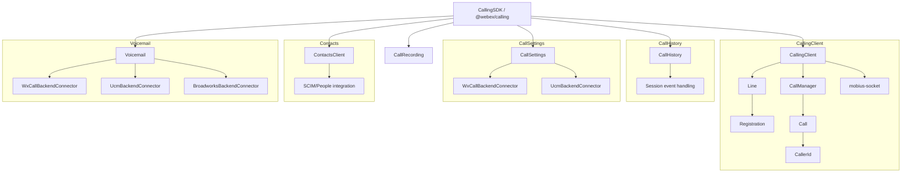

<!-- sdd-generated-metadata
doc_kind: standing-doc
generated_from: docs-index@0.3.0
generated_by: claude-code
approved_by: rarajes2@cisco.com
updated_at: 2026-11-17T03:02:22Z
validation_status: blocked
-->

# @webex/calling documentation

Doc map for developers and agents.

`@webex/calling` provides browser-based telephony via the Webex Calling platform:

- Line registration with Mobius signaling backend
- WebRTC call management (dial, answer, hold, transfer, mute, DTMF)
- Call history retrieval and management
- Call recording retrieval and deletion
- Call settings (forwarding, voicemail configuration)
- Contacts resolution (SCIM, People API)
- Voicemail management (list, playback, delete, transcription)

## Start here

Start with the package [`AGENTS.md`](../AGENTS.md) — it contains the commands, working method,
critical rules, and boundaries. Do not skip to a module specification directly.

| Resource | Path | Purpose |
| -------- | ---- | ------- |
| Package AGENTS.md | [`../AGENTS.md`](../AGENTS.md) | Commands, task workflow, and critical rules |
| Coding rules | [`../AGENTS.md`](../AGENTS.md) | Coding standards and conventions (section 5) |
| TypeScript Patterns | [`../AGENTS.md`](../AGENTS.md) | Type, interface, and code patterns (section 5) |
| Testing Patterns | [`../AGENTS.md`](../AGENTS.md) | Jest test conventions (section 4) |
| Event Patterns | [`architecture.md`](architecture.md) | Event-driven architecture patterns |
| Error Handling Patterns | [`architecture.md`](architecture.md) | Error handling patterns |

- [Getting started](getting-started.md)
- [Package architecture](architecture.md)

## Decisions

- [adr/](adr/index.md) — architectural decision records

## Specifications and contracts

- [architecture.md](architecture.md) — canonical package-wide architecture and contract index
- [specs/README.md](specs/README.md) — manifest-backed module and contract registry
- the `docs/README.md` beside each module's code — the owning specification for that module
- [adr/](adr/index.md) — concrete architectural decisions

No deployable service exists in this package, so no service specification is generated. The
published contract is an npm/SDK surface whose authoritative source is `package.json` with the
`src/index.ts` entry (TypeDoc reads `src/api.ts`). The package serves no HTTP API, so no OpenAPI
document applies; the Mobius, Janus, User Hub, Hydra, BroadWorks, UCM, and contacts endpoints it
calls are external contracts.

Module map (each box owns a specification at its folder's `docs/README.md`):

Shared modules used by all of the above — `src/SDKConnector`, `src/Metrics`, and the
package-wide `src/common`, `src/Errors`, `src/Events`, and `src/Logger` — are described in the
[package architecture](architecture.md) and the [specification registry](specs/README.md).

When modifying the calling package:

1. **New public API** - Update the owning module specification's public surface with the new method, parameters, return type, and events, and the architecture contract index.
2. **Architecture change** - Update the owning module specification with new flows, state changes, or component relationships, and the package architecture when the change crosses modules.
3. **New module** - Create its `docs/README.md` beside the module code and register it in `.sdd/manifest.json` and the specification registry.
4. **New pattern** - Add it to the coding conventions in the package `AGENTS.md`.
5. **New durable decision** - Record it as an ADR under `adr/`.

Always ensure documentation references actual code - no fabricated details.

## Related repository resources

- `README.md` — the package's npm-facing page.
- `CHANGELOG.md` — release history maintained by the workspace release tooling.
- `playwright/` — Playwright suites, fixtures, and utilities for the browser journeys.
- The monorepo root `AGENTS.md` and `docs/index.md` govern workspace-wide setup and route to every
  onboarded package.

No `ci/`, `operate/`, `diagrams/`, or runbook directories exist in this package.
