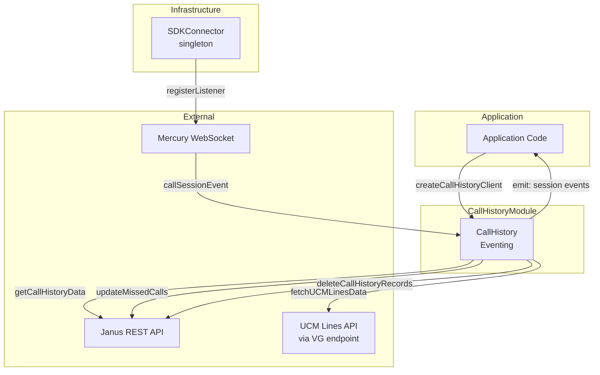
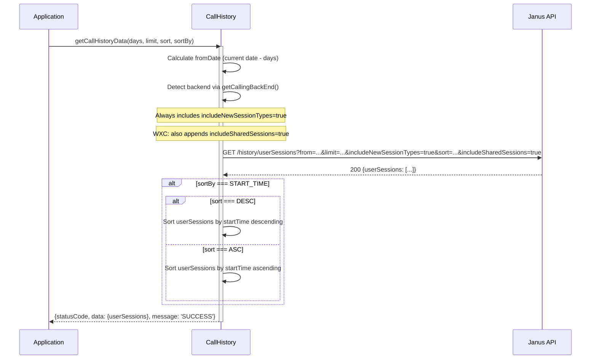
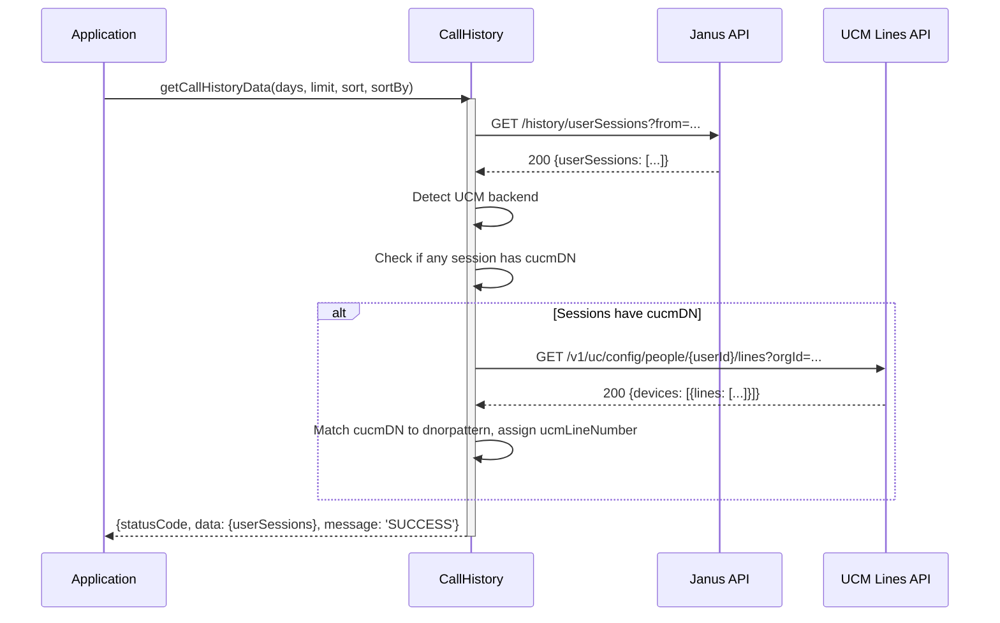
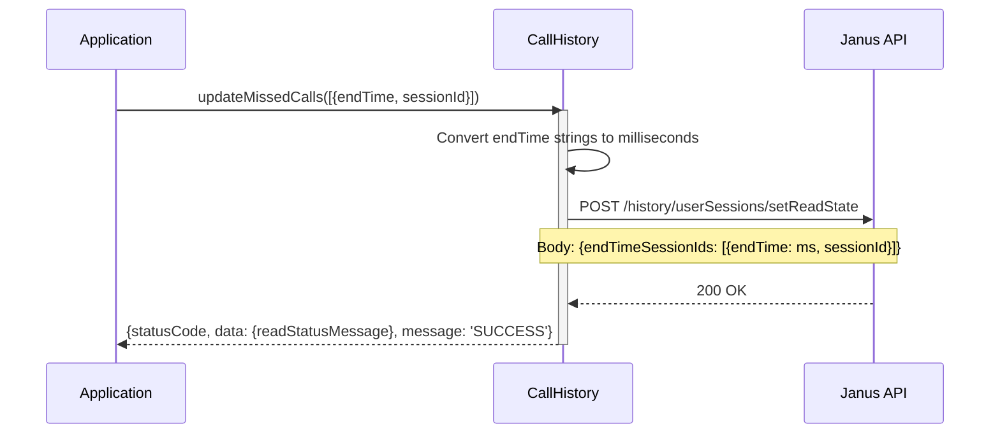
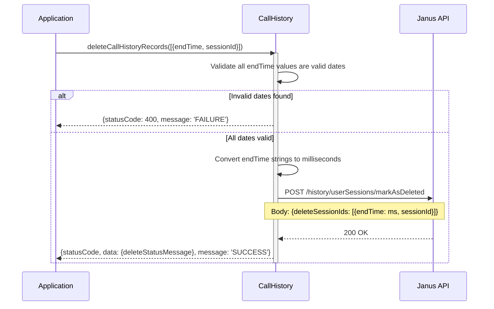
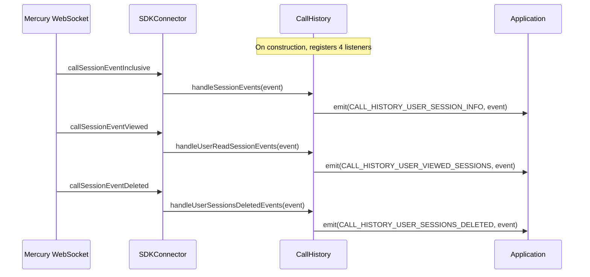
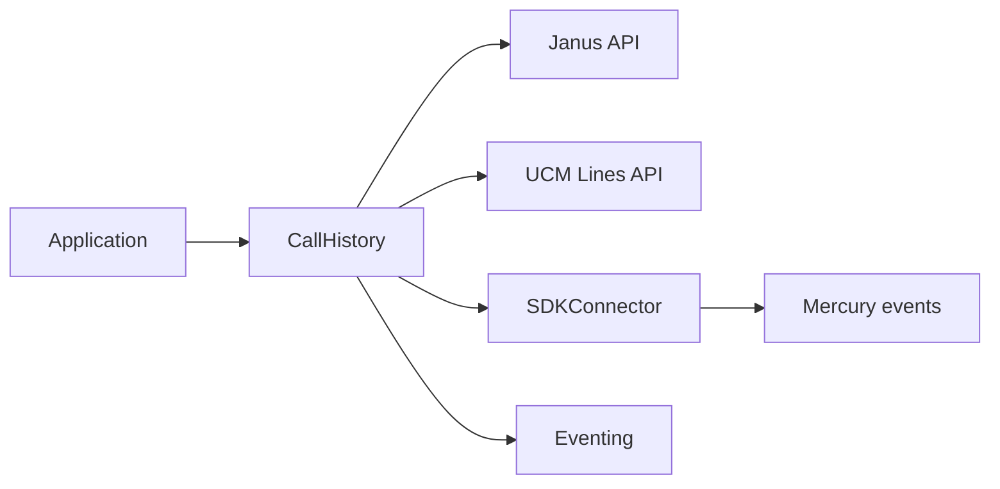

<!-- sdd-generated-metadata
doc_kind: module-spec
generated_from: module-spec@0.3.0
generated_by: claude-code
approved_by: rarajes2@cisco.com
updated_at: 2026-11-17T03:23:21Z
validation_status: pass-with-warnings
-->

# Call history

This source-local document at `src/CallHistory/docs/README.md` owns the stable specification for
**the call history module** of `@webex/calling`: the `CallHistory` client that reads the current
user's call-session records from Janus, marks missed calls as read, deletes records, enriches UCM
records with line numbers, and forwards Janus session events from Mercury. Ground every claim in
package evidence and link to the [package architecture](../../../docs/architecture.md) instead of
repeating broader facts such as the shared logger, the error envelope helper, or backend detection.
No service specification exists because this package is a library.

Related context: [documentation index](../../../docs/index.md) ·
[package agent instructions](../../../AGENTS.md)

## Metadata

| Field             | Value |
| ----------------- | ----- |
| Owner             | @webex/web-sdk (CODEOWNERS default rule) |
| Source path       | `src/CallHistory` |
| Resource kind     | module |
| Status            | Active |
| Last verified     | 2026-11-16 at `0b8c34db7f` |
| Module id         | `call-history` |
| Parent spec       | — |
| Doc kind          | Module spec |
| Coverage score    | Pending coverage assessment |
| Validation status | pass-with-warnings — validator `01a1e76e-1dbd-7680-94e4-46d29d2946d4`, assessed 2026-11-17; 0 Blocking, 1 Important (SDKConnector placeholder tests) |

## Applicability

| Condition ID                         | Status     | Evidence or reason | Owned section |
| ------------------------------------ | ---------- | ------------------ | ------------- |
| `module.has_tiers`                   | N/A        | The package defines no module tier policy | Tier |
| `module.has_ui`                      | N/A        | No view or screen; `src/CallHistory/CallHistory.ts` is a library client | UI use-case flow |
| `module.crosses_service_boundaries`  | Applicable | `src/CallHistory/CallHistory.ts` calls Janus and the UCM management gateway over HTTPS and receives Janus events from Mercury | Cross-boundary use-case flow |
| `module.holds_client_state`          | Applicable | `src/CallHistory/CallHistory.ts` keeps the Janus URL, the last query date, and the last fetched sessions on the instance | Client state model |
| `module.enforces_domain_rules`       | Applicable | Query defaults, sort fallback, end-time validation before delete, and WXC-only shared sessions in `src/CallHistory/CallHistory.ts` | Business rules and invariants |
| `module.is_concurrent_async`         | Applicable | Every operation returns a promise and Mercury callbacks arrive independently (`src/CallHistory/CallHistory.ts`) | Concurrency and reactive flow |
| `module.owns_persistence`            | N/A        | Janus owns the records; the module stores nothing durable | Data, schema, and migration discipline |
| `module.stateful_transitions`        | N/A        | No lifecycle states; each call is independent | State machine |
| `module.exposes_wire_protocol`       | Applicable | Janus query string, POST bodies, and event payloads in `src/CallHistory/constants.ts` and `src/Events/types.ts` | Protocol and wire format |
| `module.ui_multi_screen`             | N/A        | No UI | UI flow |
| `module.large_data_model`            | N/A        | UserSession mirrors a Janus record; the module owns no model | Data model |
| `module.returns_caller_errors`       | Applicable | Every method resolves an error envelope from `src/common/Utils.ts` on failure | Caller-visible failure modes |
| `module.module_specific_conventions` | Applicable | The GET-through-SDK and POST-through-fetch split and the logger context in `src/CallHistory/CallHistory.ts` | Module-specific rules |
| `module.published_package`           | Applicable | `src/index.ts` re-exports the factory and types; `package.json` names @webex/calling | Export stability |
| `module.embedded_in_host`            | N/A        | No host theme or embed API | Host integration and theming |
| `module.has_design_tradeoff`         | Applicable | Client-side UCM line enrichment that never fails the history fetch (`src/CallHistory/CallHistory.ts`) | Key design trade-off |
| `module.has_submodules`              | N/A        | Computed false by the Repo Annotation module_tree.py script: no module lies under src/CallHistory | Sub-modules |

## Evidence register

| Evidence | What it establishes |
| -------- | ------------------- |
| `src/CallHistory/CallHistory.ts` | Construction, URL building, sorting, UCM enrichment, the two POST mutations, error handling, and Mercury forwarding |
| `src/CallHistory/types.ts` | `ICallHistory`, `LoggerInterface`, and the four response envelope types |
| `src/CallHistory/constants.ts` | Defaults, path segments, endpoint names, status messages, and logger method names |
| `src/Events/types.ts` | `UserSession`, `CallRecordSelf`, `EndTimeSessionId`, the UCM lines shapes, the three event payload types, and the Janus Mercury keys |
| `src/Events/impl/index.ts` | `Eventing` base class: typed `on`, `off`, and `emit`, with an info log for every emit |
| `src/common/types.ts` | `SORT`, `SORT_BY`, and `CALLING_BACKEND` |
| `src/common/Utils.ts` | `serviceErrorCodeHandler` status mapping, `getCallingBackEnd`, `getVgActionEndpoint`, and `uploadLogs` |
| `src/SDKConnector/index.ts` | Set-once Webex binding and `registerListener` over Mercury with no removal by the module |
| `src/index.ts` | Package entry exports for this module |
| `src/api.ts` | TypeDoc entry that also exports the `CallHistory` class |
| `src/CallHistory/CallHistory.test.ts` | Unit cases for fetch, sorting, events, missed calls, UCM lines, delete, and URL construction per backend |
| `src/CallHistory/callHistoryFixtures.ts` | Janus, UCM lines, and event fixtures used by the unit cases |
| `playwright/test-groups/call-history.ts` | End-to-end journeys for history queries and records produced by answered, missed, and rejected calls |
| `jest.config.js` | Package coverage thresholds that the unit suite must meet |

## Purpose and boundary

- Responsibility: give an application one typed client for the signed-in user's call history:
  query records, mark missed calls read, delete records, and receive record changes in real time.
- In scope: everything under `src/CallHistory`: the `CallHistory` class, its factory, its response
  types, and its constants.
- Out of scope: the Janus and UCM services and the records they hold, the Mercury connection, backend
  detection, the error envelope helper, and the logger (package architecture).
- Consumers: applications through `createCallHistoryClient` from `@webex/calling`, and the `webex`
  package, which creates the client when `clientConfig.callHistory` is set.

The `CallHistory` module provides APIs for retrieving, managing, and receiving real-time updates for call history records from backend services. It supports fetching paginated and sorted call history, marking missed calls as read, deleting call history records, and listening for real-time session events via Mercury WebSocket.

For Webex Calling (WXC), call history is fetched from Janus and includes shared session support. For UCM (Unified Communications Manager), call history records can be enriched with line number data from the UCM Lines API.

CallHistory owns the behavior rooted at `src/CallHistory/` and exposes it through the typed `@webex/calling` package boundary; shared infrastructure remains owned by `Errors`, `Events`, `Logger`, and `common`.

**Package:** `@webex/calling`

**Entry point:** `packages/calling/src/CallHistory/CallHistory.ts` (monorepo-relative path)

**Factory:** `createCallHistoryClient(webex, logger) -> ICallHistory`

| Capability | Description |
| ----------- | ----------- |
| **Fetch Call History** | Retrieves call history records from backend APIs with configurable date range, record limit, and sort order (ASC/DESC). |
| **Sorting** | Supports sorting by `startTime` or `endTime` in ascending or descending order. Default sort is by `endTime` descending. |
| **Update Missed Calls** | Marks missed call records as read by posting `endTime` and `sessionId` pairs to the Janus `setReadState` endpoint. |
| **Delete Call History Records** | Deletes call history records by posting `endTime` and `sessionId` pairs to the Janus `markAsDeleted` endpoint. Validates date formats before submission. |
| **Real-Time Session Events** | Listens for Mercury WebSocket events (`callSessionEventInclusive`, `callSessionEventLegacy`, `callSessionEventViewed`, `callSessionEventDeleted`) and emits them to the application. |
| **Error Handling & Logging** | Standardized error handling via `serviceErrorCodeHandler` with automatic log upload on failures. |

## Structure and key files

| Path | Responsibility |
| ---- | -------------- |
| `src/CallHistory/CallHistory.ts` | Main class with all public APIs: the `CallHistory` class (extends `Eventing<CallHistoryEventTypes>`) and the `createCallHistoryClient` factory |
| `src/CallHistory/types.ts` | `ICallHistory`, `JanusResponseEvent`, `UpdateMissedCallsResponse`, `DeleteCallHistoryRecordsResponse`, `UCMLinesResponse`, and `LoggerInterface` response types |
| `src/CallHistory/constants.ts` | Endpoints, defaults, status messages, and method names for logger context |
| `src/CallHistory/CallHistory.test.ts` | Unit tests for every public method, the private UCM lines call, and the event handlers |
| `src/CallHistory/callHistoryFixtures.ts` | Test fixtures for Janus, UCM lines, and Mercury payloads |

## Public surface

Declarations live in `src/CallHistory/types.ts`, with the shared payload types in
`src/Events/types.ts` and the sort enums in `src/common/types.ts`. This section summarises them and
does not restate signatures.

| Surface | Consumer | Compatibility commitment | Source |
| ------- | -------- | ------------------------ | ------ |
| `createCallHistoryClient(webex, logger)` returning `ICallHistory` | Applications, the `webex` package | Construction per `MOD-001` | `src/CallHistory/CallHistory.ts` |
| `ICallHistory.getCallHistoryData` | Applications | Query per `MOD-002` to `MOD-006` | `src/CallHistory/types.ts` |
| `ICallHistory.updateMissedCalls` | Applications | Mutation per `MOD-007` | `src/CallHistory/types.ts` |
| `ICallHistory.deleteCallHistoryRecords` | Applications | Mutation per `MOD-008` | `src/CallHistory/types.ts` |
| `callHistory:*` events through `on` and `off` | Applications | Forwarding per `MOD-010` | `src/Events/types.ts` |

Contract `call-history-sdk` is published with native artifact `package.json`. Required contracts:
`sdk-connector-internal`, `janus-http`, `mercury-events`, and `ucm-gateway-http`.

The following methods are defined on the `ICallHistory` interface:

| Method | Signature | Description |
| ------ | --------- | ----------- |
| `getCallHistoryData` | `getCallHistoryData(days, limit, sort, sortBy)`, async. All four parameters are declared required on `ICallHistory`; the class supplies defaults `10`, `50`, `SORT.DEFAULT`, `SORT_BY.DEFAULT` when omitted at runtime. Resolves `JanusResponseEvent` | Fetches call history records from Janus |
| `updateMissedCalls` | `updateMissedCalls(endTimeSessionIds)`, async. One required `EndTimeSessionId` array. Resolves `UpdateMissedCallsResponse` | Marks missed calls as read |
| `deleteCallHistoryRecords` | `deleteCallHistoryRecords(deleteSessionIds)`, async. One required `EndTimeSessionId` array. Resolves `DeleteCallHistoryRecordsResponse` | Deletes call history records |

Inherited from `Eventing<CallHistoryEventTypes>` (`src/Events/impl/index.ts`):

| Method | Signature | Description |
| ------ | --------- | ----------- |
| `on` | `(event, handler)` | Subscribe to an event |
| `off` | `(event, handler)` | Unsubscribe from an event |
| `emit` | `(event, data)` | Emit an event |

| Event | Enum Key | Payload | Description |
| ----- | -------- | ------- | ----------- |
| `callHistory:user_recent_sessions` | `COMMON_EVENT_KEYS.CALL_HISTORY_USER_SESSION_INFO` | `CallSessionEvent` | New or updated call session received |
| `callHistory:user_viewed_sessions` | `COMMON_EVENT_KEYS.CALL_HISTORY_USER_VIEWED_SESSIONS` | `CallSessionViewedEvent` | Sessions marked as viewed |
| `callHistory:user_sessions_deleted` | `COMMON_EVENT_KEYS.CALL_HISTORY_USER_SESSIONS_DELETED` | `CallSessionDeletedEvent` | Sessions deleted |

| Type | Description |
| ---- | ----------- |
| `JanusResponseEvent` | Response containing `statusCode`, `data.userSessions`, and `message` |
| `UpdateMissedCallsResponse` | Response containing `statusCode`, `data.readStatusMessage`, and `message` |
| `DeleteCallHistoryRecordsResponse` | Response containing `statusCode`, `data.deleteStatusMessage`, and `message` |
| `EndTimeSessionId` | Object with `endTime` (string) and `sessionId` (string) |
| `SORT` | Enum: `ASC = 'ASC'`, `DESC = 'DESC'`, `DEFAULT = 'DESC'` |
| `SORT_BY` | Enum: `START_TIME = 'startTime'`, `END_TIME = 'endTime'`, `DEFAULT = 'endTime'` |

Every response envelope also carries an optional `data.error` string, filled only on failure
(`MOD-009`).

The `CallHistory` constructor accepts:

| Parameter | Type | Required | Description |
| --------- | ---- | -------- | ----------- |
| `webex` | `WebexSDK` | Yes | An initialized Webex SDK instance |
| `logger` | `LoggerInterface` | Yes | Logger interface with a `level` property |

`getCallHistoryData` parameters:

| Parameter | Type | Default | Description |
| --------- | ---- | ------- | ----------- |
| `days` | `number` | `10` | Number of days of history to fetch |
| `limit` | `number` | `50` | Maximum number of records to return |
| `sort` | `SORT` | `SORT.DEFAULT` | Sort order (ASC/DESC) |
| `sortBy` | `SORT_BY` | `SORT_BY.DEFAULT` | Sort field (startTime/endTime) |

## Dependencies

| Dependency | Why it is required | Failure behavior |
| ---------- | ------------------ | ---------------- |
| Webex request client and Janus call-history APIs (`janus-http`) | Session list, read state, and delete (`MOD-002`, `MOD-007`, `MOD-008`) | Rejections and non-2xx responses become error envelopes (`MOD-009`) |
| UCM Lines API for line enrichment (`ucm-gateway-http`) | `ucmLineNumber` for UCM records (`MOD-005`) | Never fails the fetch (`MOD-006`) |
| Mercury real-time events (`mercury-events`) | Janus session events (`MOD-010`) | No event arrives; nothing is reported to the caller |
| `SDKConnector` (`sdk-connector-internal`) | Webex binding and Mercury listener registration | `setWebex` throws during construction when the Webex instance fails validation |
| Global `fetch` | The two POST mutations | A network rejection becomes an envelope from a status of `NaN`, which maps to 422 (`MOD-009`) |
| Shared `src/common`, `src/Events`, `src/Logger` code | Backend detection, error envelopes, log upload, typed emitter, logging (package architecture) | `uploadLogs` reports its own failure in logs and does not throw by default |

| Package | Purpose |
| ------- | ------- |
| `webex` (SDK) | HTTP requests to Janus API, Mercury WebSocket event subscription |

| Module | Purpose |
| ------ | ------- |
| `SDKConnector` | Singleton bridge to Webex SDK, Mercury event listener registration |
| `Eventing<T>` | Typed event emitter base class |
| `Logger` | Structured logging with file/method context |
| `serviceErrorCodeHandler` | Standardized error response formatting |
| `getVgActionEndpoint` | Resolves VG endpoint for UCM Lines API |
| `getCallingBackEnd` | Determines the calling backend (WXC, UCM, BWRKS) |
| `uploadLogs` | Uploads diagnostic logs on error |

## Requirements

| ID | WHAT | WHY | Source evidence | Test or example evidence | Assumptions or gaps | Confidence |
| -- | ---- | --- | --------------- | ------------------------ | ------------------- | ---------- |
| `MOD-001` | `createCallHistoryClient(webex, logger)` returns a new `CallHistory`. The constructor binds `SDKConnector` to `webex` only when it has no Webex instance yet, then uses the connector's instance; resolves the Janus URL once from `services._serviceUrls.janus`, falling back to `services.get(services._activeServices.janus)`; registers the four Mercury listeners of `MOD-010`; and sets the shared logger level from `logger.level`. | `SDKConnector.setWebex` throws when called twice, so every client reuses the first binding; one URL lookup serves all later calls. | `src/CallHistory/CallHistory.ts`, `src/SDKConnector/index.ts` | `src/CallHistory/CallHistory.test.ts` (constructed once in beforeAll) | No test covers the `services.get` fallback | Present |
| `MOD-002` | `getCallHistoryData(days, limit, sort, sortBy)` computes `from` as now minus `days` days in ISO form, replaces a `sort` or `sortBy` value that is not a member of `SORT` or `SORT_BY` with the default, and sends one GET through `webex.request` with `service: 'janus'` to the URL in Protocol and wire format. Success resolves `{statusCode, data: {userSessions}, message: 'SUCCESS'}`, where `statusCode` is the `statusCode` field of the Janus response body. | A bounded, parameterized query lets consumers request the history window they need without always loading the user's full Janus record set. | `src/CallHistory/CallHistory.ts`, `src/CallHistory/constants.ts` | `src/CallHistory/CallHistory.test.ts` "verify successful call history case", "should construct URL correctly with base parameters for all backends"; `playwright/test-groups/call-history.ts` CH-QUERY-001 | An invalid-enum fallback case is not tested | Present |
| `MOD-003` | With `sortBy` `startTime`, the returned sessions are re-sorted client-side by `startTime`, newest first for `DESC` and oldest first for `ASC`. With `endTime`, the order is the one Janus returns for the `sort` parameter; `sortBy` is never sent. | A deterministic newest-first default matches the primary recent-calls use case while explicit alternatives keep pagination and presentation ordering predictable. | `src/CallHistory/CallHistory.ts` | `src/CallHistory/CallHistory.test.ts` "Array should be sort.ASC by START TIME" | The `DESC` start-time branch is not tested | Present |
| `MOD-004` | The query always carries `includeNewSessionTypes=true`; it carries `includeSharedSessions=true` only when `getCallingBackEnd` returns `WXC`. | Shared-line sessions must be requested explicitly so users see calls placed or received on shared Webex Calling lines (code comment: sessions of type `WEBEXCALLING_SHARED`). | `src/CallHistory/CallHistory.ts` | `src/CallHistory/CallHistory.test.ts` "URL construction for shared sessions based on calling backend" (WXC, UCM, BWRKS, unknown) | — | Present |
| `MOD-005` | On the UCM backend, when any returned session has a non-empty `self.cucmDN`, the module GETs the UCM lines document (no `service` key) and, when that call reports `statusCode` 200 with `devices`, sets `self.ucmLineNumber` to the line `index` of every line whose `dnorpattern` equals the session's `cucmDN`. | UCM records need line-pattern enrichment so multi-line clients can associate a history entry with the correct provisioned line. | `src/CallHistory/CallHistory.ts`, `src/Events/types.ts` | `src/CallHistory/CallHistory.test.ts` "should call fetchUCMLinesData when calling backend is UCM and userSessions contain valid cucmDN", "should not call fetchUCMLinesData when calling backend is UCM but no valid cucmDN is present", "should not call fetchUCMLinesData when calling backend is not UCM" | When two lines share a pattern, the last match wins | Present |
| `MOD-006` | A failed or empty UCM lines result never fails the fetch: an error envelope or a response without `devices` is logged at info, a thrown error is logged at warn, and the call resolves the unenriched sessions with the Janus status. | The in-code comment (BEMS01958007) requires that a lines or log-upload failure does not drop call history. | `src/CallHistory/CallHistory.ts` | `src/CallHistory/CallHistory.test.ts` "should fetchUCMLinesData but not assign ucmLineNumber when UCM backend has no line data", "verify bad request failed UCM lines API case" | The thrown-error branch is not tested | Present |
| `MOD-007` | `updateMissedCalls(endTimeSessionIds)` converts each `endTime` to epoch milliseconds without validating it, POSTs `{endTimeSessionIds}` with `fetch` to the `setReadState` URL with `Content-Type: application/json` and `Authorization` from `credentials.getUserToken()`, and on an OK response resolves `{statusCode, data: {readStatusMessage: 'Missed calls are read by the user.'}, message: 'SUCCESS'}` with `statusCode` from the response body. A non-OK response is thrown as its HTTP status and becomes an error envelope (`MOD-009`). | Janus identifies the exact viewed records by the end-time/session-id pair, preventing unrelated missed calls from being marked read. | `src/CallHistory/CallHistory.ts`, `src/CallHistory/constants.ts` | `src/CallHistory/CallHistory.test.ts` "successfully updates missed calls", "Error: updateMissedCalls throw 400 error", "Error: updateMissedCalls throw 401 error" | An unparsable `endTime` is sent as `null` | Present |
| `MOD-008` | `deleteCallHistoryRecords(deleteSessionIds)` first checks every `endTime`. If any is not a valid date, it resolves `{statusCode: 400, data: {deleteStatusMessage: 'The provided date is malformed or invalid'}, message: 'FAILURE'}` without a request or log upload. Otherwise it converts the times to epoch milliseconds and POSTs `{deleteSessionIds}` to the `markAsDeleted` URL the same way as `MOD-007`, resolving `deleteStatusMessage: 'Call history records are deleted by the user.'` on success. | Validating and sending the record identity pair prevents malformed dates or ambiguous session identifiers from deleting the wrong history entries. | `src/CallHistory/CallHistory.ts`, `src/CallHistory/constants.ts` | `src/CallHistory/CallHistory.test.ts` "successfully deletes the call history records", "handles invalid date formats gracefully", 400 and 401 cases | — | Present |
| `MOD-009` | No public method rejects on a service failure. Each logs an error, awaits `uploadLogs()`, and resolves the `serviceErrorCodeHandler` envelope `{statusCode, data: {error}, message: 'FAILURE'}`: 400, 401, 403, 404, 408, 500, 501, and 503 carry fixed messages, and any other or missing code becomes that code or 422. | A common error response and diagnostic-upload path gives callers stable failure handling and preserves evidence needed to diagnose remote-service failures. | `src/CallHistory/CallHistory.ts`, `src/common/Utils.ts` | `src/CallHistory/CallHistory.test.ts` "verify bad request failed call history case", "verify device not found call history case", mutation 400 and 401 cases | A rejection from `getUserToken` or `response.json()` follows the same path | Present |
| `MOD-010` | The constructor registers listeners for `event:janus.user_recent_sessions` and `event:janus.user_sessions` (both emit `callHistory:user_recent_sessions` when `data.userSessions.userSessions` is present), `event:janus.user_viewed_sessions` (emits `callHistory:user_viewed_sessions` when `data.userReadSessions.userReadSessions` is present), and `event:janus.user_sessions_deleted` (emits `callHistory:user_sessions_deleted` when `data.deletedSessions` is present). The Mercury event object is forwarded unchanged. | Forwarding Janus lifecycle events keeps consumer history state current without polling after sessions are created, viewed, or deleted. | `src/CallHistory/CallHistory.ts`, `src/Events/types.ts` | `src/CallHistory/CallHistory.test.ts` "Call History Session Event test" (recent, locus, viewed, deleted) | A payload without `data` throws inside the handler (Pitfalls) | Present |

## Design overview

The CallHistory module follows a layered architecture: **Application -> CallHistory -> Janus API / Mercury WebSocket / UCM Lines API**. The `CallHistory` class orchestrates call history retrieval, missed call updates, record deletion, and real-time event forwarding.

`CallHistory` is one class with no backend connector: backend differences are two branches inside
`getCallHistoryData` (`MOD-004`, `MOD-005`). It extends the typed emitter, so the same instance is
both the request API and the event source. All Janus URLs are built from the Janus URL resolved at
construction (`MOD-001`); the UCM lines URL is built per call from the `ucmgmt-gateway` catalog
entry and the device's user and organization IDs.

| Backend | Behavior |
| ------- | -------- |
| **WXC** | Adds `includeSharedSessions=true` so shared session types (`WEBEXCALLING_SHARED`) are included in call history queries. |
| **UCM** | Enriches call history records with `ucmLineNumber` by matching `self.cucmDN` against UCM Lines API (`dnorpattern`). |

The module uses **two different HTTP mechanisms** depending on the method:

| Method | Client | Reason |
|--------|--------|--------|
| `getCallHistoryData` | `this.webex.request()` | GET request, SDK handles auth automatically |
| `updateMissedCalls` | Browser `fetch` | POST request with manual `Authorization` header |
| `deleteCallHistoryRecords` | Browser `fetch` | POST request with manual `Authorization` header |
| `fetchUCMLinesData` | `this.webex.request()` | GET request, SDK handles auth automatically |

The manual header value is `await this.webex.credentials.getUserToken()`, sent with
`Content-Type: application/json`. `fetchUCMLinesData` is private and is reached only through
`getCallHistoryData`.

## Data flow and sequence coverage

Transport: HTTPS GET through `webex.request` to Janus and to the UCM management gateway, HTTPS POST
through global `fetch` to Janus, and Mercury WebSocket events delivered through `SDKConnector`.
Every operation is promise-based.

| Operation group | Entry and outcome | Diagram or evidence | Failure and recovery coverage |
| --------------- | ----------------- | ------------------- | ----------------------------- |
| Construct and fetch WXC history | `getCallHistoryData` → GET Janus → optional start-time sort → envelope | Diagram 1 | Service errors return the normalized failure response (`MOD-009`) |
| Fetch and enrich UCM history | `getCallHistoryData` on UCM → GET Janus → GET UCM lines → enrich | Diagram 2 | Lines failure returns the original history response (`MOD-006`) |
| Mark missed calls / delete records | `updateMissedCalls` or `deleteCallHistoryRecords` → POST Janus | Diagrams 3 and 4 | Invalid delete dates return 400 before any request; auth and service failures are surfaced as envelopes |
| Consume real-time session events | Mercury → `SDKConnector` → handler → `callHistory:*` | Diagram 5 | Payloads are not retyped; a payload without its inner list is dropped |

**Layer diagram — components and transports**



**Diagram 1 — fetching call history (WXC backend)**



**Diagram 2 — fetching call history with UCM line enrichment**



**Diagram 3 — updating missed calls**



**Diagram 4 — deleting call history records**



**Diagram 5 — real-time session event handling**



The `callSessionEventLegacy` event (key `event:janus.user_sessions`) follows the same path as the inclusive one and
emits the same typed event (`MOD-010`).

## Class and component relationships



| Layer | Component | File | Key Responsibilities |
|-------|-----------|------|---------------------|
| **Orchestrator** | `CallHistory` | `CallHistory.ts` | Call history fetch, missed call updates, record deletion, UCM enrichment, real-time event forwarding |
| **Event System** | `Eventing<CallHistoryEventTypes>` | `Events/impl/index.ts` | Typed event emission for session events |
| **SDK Bridge** | `SDKConnector` | `SDKConnector/` | Mercury listener registration, Webex SDK access |

| Component | Access Pattern | Lifecycle |
|-----------|---------------|-----------|
| `CallHistory` | `createCallHistoryClient(webex, logger)` factory | One per application |
| `SDKConnector` | Frozen singleton via `import SDKConnector` | Global, set once via `setWebex()` |

## Use cases and flows

| Use case | Actor or caller | Primary steps and outcome | Failure or boundary behavior | Evidence |
| -------- | --------------- | ------------------------- | ---------------------------- | -------- |
| `UC-001` | Application showing recent calls | `createCallHistoryClient(webex, logger)`, then `getCallHistoryData(days, limit, sort, sortBy)`; read `data.userSessions` | A failure resolves an envelope with `data.error` (`MOD-009`) | `src/CallHistory/CallHistory.test.ts`, `playwright/test-groups/call-history.ts` |
| `UC-002` | Application clearing missed-call badges | `updateMissedCalls` with the `endTime` and `sessionId` of each viewed missed call | A non-OK response resolves an envelope with the HTTP status | `src/CallHistory/CallHistory.test.ts` |
| `UC-003` | Application deleting history entries | `deleteCallHistoryRecords` with `endTime` and `sessionId` pairs | Any invalid date resolves 400 before a request (`MOD-008`) | `src/CallHistory/CallHistory.test.ts` |
| `UC-004` | Application keeping a history list live | Subscribe to the three `callHistory:*` events and apply the payloads | No event arrives while Mercury is disconnected | `src/CallHistory/CallHistory.test.ts` |
| `UC-005` | Multi-line UCM client | `getCallHistoryData` on UCM; read `self.ucmLineNumber` | Missing line data leaves the field unset (`MOD-006`) | `src/CallHistory/CallHistory.test.ts` |

The snippets below are consumer-style JavaScript checked against `src/CallHistory/types.ts`. A
TypeScript caller passes `LOGGER.INFO` and the `COMMON_EVENT_KEYS` members instead of the string
literals, because the declared parameter types are string enums.

```javascript
import {createCallHistoryClient} from '@webex/calling';

const callHistory = createCallHistoryClient(webex, {level: 'info'});
```

```javascript
const response = await callHistory.getCallHistoryData(10, 50, SORT.DESC, SORT_BY.END_TIME);

if (response.statusCode === 200) {
  const sessions = response.data.userSessions;
  console.log(`Retrieved ${sessions.length} call records`);
}
```

```javascript
callHistory.on('callHistory:user_recent_sessions', (event) => {
  console.log('New session event:', event.data.userSessions.userSessions);
});

callHistory.on('callHistory:user_viewed_sessions', (event) => {
  console.log('Sessions viewed:', event.data.userReadSessions.userReadSessions);
});

callHistory.on('callHistory:user_sessions_deleted', (event) => {
  console.log('Sessions deleted:', event.data.deletedSessions);
});
```

```javascript
const endTimeSessionIds = [
  {endTime: '2024-01-15T10:30:00.000Z', sessionId: 'session-uuid-1'},
  {endTime: '2024-01-15T11:00:00.000Z', sessionId: 'session-uuid-2'},
];

const response = await callHistory.updateMissedCalls(endTimeSessionIds);

if (response.statusCode === 200) {
  console.log(response.data.readStatusMessage);
}
```

```javascript
const deleteSessionIds = [
  {endTime: '2024-01-15T10:30:00.000Z', sessionId: 'session-uuid-1'},
];

const response = await callHistory.deleteCallHistoryRecords(deleteSessionIds);

if (response.statusCode === 200) {
  console.log(response.data.deleteStatusMessage);
}
```

### Cross-boundary use-case flow

| Boundary | Transport | Ordering | Timeout | Retry and recovery | Compatibility |
| -------- | --------- | -------- | ------- | ------------------ | ------------- |
| Janus session list | HTTPS GET through `webex.request` with `service: 'janus'` | One request per call | The Webex SDK request defaults; none set here | None; the caller retries | Query string in Protocol and wire format |
| Janus `setReadState` and `markAsDeleted` | HTTPS POST through global `fetch` | One request per call | None set; `fetch` has no default timeout | None | Bodies in Protocol and wire format |
| UCM management gateway lines | HTTPS GET through `webex.request`, no `service` key | After the Janus GET, only on UCM with a `cucmDN` | The Webex SDK request defaults | None; enrichment is skipped (`MOD-006`) | `devices[].lines[]` with `dnorpattern` and `index` |
| Mercury Janus events | WebSocket through `SDKConnector.registerListener` | As delivered by Mercury; no reordering or deduplication | — | Reconnection belongs to the Webex SDK | Event keys and payload paths in Protocol and wire format |

## Client state model

`CallHistory` owns the initialized backend connector, Janus/Mercury listener registrations, and per-request UCM enrichment data. It does not persist history; Janus remains authoritative. Listener callbacks emit typed session changes, while UCM enrichment mutates only the response objects returned for that fetch.

The "backend connector" here is the shared `SDKConnector` binding; the module has no
backend-specific connector class.

| State or slice | Owner | Initial state | Transition triggers | Reset or persistence boundary |
| -------------- | ----- | ------------- | ------------------- | ----------------------------- |
| Webex binding | `SDKConnector` singleton | Unset until the first module binds it | First construction of any module client | Process lifetime; never replaced |
| Janus URL | `CallHistory` instance | Resolved in the constructor | None | Instance lifetime; a catalog change is not picked up |
| Last query date and last sessions (`fromDate`, `userSessions`) | `CallHistory` instance | Empty | Overwritten by each `getCallHistoryData` call | Instance lifetime; read only within that call |
| Mercury listener registrations | Webex Mercury emitter | Four handlers per instance | Constructor | Never removed by the module |
| Log level | Shared logger | Package default | `log.setLogger(logger.level, 'CallHistory')` in the constructor | Process-wide; the last module constructed wins |

## Business rules and invariants

| ID | Invariant | WHY | Enforcement source | Test evidence |
| -- | --------- | --- | ------------------ | ------------- |
| `INV-001` | Query defaults remain 10 days, 50 records, `endTime`, descending unless the caller supplies alternatives. | The recent-calls view needs a newest-first default without arguments. | `src/CallHistory/CallHistory.ts`, `src/CallHistory/constants.ts` | `src/CallHistory/CallHistory.test.ts` |
| `INV-002` | Delete mutations require valid `endTime`/`sessionId` pairs: every `endTime` must parse as a date before a delete request is sent. Missed-call updates do not validate. | A malformed date must not delete the wrong entries. | `src/CallHistory/CallHistory.ts` | `src/CallHistory/CallHistory.test.ts` "handles invalid date formats gracefully" |
| `INV-003` | WXC queries include shared sessions; UCM results are enriched by matching `self.cucmDN` to line `dnorpattern`. | Backend capabilities differ; other backends get neither. | `src/CallHistory/CallHistory.ts` | `src/CallHistory/CallHistory.test.ts` |
| `INV-004` | Mercury events retain their typed payload and event-key mapping: the received object is emitted unchanged under the key fixed in `MOD-010`. | Consumers read the Janus payload paths directly. | `src/CallHistory/CallHistory.ts` | `src/CallHistory/CallHistory.test.ts` |
| `INV-005` | Service failures resolve an envelope and never reject (`MOD-009`). | Callers branch on `statusCode` without a try block. | `src/CallHistory/CallHistory.ts`, `src/common/Utils.ts` | `src/CallHistory/CallHistory.test.ts` |

## Concurrency and reactive flow

HTTP requests and Mercury callbacks can complete independently. Each event is forwarded as received; UCM line lookup is awaited only for the fetch being enriched and a line-service failure falls back to the original history response rather than discarding it.

- Execution model: the JavaScript event loop. Every public method is `async`; Mercury handlers are
  `async` arrow functions invoked by `SDKConnector`.
- Ordering guarantees: none across calls. Within one fetch, the Janus GET completes before the UCM
  lines GET.
- Idempotency and retry: no retries. Repeating a read-state or delete POST resends the same pairs.
- Shared-state protection: none. `userSessions` is an instance field written by every fetch; on the
  UCM path a second concurrent fetch can replace it while the first awaits the lines call, so the
  first call can return the second call's sessions.
- Blocking restrictions: none; sorting and enrichment run synchronously on the fetched page.

## Protocol and wire format

`getCallHistoryData()` builds the request URL in steps:

1. Base path: `{janusUrl}/history/userSessions`
2. Required query params: `from`, `limit`, `includeNewSessionTypes=true`, `sort`
3. Conditional query param: `includeSharedSessions=true` (WXC only)

The `FROM_DATE` constant is `'?from'` (includes the `?` query string opener), so the final Janus URL pattern is:

```text
{janusUrl}/history/userSessions?from={isoDate}&limit={limit}&includeNewSessionTypes=true&sort={sort}[&includeSharedSessions=true]
```

Notes:

- `includeNewSessionTypes=true` is always appended.
- `includeSharedSessions=true` is appended only for WXC backend.
- `sortBy` is applied in module logic after fetch (for `startTime`) and is not sent as a URL parameter.

The UCM lines URL is `{ucmgmt-gateway}/v1/uc/config/people/{userId}/lines?orgId={orgId}`, with the
user and organization IDs read from `webex.internal.device`.

The POST endpoints use different body key names:

| Endpoint | Body Key | Body Shape |
| -------- | -------- | ---------- |
| `setReadState` | `endTimeSessionIds` | `{endTimeSessionIds: [{endTime: number, sessionId: string}]}` |
| `markAsDeleted` | `deleteSessionIds` | `{deleteSessionIds: [{endTime: number, sessionId: string}]}` |

Note: In both cases, `endTime` is converted from an ISO date string to milliseconds (epoch) before sending.

| Constant | Value | Description |
|----------|-------|-------------|
| `FROM_DATE` | `'?from'` | Query string opener + from param (note: includes `?`) |
| `HISTORY` | `'history'` | Janus history path segment |
| `UPDATE_MISSED_CALLS_ENDPOINT` | `'setReadState'` | Endpoint for marking missed calls as read |
| `DELETE_CALL_HISTORY_RECORDS_ENDPOINT` | `'markAsDeleted'` | Endpoint for deleting call history records |
| `VERSION_1` | `'v1'` | UCM Lines API version |
| `UNIFIED_COMMUNICATIONS` | `'uc'` | UCM path segment |
| `CONFIG` | `'config'` | UCM config path segment |
| `PEOPLE` | `'people'` | UCM people path segment |
| `LINES` | `'lines'` | UCM lines path segment |

| Constant | Value | Description |
|----------|-------|-------------|
| `NUMBER_OF_DAYS` | `10` | Default number of days for call history fetch |
| `LIMIT` | `50` | Default maximum records to fetch |

| Event Key | Wire Value | Description |
|-----------|------------|-------------|
| `MOBIUS_EVENT_KEYS.CALL_SESSION_EVENT_INCLUSIVE` | `'event:janus.user_recent_sessions'` | New/updated session events |
| `MOBIUS_EVENT_KEYS.CALL_SESSION_EVENT_LEGACY` | `'event:janus.user_sessions'` | Legacy session events |
| `MOBIUS_EVENT_KEYS.CALL_SESSION_EVENT_VIEWED` | `'event:janus.user_viewed_sessions'` | Session viewed events |
| `MOBIUS_EVENT_KEYS.CALL_SESSION_EVENT_DELETED` | `'event:janus.user_sessions_deleted'` | Session deleted events |

The event payloads have nested structures that must be accessed correctly:

| Event Type | Data Access Path | Inner Type |
| ---------- | ---------------- | ---------- |
| `CallSessionEvent` | event.data.userSessions.userSessions | `UserSession[]` |
| `CallSessionViewedEvent` | event.data.userReadSessions.userReadSessions | `UserReadSessions[]` |
| `CallSessionDeletedEvent` | event.data.deletedSessions | `string[]` |

`UserSession` (declared in `src/Events/types.ts`) key fields for this module: `id`, `sessionId`,
`disposition` (`Disposition`), `startTime` and `endTime` (ISO strings), `durationSeconds`,
`direction`, `sessionType` (`SessionType`), `self` (`CallRecordSelf`), and `other`
(`CallRecordListOther`), plus additional fields such as `url`, `links`, `correlationIds`, and
`callingSpecifics`. `CallRecordSelf` has a required `id` and optional `name`, `phoneNumber`,
`cucmDN` (UCM directory number, used for line enrichment), and `ucmLineNumber` (populated by UCM
line enrichment).

| Message or frame | Version | Producer or serializer | Consumer or parser | Compatibility and ordering rule |
| ---------------- | ------- | ---------------------- | ------------------ | ------------------------------- |
| Janus session list query | Janus `history` API | `CallHistory.getCallHistoryData` | Janus | `sortBy` is never sent |
| Janus session list body `{statusCode, userSessions}` | Janus | Janus | `CallHistory.getCallHistoryData` | Body `statusCode` is copied to the envelope |
| `setReadState` and `markAsDeleted` bodies | Janus `history` API | `CallHistory` mutations | Janus | `endTime` as epoch milliseconds |
| UCM lines body `{devices: [{name, model, lines: [{dnorpattern, index, label}]}]}` | UCM gateway `v1` | UCM | `CallHistory.fetchUCMLinesData` | Only `dnorpattern` and `index` are read |
| Janus Mercury events | Janus | Janus via Mercury | `CallHistory` handlers | Forwarded unchanged |

## Caller-visible failure modes

| Condition | Signal or result | Caller behavior | Retry or recovery | Evidence |
| --------- | ---------------- | --------------- | ----------------- | -------- |
| Janus GET rejects | Envelope from `serviceErrorCodeHandler` with the rejection's `statusCode` (`MOD-009`) | Show the `data.error` text or retry | Caller retries; 401 suggests token expiry | `src/CallHistory/CallHistory.ts` |
| A read-state or delete POST is not OK | Envelope with the HTTP status | Same | Caller retries | `src/CallHistory/CallHistory.ts` |
| Network failure in a POST | Envelope with status 422 (no status is available) | Same | Caller retries | `src/common/Utils.ts` |
| Any delete `endTime` is not a date | `statusCode: 400`, `data.deleteStatusMessage: 'The provided date is malformed or invalid'`, `message: 'FAILURE'` | Fix the input | — | `src/CallHistory/CallHistory.ts` |
| UCM lines call fails | Not visible: sessions return without `ucmLineNumber` (`MOD-006`) | Treat the field as optional | — | `src/CallHistory/CallHistory.ts` |
| Webex instance fails `SDKConnector` validation | The constructor throws | Fix the Webex instance before creating the client | — | `src/SDKConnector/index.ts` |

## Pitfalls and constraints

- A Mercury payload without `data` makes the handler throw a `TypeError` inside its async callback;
  the rejected promise is not handled and no event is emitted (`MOD-010`).
- Each construction adds four Mercury handlers that are never removed, so create one client per
  application, as the lifecycle in Class and component relationships states.
- Concurrent UCM fetches can return each other's sessions (Concurrency and reactive flow).
- `statusCode` on a successful fetch or mutation is read from the response body, not the HTTP
  status; a body without it yields an `undefined` status (`MOD-002`, `MOD-007`).
- The two POST mutations bypass `webex.request`, so they carry only the headers set in
  `MOD-007`.

Empty call history results. **Symptoms:** `getCallHistoryData` returns empty `userSessions` array.
**Possible Causes:**

- `days` parameter too small (no records in date range)
- Janus service URL not resolved
- Invalid or expired Webex token

**Debug Steps:**

```typescript
// Check with larger date range
const response = await callHistory.getCallHistoryData(30, 100);
console.log('Status:', response.statusCode);
console.log('Sessions:', response.data.userSessions?.length);
```

UCM line enrichment not working. **Symptoms:** `ucmLineNumber` is undefined on UCM call history records.
**Possible Causes:**

- No `cucmDN` in session records
- UCM Lines API returned error (non-fatal, call history still returned)
- `dnorpattern` mismatch between Lines API and session `cucmDN`

**What happens internally:** UCM enrichment failures are caught separately and do not affect the
main call history response. A lines API error is logged as `Failed to fetch UCM lines data` and
then `UCM lines API returned statusCode ...`; only an unexpected thrown error logs the
`UCM lines fetch or enrich failed` warning.

Update missed calls fails. **Symptoms:** `updateMissedCalls` returns error status.
**Possible Causes:**

- Invalid `endTime` format (must be valid ISO date string)
- Invalid or missing `sessionId`
- Authentication failure (401)

Delete returns 400 status. **Symptoms:** `deleteCallHistoryRecords` returns `statusCode: 400`.
**What happens internally:** Before making the API call, the module validates all `endTime` values. If any are invalid dates (`isNaN` after `new Date().getTime()`), it returns a 400 immediately with the message "The provided date is malformed or invalid".

Real-time events not firing. **Symptoms:** Event listeners on `callHistory:user_recent_sessions` never fire.
**Possible Causes:**

- Mercury WebSocket not connected
- `SDKConnector` already bound to a different Webex instance before CallHistory construction (the constructor binds it only when unset)
- Events don't contain expected `data.userSessions.userSessions` structure

## Module-specific rules

- DO use the factories, typed events, constants, and adapters already owned by `src/CallHistory/`.
- DON'T add direct network or SDK access when the module already provides an adapter.
- Do: when adding new API methods, follow the `fetch`-based pattern (used by `updateMissedCalls`/`deleteCallHistoryRecords`) for POST endpoints and `webex.request` for GET endpoints, so new calls match the existing auth handling in Design overview.
- Do: log with `{file: 'CallHistory', method}` using the `METHODS` names in
  `src/CallHistory/constants.ts`, and call `uploadLogs()` before returning a failure envelope.
- Do: return failures through `serviceErrorCodeHandler`; never reject to the caller (`INV-005`).
- Do not: send `sortBy` to Janus; sorting by start time is a client-side step (`MOD-003`).

## Export stability

| Export or entry point | Consumer | Stability | Versioning and deprecation rule | Declaration or API report |
| --------------------- | -------- | --------- | ------------------------------- | ------------------------- |
| `createCallHistoryClient`, `ICallHistory`, `JanusResponseEvent` | Applications | Public | Removal or an incompatible signature change is breaking for `@webex/calling` | `src/index.ts` |
| `UserSession`, `SORT`, `SORT_BY`, `COMMON_EVENT_KEYS` | Applications | Public, shared with other modules | Same | `src/index.ts` |
| `CallHistory` class | TypeDoc readers | Documented | Same | `src/api.ts` |
| `UpdateMissedCallsResponse`, `DeleteCallHistoryRecordsResponse`, `EndTimeSessionId`, event payload types | TypeScript callers through method signatures | Public by reference only; not exported from the entry | Reachable only through deep `dist/types` paths | `src/CallHistory/types.ts` |

Public factories, interfaces, types, and events are semver-controlled through `src/index.ts`; removals or incompatible signature changes require an approved migration and release plan.

## Key design trade-off

| Chosen trade-off | Preserved invariant or benefit | Cost or limitation | Decision evidence |
| ---------------- | ------------------------------ | ------------------ | ----------------- |
| CallHistory enriches UCM records client-side instead of changing the Janus contract | The common Janus response stays unchanged, and on a Lines 404/failure the fetch still returns the original history data (`MOD-006`) | One optional Lines lookup per UCM fetch, and line numbers are absent whenever that lookup fails | `src/CallHistory/CallHistory.ts`, `src/CallHistory/CallHistory.test.ts` |
| POST mutations through `fetch` with a manual token | Matches the Janus mutation endpoints as called today | Skips `webex.request` interceptors and has no timeout | `src/CallHistory/CallHistory.ts` |

## Verification

| Requirement or invariant | Test level | Positive evidence | Negative or boundary evidence | Gap |
| ------------------------ | ---------- | ----------------- | ----------------------------- | --- |
| `MOD-001` | Unit | `src/CallHistory/CallHistory.test.ts` | none found | Janus URL fallback and the existing-binding branch not asserted |
| `MOD-002`, `INV-001` | Unit and E2E | `src/CallHistory/CallHistory.test.ts`, `playwright/test-groups/call-history.ts` | `src/CallHistory/CallHistory.test.ts` 400 and 404 cases | Invalid `sort` or `sortBy` fallback not tested |
| `MOD-003` | Unit | `src/CallHistory/CallHistory.test.ts` "Array should be sort.ASC by START TIME" | none found | Start-time `DESC` branch not tested |
| `MOD-004`, `INV-003` | Unit | `src/CallHistory/CallHistory.test.ts` WXC case | `src/CallHistory/CallHistory.test.ts` UCM, BWRKS, and unknown cases | none |
| `MOD-005`, `MOD-006` | Unit | `src/CallHistory/CallHistory.test.ts` matched enrichment | `src/CallHistory/CallHistory.test.ts` missing line data, missing cucmDN, non-UCM, lines 400 | Thrown-error branch and concurrent fetches not tested |
| `MOD-007` | Unit | `src/CallHistory/CallHistory.test.ts` "successfully updates missed calls" | `src/CallHistory/CallHistory.test.ts` 400 and 401 cases | Invalid `endTime` not tested |
| `MOD-008`, `INV-002` | Unit | `src/CallHistory/CallHistory.test.ts` "successfully deletes the call history records" | `src/CallHistory/CallHistory.test.ts` invalid date, 400, 401 | none |
| `MOD-009`, `INV-005` | Unit | `src/CallHistory/CallHistory.test.ts` | Error cases above | Network rejection in `fetch` not tested |
| `MOD-010`, `INV-004` | Unit | `src/CallHistory/CallHistory.test.ts` "Call History Session Event test" | none found | Payload without `data` not tested |

Unit tests are co-located under `src/CallHistory/` and exercise positive, negative, error, retry, and cleanup behavior as applicable. Package journeys under `playwright/` cover cross-module flows.

The module has no retry or cleanup paths to exercise. Run the unit file alone with
`yarn test:unit` and a `CallHistory` path filter; the package suite and its coverage thresholds are
described in the [package architecture](../../../docs/architecture.md).
