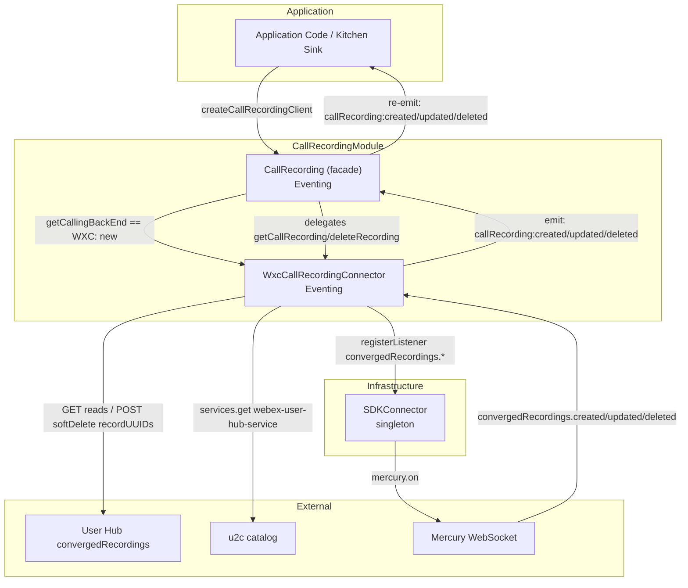
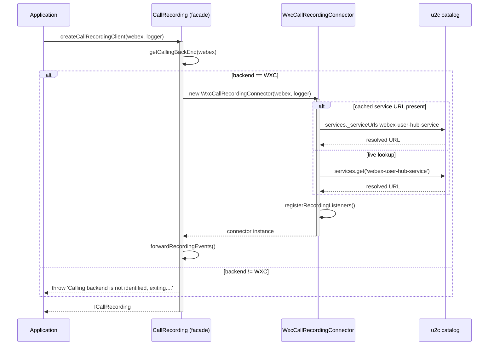
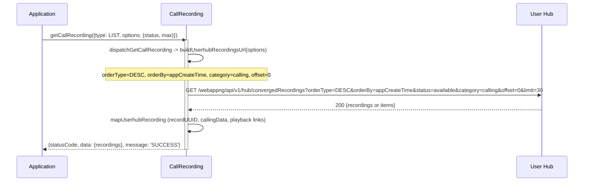
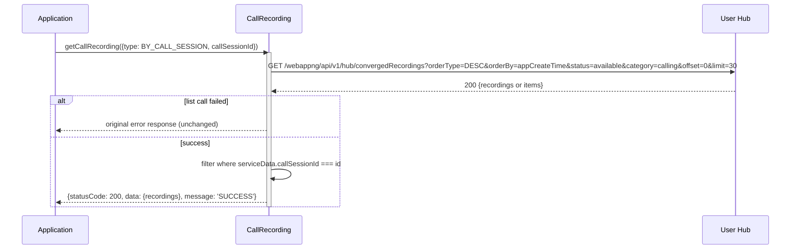
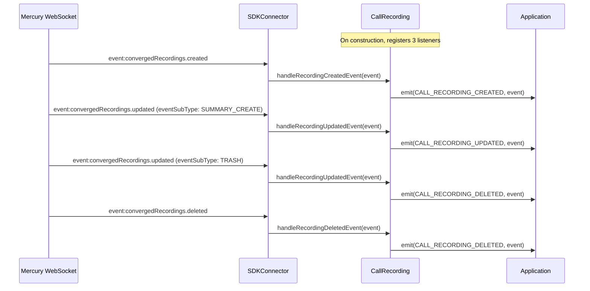

# CallRecording Module — Architecture

> Canonical SDD target: [`src/CallRecording/ai-docs/call-recording-spec.md`](call-recording-spec.md). This legacy document is retained as migration source; use the canonical target for current lifecycle work.

## Component Overview

The CallRecording module follows a layered architecture:
**Application → CallRecording (facade) → WxcCallRecordingConnector → User Hub REST / Mercury WebSocket**.

The module uses the same **backend-connector (strategy) pattern** as Voicemail. `CallRecording` is a
thin, backend-agnostic facade that resolves the calling backend (`getCallingBackEnd`) and selects a
backend-specific connector. Today only the Webex Calling (WXC) backend is supported — Post Call
Recording (`convergedRecordings`) is a Webex Calling cloud capability — so the facade instantiates
`WxcCallRecordingConnector` for WXC and throws for any other backend (BWRKS/UCM/INVALID). The facade
delegates all read/delete operations to the active connector and re-emits the connector's recording
lifecycle events. Adding another backend later is a drop-in new connector + a `case` in the facade,
with no consumer-facing changes.

The `WxcCallRecordingConnector` owns everything backend-specific: it resolves
`webex-user-hub-service` from the u2c catalog (`webappng/api/v1/hub/convergedRecordings`) and
subscribes to `convergedRecordings.*` Mercury events through the `SDKConnector`. Calling recordings
do not send `siteurl`.

### Component Table

| Layer | Component | File | Key Responsibilities |
|-------|-----------|------|---------------------|
| **Facade** | `CallRecording` | `CallRecording.ts` | Backend selection (WXC-only today, else throw), delegates read/delete, re-emits connector events |
| **WXC Connector** | `WxcCallRecordingConnector` | `WxcCallRecordingConnector.ts` | URL resolution, list/get/metadata/delete, call-session filtering, `convergedRecordings.*` Mercury subscription + emit |
| **Event System** | `Eventing<CallRecordingEventTypes>` | `Events/impl/index.ts` | Typed event emission for recording events |
| **SDK Bridge** | `SDKConnector` | `SDKConnector/` | Mercury listener registration, Webex SDK access |

### Singletons and Factories

| Component | Access Pattern | Lifecycle |
|-----------|---------------|-----------|
| `CallRecording` | `createCallRecordingClient(webex, logger)` factory | One per application |
| `WxcCallRecordingConnector` | Instantiated internally by the facade for the WXC backend | One per facade |
| `SDKConnector` | Frozen singleton via `import SDKConnector` | Global, set once via `setWebex()` |

### File Structure

```
CallRecording/
├── CallRecording.ts                    # Backend-agnostic facade (selection + delegation + event forwarding)
├── CallRecording.test.ts               # Facade tests (gating, delegation, event forwarding)
├── WxcCallRecordingConnector.ts        # Webex Calling (WXC) backend connector (REST + Mercury)
├── WxcCallRecordingConnector.test.ts   # Connector tests (REST, URL resolution, Mercury events)
├── types.ts                            # ICallRecording, Recording, RecordingMetadata, response types
├── constants.ts                        # Endpoints, query keys, method names
├── userhub.ts                          # User Hub URL join and recordUUID/callingData mapping
├── callRecordingFixtures.ts            # Test fixtures
└── ai-docs/
    ├── AGENTS.md                       # Module agent doc
    └── ARCHITECTURE.md                 # This file
```

---

## Data Flows

### Layer Communication Flow



---

## Sequence Diagrams

### 1. Client Construction & URL Resolution



### 2. Listing Recordings



### 3. Get Recording / Metadata

```mermaid
sequenceDiagram
    participant App as Application
    participant CR as CallRecording
    participant WxApp as User Hub

    App->>CR: getCallRecording({type: DETAIL, recordingId})
    CR->>WxApp: GET /webappng/api/v1/hub/convergedRecordings/{recordingId}
    WxApp-->>CR: 200 recordUUID, callingData, recordingPlaybackLinks, aiAssistantData
    CR-->>App: {statusCode, data: {recording}, message: 'SUCCESS'}

    App->>CR: getCallRecording({type: METADATA, recordingId})
    CR->>WxApp: GET /webappng/api/v1/hub/convergedRecordings/{recordingId}
    Note over CR: same detail URL; mapUserhubMetadata keeps id, owner, serviceData
    WxApp-->>CR: 200 same detail body
    CR-->>App: {statusCode, data: {metadata}, message: 'SUCCESS'}

    App->>CR: deleteRecording(recordingId)
    CR->>WxApp: POST /webappng/api/v1/hub/convergedRecordings/softDelete { recordUUIDs: [recordingId] }
    WxApp-->>CR: 204 (recording moved to recycle bin)
    CR-->>App: {statusCode, data: {}, message: 'SUCCESS'}
```

### 4. Get Recordings by Call Session Id (client-side filter)



### 5. Real-Time Recording Event Handling

> **Note:** The backend expresses the full lifecycle through `convergedRecordings.updated` qualified
> by `eventSubType` (verified in production: a delete arrives as `updated` + `TRASH`, not
> `deleted`). `handleRecordingUpdatedEvent` routes by `eventSubType`: `TRASH`/`PURGE` →
> `CALL_RECORDING_DELETED`, `RESTORE` → `CALL_RECORDING_CREATED`, `SUMMARY_CREATE`/other →
> `CALL_RECORDING_UPDATED`. The full event (incl. `eventSubType`) is always forwarded.



---

## Key Constants

### API Endpoints (`CallRecording/constants.ts`)

| Constant | Value | Description |
|----------|-------|-------------|
| `USERHUB_SERVICE_NAME` | `'webex-user-hub-service'` | u2c catalog service for User Hub |
| `USERHUB_RECORDINGS_PATH` | `'webappng/api/v1/hub/convergedRecordings'` | Recordings collection path |
| `SOFT_DELETE` | `'softDelete'` | Recycle-bin collection segment |

### Query Parameter Keys

Sent on every list. `siteurl` is not a query parameter.

| Constant | Value | Default |
|----------|-------|---------|
| `ORDER_TYPE` | `'orderType'` | `DESC` |
| `ORDER_BY` | `'orderBy'` | `appCreateTime` |
| `CATEGORY` | `'category'` | `calling` |
| `STATUS` | `'status'` | `available` (`options.status`) |
| `OFFSET` | `'offset'` | `0` |
| `LIMIT` | `'limit'` | `30` (`options.max`) |

### Headers

| Constant | Value | Description |
|----------|-------|-------------|
| `WEBEX_USER_REQUEST_HEADER` | `'WebexUserRequest'` | Always sent as `'true'`, with `Accept: application/json` |

### Mercury Event Keys (`Events/types.ts`)

| Event Key | Wire Value | Description |
|-----------|------------|-------------|
| `MOBIUS_EVENT_KEYS.RECORDING_EVENT_CREATED` | `'event:convergedRecordings.created'` | Recording created |
| `MOBIUS_EVENT_KEYS.RECORDING_EVENT_UPDATED` | `'event:convergedRecordings.updated'` | Recording updated (incl. `SUMMARY_CREATE`) |
| `MOBIUS_EVENT_KEYS.RECORDING_EVENT_DELETED` | `'event:convergedRecordings.deleted'` | Recording deleted |

### Recording Event Sub-Types (`RECORDING_EVENT_SUBTYPE`)

| Value | Meaning |
|-------|---------|
| `TRASH` | Recording moved to trash |
| `PURGE` | Recording permanently removed |
| `RESTORE` | Recording restored from trash |
| `SUMMARY_CREATE` | AI summary/transcript became available (no dedicated event) |

---

## Troubleshooting Guide

### 1. User Hub URL is empty / requests fail before User Hub

**Symptoms:** Requests fail with status 503, or the recordings URL is empty.

**Possible Causes:**
- `webex-user-hub-service` is not in the u2c catalog for this token's environment.

**Debug Steps:**
```typescript
console.log(webex.internal.services._serviceUrls?.['webex-user-hub-service']);
console.log(webex.internal.services.get('webex-user-hub-service'));
```

### 2. Empty Recording List

**Symptoms:** a `LIST` request (`getCallRecording({type: LIST})`) returns an empty `recordings` array.

**Possible Causes:**
- No recordings match `status=available` (deleted rows are excluded unless `status: deleted` is passed).
- The auth token lacks `spark:recordings_read`.
- The token was downscoped. User Hub can return 500 for that token. The connector prefers `credentials.supertoken`.

### 3. `BY_CALL_SESSION` Request Returns Empty

**What happens internally:** The User Hub list page is fetched, then filtered client-side on
`serviceData.callSessionId`. An empty result logs
`"No recordings found for the given call session id."` and returns `statusCode: 200` with an empty
array. If the underlying list call fails, the original error response is returned unchanged. A
recording outside the first page (`limit`, default 30) is not in the scan.

### 4. Recording Events Not Firing

**Symptoms:** Listeners on `callRecording:*` never fire.

**Possible Causes:**
- Mercury WebSocket not connected.
- `registerRecordingListeners()` was never invoked, so Mercury subscriptions were never created.
- Event envelope missing `data.activity` (handlers guard on its presence before re-emitting).

### 5. 401 / 429 Responses

**Symptoms:** `getCallRecording` requests (`LIST`/`DETAIL`) return `statusCode: 401`, `429`, or `500`.

**Notes:** Errors are returned (not thrown) via `serviceErrorCodeHandler`. Every User Hub call sends
`WebexUserRequest: true`. A 500 with "The system has internal error" was seen when a `siteurl` query
was added; the connector does not send `siteurl`. A 500 from `webex.request` is retried once with
the user token and without `cisco-device-url`.

---

## Related Documentation

- [AGENTS.md](./AGENTS.md) — Overview, examples, public API
