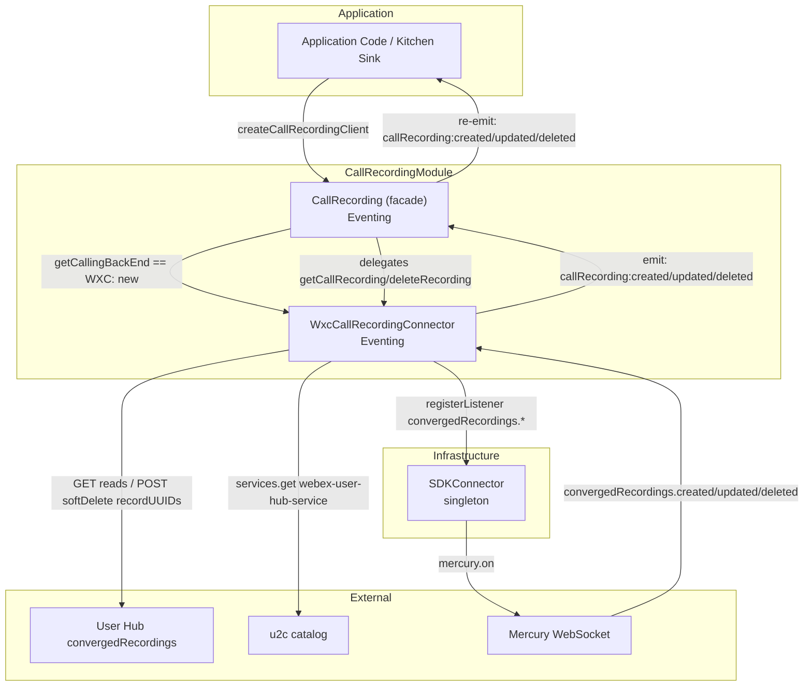
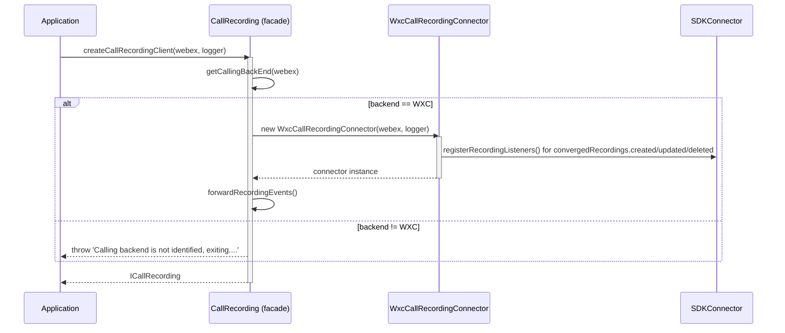
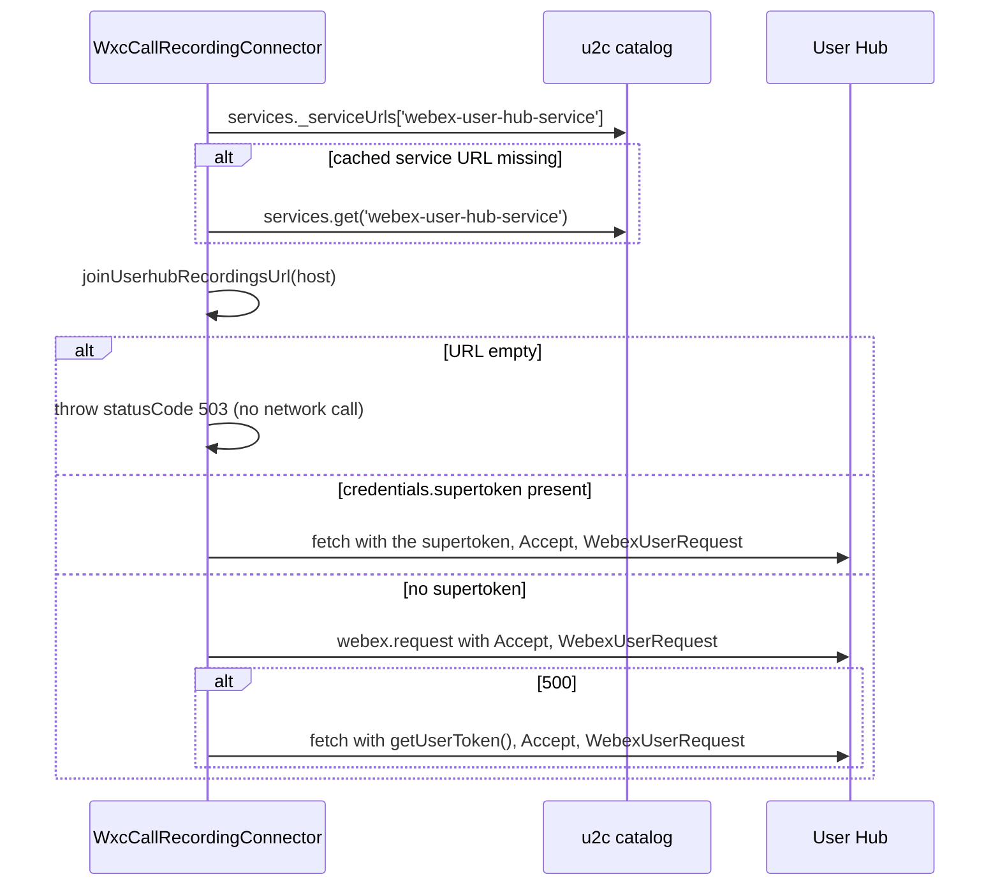
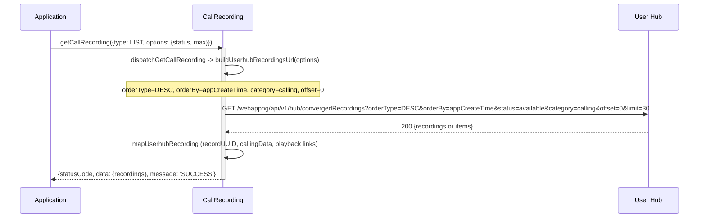
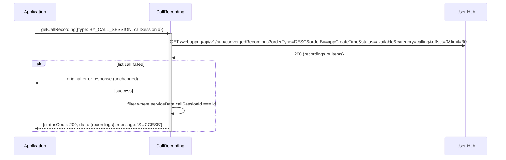
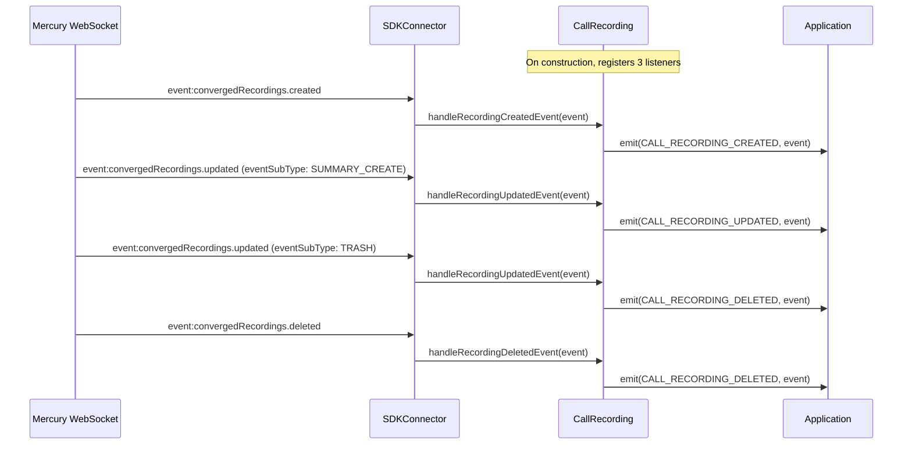
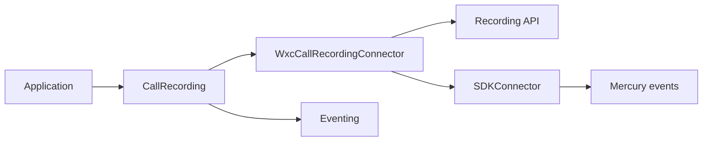

<!-- sdd-generated-metadata
doc_kind: module-spec
generated_from: module-spec@0.3.0
generated_by: claude-code
approved_by: rarajes2@cisco.com
updated_at: 2026-11-17T03:23:21Z
validation_status: pass-with-warnings
-->

# Call recording

This source-local document at `src/CallRecording/docs/README.md` owns the stable specification for
**the call recording module** of `@webex/calling`: the `CallRecording` facade and its Webex Calling
connector, which read Post Call Recordings from User Hub, move a recording to the recycle bin, and
forward recording lifecycle events from Mercury. Ground every claim in package evidence and link to
the [package architecture](../../../docs/architecture.md) instead of repeating broader facts such as
the shared logger, the error envelope helper, or backend detection. No service specification exists
because this package is a library.

Related context: [documentation index](../../../docs/index.md) ·
[package agent instructions](../../../AGENTS.md)

## Metadata

| Field             | Value |
| ----------------- | ----- |
| Owner             | @webex/web-sdk (CODEOWNERS default rule) |
| Source path       | `src/CallRecording` |
| Resource kind     | module |
| Status            | Active |
| Last verified     | 2026-11-16 at `0b8c34db7f` |
| Module id         | `call-recording` |
| Parent spec       | — |
| Doc kind          | Module spec |
| Coverage score    | Pending coverage assessment |
| Validation status | pass-with-warnings — validator `01a1e76e-1dbd-7680-94e4-46d29d2946d4`, assessed 2026-11-17; 0 Blocking, 1 Important (SDKConnector placeholder tests) |

## Applicability

| Condition ID                         | Status     | Evidence or reason | Owned section |
| ------------------------------------ | ---------- | ------------------ | ------------- |
| `module.has_tiers`                   | N/A        | The package defines no module tier policy | Tier |
| `module.has_ui`                      | N/A        | No view or screen; `src/CallRecording/CallRecording.ts` is a library client | UI use-case flow |
| `module.crosses_service_boundaries`  | Applicable | `src/CallRecording/WxcCallRecordingConnector.ts` calls User Hub over HTTPS and receives recording events from Mercury | Cross-boundary use-case flow |
| `module.holds_client_state`          | Applicable | `src/CallRecording/CallRecording.ts` keeps the resolved backend and the selected connector; the connector keeps its Mercury handlers | Client state model |
| `module.enforces_domain_rules`       | Applicable | WXC-only gating in `src/CallRecording/CallRecording.ts`; fixed list query and event routing in `src/CallRecording/WxcCallRecordingConnector.ts` | Business rules and invariants |
| `module.is_concurrent_async`         | Applicable | Every read and delete returns a promise and Mercury callbacks arrive independently (`src/CallRecording/WxcCallRecordingConnector.ts`) | Concurrency and reactive flow |
| `module.owns_persistence`            | N/A        | User Hub owns the recordings; the module stores nothing durable | Data, schema, and migration discipline |
| `module.stateful_transitions`        | N/A        | The client has no lifecycle states after construction | State machine |
| `module.exposes_wire_protocol`       | Applicable | User Hub query, bodies, and row mapping in `src/CallRecording/constants.ts` and `src/CallRecording/userhub.ts`; event envelope in `src/Events/types.ts` | Protocol and wire format |
| `module.ui_multi_screen`             | N/A        | No UI | UI flow |
| `module.large_data_model`            | N/A        | The recording types mirror User Hub rows; the module owns no model | Data model |
| `module.returns_caller_errors`       | Applicable | Every read and delete resolves an error envelope from `src/common/Utils.ts`; construction throws for unsupported backends | Caller-visible failure modes |
| `module.module_specific_conventions` | Applicable | Facade plus backend connector, and the User Hub token rule in `src/CallRecording/WxcCallRecordingConnector.ts` | Module-specific rules |
| `module.published_package`           | Applicable | `src/index.ts` re-exports the factory, types, and the helper; `package.json` names @webex/calling | Export stability |
| `module.embedded_in_host`            | N/A        | No host theme or embed API | Host integration and theming |
| `module.has_design_tradeoff`         | Applicable | A backend-agnostic facade over a single WXC connector, and a client-side call-session filter (`src/CallRecording/CallRecording.ts`) | Key design trade-off |
| `module.has_submodules`              | N/A        | Computed false by the Repo Annotation module_tree.py script: no module lies under src/CallRecording | Sub-modules |

## Evidence register

| Evidence | What it establishes |
| -------- | ------------------- |
| `src/CallRecording/CallRecording.ts` | Backend gating, connector selection, delegation, and event re-emission |
| `src/CallRecording/WxcCallRecordingConnector.ts` | URL resolution, the token and retry rule, the four read operations, soft delete, error envelopes, and Mercury routing |
| `src/CallRecording/userhub.ts` | URL join, response unwrapping, and the User Hub row and metadata mapping |
| `src/CallRecording/utils.ts` | `getRemoteParty` |
| `src/CallRecording/types.ts` | `ICallRecording`, the request union, `RecordingResponseFor`, and every recording, option, and response type |
| `src/CallRecording/constants.ts` | Service name, path, query keys and defaults, header name, messages, and logger method names |
| `src/Events/types.ts` | `RecordingEvent`, `RECORDING_EVENT_SUBTYPE`, the recording Mercury keys, and `COMMON_EVENT_KEYS` recording members |
| `src/Events/impl/index.ts` | `Eventing` base class: typed `on`, `off`, and `emit` |
| `src/common/Utils.ts` | `serviceErrorCodeHandler`, `getCallingBackEnd`, and `uploadLogs` |
| `src/SDKConnector/index.ts` | Set-once Webex binding and `registerListener` over Mercury |
| `src/index.ts` | Package entry exports for this module |
| `src/api.ts` | TypeDoc entry that also exports the `CallRecording` class |
| `src/CallRecording/CallRecording.test.ts` | Backend gating, delegation, and event forwarding |
| `src/CallRecording/WxcCallRecordingConnector.test.ts` | List query, token path, 500 retry, missing catalog host, detail, metadata, call-session filter, soft delete, URL resolution, and Mercury routing |
| `src/CallRecording/utils.test.ts` | `getRemoteParty` cases |
| `src/CallRecording/callRecordingFixtures.ts` | User Hub list, detail, and event fixtures |
| Sibling workspace package webex, file src/calling.js | Creates the client only when `clientConfig.callRecording` is true and swallows construction errors |

## Purpose and boundary

- Responsibility: give an application one typed client for the signed-in user's Webex Calling
  recordings: list, read one, read its metadata, find recordings of a call session, move one to the
  recycle bin, and receive recording changes in real time.
- In scope: everything under `src/CallRecording`: the facade, the WXC connector, the User Hub
  mapping, `getRemoteParty`, the types, and the constants.
- Out of scope: User Hub and the recordings it stores, downloading transcripts or summaries,
  compliance permanent delete, restore and purge APIs, the Mercury connection, backend detection,
  the error envelope helper, and the logger (package architecture).
- Consumers: applications through `createCallRecordingClient` from `@webex/calling`. When using the top-level `webex` package, enable the client via `clientConfig.callRecording = true`
  and access it as `calling.callRecordingClient`.

The `CallRecording` module provides read access to **Post Call Recordings** (recordings, transcripts,
summaries, and action items) produced for Webex Calling sessions through a single
`getCallRecording` method, moves a recording to the recycle bin via `deleteRecording`, and forwards recording
lifecycle events received over Mercury as typed SDK events.

Recordings are fetched from **User Hub** — catalog service `webex-user-hub-service`, path
`webappng/api/v1/hub/convergedRecordings`. The base URL is resolved from the u2c catalog. URL
resolution and the underlying Mercury subscriptions are owned by the WXC backend connector, while
the `CallRecording` facade exposes a typed, ergonomic API. Calling recordings do not send a
`siteurl` query. A wrong site name makes User Hub return 500.

**Backend support:** Post Call Recording is a Webex Calling cloud capability and is therefore
supported **only for the Webex Calling (`WXC`) backend**. The facade resolves the user's backend via
`getCallingBackEnd(webex)` in its constructor and **throws `Error('Calling backend is not identified,
exiting....')`** for any other backend (`BWRKS`, `UCM`, `INVALID`) — the same convention used by the
`Voicemail` and `CallSettings` clients. As a result, `createCallRecordingClient` only yields a usable
client for Webex Calling users; for non-WXC users the factory/constructor throws and no client is
created.

CallRecording owns the behavior rooted at `src/CallRecording/` and exposes it through the typed `@webex/calling` package boundary; shared infrastructure remains owned by `Errors`, `Events`, `Logger`, and `common`.

**Package:** `@webex/calling`

**Entry point:** `packages/calling/src/CallRecording/CallRecording.ts` (monorepo-relative path)

**Factory:** `createCallRecordingClient(webex, logger) -> ICallRecording`

| Capability | Description |
| ----------- | ----------- |
| **List Recordings** | Retrieves the current user's calling recordings (`status`, `limit` from `max`; ordered by `appCreateTime` DESC). |
| **Get Recording** | Fetches a single recording by its `id`, including `recordingPlaybackLinks` (transcript and audio) and `aiAssistantData.suggestedNoteUrl`. The SDK returns those URLs; it does not download the transcript or summary. |
| **Get By Call Session** | Returns all recordings tied to a call session id (`serviceData.callSessionId`), filtered client-side from the same list. |
| **Get Metadata** | Reads the same User Hub detail as Get Recording and returns only `id`, owner, `callSessionId`, and `serviceData`. |
| **Real-Time Recording Events** | Re-emits Mercury `convergedRecordings.*` events as typed `callRecording:*` events. |
| **Error Handling & Logging** | Standardized error handling via `serviceErrorCodeHandler` with automatic log upload on failure. |

## Structure and key files

| Path | Responsibility |
| ---- | -------------- |
| `src/CallRecording/CallRecording.ts` | Backend-agnostic facade (selection + delegation + event forwarding) and the `createCallRecordingClient` factory |
| `src/CallRecording/WxcCallRecordingConnector.ts` | Webex Calling (WXC) backend connector (REST + Mercury): URL resolution, list/get/metadata/delete, call-session filtering |
| `src/CallRecording/userhub.ts` | User Hub URL join and recordUUID/callingData mapping onto `Recording` and `RecordingMetadata` |
| `src/CallRecording/utils.ts` | `getRemoteParty` helper |
| `src/CallRecording/types.ts` | `ICallRecording`, `Recording`, `RecordingMetadata`, request, option, and response types |
| `src/CallRecording/constants.ts` | Endpoints, query keys, defaults, header name, and method names |
| `src/CallRecording/CallRecording.test.ts` | Facade tests (gating, delegation, event forwarding) |
| `src/CallRecording/WxcCallRecordingConnector.test.ts` | Connector tests (REST, URL resolution, Mercury events) |
| `src/CallRecording/utils.test.ts` | `getRemoteParty` tests |
| `src/CallRecording/callRecordingFixtures.ts` | Test fixtures |

## Public surface

Declarations live in `src/CallRecording/types.ts`, with the helper in `src/CallRecording/utils.ts`
and the event envelope in `src/Events/types.ts`. This section summarises them and does not restate
signatures.

| Surface | Consumer | Compatibility commitment | Source |
| ------- | -------- | ------------------------ | ------ |
| `createCallRecordingClient(webex, logger)` returning `ICallRecording` | Applications, the `webex` package | Construction per `MOD-001` | `src/CallRecording/CallRecording.ts` |
| `ICallRecording.getCallRecording(request)` | Applications | Dispatch per `MOD-002`; operations per `MOD-003` to `MOD-007` | `src/CallRecording/types.ts` |
| `ICallRecording.deleteRecording(recordingId, options)` | Applications | Soft delete per `MOD-008` | `src/CallRecording/types.ts` |
| `getRemoteParty(serviceData)` | Applications | Party resolution per `MOD-012` | `src/CallRecording/utils.ts` |
| `callRecording:*` events through `on` and `off` | Applications | Routing per `MOD-011` | `src/Events/types.ts` |

Contract `call-recording-sdk` is published with native artifact `package.json`. Required contracts:
`sdk-connector-internal`, `userhub-recordings-http`, and `mercury-events`.

All reads go through a **single** `getCallRecording` method, which dispatches on the request
`type` (a `RecordingRequestType`) and infers the concrete response type per request via
`RecordingResponseFor<T>`. Permanent deletion stays a separate method (different verb + scope).

| Method | Signature | Description |
| ------ | --------- | ----------- |
| `getCallRecording` | `getCallRecording(request)`, generic over the `GetCallRecordingRequest` member passed; returns a promise of `RecordingResponseFor` that member | Reads recordings; the `request.type` selects LIST / DETAIL / METADATA / BY_CALL_SESSION |
| `deleteRecording` | `deleteRecording(recordingId, options)`, async; `recordingId` required, `options` (`DeleteRecordingOptions`) optional; resolves `RecordingDeleteResponse` | Moves a recording to the recycle bin via `POST /convergedRecordings/softDelete`; needs `spark:recordings_write`. `options` is deprecated and ignored |

| Helper | Signature | Description |
| ------ | --------- | ----------- |
| `getRemoteParty` | `getRemoteParty(serviceData)`, synchronous; `serviceData` (`RecordingServiceData`) optional; returns a `RecordingParty` or `undefined` | Resolves the *other* party of the call from `serviceData` using `personality` (`originator` → `calledParty`, `terminator` → `callingParty`). Use `getRemoteParty(serviceData)?.actor?.id` for the Webex person UUID (avatar/presence). Returns `undefined` when `serviceData` is absent or `personality` is unknown; `actor.id` is `undefined` for external/PSTN parties (fall back to `?.name`). |

> User Hub `callingData` is mapped onto `serviceData` for both the list and the detail, including
> `personality`, `callingParty`, and `calledParty`. `getRemoteParty(serviceData)` works on a list row
> when those parties are present. `METADATA` returns that same party block plus the owner; it does
> not call a separate `/metadata` URL.

Avatar and presence still use the party actor id with the existing person APIs.

| `request.type` (`RecordingRequestType`) | Request shape | Maps to | Resolves with |
| --- | --- | --- | --- |
| `LIST` | `{type, options?}` | `GET {userhub}/webappng/api/v1/hub/convergedRecordings` | `RecordingListResponse` |
| `DETAIL` | `{type, recordingId}` | `GET {userhub}/webappng/api/v1/hub/convergedRecordings/{id}` | `RecordingResponse` |
| `METADATA` | `{type, recordingId}` | same detail URL, mapped to owner + `serviceData` | `RecordingMetadataResponse` |
| `BY_CALL_SESSION` | `{type, callSessionId, options?}` | client-side filter over the list | `RecordingListResponse` |

The `RecordingRequestType` values on the wire of the request object are `list`, `detail`,
`metadata`, and `byCallSession`.

Inherited from `Eventing<CallRecordingEventTypes>` (`src/Events/impl/index.ts`):

| Method | Signature | Description |
| ------ | --------- | ----------- |
| `on` | `(event, handler)` | Subscribe to an event |
| `off` | `(event, handler)` | Unsubscribe from an event |
| `emit` | `(event, data)` | Emit an event |

| Event | Enum Key | Payload | Description |
| ----- | -------- | ------- | ----------- |
| `callRecording:created` | `COMMON_EVENT_KEYS.CALL_RECORDING_CREATED` | `RecordingEvent` | A new recording was created (or restored from trash) |
| `callRecording:updated` | `COMMON_EVENT_KEYS.CALL_RECORDING_UPDATED` | `RecordingEvent` | A recording was updated (e.g. `SUMMARY_CREATE`) |
| `callRecording:deleted` | `COMMON_EVENT_KEYS.CALL_RECORDING_DELETED` | `RecordingEvent` | A recording was soft-deleted (`TRASH`) or permanently purged (`PURGE`) |

| Type | Description |
| ---- | ----------- |
| `RecordingRequestType` | Discriminant enum for `getCallRecording`: `LIST`, `DETAIL`, `METADATA`, `BY_CALL_SESSION` |
| `GetCallRecordingRequest` | Discriminated union of the read requests passed to `getCallRecording` (`ListRecordingsRequest` \| `DetailRecordingRequest` \| `MetadataRecordingRequest` \| `CallSessionRecordingsRequest`) |
| `RecordingResponseFor<T>` | Maps a request member to its response type so `getCallRecording` infers the return per request |
| `Recording` | Mapped User Hub recording. Key fields: `id` (`recordUUID`), `topic` (`title`), `createTime`, `timeRecorded`, `status` (`Active` → `available`), `serviceType` (`calling`), `durationSeconds`, `sizeBytes`, `ownerId`, `ownerEmail`, `serviceData`, `recordingPlaybackLinks`, `aiAssistantData`. Deprecated Hydra fields `ownerType`, `storageRegion`, `temporaryDirectDownloadLinks` stay on the type and are not populated |
| `RecordingServiceData` | Mapped from User Hub `callingData`: `locationId`, `callSessionId`, `personality`, `callingParty`, `calledParty`. The type also allows `callRecordingId`, which the mapping does not set |
| `RecordingPersonality` | Which side the owner was on: `'originator'` (remote = `calledParty`) \| `'terminator'` (remote = `callingParty`) |
| `RecordingParty` | A call party: `actor` (`{type, id, email}`), `number`, `name`. `actor.id` is the person UUID for avatar/presence |
| `RecordingActor` | The acting entity behind a party: `type`, `id` (person UUID for Webex users), `email` |
| `RecordingMetadata` | User Hub maps `id`, `owner`, `callSessionId`, and `serviceData`. `session`, `participants`, `mediaStreams`, and `extensionData` remain on the type for compatibility and are not populated |
| `GetRecordingsOptions` | `status` and `max` are sent (`status`, `limit`). `days`, `from`, `to`, and the older filters are accepted and not sent. There is no `siteUrl`. Optional fields: `from`, `to`, `days`, `status`, `max`, `serviceType`, `format`, `ownerType`, `storageRegion`, `locationId`, `topic`, `webexUserRequest` |
| `RecordingStatus` | Enum: `available`, `deleted` |
| `RecordingListResponse` | `{statusCode, data: {recordings?, error?}, message}` |
| `RecordingResponse` | `{statusCode, data: {recording?, error?}, message}` |
| `RecordingMetadataResponse` | `{statusCode, data: {metadata?, error?}, message}` |
| `RecordingDeleteResponse` | `{statusCode, data: {error?}, message}` |
| `DeleteRecordingOptions` | `{reason?, comment?}` — **deprecated**, ignored by `deleteRecording` |
| `RecordingEvent` | Mercury event envelope: `{id?, data: {activity, eventType, eventSubType?}, timestamp?, trackingId?}` |

| Concept | Field |
| ------- | ----- |
| Recording id (for `DETAIL` / `METADATA` requests) | `id`, mapped from User Hub `recordUUID` |
| Call session id (for the `BY_CALL_SESSION` request) | `serviceData.callSessionId`, mapped from `callingData.callSessionID` |
| Location | `serviceData.locationId` |
| Owner | `ownerId` / `ownerEmail` |
| Remote party (avatar / presence) | `getRemoteParty(recording.serviceData)?.actor?.id` |
| Transcript URL | `recordingPlaybackLinks.transcriptPlaybackLink` on `DETAIL` |
| Summary URL | `aiAssistantData.suggestedNoteUrl` on `DETAIL` when `suggestedNoteStatus` is `Success` |

The `CallRecording` constructor accepts:

| Parameter | Type | Required | Description |
| --------- | ---- | -------- | ----------- |
| `webex` | `WebexSDK` | Yes | An initialized Webex SDK instance (with `webex-user-hub-service` in its u2c catalog) |
| `logger` | `LoggerInterface` | Yes | Logger interface with a `level` property |

List options (`GetRecordingsOptions`) apply to the `LIST` and `BY_CALL_SESSION` requests (passed as `request.options`).

| Field | Type | Default | Description |
| ----- | ---- | ------- | ----------- |
| `from` | `string` (ISO-8601) | _(ignored)_ | Deprecated. Accepted so existing callers keep compiling. Not sent |
| `to` | `string` (ISO-8601) | _(ignored)_ | Deprecated. Accepted so existing callers keep compiling. Not sent |
| `days` | `number` | _(ignored)_ | Deprecated. Accepted so existing callers keep compiling. Not sent |
| `status` | `RecordingStatus` | `available` | Filter by recording status (`available`/`deleted`). Sent as `status` |
| `max` | `number` | `30` | Page size. Sent as `limit` |
| `serviceType` | `string` | _(ignored)_ | Deprecated. The list always uses `category=calling`. Not sent |
| `format` | `string` | _(ignored)_ | Deprecated. Accepted so existing callers keep compiling. Not sent |
| `ownerType` | `string` | _(ignored)_ | Deprecated. Accepted so existing callers keep compiling. Not sent |
| `storageRegion` | `string` | _(ignored)_ | Deprecated. Accepted so existing callers keep compiling. Not sent |
| `locationId` | `string` | _(ignored)_ | Deprecated. Accepted so existing callers keep compiling. Not sent |
| `topic` | `string` | _(ignored)_ | Deprecated. Accepted so existing callers keep compiling. Not sent |
| `webexUserRequest` | `boolean` | _(ignored)_ | Deprecated. The connector always sends `WebexUserRequest: true` |

## Dependencies

| Dependency | Why it is required | Failure behavior |
| ---------- | ------------------ | ---------------- |
| User Hub `webex-user-hub-service` converged recordings endpoints (`userhub-recordings-http`) | Every read and the soft delete (`MOD-003` to `MOD-008`) | Non-2xx becomes an error envelope (`MOD-010`); one 500 from `webex.request` is retried (`MOD-009`) |
| Mercury recording lifecycle events (`mercury-events`) | Recording events (`MOD-011`) | No event arrives; nothing is reported to the caller |
| Calling-backend resolution (`getCallingBackEnd`) | WXC gating (`MOD-001`) | Any non-WXC result makes construction throw |
| `SDKConnector` (`sdk-connector-internal`) | Webex binding and Mercury listener registration | `setWebex` throws during construction when the Webex instance fails validation |
| Global `fetch` | The token path and the 500 retry (`MOD-009`) | A network rejection becomes an envelope with status 422 |
| Shared `src/common`, `src/Events`, `src/Logger` code | Error envelopes, log upload, typed emitter, logging (package architecture) | `uploadLogs` reports its own failure in logs and does not throw by default |

| Module | Purpose |
| ------ | ------- |
| `WxcCallRecordingConnector` | Webex Calling (WXC) backend connector — REST calls, URL resolution, Mercury subscription/emit |
| `getCallingBackEnd` | Resolves the user's calling backend so the facade can select a connector (WXC-only today) |
| `SDKConnector` | Singleton bridge to Webex SDK, Mercury event listener registration |
| `Eventing<T>` | Typed event emitter base class |
| `Logger` | Structured logging with file/method context |
| `serviceErrorCodeHandler` | Standardized error response formatting |
| `uploadLogs` | Uploads diagnostic logs on error |
| `userhub.ts` | Joins the User Hub recordings URL and maps `recordUUID` / `callingData` / playback links onto `Recording` |
| `webex.internal.services` | Resolves the `webex-user-hub-service` base URL from the u2c catalog |
| `webex.internal.mercury` | Delivers `convergedRecordings.*` events via the SDKConnector listener |

## Requirements

| ID | WHAT | WHY | Source evidence | Test or example evidence | Assumptions or gaps | Confidence |
| -- | ---- | --- | --------------- | ------------------------ | ------------------- | ---------- |
| `MOD-001` | `createCallRecordingClient(webex, logger)` returns a new `CallRecording`. The constructor binds `SDKConnector` to `webex` only when it has no instance yet, resolves the backend with `getCallingBackEnd`, and for `WXC` creates one `WxcCallRecordingConnector` (which registers the three Mercury listeners of `MOD-011` and sets the logger level) and subscribes to its three events. For any other backend it throws `Error('Calling backend is not identified, exiting....')` before any listener exists. | Post Call Recording is a Webex Calling cloud capability, so only WXC users get a client; the convention matches the Voicemail and CallSettings clients. | `src/CallRecording/CallRecording.ts`, `src/CallRecording/WxcCallRecordingConnector.ts` | `src/CallRecording/CallRecording.test.ts` "calling backend gating" (WXC, BWRKS, UCM, INVALID), "returns a CallRecording facade instance" | — | Present |
| `MOD-002` | `getCallRecording(request)` is not `async`: it returns the connector's promise for the operation chosen by `request.type` (`LIST`, `DETAIL`, `METADATA`, `BY_CALL_SESSION`), typed by `RecordingResponseFor`. A `type` outside the union throws `Unsupported recording request type` synchronously. | One read entry point keeps the surface small, and the discriminated union lets TypeScript infer the response per request. | `src/CallRecording/CallRecording.ts`, `src/CallRecording/WxcCallRecordingConnector.ts`, `src/CallRecording/types.ts` | `src/CallRecording/CallRecording.test.ts` "delegation to the backend connector" (four request types) | The unsupported-type throw is not tested | Present |
| `MOD-003` | `LIST` sends one GET to `{base}?orderType=DESC&orderBy=appCreateTime&status={status}&category=calling&offset=0&limit={max}` with `status` defaulting to `available` and `max` to 30; no other option is sent. Rows come from `recordings`, else `items`, else none; each is mapped (`MOD-004`) and rows without an `id` are dropped. Success resolves `{statusCode, data: {recordings}, message: 'SUCCESS'}` with the HTTP status or 200. | Status and page size bound the User Hub list to the newest calling recordings without Hydra time-window filters. | `src/CallRecording/WxcCallRecordingConnector.ts`, `src/CallRecording/constants.ts` | `src/CallRecording/WxcCallRecordingConnector.test.ts` "builds the request URL with the provided filter/pagination query params", "applies the default userhub list query when no options are provided", "returns an empty list when there are no recordings" | Only the first page is reachable; `offset` is fixed | Present |
| `MOD-004` | Each User Hub row maps to a `Recording`: `id` from `recordUUID` or `id` (trimmed); `topic` from `title` or `topic`; `createTime` from `appCreateTime` and `timeRecorded` from `startRecordingTime` or `appCreateTime`, both normalized to ISO when parsable; `durationSeconds` from `durationSeconds` or `durationMS / 1000` rounded; `sizeBytes` from `sizeByte`; `status` `deleted` only when User Hub says `deleted`, otherwise `available`; `serviceType` always `calling`; owner, playback links, and AI data copied; `serviceData` from `callingData`, with `personality` normalized (`originator`, `originating`, `caller` → `originator`; `terminator`, `terminating`, `callee` → `terminator`; anything else → unset) and both parties always present as objects. | The connector comment states the module uses User Hub only, because Hydra download links fail CORS in browser hosts; mapping onto the existing `Recording` type keeps consumers unchanged. | `src/CallRecording/userhub.ts`, `src/CallRecording/WxcCallRecordingConnector.ts` | `src/CallRecording/WxcCallRecordingConnector.test.ts` "successfully fetches the list of recordings" (id, links, personality, deprecated fields unset) | `userhub.ts` has no test file of its own; time and personality variants are not tested | Present |
| `MOD-005` | `DETAIL` sends one GET to `{base}/{encodeURIComponent(recordingId)}` with no query, unwraps a `{recording}` wrapper when present, and resolves `{statusCode, data: {recording}, message: 'SUCCESS'}`. | Fetching by recording id is required to retrieve one artifact and its User Hub playback and summary URLs without scanning a list response. | `src/CallRecording/WxcCallRecordingConnector.ts`, `src/CallRecording/userhub.ts` | `src/CallRecording/WxcCallRecordingConnector.test.ts` "successfully fetches a single recording", "handles a 404 error when the recording does not exist" | — | Present |
| `MOD-006` | `METADATA` sends the same GET as `DETAIL` and resolves `data.metadata` = `{id, callSessionId, owner: {ownerID, ownerEmail}, serviceData}` from the mapped row. | Metadata reuses the detail body so party data is available without a Hydra `/metadata` document. | `src/CallRecording/userhub.ts`, `src/CallRecording/WxcCallRecordingConnector.ts` | `src/CallRecording/WxcCallRecordingConnector.test.ts` "successfully fetches the recording metadata", "handles a 400 error" | — | Present |
| `MOD-007` | `BY_CALL_SESSION` runs `LIST` with the request's `options`; a list result whose `statusCode` is not 200 is returned unchanged. Otherwise it keeps the rows whose `serviceData.callSessionId` equals `callSessionId` and resolves 200 with them; an empty result logs `No recordings found for the given call session id.` | Client-side session filtering groups every recording artifact for a call even though the service does not expose a dedicated call-session endpoint. | `src/CallRecording/WxcCallRecordingConnector.ts`, `src/CallRecording/constants.ts` | `src/CallRecording/WxcCallRecordingConnector.test.ts` "returns only the recordings matching the call session id", "returns an empty list when no recording matches", "propagates the error response from the underlying list call", "forwards list options to the underlying list query to widen the scan" | — | Present |
| `MOD-008` | `deleteRecording(recordingId, options)` POSTs `{recordUUIDs: [recordingId]}` to `{base}/softDelete`, ignores `options`, and resolves `{statusCode, data: {}, message: 'SUCCESS'}` with the HTTP status (204 from User Hub) or 200. | The method comment states the recording can be restored from the recycle bin; compliance permanent delete is a separate API this client does not expose. | `src/CallRecording/WxcCallRecordingConnector.ts`, `src/CallRecording/CallRecording.ts` | `src/CallRecording/WxcCallRecordingConnector.test.ts` "successfully soft-deletes a recording via POST /convergedRecordings/softDelete", "ignores deprecated reason/comment options (compliance DELETE is not exposed)" | — | Present |
| `MOD-009` | Every request resolves the base URL anew from `services._serviceUrls['webex-user-hub-service']`, else `services.get('webex-user-hub-service')`, joined to the recordings path; an empty result fails with status 503 before any network call. With `credentials.supertoken` present the request goes through `fetch` with that token; otherwise through `webex.request` with `Accept: application/json` and `WebexUserRequest: true`, and a 500 from that call is retried once through `fetch` with `credentials.getUserToken()`. The `fetch` path sends `Accept`, `Authorization` (prefixed `Bearer ` only when missing), `WebexUserRequest: true`, and `Content-Type` only with a body; a non-JSON body becomes `{message}`. | The code comments state that `getUserToken()` downscopes the token (drops `spark:kms`) and User Hub returns 500 for it, so the original user token is sent the way the Teams proof of concept sends it. | `src/CallRecording/WxcCallRecordingConnector.ts`, `src/CallRecording/userhub.ts` | `src/CallRecording/WxcCallRecordingConnector.test.ts` "lists recordings with the original user token and does not call webex.request", "retries a 500 with the user token and without sdk request headers", "returns 503 and does not call User Hub when the catalog host is missing", "resolves the recording base URL from the services catalog (webex-user-hub-service)" | — | Present |
| `MOD-010` | No read or delete rejects on a service failure. Each logs an error with the User Hub server detail when present, awaits `uploadLogs()`, and resolves the `serviceErrorCodeHandler` envelope. `LIST` also overwrites `data.error` with the server detail, and on 500 appends the request URL. | Normalized service errors and log upload give callers one failure contract and retain diagnostics for remote recording failures; the code comment keeps the server message (no tokens) so a sample can show why the list failed. | `src/CallRecording/WxcCallRecordingConnector.ts`, `src/common/Utils.ts` | `src/CallRecording/WxcCallRecordingConnector.test.ts` "handles a $statusCode error" (400, 401, 404), detail 404, metadata 400, delete 400 | 500 detail text is not asserted | Present |
| `MOD-011` | The connector listens to `event:convergedRecordings.created`, `.updated`, and `.deleted`. Events without `data.activity` are dropped. `created` emits `callRecording:created`; `deleted` emits `callRecording:deleted`; `updated` emits `callRecording:deleted` for `TRASH` and `PURGE`, `callRecording:created` for `RESTORE`, and `callRecording:updated` otherwise. The facade re-emits each connector event unchanged. | Re-emitting converged-recording events lets consumers synchronize created, updated, and deleted state without polling the recording service. The backend expresses the lifecycle through `updated` events qualified by `eventSubType` (observed in production), so consumers get the intuitive typed event and can still read the sub-type. | `src/CallRecording/WxcCallRecordingConnector.ts`, `src/CallRecording/CallRecording.ts`, `src/Events/types.ts` | `src/CallRecording/WxcCallRecordingConnector.test.ts` "registers listeners for all three recording mercury events", updated routing cases, "ignores malformed events without an activity payload"; `src/CallRecording/CallRecording.test.ts` "recording event forwarding" | — | Present |
| `MOD-012` | `getRemoteParty(serviceData)` returns `calledParty` when `personality` is `originator`, `callingParty` when it is `terminator`, and `undefined` when `serviceData` is absent or `personality` is anything else. | Avatar and presence lookups need the party that is not the recording owner. | `src/CallRecording/utils.ts` | `src/CallRecording/utils.test.ts` (originator, terminator, missing personality, undefined serviceData, external party) | — | Present |

## Design overview

The CallRecording module follows a layered architecture:
**Application → CallRecording (facade) → WxcCallRecordingConnector → User Hub REST / Mercury WebSocket**.

**Architecture:** `CallRecording` uses the same **backend-connector (strategy) pattern** as
Voicemail. `CallRecording` is a thin, backend-agnostic facade; the actual REST/Mercury work lives in
a backend-specific connector. Today the only connector is `WxcCallRecordingConnector`
(`WxcCallRecordingConnector.ts`). The facade selects the connector based on the resolved calling
backend, delegates all read/delete calls to it, and re-emits the connector's recording events.
Adding a future backend (e.g. UCM/Broadworks, once a recording API exists for it) is a drop-in new
connector plus a `case` in the facade — no consumer-facing changes.

The `WxcCallRecordingConnector` owns everything backend-specific: it resolves its base URL directly
from the u2c service catalog and subscribes to `convergedRecordings.*` Mercury events through the
`SDKConnector` (no dedicated recording plugin dependency).

The `WxcCallRecordingConnector` resolves the recording base URL from the u2c catalog on each request:

1. `webex.internal.services._serviceUrls['webex-user-hub-service']`.
2. Fallback: `webex.internal.services.get('webex-user-hub-service')`.

`joinUserhubRecordingsUrl` turns that host into
`{userhub}/webappng/api/v1/hub/convergedRecordings`. A host that already ends in `/webappng/api/v1`
or `/webappng`, or already contains the path, is completed rather than duplicated.

When `credentials.supertoken` is present, the connector calls User Hub with `fetch` and that token.
Headers are `Accept: application/json`, `Authorization`, and `WebexUserRequest: true`. It does not
call `webex.request` on that path, because `getUserToken()` downscopes the token and User Hub can
return 500. If there is no supertoken, it uses `webex.request` with the same Accept and
`WebexUserRequest` headers, and retries once with `fetch` when that call returns 500.

Errors are **returned** (not thrown) as `{statusCode, data: {error}, message}` envelopes via
`serviceErrorCodeHandler`, and diagnostic logs are uploaded via `uploadLogs()` on failure.

Internally `getCallRecording` dispatches to one operation per `request.type`. The private
dispatcher switches over the concrete union, so adding a request member without a case fails the
TypeScript build.

## Data flow and sequence coverage

Transport: HTTPS to User Hub through `webex.request` or global `fetch` (`MOD-009`), and Mercury
WebSocket events delivered through `SDKConnector`. In Diagrams 3 to 6 the `CR` participant stands
for the facade together with its WXC connector, which performs the calls.

| Operation group | Entry and outcome | Diagram or evidence | Failure and recovery coverage |
| --------------- | ----------------- | ------------------- | ----------------------------- |
| Construct connector | `createCallRecordingClient` → backend check → connector → listeners | Diagram 1 | Unsupported backend throws; no client is created |
| Resolve URL and send | Each operation → catalog lookup → token path or `webex.request` | Diagram 2 | Missing host fails with 503; one 500 retry |
| List recordings | `LIST` → GET list → map rows | Diagram 3 | Service errors resolve envelopes (`MOD-010`) |
| Get detail, metadata, or delete | `DETAIL`, `METADATA` → GET detail; `deleteRecording` → POST softDelete | Diagram 4 | Not-found and service errors use the normalized response path |
| Get session recordings | `BY_CALL_SESSION` → list → client-side filter | Diagram 5 | A failed list returns its envelope unchanged |
| Lifecycle events | Mercury → connector routing → facade re-emit | Diagram 6 | Events without `data.activity` are dropped |

**Layer diagram — components and transports**



**Diagram 1 — client construction**



**Diagram 2 — per-request URL resolution and transport**



**Diagram 3 — listing recordings**



**Diagram 4 — get recording, metadata, and soft delete**

```mermaid
sequenceDiagram
    participant App as Application
    participant CR as CallRecording
    participant WxApp as User Hub

    App->>CR: getCallRecording({type: DETAIL, recordingId})
    CR->>WxApp: GET /webappng/api/v1/hub/convergedRecordings/{recordingId}
    WxApp-->>CR: 200 recordUUID, callingData, recordingPlaybackLinks, aiAssistantData
    CR-->>App: {statusCode, data: {recording}, message: 'SUCCESS'}

    App->>CR: getCallRecording({type: METADATA, recordingId})
    CR->>WxApp: GET /webappng/api/v1/hub/convergedRecordings/{recordingId}
    Note over CR: same detail URL; mapUserhubMetadata keeps id, owner, serviceData
    WxApp-->>CR: 200 same detail body
    CR-->>App: {statusCode, data: {metadata}, message: 'SUCCESS'}

    App->>CR: deleteRecording(recordingId)
    CR->>WxApp: POST /webappng/api/v1/hub/convergedRecordings/softDelete { recordUUIDs: [recordingId] }
    WxApp-->>CR: 204 (recording moved to recycle bin)
    CR-->>App: {statusCode, data: {}, message: 'SUCCESS'}
```

**Diagram 5 — get recordings by call session id (client-side filter)**



**Diagram 6 — real-time recording event handling**

> **Note:** The backend expresses the full lifecycle through `convergedRecordings.updated` qualified
> by `eventSubType` (verified in production: a delete arrives as `updated` + `TRASH`, not
> `deleted`). `handleRecordingUpdatedEvent` routes by `eventSubType`: `TRASH`/`PURGE` →
> `CALL_RECORDING_DELETED`, `RESTORE` → `CALL_RECORDING_CREATED`, `SUMMARY_CREATE`/other →
> `CALL_RECORDING_UPDATED`. The full event (incl. `eventSubType`) is always forwarded.



## Class and component relationships



| Layer | Component | File | Key Responsibilities |
|-------|-----------|------|---------------------|
| **Facade** | `CallRecording` | `CallRecording.ts` | Backend selection (WXC-only today, else throw), delegates read/delete, re-emits connector events |
| **WXC Connector** | `WxcCallRecordingConnector` | `WxcCallRecordingConnector.ts` | URL resolution, list/get/metadata/delete, call-session filtering, `convergedRecordings.*` Mercury subscription + emit |
| **Event System** | `Eventing<CallRecordingEventTypes>` | `Events/impl/index.ts` | Typed event emission for recording events |
| **SDK Bridge** | `SDKConnector` | `SDKConnector/` | Mercury listener registration, Webex SDK access |

| Component | Access Pattern | Lifecycle |
|-----------|---------------|-----------|
| `CallRecording` | `createCallRecordingClient(webex, logger)` factory | One per application |
| `WxcCallRecordingConnector` | Instantiated internally by the facade for the WXC backend | One per facade |
| `SDKConnector` | Frozen singleton via `import SDKConnector` | Global, set once via `setWebex()` |

Both the facade and the connector implement `ICallRecording` and extend `Eventing`; the facade
holds the connector as an `ICallRecording`, which is the seam a second backend would use.

## Use cases and flows

| Use case | Actor or caller | Primary steps and outcome | Failure or boundary behavior | Evidence |
| -------- | --------------- | ------------------------- | ---------------------------- | -------- |
| `UC-001` | Application listing recordings | `getCallRecording({type: LIST, options})`; read `data.recordings` | Envelope with `data.error` on failure (`MOD-010`) | `src/CallRecording/WxcCallRecordingConnector.test.ts` |
| `UC-002` | Application opening one recording | `DETAIL`; open `recordingPlaybackLinks` and `aiAssistantData.suggestedNoteUrl` | 404 resolves an envelope | `src/CallRecording/WxcCallRecordingConnector.test.ts` |
| `UC-003` | Call view showing recordings of a call | `BY_CALL_SESSION` with the call session id | Only the first page is scanned; widen with `max` | `src/CallRecording/WxcCallRecordingConnector.test.ts` |
| `UC-004` | Application showing the other party | `getRemoteParty(serviceData)?.actor?.id`, else `?.name` | `undefined` without a known personality | `src/CallRecording/utils.test.ts` |
| `UC-005` | Application deleting a recording | `deleteRecording(id)`; expect `callRecording:deleted` from the `TRASH` event | Envelope on failure; the recording stays in the recycle bin | `src/CallRecording/WxcCallRecordingConnector.test.ts` |
| `UC-006` | Application keeping a list live | Subscribe to the three `callRecording:*` events | No event while Mercury is disconnected | `src/CallRecording/CallRecording.test.ts` |

The snippets below are consumer-style JavaScript checked against `src/CallRecording/types.ts`. A
TypeScript caller passes `LOGGER.INFO` and the `COMMON_EVENT_KEYS` members instead of the string
literals, because the declared parameter types are string enums.

```javascript
import {createCallRecordingClient} from '@webex/calling';

const callRecording = createCallRecordingClient(webex, {level: 'info'});
```

```javascript
import {RecordingRequestType, RecordingStatus} from '@webex/calling';

const response = await callRecording.getCallRecording({
  type: RecordingRequestType.LIST,
  options: {max: 30, status: RecordingStatus.AVAILABLE},
});

if (response.statusCode === 200) {
  console.log(`Retrieved ${response.data.recordings?.length} recordings`);
}
```

```javascript
const recordingResponse = await callRecording.getCallRecording({
  type: RecordingRequestType.DETAIL,
  recordingId: 'recording-uuid',
});
const metadataResponse = await callRecording.getCallRecording({
  type: RecordingRequestType.METADATA,
  recordingId: 'recording-uuid',
});

console.log(recordingResponse.data.recording?.recordingPlaybackLinks?.transcriptPlaybackLink);
console.log(recordingResponse.data.recording?.aiAssistantData?.suggestedNoteUrl);
console.log(metadataResponse.data.metadata?.serviceData);
```

```javascript
const response = await callRecording.getCallRecording({
  type: RecordingRequestType.BY_CALL_SESSION,
  callSessionId: 'call-session-id',
});

console.log(`Found ${response.data.recordings?.length} recordings for the session`);
```

```javascript
const response = await callRecording.deleteRecording('recording-uuid');

if (response.statusCode >= 200 && response.statusCode < 300) {
  // Recording moved to recycle bin; Mercury TRASH -> callRecording:deleted.
}
```

> Compliance permanent delete (`DELETE /convergedRecordings/{id}`) and batch purge/restore APIs are
> not exposed on this client. `reason` and `comment` are ignored. This client does not call the
> compliance permanent-delete API.

```javascript
callRecording.on('callRecording:created', (event) => {
  console.log('Recording created:', event.data.activity.object.id);
});

callRecording.on('callRecording:updated', (event) => {
  if (event.data.eventSubType === 'SUMMARY_CREATE') {
    console.log('AI summary/transcript is now available for', event.data.activity.object.id);
  }
});

callRecording.on('callRecording:deleted', (event) => {
  console.log('Recording deleted:', event.data.activity.object.id);
});
```

### Cross-boundary use-case flow

| Boundary | Transport | Ordering | Timeout | Retry and recovery | Compatibility |
| -------- | --------- | -------- | ------- | ------------------ | ------------- |
| User Hub list and detail | HTTPS GET through `webex.request` or `fetch` (`MOD-009`) | One request per call; `BY_CALL_SESSION` runs one list | The Webex SDK request defaults; none on `fetch` | One retry through `fetch` after a 500 from `webex.request` | Query and mapping in Protocol and wire format |
| User Hub `softDelete` | HTTPS POST, same transport rule | One request per call | Same | Same | Body `{recordUUIDs}` |
| Mercury recording events | WebSocket through `SDKConnector.registerListener` | As delivered; no reordering or deduplication | — | Reconnection belongs to the Webex SDK | Envelope and sub-types in Protocol and wire format |

## Client state model

The facade owns one selected recording connector and re-emits its lifecycle events. `WxcCallRecordingConnector` resolves the recording-service URL from the catalog on every request and caches nothing; recording data itself remains service-owned and is fetched per operation.

| State or slice | Owner | Initial state | Transition triggers | Reset or persistence boundary |
| -------------- | ----- | ------------- | ------------------- | ----------------------------- |
| Webex binding | `SDKConnector` singleton | Unset until the first module binds it | First construction of any module client | Process lifetime |
| Calling backend and connector | `CallRecording` instance | Resolved in the constructor | None | Instance lifetime; a backend change needs a new client |
| Mercury handlers | Webex Mercury emitter | Three handlers per connector | Connector constructor | Never removed by the module |
| Log level | Shared logger | Package default | `setLogger` in the connector and the facade constructors | Process-wide |

## Business rules and invariants

| ID | Invariant | WHY | Enforcement source | Test evidence |
| -- | --------- | --- | ------------------ | ------------- |
| `INV-001` | Only WXC is supported; other calling backends fail during connector selection. | Post Call Recording exists only in Webex Calling. | `src/CallRecording/CallRecording.ts` | `src/CallRecording/CallRecording.test.ts` |
| `INV-002` | `deleteRecording` is a soft delete (recycle bin) and requires the `spark:recordings_write` scope; permanent deletion is not exposed by this client. | A recording stays restorable after an SDK delete. | `src/CallRecording/WxcCallRecordingConnector.ts` | `src/CallRecording/WxcCallRecordingConnector.test.ts` |
| `INV-003` | Call-session lookup filters returned recordings by `serviceData.callSessionId`. | User Hub has no call-session filter. | `src/CallRecording/WxcCallRecordingConnector.ts` | `src/CallRecording/WxcCallRecordingConnector.test.ts` |
| `INV-004` | Connector events are re-emitted with the same typed recording payload. | Consumers can read `data.eventSubType` to tell `TRASH` from `PURGE`. | `src/CallRecording/CallRecording.ts` | `src/CallRecording/CallRecording.test.ts` |
| `INV-005` | The list query never carries `siteurl` or any deprecated option. | A wrong site name makes User Hub return 500. | `src/CallRecording/WxcCallRecordingConnector.ts` | `src/CallRecording/WxcCallRecordingConnector.test.ts` |
| `INV-006` | After construction, reads and deletes resolve envelopes and never reject for service failures (`MOD-010`). | Callers branch on `statusCode` without a try block. | `src/CallRecording/WxcCallRecordingConnector.ts` | `src/CallRecording/WxcCallRecordingConnector.test.ts` |

## Concurrency and reactive flow

Mercury recording events may arrive while REST reads or deletes are in flight. Event forwarding is independent of request promises, and each request returns its own normalized response/error without mutating a shared recording list.

- Execution model: the JavaScript event loop; Mercury handlers are `async` arrow functions.
- Ordering guarantees: none across calls. A delete's `TRASH` event can arrive before or after the
  delete promise resolves.
- Idempotency and retry: one retry after a 500 from `webex.request`; no other retry.
- Shared-state protection: no shared mutable state; each request builds its URL and result locally.
- Blocking restrictions: none; mapping and filtering run synchronously on one page.

## Protocol and wire format

A `LIST` request builds:

```text
{userhub}/webappng/api/v1/hub/convergedRecordings?orderType=DESC&orderBy=appCreateTime&status=available&category=calling&offset=0&limit=30
```

- `status` defaults to `available`. `limit` defaults to `30` (`options.max`). `offset` is `0`.
- `category` is always `calling`. `siteurl` is not sent. `days` is accepted on the options type and is not sent.
- User Hub rows use `recordings` or `items`. Each row is mapped by `mapUserhubRecording` (`recordUUID` → `id`, `title` → `topic`, `callingData` → `serviceData`, playback and AI links copied through).
- `DETAIL`: `GET {userhub}/webappng/api/v1/hub/convergedRecordings/{recordingId}` with no query. This body carries `recordingPlaybackLinks.transcriptPlaybackLink` and `aiAssistantData.suggestedNoteUrl`.
- `METADATA`: the same detail URL. `mapUserhubMetadata` keeps `id`, owner, `callSessionId`, and `serviceData`.
- `deleteRecording`: `POST {userhub}/webappng/api/v1/hub/convergedRecordings/softDelete` with body `{ recordUUIDs: [recordingId] }` (recycle bin; requires `spark:recordings_write`).

There is no confirmed server-side query parameter to filter by call session id. The client fetches
a list (the same operation as a `LIST` request, using `request.options`) and filters client-side on
`serviceData.callSessionId === callSessionId`. Because the scan is bounded by that list query, it
only searches the first page (`offset=0`, `limit` from `max`, default 30) unless a larger `max` or a
different `status` is passed. Deprecated `from`/`to`/`days` options are accepted and not sent. If
the underlying list call fails, the original error response is returned unchanged.

| Constant | Value | Description |
|----------|-------|-------------|
| `USERHUB_SERVICE_NAME` | `'webex-user-hub-service'` | u2c catalog service for User Hub |
| `USERHUB_RECORDINGS_PATH` | `'webappng/api/v1/hub/convergedRecordings'` | Recordings collection path |
| `SOFT_DELETE` | `'softDelete'` | Recycle-bin collection segment |

Query parameter keys, sent on every list. `siteurl` is not a query parameter.

| Constant | Value | Default |
|----------|-------|---------|
| `ORDER_TYPE` | `'orderType'` | `DESC` |
| `ORDER_BY` | `'orderBy'` | `appCreateTime` |
| `CATEGORY` | `'category'` | `calling` |
| `STATUS` | `'status'` | `available` (`options.status`) |
| `OFFSET` | `'offset'` | `0` |
| `LIMIT` | `'limit'` | `30` (`options.max`) |

| Constant | Value | Description |
|----------|-------|-------------|
| `WEBEX_USER_REQUEST_HEADER` | `'WebexUserRequest'` | Always sent as `'true'`, with `Accept: application/json` |

| Event Key | Wire Value | Description |
|-----------|------------|-------------|
| `MOBIUS_EVENT_KEYS.RECORDING_EVENT_CREATED` | `'event:convergedRecordings.created'` | Recording created |
| `MOBIUS_EVENT_KEYS.RECORDING_EVENT_UPDATED` | `'event:convergedRecordings.updated'` | Recording updated (incl. `SUMMARY_CREATE`) |
| `MOBIUS_EVENT_KEYS.RECORDING_EVENT_DELETED` | `'event:convergedRecordings.deleted'` | Recording deleted |

Recording event sub-types (`RECORDING_EVENT_SUBTYPE` in `src/Events/types.ts`):

| Value | Meaning |
|-------|---------|
| `TRASH` | Recording moved to trash |
| `PURGE` | Recording permanently removed |
| `RESTORE` | Recording restored from trash |
| `SUMMARY_CREATE` | AI summary/transcript became available (no dedicated event) |

> **Important — the backend expresses the lifecycle through `updated` + `eventSubType`, not via
> distinct event types.** Verified against production: a delete in the Webex client arrives as
> `convergedRecordings.updated` with `eventSubType: TRASH` (NOT `convergedRecordings.deleted`), and AI
> summary/transcript availability arrives as `convergedRecordings.updated` with
> `eventSubType: SUMMARY_CREATE`. The connector therefore **routes `convergedRecordings.updated`
> events by `eventSubType`** into the intuitive typed event, while always forwarding the full event
> (so consumers can still read `data.eventSubType` to distinguish a soft `TRASH` from a permanent
> `PURGE`):
>
> | Mercury `eventType` | `eventSubType` | Emitted typed event |
> | ------------------- | -------------- | ------------------- |
> | `convergedRecordings.created` | — | `callRecording:created` |
> | `convergedRecordings.updated` | `TRASH` (soft delete) | `callRecording:deleted` |
> | `convergedRecordings.updated` | `PURGE` (permanent) | `callRecording:deleted` |
> | `convergedRecordings.updated` | `RESTORE` (from trash) | `callRecording:created` |
> | `convergedRecordings.updated` | `SUMMARY_CREATE` / other | `callRecording:updated` |
> | `convergedRecordings.deleted` | — | `callRecording:deleted` (subscribed for completeness; not observed in practice) |

| Message or frame | Version | Producer or serializer | Consumer or parser | Compatibility and ordering rule |
| ---------------- | ------- | ---------------------- | ------------------ | ------------------------------- |
| List query | User Hub `webappng/api/v1` | `WxcCallRecordingConnector` | User Hub | Fixed keys; only `status` and `limit` vary |
| List body `{recordings}` or `{items}` | User Hub | User Hub | `WxcCallRecordingConnector` | Either key accepted; rows without an id dropped |
| Detail body, optionally wrapped in `{recording}` | User Hub | User Hub | `unwrapUserhubRecording` | Both shapes accepted |
| Soft delete body `{recordUUIDs: [id]}` | User Hub | `WxcCallRecordingConnector` | User Hub | One id per call |
| `RecordingEvent` `{id?, data: {activity, eventType, eventSubType?}, timestamp?, trackingId?}` | Webex | User Hub via Mercury | Connector handlers | Requires `data.activity`; forwarded unchanged |

## Caller-visible failure modes

| Condition | Signal or result | Caller behavior | Retry or recovery | Evidence |
| --------- | ---------------- | --------------- | ----------------- | -------- |
| Backend is not WXC | Constructor and factory throw `Calling backend is not identified, exiting....` | Do not offer recordings to that user | — | `src/CallRecording/CallRecording.ts` |
| Webex instance fails `SDKConnector` validation | The constructor throws | Fix the Webex instance | — | `src/SDKConnector/index.ts` |
| Unknown `request.type` | `getCallRecording` throws synchronously | Pass a `RecordingRequestType` member | — | `src/CallRecording/WxcCallRecordingConnector.ts` |
| User Hub host missing from the catalog | Envelope with status 503, `Unable to establish a connection with the server` | Check the catalog for `webex-user-hub-service` | — | `src/CallRecording/WxcCallRecordingConnector.ts` |
| User Hub non-2xx | Envelope from `serviceErrorCodeHandler`; `LIST` carries the server detail in `data.error` | Show or log `data.error` | One automatic 500 retry when no supertoken is set; otherwise the caller retries | `src/CallRecording/WxcCallRecordingConnector.ts` |
| `BY_CALL_SESSION` with a failed list | The list envelope, unchanged | As above | — | `src/CallRecording/WxcCallRecordingConnector.ts` |
| Network failure in `fetch` | Envelope with status 422 | Caller retries | — | `src/common/Utils.ts` |

## Pitfalls and constraints

- `getCallRecording` throws synchronously for an unknown `request.type`, so a `.catch()` on the
  returned value never runs; wrap the call itself (`MOD-002`).
- `BY_CALL_SESSION` scans only the first page; a recording outside it is not found (`MOD-007`).
- The `webex` package swallows a construction error and leaves `callRecordingClient` undefined, so
  a non-WXC user sees no client rather than an error.
- `RECORDING_EVENT_SUBTYPE` is not exported from the package entry; compare `data.eventSubType`
  with its string value.
- Each client adds three Mercury handlers that are never removed; create one client per application.

User Hub URL is empty / requests fail before User Hub. **Symptoms:** Requests fail with status 503, or the recordings URL is empty.
**Possible Causes:**

- `webex-user-hub-service` is not in the u2c catalog for this token's environment.

**Debug Steps:**

```typescript
console.log(webex.internal.services._serviceUrls?.['webex-user-hub-service']);
console.log(webex.internal.services.get('webex-user-hub-service'));
```

Empty recording list. **Symptoms:** a `LIST` request (`getCallRecording({type: LIST})`) returns an empty `recordings` array.
**Possible Causes:**

- No recordings match `status=available` (deleted rows are excluded unless `status: deleted` is passed).
- The auth token lacks `spark:recordings_read`.
- The token was downscoped. User Hub can return 500 for that token. The connector prefers `credentials.supertoken`.
- The first page (`offset=0`, `limit` from `max`) does not include older recordings, or the auth token lacks the `spark:recordings_read` scope.

`BY_CALL_SESSION` request returns empty. **What happens internally:** The User Hub list page is fetched, then filtered client-side on
`serviceData.callSessionId`. An empty result logs
`"No recordings found for the given call session id."` and returns `statusCode: 200` with an empty
array. If the underlying list call fails, the original error response is returned unchanged. A
recording outside the first page (`limit`, default 30) is not in the scan.

Recording events not firing. **Symptoms:** Listeners on `callRecording:*` never fire.
**Possible Causes:**

- Mercury WebSocket not connected.
- `registerRecordingListeners()` runs only inside the WXC connector constructor, so Mercury subscriptions were never created when the client was not built (non-WXC backend, or the `webex` package left `callRecordingClient` undefined).
- Event envelope missing `data.activity` (handlers guard on its presence before re-emitting).

401 / 429 responses. **Symptoms:** `getCallRecording` requests (`LIST`/`DETAIL`) return `statusCode: 401`, `429`, or `500`.

**Notes:** Errors are returned (not thrown) via `serviceErrorCodeHandler`. Every User Hub call sends
`WebexUserRequest: true`. A 500 with "The system has internal error" was seen when a `siteurl` query
was added; the connector does not send `siteurl`. A 500 from `webex.request` is retried once with
the user token and without `cisco-device-url`.

## Module-specific rules

- DO use the factories, typed events, constants, and adapters already owned by `src/CallRecording/`.
- DON'T add direct network or SDK access when the module already provides an adapter.
- Do: add a backend as a new connector implementing `ICallRecording` plus a `case` in
  `initializeBackendConnector`; keep the facade free of transport code.
- Do: send every User Hub call through `userhubRequest`, so the supertoken rule, the 500 retry,
  and the 503 guard apply (`MOD-009`).
- Do: log with `{file: 'CallRecording', method}` using `METHODS` names, call `uploadLogs()`, and
  return `serviceErrorCodeHandler` envelopes; never log tokens.
- Do not: add `siteurl` or the deprecated options to the list query (`INV-005`).

## Export stability

| Export or entry point | Consumer | Stability | Versioning and deprecation rule | Declaration or API report |
| --------------------- | -------- | --------- | ------------------------------- | ------------------------- |
| `createCallRecordingClient`, `getRemoteParty` | Applications | Public | Removal or an incompatible signature change is breaking for `@webex/calling` | `src/index.ts` |
| `ICallRecording`, `Recording`, `RecordingListResponse`, `RecordingMetadata`, `RecordingMetadataResponse`, `RecordingResponse`, `RecordingStatus`, `RecordingDeleteResponse`, `DeleteRecordingOptions`, `GetRecordingsOptions`, `RecordingRequestType`, `GetCallRecordingRequest`, `RecordingResponseFor` | Applications | Public | Same; deprecated option and Hydra fields stay on the types so existing callers keep compiling | `src/index.ts` |
| `CallRecording` class | TypeDoc readers | Documented | Same | `src/api.ts` |
| `RecordingEvent`, `RECORDING_EVENT_SUBTYPE`, `RecordingServiceData`, `RecordingParty`, and the request member types | TypeScript callers through signatures | Public by reference only; not exported from the entry | Reachable only through deep `dist/types` paths | `src/CallRecording/types.ts` |

Public factories, interfaces, types, and events are semver-controlled through `src/index.ts`; removals or incompatible signature changes require an approved migration and release plan.

## Key design trade-off

| Chosen trade-off | Preserved invariant or benefit | Cost or limitation | Decision evidence |
| ---------------- | ------------------------------ | ------------------ | ----------------- |
| A backend-agnostic facade is retained even though only WXC currently supports converged recordings | The extra connector layer keeps the consumer contract stable if another backend is added and isolates WXC URL/event details | Two emitters and one extra hop per event | `src/CallRecording/CallRecording.ts` |
| Filter recordings by call session on the client | Works without a User Hub call-session parameter (`INV-003`) | Only the first page is scanned (`MOD-007`) | `src/CallRecording/WxcCallRecordingConnector.ts` |
| Send the original user token to User Hub | Avoids the 500 seen with the downscoped token (`MOD-009`) | Two transports to maintain, and the `fetch` path has no timeout | `src/CallRecording/WxcCallRecordingConnector.ts` |

## Verification

| Requirement or invariant | Test level | Positive evidence | Negative or boundary evidence | Gap |
| ------------------------ | ---------- | ----------------- | ----------------------------- | --- |
| `MOD-001`, `INV-001` | Unit | `src/CallRecording/CallRecording.test.ts` WXC case | `src/CallRecording/CallRecording.test.ts` BWRKS, UCM, INVALID cases | none |
| `MOD-002` | Unit | `src/CallRecording/CallRecording.test.ts` delegation cases | none found | Unknown request type not tested |
| `MOD-003`, `INV-005` | Unit | `src/CallRecording/WxcCallRecordingConnector.test.ts` list cases | `src/CallRecording/WxcCallRecordingConnector.test.ts` deprecated options not sent, empty list | Rows without an id not tested |
| `MOD-004` | Unit | `src/CallRecording/WxcCallRecordingConnector.test.ts` "successfully fetches the list of recordings" | none found | Time normalization, duration from milliseconds, and personality synonyms not tested |
| `MOD-005`, `MOD-006` | Unit | `src/CallRecording/WxcCallRecordingConnector.test.ts` detail and metadata cases | `src/CallRecording/WxcCallRecordingConnector.test.ts` 404 and 400 cases | Wrapped detail body not tested |
| `MOD-007`, `INV-003` | Unit | `src/CallRecording/WxcCallRecordingConnector.test.ts` call-session cases | `src/CallRecording/WxcCallRecordingConnector.test.ts` failed-list propagation | none |
| `MOD-008`, `INV-002` | Unit | `src/CallRecording/WxcCallRecordingConnector.test.ts` soft delete | `src/CallRecording/WxcCallRecordingConnector.test.ts` 400 and ignored options | none |
| `MOD-009` | Unit | `src/CallRecording/WxcCallRecordingConnector.test.ts` supertoken, 500 retry, URL resolution | `src/CallRecording/WxcCallRecordingConnector.test.ts` missing catalog host | `services.get` fallback and Bearer prefixing not tested |
| `MOD-010`, `INV-006` | Unit | `src/CallRecording/WxcCallRecordingConnector.test.ts` error cases | Same | 500 detail and URL text not asserted |
| `MOD-011`, `INV-004` | Unit | `src/CallRecording/WxcCallRecordingConnector.test.ts` Mercury cases, `src/CallRecording/CallRecording.test.ts` forwarding cases | `src/CallRecording/WxcCallRecordingConnector.test.ts` malformed event | none |
| `MOD-012` | Unit | `src/CallRecording/utils.test.ts` | `src/CallRecording/utils.test.ts` missing personality and undefined serviceData | none |

Unit tests are co-located under `src/CallRecording/` and exercise positive, negative, error, and
retry behavior. No Playwright journey under `playwright/` covers recordings. Run the module's unit
files with `yarn test:unit` and a `CallRecording` path filter; the package suite is described in the
[package architecture](../../../docs/architecture.md).
