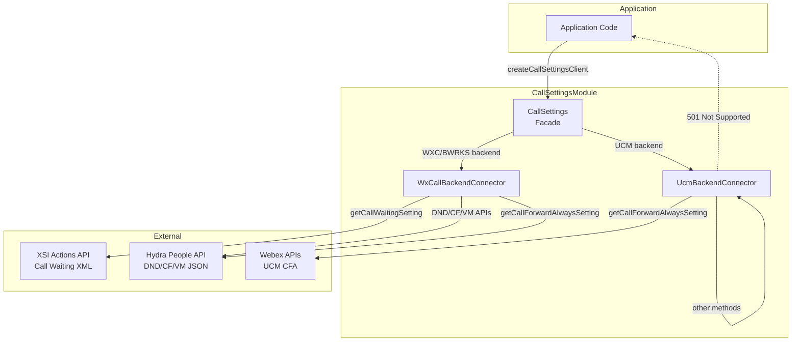
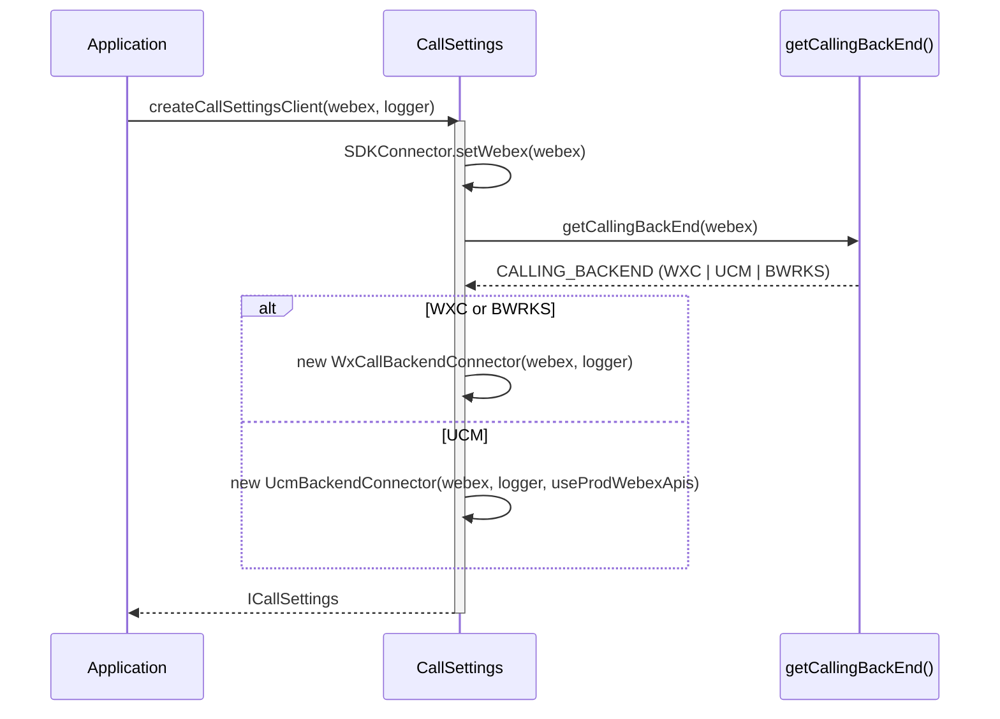
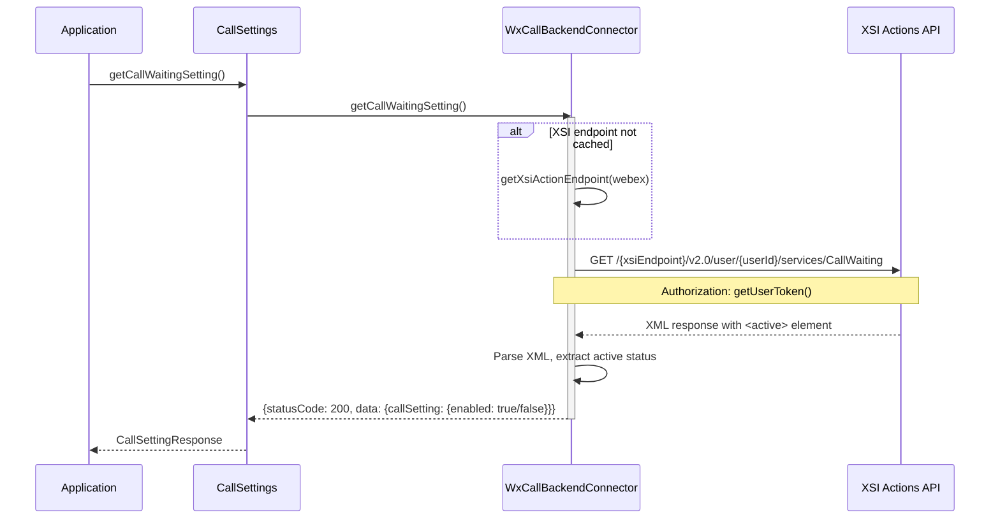
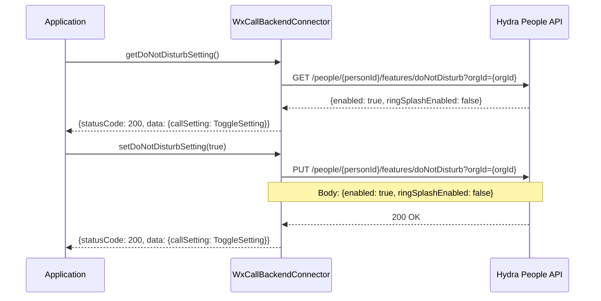
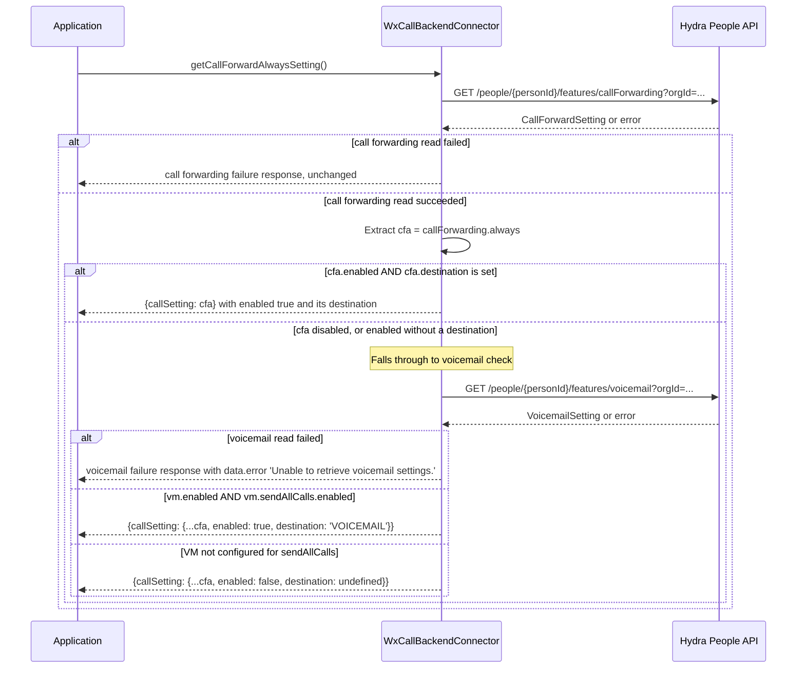
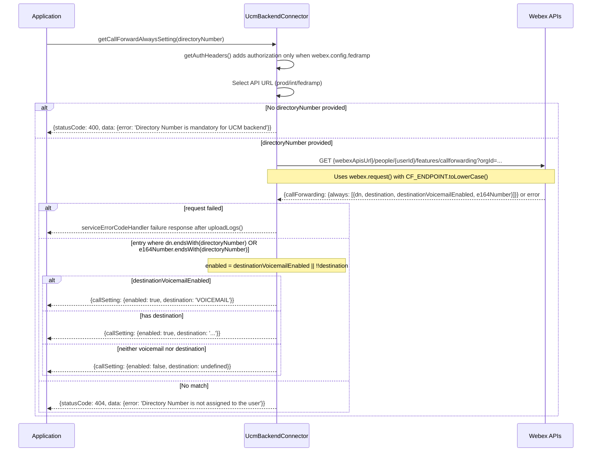
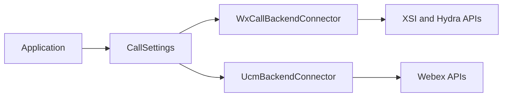
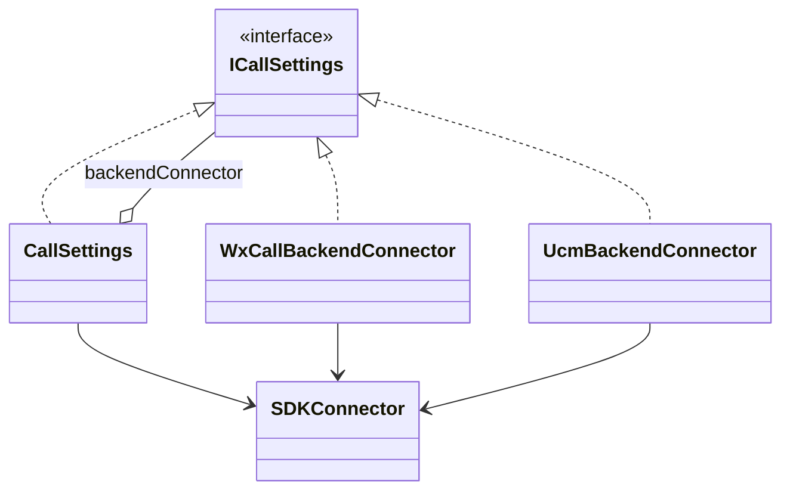

<!-- sdd-generated-metadata
doc_kind: module-spec
generated_from: module-spec@0.3.0
generated_by: claude-code
approved_by: rarajes2@cisco.com
updated_at: 2026-11-16T14:00:00Z
validation_status: not-run
-->

# CallSettings

This source-local document at `src/CallSettings/docs/README.md` owns the stable specification for
**CallSettings**: the `@webex/calling` client that reads and updates a user's call waiting, Do Not
Disturb, call forwarding, voicemail, and call forward always settings through a backend-specific
connector. Ground every claim in package evidence and link to the
[package architecture](../../../docs/architecture.md) instead of repeating package-wide facts such
as the shared logger, error formatting, and backend detection. No service specification exists
because this package is a library.

Related context: [documentation index](../../../docs/index.md) ·
[package agent instructions](../../../AGENTS.md)

## Metadata

| Field             | Value |
| ----------------- | ----- |
| Owner             | @webex/web-sdk (CODEOWNERS default rule) |
| Source path       | `src/CallSettings` |
| Resource kind     | module |
| Status            | Active |
| Last verified     | 2026-11-16 at `0b8c34db7f` |
| Module id         | `call-settings` |
| Parent spec       | — |
| Doc kind          | Module spec |
| Coverage score    | Pending coverage assessment |
| Validation status | not-run — independent validation pending in a different runtime |

## Applicability

| Condition ID                         | Status     | Evidence or reason | Owned section |
| ------------------------------------ | ---------- | ------------------ | ------------- |
| `module.has_tiers`                   | N/A        | No tier policy exists for this package or module | Tier |
| `module.has_ui`                      | N/A        | No view or screen; the module is a TypeScript library | UI use-case flow |
| `module.crosses_service_boundaries`  | Applicable | `src/CallSettings/WxCallBackendConnector.ts` calls the XSI Actions and Hydra People APIs; `src/CallSettings/UcmBackendConnector.ts` calls the Webex UC config API | Cross-boundary use-case flow |
| `module.holds_client_state`          | N/A        | Connectors keep only construction-time ids and a lazily cached XSI endpoint; no consumer-visible state (`src/CallSettings/WxCallBackendConnector.ts`) | Client state model |
| `module.enforces_domain_rules`       | Applicable | Backend selection, the call forward always precedence rule, and UCM directory-number matching (`src/CallSettings/CallSettings.ts`, `src/CallSettings/WxCallBackendConnector.ts`, `src/CallSettings/UcmBackendConnector.ts`) | Business rules and invariants |
| `module.is_concurrent_async`         | Applicable | Every ICallSettings method returns a promise (`src/CallSettings/types.ts`) | Concurrency and reactive flow |
| `module.owns_persistence`            | N/A        | Settings live in the remote calling profile; nothing is stored locally (`src/CallSettings/WxCallBackendConnector.ts`) | Data, schema, and migration discipline |
| `module.stateful_transitions`        | N/A        | Each call is an independent request and response; no lifecycle state machine (`src/CallSettings/CallSettings.ts`) | State machine |
| `module.exposes_wire_protocol`       | Applicable | URL paths, query parameters, and payload shapes are built from `src/CallSettings/constants.ts` and declared in `src/CallSettings/types.ts` | Protocol and wire format |
| `module.ui_multi_screen`             | N/A        | No UI | UI flow |
| `module.large_data_model`            | N/A        | Five setting shapes that mirror remote payloads (`src/CallSettings/types.ts`) | Data model |
| `module.returns_caller_errors`       | Applicable | The factory throws on an unidentified backend and every method can resolve a failure response (`src/CallSettings/CallSettings.ts`, `src/common/Utils.ts`) | Caller-visible failure modes |
| `module.module_specific_conventions` | Applicable | Backend-specific code stays in its connector, URLs come from module constants, and connectors resolve error responses instead of rejecting (`src/CallSettings/WxCallBackendConnector.ts`) | Module-specific rules |
| `module.published_package`           | Applicable | `package.json` publishes @webex/calling and `src/index.ts` re-exports the factory and types | Export stability |
| `module.embedded_in_host`            | N/A        | No host theme or embed API | Host integration and theming |
| `module.has_design_tradeoff`         | Applicable | One interface for every backend, with UCM answering 501 for unsupported methods (`src/CallSettings/UcmBackendConnector.ts`) | Key design trade-off |
| `module.has_submodules`              | N/A        | Computed false by the Repo Annotation module_tree.py script: no other module path lies under the CallSettings folder | Sub-modules |

## Evidence register

| Evidence | What it establishes |
| -------- | ------------------- |
| `src/CallSettings/CallSettings.ts` | The facade, its backend switch, the unidentified-backend error, and the `createCallSettingsClient` factory |
| `src/CallSettings/WxCallBackendConnector.ts` | WXC and BWRKS behavior: Hydra id encoding, the Hydra endpoint lookup, XSI call waiting, Hydra DND, call forwarding, voicemail, and the composite call forward always read |
| `src/CallSettings/UcmBackendConnector.ts` | UCM behavior: the 501 helper, Webex UC config URL selection, per-request FedRAMP authorization, and directory-number matching |
| `src/CallSettings/types.ts` | `ICallSettings`, `CallSettingResponse`, the setting shapes, and the UCM response shape |
| `src/CallSettings/constants.ts` | Path segments, the XSI version, and the `METHODS` log-context names |
| `src/common/Utils.ts` | `getCallingBackEnd`, `getXsiActionEndpoint` (which returns the caught error instead of throwing), `inferIdFromUuid`, `serviceErrorCodeHandler` status mapping, and `uploadLogs` |
| `src/common/constants.ts` | `SERVICES_ENDPOINT`, `VOICEMAIL`, the three Webex UC config base URLs, `SUCCESS_MESSAGE`, and `FAILURE_MESSAGE` |
| `src/SDKConnector/index.ts` | The frozen `SDKConnector` singleton and its set-once `setWebex` |
| `src/Logger/types.ts` | `LOGGER` level values used by `LoggerInterface` |
| `src/index.ts`, `src/api.ts`, `package.json` | The published exports and the TypeDoc entry |
| `src/CallSettings/CallSettings.test.ts` | Backend selection for UCM, WXC basic and standard, BWRKS, and both invalid inputs |
| `src/CallSettings/WxCallBackendConnector.test.ts` | Call waiting success, HTTP error, and thrown-error paths; DND, call forwarding, and voicemail get and set; call forward always destination, voicemail, not set, voicemail failure, and FedRAMP partial payload |
| `src/CallSettings/UcmBackendConnector.test.ts` | UCM call forward always matching by `dn` and `e164Number`, voicemail, not set, request failure, wrong and missing directory number, the 501 methods, and the FedRAMP URL and header |
| `src/CallSettings/testFixtures.ts` | Call forwarding, voicemail, and XSI lookup payloads used by the tests |
| `playwright/test-groups/call-settings.ts` | End-to-end journeys for DND, call forwarding, call forward always, and voicemail settings through the sample application |

## Purpose and boundary

- Responsibility: give an application one `ICallSettings` client that reads and updates the signed-in
  user's calling settings on whichever backend the user is entitled to. CallSettings owns the
  behavior rooted at `src/CallSettings/` and exposes it through the typed `@webex/calling` package
  boundary; shared infrastructure remains owned by `SDKConnector`, `Logger`, and `common`.
- In scope: backend detection at construction, the WXC/Broadworks connector, the UCM connector, the
  call forward always composition, and the response shape returned to callers.
- Out of scope: the remote settings services themselves, line registration and calls (CallingClient),
  voicemail messages (the Voicemail module), and package-wide logging and error formatting described
  in the [package architecture](../../../docs/architecture.md).
- Consumers: applications that call `createCallSettingsClient` from `@webex/calling`; in this
  repository, the Playwright sample journeys under `playwright/`.

The `CallSettings` module provides APIs for retrieving and updating user call settings such as Call
Waiting, Do Not Disturb (DND), Call Forwarding, Voicemail settings, and Call Forward Always. It uses a
**strategy pattern** to delegate operations to backend-specific connectors based on the user's
calling backend (WXC/Broadworks or UCM).

| Capability | Description |
| ----------- | ----------- |
| **Get Call Waiting** | Retrieves call waiting enabled/disabled status. WXC uses XSI Actions XML API via browser `fetch`. UCM returns 501 (not supported). |
| **Get/Set Do Not Disturb** | Reads or updates DND status via Hydra People API using `webex.request()` (WXC) or returns 501 (UCM). |
| **Get/Set Call Forwarding** | Reads or updates full call forwarding settings (always, busy, no answer, business continuity) via Hydra People API using `webex.request()` (WXC) or returns 501 (UCM). |
| **Get/Set Voicemail Settings** | Reads or updates voicemail configuration via Hydra People API using `webex.request()` (WXC) or returns 501 (UCM). |
| **Get Call Forward Always** | Composite API. WXC: checks call forwarding settings first; if CFA is enabled with a destination returns it, otherwise falls through to voicemail check (returns `VOICEMAIL` if voicemail `enabled` and `sendAllCalls.enabled`). UCM: queries Webex APIs and matches `directoryNumber` against `dn` or `e164Number` fields using `endsWith()`. |
| **Multi-Backend Support** | Automatically selects the correct backend connector (WXC/Broadworks or UCM) based on user entitlements via `getCallingBackEnd()`. |

## Structure and key files

| Path | Responsibility |
| ---- | -------------- |
| `src/CallSettings/CallSettings.ts` | Facade class with backend delegation, and the `createCallSettingsClient` factory |
| `src/CallSettings/WxCallBackendConnector.ts` | WXC/Broadworks backend implementation |
| `src/CallSettings/UcmBackendConnector.ts` | UCM backend implementation |
| `src/CallSettings/types.ts` | ICallSettings, setting types, response types |
| `src/CallSettings/constants.ts` | Endpoints, method names |
| `src/CallSettings/testFixtures.ts` | Test fixtures |
| `src/CallSettings/CallSettings.test.ts` | Facade unit tests |
| `src/CallSettings/WxCallBackendConnector.test.ts` | WXC connector unit tests |
| `src/CallSettings/UcmBackendConnector.test.ts` | UCM connector unit tests |

## Public surface

Declarations live in `src/CallSettings/types.ts` and `src/CallSettings/CallSettings.ts`; the package
entry `src/index.ts` re-exports them and the declaration build writes `dist/types/index.d.ts`. This
section summarises them and does not restate signatures.

| Surface | Consumer | Compatibility commitment | Source |
| ------- | -------- | ------------------------ | ------ |
| `createCallSettingsClient` factory | Applications through `@webex/calling` | Synchronous; returns a new `ICallSettings` per call (`MOD-001`) | `src/CallSettings/CallSettings.ts` |
| `ICallSettings` interface | Applications | Eight methods, each returning `Promise<CallSettingResponse>` (`MOD-002` to `MOD-008`) | `src/CallSettings/types.ts` |
| `CallSettingResponse`, `ToggleSetting`, `CallForwardSetting`, `CallForwardAlwaysSetting`, `VoicemailSetting` types | Applications | Re-exported from the package entry | `src/index.ts` |
| `CallSettings` class | TypeDoc reference build | Listed only in the TypeDoc entry, not in the package entry | `src/api.ts` |

**Package:** `@webex/calling`

**Entry point:** `src/CallSettings/CallSettings.ts` in the `packages/calling` workspace

**Factory:** `createCallSettingsClient(webex, logger, useProdWebexApis?) -> ICallSettings`

| Method | Signature | Description |
| ------ | --------- | ----------- |
| `getCallWaitingSetting` | `(): Promise<CallSettingResponse>` | Get call waiting status |
| `getDoNotDisturbSetting` | `(): Promise<CallSettingResponse>` | Get DND status |
| `setDoNotDisturbSetting` | `(flag: boolean): Promise<CallSettingResponse>` | Enable/disable DND |
| `getCallForwardSetting` | `(): Promise<CallSettingResponse>` | Get call forwarding settings |
| `setCallForwardSetting` | `(request: CallForwardSetting): Promise<CallSettingResponse>` | Update call forwarding settings |
| `getVoicemailSetting` | `(): Promise<CallSettingResponse>` | Get voicemail configuration |
| `setVoicemailSetting` | `(request: VoicemailSetting): Promise<CallSettingResponse>` | Update voicemail configuration |
| `getCallForwardAlwaysSetting` | `(directoryNumber?: string): Promise<CallSettingResponse>` | Get CFA status (destination or voicemail). `directoryNumber` required for UCM. |

| Parameter | Type | Required | Description |
| --------- | ---- | -------- | ----------- |
| `webex` | `WebexSDK` | Yes | An initialized Webex SDK instance |
| `logger` | `LoggerInterface` | Yes | Logger interface with a `level` property |
| `useProdWebexApis` | `boolean` | No | For UCM: use production Webex APIs (default: `true`). Set to `false` for integration testing. |

Response and setting shapes (declared in `src/CallSettings/types.ts`):

- `CallSettingResponse` has a numeric `statusCode`, a `data` object holding an optional `callSetting`
  (a `ToggleSetting`, `CallForwardSetting`, `VoicemailSetting`, or `CallForwardAlwaysSetting`) and an
  optional `error` string, and a `message` that is a string or `null`; success responses carry
  `SUCCESS` and failure responses `FAILURE`.
- `ToggleSetting` has a required boolean `enabled` and an optional boolean `ringSplashEnabled`.
- `CallForwardAlwaysSetting` has a required boolean `enabled` and the optional `ringReminderEnabled`,
  `destinationVoicemailEnabled`, and `destination` (a phone number or `'VOICEMAIL'`).
- `CallForwardSetting` has `callForwarding` with `always` (a `CallForwardAlwaysSetting`), `busy`
  (`enabled`, optional `destinationVoicemailEnabled` and `destination`), and `noAnswer` (`enabled`,
  optional `numberOfRings`, `systemMaxNumberOfRings`, `destinationVoicemailEnabled`, and
  `destination`), plus a top-level `businessContinuity` (`enabled`, optional
  `destinationVoicemailEnabled` and `destination`).
- `VoicemailSetting` contains `enabled`, an optional `sendAllCalls`, `sendBusyCalls`,
  `sendUnansweredCalls`, `notifications`, an optional `transferToNumber`, `emailCopyOfMessage`,
  `messageStorage`, and an optional `faxMessage` configuration object, plus the optional
  `voiceMessageForwardingEnabled` flag.

## Dependencies

| Dependency | Why it is required | Failure behavior |
| ---------- | ------------------ | ---------------- |
| `SDKConnector` singleton (`sdk-connector-internal`) | Holds the shared Webex SDK instance; the facade and each connector call `setWebex` only when no instance is set yet | `setWebex` throws when the instance fails validation; the error propagates from the factory |
| Hydra People API (`hydra-http`) | DND, call forwarding, and voicemail settings for WXC and BWRKS, and the organization lookup that yields the XSI Actions endpoint | Rejections become `serviceErrorCodeHandler` responses (`MOD-008`) |
| XSI Actions `CallWaiting` service, at the endpoint returned by the Hydra organization lookup | Call waiting for WXC and BWRKS | A non-OK status or parse failure becomes a failure response (`MOD-002`) |
| Webex UC config API (`/v1/uc/config` on the production, integration, or FedRAMP host) | Call forward always for UCM | Rejections become failure responses; a FedRAMP token failure rejects (`MOD-007`) |
| Webex SDK `credentials.getUserToken()` | Explicit authorization for XSI call waiting and for FedRAMP UCM requests | See the call waiting and UCM rows above |

- Webex Calling XSI/Hydra services
- Webex UC config API for UCM call forward always (the module does not call the UCM management gateway)
- Calling-backend resolution

The manifest's `broadworks-http` and `ucm-gateway-http` contracts are not reached by this module's
code: BWRKS users go through the same Hydra and XSI path as WXC, and UCM reads go to the Webex UC
config API.

| Package | Purpose |
| ------- | ------- |
| `webex` (SDK) | HTTP requests to Hydra API, XSI Actions API, Webex APIs |

| Module | Purpose |
| ------ | ------- |
| `SDKConnector` | Singleton bridge to Webex SDK |
| `Logger` | Structured logging with file/method context |
| `getCallingBackEnd` | Determines calling backend (WXC, UCM, BWRKS) |
| `getXsiActionEndpoint` | Resolves XSI Actions endpoint for call waiting (lazy, cached after first call) |
| `inferIdFromUuid` | Converts device userId/orgId to Hydra-format IDs (`DecodeType.PEOPLE`, `DecodeType.ORGANIZATION`) |
| `serviceErrorCodeHandler` | Standardized error response formatting |
| `uploadLogs` | Uploads diagnostic logs on error |

## Requirements

| ID | WHAT | WHY | Source evidence | Test or example evidence | Assumptions or gaps | Confidence |
| -- | ---- | --- | --------------- | ------------------------ | ------------------- | ---------- |
| `MOD-001` | `createCallSettingsClient(webex, logger, useProdWebexApis?)` resolves the backend with `getCallingBackEnd`; `WXC` and `BWRKS` get a `WxCallBackendConnector`, `UCM` gets a `UcmBackendConnector` that receives `useProdWebexApis`, and any other result throws `Error('Calling backend is not identified, exiting....')` | Selecting a connector from entitlements isolates incompatible backend APIs behind one interface and prevents requests to unsupported services. | `src/CallSettings/CallSettings.ts` | `src/CallSettings/CallSettings.test.ts` | none | Present |
| `MOD-002` | On WXC and BWRKS, `getCallWaitingSetting` GETs the XSI `CallWaiting` service with an `Authorization` header from `getUserToken()` and returns `callSetting.enabled` true only when the `active` element text is `true`; on UCM it resolves the 501 response | Backend-specific support must be explicit so callers receive the WXC value and a truthful unsupported response on UCM instead of a fabricated setting. | `src/CallSettings/WxCallBackendConnector.ts`, `src/CallSettings/UcmBackendConnector.ts` | `src/CallSettings/WxCallBackendConnector.test.ts`, `src/CallSettings/UcmBackendConnector.test.ts` | none | Present |
| `MOD-003` | On WXC and BWRKS, `getDoNotDisturbSetting` GETs and `setDoNotDisturbSetting(enabled)` PUTs `{enabled, ringSplashEnabled: false}` to the Hydra `doNotDisturb` feature; the set response echoes that request body; on UCM both resolve 501 | Symmetric read/write DND operations keep the local client aligned with the person's authoritative remote calling profile. | `src/CallSettings/WxCallBackendConnector.ts` | `src/CallSettings/WxCallBackendConnector.test.ts` | none | Present |
| `MOD-004` | On WXC and BWRKS, `getCallForwardSetting` GETs and `setCallForwardSetting` PUTs the whole `CallForwardSetting` to the Hydra `callForwarding` feature; the set response echoes the request; on UCM both resolve 501 | Preserving each forwarding mode prevents an update to one destination from silently overwriting busy, no-answer, or continuity behavior. | `src/CallSettings/WxCallBackendConnector.ts` | `src/CallSettings/WxCallBackendConnector.test.ts` | Callers must send every mode they want to keep | Present |
| `MOD-005` | On WXC and BWRKS, `getVoicemailSetting` GETs and `setVoicemailSetting` PUTs the `VoicemailSetting` to the Hydra `voicemail` feature; the set response echoes the request; on UCM both resolve 501 | Voicemail routing is a remote user setting, so reads and writes must use the backend contract rather than local cached assumptions. | `src/CallSettings/WxCallBackendConnector.ts` | `src/CallSettings/WxCallBackendConnector.test.ts` | none | Present |
| `MOD-006` | On WXC and BWRKS, `getCallForwardAlwaysSetting()` reads call forwarding, returns `callForwarding.always` when it is enabled with a destination, and otherwise reads voicemail and returns the always setting with `enabled: true, destination: 'VOICEMAIL'` when voicemail `enabled` and `sendAllCalls.enabled` are both true, or `enabled: false, destination: undefined` when not; the status code is the call forwarding read's | The composite check produces one caller-facing CFA answer while respecting the different WXC voicemail fallback and UCM directory-number models. | `src/CallSettings/WxCallBackendConnector.ts` | `src/CallSettings/WxCallBackendConnector.test.ts` | none | Present |
| `MOD-007` | On UCM, `getCallForwardAlwaysSetting(directoryNumber)` resolves 400 without a directory number, otherwise GETs the Webex UC config `callforwarding` feature, picks the first `always` entry whose `dn` or `e164Number` ends with the directory number, and returns `enabled = destinationVoicemailEnabled \|\| !!destination` with `destination` set to `VOICEMAIL` when voicemail is enabled; no match resolves 404 | UCM users can have multiple directory numbers, so the caller must name the line whose forwarding it wants; matching the suffix accepts both short and E.164 forms of that number. | `src/CallSettings/UcmBackendConnector.ts` | `src/CallSettings/UcmBackendConnector.test.ts` | none | Present |
| `MOD-008` | When a remote request fails, each connector method logs the error, calls `uploadLogs()`, and resolves the `serviceErrorCodeHandler` response (`statusCode`, `data.error`, message `FAILURE`) instead of rejecting | Standardized error response formatting lets callers branch on `statusCode` for every backend instead of handling transport-specific exceptions. | `src/CallSettings/WxCallBackendConnector.ts`, `src/CallSettings/UcmBackendConnector.ts`, `src/common/Utils.ts` | `src/CallSettings/WxCallBackendConnector.test.ts`, `src/CallSettings/UcmBackendConnector.test.ts` | The FedRAMP token fetch in the UCM connector runs outside the guarded block | Present |

## Design overview

The CallSettings module uses a **strategy pattern**: the `CallSettings` facade delegates all
operations to a backend-specific connector chosen at construction time. The architecture is:
**Application -> CallSettings -> BackendConnector (WXC or UCM) -> Backend API**.

The facade is a thin logger-and-delegate layer: each public method logs its start under the
`CallSettings` file context and returns the connector's promise unchanged. The facade and both
connectors share the Webex SDK instance through `SDKConnector` and set it only when it is unset.
The WXC connector computes its Hydra base URL and Hydra-format person and organization ids once in
its constructor, and resolves the XSI Actions endpoint lazily on the first call waiting read. The UCM
connector keeps the raw device user and organization ids and builds its base URL and headers on
every call. Connectors hold no other state; every setting lives in the remote profile.

## Data flow and sequence coverage

All calls are promise-returning HTTP requests: `webex.request()` for Hydra and the Webex UC config
API, and browser `fetch` for XSI call waiting. The module adds no timeout or retry of its own.

| Operation group | Entry and outcome | Diagram or evidence | Failure and recovery coverage |
| --------------- | ----------------- | ------------------- | ----------------------------- |
| Select backend connector | `createCallSettingsClient` returns an `ICallSettings` backed by the WXC or UCM connector | Backend selection flow and backend connector initialization below; `src/CallSettings/CallSettings.ts` | An unidentified backend throws instead of selecting an invalid connector |
| Read call waiting | `getCallWaitingSetting` returns `enabled` parsed from XSI XML | Get call waiting below; `src/CallSettings/WxCallBackendConnector.ts` | Token, HTTP status, XML, and service failures resolve a failure response; UCM resolves 501 |
| Read and write DND, forwarding, and voicemail | Get or PUT one Hydra feature and return its body or the request body | Get/set DND below (forwarding and voicemail use the same actors and order); `src/CallSettings/WxCallBackendConnector.ts` | Rejections resolve failure responses; UCM resolves 501 |
| Resolve call forward always | One composite answer per backend | WXC and UCM call forward always diagrams below; `src/CallSettings/UcmBackendConnector.ts` | The voicemail fallback, the voicemail read failure, and missing or unmatched directory numbers are explicit |

Backend selection flow:



Backend connector initialization:



Get call waiting (WXC, XSI Actions):



Get/set DND (WXC, Hydra API):



Get call forward always (WXC, composite):



Get call forward always (UCM, directory number):



## Class and component relationships

| Layer | Component | File | Key Responsibilities |
|-------|-----------|------|---------------------|
| **Facade** | `CallSettings` | `CallSettings.ts` | Backend detection, connector initialization, API delegation |
| **WXC Connector** | `WxCallBackendConnector` | `WxCallBackendConnector.ts` | XSI Actions (call waiting), Hydra People API (DND, CF, VM, CFA) |
| **UCM Connector** | `UcmBackendConnector` | `UcmBackendConnector.ts` | Webex APIs for CFA with directory number; 501 for unsupported methods |

| Component | Access Pattern | Lifecycle |
|-----------|---------------|-----------|
| `CallSettings` | `createCallSettingsClient(webex, logger, useProdWebexApis?)` factory | A new instance per factory call; typically one per application |
| `SDKConnector` | Frozen singleton via `import SDKConnector` | Global, set once via `setWebex()` |
| `WxCallBackendConnector` | Created internally by `CallSettings.initializeBackendConnector()` | One per CallSettings |
| `UcmBackendConnector` | Created internally by `CallSettings.initializeBackendConnector()` | One per CallSettings |



Both connectors implement the same interface as the facade (`IWxCallBackendConnector` and
`IUcmBackendConnector` are aliases of `ICallSettings`), so the facade holds the connector through
the interface type:



## Use cases and flows

| Use case | Actor or caller | Primary steps and outcome | Failure or boundary behavior | Evidence |
| -------- | --------------- | ------------------------- | ---------------------------- | -------- |
| `UC-001` | Application | Create a client with the Webex instance and a logger level; the backend is chosen once | Throws on an unidentified backend | `src/CallSettings/CallSettings.test.ts` |
| `UC-002` | Application | Read DND, then enable or disable it | UCM resolves 501 | `src/CallSettings/WxCallBackendConnector.test.ts` |
| `UC-003` | Application on WXC or BWRKS | Read call forward always without an argument and branch on `destination` | Voicemail read failure resolves a failure response | `src/CallSettings/WxCallBackendConnector.test.ts` |
| `UC-004` | Application on UCM | Read call forward always for one directory number | 400 without a number, 404 when it is not the user's | `src/CallSettings/UcmBackendConnector.test.ts` |
| `UC-005` | Application | Send a full call forwarding object to update every mode | UCM resolves 501; failures resolve mapped status codes | `src/CallSettings/WxCallBackendConnector.test.ts` |
| `UC-006` | Application | Read or update voicemail routing and notifications | UCM resolves 501 | `src/CallSettings/WxCallBackendConnector.test.ts` |
| `UC-007` | Application | Read call waiting | UCM resolves 501; XSI failures resolve mapped status codes | `src/CallSettings/WxCallBackendConnector.test.ts` |

Create a CallSettings client:

```typescript
import {createCallSettingsClient} from '@webex/calling';

const callSettings = createCallSettingsClient(webex, {level: 'info'});
```

Get and set DND:

```typescript
const dndResponse = await callSettings.getDoNotDisturbSetting();
console.log('DND enabled:', dndResponse.data.callSetting?.enabled);

await callSettings.setDoNotDisturbSetting(true);
```

Get call forward always status:

```typescript
// WXC backend (no directoryNumber needed)
const cfaResponse = await callSettings.getCallForwardAlwaysSetting();

// UCM backend (directoryNumber required)
const cfaResponse = await callSettings.getCallForwardAlwaysSetting('1234');

if (cfaResponse.data.callSetting?.destination === 'VOICEMAIL') {
  console.log('CFA is set to voicemail');
}
```

Update call forwarding:

```typescript
const cfSettings = {
  callForwarding: {
    always: {enabled: true, destination: '+15551234567'},
    busy: {enabled: false},
    noAnswer: {enabled: true, numberOfRings: 4, destination: '+15559876543'},
  },
  businessContinuity: {enabled: false},
};

await callSettings.setCallForwardSetting(cfSettings);
```

### Cross-boundary use-case flow

- XSI Actions (`UC-007`): the WXC connector first asks Hydra for the organization's calling data to
  learn the XSI Actions endpoint, then sends one browser `fetch` GET with the user token. There is no
  timeout or retry; a non-OK status is turned into a failure response by status code.
- Hydra People API (`UC-002`, `UC-003`, `UC-005`, `UC-006`): one `webex.request()` per read or
  write, with the Hydra-format person id in the path and the Hydra-format organization id in the
  `orgId` query parameter. Call forward always issues the call forwarding read and then, only when
  needed, the voicemail read, strictly in that order. The SDK owns authentication, timeouts, and
  retries for these requests.
- Webex UC config API (`UC-004`): one `webex.request()` with the raw device user and organization
  ids; on FedRAMP the connector adds an `authorization` header fetched for each request rather than
  cached.

## Business rules and invariants

| ID | Invariant | WHY | Enforcement source | Test evidence |
| -- | --------- | --- | ------------------ | ------------- |
| `INV-001` | Connector selection follows the resolved calling backend; unsupported UCM operations return 501 rather than simulating support. | A caller can always tell an unsupported setting from a real value | `src/CallSettings/CallSettings.ts` | `src/CallSettings/UcmBackendConnector.test.ts` |
| `INV-002` | WXC XSI call-waiting requests use an explicit user-token header; Webex SDK requests use their documented auth path. | The browser `fetch` path has no SDK interceptor to add credentials | `src/CallSettings/WxCallBackendConnector.ts` | `src/CallSettings/WxCallBackendConnector.test.ts` |
| `INV-003` | Call-forward-always resolution prefers an enabled destination, then the voicemail fallback. Key fields for CFA logic: `enabled` and `sendAllCalls.enabled` — when both are true, CFA is considered set to voicemail. | One answer per user even though WXC stores voicemail forwarding outside call forwarding | `src/CallSettings/WxCallBackendConnector.ts` | `src/CallSettings/WxCallBackendConnector.test.ts` |
| `INV-004` | The UCM connector matches the provided `directoryNumber` against CFA entries using `endsWith()`. UCM directory-number matching accepts `dn` or `e164Number` suffix matches: `callForwarding.always.find((item) => item.dn.endsWith(directoryNumber) \|\| item.e164Number.endsWith(directoryNumber))`. This allows partial matching (e.g., passing `'1234'` matches `'+15551234'`). | Callers may hold either the short or the E.164 form of the line number | `src/CallSettings/UcmBackendConnector.ts` | `src/CallSettings/UcmBackendConnector.test.ts` |
| `INV-005` | A UCM call forward always entry is enabled when `destinationVoicemailEnabled` is true or a destination exists, and voicemail wins over a destination. | The UCM payload carries no separate enabled flag for always forwarding | `src/CallSettings/UcmBackendConnector.ts` | `src/CallSettings/UcmBackendConnector.test.ts` |

## Concurrency and reactive flow

- Execution model: browser event loop; every method is `async` and awaits its requests.
- Ordering guarantees: Each settings method awaits one backend connector operation. Within WXC call
  forward always, the voicemail read starts only after the call forwarding read resolves. Separate
  calls are not ordered against each other.
- Idempotency and retry: reads are idempotent; set methods PUT the full object, so repeating one is
  harmless. The module never retries.
- Shared-state protection: The WXC XSI endpoint is resolved lazily and cached in `xsiEndpoint`; there
  is no in-flight de-duplication, so concurrent first calls each resolve the endpoint and the last
  write wins, while each call keeps its own independent response promise. All other connector fields
  are written only in the constructor.
- Blocking restrictions: none; XML parsing of the call waiting response is synchronous but small.

## Protocol and wire format

| Message or frame | Version | Producer or serializer | Consumer or parser | Compatibility and ordering rule |
| ---------------- | ------- | ---------------------- | ------------------ | ------------------------------- |
| XSI call waiting GET, XML response | XSI `v2.0` | `src/CallSettings/WxCallBackendConnector.ts` | `src/CallSettings/WxCallBackendConnector.ts` (`DOMParser`, first `active` element) | The response must contain an `active` element; anything else becomes a 422 failure |
| Hydra feature GET and PUT, JSON | Hydra v1 | `src/CallSettings/WxCallBackendConnector.ts` | Hydra People API | PUT bodies are the caller's objects unchanged, except DND, which always sends `ringSplashEnabled: false` |
| Webex UC config call forwarding GET, JSON | `/v1/uc/config` | `src/CallSettings/UcmBackendConnector.ts` | `src/CallSettings/UcmBackendConnector.ts` | `callForwarding.always` is read as an array of `CallForwardingAlwaysSettingsUCM` |

URL patterns:

WXC call waiting (XSI):

```
{xsiEndpoint}/v2.0/user/{userId}/services/CallWaiting
```

WXC Hydra APIs (DND, CF, VM):

```
{hydraEndpoint}/people/{personId}/features/{feature}?orgId={orgId}
```

Where `{personId}` and `{orgId}` are Hydra-encoded via `inferIdFromUuid()`. The XSI call waiting URL
uses the raw device `userId`.

UCM call forward always:

```
{webexApisUrl}/people/{userId}/features/callforwarding?orgId={orgId}
```

Where `{webexApisUrl}` is selected based on prod/int/fedramp config. Note: uses raw `userId` and
`orgId` (not Hydra-encoded).

The WXC connector converts raw device UUIDs to Hydra-format IDs at construction time:
`this.personId` is `inferIdFromUuid(this.webex.internal.device.userId, DecodeType.PEOPLE)` and
`this.orgId` is `inferIdFromUuid(this.webex.internal.device.orgId, DecodeType.ORGANIZATION)`. These
Hydra-format IDs are used in all Hydra People API URLs. The Hydra base URL is
`webex.internal.services._serviceUrls.hydra`, or the active `hydra` service URL when that is absent.

The UCM connector lowercases `CF_ENDPOINT` when constructing URLs:

- WXC uses: `features/callForwarding` (camelCase)
- UCM uses: `features/callforwarding` (lowercase, via `.toLowerCase()`)

The UCM response (`CallForwardingSettingsUCM`, not exported) has `callForwarding.always` as an array
of `CallForwardingAlwaysSettingsUCM` entries, each with a required `dn` (directory number), an
optional `destination` (forward destination), a required boolean `destinationVoicemailEnabled`, and
a required `e164Number` (E.164 formatted number). Note: The UCM response has `always` as an
**array** (unlike WXC which has a single object), since UCM users can have multiple directory
numbers.

The UCM connector selects the Webex API base URL based on configuration:

| Condition | Base URL |
| --------- | -------- |
| `webex.config.fedramp === true` | `https://api-usgov.webex.com/v1/uc/config` |
| `useProdWebexApis === true` (default) | `https://webexapis.com/v1/uc/config` |
| `useProdWebexApis === false` | `https://integration.webexapis.com/v1/uc/config` |

| Method | Backend | HTTP Client | Auth Handling |
| ------ | ------- | ----------- | ------------- |
| `getCallWaitingSetting` | WXC | Browser `fetch` | Manual `Authorization` header via `getUserToken()` |
| `getDoNotDisturbSetting` | WXC | `this.webex.request()` | Automatic via SDK |
| `setDoNotDisturbSetting` | WXC | `this.webex.request()` | Automatic via SDK |
| `getCallForwardSetting` | WXC | `this.webex.request()` | Automatic via SDK |
| `setCallForwardSetting` | WXC | `this.webex.request()` | Automatic via SDK |
| `getVoicemailSetting` | WXC | `this.webex.request()` | Automatic via SDK |
| `setVoicemailSetting` | WXC | `this.webex.request()` | Automatic via SDK |
| `getCallForwardAlwaysSetting` | WXC | `this.webex.request()` (via CF/VM methods) | Automatic via SDK |
| `getCallForwardAlwaysSetting` | UCM | `this.webex.request()` | FedRAMP: manual `authorization` header; otherwise: implicit |

Path segments from `src/CallSettings/constants.ts`:

| Constant | Value | Description |
|----------|-------|-------------|
| `PEOPLE_ENDPOINT` | `'people'` | Hydra People API path segment |
| `DND_ENDPOINT` | `'features/doNotDisturb'` | DND feature endpoint |
| `CF_ENDPOINT` | `'features/callForwarding'` | Call forwarding feature endpoint (UCM lowercases this) |
| `VM_ENDPOINT` | `'features/voicemail'` | Voicemail feature endpoint |
| `CALL_WAITING_ENDPOINT` | `'CallWaiting'` | XSI call waiting service endpoint |
| `XSI_VERSION` | `'v2.0'` | XSI Actions API version |
| `ORG_ENDPOINT` | `'orgId'` | Organization ID query parameter |
| `USER_ENDPOINT` | `'user'` | XSI user path segment |

Shared values from `src/common/constants.ts`:

| Constant | Value | Description |
|----------|-------|-------------|
| `SERVICES_ENDPOINT` | `'services'` | XSI services path segment |
| `VOICEMAIL` | `'VOICEMAIL'` | Voicemail destination string (used by UCM connector) |
| `WEBEX_API_CONFIG_PROD_URL` | `'https://webexapis.com/v1/uc/config'` | UCM production API base |
| `WEBEX_API_CONFIG_INT_URL` | `'https://integration.webexapis.com/v1/uc/config'` | UCM integration/test API base |
| `WEBEX_API_CONFIG_FEDRAMP_URL` | `'https://api-usgov.webex.com/v1/uc/config'` | UCM FedRAMP API base |

## Caller-visible failure modes

| Condition | Signal or result | Caller behavior | Retry or recovery | Evidence |
| --------- | ---------------- | --------------- | ----------------- | -------- |
| Backend is not WXC, BWRKS, or UCM | `createCallSettingsClient` throws `Error('Calling backend is not identified, exiting....')` | Do not offer call settings for this user | Fix the device calling behavior or entitlements, then create a new client | `src/CallSettings/CallSettings.test.ts` |
| UCM method other than call forward always | Resolves `statusCode: 501`, `data.error` 'Method is not implemented at the backend', message `FAILURE` | Hide or disable the setting | None; the backend has no implementation | `src/CallSettings/UcmBackendConnector.test.ts` |
| UCM call forward always without a directory number | Resolves 400 with 'Directory Number is mandatory for UCM backend' | Pass the line's directory number | Call again with the number | `src/CallSettings/UcmBackendConnector.test.ts` |
| UCM directory number not on the user | Resolves 404 with 'Directory Number is not assigned to the user' | Check which line is selected | Call again with an assigned number | `src/CallSettings/UcmBackendConnector.test.ts` |
| Remote request rejects (Hydra or Webex UC config) | Resolves the mapped status: 400, 401, 403, 404, 408, 500, 501, or 503 with a fixed message, otherwise the code itself or 422 | Branch on `statusCode` | Caller-owned; 401 suggests a token refresh | `src/CallSettings/WxCallBackendConnector.test.ts` |
| XSI call waiting fails | A non-OK status resolves that status mapped as above; a thrown error or an XML body without `active` resolves 422 | Branch on `statusCode` | Caller-owned | `src/CallSettings/WxCallBackendConnector.test.ts` |
| WXC call forward always: voicemail read fails | Resolves the voicemail failure response with `data.error` 'Unable to retrieve voicemail settings.' | Treat the call forward always state as unknown | Call again | `src/CallSettings/WxCallBackendConnector.test.ts` |
| WXC call forward always: call forwarding read fails | Resolves the call forwarding failure response unchanged; voicemail is not read | Treat the state as unknown | Call again | `src/CallSettings/WxCallBackendConnector.test.ts` |
| UCM on FedRAMP and the user token fetch rejects | `getCallForwardAlwaysSetting` rejects with that error | Catch the rejection | Refresh credentials and call again | `src/CallSettings/UcmBackendConnector.ts` |

## Pitfalls and constraints

- **501 Not Supported for UCM.** **Symptoms:** Methods like `getCallWaitingSetting`,
  `getDoNotDisturbSetting`, etc. return `statusCode: 501`. **Explanation:** The UCM backend connector
  intentionally returns 501 for most methods. Only `getCallForwardAlwaysSetting` is implemented for
  UCM.
- **Call Waiting Fails on WXC.** **Symptoms:** `getCallWaitingSetting` returns an error.
  **Possible Causes:**
  - XSI Actions endpoint not resolvable via `getXsiActionEndpoint()`
  - User token expired (fetched via `this.webex.credentials.getUserToken()`)
  - XSI service unavailable
  - XML parse error (response doesn't contain `<active>` element), reported as 422

  **What happens internally:** The WXC connector lazily resolves the XSI endpoint on first call via
  `getXsiActionEndpoint(webex, loggerContext, CALLING_BACKEND.WXC)` and caches it in
  `this.xsiEndpoint`. Uses browser `fetch` (not `webex.request()`) for this endpoint. Parses the XML
  response using `DOMParser` and extracts `<active>` element text content.
- **A failed XSI endpoint lookup is cached.** `getXsiActionEndpoint` catches its own errors and
  returns the error object, which the connector stores as `xsiEndpoint`; later call waiting reads on
  that client keep failing until a new client is created. Evidence: `src/common/Utils.ts`.
- **CFA Returns Wrong State.** **Symptoms:** `getCallForwardAlwaysSetting` returns unexpected
  enabled/destination values. Trace the branch in the WXC and UCM call forward always diagrams under
  Data flow and sequence coverage (`MOD-006`, `MOD-007`). On WXC, an always entry that has a
  destination but `enabled: false` falls through to voicemail and comes back with
  `destination: undefined`.
- **UCM CFA Requires Directory Number.** **Symptoms:** `getCallForwardAlwaysSetting()` returns
  `statusCode: 400` on UCM. **Fix:** Pass the user's directory number:
  `getCallForwardAlwaysSetting('1234')`
- **Set responses echo the request.** `setDoNotDisturbSetting`, `setCallForwardSetting`, and
  `setVoicemailSetting` return the object that was sent, not a fresh read; read again to see the
  server's normalized state.
- **Partial forwarding objects overwrite.** `setCallForwardSetting` sends the object as given, so a
  caller that omits a mode can reset it (`MOD-004`).

## Module-specific rules

- Do: For WXC-specific backend logic, refer to `WxCallBackendConnector.ts`; it also serves BWRKS.
- Do: For UCM-specific backend logic, refer to `UcmBackendConnector.ts`.
- Do: For backend detection logic (`getCallingBackEnd`), refer to `common/Utils.ts`; the facade only
  selects and delegates.
- Do: use the factories, constants, and adapters already owned by `src/CallSettings/`: build URLs
  from `constants.ts`, reach the SDK through `SDKConnector`, and add each new method name to
  `METHODS` for its log context.
- Do: catch remote failures in the connector, call `uploadLogs()`, and resolve
  `serviceErrorCodeHandler(...)` (`MOD-008`); do not let connector methods reject.
- Do not: add direct network or SDK access when the module already provides an adapter. The one
  existing exception is the XSI call waiting `fetch`, which must carry the user token itself
  (`INV-002`).

## Export stability

| Export or entry point | Consumer | Stability | Versioning and deprecation rule | Declaration or API report |
| --------------------- | -------- | --------- | ------------------------------- | ------------------------- |
| `createCallSettingsClient` | Applications | Stable | Semver through `@webex/calling` | `src/index.ts` |
| `ICallSettings`, `CallSettingResponse`, `ToggleSetting`, `CallForwardSetting`, `CallForwardAlwaysSetting`, `VoicemailSetting` | Applications | Stable | Semver through `@webex/calling` | `src/CallSettings/types.ts` |
| `CallSettings` class | TypeDoc readers | Documentation only | Not in the package entry; do not depend on it | `src/api.ts` |

- Public factories, interfaces, types, and events are semver-controlled through `src/index.ts`;
  removals or incompatible signature changes require an approved migration and release plan.

## Key design trade-off

| Chosen trade-off | Preserved invariant or benefit | Cost or limitation | Decision evidence |
| ---------------- | ------------------------------ | ------------------ | ----------------- |
| One `ICallSettings` interface for every backend, with UCM answering 501 for methods it lacks | One entry point and one response shape for every user | Consumers must handle documented WXC/UCM support differences | `src/CallSettings/UcmBackendConnector.ts` |
| Call forward always is composed in the WXC connector from two reads | Callers get one answer that includes voicemail forwarding | Two sequential requests, and the result is not atomic | `src/CallSettings/WxCallBackendConnector.ts` |

The common settings interface exposes backend capability differences as explicit 501 results rather
than a least-common-denominator API. Consumers get one entry point, but must handle documented
WXC/UCM support differences.

## Verification

| Requirement or invariant | Test level | Positive evidence | Negative or boundary evidence | Gap |
| ------------------------ | ---------- | ----------------- | ----------------------------- | --- |
| `MOD-001` | Unit | `src/CallSettings/CallSettings.test.ts` | `src/CallSettings/CallSettings.test.ts` | none |
| `MOD-002`, `INV-002` | Unit | `src/CallSettings/WxCallBackendConnector.test.ts` | `src/CallSettings/WxCallBackendConnector.test.ts` | No test for an XML body without `active`, or for a failed endpoint lookup being cached |
| `MOD-003` | Unit, end-to-end | `src/CallSettings/WxCallBackendConnector.test.ts`, `playwright/test-groups/call-settings.ts` | `src/CallSettings/WxCallBackendConnector.test.ts` | none |
| `MOD-004` | Unit, end-to-end | `src/CallSettings/WxCallBackendConnector.test.ts`, `playwright/test-groups/call-settings.ts` | `src/CallSettings/WxCallBackendConnector.test.ts` | none |
| `MOD-005` | Unit, end-to-end | `src/CallSettings/WxCallBackendConnector.test.ts`, `playwright/test-groups/call-settings.ts` | `src/CallSettings/WxCallBackendConnector.test.ts` | none |
| `MOD-006`, `INV-003` | Unit | `src/CallSettings/WxCallBackendConnector.test.ts` | `src/CallSettings/WxCallBackendConnector.test.ts` | none |
| `MOD-007`, `INV-004`, `INV-005` | Unit | `src/CallSettings/UcmBackendConnector.test.ts` | `src/CallSettings/UcmBackendConnector.test.ts` | No test for a rejected FedRAMP token fetch |
| `MOD-008` | Unit | `src/CallSettings/WxCallBackendConnector.test.ts` | `src/CallSettings/UcmBackendConnector.test.ts` | none |
| `INV-001` | Unit | `src/CallSettings/UcmBackendConnector.test.ts` | `src/CallSettings/CallSettings.test.ts` | none |

Unit tests are co-located under `src/CallSettings/` and exercise positive, negative, and error
behavior; the module has no retry or cleanup behavior to test. Package journeys under `playwright/`
cover cross-module flows: `playwright/test-groups/call-settings.ts` drives DND, call forwarding, call
forward always, and voicemail settings through the sample application.
