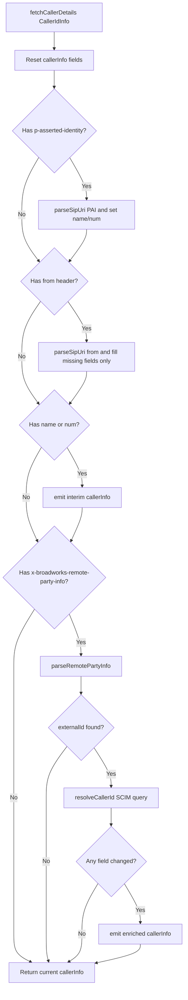
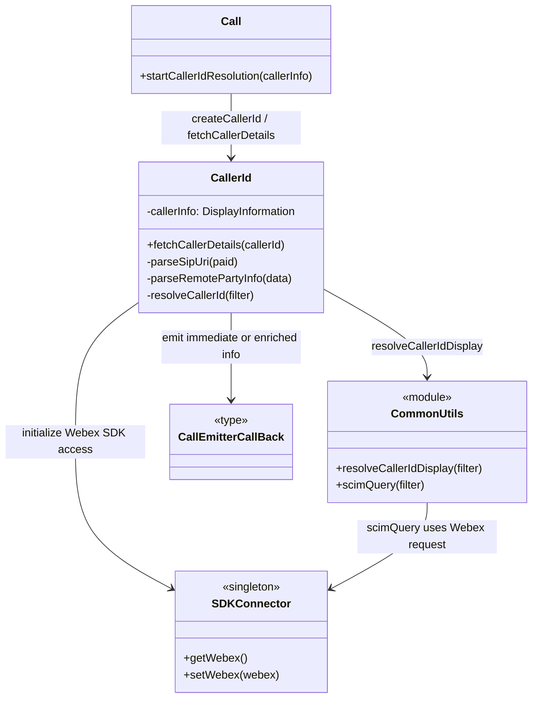

<!-- sdd-generated-metadata
doc_kind: module-spec
generated_from: module-spec@0.3.0
generated_by: claude-code
approved_by: rarajes2@cisco.com
updated_at: 2026-11-16T14:00:00Z
validation_status: not-run
-->

# CallerId

This source-local document at `src/CallingClient/calling/CallerId/docs/README.md` owns the stable
specification for **CallerId**: the per-call resolver that turns SIP identity headers into caller
display information and then enriches it through a SCIM directory lookup. Ground every claim in
package evidence and link to the [package architecture](../../../../../docs/architecture.md) and the
parent [calling module specification](../../docs/README.md) instead of repeating broader facts. No
service specification exists because this package is a library.

Related context: [documentation index](../../../../../docs/index.md) ·
[package agent instructions](../../../../../AGENTS.md)

## Metadata

| Field | Value |
| ----- | ----- |
| Owner | @webex/web-sdk (CODEOWNERS default rule) |
| Source path | `src/CallingClient/calling/CallerId` |
| Resource kind | module |
| Status | Active |
| Last verified | 2026-11-16 at `0b8c34db7f` |
| Module id | `caller-id` |
| Parent spec | [src/CallingClient/calling/docs/README.md](../../docs/README.md) |
| Doc kind | Module spec |
| Coverage score | Pending coverage assessment |
| Validation status | not-run — independent validation pending in a different runtime |

## Applicability

| Condition ID                         | Status     | Evidence or reason | Owned section |
| ------------------------------------ | ---------- | ------------------ | ------------- |
| `module.has_tiers`                   | N/A        | No tier policy exists in this package or its `package.json` | Tier |
| `module.has_ui`                      | N/A        | No view or screen; the module returns data to the call object (`src/CallingClient/calling/CallerId/index.ts`) | UI use-case flow |
| `module.crosses_service_boundaries`  | Applicable | The enrichment step queries the Webex identity SCIM service through `src/common/Utils.ts` | Cross-boundary use-case flow |
| `module.holds_client_state`          | Applicable | Each instance keeps one mutable caller record and the emitter callback (`src/CallingClient/calling/CallerId/index.ts`) | Client state model |
| `module.enforces_domain_rules`       | Applicable | Header precedence, phone-number validation, and SCIM filter escaping (`src/CallingClient/calling/CallerId/index.ts`, `src/common/Utils.ts`) | Business rules and invariants |
| `module.is_concurrent_async`         | Applicable | The SCIM enrichment runs as an unawaited promise after the synchronous return (`src/CallingClient/calling/CallerId/index.ts`) | Concurrency and reactive flow |
| `module.owns_persistence`            | N/A        | No stored data; the caller record lives in instance memory (`src/CallingClient/calling/CallerId/index.ts`) | Data, schema, and migration discipline |
| `module.stateful_transitions`        | N/A        | No lifecycle states beyond reset and fill; covered by the client state model (`src/CallingClient/calling/CallerId/index.ts`) | State machine |
| `module.exposes_wire_protocol`       | N/A        | The header shape is owned by the Events types and the SCIM payload by Webex (`src/Events/types.ts`) | Protocol and wire format |
| `module.ui_multi_screen`             | N/A        | No UI | UI flow |
| `module.large_data_model`            | N/A        | Four display fields and three header fields (`src/common/types.ts`, `src/Events/types.ts`) | Data model |
| `module.returns_caller_errors`       | N/A        | No method throws or rejects to its caller; lookup failures are absorbed (`src/common/Utils.ts`) | Caller-visible failure modes |
| `module.module_specific_conventions` | Applicable | Callback-only updates and the precedence and validation rules (`src/CallingClient/calling/CallerId/index.ts`) | Module-specific rules |
| `module.published_package`           | N/A        | The resolver is not exported from `src/index.ts`; only its display types are, and their owners document them | Export stability |
| `module.embedded_in_host`            | N/A        | No host theme or embed API | Host integration and theming |
| `module.has_design_tradeoff`         | Applicable | Immediate header identity followed by a later SCIM update (`src/CallingClient/calling/CallerId/index.ts`) | Key design trade-off |
| `module.has_submodules`              | N/A        | Computed false by the Repo Annotation module_tree.py script: no module is nested under this module path | Sub-modules |

## Evidence register

Requirements cite stable implementation and test file paths; no line-number anchors or local
run-report paths are canonical evidence.

| Evidence | What it establishes |
| -------- | ------------------- |
| `src/CallingClient/calling/CallerId/index.ts` | The `CallerId` class and `createCallerId` factory: reset, header parsing, the interim callback, BroadWorks `externalId` extraction, and the SCIM merge. Logs parsing/resolution steps with `{file, method}` context, using the file name `CallerId`; the extracted `externalId` value is logged at info level |
| `src/CallingClient/calling/CallerId/types.ts` | `ICallerId` with its single `fetchCallerDetails` member, plus the `EmailType`, `SipAddressType`, and `PhotoType` helper types, which no package file imports |
| `src/CallingClient/calling/CallerId/index.test.ts` | Seven cases: factory, PAI preferred over From, From filling a missing PAI name, From filling a missing PAI name and number, PAI without From, no `externalId`, and SCIM failure; the second case also checks the escaped SCIM filter |
| `src/common/Utils.ts` | `resolveCallerIdDisplay`, `scimQuery`, and `escapeScimFilterValue`: the SCIM request, the profile-to-display mapping, error absorption, and filter escaping |
| `src/CallingClient/constants.ts` | `VALID_PHONE_REGEX` and `CALLER_ID_FILE` |
| `src/CallingClient/calling/call.ts` | `Call` creates one resolver in its constructor, calls `startCallerIdResolution` for incoming-call progress and mid-call `CALL_INFO` events, and its callback stores the record and emits `caller_id` with the correlation ID |
| `src/Events/types.ts`, `src/common/types.ts`, `src/CallingClient/calling/types.ts` | `CallerIdInfo` (three optional headers), `CallerIdDisplay`, `DisplayInformation` (four optional-valued fields), and `CallEmitterCallBack` |
| `src/index.ts` | Exports the `CallerIdDisplay` and `DisplayInformation` types; nothing from this module |

## Purpose and boundary

The `CallerId` sub-module resolves caller identity for a `Call` using SIP-style headers delivered by Mobius signaling events. It provides immediate, best-effort display information from headers and then performs asynchronous enrichment through SCIM lookup when BroadWorks metadata includes an `externalId`.

- Responsibility: CallerId owns the behavior rooted at `src/CallingClient/calling/CallerId/` and
  serves it to the call object of the `@webex/calling` package; shared infrastructure remains owned
  by `Errors`, `Events`, `Logger`, and `common`.
- In scope: header precedence, SIP URI parsing, BroadWorks `externalId` extraction, and merging the
  SCIM result into the caller record (`MOD-001` to `MOD-010`).
- Out of scope: the SCIM request and profile mapping, which live in `src/common/Utils.ts`
  (see Dependencies); emitting the public `caller_id` event, which `Call` does (parent
  [calling specification](../../docs/README.md)).
- Configuration/rollout is N/A: CallerId has no feature flag, environment variable, or mutable runtime configuration; behavior is selected solely by the supplied identity headers and availability of BroadWorks `externalId`. Evidence: `src/CallingClient/calling/CallerId/index.ts`, `src/CallingClient/calling/CallerId/types.ts`.
- Consumers: `Call` only, through `createCallerId` and `ICallerId`.

## Structure and key files

The module is TypeScript source in the `@webex/calling` package, tested with Jest unit tests; its
only remote call is the SCIM lookup that `src/common/Utils.ts` performs through the Webex SDK.

| File | Primary Symbol(s) | Description |
|------|--------------------|-------------|
| `src/CallingClient/calling/CallerId/index.ts` | `CallerId`, `createCallerId` | Main implementation and factory for caller ID resolution |
| `src/CallingClient/calling/CallerId/types.ts` | `ICallerId`, helper types | Internal contract for caller detail resolution; the helper types are unused |
| `src/CallingClient/calling/CallerId/index.test.ts` | Jest tests | Priority, fallback, and async enrichment behavior validation |

## Public surface

Declarations live in `src/CallingClient/calling/CallerId/types.ts` and
`src/CallingClient/calling/CallerId/index.ts`; this section summarises them and does not restate
signatures. The contract index is the [package architecture](../../../../../docs/architecture.md).

| Contract ID | Type | Surface | Purpose | Compatibility / deprecation | Schema / detail link | Root index |
|---|---|---|---|---|---|---|
| `caller-id-internal` | Internal call collaborator | `createCallerId(webex, emitterCb)`: synchronous; takes a required `WebexSDK` and a required `CallEmitterCallBack`; returns a new `ICallerId` | Create the call-owned identity resolver (`MOD-001`) | Internal; not exported from `src/index.ts` | `src/CallingClient/calling/CallerId/index.ts`, `src/CallingClient/calling/CallerId/types.ts` | [package architecture](../../../../../docs/architecture.md) |
| `caller-id-internal` | Internal call collaborator | `ICallerId.fetchCallerDetails(callerId)`: synchronous; takes one required `CallerIdInfo`; returns the resolver's `DisplayInformation` record | Return immediate header-derived identity and start SCIM enrichment, whose result arrives through the callback (`MOD-002` to `MOD-010`) | Internal | `src/CallingClient/calling/CallerId/types.ts` | [package architecture](../../../../../docs/architecture.md) |

`ICallerId` is the contract consumed by `Call`. It defines a single entrypoint that returns immediate display info while potentially triggering async updates through the emitter callback.

The public package exports `CallerIdDisplay` and `DisplayInformation` types, but not `CallerId`, `ICallerId`, or `createCallerId`.

## Dependencies

| Dependency | Why it is required | Failure behavior |
| ---------- | ------------------ | ---------------- |
| Mobius SIP-style identity headers | `CallerIdInfo` with optional `p-asserted-identity`, `from`, and `x-broadworks-remote-party-info`, passed in by `Call` from incoming-call progress and mid-call `CALL_INFO` events | A missing or malformed header leaves its fields unset (`MOD-005`) |
| SCIM people lookup through the Webex SDK (`contacts-service-http`, SCIM identity) | `resolveCallerIdDisplay` in `src/common/Utils.ts` sends a GET to the identity SCIM Users endpoint for the device organization (integration host when the device URL contains `-int`) and maps the first resource: name from `displayName`; number from the primary phone, else the `work` phone, else the first phone; avatar from the `thumbnail` photo, else the string `unknown`; ID from the SCIM `id` | A failed request is logged as a warning with its status code and yields an empty result; no user found also yields an empty result (`MOD-009`) |
| `SDKConnector` (`sdk-connector-internal`) | The constructor binds the Webex SDK when the connector is unbound; `scimQuery` reads the bound SDK for the request, device URL, and organization | `SDKConnector.setWebex` throws on an invalid SDK, so construction throws |
| Logger (`src/Logger`) and `CALLER_ID_FILE` | `{file, method}` context on every log line | — |

## Requirements

| ID | WHAT | WHY | Source Evidence | Test / Example Evidence | Assumptions / Gaps | Confidence |
|---|---|---|---|---|---|---|
| `MOD-001` | `createCallerId(webex, emitterCb)` returns a new `CallerId`. Constructor responsibilities: Ensures `SDKConnector` has a valid Webex instance. Initializes internal mutable `callerInfo`. Stores emitter callback for incremental caller ID updates. It calls `SDKConnector.setWebex(webex)` only when the connector has no instance and then uses the bound one, so a different `webex` passed later is ignored. | Each call owns its resolver and receives updates through its own callback, while SDK access stays behind the shared connector. | `src/CallingClient/calling/CallerId/index.ts` | `src/CallingClient/calling/CallerId/index.test.ts` "create callerId Object" | — | Present |
| `MOD-002` | Reset `callerInfo` (`id`, `avatarSrc`, `name`, `num`) before processing a new event: `fetchCallerDetails` sets the four fields of the same object to `undefined` and allocates no new object. | Resetting before each event prevents identity fields from a previous call leaking into a new caller result; `Call` reuses one resolver for the progress event and every mid-call `CALL_INFO` event. | `src/CallingClient/calling/CallerId/index.ts`, `src/CallingClient/calling/call.ts` | `src/CallingClient/calling/CallerId/index.test.ts` (each case asserts fresh values) | The tests reassign `callerInfo` by hand between cases, so none proves the reset itself | Present |
| `MOD-003` | Parses `p-asserted-identity` first (highest preference). If `p-asserted-identity` exists, parse and set `name`/`num` directly (highest priority). The parsed values are assigned even when they are unset, which leaves those fields open for the From fallback. | P-Asserted-Identity is the signaling service's asserted identity and must win over fallback headers when both are present. | `src/CallingClient/calling/CallerId/index.ts` | `src/CallingClient/calling/CallerId/index.test.ts` "When PA-ID, From header is present along with x-broad-works", "When PA-ID is present but From header is absent" | — | Present |
| `MOD-004` | Uses `from` header as fallback for missing fields. If `from` exists, parse and fill only fields still unset after the P-Asserted-Identity step. | Maintains predictable precedence for name/number population. | `src/CallingClient/calling/CallerId/index.ts` | `src/CallingClient/calling/CallerId/index.test.ts` "but name in PAI is missing", "but name, number in PAI is missing" | — | Present |
| `MOD-005` | Extracts display name from quoted/header prefix. Extracts number from SIP URI local part. Validates parsed phone tokens using `VALID_PHONE_REGEX`. `parseSipUri` takes the text before the first `<`, removes double quotes, and trims it as the name; it takes the text after the first `:` and before the first `@`, with double quotes removed, as the number, and keeps the number only when the regular expression (digits, spaces, parentheses, `*`, `#`, `+`, `.`, `-`) matches the whole token. A part that is not found logs a warning and stays unset. | Separating the display name and SIP user produces the name/number fields consumed by call notifications without exposing raw header syntax; the whole-token match keeps user IDs such as UUIDs out of the number. | `src/CallingClient/calling/CallerId/index.ts`, `src/CallingClient/constants.ts` | `src/CallingClient/calling/CallerId/index.test.ts` "but name, number in PAI is missing" (UUID user part rejected) | A header with no `<` is taken whole as the name (Pitfalls and constraints) | Present |
| `MOD-006` | Emits initial caller info early when header parsing yields usable values: emit immediate caller update if `name` or `num` is available. `fetchCallerDetails` then returns the same `callerInfo` object synchronously, before any SCIM result. | Resolution preserves header priority and non-blocking SCIM enrichment so incoming-call presentation shows the header identity at once and Call consumers see a stable immediate-then-enriched order (Key design trade-off). | `src/CallingClient/calling/CallerId/index.ts` | `src/CallingClient/calling/CallerId/index.test.ts` (returned values asserted before the 50 ms wait) | No test spies on the emitter | Present |
| `MOD-007` | Parses `x-broadworks-remote-party-info`. Detects `externalId` and issues SCIM-driven resolution through `resolveCallerIdDisplay()`. If `x-broadworks-remote-party-info` exists, parse `externalId` and run async SCIM enrichment. Only the last `;`-separated token is examined: when it contains `externalId`, the text after its first `=` is escaped (`INV-002`) and sent as the SCIM filter `id eq` followed by the escaped value in double quotes; otherwise the warning `externalId not found!` is logged. The lookup starts without `await`. | BroadWorks remote-party data carries the caller's directory identity, which the SCIM lookup turns into a fuller profile. | `src/CallingClient/calling/CallerId/index.ts` | `src/CallingClient/calling/CallerId/index.test.ts` "When PA-ID, From header is present along with x-broad-works" (escaped filter), "x-broad-works does not have externalId" | An `externalId` that is not the last token is ignored | Present |
| `MOD-008` | Upgrades interim caller details with richer profile fields (`name`, `num`, `avatarSrc`, `id`) when available. When the lookup completes, `name` and `num` are overwritten only when the SCIM result has a value that differs; `avatarSrc` and `id` are overwritten whenever the current value is empty or differs, so after the reset in `MOD-002` they are always written, possibly with `undefined`. The callback then fires whenever any field was written, which is every completed enrichment, including an empty result after a SCIM failure. | The in-code comment gives SCIM results preference over header values; the diff check before the callback was meant to avoid noisy duplicate emissions by emitting only when the resolution changes the record (Module-specific rules). | `src/CallingClient/calling/CallerId/index.ts` | `src/CallingClient/calling/CallerId/index.test.ts` (SCIM values replace header values after 50 ms) | The avatar and ID conditions defeat the intended diff check; no test counts callback calls | Present |
| `MOD-009` | Continues gracefully when external ID is missing or SCIM enrichment fails. Preserves best-known caller info instead of failing hard. After a failed lookup the header `name` and `num` remain and `avatarSrc` and `id` stay `undefined`; nothing is thrown to `Call`. | A directory outage must not remove the identity already shown for a call. | `src/CallingClient/calling/CallerId/index.ts`, `src/common/Utils.ts` | `src/CallingClient/calling/CallerId/index.test.ts` "SCIM query fails" (404 warning logged), "does not have externalId" | — | Present |
| `MOD-010` | Updates reach `Call` only through the `CallEmitterCallBack`; the resolver holds no reference to the `Call`. The object passed to the callback and returned by `fetchCallerDetails` is the resolver's own `callerInfo`, so `Call` and `caller_id` listeners share it and observe later writes. | The callback boundary decouples identity resolution from Call mutation; `Call` decides how to store and emit the record. | `src/CallingClient/calling/CallerId/index.ts`, `src/CallingClient/calling/call.ts` | none found | No test checks object identity across events | Present |

## Design overview

This module is intentionally small and stateful:
- `fetchCallerDetails()` is the public entrypoint.
- It resets and repopulates internal `callerInfo` for each resolution request.
- It emits updates via a callback when new identity data becomes available.

| Method | Visibility | Purpose |
|--------|------------|---------|
| `fetchCallerDetails(callerId)` | Public | Main entrypoint: resets fields, applies header priority parsing, emits initial data, triggers async BroadWorks enrichment |
| `parseSipUri(paid)` | Private | Parses name and number from SIP-like header string |
| `parseRemotePartyInfo(data)` | Private async | Extracts BroadWorks `externalId` and starts SCIM lookup without awaiting it |
| `resolveCallerId(filter)` | Private async | Performs SCIM enrichment and emits whenever it writes a field, which after the reset is every completed lookup (`MOD-008`) |

The record, the callback, and the bound SDK reference are the only instance state (Client state
model). The SCIM request and the profile-to-display mapping are delegated to `src/common/Utils.ts`,
so this module contains no network code of its own.

## Data flow and sequence coverage

Header parsing is synchronous; SCIM enrichment is deliberately non-blocking. Evidence: `src/CallingClient/calling/CallerId/index.ts`, `src/CallingClient/calling/CallerId/index.test.ts`.

Sequence coverage:

| Operation group | Diagram / coverage | Failure / recovery coverage |
|---|---|---|
| Resolve P-Asserted-Identity / From headers | Caller identity resolution diagram | Missing/malformed fields leave values undefined and fall through |
| Enrich BroadWorks identity through SCIM | Same diagram, async branch | SCIM failure retains the header name and number; a second callback still fires with them (`MOD-008`, `MOD-009`) |

**Control flow of `fetchCallerDetails`**



The `N` decision follows the code's write check; after the reset its `No` branch is not reached
(`MOD-008`). The return at `M` happens before the asynchronous branch from `L` completes.

**Caller identity resolution diagram**

```mermaid
sequenceDiagram
  participant Call
  participant CallerId
  participant SDK as SDKConnector / People SCIM
  participant Callback as CallEmitterCallBack
  Call->>CallerId: fetchCallerDetails(headers)
  CallerId->>CallerId: reset id/avatar/name/num
  opt P-Asserted-Identity present
    CallerId->>CallerId: parseSipUri(PAI)
  end
  opt From present and fields still missing
    CallerId->>CallerId: parseSipUri(From)
  end
  opt immediate name or number exists
    CallerId-->>Callback: current DisplayInformation
  end
  CallerId-->>Call: immediate DisplayInformation
  opt BroadWorks externalId exists
    CallerId->>SDK: SCIM people lookup
    alt lookup returns a profile
      SDK-->>CallerId: enriched profile
      CallerId-->>Callback: updated DisplayInformation
    else lookup fails or finds no user
      SDK--xCallerId: error logged / empty result
      Note over CallerId,Callback: keep header name and number; avatar and id stay unset
      CallerId-->>Callback: same DisplayInformation again
    end
  end
```

## Class and component relationships



`Call` creates one `CallerId` and supplies the typed callback that updates and emits caller information. `CallerId` parses SIP identity headers synchronously, then delegates BroadWorks `externalId` enrichment to `resolveCallerIdDisplay()` / `scimQuery()`, which obtains the initialized Webex SDK through `SDKConnector`. Evidence: `src/CallingClient/calling/call.ts`, `src/CallingClient/calling/CallerId/index.ts`, `src/CallingClient/calling/types.ts`, `src/common/Utils.ts`.

## Use cases and flows

| Use case | Actor or caller | Primary steps and outcome | Failure or boundary behavior | Evidence |
| -------- | --------------- | ------------------------- | ---------------------------- | -------- |
| `UC-001` | Caller identity resolution and incremental display-information callbacks: `Call` handling an incoming-call progress event | `startCallerIdResolution` stores the returned record; the interim callback and the later SCIM callback each make `Call` emit `caller_id` with the correlation ID | Without an `externalId` only the interim callback fires (`MOD-007`) | `src/CallingClient/calling/call.ts`, `src/CallingClient/calling/CallerId/index.ts` |
| `UC-002` | `Call` handling a mid-call `CALL_INFO` event | The same resolver resets and resolves the new headers (`MOD-002`) | A lookup still running from the previous event can overwrite the new record (Concurrency and reactive flow) | `src/CallingClient/calling/call.ts` |
| `UC-003` | Directory lookup failure | Header identity stays; one more callback fires with it (`MOD-008`, `MOD-009`) | Avatar and user ID stay unset | `src/CallingClient/calling/CallerId/index.test.ts` |

### Cross-boundary use-case flow

| Boundary | Transport | Ordering | Timeout | Retry and recovery | Compatibility |
| -------- | --------- | -------- | ------- | ------------------ | ------------- |
| Webex identity SCIM Users | HTTPS GET through `webex.request`, with the device URL and calling user-agent headers, from `src/common/Utils.ts` | One lookup per resolution that has an `externalId`; results apply in completion order | None set here; the Webex SDK request default applies | None; a failure becomes an empty result (`MOD-009`) | SCIM v2 Users list response; only the first resource is used |

## Client state model

A `CallerId` instance owns one mutable `callerInfo` record for the current resolution. `fetchCallerDetails` resets all fields before parsing; an immediate callback may be followed by one async SCIM callback each time a lookup completes, whatever it returns (`MOD-008`). No identity data is persisted.

| State or slice | Owner | Initial state | Transition triggers | Reset or persistence boundary |
| -------------- | ----- | ------------- | ------------------- | ----------------------------- |
| `callerInfo` | `CallerId` instance | Empty object | Reset and header fill in `fetchCallerDetails`; SCIM merge in `resolveCallerId` | Reset in place on every call; shared by reference with `Call` (`MOD-010`); lives as long as the call |
| Emitter callback | `CallerId` instance | Set by the constructor | None | Instance lifetime |
| Webex SDK reference | `CallerId` instance, read from `SDKConnector` | Bound SDK at construction | None | Instance lifetime |

## Business rules and invariants

| ID | Invariant | WHY | Enforcement source | Test evidence |
| -- | --------- | --- | ------------------ | ------------- |
| `INV-001` | P-Asserted-Identity fills name/number before the From fallback; SCIM values, when present, replace both (`MOD-003`, `MOD-004`, `MOD-008`). | Asserted identity outranks the From header, and the directory profile outranks both. | `src/CallingClient/calling/CallerId/index.ts` | `src/CallingClient/calling/CallerId/index.test.ts` |
| `INV-002` | **SCIM filter injection prevention (AC-1 / CAI-8461):** The `externalId` token extracted from the `x-broadworks-remote-party-info` SIP header is passed through `escapeScimFilterValue` (from `src/common/Utils.ts`) before interpolation into the `id eq "..."` SCIM filter string. This escapes `\` and `"` so a maliciously crafted header value cannot terminate the quoted literal or inject additional SCIM filter clauses. Legitimate opaque identifiers (e.g. UUIDs) are unaffected. | The header comes from the network and the filter selects directory records. | `src/CallingClient/calling/CallerId/index.ts`, `src/common/Utils.ts` | `src/CallingClient/calling/CallerId/index.test.ts` |
| `INV-003` | SIP identity headers and SCIM profile fields are sensitive caller data: use them for display resolution only, do not log raw headers, and rely on the initialized SDK for SCIM authorization. Evidence: `src/CallingClient/calling/CallerId/index.ts`. | Logs leave the process through the SDK logger. | `src/CallingClient/calling/CallerId/index.ts` | none found |
| `INV-004` | Reset `id`, `avatarSrc`, `name`, and `num` before each resolution (`MOD-002`). | A new event never shows the previous caller. | `src/CallingClient/calling/CallerId/index.ts` | none found |
| `INV-005` | BroadWorks `externalId` enrichment is non-blocking: `fetchCallerDetails` returns before the lookup completes, and the follow-up callback is not limited to changed data (`MOD-008`). | Header identity must not wait for the directory. | `src/CallingClient/calling/CallerId/index.ts` | `src/CallingClient/calling/CallerId/index.test.ts` |

## Concurrency and reactive flow

- Execution model: the JavaScript event loop. Header parsing and the interim callback run
  synchronously inside `fetchCallerDetails`; enrichment is a promise chain started without `await`.
- Ordering guarantees: the interim callback fires before `fetchCallerDetails` returns; the SCIM
  callback fires later, after the request completes.
- Idempotency and retry: no retry; each resolution with an `externalId` starts a new lookup.
- Shared-state protection: none. A lookup started by an earlier event can complete after a later
  `fetchCallerDetails` has reset the record and overwrite it with the earlier caller's profile.
  `resolveCallerIdDisplay` never rejects, but an exception thrown by the callback inside the
  asynchronous path becomes an unhandled rejection.
- Blocking restrictions: nothing in the module waits; the caller is never blocked on SCIM.

## Pitfalls and constraints

- The record is shared by reference (`MOD-010`): a `caller_id` payload kept by a listener changes when
  a later event or lookup writes the record.
- A header without `<` is taken whole as the name, for example `sip:5888@host` becomes the name; a
  number is still extracted when the user part matches (`MOD-005`).
- The `externalId` must be the last `;`-separated token, and a value containing `=` is cut at the
  second `=` (`MOD-007`).
- The extracted `externalId` is logged at info level by this module and the full SCIM filter by
  `scimQuery`; raw headers are not logged (`INV-003`).
- The unit tests reassign `callerInfo` between cases and wait 50 ms of real time for the lookup;
  they never observe the callback (Verification).

## Module-specific rules

When implementing or modifying `CallerId`:
- Keep `fetchCallerDetails()` as the only public resolution entrypoint.
- Preserve the strict precedence order: `p-asserted-identity` -> `from` -> BroadWorks enrichment.
- Keep enrichment non-blocking for initial caller identity delivery.
- Do not introduce direct event emitter dependencies; continue using `CallEmitterCallBack`.
- Use existing logger conventions with `{file, method}` metadata.
- Reuse `DisplayInformation` and `CallerIdInfo` types (no duplicate local types).
- Keep parsing and enrichment side effects minimal and explicit.
- DO use the factories, typed events, constants, and adapters already owned by `src/CallingClient/calling/CallerId/`.
- DON'T add direct network or SDK access when the module already provides an adapter; SCIM access goes
  through `resolveCallerIdDisplay`.

Do not:
- Do not replace the callback-based update mechanism with direct `Call` mutations.
- Do not block return of interim caller details while waiting for SCIM lookup.
- Do not emit duplicate callbacks when resolved data is unchanged. The current avatar and ID checks
  break this rule (`MOD-008`); a fix must keep the SCIM preference.
- Do not weaken validation around parsed number fields.

## Key design trade-off

| Chosen trade-off | Preserved invariant or benefit | Cost or limitation | Decision evidence |
| ---------------- | ------------------------------ | ------------------ | ----------------- |
| CallerId returns header-derived identity immediately and enriches it later instead of blocking incoming-call presentation on SCIM | Call presentation never waits for the directory (`INV-005`) | Consumers must tolerate a second callback; the diff guard does not stop it today, so the follow-up callback fires even when nothing changed (`MOD-008`) | `src/CallingClient/calling/CallerId/index.ts` |

## Verification

Unit checks run with Jest from the package directory; the target file is
`src/CallingClient/calling/CallerId/index.test.ts`.

| Behavior / Requirement | Existing test evidence | Gap |
|---|---|---|
| `MOD-001` | `src/CallingClient/calling/CallerId/index.test.ts` | Connector binding when already bound is not tested |
| `MOD-002`, `INV-004` | `src/CallingClient/calling/CallerId/index.test.ts` | Tests reset the record by hand; no case sends two events to one record |
| `MOD-003`, `MOD-004`, `INV-001` | `src/CallingClient/calling/CallerId/index.test.ts` | From-only input is not tested |
| `MOD-005` | `src/CallingClient/calling/CallerId/index.test.ts` | Header without `<` and invalid characters other than a UUID are not tested |
| `MOD-006`, `MOD-008`, `INV-005` | `src/CallingClient/calling/CallerId/index.test.ts` | No test counts or inspects callback calls; the repeated callback is untested |
| `MOD-007`, `INV-002` | `src/CallingClient/calling/CallerId/index.test.ts` | `externalId` in a non-final token is not tested |
| `MOD-009` | `src/CallingClient/calling/CallerId/index.test.ts` | Empty SCIM result (no user) is not tested |
| `MOD-010`, `INV-003` | none found | Object identity and log content are not tested |

Tests for this module should cover:
- Header precedence: `p-asserted-identity` over `from`.
- Fallback behavior when one/both SIP fields are partially missing.
- Async overwrite by BroadWorks+SCIM enrichment when `externalId` is present.
- No overwrite when `externalId` is absent.
- SCIM failure path preserves already-resolved interim details.
- Emission behavior:
  - Interim emit when `name`/`num` exists.
  - Follow-up emit only when enrichment changes fields (not met today; see `MOD-008`).

Before merging a change, confirm:
- `createCallerId()` still returns `ICallerId`.
- `fetchCallerDetails()` resets stale state before processing input.
- Header parsing order and fallback semantics remain unchanged.
- BroadWorks `externalId` parsing still triggers async SCIM lookup.
- Callback emissions occur for interim and changed enriched data only.
- Existing `index.test.ts` scenarios remain valid or are updated with behavior-preserving intent.
