<!-- sdd-generated-metadata
doc_kind: module-spec
generated_from: module-spec@0.3.0
generated_by: claude-code
approved_by: rarajes2@cisco.com
updated_at: 2026-11-17T03:02:22Z
validation_status: blocked
-->

# Call control

This source-local document at `src/CallingClient/calling/docs/README.md` owns the stable
specification for **call control** in `@webex/calling`: the per-call `Call` executor behind the
published `ICall` interface, the `CallManager` singleton that owns the active-call collection and
routes Mobius call events, the call signaling and ROAP media state machines, and the supplementary
services (hold, resume, transfer). Ground every claim in package evidence and link to the
[package architecture](../../../../docs/architecture.md) instead of repeating broader facts. No
service specification exists because this package is a library.

Related context: [documentation index](../../../../docs/index.md) ·
[package agent instructions](../../../../AGENTS.md)

## Metadata

| Field             | Value |
| ----------------- | ----- |
| Owner             | @webex/web-sdk (CODEOWNERS default rule) |
| Source path       | `src/CallingClient/calling` |
| Resource kind     | module |
| Status            | Active |
| Last verified     | 2026-11-16 at `0b8c34db7f` |
| Module id         | `calling` |
| Parent spec       | [CallingClient specification](../../docs/README.md) |
| Doc kind          | Module spec |
| Coverage score    | Pending coverage assessment |
| Validation status | blocked — validator `01a1e76e-1dbd-7680-94e4-46d29d2946d4`, assessed 2026-11-17; 2 Blocking, 1 Important (questionnaire gate evidence, UC config contract index, SDKConnector test coverage) |

## Applicability

| Condition ID                         | Status     | Evidence or reason | Owned section |
| ------------------------------------ | ---------- | ------------------ | ------------- |
| `module.has_tiers`                   | N/A        | No tier policy exists in this package or its `package.json` | Tier |
| `module.has_ui`                      | N/A        | No view or screen; the module is a TypeScript library | UI use-case flow |
| `module.crosses_service_boundaries`  | Applicable | `src/CallingClient/calling/call.ts` sends Mobius REST requests through `src/CallingClient/utils/request.ts`; `src/CallingClient/calling/callManager.ts` consumes Mobius events from Mercury or the Mobius socket | Cross-boundary use-case flow |
| `module.holds_client_state`          | Applicable | `src/CallingClient/calling/callManager.ts` holds the active-call and line maps; `src/CallingClient/calling/call.ts` holds per-call flags, timers, ROAP messages, and two interpreters | Client state model |
| `module.enforces_domain_rules`       | Applicable | Event routing by correlation and call id, guarded answer and dial, disconnect-reason selection, and hold/resume confirmation rules in `src/CallingClient/calling/call.ts` and `src/CallingClient/calling/callManager.ts` | Business rules and invariants |
| `module.is_concurrent_async`         | Applicable | Asynchronous Mobius events, promise-returning REST calls, a keepalive interval, a supplementary-service timer, and XState delayed transitions in `src/CallingClient/calling/call.ts` | Concurrency and reactive flow |
| `module.owns_persistence`            | N/A        | All state is in memory and ends with the call; Mobius owns the call records | Data, schema, and migration discipline |
| `module.stateful_transitions`        | Applicable | Two XState machines (call-state, roap-state) in `src/CallingClient/calling/call.ts` | State machine |
| `module.exposes_wire_protocol`       | Applicable | Mobius event and REST payload shapes in `src/CallingClient/calling/types.ts` and ROAP message types in `src/Events/types.ts` | Protocol and wire format |
| `module.ui_multi_screen`             | N/A        | No UI | UI flow |
| `module.large_data_model`            | N/A        | Payload mirrors and a handful of enums; no owned entity model | Data model |
| `module.returns_caller_errors`       | Applicable | CallError objects emitted on call_error, hold_error, resume_error, and transfer_error (`src/CallingClient/calling/call.ts`, `src/Errors/catalog/CallError.ts`) | Caller-visible failure modes |
| `module.module_specific_conventions` | Applicable | Every Mobius failure is routed through handleCallErrors with an emitter callback, followed by uploadLogs (`src/CallingClient/calling/call.ts`, `src/common/Utils.ts`) | Module-specific rules |
| `module.published_package`           | Applicable | `src/index.ts` exports ICall and TransferType from `src/CallingClient/calling/types.ts`; contract call-sdk cites `package.json` | Export stability |
| `module.embedded_in_host`            | N/A        | No host theme or embed API | Host integration and theming |
| `module.has_design_tradeoff`         | Applicable | Separate signaling and media state machines coordinated through explicit events (`src/CallingClient/calling/call.ts`) | Key design trade-off |
| `module.has_submodules`              | Applicable | Computed true by the Repo Annotation module_tree.py script: src/CallingClient/calling/CallerId is a child module with its own spec | Sub-modules |

## Evidence register

| Evidence | What it establishes |
| -------- | ------------------- |
| `src/CallingClient/calling/call.ts` | The `Call` class: constructor pipeline, both XState machines, every action handler, Mobius REST requests, media connection wiring, keepalive, supplementary services, metrics, and the `createCall` factory. Backs the `Call signaling machine`, `ROAP media machine`, `Call internals`, `Outgoing and incoming call setup`, `ROAP negotiation`, `Hold, resume, and transfer`, and `Failure, disconnect, and keepalive` subsections |
| `src/CallingClient/calling/callManager.ts` | `CallManager`, `getCallManager`, transport-aligned event intake, Mobius event routing, call deletion callback, and `setIceGatheringConfig`. Backs the `CallManager collaborator surface`, `Call construction`, and `Mobius event intake` subsections |
| `src/CallingClient/calling/types.ts` | `ICall`, `ICallManager`, Mobius event and response types, transfer and mute enums, disconnect codes, RTP statistics, ICE configuration, and callback types. Backs the `Call events`, `Mobius event types`, `Call REST endpoints`, and `Mid-call service events` subsections |
| `src/CallingClient/calling/index.ts` | Barrel that re-exports `call.ts` and `callManager.ts` |
| `src/CallingClient/calling/CallerId/index.ts`, `src/CallingClient/calling/CallerId/types.ts` | The caller-identity resolver `Call` uses: `createCallerId`, `fetchCallerDetails`, header precedence, and asynchronous SCIM enrichment |
| `src/CallingClient/constants.ts` | Timers, retry limits, endpoint path segments, ICE timeouts, header names, and method names used in logs and error routing. Backs the `Timers and endpoint constants` subsection |
| `src/common/constants.ts` | `SERVICES_ENDPOINT` (`services`) used for supplementary-service URIs |
| `src/common/Utils.ts` | `handleCallErrors` status mapping, retry and abort rules; `uploadLogs`; `parseMediaQualityStatistics` |
| `src/common/callUtils.ts` | `modifySdpForIPv4` and `getHostIpsFromSdp` |
| `src/common/types.ts` | `CallDirection`, `CallDetails`, `DisplayInformation`, `ServiceIndicator`, `ALLOWED_SERVICES` |
| `src/Events/types.ts` | `CALL_EVENT_KEYS`, `LINE_EVENT_KEYS`, `CALLING_CLIENT_EVENT_KEYS`, `SUPPLEMENTARY_SERVICES`, `MOBIUS_MIDCALL_STATE`, `CallEvent`, `RoapEvent`, `RoapMessage` |
| `src/Errors/types.ts`, `src/Errors/catalog/CallError.ts` | `ERROR_LAYER`, `ERROR_TYPE`, `ERROR_CODE`, `CALL_ERROR_CODE`, `CallError`, `createCallError` |
| `src/CallingClient/utils/request.ts` | `APIRequest.makeRequest` and `isSocketEnabled`, the transport every Call request uses |
| `src/CallingClient/CallingClient.ts` | Forwards Mobius socket events to `dequeueWsEvents`, intercepts `registration.down`, and listens for `ALL_CALLS_CLEARED` |
| `src/CallingClient/line/index.ts` | `makeCall` creates outbound calls through `CallManager.createCall`; re-emits `INCOMING_CALL` as `LINE_EVENTS.INCOMING_CALL` |
| `src/CallingClient/registration/register.ts` | Calls `updateActiveMobius` after registration selects a Mobius server |
| `src/index.ts` | Package exports `ICall`, `TransferType`, `CALL_EVENT_KEYS`, `CallError`, `CallDetails`, `LINE_EVENTS` |
| `src/CallingClient/calling/call.test.ts` | Unit tests for dial, answer, media listeners, state transitions, out-of-order events, timers, keepalive, hold, resume, transfer, mute, and host addresses |
| `src/CallingClient/calling/callManager.test.ts` | Unit tests for singleton, ICE configuration threading, incoming-call routing, ROAP routing, disconnect routing, registration-down handling, and transport alignment |
| `src/CallingClient/calling/CallerId/index.test.ts` | Unit tests for header precedence and SCIM enrichment |
| `playwright/test-groups/call-lifecycle.ts`, `playwright/test-groups/call-controls.ts`, `playwright/test-groups/call-errors.ts`, `playwright/test-groups/call-keepalive.ts`, `playwright/test-groups/transfer-tests.ts` | End-to-end call journeys (need Playwright browsers and test accounts; not run during this migration) |
| Code reading, 2026-11-16 | `forceSendStatsReport` in `src/CallingClient/calling/call.ts` has no caller; `CALL_EVENT_KEYS.ALERTING` is declared but never emitted; state `S_ERROR` has no incoming transition |

## Purpose and boundary

The `calling/` sub-module within `CallingClient` contains the core call management logic for the Webex Calling SDK. It consists of two primary classes -- `Call` and `CallManager` -- along with the `CallerId` sub-module for caller identity resolution. Together, these classes handle the full lifecycle of voice calls: creation, signaling via Mobius, WebRTC media negotiation via ROAP, mid-call operations, and termination.

Calling owns the behavior rooted at `src/CallingClient/calling/` and exposes it through the typed `@webex/calling` package boundary; shared infrastructure remains owned by `Errors`, `Events`, `Logger`, and `common`.

- Responsibility: one `Call` object per voice call, driven by Mobius signaling and ROAP media
  negotiation, plus one `CallManager` that creates calls, owns the active-call collection, and routes
  every Mobius call event to the right call.
- In scope:
  - Call lifecycle orchestration:
    - Creates and manages outbound and inbound call instances with stable `correlationId` mapping.
    - Drives call progression from setup to established, held/resumed, transfer, and disconnect states.
    - Cleans up call resources and collection state when calls terminate.
  - Mobius event intake and routing:
    - Subscribes to `event:mobius` via `SDKConnector` and processes signaling/media events
      (HTTP transport); with the WebSocket transport, `CallingClient` forwards Mobius socket events
      to `CallManager.dequeueWsEvents()`.
    - Routes each event to the correct `Call` object based on `correlationId` and `callId` matching.
    - Handles out-of-order event scenarios (for example, media before setup) safely.
  - Signaling and media state machine coordination (see State machine).
  - Mid-call operations and supplementary services:
    - Supports hold/resume, transfer, mute, DTMF, and media updates during active calls.
    - Enforces supplementary-service timeout behavior and emits typed error events on failure.
    - Tracks connected/held/muted state transitions for accurate client behavior.
  - Caller identity resolution, delegated to the `CallerId` child module:
    - Resolves caller display details from SIP headers (`p-asserted-identity`, `from`) and Broadworks metadata.
    - Performs SCIM-backed resolution where applicable and emits caller ID updates through typed events.
  - Typed events, errors, and metrics:
    - Emits strongly typed lifecycle and error events through shared event enums/type maps.
    - Uses call-scoped typed errors (`CallError`) with correlation and layer context.
    - Submits call and media metrics for both success and failure paths.
- Out of scope: registration, failover, and the Mobius server choice (`registration` module); line
  objects and `makeCall` (`line` module); transport selection and the Mobius socket
  (`src/CallingClient/utils/request.ts`, `mobius-socket` module); WebRTC internals
  (`@webex/internal-media-core`); caller-identity parsing details (`caller-id` child module); the
  shared logger, error hierarchy, and event enums (package architecture).
- Consumers: applications through `ICall` objects returned by `ILine.makeCall` or delivered on
  `LINE_EVENTS.INCOMING_CALL`; internally, `Line`, `Registration`, and `CallingClient`, which all
  obtain the shared `CallManager` with `getCallManager`.

## Structure and key files

```text
src/CallingClient/calling/
├── CallerId/index.ts
├── CallerId/types.ts
├── call.ts
├── callManager.ts
├── index.ts
├── types.ts
├── CallerId/index.test.ts
├── call.test.ts
├── callManager.test.ts
```

| File | Class | Interface | Description |
|------|-------|-----------|-------------|
| `call.ts` | `Call` | `ICall` | Individual call instance managing signaling and media state machines |
| `callManager.ts` | `CallManager` | `ICallManager` | Singleton managing the collection of active calls and routing Mobius WebSocket events |
| `types.ts` | - | - | All types, enums, and interfaces for call management |
| `CallerId/index.ts` | `CallerId` | `ICallerId` | Caller identity resolution from SIP headers and SCIM |
| `CallerId/types.ts` | - | - | CallerId types |
| `index.ts` | - | - | Barrel re-exporting `call.ts` and `callManager.ts` (`createCall`, `Call`, `CallManager`, `getCallManager`) |
| `call.test.ts`, `callManager.test.ts`, `CallerId/index.test.ts` | - | - | Co-located Jest unit tests and characterization baseline |

All import sources below are given as package files; external packages are named in plain text.

| Symbol(s) | Import Path |
|-----------|-------------|
| `ICall`, `ICallManager`, `MobiusEventType`, `MediaState`, `MobiusAsyncEvent`, `MobiusCallData`, `MobiusCallResponse`, `PatchResponse`, `SSResponse`, `TransferContext`, `CallRtpStats`, `DisconnectCode`, `DisconnectCause`, `TransferType`, `MUTE_TYPE`, `MidCallEventType`, `MobiusCallState`, `MidCallEvent`, `RoapScenario`, `IceGatheringConfig` | `src/CallingClient/calling/types.ts` |
| `CALL_EVENT_KEYS`, `CallerIdInfo`, `CallEvent`, `CallEventTypes`, `RoapEvent`, `RoapMessage`, `RoapMessageEvent`, `SUPPLEMENTARY_SERVICES`, `LINE_EVENT_KEYS`, `CALLING_CLIENT_EVENT_KEYS`, `MEDIA_CONNECTION_EVENT_KEYS`, `MOBIUS_MIDCALL_STATE` | `src/Events/types.ts` |
| `Eventing` | `src/Events/impl/index.ts` |
| `CallError`, `createCallError` | `src/Errors/catalog/CallError.ts` |
| `ERROR_LAYER`, `ERROR_TYPE`, `ErrorContext` | `src/Errors/types.ts` |
| `handleCallErrors`, `parseMediaQualityStatistics`, `serviceErrorCodeHandler`, `uploadLogs` | `src/common/Utils.ts` |
| `getHostIpsFromSdp`, `modifySdpForIPv4` | `src/common/callUtils.ts` |
| `CallDetails`, `CallDirection`, `CallId`, `CorrelationId`, `DisplayInformation`, `HTTP_METHODS`, `ServiceIndicator`, `WebexRequestPayload`, `ALLOWED_SERVICES` | `src/common/types.ts` |
| `SDKConnector` | `src/SDKConnector/index.ts` |
| `ISDKConnector`, `WebexSDK` | `src/SDKConnector/types.ts` |
| `ILine` | `src/CallingClient/line/types.ts` |
| Constants (`DEFAULT_SESSION_TIMER`, `SUPPLEMENTARY_SERVICES_TIMEOUT`, `MAX_CALL_KEEPALIVE_RETRY_COUNT`, `INITIAL_SEQ_NUMBER`, endpoint resources, `METHODS`) | `src/CallingClient/constants.ts` |
| `APIRequest` | `src/CallingClient/utils/request.ts` |
| `IMetricManager`, `METRIC_EVENT`, `METRIC_TYPE`, `TRANSFER_ACTION`, `MEDIA_CONNECTION_ACTION`, `getMetricManager` | `src/Metrics/types.ts`, `src/Metrics/index.ts` |
| `RoapMediaConnection`, `LocalMicrophoneStream`, `MediaConnectionEventNames`, `LocalStreamEventNames` | package @webex/internal-media-core |
| `RtcMetrics` | package @webex/internal-plugin-metrics |
| `EffectEvent`, `TrackEffect` | package @webex/media-helpers |
| `createMachine`, `interpret` | package xstate |

## Sub-modules

| Sub-module | Responsibility | Specification |
| ---------- | -------------- | ------------- |
| `src/CallingClient/calling/CallerId` | Caller identity resolution and incremental display-information callbacks | [CallerId specification](../CallerId/docs/README.md) |

The `CallerId` sub-module resolves caller identity from SIP headers present in Mobius call events.
`Call` builds one resolver per call with `createCallerId(webex, emitterCallback)` and calls
`fetchCallerDetails(callerInfo)` from `startCallerIdResolution`. The call stores the synchronous
return value as its `callerInfo`; every later emitter callback replaces `callerInfo` and emits
`CALL_EVENT_KEYS.CALLER_ID` with `{correlationId, callerId}` (`MOD-022`).

Resolution priority as the call sees it (detail and tests live in the child spec):

1. **P-Asserted-Identity** (`p-asserted-identity`) -- Highest priority, parsed as SIP URI
2. **From header** (`from`) -- Secondary, parsed as SIP URI; fills only the name or number that P-Asserted-Identity left empty
3. **x-broadworks-remote-party-info** -- Async resolution for external caller ID via SCIM query

Current resolution flow: `fetchCallerDetails` clears the previous fields, applies
`p-asserted-identity` then `from` through `parseSipUri()`, emits the intermediate
`DisplayInformation` once when a name or number exists, and, when
`x-broadworks-remote-party-info` carries an `externalId`, runs `parseRemotePartyInfo()` and
`resolveCallerId()` (a SCIM query to Webex) asynchronously; the emitter fires again only when the
SCIM result changes a field, and the call then emits a further `CALLER_ID` event. The headers are
not exclusive branches: all present headers are processed in that order.

`DisplayInformation` (declared in `src/common/types.ts`) has four fields, each possibly
`undefined`: `avatarSrc` (`AvatarId`), `name` (`DisplayName`), `num` (string), and `id` (string).

## Public surface

Declarations live in `src/CallingClient/calling/types.ts` (re-exported by `src/index.ts`) and
`src/Events/types.ts`; this section summarises them and does not restate interface blocks.

| Surface | Consumer | Compatibility commitment | Source |
| ------- | -------- | ------------------------ | ------ |
| Contract `call-sdk`: `ICall` and `TransferType` | Applications | Semver-controlled through `@webex/calling` (see Export stability) | `src/CallingClient/calling/types.ts` |
| Contract `call-sdk`: `CALL_EVENT_KEYS` event names and payloads | Applications listening on an `ICall` | Event names and payload shapes per the event table below | `src/Events/types.ts` |
| Contract `call-sdk`: `CallError` emitted on error events | Applications | `getCallError()` shape and `ERROR_TYPE` values (see Caller-visible failure modes) | `src/Errors/catalog/CallError.ts` |
| `CallManager`, `getCallManager`, `ICallManager`, `createCall` | `Line`, `Registration`, `CallingClient` (internal) | Internal; not exported from `src/index.ts` | `src/CallingClient/calling/callManager.ts` |

`ICall` is the contract for the `Call` class. It defines the methods a call object must expose for call control operations, state checks, media updates, event handling hooks, and call metadata access.
`ICall` extends `Eventing<CallEventTypes>`, so consumers subscribe to strongly typed call events with
`on`. Members: the `lineId` string property; call control `dial(localAudioStream)`,
`answer(localAudioStream)`, `end()`, `doHoldResume()`,
`completeTransfer(transferType, transferCallId?, transferTarget?)`, `sendDigit(tone)`; media
`mute(localAudioStream, muteType?)`, `updateMedia(newAudioStream)`, `getCallRtpStats()` (a
`Promise<CallRtpStats>`); state checks `isMuted()`, `isConnected()`, `isHeld()` (booleans);
identifiers and metadata `getCallId()`, `setCallId(callId)`, `getCorrelationId()`,
`getDirection()` (`CallDirection`), `getDisconnectReason()` (`DisconnectReason`),
`getBroadworksCorrelationInfo()` (string or `undefined`), `setBroadworksCorrelationInfo(info)`;
caller identity `getCallerInfo()` (`DisplayInformation`), `startCallerIdResolution(callerInfo)`
(`CallerIdInfo`); and internal event pathways exposed on the interface and hidden from the API docs
with `@ignore`: `handleMidCallEvent(event)` (`MidCallEvent`), `sendCallStateMachineEvt(event)`
(`CallEvent`), `sendMediaStateMachineEvt(event)` (`RoapEvent`), and `postStatus()` (a
`Promise<WebexRequestPayload>`). `ICall` declares `dial`, `answer`, and `completeTransfer` as
returning `void`; `Call` implements them as `async` methods, so callers receive a promise that
resolves once the local work is dispatched, never a call outcome.

| Method | Signature | Description |
|--------|-----------|-------------|
| `lineId` | `lineId: string` (property) | Identifier of the line that owns the call |
| `dial` | `dial(localAudioStream: LocalMicrophoneStream): void` | Initiate an outgoing call |
| `answer` | `answer(localAudioStream: LocalMicrophoneStream): void` | Answer an incoming call |
| `end` | `end(): void` | Disconnect the call |
| `mute` | `mute(localAudioStream: LocalMicrophoneStream, muteType?: MUTE_TYPE): void` | Toggle mute |
| `isMuted` | `isMuted(): boolean` | Check mute state |
| `isConnected` | `isConnected(): boolean` | Check connected state |
| `isHeld` | `isHeld(): boolean` | Check hold state |
| `doHoldResume` | `doHoldResume(): void` | Toggle hold/resume |
| `sendDigit` | `sendDigit(tone: string): void` | Send DTMF tone |
| `completeTransfer` | `completeTransfer(transferType: TransferType, transferCallId?: CallId, transferTarget?: string): void` | Complete blind or consult transfer |
| `updateMedia` | `updateMedia(newAudioStream: LocalMicrophoneStream): void` | Change audio stream |
| `getCallId` | `getCallId(): string` | Get Mobius call ID |
| `getCorrelationId` | `getCorrelationId(): string` | Get client correlation ID |
| `getDirection` | `getDirection(): CallDirection` | Get call direction |
| `setCallId` | `setCallId(callId: CallId): void` | Set Mobius call ID |
| `getCallerInfo` | `getCallerInfo(): DisplayInformation` | Get resolved caller display info |
| `startCallerIdResolution` | `startCallerIdResolution(callerInfo: CallerIdInfo): void` | Trigger caller ID resolution |
| `handleMidCallEvent` | `handleMidCallEvent(event: MidCallEvent): void` | Process mid-call events |
| `getDisconnectReason` | `getDisconnectReason(): DisconnectReason` | Get disconnect reason |
| `getBroadworksCorrelationInfo` | `getBroadworksCorrelationInfo(): string \| undefined` | Get Broadworks correlation info |
| `setBroadworksCorrelationInfo` | `setBroadworksCorrelationInfo(broadworksCorrelationInfo: string): void` | Set Broadworks correlation info |
| `getCallRtpStats` | `getCallRtpStats(): Promise<CallRtpStats>` | Get RTP statistics |
| `postStatus` | `postStatus(): Promise<WebexRequestPayload>` | Send call keepalive to Mobius |
| `sendCallStateMachineEvt` | `sendCallStateMachineEvt(event: CallEvent): void` | Send event to call state machine |
| `sendMediaStateMachineEvt` | `sendMediaStateMachineEvt(event: RoapEvent): void` | Send event to media state machine |
| `postSSRequest` | `postSSRequest(context: unknown, type: SUPPLEMENTARY_SERVICES): Promise<SSResponse>` | Public on `Call` but not declared on `ICall`: send supplementary service request (hold, resume, transfer) to Mobius |

Call-level enums and types in `src/CallingClient/calling/types.ts`: `DisconnectCode` (`BUSY = 115`,
`NORMAL = 0`, `MEDIA_INACTIVITY = 131`) and `DisconnectCause` (`BUSY = 'User Busy.'`,
`NORMAL = 'Normal Disconnect.'`, `MEDIA_INACTIVITY = 'Media Inactivity.'`) combine into
`DisconnectReason` `{code, cause}`; `TransferType` is `BLIND = 'BLIND'` or `CONSULT = 'CONSULT'`;
`MUTE_TYPE` is `USER = 'user_mute'` or `SYSTEM = 'system_mute'`; `MidCallEventType` is
`CALL_INFO = 'callInfo'` or `CALL_STATE = 'callState'`; `TransferContext` has
`transferorCallId: CallId` plus optional `destination` (blind) or `transferToCallId` (consult);
`CallRtpStats` has `'rtp-rxstat'` (`ReceiveStatistics`) and `'rtp-txstat'` (`TransmitStatistics`).
Callback types: `DeleteRecordCallBack` `(callId: CallId) => void` (called with the correlation id),
`CallEmitterCallBack` `(callerInfo: DisplayInformation) => void`, `CallErrorEmitterCallBack`
`(error: CallError) => void`, and `RetryCallBack` `(interval: number) => void` (seconds).

### Call events

This module has two event layers:
- **Inbound/internal events** consumed by `CallManager`/`Call` (Mobius, media engine, stream/effect events); see Mobius event intake.
- **Public SDK events** emitted from `Call` (and `CallManager`) for app consumers.

`CALL_EVENT_KEYS` (`src/Events/types.ts`) has the values `alerting`, `call_error`, `caller_id`,
`connect`, `disconnect`, `established`, `held`, `hold_error`, `progress`, `remote_media`,
`resume_error`, `resumed`, and `transfer_error`. `ALERTING` is declared but no code emits it.

| Event | Enum Key | Payload | When Emitted |
|-------|----------|---------|-------------|
| `progress` | `CALL_EVENT_KEYS.PROGRESS` | `CorrelationId` | Call progress received |
| `connect` | `CALL_EVENT_KEYS.CONNECT` | `CorrelationId` | Remote answered or call connected |
| `established` | `CALL_EVENT_KEYS.ESTABLISHED` | `CorrelationId` | Call fully established with media (signaling and media negotiation complete) |
| `held` | `CALL_EVENT_KEYS.HELD` | `CorrelationId` | Call placed on hold, confirmed by mid-call state |
| `resumed` | `CALL_EVENT_KEYS.RESUMED` | `CorrelationId` | Call resumed from hold, confirmed by mid-call state |
| `disconnect` | `CALL_EVENT_KEYS.DISCONNECT` | `CorrelationId` | Remote disconnect, signaling-state timeout, keepalive abort, or `dial` without an audio track; not emitted by the local `end()` path |
| `remote_media` | `CALL_EVENT_KEYS.REMOTE_MEDIA` | `MediaStreamTrack` | Remote audio media track available |
| `caller_id` | `CALL_EVENT_KEYS.CALLER_ID` | `{ correlationId: CorrelationId, callerId: DisplayInformation }` | Caller ID resolved or updated |
| `call_error` | `CALL_EVENT_KEYS.CALL_ERROR` | `CallError` | Error in call signaling or media |
| `hold_error` | `CALL_EVENT_KEYS.HOLD_ERROR` | `CallError` | Error placing call on hold, or hold confirmation timed out |
| `resume_error` | `CALL_EVENT_KEYS.RESUME_ERROR` | `CallError` | Error resuming call, or resume confirmation timed out |
| `transfer_error` | `CALL_EVENT_KEYS.TRANSFER_ERROR` | `CallError` | Error in call transfer |

Related manager-level emissions:
- `LINE_EVENT_KEYS.INCOMING_CALL` (from `CallManager`) with `ICall` payload.
- `CALLING_CLIENT_EVENT_KEYS.ALL_CALLS_CLEARED` when active call collection becomes empty.

`LINE_EVENT_KEYS.INCOMING_CALL` is `incoming_call` and `CALLING_CLIENT_EVENT_KEYS.ALL_CALLS_CLEARED`
is `callingClient:all_calls_cleared`; `Line` re-emits the first as `LINE_EVENTS.INCOMING_CALL`
(`line:incoming_call`).

### CallManager collaborator surface

`ICallManager` is the contract for the `CallManager` class. It defines the core methods `CallManager` must expose for call creation, lookup, lifecycle tracking, and line/Mobius context updates.
In practice, this interface ensures a consistent API surface between the singleton accessor (`getCallManager`) and the concrete `CallManager` implementation.
`ICallManager` extends `Eventing<CallEventTypes>` and declares `createCall(direction, deviceId,
lineId, destination?)` returning `ICall`, `getCall(correlationId)` returning `ICall` (or
`undefined` at run time when unknown), `getActiveCalls()` returning `Record<string, ICall>`,
`updateActiveMobius(url)`, `dequeueWsEvents(event: unknown)`, and `updateLine(deviceId, line)`,
all synchronous.

Singleton: a module-level `let callManager: ICallManager` holds one `CallManager`. The exported
const `getCallManager(webex: WebexSDK, indicator: ServiceIndicator, iceGatheringConfig?)` creates it
with `new CallManager(...)` on the first call and returns it; on later calls it ignores `webex` and
`indicator` and, when `iceGatheringConfig` is given, applies it with `setIceGatheringConfig` so the
configuration reaches newly created calls whatever collaborator constructed the singleton first.

Factory: `createCall(activeUrl, webex, dir, deviceId, lineId, deleteCb, indicator, dest?,
iceGatheringConfig?)` in `src/CallingClient/calling/call.ts` returns `new Call(...)` with the same
arguments; `CallManager.createCall` is its only production caller.

| Method | Signature | Scope | Purpose |
|--------|-----------|-------|---------|
| `constructor` | `constructor(webex: WebexSDK, indicator: ServiceIndicator, iceGatheringConfig?: IceGatheringConfig)` | Public | Initializes manager state, connector references, the `APIRequest` instance, and transport-aligned Mobius listener registration |
| `createCall` | `createCall(direction: CallDirection, deviceId: string, lineId: string, destination?: CallDetails): ICall` | Public | Creates a `Call` instance, stores it in `callCollection`, and wires delete callback |
| `getCall` | `getCall(correlationId: CorrelationId): ICall` | Public | Returns the active call for a correlation ID |
| `getActiveCalls` | `getActiveCalls(): Record<string, ICall>` | Public | Returns the current active call map |
| `updateActiveMobius` | `updateActiveMobius(url: string): void` | Public | Updates active Mobius URL used by newly created calls, then re-aligns the Mobius event source with the transport |
| `updateLine` | `updateLine(deviceId: string, line: ILine): void` | Public | Stores/updates line mapping used for incoming call routing |
| `dequeueWsEvents` | `dequeueWsEvents(event: MobiusAsyncEvent \| unknown): void` | Public | Routes Mobius call/media/disconnect events to the correct `Call` instance; called by the Mercury listener or by `CallingClient` for socket events |
| `setIceGatheringConfig` | `setIceGatheringConfig(iceGatheringConfig?: IceGatheringConfig): void` | Public (not on `ICallManager`) | Replaces the ICE configuration applied to calls created afterwards |
| `listenForWsEvents` | `listenForWsEvents(): void` | Private | Registers the `event:mobius` Mercury listener for the HTTP transport, or removes it for the WebSocket transport; idempotent |
| `getLineId` | `getLineId(deviceId: string): string` | Private | Resolves line ID from `lineDict` for inbound call creation/routing |

## Dependencies

- Mobius signaling through APIRequest
- @webex/internal-media-core ROAP/media engine
- CallerId, Metrics, Logger, and SDKConnector

| Dependency | Why it is required | Failure behavior |
| ---------- | ------------------ | ---------------- |
| Mobius REST (`mobius-http`) through `APIRequest.makeRequest` | Call setup, state PATCH, ROAP media, keepalive status, supplementary services, and DELETE | Rejections are mapped by `handleCallErrors` to typed error events (Caller-visible failure modes) |
| Mercury `event:mobius` (`mercury-events`) or the Mobius socket forwarded by `CallingClient` | Inbound call, progress, connect, media, info, and disconnect events | No timeout at the source; missing events surface as signaling-state timeouts (`MOD-011`) |
| `@webex/internal-media-core` (`internal-media-core`) | `RoapMediaConnection`: offer and answer generation, ROAP processing, DTMF, track updates, stats | `ROAP_FAILURE` and ICE candidate errors become media error metrics; `insertDTMF` and `updateLocalTracks` failures are logged; `getStats` failure falls back to dummy stats |
| `@webex/media-helpers` (`media-helpers`) | `LocalMicrophoneStream` mute and output-track events, noise-reduction effect events | Missing audio track stops `dial`, `answer`, or `updateMedia` (`MOD-008`, `MOD-009`, `MOD-019`) |
| `CallerId` child module (`caller-id-internal`) | Caller display information | Asynchronous SCIM failures are handled inside the child; the call keeps the header-derived value |
| `MetricManager` (`metrics-internal`) and `RtcMetrics` from `@webex/internal-plugin-metrics` | Call, media, error, BNR, ICE, and transfer metrics; WebRTC metric upload | Fire-and-forget; failures do not change call state |
| `SDKConnector` (`sdk-connector-internal`) | Shared Webex SDK instance, Mercury listener registration, device URL for the `cisco-device-url` header | Set once per process; `Call` and `CallManager` set it only when empty |
| `src/common/Utils.ts`, `src/common/callUtils.ts`, `src/Logger/index.ts`, `src/Errors/catalog/CallError.ts`, `src/Events/impl/index.ts` (package architecture) | Error mapping, log upload, stats parsing, SDP helpers, logging, error objects, typed emitter | Shared code; described in the package architecture |
| `xstate` | `createMachine` and `interpret` for both state machines | Events not accepted in the current state are ignored by the interpreter |

## Requirements

| ID | WHAT | WHY | Source evidence | Test or example evidence | Assumptions or gaps | Confidence |
| -- | ---- | --- | --------------- | ------------------------ | ------------------- | ---------- |
| `MOD-001` | `getCallManager` returns one process-wide `CallManager`; the first caller's `webex` and `indicator` win, and a later non-empty `iceGatheringConfig` replaces the stored one. | `Line`, `Registration`, and `CallingClient` each obtain the manager independently and must share one active-call collection and one event intake; the code comment states the config must be seeded regardless of construction order. | `src/CallingClient/calling/callManager.ts` | `src/CallingClient/calling/callManager.test.ts` "Check whether callManager is singleton", "threads iceGathering config from getCallManager into newly created calls" | — | Present |
| `MOD-002` | The Mercury `event:mobius` listener is registered only while `APIRequest.isSocketEnabled()` is false and is removed when it becomes true; the check runs at construction and on every `updateActiveMobius`, and never registers twice. With the socket transport, `CallingClient` forwards events to `dequeueWsEvents`. | The transport is resolved per Mobius server group during registration (WSS can fall back to HTTP), so the event source can only be fixed after registration, and a duplicate listener would deliver each event twice. | `src/CallingClient/calling/callManager.ts`, `src/CallingClient/CallingClient.ts` | `src/CallingClient/calling/callManager.test.ts` "registers the Mercury listener when the transport falls back to HTTP", "removes the Mercury listener when the transport switches to WebSocket", "does not re-register the Mercury listener when already registered on HTTP" | — | Present |
| `MOD-003` | `mobius.call` with `midCallService` hands each entry to `handleMidCallEvent` of the call found by `correlationId`, dropping entries with no call; otherwise the manager reuses a call whose `callId` matches or creates an `INBOUND` call (line from `lineDict`, `setCallId`, optional `broadworksCorrelationInfo`), starts caller-id resolution when `callerId` is present, emits `INCOMING_CALL`, and sends `E_RECV_CALL_SETUP`. | Mobius can deliver the first media message before call setup; matching by `callId` keeps one `Call` per Mobius call. Mid-call messages share the setup event type. | `src/CallingClient/calling/callManager.ts` | `src/CallingClient/calling/callManager.test.ts` "Accept an incoming call from Mobius where Call Setup was the first message", "Accept an incoming call from Mobius where Media Event was the first message" | `INCOMING_CALL` is emitted again when setup arrives for a call created from media | Present |
| `MOD-004` | `mobius.media` finds the call by `correlationId`, else by `callId`, else creates an `INBOUND` call; `OFFER`, `ANSWER`, `OFFER_REQUEST` become `E_RECV_ROAP_OFFER`, `E_RECV_ROAP_ANSWER`, `E_RECV_ROAP_OFFER_REQUEST`, and `OK` becomes `E_ROAP_OK` with `{received: true, message}`; `ERROR` and unknown types are only logged; a `correlationId` with no call is discarded. | Routes signaling-plane ROAP to the media machine without letting an unknown correlation id touch another call. | `src/CallingClient/calling/callManager.ts` | `src/CallingClient/calling/callManager.test.ts` "When Offer is received", "When OK is received", "When Error is Received" | No queue for discarded media events (an in-code note proposes one) | Present |
| `MOD-005` | `mobius.callprogress` resolves caller id when present and sends `E_RECV_CALL_PROGRESS`; `mobius.callconnected` sends `E_RECV_CALL_CONNECT`; `mobius.callinfo` only resolves caller id on an existing call; `mobius.calldisconnected` sends `E_RECV_CALL_DISCONNECT` only when the call exists; other types are logged. | Progress and info events carry updated caller identity; disconnect must be idempotent for a call already cleared. | `src/CallingClient/calling/callManager.ts` | `src/CallingClient/calling/callManager.test.ts` "Disconnect a call if received a Call Disconnect event", "Do not Disconnect a call if call has been disconnected already", "When Unknown Call event is Received" | Progress and connect for an unknown `correlationId` are not guarded (Pitfalls) | Present |
| `MOD-006` | The delete callback removes the call from `callCollection` and emits `ALL_CALLS_CLEARED` when no call remains. | This `ALL_CALLS_CLEARED` event is consumed by `CallingClient` to trigger deferred re-registration when connectivity was lost during an active call. | `src/CallingClient/calling/callManager.ts`, `src/CallingClient/CallingClient.ts` | `src/CallingClient/calling/callManager.test.ts` "Walk through an End to End call" | — | Present |
| `MOD-007` | Each call gets a client `correlationId` (uuid) and the placeholder `callId` `DefaultLocalId_<uuid>` until `setCallId` stores the Mobius id (also updating `RtcMetrics`); DELETE strips the `DefaultLocalId_` prefix. | The client must address a call before Mobius assigns its id, and metrics must follow the real id. | `src/CallingClient/calling/call.ts`, `src/CallingClient/constants.ts` | `src/CallingClient/calling/call.test.ts` "create call object", "delete sends the server-assigned callId unchanged" | — | Present |
| `MOD-008` | `dial(stream)` without an audio track removes the call and emits `DISCONNECT`; otherwise it creates the media connection and listeners once and, only in `S_ROAP_IDLE`, sends `E_SEND_ROAP_OFFER`, which asks the media engine for an offer; the offer becomes `E_SEND_CALL_SETUP` and is posted inside `POST /devices/{deviceId}/call`, with `callee` only when the call has a destination. | Mobius creates the call from the request that carries the SDP offer; guest calling sends no callee. | `src/CallingClient/calling/call.ts` | `src/CallingClient/calling/call.test.ts` "dial functionality tests for coverage", "dial fails if localAudioTrack is empty", "outgoing call for guest calling must not have callee" | — | Present |
| `MOD-009` | `answer(stream)` without an audio track sets `mediaInactivity` and sends `E_SEND_CALL_DISCONNECT`; otherwise it initializes media once and sends `E_SEND_CALL_CONNECT` only in `S_SEND_CALL_PROGRESS`. The connect handler feeds the buffered remote offer to the media engine and PATCHes `sig_connected`; with no offer yet it sets `connectPending`, and the next local ANSWER or OFFER_RESPONSE re-dispatches `E_SEND_CALL_CONNECT`. | An answer can race the inbound offer; deferring connect keeps the PATCH after the offer is processed. | `src/CallingClient/calling/call.ts` | `src/CallingClient/calling/call.test.ts` "answer functionality tests for coverage", "answer fails if localAudioTrack is empty", "sends connect before ROAP answer when inbound offer is delayed" | — | Present |
| `MOD-010` | An inbound `E_RECV_CALL_SETUP` immediately sends `E_SEND_CALL_ALERTING`, which PATCHes `sig_alerting` with `inbandMedia: false`. | Mobius needs the alerting signal to ring the caller. | `src/CallingClient/calling/call.ts` | `src/CallingClient/calling/call.test.ts` "state changes during successful incoming call" | `inbandMedia` is hard-coded (in-code comment) | Present |
| `MOD-011` | Setup and connect states time out after 10 s and progress states after 60 s into `S_CALL_CLEARED`; the timeout handler removes the call, emits `DISCONNECT`, and DELETEs it at Mobius. | The handler is documented as handling timeouts for missed events, so a lost Mobius event cannot leave a call stuck in setup. | `src/CallingClient/calling/call.ts` | `src/CallingClient/calling/call.test.ts` "times out if the next event is not received - 60 seconds timeout", "times out if the next event is not received - 10 seconds timeout" | The timeout path does not close media or clear timers (Pitfalls) | Present |
| `MOD-012` | `E_ROAP_OK` drives call establishment: a locally generated OK is posted to Mobius and sends `E_CALL_ESTABLISHED` unless early media is active or negotiation finished before connect (then `handleIncomingCallConnect` establishes the call); a received OK is forwarded to the media engine, sends `E_CALL_ESTABLISHED` unless early media is active, and replays a buffered remote offer or offer request with a higher sequence number. | A call is established only when signaling is connected and media negotiation is complete, in whichever order they finish. | `src/CallingClient/calling/call.ts` | `src/CallingClient/calling/call.test.ts` "outgoing call where we receive connect directly after setup. Media established before connect. test call and media state changes", "state changes during successful outgoing call with early media" | — | Present |
| `MOD-013` | Remote offers and offer requests that arrive before the media connection exists, or while a ROAP OK is awaited (`receivedRoapOKSeq === seq - 2`), are buffered in `remoteRoapMessage`; answers and OKs are sent with the current `seq`; a forwarded offer request takes `seq + 1`. | Mobius ROAP messages can arrive out of order relative to call setup and to the previous negotiation. | `src/CallingClient/calling/call.ts` | `src/CallingClient/calling/call.test.ts` "state changes during successful incoming call with out of order events", "successfully handles out of order events when ROAP OK is received while executing outgoingRoapAnswer" | — | Present |
| `MOD-014` | Local OFFER, ANSWER, and OFFER_RESPONSE messages from the media engine pass through `modifySdpForIPv4`; the initial OFFER also has every video m-line port set to 0; messages without SDP are logged and dropped. | The in-code comment marks the IPv4 rewrite as a workaround until the media library fixes IPv6 `c=` lines; the call is audio-only. | `src/CallingClient/calling/call.ts`, `src/common/callUtils.ts` | `src/CallingClient/calling/call.test.ts` "state changes during unsuccessful outgoing call since no sdp in offer" | — | Present |
| `MOD-015` | `post` and `postMedia` report the host candidate addresses of the ROAP message they are sending as `hostIps`, derived from that message's SDP by `getHostIpsFromSdp()`. The field is always present and is `[]` when the message carries no SDP or no message was attached at all. Neither call path reads the addresses `Line.register()` discovered for registration. | Mobius correlates media routing against the addresses of the offer or answer it is actually negotiating, so deriving them from the SDP at hand keeps the payload correct for a call that starts on a different network than initialization did, and an unconditional empty array avoids a conditional payload shape the Mobius schema does not require. | `src/CallingClient/calling/call.ts`, `src/common/callUtils.ts` | `src/CallingClient/calling/call.test.ts` "Host ips in the call payloads"; `src/common/callUtils.test.ts` | — | Present |
| `MOD-016` | `doHoldResume` sends `E_CALL_RESUME` when held and `E_CALL_HOLD` otherwise; the handler POSTs `services/callhold/hold` or `resume` and, when the held flag has not already changed, arms a 10 s timer. A mid-call `HELD` or `CONNECTED` state sets the flag, emits `HELD` or `RESUMED`, and clears the timer; the timer emits `HOLD_ERROR` or `RESUME_ERROR` with `ERROR_TYPE.TIMEOUT`; a rejected POST emits the error, sends `E_CALL_ESTABLISHED`, and uploads logs. | Mobius confirms hold and resume asynchronously through mid-call events, so the HTTP 200 alone does not prove the state change. | `src/CallingClient/calling/call.ts` | `src/CallingClient/calling/call.test.ts` "Handle successful Call hold case with delayed http response", "Handle Call hold case where successful Held response does not come", "Handle failure Call Resume case during signalling" | — | Present |
| `MOD-017` | `completeTransfer(BLIND, _, target)` and `completeTransfer(CONSULT, callId)` POST `services/calltransfer/commit` with `blindTransferContext` or `consultTransferContext` and `transferType`; success submits a `TRANSFER_ACTION` metric, failure emits `TRANSFER_ERROR`, submits an error metric, and uploads logs; a type without its required argument is logged and sends nothing. | Transfer is a Mobius supplementary service; the transferred call then ends through a normal Mobius disconnect. | `src/CallingClient/calling/call.ts` | `src/CallingClient/calling/call.test.ts` "Handle successful blind transfer case", "Handle unsuccessful consult transfer case", "Handle blind transfer with undefined transferTarget" | — | Present |
| `MOD-018` | `mute(stream, USER)` toggles `setUserMuted(!muted)` unless the stream is system-muted; `mute(stream, SYSTEM)` copies `systemMuted` into `muted` unless the user has muted; a missing stream is logged. | A user toggle must not override a system mute, and a system mute event must not clear a user mute. | `src/CallingClient/calling/call.ts` | `src/CallingClient/calling/call.test.ts` "test system mute and user mute different scnearios" | — | Present |
| `MOD-019` | `sendDigit` calls `insertDTMF` and logs a failure; `updateMedia` replaces the audio track and re-registers stream listeners, doing nothing when the new stream has no track; `getCallRtpStats` parses `getStats()` output and falls back to dummy statistics on failure. | Mid-call media changes and DTMF must never break the call; DELETE always needs a metrics body. | `src/CallingClient/calling/call.ts`, `src/common/Utils.ts` | `src/CallingClient/calling/call.test.ts` "should log a warning when sending a digit fails", "update media with invalid stream", "check call stats for active call" | — | Present |
| `MOD-020` | After establishment a 10-minute interval POSTs `/status`; failures go through `handleCallErrors` with the keepalive caller name, retries run only when it calls the retry callback (at most four), and an abort (401, 403, 404) sends `E_SEND_CALL_DISCONNECT` and emits `DISCONNECT`. | Mobius ends calls whose client stops refreshing the session; auth or not-found failures mean the call is already gone. | `src/CallingClient/calling/call.ts`, `src/common/Utils.ts` | `src/CallingClient/calling/call.test.ts` "successful session refresh", "session refresh 401 emits token error and ends the call", "keepalive ends after reaching max retry count" | — | Present |
| `MOD-021` | Remote and local disconnects both select a disconnect reason, DELETE the call with RTP metrics, `causecode`, and `cause`, remove the call, unregister stream and media listeners, clear the keepalive interval, close the media connection, and finish both machines; only the remote path emits `DISCONNECT`, and it does so before the DELETE. | Mobius needs the final statistics and cause; listeners and timers must not outlive the call. | `src/CallingClient/calling/call.ts` | `src/CallingClient/calling/call.test.ts` "delete call object when ending the call", "emits DISCONNECT before mobius delete request is invoked" | — | Present |
| `MOD-022` | The caller-id emitter replaces `callerInfo` and emits `CALLER_ID` with `{correlationId, callerId}`; `startCallerIdResolution` stores the synchronous result, and a mid-call `callInfo` entry restarts resolution. | Early caller detail makes incoming-call UI usable while asynchronous enrichment can improve the display without delaying call handling. | `src/CallingClient/calling/call.ts`, `src/CallingClient/calling/CallerId/index.ts` | `src/CallingClient/calling/call.test.ts` "check whether callerId midcall event is serviced or not" | — | Present |
| `MOD-023` | `REMOTE_MEDIA` is emitted with the track only for audio `REMOTE_TRACK_ADDED` events. | The call is audio-only; other track kinds are ignored. | `src/CallingClient/calling/call.ts` | `src/CallingClient/calling/call.test.ts` "registers and unregisters media connection listeners with stable handlers" | — | Present |
| `MOD-024` | Every call-machine transition except into `S_UNKNOWN` submits a call metric and every media-machine transition except into `S_ROAP_ERROR` submits a media metric with both SDPs; errors submit a call or media error metric by error layer; ICE state changes, ICE candidate errors, ROAP failures, and noise-reduction enable/disable submit their own metrics. | Calling telemetry reconstructs each call from state transitions; failure states are reported through the error metrics instead. | `src/CallingClient/calling/call.ts`, `src/Metrics/types.ts` | `src/CallingClient/calling/call.test.ts` "handles ICE listener payloads and submits metrics with event names", "handles ROAP failure listener and submits media error metric", "testing enabling/disabling the BNR on an active call" | — | Present |
| `MOD-025` | The media connection uses `iceCandidatesTimeout` 3000 ms, or 500 ms (or `iceLiteTimeout`) when `reduceTimeoutForIceLite` is set and the buffered remote SDP has `a=ice-lite`. | ICE-lite peers offer only host candidates, so waiting the full gathering timeout only stalls negotiation; the optimization is opt-in. | `src/CallingClient/calling/call.ts`, `src/CallingClient/calling/types.ts` | `src/CallingClient/calling/call.test.ts` parametrized ICE candidates timeout cases "uses ..." | — | Present |
| `MOD-026` | Routing mid-call actions (hold, resume, transfer, DTMF, mute, media update) through the `Call` object and its state machines. | Routing mid-call actions through the Call lifecycle prevents hold, transfer, DTMF, mute, or media updates from bypassing signaling and media state guards. | `src/CallingClient/calling/call.ts` | `src/CallingClient/calling/call.test.ts` "Supplementary Services tests" | — | Present |

## Design overview

TypeScript 4.9 source targeting the `@webex/calling` package, Jest unit tests, Playwright package journeys, Webex SDK workspace dependencies, and module-specific remote transports documented below.

`CallManager` is a **singleton** that serves as the central hub for all call-related operations. It:
- Maintains the collection of active `Call` objects keyed by `correlationId`
- Listens for Mobius WebSocket events (`event:mobius`) via the `SDKConnector`, or receives them from `CallingClient` when the Mobius socket transport is active
- Routes incoming Mobius events to the correct `Call` instance
- Creates new `Call` objects for incoming calls
- Emits `ALL_CALLS_CLEARED` when the last call is removed from the collection
- Emits `INCOMING_CALL` to signal the Line about new incoming calls

The `Call` class represents a single voice call instance. It manages:
- Two XState state machines: **call signaling** and **media (ROAP) negotiation**
- WebRTC media connection via `RoapMediaConnection` from `@webex/internal-media-core`
- Mobius API calls for call setup, progress, hold/resume, transfer, and disconnect
- Caller ID resolution via the `CallerId` sub-module
- RTP statistics collection
- Supplementary services (hold, resume, transfer)
- Event emission for application-facing call lifecycle events

`Call` creation has two entry paths (inbound and outbound). Both converge at `CallManager.createCall()`, which invokes the `Call` constructor. The constructor runs a deterministic initialization pipeline that sets up identifiers, state defaults, caller ID resolution, metrics, and both XState state machines.
Every Mobius request a call makes goes through the shared `APIRequest` instance with
`service: ALLOWED_SERVICES.MOBIUS` and the `cisco-device-url` and `spark-user-agent` headers; the
call never touches Mercury or the Mobius socket directly.

### Call internals

These are internal methods on the `Call` class. They are not exposed via `ICall` but are essential for understanding call internals when implementing new features or modifying existing flows. Action handlers of the two state machines are catalogued under State machine; keepalive methods under Concurrency and reactive flow.

| Method | Signature | Description |
|--------|-----------|-------------|
| `initMediaConnection` | `private initMediaConnection(localAudioTrack: MediaStreamTrack, debugId?: string): void` | Creates `RoapMediaConnection` with local audio track (send-receive audio, inactive video), empty ICE servers, `skipInactiveTransceivers`, SDP munging options, the ICE candidates timeout, and `RtcMetrics` callbacks; listeners are registered separately by `dial` and `answer` |
| `mediaRoapEventsListener` | `private mediaRoapEventsListener(): void` | Listens for `ROAP_MESSAGE_TO_SEND` from media SDK, stores local ROAP message and drives the state machines; also listens for `ROAP_FAILURE` |
| `mediaTrackListener` | `private mediaTrackListener(): void` | Listens for `REMOTE_TRACK_ADDED` and emits `CALL_EVENT_KEYS.REMOTE_MEDIA` for audio tracks |
| `mediaIceEventsListener` | `private mediaIceEventsListener(): void` | Listens for ICE gathering, peer connection, and ICE connection state changes and ICE candidate errors, and submits media metrics |
| `unregisterMediaConnectionListeners` | `private unregisterMediaConnectionListeners(): void` | Removes every media connection listener with the same stable handler references; no-op when the connection has no `off` |
| `getIceCandidatesTimeout` | `private getIceCandidatesTimeout(): number` | Returns `ICE_CANDIDATES_TIMEOUT`, or the ICE-lite timeout when configured and the remote SDP is ICE-lite (`MOD-025`) |
| `registerListeners` | `private registerListeners(localAudioStream: LocalMicrophoneStream): void` | Registers effect and track change listeners on local audio stream; submits a BNR-enabled metric when noise reduction is already on |
| `unregisterListeners` | `private unregisterListeners(): void` | Removes all event listeners from local audio stream and effects |
| `registerEffectListener` | `private registerEffectListener(addedEffect: TrackEffect): void` | Registers enabled/disabled listeners for a specific audio effect (e.g., BNR), only when it is the stream's noise-reduction effect |
| `updateTrack` | `private updateTrack = (audioTrack: MediaStreamTrack): void` | Updates local audio track in media connection |

| Method | Signature | Description |
|--------|-----------|-------------|
| `post` | `private post = async (roapMessage: RoapMessage): Promise<MobiusCallResponse>` | POST `/devices/{deviceId}/call` -- outgoing call setup with ROAP offer; reports the offer's host candidate addresses as `hostIps` via `getHostIpsFromSdp()` |
| `patch` | `private async patch(state: MobiusCallState): Promise<PatchResponse>` | PATCH `/devices/{deviceId}/calls/{callId}` -- update call state (alerting, connected) |
| `delete` | `private async delete(): Promise<MobiusCallResponse>` | DELETE `/devices/{deviceId}/calls/{callId}` -- disconnect call with metrics and reason |
| `postMedia` | `private async postMedia(roapMessage: RoapMessage): Promise<WebexRequestPayload>` | POST `/devices/{deviceId}/calls/{callId}/media` -- send ROAP message; reports the message's host candidate addresses as `hostIps` via `getHostIpsFromSdp()`; the SDP was already rewritten by `modifySdpForIPv4()` when the media engine produced it |

| Method | Signature | Description |
|--------|-----------|-------------|
| `getCallStats` | `private async getCallStats(): Promise<CallRtpStats>` | Retrieves RTP statistics from media connection |
| `forceSendStatsReport` | `private async forceSendStatsReport({callFrom}: {callFrom?: string}): Promise<void>` | Sends WebRTC telemetry dump via media core metrics; currently has no caller |
| `submitCallErrorMetric` | `private submitCallErrorMetric(error: CallError, transferMetricAction?: TRANSFER_ACTION): void` | Submits error metrics based on error layer and current state |
| `onEffectEnabled` | `private onEffectEnabled = (): void` | Submits BNR enabled metric |
| `onEffectDisabled` | `private onEffectDisabled = (): void` | Submits BNR disabled metric |
| `setDisconnectReason` | `private setDisconnectReason(): void` | Sets disconnect code/cause based on call state (mediaInactivity, connected, direction) |
| `getEmitterCallback` | `private getEmitterCallback(errData: MobiusCallResponse): (error: CallError) => void` | Returns error emitter callback that emits the correct error event based on current state machine state: `HOLD_ERROR` (clearing the hold timer) in `S_CALL_HOLD`, `RESUME_ERROR` in `S_CALL_RESUME`, both followed by `E_CALL_ESTABLISHED`; otherwise `CALL_ERROR` plus `E_ROAP_ERROR` when not yet connected |

### Timers and endpoint constants

Constants are imported from `src/CallingClient/constants.ts`, except `SERVICES_ENDPOINT`, which comes from `src/common/constants.ts`.

| Constant | Value | Description |
|----------|-------|-------------|
| `DEFAULT_SESSION_TIMER` | `600000` (10 minutes) | Keepalive interval after call establishment |
| `SUPPLEMENTARY_SERVICES_TIMEOUT` | `10000` (10 seconds) | Timeout for hold/resume mid-call response |
| `MAX_CALL_KEEPALIVE_RETRY_COUNT` | `4` | Maximum keepalive retries before retry loop stops |
| `DEFAULT_KEEPALIVE_INTERVAL` | `30` (seconds) | Keepalive retry interval when Mobius sends no `retry-after` (used by `handleCallErrors`) |
| `INITIAL_SEQ_NUMBER` | `1` | Starting ROAP sequence number |
| `DEFAULT_LOCAL_CALL_ID` | `'DefaultLocalId'` | Prefix of the placeholder call ID |
| `ICE_CANDIDATES_TIMEOUT` | `3000` | Default ICE candidate gathering timeout (ms) |
| `ICE_LITE_CANDIDATES_TIMEOUT` | `500` | Reduced ICE gathering timeout (ms) for ICE-lite remotes when enabled |
| `DEVICES_ENDPOINT_RESOURCE` | `'devices'` | URL path segment |
| `CALL_ENDPOINT_RESOURCE` | `'call'` | URL path segment (singular, for POST) |
| `CALLS_ENDPOINT_RESOURCE` | `'calls'` | URL path segment (plural, for PATCH/DELETE/media/status) |
| `MEDIA_ENDPOINT_RESOURCE` | `'media'` | URL path segment |
| `CALL_STATUS_RESOURCE` | `'status'` | URL path segment |
| `SERVICES_ENDPOINT` | `'services'` | Supplementary service URL prefix |
| `CALL_HOLD_SERVICE` | `'callhold'` | Supplementary service path segment |
| `CALL_TRANSFER_SERVICE` | `'calltransfer'` | Supplementary service path segment |
| `HOLD_ENDPOINT` | `'hold'` | Hold action endpoint |
| `RESUME_ENDPOINT` | `'resume'` | Resume action endpoint |
| `TRANSFER_ENDPOINT` | `'commit'` | Transfer action endpoint |

## Data flow and sequence coverage

Transport: application calls on `ICall` are synchronous or promise-returning in-process calls;
outbound signaling is Mobius REST over HTTPS through `APIRequest.makeRequest`; inbound signaling
is Mobius events delivered either by the Mercury `event:mobius` listener (HTTP transport) or by
`CallingClient` from the Mobius socket (WebSocket transport); media negotiation is ROAP carried in
those same REST bodies and events. In this document, **Mobius** refers to the backend
signaling/control service used by the calling stack.

Sequence coverage:

| Operation group | Diagram / coverage | Failure / recovery coverage |
|---|---|---|
| Call construction | Entry paths and constructor pipeline (Call construction) | No failure path: construction is synchronous and local |
| Mobius event routing | CallManager event processing pipeline (Mobius event intake) | Correlation/call-id guards prevent routing to the wrong call; unknown types and unmatched media or mid-call events are logged and dropped |
| Outbound call setup and ROAP | Outgoing call flow and complete ROAP sequence (outbound call) | Outgoing call setup failure; signaling/media errors emit typed call errors; signaling-state timeouts (`MOD-011`) |
| Inbound call answer and ROAP | Incoming call flow and complete ROAP sequence (inbound call) | Reject/disconnect and media failure paths use the same state machines; connect PATCH failure emits `CALL_ERROR` and clears the call |
| Mid-call hold/resume/transfer | Hold and resume flow, blind and consult transfer flows | Hold/resume failure (error and timeout) flow; transfer failure emits `TRANSFER_ERROR` (Caller-visible failure modes) |
| Disconnect | Local and remote disconnect flows | DELETE failure is logged, logs are uploaded, and cleanup still runs |
| Keepalive | Call keepalive flow | Retry with `retry-after` or default interval, stop after four retries, disconnect on abort |

### Call construction

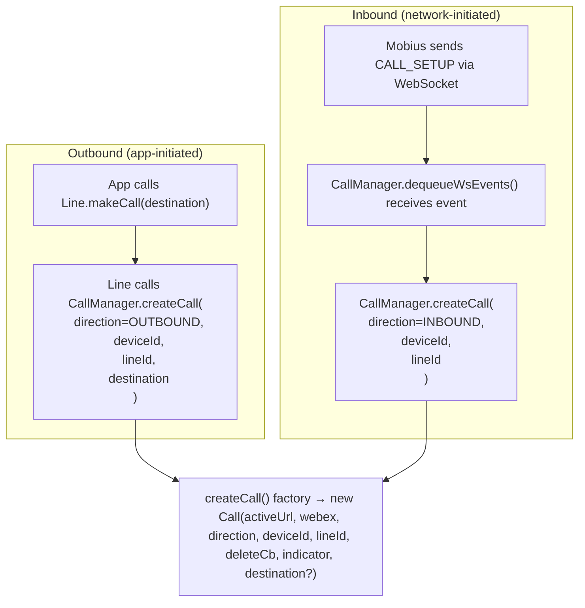

The inbound path also runs when a `CALL_MEDIA` event arrives before `CALL_SETUP` (`MOD-004`), and
the factory passes the manager's `iceGatheringConfig` as a ninth argument.

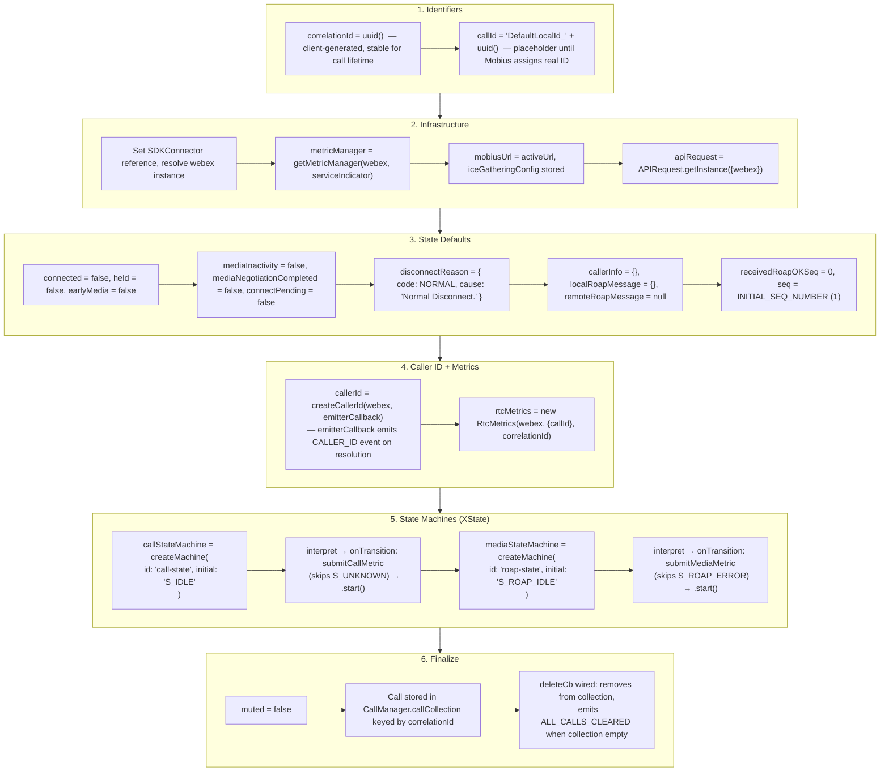

### Mobius event intake

| Source | Event | Handler Path | Purpose |
|--------|-------|--------------|---------|
| CallManager Instantiation | `event:mobius` | listenForWsEvents() -> dequeueWsEvents() | Entry point for all signaling/media events from backend on the HTTP transport |
| CallingClient (Mobius socket) | Mobius async event | CallingClient -> CallManager.dequeueWsEvents() | Entry point on the WebSocket transport; `registration.down` is handled by CallingClient and never reaches CallManager |
| MediaConnection | `ROAP_MESSAGE_TO_SEND` | Call.mediaRoapEventsListener() | Publish local ROAP back to Mobius (`post` for the initial offer, `postMedia` otherwise) |
| MediaConnection | `ROAP_FAILURE` | Call.mediaRoapEventsListener() | Submit a media error metric |
| MediaConnection | `REMOTE_TRACK_ADDED` | Call.mediaTrackListener() | Emit remote media track to app |
| MediaConnection | ICE gathering, peer connection, ICE connection state changes; ICE candidate error | Call.mediaIceEventsListener() | Submit media metrics |
| LocalMicrophoneStream | `OutputTrackChange`, `EffectAdded` | Call.registerListeners() | Keep media/effect state synchronized (`EffectAdded` registers per-effect `Enabled/Disabled` listeners) |

Per-type Mobius routing is listed under Protocol and wire format (Mobius event types).

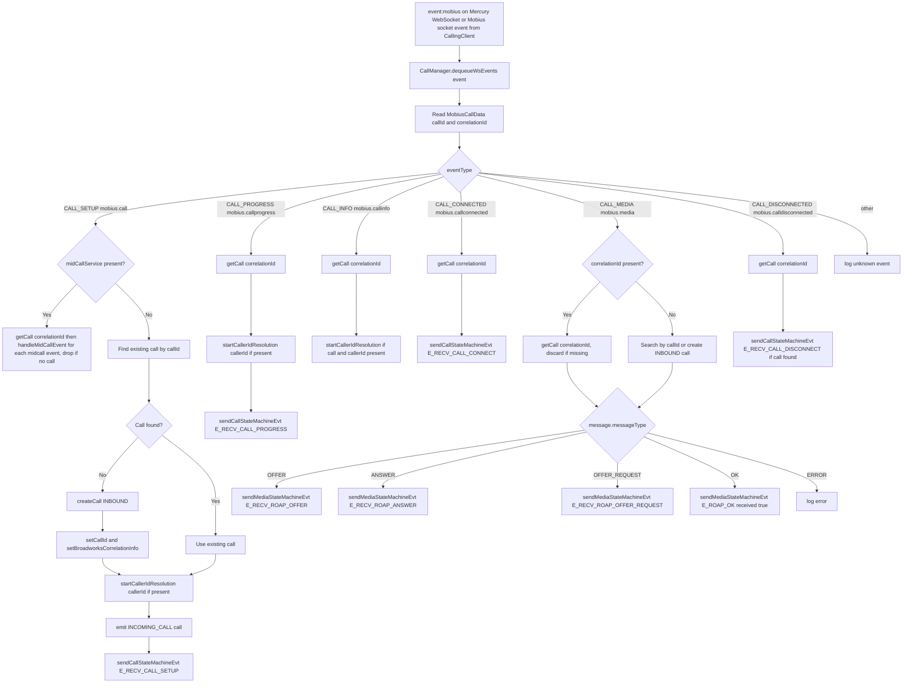

When a `CALL_SETUP` event arrives, the CallManager:
1. Checks if the event contains `midCallService` data -- if so, routes to existing call's `handleMidCallEvent()`
2. Searches `callCollection` for a call matching the `callId` (handles case where `CALL_MEDIA` arrived before `CALL_SETUP`)
3. If no match found, creates a new `INBOUND` call via `createCall()`
4. Sets the Mobius `callId` and optional `broadworksCorrelationInfo` on the call
5. Starts caller ID resolution when the event carries `callerId`
6. Emits `LINE_EVENT_KEYS.INCOMING_CALL` with the call object
7. Sends `E_RECV_CALL_SETUP` to the call's state machine

### Outgoing and incoming call setup

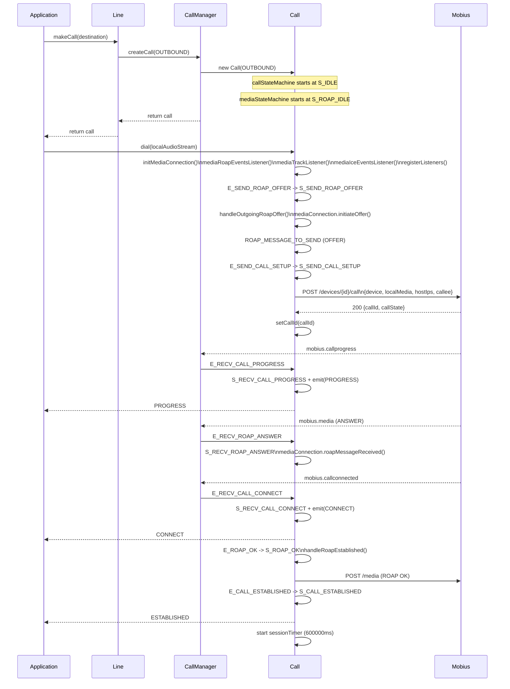

When the media engine's ROAP OK comes before `mobius.callconnected` (call still in
`S_SEND_CALL_SETUP` or `S_RECV_CALL_PROGRESS`), `handleRoapEstablished` only records
`mediaNegotiationCompleted`, and `handleIncomingCallConnect` sends `E_CALL_ESTABLISHED` after
emitting `CONNECT` (`MOD-012`).

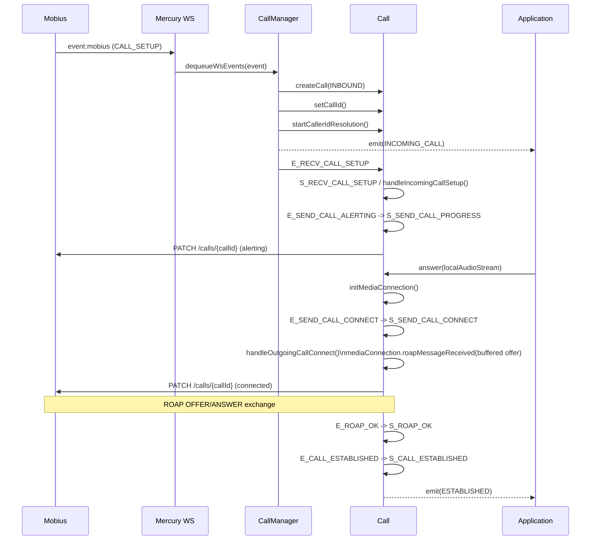

### ROAP negotiation

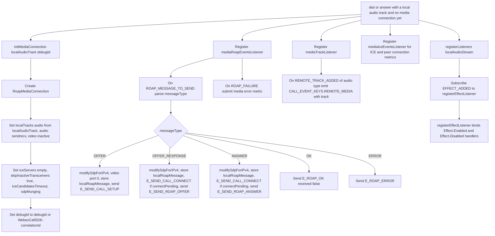

ROAP handling is bidirectional:

When Mobius sends a media event, `CallManager` routes it to the target `Call`, which forwards it into the media state machine and then to `mediaConnection.roapMessageReceived()` for SDP processing.

1. `event:mobius` with `CALL_MEDIA` reaches `CallManager.dequeueWsEvents()`.
2. `CallManager` resolves the correct call by `correlationId` (or fallback by `callId`).
3. `message.messageType` is mapped to media state events:
   - `OFFER` -> `E_RECV_ROAP_OFFER`
   - `ANSWER` -> `E_RECV_ROAP_ANSWER`
   - `OFFER_REQUEST` -> `E_RECV_ROAP_OFFER_REQUEST`
   - `OK` -> `E_ROAP_OK`
4. `Call` action handlers process the event and pass the ROAP payload to media engine APIs when applicable.

When the media engine emits `ROAP_MESSAGE_TO_SEND`, `Call` converts that into state-machine events and publishes ROAP to Mobius via `post()` (initial offer) or `postMedia()`.

1. `mediaConnection` emits `ROAP_MESSAGE_TO_SEND` (`OFFER`/`OFFER_RESPONSE`/`ANSWER`/`OK`/`ERROR`).
2. `Call.handleMediaRoapEvent()` rewrites SDP with `modifySdpForIPv4()`, stores the local ROAP message, and sends the corresponding event (`E_SEND_CALL_SETUP` for the initial `OFFER`, `E_SEND_ROAP_OFFER`, `E_SEND_ROAP_ANSWER`, `E_ROAP_OK`, `E_ROAP_ERROR`).
3. Outgoing action handlers invoke `postMedia()`; the initial offer is carried by the call setup `post()`.
4. Both requests add `hostIps` derived from the SDP being sent (`MOD-015`).

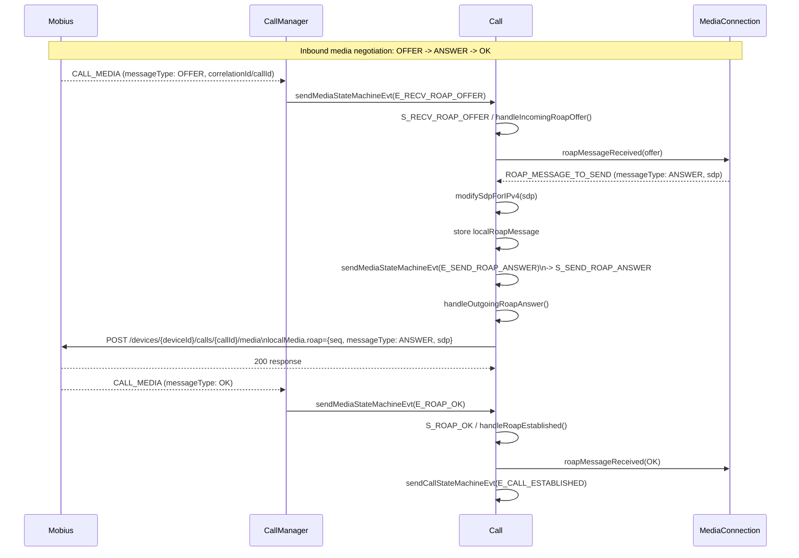

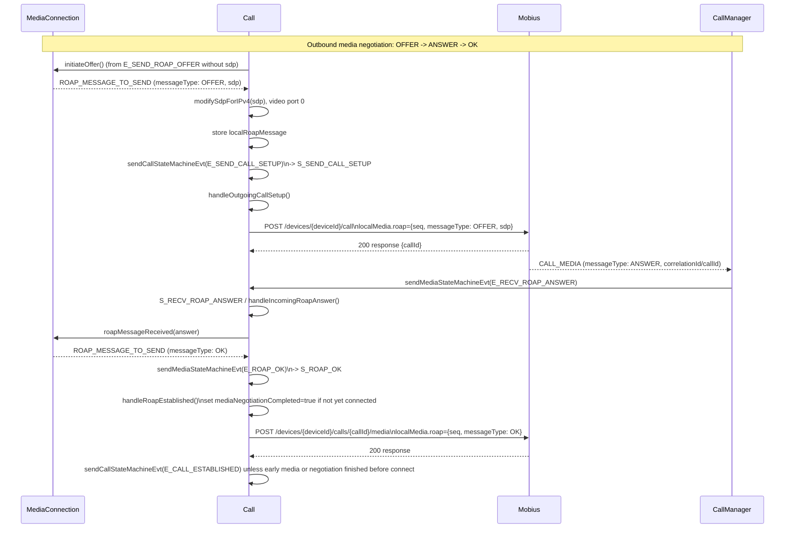

Mid-call offers from the media engine (`OFFER_RESPONSE`) follow the `E_SEND_ROAP_OFFER` path and
are posted with `postMedia()`; Mobius-initiated renegotiation (hold, resume) starts with a received
`OFFER` or `OFFER_REQUEST`.

### Hold, resume, and transfer

- `doHoldResume()` checks the `held` flag and sends either `E_CALL_HOLD` or `E_CALL_RESUME` to the call state machine
- The state machine transitions to `S_CALL_HOLD` or `S_CALL_RESUME` and calls `handleCallHold()` or `handleCallResume()`
- These handlers POST to the Mobius hold/resume endpoint
- After a successful POST, a `supplementaryServicesTimer` (10 seconds) is set to emit `HOLD_ERROR` or `RESUME_ERROR` if Mobius doesn't respond with a mid-call state event in time; it is set only when the `held` flag has not already changed
- On success, a mid-call event with `HELD` or `CONNECTED` state arrives and the timer is cleared
- The return to `S_CALL_ESTABLISHED` comes from the Mobius-driven ROAP renegotiation that ends in `E_ROAP_OK`, not from the mid-call event

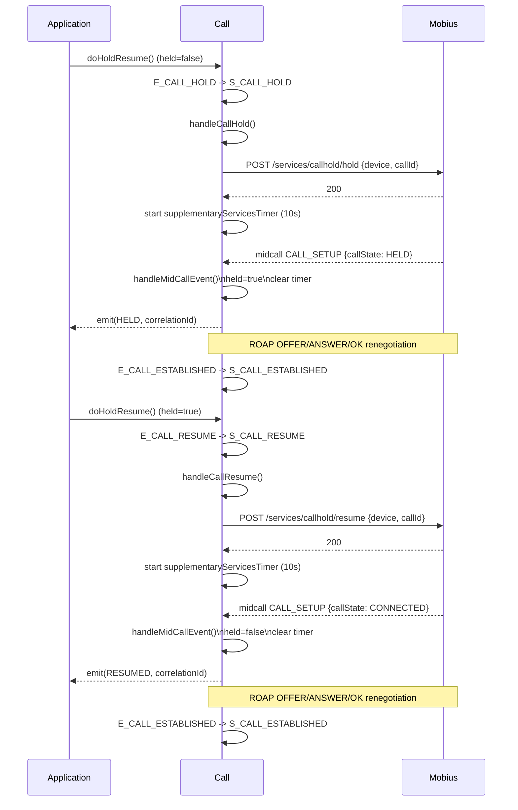

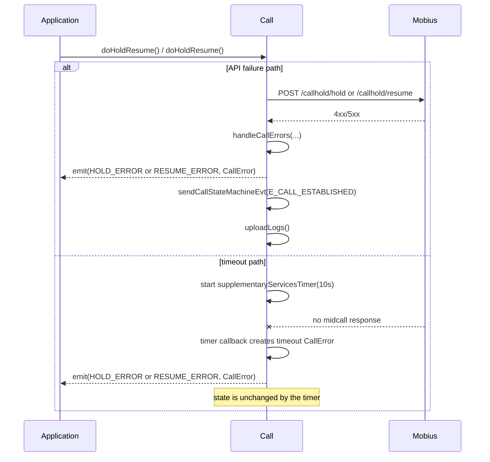

Two transfer types are supported:

| Type | Enum | Required Parameters |
|------|------|-------------------|
| Blind | `TransferType.BLIND` | `transferTarget` (destination number) |
| Consult | `TransferType.CONSULT` | `transferCallId` (call ID of second call) |

Both are executed via `postSSRequest()` to the `/calltransfer/commit` endpoint.

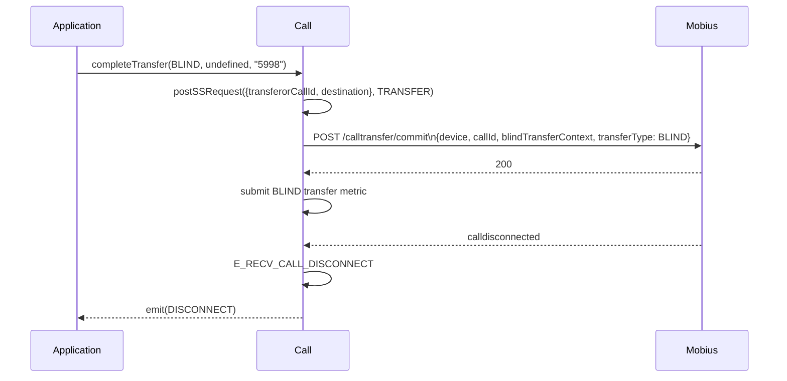

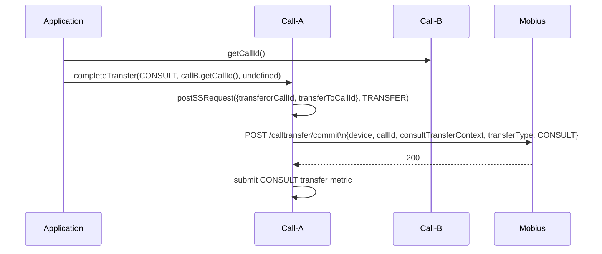

### Failure, disconnect, and keepalive

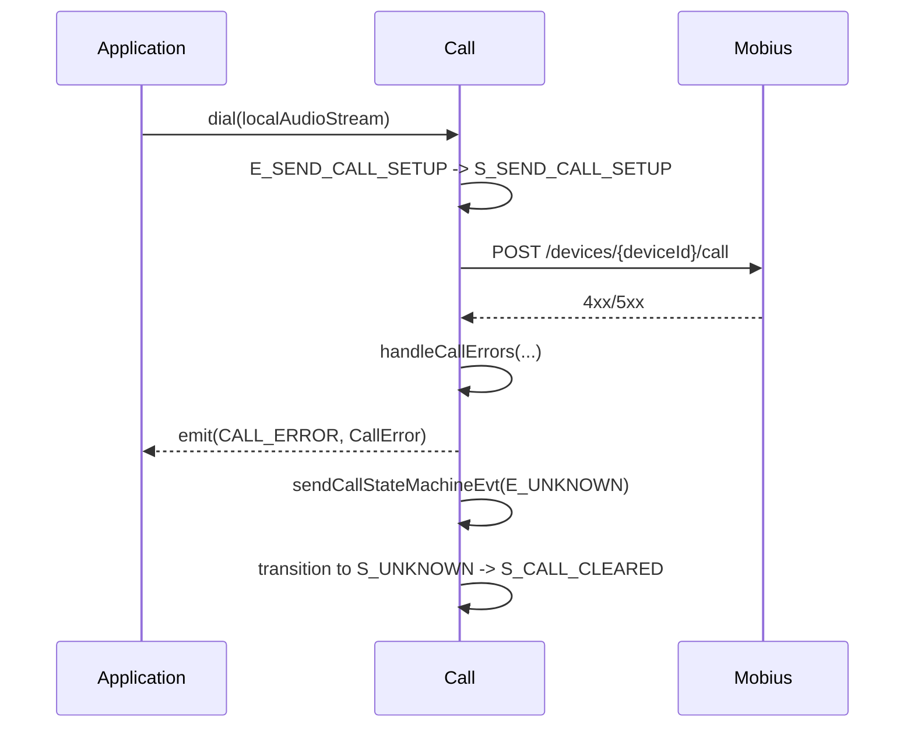

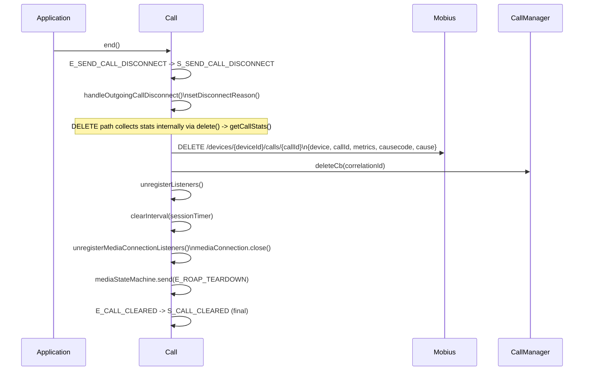

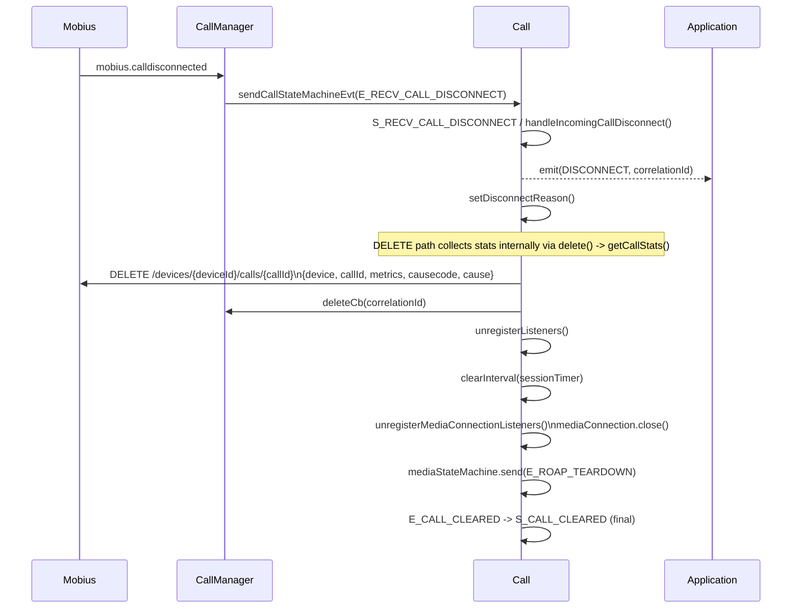

A failed DELETE is logged and triggers `uploadLogs`; cleanup continues either way.

When a call is created, a `deleteCb` callback is passed that:
1. Removes the call from `callCollection`
2. If `callCollection` becomes empty, emits `CALLING_CLIENT_EVENT_KEYS.ALL_CALLS_CLEARED`

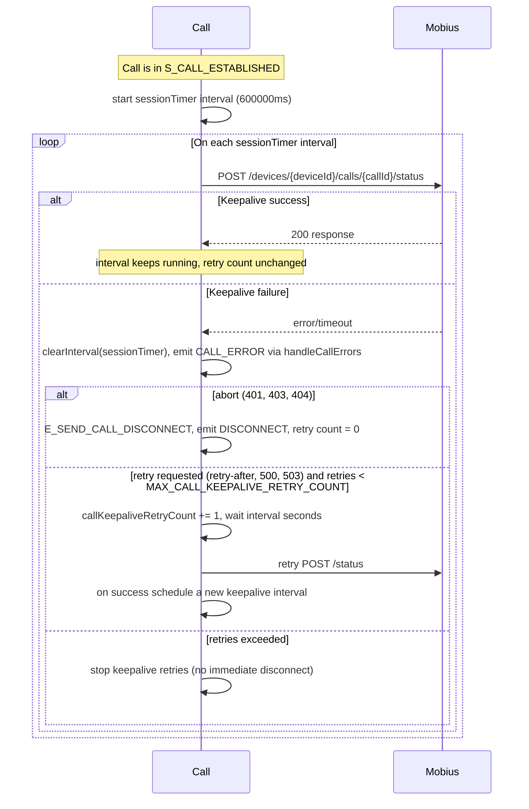

## Class and component relationships

The Calling sub-module is organized around one manager (`CallManager`) and per-call executors (`Call`).
`CallManager` handles event intake/routing and active call tracking, while each `Call` owns signaling/media state, backend signaling API operations, and event emission.
`CallerId` is a focused helper used by `Call` for caller identity resolution and incremental updates.

| Component | Primary Responsibility | Key Interactions |
|-----------|------------------------|------------------|
| `CallManager` (class) | Owns active call collection, resolves/routes backend events | Backend signaling stream (`event:mobius` or Mobius socket events forwarded by `CallingClient`), `Call`, `Line` |
| `Call` (class) | Executes call lifecycle operations and state machines | Backend signaling service (`Mobius`) REST APIs through `APIRequest`, `RoapMediaConnection`, `CallerId`, app listeners |
| `CallerId` | Resolves display identity from headers + SCIM enrichment | `Call` callback emitter, shared identity utilities |
| `Call State Machine` | Signaling transitions and call control actions | Lives in `Call` as `callMachine` and drives handlers (`setup`, `connect`, `disconnect`, `hold/resume`) |
| `Media ROAP State Machine` | ROAP negotiation transitions (`OFFER/ANSWER/OK/ERROR`) | Lives in `Call` as `mediaMachine` and drives ROAP handlers + `RoapMediaConnection` |

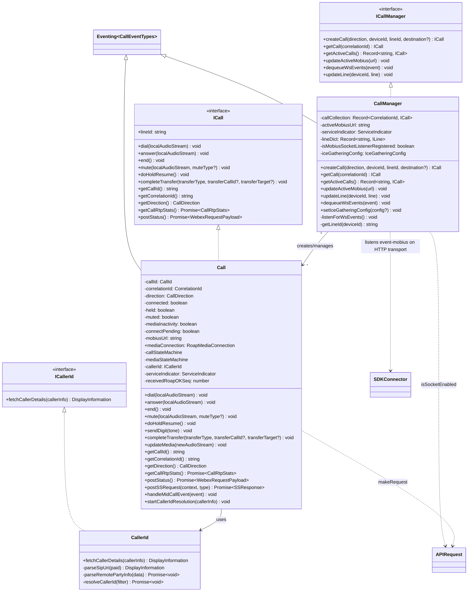

## Use cases and flows

| Use case | Actor or caller | Primary steps and outcome | Failure or boundary behavior | Evidence |
| -------- | --------------- | ------------------------- | ---------------------------- | -------- |
| `UC-001` Place a call | Application through `ILine.makeCall` and `ICall.dial` | Offer generated, `POST /call`, progress, connect, ROAP OK, `ESTABLISHED` (`MOD-008`, `MOD-012`) | No audio track: `DISCONNECT`; setup failure: `CALL_ERROR` and clear; missing Mobius event: timeout `DISCONNECT` | `src/CallingClient/calling/call.ts`, `src/CallingClient/calling/call.test.ts` |
| `UC-002` Receive and answer a call | Mobius, then the application on `LINE_EVENTS.INCOMING_CALL` | `INCOMING_CALL`, alerting PATCH, `answer`, connect PATCH, ROAP, `ESTABLISHED` (`MOD-003`, `MOD-009`, `MOD-010`) | Answer outside `S_SEND_CALL_PROGRESS` is ignored with a warning; no track: local disconnect with media-inactivity cause | `src/CallingClient/calling/callManager.ts`, `src/CallingClient/calling/callManager.test.ts` |
| `UC-003` Hold and resume | Application | `doHoldResume`, POST, mid-call confirmation, `HELD` or `RESUMED` (`MOD-016`) | `HOLD_ERROR` or `RESUME_ERROR` on failure or 10 s timeout | `src/CallingClient/calling/call.ts`, `src/CallingClient/calling/call.test.ts` |
| `UC-004` Transfer | Application | `completeTransfer` blind or consult, then Mobius disconnect (`MOD-017`) | `TRANSFER_ERROR`; missing argument sends nothing | `src/CallingClient/calling/call.ts`, `src/CallingClient/calling/call.test.ts` |
| `UC-005` Mid-call media control | Application | `mute`, `sendDigit`, `updateMedia`, `getCallRtpStats` (`MOD-018`, `MOD-019`) | Failures logged, call unaffected | `src/CallingClient/calling/call.ts`, `src/CallingClient/calling/call.test.ts` |
| `UC-006` End a call | Application or Mobius | `end()` or `mobius.calldisconnected`, DELETE, cleanup (`MOD-021`) | DELETE failure logged and logs uploaded | `src/CallingClient/calling/call.ts`, `src/CallingClient/calling/callManager.test.ts` |
| `UC-007` Keep the call session alive | `Call` timer | Interval `POST /status` (`MOD-020`) | Retries, then stop; abort disconnects | `src/CallingClient/calling/call.ts`, `src/CallingClient/calling/call.test.ts` |

Listen for incoming calls first, then attach per-call listeners:

```typescript
import {CALL_EVENT_KEYS, ICall, LINE_EVENTS} from '@webex/calling';

line.on(LINE_EVENTS.INCOMING_CALL, (call: ICall) => {
  call.on(CALL_EVENT_KEYS.PROGRESS, (id) => {/* update UI */});
  call.on(CALL_EVENT_KEYS.CONNECT, (id) => {/* ringing -> connected */});
  call.on(CALL_EVENT_KEYS.ESTABLISHED, (id) => {/* media established */});
  call.on(CALL_EVENT_KEYS.REMOTE_MEDIA, (track) => {/* attach remote track */});
  call.on(CALL_EVENT_KEYS.CALLER_ID, ({correlationId, callerId}) => {/* refresh caller display */});
  call.on(CALL_EVENT_KEYS.CALL_ERROR, (err) => {/* show retry/failure */});
  call.on(CALL_EVENT_KEYS.DISCONNECT, (id) => {/* teardown UI */});
});
```

For outbound calls, attach listeners immediately after `createCall`/`makeCall` and before or right after `dial()` to avoid missing early events.

### Cross-boundary use-case flow

- Boundary: `Call` to Mobius REST (`mobius-http`) through `APIRequest`; Mobius to `CallManager`
  through Mercury (`mercury-events`) or the Mobius socket; `Call` to the media engine in process.
- Ordering: Mobius events are handled in arrival order by `dequeueWsEvents`; no reordering queue
  exists, so the call tolerates media-before-setup and offer-before-answer through buffering
  (`MOD-003`, `MOD-013`) and ignores events a state does not accept.
- Compatibility: request and event shapes are fixed by Mobius (Protocol and wire format); every
  call request carries the `cisco-device-url` and `spark-user-agent` headers.
- Timeout: signaling-state timers (10 s, 60 s), the 10 s hold/resume confirmation timer, and the
  10-minute keepalive; REST calls rely on the transport's own timeout.
- Retry: only keepalive and mid-call ROAP sends (offer, answer, OK while connected) retry, and
  only when Mobius returns `retry-after` (or keepalive 500/503 defaults); call setup, PATCH,
  hold, resume, and transfer never retry.
- Recovery: unrecoverable setup or media failures end in `S_UNKNOWN` with a Mobius DELETE;
  `uploadLogs` runs after each Mobius failure.

## Client state model

`CallManager` owns active calls keyed by correlation id and line mappings keyed by device id. Each `Call` owns a signaling state machine, a ROAP/media state machine, identifiers, timers, media connection, caller information, and disconnect reason. Evidence: `src/CallingClient/calling/callManager.ts`, `src/CallingClient/calling/call.ts`.

| State or slice | Owner | Initial state | Transition triggers | Reset or persistence boundary |
| -------------- | ----- | ------------- | ------------------- | ----------------------------- |
| Active-call collection | `CallManager` | Empty | `createCall` adds; the delete callback removes | Process lifetime (singleton); `ALL_CALLS_CLEARED` when it empties |
| Line map | `CallManager` | Empty | `updateLine(deviceId, line)` | Never cleared |
| Mercury listener flag | `CallManager` | `false` | `listenForWsEvents` at construction and on `updateActiveMobius` | Tracks the single registered listener |
| Signaling and media states | `Call` | `S_IDLE`, `S_ROAP_IDLE` | State machine events (State machine) | Final states `S_CALL_CLEARED`, `S_ROAP_TEARDOWN` |
| Call flags (`connected`, `held`, `muted`, `earlyMedia`, `mediaInactivity`, `mediaNegotiationCompleted`, `connectPending`) | `Call` | All `false` | Handlers listed under Business rules and invariants | Discarded with the call object |
| ROAP messages and sequence (`localRoapMessage`, `remoteRoapMessage`, `seq`, `receivedRoapOKSeq`) | `Call` | `{}`, `null`, `1`, `0` | Local and remote ROAP events (`MOD-013`) | Discarded with the call object |
| Timers (`sessionTimer`, `supplementaryServicesTimer`, keepalive retry count) | `Call` | Unset, unset, `0` | Establishment, hold/resume POST, keepalive failures | Session interval cleared on disconnect and keepalive error; hold timer cleared by mid-call state |

| Property | Type | Description |
|----------|------|-------------|
| `callCollection` | `Record<CorrelationId, ICall>` | Active calls keyed by client-side correlation ID |
| `activeMobiusUrl` | `string` | Current active Mobius server URL |
| `serviceIndicator` | `ServiceIndicator` | Service type (`calling`, `contactcenter`, `guestcalling`) |
| `lineDict` | `Record<string, ILine>` | Lines keyed by device ID, for resolving `lineId` from incoming events |
| `isMobiusSocketListenerRegistered` | `boolean` | Whether the Mercury `event:mobius` listener is currently registered |
| `iceGatheringConfig` | `IceGatheringConfig \| undefined` | ICE configuration passed to new calls |
| `apiRequest` | `APIRequest` | Transport facade used to check whether the Mobius socket is enabled |

| Property | Type | Visibility | Description |
|----------|------|-----------|-------------|
| `direction` | `CallDirection` | private | `INBOUND` or `OUTBOUND` |
| `callId` | `CallId` | private | Server-assigned Mobius call ID (initially `DefaultLocalId_{uuid}`) |
| `correlationId` | `CorrelationId` | private | Client-generated UUID for this call |
| `deviceId` | `string` | private | Mobius device ID |
| `lineId` | `string` | public | Associated line ID |
| `destination` | `CallDetails` | private | Target address for outgoing calls |
| `connected` | `boolean` | private | Whether call is in connected/established state |
| `held` | `boolean` | private | Whether call is currently on hold |
| `muted` | `boolean` | private | Whether local audio is muted |
| `earlyMedia` | `boolean` | private | Whether early media (inband ROAP) was detected |
| `mediaInactivity` | `boolean` | private | Whether media inactivity was detected |
| `mediaNegotiationCompleted` | `boolean` | private | Whether ROAP negotiation finished |
| `connectPending` | `boolean` | private | Whether an answer is waiting for the remote offer before the connect PATCH |
| `mediaConnection` | `RoapMediaConnection` (declared `any`, optional) | public | WebRTC media connection instance |
| `localAudioStream` | `LocalMicrophoneStream` | private | Local microphone stream |
| `mobiusUrl` | `string` | private | Active Mobius server URL for this call |
| `callStateMachine` | XState interpreter | private | Call signaling state machine |
| `mediaStateMachine` | XState interpreter | private | ROAP media state machine |
| `seq` | `number` | private | ROAP sequence number (starts at 1) |
| `localRoapMessage` | `RoapMessage` | private | Last local ROAP message |
| `remoteRoapMessage` | `RoapMessage \| null` | private | Last remote ROAP message (buffered) |
| `disconnectReason` | `DisconnectReason` | private | Reason for disconnect (code + cause) |
| `callerInfo` | `DisplayInformation` | private | Resolved caller display info |
| `callerId` | `ICallerId` | private | CallerId resolver instance |
| `sessionTimer` | `NodeJS.Timeout` | private | 10-minute keepalive interval started at call establishment |
| `supplementaryServicesTimer` | `NodeJS.Timeout` | private | 10-second timeout for hold/resume responses |
| `broadworksCorrelationInfo` | `string` | private | Broadworks correlation ID (used for WxCC) |
| `serviceIndicator` | `ServiceIndicator` | private | Service type (`calling`, `contactcenter`, `guestcalling`) |
| `metricManager` | `IMetricManager` | private | Metrics submission |
| `rtcMetrics` | `RtcMetrics` | private | WebRTC metrics from `@webex/internal-plugin-metrics` |
| `receivedRoapOKSeq` | `number` | private | Tracks the sequence number of the last received ROAP OK |
| `callKeepaliveRetryCount` | `number` | private | Keepalive retry counter (max 4) |
| `deleteCb` | `DeleteRecordCallBack` | private | Callback that removes the call from `CallManager` |
| `apiRequest` | `APIRequest` | private | Transport used for every Mobius request |
| `iceGatheringConfig` | `IceGatheringConfig` | private | Optional ICE-lite timeout configuration |

## Business rules and invariants

| ID | Invariant | WHY | Enforcement source | Test evidence |
| -- | --------- | --- | ------------------ | ------------- |
| `INV-001` | A call is answered only in `S_SEND_CALL_PROGRESS` and dialed only while the media machine is in `S_ROAP_IDLE`; otherwise the request is logged and ignored | Prevents duplicate offers or a connect before alerting | `src/CallingClient/calling/call.ts` | `src/CallingClient/calling/call.test.ts` |
| `INV-002` | `connected` becomes true only in `handleCallEstablished`, and failures before that point clear the call while failures after it keep it (media errors, ROAP send failures) | Mid-call media trouble must not drop an established call | `src/CallingClient/calling/call.ts` | `src/CallingClient/calling/call.test.ts` |
| `INV-003` | Disconnect reason: media inactivity gives code 131 `Media Inactivity.`; a connected or outbound call gives 0 `Normal Disconnect.`; an unconnected inbound call gives 115 `User Busy.` | Mobius reports a declined or unanswered inbound call as busy | `src/CallingClient/calling/call.ts` | `src/CallingClient/calling/call.test.ts` |
| `INV-004` | `held` changes only on a mid-call `HELD` or `CONNECTED` state from Mobius | The server, not the HTTP 200, is the authority on hold state | `src/CallingClient/calling/call.ts` | `src/CallingClient/calling/call.test.ts` |
| `INV-005` | A call is removed from `CallManager` through its delete callback, and `ALL_CALLS_CLEARED` fires whenever the collection becomes empty | `CallingClient` defers re-registration until no call is active | `src/CallingClient/calling/callManager.ts` | `src/CallingClient/calling/callManager.test.ts` |

- Mobius events are routed by correlation/call id; unknown or out-of-order events must not mutate an unrelated call.
- Signaling and media transitions occur only through their XState event entry points.
- Call cleanup deletes the call from CallManager exactly once; the disconnect paths also remove listeners and timers, but the timeout path and the unknown-state path leave some of them (Pitfalls and constraints).
- Auth metadata is obtained through APIRequest/SDKConnector; call logs and metrics must not expose authorization values or raw sensitive identity data. Evidence: `src/CallingClient/calling/call.ts`, `src/CallingClient/calling/callManager.ts`, `src/CallingClient/utils/request.ts`.

The `mute()` method handles two mute types (`MOD-018`):
- `MUTE_TYPE.USER` -- User-initiated mute, toggles `localAudioStream.setUserMuted()` unless the stream is system-muted
- `MUTE_TYPE.SYSTEM` -- System-initiated mute, respects user mute state

## Concurrency and reactive flow

- Execution model: single JavaScript event loop; Mobius events, media engine events, REST
  promises, XState delayed transitions, and timers all run as callbacks on it.
- Ordering guarantees: each machine processes events in send order; Mobius events are processed in
  arrival order with no queue; async handlers are not awaited by the machine, so a REST call can
  finish after the next event has already moved the state.
- Idempotency and retry: unaccepted events are ignored by XState; `CallManager` drops disconnects
  for unknown calls; retries exist only for keepalive and mid-call ROAP sends (Cross-boundary
  use-case flow).
- Shared-state protection: one owner per slice (Client state model); the `CallManager` singleton is
  shared by `Line`, `Registration`, and `CallingClient` without locking.
- Blocking restrictions: no handler blocks; `uploadLogs` and metric submission are awaited only
  inside error paths after the state event has been sent.

Keepalive is active while the call is established. A session timer triggers periodic status checks using `postStatus()`:

- `sessionTimer` starts after call establishment (default interval: `600000ms`) as a `setInterval`; any previous interval is cleared first.
- On each tick, `Call` sends `POST /devices/{deviceId}/calls/{callId}/status`.
- Success neither resets keepalive retry tracking nor schedules the next keepalive cycle: the interval keeps running, and the retry counter is reset only after an abort.
- Failure clears the interval, emits `CALL_ERROR`, and passes `RetryCallBack` to `handleCallErrors`, which calls it on `retry-after`, 500, or 503; each retry increments `callKeepaliveRetryCount` and a successful retry schedules a new interval.
- On retry exhaustion (`MAX_CALL_KEEPALIVE_RETRY_COUNT`), retry loop stops and no immediate disconnect event is sent.
- Disconnect is triggered only on abort scenarios from `handleCallErrors` (for example keepalive 401/403/404 paths), where `E_SEND_CALL_DISCONNECT` is emitted.

| Method | Signature | Description |
|--------|-----------|-------------|
| `scheduleCallKeepaliveInterval` | `private scheduleCallKeepaliveInterval = (): void` | Schedules periodic `postStatus()` call to Mobius |
| `callKeepaliveRetryCallback` | `private callKeepaliveRetryCallback = (interval: number): void` | Retries keepalive POST after error with given interval |
| `handleCallKeepaliveError` | `private handleCallKeepaliveError = async (err: unknown): Promise<void>` | Handles keepalive errors, clears the interval, emits `CALL_ERROR`, and disconnects on abort; uploads logs |

## State machine

- Maintains call signaling and ROAP media state machines per call.
- Coordinates HTTP signaling operations with asynchronous WebSocket-driven transitions.
- Preserves deterministic behavior through explicit event-driven transitions.

Both machines are XState v4 machines created in the `Call` constructor and started immediately.
Event unions are declared in `src/Events/types.ts`: `CallEvent` has the types
`E_RECV_CALL_SETUP`, `E_RECV_CALL_PROGRESS`, `E_RECV_CALL_CONNECT`, `E_RECV_CALL_DISCONNECT`,
`E_SEND_CALL_SETUP`, `E_SEND_CALL_ALERTING`, `E_SEND_CALL_CONNECT`, `E_SEND_CALL_DISCONNECT`,
`E_CALL_ESTABLISHED`, `E_CALL_INFO`, `E_UNKNOWN`, `E_CALL_CLEARED`, `E_CALL_HOLD`, and
`E_CALL_RESUME`; `RoapEvent` has `E_SEND_ROAP_OFFER`, `E_SEND_ROAP_ANSWER`, `E_RECV_ROAP_OFFER`,
`E_RECV_ROAP_ANSWER`, `E_ROAP_ERROR`, `E_ROAP_OK`, `E_RECV_ROAP_OFFER_REQUEST`, and
`E_ROAP_TEARDOWN`; each carries optional `data`. An event a state does not list is ignored.
`E_CALL_INFO` has no transition anywhere, `S_ERROR` has no incoming transition, and terminal states
are `S_CALL_CLEARED` and `S_ROAP_TEARDOWN`.

### Call signaling machine

```mermaid
stateDiagram-v2
    [*] --> S_IDLE

    S_IDLE --> S_RECV_CALL_SETUP: E_RECV_CALL_SETUP / incomingCallSetup
    S_IDLE --> S_SEND_CALL_SETUP: E_SEND_CALL_SETUP / outgoingCallSetup
    S_IDLE --> S_RECV_CALL_DISCONNECT: E_RECV_CALL_DISCONNECT / incomingCallDisconnect
    S_IDLE --> S_SEND_CALL_DISCONNECT: E_SEND_CALL_DISCONNECT / outgoingCallDisconnect
    S_IDLE --> S_UNKNOWN: E_UNKNOWN / unknownState

    S_RECV_CALL_SETUP --> S_SEND_CALL_PROGRESS: E_SEND_CALL_ALERTING / outgoingCallAlerting
    S_RECV_CALL_SETUP --> S_RECV_CALL_DISCONNECT: E_RECV_CALL_DISCONNECT / incomingCallDisconnect
    S_RECV_CALL_SETUP --> S_SEND_CALL_DISCONNECT: E_SEND_CALL_DISCONNECT / outgoingCallDisconnect
    S_RECV_CALL_SETUP --> S_UNKNOWN: E_UNKNOWN / unknownState
    S_RECV_CALL_SETUP --> S_CALL_CLEARED: timeout 10000ms / triggerTimeout

    S_SEND_CALL_SETUP --> S_RECV_CALL_PROGRESS: E_RECV_CALL_PROGRESS / incomingCallProgress
    S_SEND_CALL_SETUP --> S_RECV_CALL_CONNECT: E_RECV_CALL_CONNECT / incomingCallConnect
    S_SEND_CALL_SETUP --> S_RECV_CALL_DISCONNECT: E_RECV_CALL_DISCONNECT / incomingCallDisconnect
    S_SEND_CALL_SETUP --> S_SEND_CALL_DISCONNECT: E_SEND_CALL_DISCONNECT / outgoingCallDisconnect
    S_SEND_CALL_SETUP --> S_UNKNOWN: E_UNKNOWN / unknownState
    S_SEND_CALL_SETUP --> S_CALL_CLEARED: timeout 10000ms / triggerTimeout

    S_RECV_CALL_PROGRESS --> S_RECV_CALL_CONNECT: E_RECV_CALL_CONNECT / incomingCallConnect
    S_RECV_CALL_PROGRESS --> S_RECV_CALL_DISCONNECT: E_RECV_CALL_DISCONNECT / incomingCallDisconnect
    S_RECV_CALL_PROGRESS --> S_SEND_CALL_DISCONNECT: E_SEND_CALL_DISCONNECT / outgoingCallDisconnect
    S_RECV_CALL_PROGRESS --> S_RECV_CALL_PROGRESS: E_RECV_CALL_PROGRESS / incomingCallProgress
    S_RECV_CALL_PROGRESS --> S_UNKNOWN: E_UNKNOWN / unknownState
    S_RECV_CALL_PROGRESS --> S_CALL_CLEARED: timeout 60000ms / triggerTimeout

    S_SEND_CALL_PROGRESS --> S_SEND_CALL_CONNECT: E_SEND_CALL_CONNECT / outgoingCallConnect
    S_SEND_CALL_PROGRESS --> S_RECV_CALL_DISCONNECT: E_RECV_CALL_DISCONNECT / incomingCallDisconnect
    S_SEND_CALL_PROGRESS --> S_SEND_CALL_DISCONNECT: E_SEND_CALL_DISCONNECT / outgoingCallDisconnect
    S_SEND_CALL_PROGRESS --> S_UNKNOWN: E_UNKNOWN / unknownState
    S_SEND_CALL_PROGRESS --> S_CALL_CLEARED: timeout 60000ms / triggerTimeout

    S_RECV_CALL_CONNECT --> S_CALL_ESTABLISHED: E_CALL_ESTABLISHED / callEstablished
    S_RECV_CALL_CONNECT --> S_RECV_CALL_DISCONNECT: E_RECV_CALL_DISCONNECT / incomingCallDisconnect
    S_RECV_CALL_CONNECT --> S_SEND_CALL_DISCONNECT: E_SEND_CALL_DISCONNECT / outgoingCallDisconnect
    S_RECV_CALL_CONNECT --> S_UNKNOWN: E_UNKNOWN / unknownState
    S_RECV_CALL_CONNECT --> S_CALL_CLEARED: timeout 10000ms / triggerTimeout

    S_SEND_CALL_CONNECT --> S_SEND_CALL_CONNECT: E_SEND_CALL_CONNECT [connectPending] / outgoingCallConnect
    S_SEND_CALL_CONNECT --> S_CALL_ESTABLISHED: E_CALL_ESTABLISHED / callEstablished
    S_SEND_CALL_CONNECT --> S_RECV_CALL_DISCONNECT: E_RECV_CALL_DISCONNECT / incomingCallDisconnect
    S_SEND_CALL_CONNECT --> S_SEND_CALL_DISCONNECT: E_SEND_CALL_DISCONNECT / outgoingCallDisconnect
    S_SEND_CALL_CONNECT --> S_UNKNOWN: E_UNKNOWN / unknownState
    S_SEND_CALL_CONNECT --> S_CALL_CLEARED: timeout 10000ms / triggerTimeout

    S_CALL_ESTABLISHED --> S_CALL_HOLD: E_CALL_HOLD / initiateCallHold
    S_CALL_ESTABLISHED --> S_CALL_RESUME: E_CALL_RESUME / initiateCallResume
    S_CALL_ESTABLISHED --> S_RECV_CALL_DISCONNECT: E_RECV_CALL_DISCONNECT / incomingCallDisconnect
    S_CALL_ESTABLISHED --> S_SEND_CALL_DISCONNECT: E_SEND_CALL_DISCONNECT / outgoingCallDisconnect
    S_CALL_ESTABLISHED --> S_CALL_ESTABLISHED: E_CALL_ESTABLISHED / callEstablished
    S_CALL_ESTABLISHED --> S_UNKNOWN: E_UNKNOWN / unknownState

    S_CALL_HOLD --> S_RECV_CALL_DISCONNECT: E_RECV_CALL_DISCONNECT / incomingCallDisconnect
    S_CALL_HOLD --> S_SEND_CALL_DISCONNECT: E_SEND_CALL_DISCONNECT / outgoingCallDisconnect
    S_CALL_HOLD --> S_CALL_ESTABLISHED: E_CALL_ESTABLISHED / callEstablished
    S_CALL_HOLD --> S_UNKNOWN: E_UNKNOWN / unknownState

    S_CALL_RESUME --> S_RECV_CALL_DISCONNECT: E_RECV_CALL_DISCONNECT / incomingCallDisconnect
    S_CALL_RESUME --> S_SEND_CALL_DISCONNECT: E_SEND_CALL_DISCONNECT / outgoingCallDisconnect
    S_CALL_RESUME --> S_CALL_ESTABLISHED: E_CALL_ESTABLISHED / callEstablished
    S_CALL_RESUME --> S_UNKNOWN: E_UNKNOWN / unknownState

    S_RECV_CALL_DISCONNECT --> S_CALL_CLEARED: E_CALL_CLEARED
    S_SEND_CALL_DISCONNECT --> S_CALL_CLEARED: E_CALL_CLEARED
    S_UNKNOWN --> S_CALL_CLEARED: E_CALL_CLEARED
    S_ERROR --> S_CALL_CLEARED: E_CALL_CLEARED
    S_CALL_CLEARED --> [*]
```

| Action Name | Handler Method | Triggered On |
|------------|---------------|-------------|
| `incomingCallSetup` | `handleIncomingCallSetup()` | Incoming call received; sends `E_SEND_CALL_ALERTING` to begin alerting flow |
| `outgoingCallSetup` | `handleOutgoingCallSetup()` | Outgoing call initiated - POST /call to Mobius with the ROAP offer, sets server-assigned `callId` |
| `incomingCallProgress` | `handleIncomingCallProgress()` | Remote alerting/progress received; processes inband media flag, resolves caller ID, emits `PROGRESS` |
| `outgoingCallAlerting` | `handleOutgoingCallAlerting()` | Send alerting - PATCH call state `sig_alerting` to Mobius |
| `incomingCallConnect` | `handleIncomingCallConnect()` | Remote connected, emit CONNECT; sends `E_CALL_ESTABLISHED` when early media or completed negotiation already exists |
| `outgoingCallConnect` | `handleOutgoingCallConnect()` | Answer call - process buffered ROAP, PATCH `sig_connected`; sets `connectPending` when no offer is buffered yet |
| `callEstablished` | `handleCallEstablished()` | Call fully established, emit ESTABLISHED, clear early media, set connected, start keepalive session timer |
| `initiateCallHold` | `handleCallHold()` | POST to /callhold/hold, then start `supplementaryServicesTimer` |
| `initiateCallResume` | `handleCallResume()` | POST to /callhold/resume, then start `supplementaryServicesTimer` |
| `incomingCallDisconnect` | `handleIncomingCallDisconnect()` | Remote disconnect - emit DISCONNECT, set disconnect reason, DELETE call, cleanup |
| `outgoingCallDisconnect` | `handleOutgoingCallDisconnect()` | Local disconnect - set disconnect reason, DELETE call, cleanup (no DISCONNECT event) |
| `unknownState` | `handleUnknownState()` | Unknown event or failure - DELETE call at Mobius, remove from collection, close media, cleanup |
| `triggerTimeout` | `handleTimeout()` | State timeout - remove from collection, emit DISCONNECT, DELETE call |

### ROAP media machine

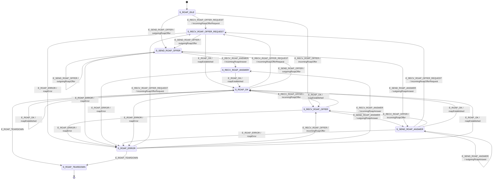

`E_ROAP_TEARDOWN` is accepted only in `S_ROAP_OK` and `S_ROAP_ERROR`; a call cleared from any other
media state leaves the media machine where it was.

| Action Name | Handler Method | Description |
|------------|---------------|-------------|
| `outgoingRoapOffer` | `handleOutgoingRoapOffer()` | Without SDP, calls `mediaConnection.initiateOffer()`; with SDP, sends the offer via `postMedia()` |
| `outgoingRoapAnswer` | `handleOutgoingRoapAnswer()` | Send the generated SDP answer via `postMedia()` with the current `seq` |
| `incomingRoapOffer` | `handleIncomingRoapOffer()` | Process received SDP offer, forward to `mediaConnection.roapMessageReceived()`, or buffer it before the media connection exists or while a ROAP OK is awaited |
| `incomingRoapAnswer` | `handleIncomingRoapAnswer()` | Process received SDP answer, forward to `mediaConnection.roapMessageReceived()` |
| `incomingRoapOfferRequest` | `handleIncomingRoapOfferRequest()` | Handle request from server to generate a new offer; buffered or forwarded to the media connection |
| `roapEstablished` | `handleRoapEstablished()` | Media negotiation complete: a local OK is sent to the server, a received OK is forwarded to the media engine; then transition call state with `E_CALL_ESTABLISHED` per `MOD-012` |
| `roapError` | `handleRoapError()` | Media error: POST the ROAP `ERROR` to `/media` (emit `CALL_ERROR` only if that POST fails), and disconnect the call if not connected |

## Protocol and wire format

| Message or frame | Version | Producer or serializer | Consumer or parser | Compatibility and ordering rule |
| ---------------- | ------- | ---------------------- | ------------------ | ------------------------------- |
| Mobius call event (`mobius.*` in `data.eventType`) | Unversioned; Mobius-owned | Mobius through Mercury or the Mobius socket | `CallManager.dequeueWsEvents` | Routed by `correlationId`, falling back to `callId`; arrival order, no reordering |
| ROAP message (`RoapMessage`) | `version` field carried through | Media engine (local) or Mobius (remote) | `Call` media handlers and `RoapMediaConnection` | `seq` rules in `MOD-013`; `OK` closes each exchange |
| Call REST requests (`POST /call`, `PATCH`, `DELETE`, `/media`, `/status`, `services/...`) | Mobius `api/v1` path | `Call` request methods | Mobius | Bodies always carry `device {deviceId, correlationId}`; media-bearing bodies always carry `hostIps` |
| Mid-call service entry (`midCallService[]` on `mobius.call`) | Unversioned | Mobius | `Call.handleMidCallEvent` | `callInfo` and `callState` only; other types are logged |

### Mobius event types

`MobiusEventType` (`src/CallingClient/calling/types.ts`) has `CALL_SETUP = 'mobius.call'`,
`CALL_PROGRESS = 'mobius.callprogress'`, `CALL_CONNECTED = 'mobius.callconnected'`,
`CALL_MEDIA = 'mobius.media'`, `CALL_DISCONNECTED = 'mobius.calldisconnected'`,
`CALL_INFO = 'mobius.callinfo'`, and `REGISTRATION_DOWN = 'registration.down'`. `MediaState` is
`OFFER`, `ANSWER`, `OFFER_REQUEST`, `OK`, `ERROR`; `MobiusCallState` is
`PROCEEDING = 'sig_proceeding'`, `PROGRESS = 'sig_progress'`, `ALERTING = 'sig_alerting'`,
`CONNECTED = 'sig_connected'`. An event is a `MobiusAsyncEvent` `{type, eventId, trackingId,
data}` whose `data` is either `MobiusCallData` or `MobiusRegistrationDownData`. `MobiusCallData`
has `eventType`, optional `callProgressData` `{alerting, inbandMedia}`, optional `message`
(`RoapMessage`), optional `callerId` (`CallerIdInfo`), optional `midCallService` (array of
`MidCallEvent` `{eventType, eventData}`), `callId`, `callUrl`, `deviceId`, `correlationId`, and
optional `broadworksCorrelationInfo`.

The `CallManager` receives events on `dequeueWsEvents()` from the `event:mobius` listener registered on the `SDKConnector` (HTTP transport) or from `CallingClient` (WebSocket transport), and processes each one based on `eventType`:

| Mobius Event Type | Enum Value | Action |
|-------------------|------------|--------|
| `CALL_SETUP` | `mobius.call` | Create incoming call or handle mid-call event, resolve caller ID, emit `INCOMING_CALL`, send `E_RECV_CALL_SETUP` |
| `CALL_PROGRESS` | `mobius.callprogress` | Resolve caller ID, send `E_RECV_CALL_PROGRESS` to call |
| `CALL_CONNECTED` | `mobius.callconnected` | Send `E_RECV_CALL_CONNECT` to call |
| `CALL_MEDIA` | `mobius.media` | Route ROAP message (`OFFER`, `ANSWER`, `OFFER_REQUEST`, `OK`) to call's media state machine; `ERROR` is only logged |
| `CALL_DISCONNECTED` | `mobius.calldisconnected` | Send `E_RECV_CALL_DISCONNECT` to call |
| `CALL_INFO` | `mobius.callinfo` | Resolve caller ID on the existing call; no state event |
| `REGISTRATION_DOWN` | `registration.down` | Not a call event: `CallingClient` hands it to registration before it reaches `CallManager`; if it does reach `dequeueWsEvents` it is logged as unknown |

### Mid-call service events

The `Call` class handles mid-call events delivered through `CALL_SETUP` messages with `midCallService` data.

| Type | Enum | Description |
|------|------|-------------|
| `callInfo` | `MidCallEventType.CALL_INFO` | Caller ID update during an active call |
| `callState` | `MidCallEventType.CALL_STATE` | Call state change (hold/resume confirmation from server) |

| State | Enum | Description |
|-------|------|-------------|
| `HELD` | `MOBIUS_MIDCALL_STATE.HELD` | Call confirmed as held by server |
| `CONNECTED` | `MOBIUS_MIDCALL_STATE.CONNECTED` | Call confirmed as resumed/connected by server |

When a `callState` mid-call event with `HELD` state is received, the Call emits `CALL_EVENT_KEYS.HELD` and sets `held = true`. When `CONNECTED` is received, it emits `CALL_EVENT_KEYS.RESUMED` and sets `held = false`. Both clear the `supplementaryServicesTimer`.

### Call REST endpoints

All endpoints relative to `{mobiusUrl}` (which is `{mobiusHost}/api/v1/calling/web/`).

| Method | Endpoint | Handler | Description |
|--------|----------|---------|-------------|
| `POST` | `/devices/{deviceId}/call` | `post()` | Initiate outgoing call with ROAP offer |
| `PATCH` | `/devices/{deviceId}/calls/{callId}` | `patch()` | Update call state (alerting, connected) |
| `DELETE` | `/devices/{deviceId}/calls/{callId}` | `delete()` | Disconnect call with final stats |
| `POST` | `/devices/{deviceId}/calls/{callId}/media` | `postMedia()` | Send ROAP message (offer, answer, OK, error) |
| `POST` | `/devices/{deviceId}/calls/{callId}/status` | `postStatus()` | Call keepalive status check |
| `POST` | `/services/callhold/hold` | `postSSRequest()` | Place call on hold |
| `POST` | `/services/callhold/resume` | `postSSRequest()` | Resume call from hold |
| `POST` | `/services/calltransfer/commit` | `postSSRequest()` | Complete blind or consult transfer |

`SUPPLEMENTARY_SERVICES` (`src/Events/types.ts`) has `HOLD = 'hold'`, `RESUME = 'resume'`,
`DIVERT = 'divert'`, `TRANSFER = 'transfer'`, and `PARK = 'park'`.
This enum is used by `postSSRequest(context, type)` to determine which Mobius endpoint to call for supplementary service operations.
Only `HOLD`, `RESUME`, and `TRANSFER` select an endpoint; `DIVERT` and `PARK` log a warning and the
request is still posted to the bare `services` URI.

**POST call (outgoing setup):**
```json
{
  "device": { "deviceId": "...", "correlationId": "..." },
  "localMedia": {
    "roap": { "seq": 1, "messageType": "OFFER", "sdp": "..." },
    "mediaId": "uuid"
  },
  "hostIps": ["10.0.0.5"],
  "callee": { "type": "uri|tel", "address": "..." }
}
```

`callee` is present only when the call has a destination; it copies `type` and `address` from the call's `CallDetails` (`src/common/types.ts`: `type` is a `CallType`, `address` the SIP or tel address).

**PATCH call (state update):**
```json
{
  "device": { "deviceId": "...", "correlationId": "..." },
  "callId": "...",
  "callState": "sig_alerting|sig_connected",
  "inbandMedia": false
}
```

**POST media (ROAP):**
```json
{
  "device": { "deviceId": "...", "correlationId": "..." },
  "callId": "...",
  "localMedia": {
    "roap": { "seq": 2, "messageType": "ANSWER", "sdp": "..." },
    "mediaId": "uuid"
  },
  "hostIps": ["10.0.0.5"]
}
```

ROAP publish payload shape:

```json
{
  "device": { "deviceId": "...", "correlationId": "..." },
  "callId": "...",
  "localMedia": {
    "roap": { "seq": 1, "messageType": "OFFER|ANSWER|OK", "sdp": "..." },
    "mediaId": "..."
  },
  "hostIps": ["10.0.0.5", "192.168.1.7"]
}
```

`hostIps` carries the addresses of the `typ host` candidates of `localMedia.roap.sdp`, extracted by `getHostIpsFromSdp()` (`common/callUtils.ts`). It is always present and is `[]` whenever the ROAP message carries no SDP — a `messageType: OK`, an error report, or a call setup the state machine dispatched without a message attached. Call and media payloads derive their addresses only from the SDP at hand; they never reuse the addresses `Line.register()` discovered for registration, so a call that starts on a different network reports the network it is actually on. See the [CallingClient specification](../../docs/README.md) for host address discovery at registration.

**POST supplementary service (hold/resume):**
```json
{
  "device": { "deviceId": "...", "correlationId": "..." },
  "callId": "..."
}
```

**POST transfer (blind):**
```json
{
  "device": { "deviceId": "...", "correlationId": "..." },
  "callId": "...",
  "blindTransferContext": {
    "transferorCallId": "...",
    "destination": "5998"
  },
  "transferType": "BLIND"
}
```

**POST transfer (consult):**
```json
{
  "device": { "deviceId": "...", "correlationId": "..." },
  "callId": "...",
  "consultTransferContext": {
    "transferorCallId": "...",
    "transferToCallId": "..."
  },
  "transferType": "CONSULT"
}
```

The DELETE body is `{device, callId, metrics, causecode, cause}`, where `callId` has any
`DefaultLocalId_` prefix stripped and `metrics` is the `CallRtpStats` object; the `/status` body is
`{device, callId}`.

`RoapMessage` (`src/Events/types.ts`) has `seq` (number), `messageType` (`'OFFER'`, `'ANSWER'`,
`'OK'`, `'ERROR'`, `'OFFER_REQUEST'`, or `'OFFER_RESPONSE'`), and optional `offererSessionId`,
`answererSessionId`, `sdp`, `version`, `tieBreaker`, and `errorType`. Mobius responses:
`MobiusCallResponse` is `{statusCode, body: {device: {deviceId, correlationId}, callId,
callData?: {callState: MobiusCallState}}}`; `PatchResponse` and `SSResponse` are
`{statusCode, body: {device: {deviceId, correlationId}, callId}}`.

## Caller-visible failure modes

All call errors use the `CallError` class with `ERROR_LAYER` distinguishing call control vs media errors.

`ERROR_LAYER` (`src/Errors/types.ts`) is `CALL_CONTROL = 'call_control'` or `MEDIA = 'media'`.
The `ERROR_TYPE` values a call can emit are `call_error` (ICE and ROAP media failures in metrics),
`default_error`, `forbidden`, `not_found`, `service_unavailable`, `timeout`, `token_error`, and
`server_error`; the enum also declares `bad_request`, `registration_error`, `session_superseded`,
and `too_many_requests`. `handleCallErrors` switches on the HTTP status (`ERROR_CODE`
`UNAUTHORIZED = 401`, `FORBIDDEN = 403`, `DEVICE_NOT_FOUND = 404`, `INTERNAL_SERVER_ERROR = 500`,
`SERVICE_UNAVAILABLE = 503`) and, for 403 and 503 with a body, on the Mobius `CALL_ERROR_CODE`
(`INVALID_STATUS_UPDATE = 111`, `DEVICE_NOT_REGISTERED = 112`, `CALL_NOT_FOUND = 113`,
`ERROR_PROCESSING = 114`, `USER_BUSY = 115`, `PARSING_ERROR = 116`, `TIMEOUT_ERROR = 117`,
`NOT_ACCEPTABLE = 118`, `CALL_REJECTED = 119`, `NOT_AVAILABLE = 120`) to pick the message.

`CallError` (`src/Errors/catalog/CallError.ts`) extends `ExtendedError`; its constructor takes
`msg`, `context` (`ErrorContext`), `type` (`ERROR_TYPE`), `correlationId`, and `errorLayer`, and
it adds `setCallError(error)` and `getCallError()` returning `{message, context, type,
correlationId, errorLayer}`. `createCallError(msg, context, type, correlationId, errorLayer)` is the
factory every call path uses.

`handleCallErrors` is a standalone function from `src/common/Utils.ts` (not a method on `Call`). It processes HTTP error responses from Mobius and maps them to `CallError` instances.
It is async and takes `emitterCb` (`CallErrorEmitterCallBack`), `errorLayer`, `retryCb`
(`RetryCallBack`), `correlationId`, `err` (`WebexRequestPayload`), `caller` (a `METHODS` name
identifying which function made the request), and `file` (for logging context); it resolves `true`
when the caller should abort further operations.

- Handles HTTP status codes: 401, 403, 404, 500, 503; any other status gets the default error
- Extracts service error codes from the response body and maps `CALL_ERROR_CODE` values to user-facing messages
- Supports `retry-after` header (403 and 503 with a body; keepalive 500), calling `retryCb` instead of the emitter
- Special handling for keepalive calls: returns `abort: true` for 401, 403, 404 during keepalive

| Condition | Signal or result | Caller behavior | Retry or recovery | Evidence |
| --------- | ---------------- | --------------- | ----------------- | -------- |
| HTTP 401 | `CallError` type `token_error` | Prompt the user to sign in again | None; keepalive aborts and disconnects | `src/common/Utils.ts` |
| HTTP 403 | `forbidden` (message from `CALL_ERROR_CODE` when a body exists) | Show blocked-action message | `retry-after` honored when present; keepalive aborts | `src/common/Utils.ts` |
| HTTP 404 | `not_found` ("Call is no longer active") | Treat the call as gone | Keepalive aborts and disconnects | `src/common/Utils.ts` |
| HTTP 500 | `server_error` | Show retry message | Keepalive retries with `retry-after` or 30 s | `src/common/Utils.ts` |
| HTTP 503 | `service_unavailable` with the `CALL_ERROR_CODE` message | Show retry message | `retry-after` honored; keepalive retries with 30 s by default | `src/common/Utils.ts` |
| Other status | `default_error` | Show generic failure | None | `src/common/Utils.ts` |
| Hold or resume not confirmed in 10 s | `hold_error` or `resume_error`, type `timeout` | Show retry message | Call stays in its state | `src/CallingClient/calling/call.ts` |

| Scenario | Error Event | Recovery |
|----------|------------|---------|
| Call setup POST fails | `CALL_ERROR` | Transition to `S_UNKNOWN`, upload logs |
| Call alerting PATCH fails | `CALL_ERROR` | Transition to `S_UNKNOWN`, upload logs |
| Call connect PATCH fails | `CALL_ERROR` | Transition to `S_UNKNOWN`, upload logs |
| Hold POST fails | `HOLD_ERROR` | Transition back to `S_CALL_ESTABLISHED`, upload logs |
| Resume POST fails | `RESUME_ERROR` | Transition back to `S_CALL_ESTABLISHED`, upload logs |
| Hold/Resume timeout (10s) | `HOLD_ERROR` / `RESUME_ERROR` | Timer fires, emit timeout error; no state change |
| Transfer fails | `TRANSFER_ERROR` | Upload logs |
| ROAP error from the media engine | `CALL_ERROR` (MEDIA layer) only if posting the error to Mobius fails | Disconnect call (`E_UNKNOWN`) when not yet connected |
| ROAP offer, answer, or OK POST fails | `CALL_ERROR`, or `HOLD_ERROR` / `RESUME_ERROR` during hold or resume | Not connected: `E_ROAP_ERROR` and disconnect; connected: retry after `retry-after` |
| State timeout | `DISCONNECT` | Transition to `S_CALL_CLEARED`, remove from collection, DELETE at Mobius |
| No local audio track | `DISCONNECT` on `dial`; none on `answer` | `dial`: delete from collection; `answer`: local disconnect with media-inactivity cause |
| Call keepalive fails | `CALL_ERROR`, then `E_SEND_CALL_DISCONNECT` and `DISCONNECT` on abort | Disconnect call on abort; otherwise up to 4 retries, then stop |

## Pitfalls and constraints

- Do not bypass the module boundary or duplicate constants owned under `src/CallingClient/calling/`.
- Do not assume remote events are ordered or that network operations cannot fail.
- Update this specification (`src/CallingClient/calling/docs/README.md`) with behavior changes in the same merge.
- `mobius.callprogress` and `mobius.callconnected` for an unknown `correlationId` call a method on
  `undefined` and throw inside `dequeueWsEvents`; only media, info, disconnect, and mid-call events
  are guarded (`src/CallingClient/calling/callManager.ts`).
- The signaling-state timeout path (`handleTimeout`) does not close the media connection, clear the
  keepalive interval, unregister listeners, or tear down the media machine, and it awaits the DELETE
  without a `catch` (`src/CallingClient/calling/call.ts`).
- `handleUnknownState` closes media and clears the session interval but does not unregister the
  local stream listeners (`src/CallingClient/calling/call.ts`).
- Local `end()` never emits `DISCONNECT`; applications must treat their own `end()` call as the
  signal (`src/CallingClient/calling/call.ts`).
- `ICall.dial`, `answer`, and `completeTransfer` are typed `void` but return promises; outcomes
  arrive only as events.
- `CALL_EVENT_KEYS.ALERTING` is never emitted, `forceSendStatsReport` has no caller, and `S_ERROR`
  and `E_CALL_INFO` are unreachable; do not build behavior on them without wiring them first.
- Logs include SDP bodies and `broadworksCorrelationInfo` at info level
  (`src/CallingClient/calling/callManager.ts`, `src/CallingClient/calling/call.ts`).

## Module-specific rules

- DO use the factories, typed events, constants, and adapters already owned by `src/CallingClient/calling/`.
- DON'T add direct network or SDK access when the module already provides an adapter.
- Do: send every Mobius request through `this.apiRequest.makeRequest` with
  `service: ALLOWED_SERVICES.MOBIUS` and the device-url and user-agent headers.
- Do: route every Mobius failure through `handleCallErrors` with an emitter callback that emits the
  typed event, submits the error metric, and drives the state machine, then call `uploadLogs` with
  `correlationId`, `callId`, and `broadworksCorrelationInfo`, as below.
- Do: change call or media state only by sending events to the machines; never assign the state.
- Do not: add a new Mobius event type without a `dequeueWsEvents` case and a guard for a missing call.

```typescript
handleCallErrors(
  (error: CallError) => {
    this.emit(CALL_EVENT_KEYS.CALL_ERROR, error);
    this.submitCallErrorMetric(error);
    this.sendCallStateMachineEvt({type: 'E_UNKNOWN', data: errData});
  },
  ERROR_LAYER.CALL_CONTROL,
  retryCallback,
  this.getCorrelationId(),
  errData,
  methodName,
  fileName
);
```

## Export stability

Public factories, interfaces, types, and events are semver-controlled through `src/index.ts`; removals or incompatible signature changes require an approved migration and release plan.

| Export or entry point | Consumer | Stability | Versioning and deprecation rule | Declaration or API report |
| --------------------- | -------- | --------- | ------------------------------- | ------------------------- |
| `ICall` | Applications | Stable (contract `call-sdk`) | Adding members is minor; removing or retyping a member is major | `src/CallingClient/calling/types.ts` |
| `TransferType` | Applications | Stable | Enum values `BLIND`, `CONSULT` are wire values; renaming is major | `src/CallingClient/calling/types.ts` |
| `CALL_EVENT_KEYS` and event payloads | Applications | Stable | Event names are string values; renaming is major | `src/Events/types.ts` |
| `CallError` | Applications | Stable | `getCallError()` fields are part of the contract | `src/Errors/catalog/CallError.ts` |
| `CallManager`, `getCallManager`, `Call`, `createCall`, `MUTE_TYPE`, other types in `types.ts` | Package-internal | Internal | Not exported from `src/index.ts`; may change with the package | `src/CallingClient/calling/index.ts` |
| Package entry | Package managers | Published as `@webex/calling` | Semver of the package | `package.json` |

## Key design trade-off

Separate signaling and media state machines prevent transport events from directly mutating WebRTC state, but require explicit coordination of ROAP and call-control events. Evidence: `src/CallingClient/calling/call.ts`, `src/CallingClient/calling/callManager.ts`.

| Chosen trade-off | Preserved invariant or benefit | Cost or limitation | Decision evidence |
| ---------------- | ------------------------------ | ------------------ | ----------------- |
| Two XState machines per call, coordinated by explicit events | Signaling and media each have a closed transition table; unexpected events are ignored | Establishment depends on flags (`earlyMedia`, `mediaNegotiationCompleted`, `connectPending`) set across machines (`MOD-009`, `MOD-012`) | `src/CallingClient/calling/call.ts` |
| One `CallManager` singleton for the process | One collection and one event intake shared by all collaborators | First constructor's `webex` and indicator win; ICE configuration needs a setter (`MOD-001`) | `src/CallingClient/calling/callManager.ts` |
| Buffer out-of-order ROAP instead of queueing events | Media-before-setup and offer-before-answer work without a queue | Only one buffered remote message; discarded media for unknown correlation ids is lost | `src/CallingClient/calling/call.ts`, `src/CallingClient/calling/callManager.ts` |

## Verification

Unit tests are co-located under `src/CallingClient/calling/` and exercise positive, negative, error, retry, and cleanup behavior as applicable. Package journeys under `playwright/` cover cross-module flows.

| Requirement or invariant | Test level | Positive evidence | Negative or boundary evidence | Gap |
| ------------------------ | ---------- | ----------------- | ----------------------------- | --- |
| `MOD-001`, `MOD-002` | Unit | `src/CallingClient/calling/callManager.test.ts` | `src/CallingClient/calling/callManager.test.ts` | none |
| `MOD-003` to `MOD-006`, `INV-005` | Unit | `src/CallingClient/calling/callManager.test.ts` | `src/CallingClient/calling/callManager.test.ts` | Progress and connect for an unknown correlation id are untested |
| `MOD-007` to `MOD-014`, `INV-001` to `INV-003` | Unit | `src/CallingClient/calling/call.test.ts` | `src/CallingClient/calling/call.test.ts` | none |
| `MOD-015` | Unit | `src/CallingClient/calling/call.test.ts`, `src/common/callUtils.test.ts` | `src/CallingClient/calling/call.test.ts` | none |
| `MOD-016`, `MOD-017`, `MOD-026`, `INV-004` | Unit, E2E | `src/CallingClient/calling/call.test.ts`, `playwright/test-groups/transfer-tests.ts` | `src/CallingClient/calling/call.test.ts` | E2E not run in this migration |
| `MOD-018`, `MOD-019`, `MOD-023`, `MOD-024`, `MOD-025` | Unit | `src/CallingClient/calling/call.test.ts` | `src/CallingClient/calling/call.test.ts` | none |
| `MOD-020` | Unit, E2E | `src/CallingClient/calling/call.test.ts`, `playwright/test-groups/call-keepalive.ts` | `src/CallingClient/calling/call.test.ts` | Abort on 403 and 404 covered only through 401 |
| `MOD-021` | Unit, E2E | `src/CallingClient/calling/call.test.ts`, `playwright/test-groups/call-lifecycle.ts` | `src/CallingClient/calling/call.test.ts` | Cleanup gaps on the timeout path are not asserted |
| `MOD-022` | Unit | `src/CallingClient/calling/call.test.ts`, `src/CallingClient/calling/CallerId/index.test.ts` | `src/CallingClient/calling/CallerId/index.test.ts` | none |

Coverage gaps above are recorded for the next coverage review; the module stays Partial in the
manifest until it reruns.
