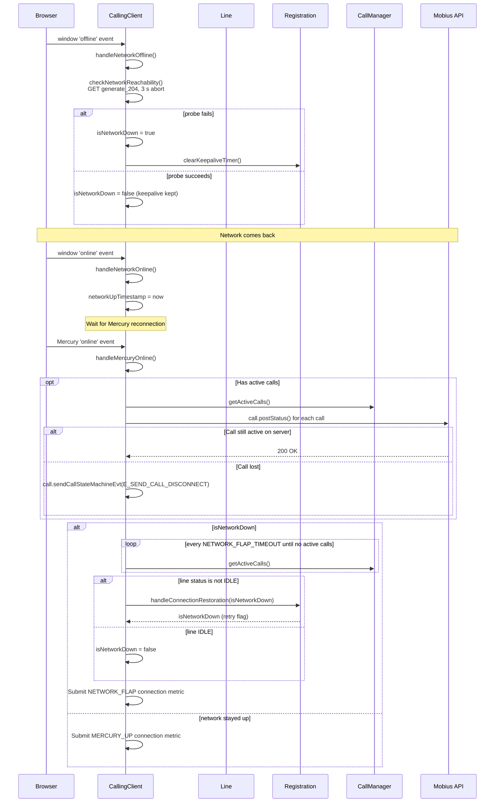
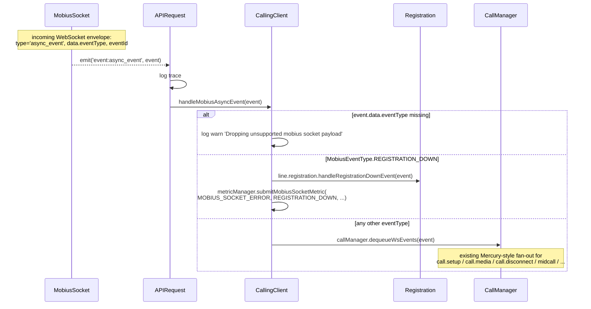
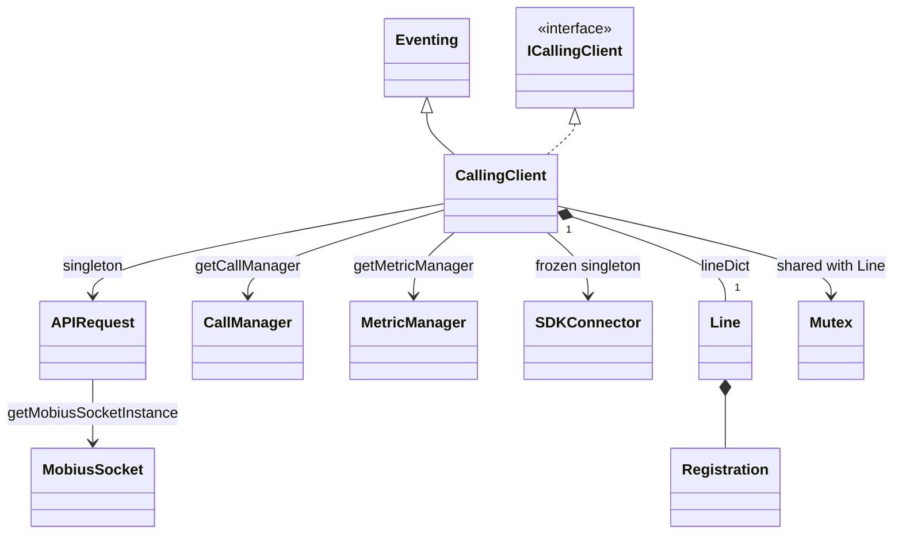
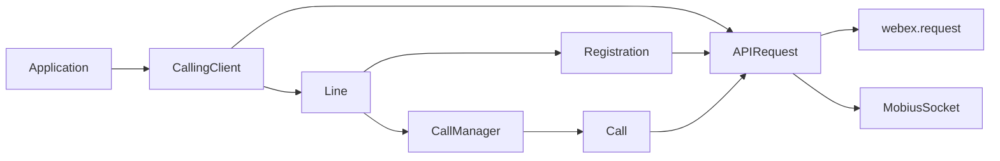
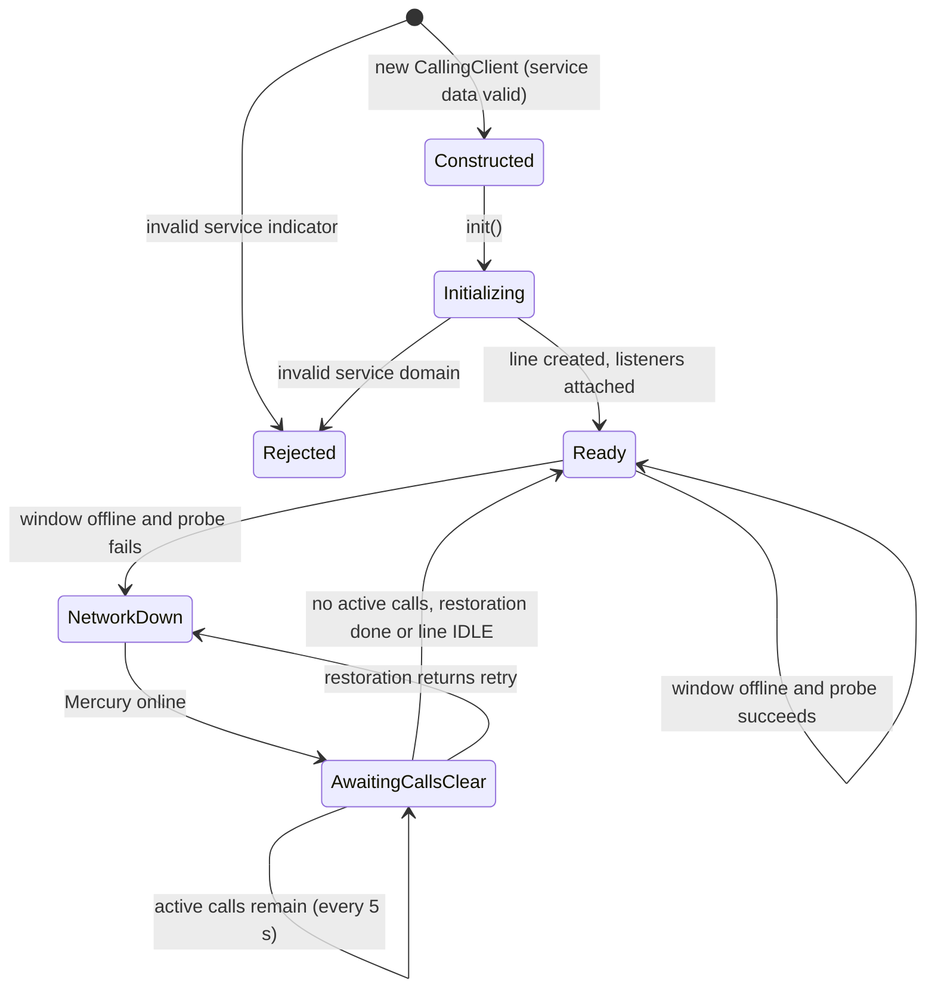
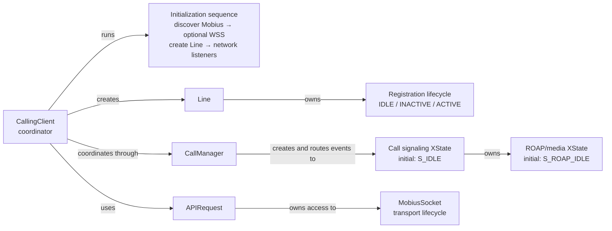

<!-- sdd-generated-metadata
doc_kind: module-spec
generated_from: module-spec@0.3.0
generated_by: claude-code
approved_by: rarajes2@cisco.com
updated_at: 2026-11-17T03:23:21Z
validation_status: pass-with-warnings
-->

# CallingClient

This source-local document at `src/CallingClient/docs/README.md` owns the stable specification for
**CallingClient**: the `createClient` factory and the `ICallingClient` orchestrator that discovers
Mobius servers, selects the HTTP or Mobius WebSocket transport, creates the line, routes Mobius
async events, and recovers from network and Mercury outages. It is the parent of the calling, line,
and registration modules, whose behavior lives in their own specifications (see Sub-modules).
Ground every claim in package evidence and link to the
[package architecture](../../../docs/architecture.md) instead of repeating broader facts. No service
specification exists because this package is a library.

Related context: [documentation index](../../../docs/index.md) ·
[package agent instructions](../../../AGENTS.md)

## Metadata

| Field | Value |
| ----- | ----- |
| Owner | @webex/web-sdk (CODEOWNERS default rule) |
| Source path | `src/CallingClient` |
| Resource kind | module |
| Status | Active |
| Last verified | 2026-11-16 at `0b8c34db7f` |
| Module id | `calling-client` |
| Parent spec | — |
| Doc kind | Module spec |
| Coverage score | Pending coverage assessment |
| Validation status | pass-with-warnings — validator `01a1e76e-1dbd-7680-94e4-46d29d2946d4`, assessed 2026-11-17; 0 Blocking, 1 Important (SDKConnector placeholder tests) |

## Applicability

| Condition ID                         | Status     | Evidence or reason | Owned section |
| ------------------------------------ | ---------- | ------------------ | ------------- |
| `module.has_tiers`                   | N/A        | No tier policy exists in this package or its `package.json` | Tier |
| `module.has_ui`                      | N/A        | No view or screen; the module is a browser SDK library | UI use-case flow |
| `module.crosses_service_boundaries`  | Applicable | `src/CallingClient/CallingClient.ts` calls region discovery, Mobius discovery, Mobius device listing, and a connectivity probe; `src/CallingClient/utils/request.ts` sends Mobius requests over HTTP or WebSocket | Cross-boundary use-case flow |
| `module.holds_client_state`          | Applicable | `src/CallingClient/CallingClient.ts` holds the line dictionary, Mobius URI lists, and network and Mercury timestamps; `src/CallingClient/utils/request.ts` holds the transport flag | Client state model |
| `module.enforces_domain_rules`       | Applicable | Service indicator and domain validation, single-line handling, and the async-event routing rule in `src/CallingClient/CallingClient.ts` and `src/common/Utils.ts` | Business rules and invariants |
| `module.is_concurrent_async`         | Applicable | Promise-based init, window and Mercury listeners, a polling interval during recovery, and a shared async-mutex in `src/CallingClient/CallingClient.ts` | Concurrency and reactive flow |
| `module.owns_persistence`            | N/A        | Nothing is persisted; browser localStorage is only read for a development override in `src/CallingClient/utils/wsFeatureFlag.ts` | Data, schema, and migration discipline |
| `module.stateful_transitions`        | Applicable | The init sequence and the network-down recovery cycle in `src/CallingClient/CallingClient.ts`, and the mutable transport flag in `src/CallingClient/utils/request.ts` | State machine |
| `module.exposes_wire_protocol`       | Applicable | Mobius discovery and device query strings in `src/CallingClient/CallingClient.ts`; the WebSocket request envelope, message types, and response normalization in `src/CallingClient/utils/request.ts` and `src/CallingClient/utils/constants.ts` | Protocol and wire format |
| `module.ui_multi_screen`             | N/A        | No UI | UI flow |
| `module.large_data_model`            | N/A        | Configuration and event payload types only (`src/CallingClient/types.ts`) | Data model |
| `module.returns_caller_errors`       | Applicable | createClient rejects on invalid service data or domain, getDevices and uploadLogs reject, and discovery failures emit callingClient:error (`src/CallingClient/CallingClient.ts`) | Caller-visible failure modes |
| `module.module_specific_conventions` | Applicable | All Mobius traffic goes through the APIRequest singleton, which is the only importer of the socket module (`src/CallingClient/utils/request.ts`) | Module-specific rules |
| `module.published_package`           | Applicable | `src/index.ts` re-exports createClient, ICallingClient, CallingClientConfig, and IceGatheringConfig; `package.json` publishes the dist folder | Export stability |
| `module.embedded_in_host`            | N/A        | No host theme or embed API; the host passes a Webex SDK instance only | Host integration and theming |
| `module.has_design_tradeoff`         | Applicable | One request shape over two transports with response normalization (`src/CallingClient/utils/request.ts`) | Key design trade-off |
| `module.has_submodules`              | Applicable | Computed true by the Repo Annotation module_tree.py script: the calling, line, and registration folders under this path are manifest modules | Sub-modules |

## Evidence register

| Evidence | What it establishes |
| -------- | ------------------- |
| `src/CallingClient/CallingClient.ts` | `CallingClient` construction, `init`, Mobius discovery, WebSocket connect, async-event routing, network and Mercury handlers, the calls-cleared handler, the query methods, `getDevices`, `uploadLogs`, and `createClient` |
| `src/CallingClient/types.ts` | `CallingClientConfig`, `ICallingClient`, `LoggerConfig`, and the re-export of `IceGatheringConfig` |
| `src/CallingClient/constants.ts` | Discovery URL, Mobius path segments, header names, timers, endpoint resources, and the RTMS catalog key |
| `src/CallingClient/windowsChromiumIceWarmupUtils.ts` | The Windows Chromium ICE warmup workaround and its 1-second gathering timeout |
| `src/CallingClient/utils/request.ts` | `APIRequest` singleton, transport flag, `makeRequest`, response and error normalization, socket connect, disconnect, and listener bridging |
| `src/CallingClient/utils/wsFeatureFlag.ts` | The WDM flag key, the allowed origins, and the `localStorage` override |
| `src/CallingClient/utils/mobiusSocketMapper.ts` | URI and HTTP method to WebSocket message type mapping and the supplementary-service test |
| `src/CallingClient/utils/constants.ts` | `MOBIUS_SOCKET_MESSAGE_TYPE` and `MOBIUS_SOCKET_DISCONNECT_REASON` |
| `src/CallingClient/utils/types.ts` | `APIRequestConfig`, the WebSocket request and response shapes, `MobiusAsyncEvent`, and `MobiusSocketConnectionListener` |
| `src/CallingClient/CallingClient.test.ts` | Service data validation, discovery order and fallbacks, transport URI selection, socket connect and connection events, network and Mercury handlers, query methods, session filtering, async-event routing, `getDevices`, and the ICE warmup |
| `src/CallingClient/utils/request.test.ts` | Singleton, transport flag, HTTP and WebSocket `makeRequest`, normalization, connect, disconnect, and listener behavior |
| `src/CallingClient/utils/wsFeatureFlag.test.ts` | Strict `true` evaluation of the WDM flag and missing-object handling |
| `src/CallingClient/utils/mobiusSocketMapper.test.ts` | Every message-type mapping, the `UNKNOWN` cases, and the supplementary-service test |
| `src/CallingClient/callingClientFixtures.ts`, `src/CallingClient/callRecordFixtures.ts` | Test fixtures (Mobius discovery bodies, device lists, Janus session events) used only by `src/CallingClient/CallingClient.test.ts` |
| `src/common/Utils.ts` | `filterMobiusUris` (WebSocket host allowlist and default host), `normalizeMobiusUris`, `validateServiceData`, `isValidServiceDomain`, `handleCallingClientErrors` (401 is the only final error), and `uploadLogs` |
| `src/common/callUtils.ts`, `src/common/constants.ts`, `src/common/callUtils.test.ts` | Host ip discovery, the SDP filter, the excluded addresses, and the ten-address cap; this evidence also justifies the Host IP discovery subsection |
| `src/CallingClient/line/index.ts`, `src/CallingClient/line/line.test.ts` | `Line` receives `localAudioStream` from `createLine` and awaits host ip discovery in `register()` before the mutex |
| `src/CallingClient/registration/register.ts` | `setSocketEnabled` per server group, per-server WebSocket connect, and the `3050` teardown, which this module relies on |
| `src/CallingClient/calling/callManager.ts` | `getCallManager` signature, the Mercury listener skipped when the socket is enabled, and the `ALL_CALLS_CLEARED` emission |
| `src/SDKConnector/index.ts` | `setWebex` validates the instance and refuses a second call; the default export is a frozen singleton |
| `src/Events/types.ts` | `CALLING_CLIENT_EVENT_KEYS`, `CallingClientEventTypes`, `MobiusSocketDisconnectedEvent`, and the Janus session event key |
| `src/Metrics/types.ts` | Metric events and the `MOBIUS_SOCKET_ACTION` values |
| `src/index.ts`, `package.json` | The published exports of this module and the package `files`, `main`, and `types` fields |

## Purpose and boundary

The `CallingClient` is one of the significant modules in the Webex Calling SDK, responsible for the main WebRTC call flow implementation. It manages line registration, call lifecycle coordination, Mobius server discovery, and network resilience.

Applications create a `CallingClient` via the `createClient()` factory function and interact with lines and calls through it.

- **Package:** `@webex/calling`
- **Entry point:** `src/CallingClient/CallingClient.ts` (`packages/calling/src/CallingClient/CallingClient.ts` from the monorepo root)
- **Factory:** `createClient(webex, config?) → Promise<ICallingClient>`

CallingClient owns the behavior rooted at `src/CallingClient/` outside its child modules and exposes it through the typed `@webex/calling` package boundary; shared infrastructure remains owned by `Errors`, `Events`, `Logger`, and `common`.

- Responsibility: build one ready client from a Webex SDK instance: discover Mobius servers, choose the transport, create the line, and keep the client working across network and Mercury interruptions.
- In scope: `CallingClient.ts`, `types.ts`, `constants.ts`, `windowsChromiumIceWarmupUtils.ts`, and the `utils/` transport layer (`APIRequest`, the message-type mapper, and the feature-flag resolver).
- Out of scope: line behavior, registration and keepalive, and call signaling and media, which belong to the child modules; the WebSocket client itself (the [MobiusSocket specification](../../mobius-socket/docs/README.md)); the SDK adapter (the [SDKConnector specification](../../SDKConnector/docs/README.md)); metrics submission (the [Metrics specification](../../Metrics/docs/README.md)); and the shared `common`, `Errors`, `Events`, and `Logger` code described in the package architecture.
- Consumers: browser applications through `createClient`; the line, registration, and calling modules through the `APIRequest` singleton.

## Structure and key files

| Path | Responsibility |
| ---- | -------------- |
| `src/CallingClient/CallingClient.ts` | Main orchestrator class `CallingClient` and the `createClient` factory |
| `src/CallingClient/types.ts` | `ICallingClient`, `CallingClientConfig`, `LoggerConfig`; re-exports `IceGatheringConfig` |
| `src/CallingClient/constants.ts` | All constants (endpoints, timers, methods, header names, file names for log context), shared with the child modules |
| `src/CallingClient/windowsChromiumIceWarmupUtils.ts` | ICE warmup for Windows Chromium |
| `src/CallingClient/utils/request.ts` | `APIRequest` singleton (HTTP / Mobius WSS transport selector), `MOD-009` |
| `src/CallingClient/utils/mobiusSocketMapper.ts` | URI + HTTP method → `MOBIUS_SOCKET_MESSAGE_TYPE` |
| `src/CallingClient/utils/wsFeatureFlag.ts` | Resolves the WSS feature flag (WDM + `localStorage` override), `MOD-010` |
| `src/CallingClient/utils/constants.ts` | `MOBIUS_SOCKET_MESSAGE_TYPE` and `MOBIUS_SOCKET_DISCONNECT_REASON` enums |
| `src/CallingClient/utils/types.ts` | `APIRequestConfig`, `MobiusSocketResponse`, `MobiusAsyncEvent`, `MobiusSocketConnectionListener` |
| `src/CallingClient/utils/index.ts` | Barrel re-exports of the five utils files |
| `src/CallingClient/CallingClient.test.ts` | Unit tests for the orchestrator and the ICE warmup |
| `src/CallingClient/callingClientFixtures.ts` | Test fixtures |
| `src/CallingClient/callRecordFixtures.ts` | Call record (Janus session) test fixtures |
| `src/CallingClient/utils/request.test.ts` | `APIRequest` unit tests |
| `src/CallingClient/utils/mobiusSocketMapper.test.ts` | Mapper unit tests |
| `src/CallingClient/utils/wsFeatureFlag.test.ts` | Feature-flag unit tests |

`src/CallingClient/README.md` is an empty file and carries no behavior.

## Sub-modules

Each child owns its own requirements and verification; this specification names the boundary only.

| Sub-module | Responsibility | Specification |
| ---------- | -------------- | ------------- |
| `src/CallingClient/line` | `Line` (`ILine`): line management, registration orchestration, call initiation, incoming call forwarding, and line event emission | [line/docs/README.md](../line/docs/README.md) |
| `src/CallingClient/registration` | `Registration`: device registration, keepalive through a web worker, failover, failback, 429 retry, reconnection, and Mobius WSS connect and disconnect per server URI | [registration/docs/README.md](../registration/docs/README.md) |
| `src/CallingClient/calling` | `CallManager` and `Call` (`ICall`): call lifecycle, signaling and media state machines, supplementary services, and caller identity (its own child `calling/CallerId`) | [calling/docs/README.md](../calling/docs/README.md) |

## Public surface

Declarations live in `src/CallingClient/types.ts` (re-exported from `src/index.ts`); the declaration
build writes `dist/types/index.d.ts`. The tables below summarize them without restating signatures
as code.

| Surface | Consumer | Compatibility commitment | Source |
| ------- | -------- | ------------------------ | ------ |
| `createClient(webex, config?)`: async, resolves `ICallingClient` after `init()` completes (`MOD-001`) | Applications | Public; semver-controlled through `@webex/calling` | `src/CallingClient/CallingClient.ts` |
| `ICallingClient`: extends `Eventing<CallingClientEventTypes>`; members listed below | Applications | Public; adding a required member or changing a return shape is breaking | `src/CallingClient/types.ts` |
| `CallingClientConfig`: all fields optional (table below) | Applications | Public; a new field must stay optional | `src/CallingClient/types.ts` |
| `IceGatheringConfig`: re-exported ICE gathering tuning, forwarded to `getCallManager` | Applications | Public; owned by the calling module | `src/CallingClient/calling/types.ts` |
| `CALLING_CLIENT_EVENT_KEYS` and `MobiusSocketDisconnectedEvent` | Applications | Public event names; renaming one is breaking | `src/Events/types.ts` |

The following methods are defined on the `ICallingClient` interface and are the officially supported public API:

| Method             | Signature                                  | Description                                     |
| ------------------ | ------------------------------------------ | ----------------------------------------------- |
| `getSDKConnector`  | `(): ISDKConnector`                        | Returns the SDK connector singleton             |
| `getLoggingLevel`  | `(): LOGGER`                               | Returns the current log level                   |
| `getLines`         | `(): Record<string, ILine>`                | Returns all the lines                           |
| `getDevices`       | `(userId?: string): Promise<DeviceType[]>` | Fetches devices from Mobius for the user        |
| `getActiveCalls`   | `(): Record<string, ICall[]>`              | Returns active calls grouped by lineId          |
| `getConnectedCall` | `(): ICall \| undefined`                   | Returns the currently connected (non-held) call |
| `isMobiusSocketConnected` | `(): boolean`                       | Whether the Mobius WebSocket transport is currently connected. Lets consumers that subscribe to `mobius_socket_connected` after `init()` reconcile the initial state. `false` when WSS transport is not in use. |
| `mediaEngine`      | `typeof Media`                             | The `@webex/internal-media-core` engine         |

The class has one public method that the interface does not declare:

| Method       | Signature                         | Description                                          |
| ------------ | --------------------------------- | ---------------------------------------------------- |
| `uploadLogs` | `(): Promise<UploadLogsResponse>` | Uploads diagnostic logs to Webex (class method only) |

Events emitted on the client (`CallingClientEventTypes`):

| Event                                | Enum Key                                      | Payload              | Description                  |
| ------------------------------------ | --------------------------------------------- | -------------------- | ---------------------------- |
| `callingClient:error`                | `CALLING_CLIENT_EVENT_KEYS.ERROR`             | `CallingClientError` | Client-level error           |
| `callingClient:outgoing_call`        | `CALLING_CLIENT_EVENT_KEYS.OUTGOING_CALL`     | `string` (callId)    | Declared in the event map only; no source emits it |
| `callingClient:user_recent_sessions` | `CALLING_CLIENT_EVENT_KEYS.USER_SESSION_INFO` | `CallSessionEvent`   | User session info from Janus |
| `callingClient:all_calls_cleared`    | `CALLING_CLIENT_EVENT_KEYS.ALL_CALLS_CLEARED` | _(none)_             | All active calls have ended; emitted by CallManager on itself and consumed internally (`MOD-012`), never re-emitted on the client |
| `callingClient:mobius_socket_connected`    | `CALLING_CLIENT_EVENT_KEYS.MOBIUS_SOCKET_CONNECTED` | _(none)_             | Mobius WebSocket (re)connected (WSS transport only) |
| `callingClient:mobius_socket_disconnected` | `CALLING_CLIENT_EVENT_KEYS.MOBIUS_SOCKET_DISCONNECTED` | `MobiusSocketDisconnectedEvent` (`{reason}`) | Mobius WebSocket disconnected; `reason` is `permanent` / `transient` / `replaced` (WSS transport only) |

`CallingClientConfig` fields (declared in `src/CallingClient/types.ts`; `logger` is `{level: LOGGER}`, `discovery` is `{country: string; region: string}`, `serviceData` is `ServiceData` with `indicator: ServiceIndicator` and optional `domain`, `jwe` is a string, `iceGathering` is `IceGatheringConfig`, and `localAudioStream` is a `LocalMicrophoneStream`):

| Property                | Required | Default       | Description                                                 |
| ----------------------- | -------- | ------------- | ----------------------------------------------------------- |
| `logger.level`          | No       | `ERROR`       | Log verbosity level                                         |
| `discovery.country`     | No       | Auto-detected | Sets `countryCode` on the Mobius discovery query. Does not choose the discovery host. Used only when `discovery.region` is also set. |
| `discovery.region`      | No       | Auto-detected | Sets `regionCode` on the Mobius discovery query. Does not choose the discovery host. Used only when `discovery.country` is also set. |
| `serviceData.indicator` | No       | `CALLING`     | Service flow: `calling`, `guestcalling`, or `contactcenter` |
| `serviceData.domain`    | No       | `''`          | RTMS domain required for contact center flow; when empty for `contactcenter`, `init()` reads it from the service catalog (`MOD-004`) |
| `jwe`                   | No       | -             | JSON Web Encryption token having destination information. This is only required for guest calling flow |
| `iceGathering`          | No       | -             | ICE candidate gathering tuning handed to `getCallManager` for call media negotiation |
| `localAudioStream`      | No       | -             | Microphone stream handed to the `Line`, which uses it in `register()` to discover this client's host ip addresses and report them in the registration. Omit it to skip that discovery — without a stream the browser masks the addresses as mDNS hostnames, so there is nothing to report. See [Host IP Discovery](#host-ip-discovery). |

## Dependencies

- SDKConnector and Webex device/feature/service plugins
- Calling, Line, Registration, Metrics, and mobius-socket modules
- WebRTC media helpers

| Dependency | Why it is required | Failure behavior |
| ---------- | ------------------ | ---------------- |
| Host Webex SDK instance (`webex-sdk-host`) | Device URL and user id, the services catalog, Mercury events, credentials, logger, and `webex.request` | The first client rejects in `SDKConnector.setWebex` when the instance fails validation; later clients reuse the stored instance |
| Mobius REST (`mobius-http`) | Discovery, device listing, registration, keepalive, and call signaling | Discovery errors emit `callingClient:error` and fall back (`MOD-003`); request errors propagate to the caller |
| `ds.ciscospark.com` region discovery | Region and country for the Mobius discovery query when the config lacks them | Failure clears both values and discovery defaults to the first catalog cluster (`MOD-003`) |
| Mobius WebSocket through `MobiusSocket` (`mobius-socket-internal`) | Alternative transport and async events when the WSS flag resolves true | Connect failures at init are logged and swallowed (`MOD-005`); request failures reject with a normalized payload (`MOD-009`) |
| Line, Registration, CallManager (`line-sdk`, `registration-internal`, calling) | The line object, its registration lifecycle, and the active-call registry | Errors surface through line and call events owned by the child modules |
| `MetricManager` (`metrics-internal`) | Discovery, connection, and socket metrics | Fire-and-forget; no effect on control flow |
| `@webex/media-helpers` (`media-helpers`) | The `LocalMicrophoneStream` type and the stream handed to the line | Not called by this module directly |
| `https://www.google.com/generate_204` | Reachability probe when the browser reports `offline` | Abort after 3 s or any fetch error counts as unreachable (`MOD-011`) |
| `webex.internal.support.submitLogs` | Diagnostic log upload | `uploadLogs()` rejects when no response is returned (`MOD-016`) |

Runtime packages:

| Package                          | Purpose                                     |
| -------------------------------- | ------------------------------------------- |
| `@webex/internal-media-core`     | WebRTC, ROAP media connections              |
| `@webex/media-helpers`           | Microphone stream, noise reduction          |
| `@webex/internal-plugin-metrics` | Telemetry and metrics                       |
| `async-mutex`                    | Concurrency control for registration        |
| `xstate`                         | State machines for call and media lifecycle |
| `uuid`                           | Unique identifier generation                |

Internal modules:

| Module          | Purpose                                             |
| --------------- | --------------------------------------------------- |
| `SDKConnector`  | Singleton bridge to Webex SDK and Mercury WebSocket |
| `CallManager`   | Singleton managing all active Call instances        |
| `MetricManager` | Singleton for telemetry submission                  |
| `Logger`        | Structured logging with file/method context         |
| `Eventing<T>`   | Typed event emitter base class                      |
| `APIRequest` (`utils/request.ts`) | Transport-agnostic request layer. Owns the WSS feature-flag decision and proxies HTTP / Mobius WSS calls. Sole consumer of `mobius-socket`. |
| `mobius-socket` | Mobius WebSocket transport (used through `APIRequest`). See the [MobiusSocket specification](../../mobius-socket/docs/README.md). |
| `mobiusSocketMapper` (`utils/mobiusSocketMapper.ts`) | Maps URI + HTTP method → `MOBIUS_SOCKET_MESSAGE_TYPE` so HTTP-style requests can be carried over the socket. |
| `wsFeatureFlag` (`utils/wsFeatureFlag.ts`) | Resolves the WSS feature flag from WDM (`webrtc-calling-over-ws-CALL-219562`), with a `localStorage` `mobius-wss-enabled` override on `localhost`, `127.0.0.1`, and `web-sdk.webex.com`. |

`APIRequest`, the mapper, and the flag resolver are files of this module; they are listed here because
the child modules depend on them as well.

## Requirements

| ID | WHAT | WHY | Source evidence | Test or example evidence | Assumptions or gaps | Confidence |
| -- | ---- | --- | --------------- | ------------------------ | ------------------- | ---------- |
| `MOD-001` | `createClient(webex, config?)` constructs one `CallingClient`, awaits `init()`, and resolves it as `ICallingClient`; a rejection from `init()` rejects the factory. `init()` creates the line but does not register it: the application calls `register()` on the line from `getLines()`. | The application attaches line event listeners before registration starts, as every usage example does, and decides when the device registers. | `src/CallingClient/CallingClient.ts` | `src/CallingClient/CallingClient.test.ts` "verify line dict successfully created", "verify getLines response" | No test asserts that no registration request is sent during `init()` | Present |
| `MOD-002` | The constructor sets the SDKConnector instance only when none is set yet (and then overrides the Webex logger level with `config.logger.level` and wires the calling logger to it); defaults `serviceData` to `{indicator: calling, domain: ''}` when no indicator is given; sets the log level (default `error`); throws `Invalid service indicator, Allowed values are: calling, contactcenter and guestcalling` for an unknown indicator; obtains the CallManager (with `iceGathering`) and MetricManager singletons for the indicator; exposes `@webex/internal-media-core` as `mediaEngine` with its logger routed to the Webex logger; obtains the `APIRequest` singleton; and registers the Janus sessions listener and the calls-cleared listener. | ServiceIndicator gates backend and feature behavior so calling, guest-calling, and contact-center sessions do not use incompatible registration or call flows. Using the shared media engine keeps media lifecycle behavior consistent with the rest of the SDK. | `src/CallingClient/CallingClient.ts`, `src/common/Utils.ts`, `src/SDKConnector/index.ts` | `src/CallingClient/CallingClient.test.ts` "Verify valid calling serviceData with no input sdk config", "Verify invalid empty service indicator, empty domain", "Verify invalid service indicator, valid domain", "Get current log level" | The logger override applies only to the first client of a page | Present |
| `MOD-003` | Mobius discovery: region and country come from `config.discovery` only when both are set, otherwise from an unauthenticated GET to `https://ds.ciscospark.com/v1/region`. Candidate hosts are the U2C service link (`_serviceUrls.mobius`, else the active `mobius` catalog entry) first, then each catalog cluster as `https://<host>/api/v1`, de-duplicated. Each candidate gets `GET <host>/calling/web/?regionCode=…&countryCode=…`; the first success fills the four URI lists through `filterMobiusUris`. A 401 is final: it emits `callingClient:error`, uploads logs, stops the walk, and defaults to the first catalog cluster; any other error emits `callingClient:error` and tries the next candidate. Missing region or country also selects the default. | Preferring the U2C service link keeps discovery on the account's home cluster instead of catalog order, which can send a US account to an EU cluster when one region is down. | `src/CallingClient/CallingClient.ts`, `src/common/Utils.ts`, `src/CallingClient/constants.ts` | `src/CallingClient/CallingClient.test.ts` "verify successful mobius server url discovery", "when region discovery succeeds but region based mobius url discovery fails with final error", "US account connects using the U2C serviceLinks mobius URL and does not query catalog clusters", "when the primary U2C mobius link is blocked, discovery walks remaining catalog clusters" | When every candidate fails with a non-final error, the URI lists stay empty and no default is applied | Present |
| `MOD-004` | For `contactcenter` with an empty domain, `init()` reads the `wcc-calling-rtms-domain` catalog URL and uses its hostname as the domain (empty on any error) and writes it back to `config.serviceData`. `init()` then rejects with `Invalid service domain.` unless the domain is empty for `calling` or `guestcalling`, or matches the domain pattern. | The RTMS domain is required for the contact center flow; reading it from the catalog spares contact-center applications from configuring it. | `src/CallingClient/CallingClient.ts`, `src/common/Utils.ts` | `src/CallingClient/CallingClient.test.ts` "ContactCenter: fetches RTMS domain from catalog when config domain is empty", "ContactCenter: init fails when config domain is empty and catalog fetch fails", "CALLING: verify invalid service domain" | — | Present |
| `MOD-005` | When `APIRequest.isSocketEnabled()` is true after discovery, `init()` registers a connection listener that emits `callingClient:mobius_socket_connected` on socket `online` and `callingClient:mobius_socket_disconnected` with `{reason}` on `offline.permanent`, `offline.transient`, and `offline.replaced`; tries the primary WSS URIs in order and stops at the first success; logs a warning and continues when the list is empty or every attempt fails; then attaches the async-event listener (`MOD-006`). Backup WSS URIs are never tried here. | Registration retries the WebSocket per server during line registration, so an init-time failure must not block client creation; the connection events let consumers track the transport. | `src/CallingClient/CallingClient.ts`, `src/CallingClient/utils/request.ts` | `src/CallingClient/CallingClient.test.ts` "skips the socket connection and warns when no primary WSS URIs are available", "connects using the first reachable primary WSS URI and stops on success", "tries each primary WSS URI and warns when all attempts fail", "does not attempt backup WSS URIs when primary WSS URIs are absent", "emits MOBIUS_SOCKET_CONNECTED when the socket comes online" | The method comment claims a backup fallback that the code does not perform | Present |
| `MOD-006` | Mobius async events are dropped with a warning when `data.eventType` is missing; `registration.down` goes to the first line's `registration.handleRegistrationDownEvent(event)` (skipped with a warning when no line exists) followed by a `MOBIUS_SOCKET_ERROR` / `registration_down` metric; every other event type goes to `callManager.dequeueWsEvents(event)`. | A single async-event fan-out preserves the existing Registration and CallManager handlers while changing only the transport that delivered the event. | `src/CallingClient/CallingClient.ts` | `src/CallingClient/CallingClient.test.ts` "routes mobius.* async events to callManager" | No unit test covers the `registration.down` branch, the missing event type, or the missing line | Present |
| `MOD-007` | `createLine()` creates exactly one `Line` with the device user id, device URL, the shared mutex, the primary and backup URIs, the log level, `serviceData`, `jwe`, and `localAudioStream`, and stores it under its `lineId`. Each group uses its WSS URIs (with a trailing slash added) when the socket is enabled and that group has WSS URIs, otherwise its HTTP URIs; primary and backup are resolved independently. | If a WSS URL is not present for a group, registration must still be attempted over HTTP even when the socket feature flag is enabled. | `src/CallingClient/CallingClient.ts`, `src/common/Utils.ts` | `src/CallingClient/CallingClient.test.ts` "uses normalized WSS URIs for both groups when socket is enabled and WSS URIs are present", "falls back to HTTP URIs for a group with no WSS URL even when the socket is enabled", "uses HTTP URIs for both groups when the socket is disabled" | Multiple lines are not supported | Present |
| `MOD-008` | `init()` forwards `CallingClientConfig.localAudioStream` to the `Line` it creates and performs no host ip discovery itself. `Line.register()` then awaits `discoverHostIps(localAudioStream)` before `triggerRegistration()`, which stores the addresses in `common/callUtils.ts` for `Registration.postRegistration` to read synchronously through `getHostIps()`. Without a stream the discovery is skipped entirely and registration reports `hostIps: []`; call and media payloads derive their own addresses from the live SDP instead. | Mobius needs the client's local interface addresses for media correlation, and ICE candidates are the only browser surface that exposes them — which requires media capture permission, so the stream the application already owns is what makes the addresses real rather than mDNS hostnames. Gathering per registration rather than per client keeps the addresses current at the moment they are reported, and spares clients created only for call history, call settings, voicemail or contacts a peer connection they never use. | `src/CallingClient/CallingClient.ts`, `src/CallingClient/line/index.ts`, `src/common/callUtils.ts` | `src/CallingClient/line/line.test.ts` "discovers the host ips before triggering the registration"; `src/common/callUtils.test.ts` "discoverHostIps" cases | Automatic re-registrations (failover, failback, keepalive recovery) bypass `Line.register()` and reuse the addresses of the last explicit registration; no `CallingClient` test asserts the forwarding | Present |
| `MOD-009` | `APIRequest` is a module singleton (`getInstance`, `createAPIRequest`; `resetInstance` for tests) that throws `WebexSDK instance is required` without `webex`, seeds its transport flag from `isMobiusWssEnabled` once, and lets `setSocketEnabled` override it. `makeRequest(request)` passes the request unchanged to `webex.request` on HTTP; on WSS it derives the message type (throwing `Unknown Mobius Socket message type: UNKNOWN` when unmapped), sends `{type, trackingId: webex-js-sdk_<uuid>, metadata: {...headers, userAgent, authorization}, data: body}` with the user token as `authorization` only for hold, resume, and transfer, and returns or throws a `WebexRequestPayload`-shaped value. | Feature-gated WSS adoption retains the proven HTTP fallback while allowing controlled rollout; one response shape keeps `handleRegistrationErrors`, `handleCallErrors`, and downstream consumers transport-agnostic. | `src/CallingClient/utils/request.ts`, `src/CallingClient/utils/mobiusSocketMapper.ts` | `src/CallingClient/utils/request.test.ts` "Constructor and singleton pattern", "setSocketEnabled", "makeRequest - WebSocket transport"; `src/CallingClient/utils/mobiusSocketMapper.test.ts` | — | Present |
| `MOD-010` | `isMobiusWssEnabled(webex)` is true only when the WDM developer feature `webrtc-calling-over-ws-CALL-219562` has value strictly `true`, unless `localStorage['mobius-wss-enabled']` is `'true'` or `'false'` on `localhost`, `127.0.0.1`, `web-sdk.webex.com`, or a subdomain of one of them, which forces the result. | Allows controlled rollout through WDM and diagnostic overrides on approved development origins only. | `src/CallingClient/utils/wsFeatureFlag.ts` | `src/CallingClient/utils/wsFeatureFlag.test.ts` strict-boolean and missing-object cases | No unit test exercises the `localStorage` override | Present |
| `MOD-011` | On window `offline` the client probes `https://www.google.com/generate_204` (`no-cors`, 3 s abort) and only when the probe fails sets `isNetworkDown` and clears the first line's keepalive timer. On Mercury `offline` it records the time and submits a `MERCURY_DOWN` connection metric. On Mercury `online`: active calls each get `postStatus()`, and a failure sends `E_SEND_CALL_DISCONNECT` to that call; if the network was down, a 5 s interval waits until no calls are active and then runs `registration.handleConnectionRestoration(isNetworkDown)` unless the line is `IDLE` (which just clears the flag), and a `NETWORK_FLAP` metric is submitted; otherwise a `MERCURY_UP` metric is submitted. | Network and Mercury recovery must restore registration rather than requiring consumers to recreate the entire client after transient connectivity loss; the probe keeps a spurious browser `offline` event from tearing down a working keepalive. | `src/CallingClient/CallingClient.ts`, `src/CallingClient/constants.ts` | `src/CallingClient/CallingClient.test.ts` "window offline handler sets networkDown and clears keepalive when network is unreachable", "window offline handler does not clear keepalive when network is reachable", "handles reconnection with no active calls after network flap, once mercury comes back up", "handle calls status check once mercury comes back up after a network flap" | Listeners are never removed; the client has no teardown | Present |
| `MOD-012` | When CallManager emits `callingClient:all_calls_cleared` and the device is not registered, the client runs, under the shared mutex, `registration.reconnectOnFailure` if a reconnect is pending. | If a re-register attempt was deferred earlier because of active calls, it is attempted once all calls are cleaned up. | `src/CallingClient/CallingClient.ts` | none found | No unit test for the handler | Weak |
| `MOD-013` | The Janus `event:janus.user_recent_sessions` listener validates its payload before filtering: a missing event or a `userSessions.userSessions` value that is not an array, or an empty array, is rejected without emitting and without throwing. Otherwise it keeps only the sessions whose type is `WEBEXCALLING`, removing every other session; when no Webex Calling session remains it suppresses the emit, and otherwise it emits `callingClient:user_recent_sessions` carrying only the retained Webex Calling sessions. | Calling consumers receive only Webex Calling sessions; other session types belong to other products, and malformed payloads must not crash the listener or surface spurious events. | `src/CallingClient/CallingClient.ts`, `src/Events/types.ts` | `src/CallingClient/CallingClient.test.ts` "verify the recent user session event", "drop the recent user session if there is no webex calling type" | — | Present |
| `MOD-014` | `getLines()` returns the line dictionary; `getActiveCalls()` groups the CallManager's active calls by `lineId`; `getConnectedCall()` returns a connected, non-held call (the last such in iteration order) or `undefined`; `isMobiusSocketConnected()` returns `isSocketEnabled() && isSocketConnected()`; `getLoggingLevel()` and `getSDKConnector()` return the current level and the connector. | The active-call registry is needed to route asynchronous Mobius events to the correct call and to know when all call resources can be released; `isMobiusSocketConnected` lets late subscribers reconcile the socket state they missed during `init()`. | `src/CallingClient/CallingClient.ts` | `src/CallingClient/CallingClient.test.ts` "returns undefined when there is no connected call", "returns the connected call", "returns all active calls", "isMobiusSocketConnected() reflects the underlying socket state (%s) when WSS is enabled" | — | Present |
| `MOD-015` | `getDevices(userId?)` uses the given id or the device user id and rejects with `userId is required to fetch devices` or `Mobius URLs are not available`; it tries each primary then backup HTTP URI with `GET <uri>devices?userid=<id>` over `webex.request`, treats a non-200 as failure, and on the first success stores the body as the first line's device info and the URI as its active Mobius URL and resolves `devices` (or `[]`). After every URI fails it rejects with the last error. | Hydrating the registration's device info and active URL lets the deregister and restore flows act on a device the client did not register itself. | `src/CallingClient/CallingClient.ts` | `src/CallingClient/CallingClient.test.ts` "fetches devices for the provided userId", "falls back to backup Mobius when primary fails" | — | Present |
| `MOD-016` | `uploadLogs()` submits the Webex diff logs through `webex.internal.support.submitLogs` with a new `feedbackId` and resolves the response; it rejects with `Failed to upload logs: No response received.` when there is no result. | Correlated logs preserve operational evidence across discovery, registration, and calls where failures span several asynchronous components; the returned tracking and feedback ids speed up support. | `src/CallingClient/CallingClient.ts`, `src/common/Utils.ts` | none found | Not declared on `ICallingClient` (Pitfalls) | Weak |
| `MOD-017` | On a Windows user agent, `init()` first runs `windowsChromiumIceWarmup({iceServers: [], timeoutMs: 1000})`, which negotiates a pair of local peer connections, exchanges their non-host candidates, and closes them; a failure is logged as a warning and init continues. | Works around Chromium issue 332933530, where WebRTC can fail on the first try on Windows because of ICE gathering. | `src/CallingClient/CallingClient.ts`, `src/CallingClient/windowsChromiumIceWarmupUtils.ts` | `src/CallingClient/CallingClient.test.ts` "should complete without throwing" | The check matches any Windows user agent, not only Chromium | Present |

## Design overview

The CallingClient module follows a layered architecture: **Application → CallingClient → Line → Registration / CallManager → APIRequest → (HTTP via Webex SDK *or* WSS via `mobius-socket`) → Mobius API**. Each layer has a distinct responsibility — orchestration (CallingClient), line management (Line), device registration (Registration), call lifecycle (CallManager/Call), transport selection (APIRequest), and SDK bridging (SDKConnector for Mercury / non-Mobius traffic).

`CallingClient` itself keeps no long-running work: it runs the init sequence once, then reacts to
window, Mercury, socket, and CallManager events and delegates recovery to the line's
`Registration`. The capabilities below are what the module tree provides; rows that a child
implements name it.

| Capability | Description  |
| ----------- | ----------- |
| **Mobius Discovery**         | Requests the U2C Mobius service link first, then remaining catalog clusters on non-final failure, to select primary and backup endpoints for registration, calls, and media. |
| **Host IP Discovery**        | Negotiates a throwaway local offer when a line registers to read this client's local interface addresses off its ICE host candidates, and reports them to Mobius in the registration. Requires `CallingClientConfig.localAudioStream`, which `init()` forwards to the line; skipped without it. |
| **Line Registration**        | Creates and registers Lines with Mobius, establishing signaling sessions, subscribing for events, and managing registration/status. Includes Line keepalives and failover routines. |
| **Media Engine Management**  | Exposes the `@webex/internal-media-core` engine as `mediaEngine` with its logger routed to the Webex logger; Call uses the engine to negotiate, establish, and manage WebRTC media streams for audio and video calls. |
| **Call Keepalive**           | Periodically sends keepalive messages for both Lines and active Calls, ensuring session continuity and timely detection of network or signaling issues.           |
| **Call Control**             | Orchestrates all aspects of call initiation, handling, and features. Divided into the following subcapabilities:                                                |
| &nbsp;&nbsp;• Outbound Calls | Enables agents to initiate outbound calls using `line.makeCall()`. Handles call setup, signaling, and media path establishment, including error cases.            |
| &nbsp;&nbsp;• Inbound Calls  | Receives and processes incoming calls via `LINE_EVENTS.INCOMING_CALL`, triggers session setup, and allocates resources for the new call.                         |
| &nbsp;&nbsp;• Supplementary Services | Provides additional in-call features including hold, resume, transfer, mute, and sending DTMF using `ICall` interface methods and underlying SIP signaling. Hold and resume suspend and reestablish the audio+video media while maintaining session context. Transfer allows the redirection of calls to alternate destinations. |
| **Active Call Monitoring**   | Tracks all ongoing calls through CallManager and exposes them grouped by line and as the connected (non-held) call, and checks each call's status with Mobius after a Mercury reconnect. |
| **Network Resilience**       | Detects network outages or Mercury channel disconnects; triggers reconnection, re-registration, and call state recovery logic to restore service with minimal interruption. |
| **Diagnostics & Logging**    | Collects and uploads diagnostic logs and metrics for calls, registrations, and failures to Webex cloud for troubleshooting, monitoring, and analytics purposes.   |
| **Service Indicators & Access Flows** | Supports various service flows and user types (`calling`, `guestcalling`, `contactcenter`) through the `ServiceIndicator`, enabling correct registration and feature availability based on license and context. |
| **Transport Selection (HTTP vs Mobius WSS)** | Routes Mobius traffic over either HTTP (`webex.request`) or the Mobius WebSocket transport (`mobius-socket`) based on the WDM feature flag `webrtc-calling-over-ws-CALL-219562` (with a localStorage override on allow-listed origins). The `isMobiusSocketEnabled` flag is seeded from the feature flag at `APIRequest` construction time, but `Registration.attemptRegistrationWithServers` overrides it per server group via `apiRequest.setSocketEnabled(servers[0].startsWith('wss://'))` — so HTTP and WSS can be used for different groups within the same session. All `register`, `keepalive`, `call setup/state/media/status`, supplementary services, and `deregister` traffic flows through the same `APIRequest.makeRequest()` API regardless of transport. |
| **Mobius WSS Async Events**  | When WSS is enabled, subscribes to `MobiusSocket`'s `event:async_event` via `APIRequest.registerMobiusSocketListener` and fans events out: `registration.down` → `Registration.handleRegistrationDownEvent`, all other event types → `CallManager.dequeueWsEvents`. |

Timers and limits defined in `src/CallingClient/constants.ts`; only `NETWORK_FLAP_TIMEOUT` is used by
this module itself, the rest by the registration and calling modules:

| Constant | Value | Description |
|----------|-------|-------------|
| `DEFAULT_KEEPALIVE_INTERVAL` | 30s | Keepalive POST frequency |
| `DEFAULT_REHOMING_INTERVAL_MIN` | 60s | Min failback timer |
| `DEFAULT_REHOMING_INTERVAL_MAX` | 120s | Max failback timer |
| `DEFAULT_SESSION_TIMER` | 10 min | Call session timeout |
| `NETWORK_FLAP_TIMEOUT` | 5000ms | Debounce for network flap |
| `REG_TRY_BACKUP_TIMER_VAL_IN_SEC` | 114s | Timer before trying backup servers |
| `REG_FAILBACK_429_MAX_RETRIES` | 5 | Max retries on 429 during failback |
| `MAX_CALL_KEEPALIVE_RETRY_COUNT` | 4 | Max call keepalive retries |

### Host IP discovery

Mobius needs the host ip addresses of this client in the `/device`, `/call` and `/media` payloads so that it can correlate the client's local interfaces for media routing. ICE candidates are the only surface a browser exposes those addresses on, and gathering only starts once a local description is set — so an offer has to be produced to obtain them.

The SDK gets them from two places, both reading the host candidates (`typ host`) off an SDP:

| Payload | Source of the addresses | How |
|---|---|---|
| `POST /device` (registration) | A throwaway offer negotiated by Line.register() | `discoverHostIps(localAudioStream)` in `common/callUtils.ts` creates a `RoapMediaConnection` configured exactly like a call's, reads the addresses off the offer it emits, then closes the connection. `Registration.postRegistration` reads the result synchronously via `getHostIps()`. |
| `POST /devices/{id}/call`, `POST /devices/{id}/calls/{id}/media` | The actual call's ROAP offer or answer | `getHostIpsFromSdp(roapMessage?.sdp)` in `Call.post` / `Call.postMedia`. These never consult `getHostIps()` — a call that starts on a different network than the last registration reports the addresses of the network it is actually on. |

Properties that matter when changing this:

- **The stream is required for the addresses to be real.** Without media capture permission the browser masks host candidates as `<uuid>.local` mDNS hostnames. `CallingClientConfig.localAudioStream` is what grants the permission, so when it is absent `Line.register()` skips the discovery entirely rather than gathering useless hostnames.
- **Discovery happens per registration, not per client.** `init()` only forwards `sdkConfig.localAudioStream` to the `Line` it creates; `Line.register()` is what gathers. A client created solely for call history, call settings, voicemail or contacts therefore never builds a peer connection, and each explicit `register()` reports the addresses the interfaces carry at that moment rather than the ones they carried when the client was created.
- **The `register()` await is load-bearing.** `getHostIps()` is a synchronous read of a module-level cache in `common/callUtils.ts`, so `Line.register()` must await the discovery before calling `triggerRegistration()`; dropping that await would let the registration race the discovery and send `hostIps: []`. It is awaited outside the mutex, which registration shares with failback and keepalive recovery.
- **Automatic re-registrations reuse the last discovered addresses.** Failover, failback, 429 retry, keepalive recovery and network-flap restoration drive `Registration` directly rather than through `Line.register()`, so they report whatever the last explicit registration gathered. This is tolerated because every subsequent `/call` and `/media` payload derives its addresses from a fresh SDP.
- **The stored addresses are replaced, never merged.** `discoverHostIps` returns nothing; it clears the module's addresses, negotiates, and stores what the offer advertised. A failed negotiation therefore leaves none stored rather than the addresses of a previous network, and `postRegistration` sends `hostIps: []`.
- **Addresses are filtered before being sent.** `getHostIpsFromSdp` drops the unspecified and loopback addresses (`0.0.0.0`, `::`, `127.0.0.1`, `::1`) and `IPV4_FALLBACK_ADDRESS` (`192.1.1.1`, which `modifySdpForIPv4` synthesises and which belongs to no interface), deduplicates across interfaces, and caps the result at `MAX_HOST_IPS` (10) because that is the Mobius schema maximum.
- **`hostIps` is always present, possibly empty.** All three Mobius schemas declare it optional with `minItems: 0`, so the SDK sends `hostIps: []` rather than omitting the field.

## Data flow and sequence coverage

Calls are in-process promises; network traffic is HTTPS through `webex.request` or a Mobius
WebSocket through `MobiusSocket`, and inbound events arrive over Mercury or that WebSocket.

| Operation group | Entry and outcome | Diagram or evidence | Failure and recovery coverage |
| --------------- | ----------------- | ------------------- | ----------------------------- |
| Initialize client and discover Mobius | `createClient` → ready `ICallingClient` with one unregistered line (`MOD-001` to `MOD-007`) | Initialization diagram below | Service-data and domain errors reject; discovery errors emit `callingClient:error` and fall back to the first catalog cluster; WSS connect failures are logged and init continues |
| Register and deregister a line | `line.register()` / `line.deregister()` | `src/CallingClient/registration/register.ts`; flows in the registration specification (Sub-modules) | Owned by the registration module |
| Recover network or Mercury | window and Mercury events → call status checks and registration restoration (`MOD-011`, `MOD-012`) | Recovery diagram below | Reachability probe, active-call deferral, and the 5 s retry interval |
| Select HTTP or WSS transport | `APIRequest.makeRequest` → `WebexRequestPayload` (`MOD-009`, `MOD-010`) | Transport flowchart below | A group without a WSS URL falls back to HTTP; an unmapped request throws before sending |
| Fan out WSS async events | `event:async_event` → Registration or CallManager (`MOD-006`) | Fan-out diagram below | Missing event type or missing line is dropped with a warning |
| Query devices | `getDevices` → device list (`MOD-015`) | `src/CallingClient/CallingClient.ts` | Primary then backup URIs; the last error rejects |

Layer communication:

```mermaid
flowchart TB
    subgraph Application
        App[Application Code]
    end

    subgraph Orchestrator
        CC[CallingClient<br/>Eventing&lt;CallingClientEventTypes&gt;]
    end

    subgraph Line
        L[Line<br/>Eventing&lt;LineEventTypes&gt;]
    end

    subgraph Registration
        Reg[Registration<br/>IRegistration]
        Worker[Web Worker<br/>Keepalive]
    end

    subgraph Calls
        CM[CallManager<br/>Eventing&lt;CallEventTypes&gt;]
        Call[Call<br/>Eventing&lt;CallEventTypes&gt;]
    end

    subgraph Transport
        API[APIRequest<br/>utils/request.ts<br/>singleton]
        FF[isMobiusWssEnabled<br/>utils/wsFeatureFlag.ts]
        Map[deriveMobiusSocketMessageType<br/>utils/mobiusSocketMapper.ts]
    end

    subgraph Infrastructure
        SDK[SDKConnector<br/>singleton]
        MS[MobiusSocket<br/>singleton<br/>mobius-socket]
        Metrics[MetricManager<br/>singleton]
    end

    subgraph External
        Webex[Webex SDK]
        Mercury[Mercury WebSocket]
        Mobius[Mobius API]
        MobiusWss[Mobius WebSocket<br/>wss://...]
        DS[ds.ciscospark.com<br/>Region Discovery]
    end

    App -->|createClient| CC
    CC -->|createLine| L
    L -->|createRegistration| Reg
    Reg -->|start/stop| Worker
    L -->|makeCall| CM
    CM -->|createCall| Call

    CC -->|emit: error, user_recent_sessions,<br/>mobius_socket_connected / disconnected| App
    CM -->|all_calls_cleared| CC
    L -->|emit: registered, incoming_call,<br/>reconnecting, reconnected, error| App
    Call -->|emit: established, disconnect, hold, etc.| App

    CC -->|isSocketEnabled / connectToMobiusSocket /<br/>registerMobiusSocketListener| API
    Reg -->|makeRequest / connect/<br/>disconnectFromMobiusSocket| API
    CM -->|isSocketEnabled| API

    API -->|isMobiusWssEnabled| FF
    API -->|deriveMobiusSocketMessageType| Map

    API -->|HTTP path:<br/>webex.request| Webex
    API -->|WSS path:<br/>getMobiusSocketInstance| MS
    Webex -->|HTTP| Mobius
    MS -->|WebSocket| MobiusWss

    SDK -->|registerListener| Mercury
    Mercury -->|event:mobius<br/>(only when WSS disabled)| CM
    MS -->|event:async_event| API
    API -->|handleMobiusAsyncEvent| CC
    CC -->|registration.down| Reg
    CC -->|other event types| CM

    CC -->|region discovery| DS
    Worker -->|POST /devices/{id}/status| Mobius
```

Client initialization:

```mermaid
sequenceDiagram
    participant App as Application
    participant CC as CallingClient
    participant API as APIRequest
    participant MS as MobiusSocket
    participant Line as Line
    participant DS as ds.ciscospark.com
    participant Mobius as Mobius API

    App->>CC: createClient(webex, config)
    activate CC
    CC->>CC: constructor()
    CC->>CC: SDKConnector.setWebex(webex) [first client only]
    CC->>CC: validateServiceData(serviceData)
    CC->>CC: getCallManager(), getMetricManager()
    CC->>API: APIRequest.getInstance({webex})
    Note over API: Reads isMobiusWssEnabled(webex) ONCE
    CC->>CC: registerSessionsListener()
    CC->>CC: registerCallsClearedListener()

    CC->>CC: init()
    CC->>CC: windowsChromiumIceWarmup() [if Windows user agent]
    Note over CC: discovery.region / country from SDK config<br/>are query params only; first host is U2C serviceLinks.mobius
    alt config lacks region or country
        CC->>DS: getClientRegionInfo()
        DS-->>CC: {clientRegion, countryCode}
    end
    CC->>Mobius: GET U2C serviceLinks.mobius /calling/web/?regionCode&countryCode
    alt service link succeeds
        Mobius-->>CC: {primary: {uris, wss}, backup: {uris, wss}}
    else non-final error (for example 500)
        CC->>Mobius: remaining catalog clusters (same query)
        Mobius-->>CC: {primary: {uris, wss}, backup: {uris, wss}}
    else final error (for example 401)
        Note over CC: abort; upload logs; default to first catalog cluster
    end
    CC->>CC: filterMobiusUris → primary, backup,<br/>primaryWss, backupWss

    opt apiRequest.isSocketEnabled()
        CC->>API: registerMobiusSocketConnectionListener(onConnected, onDisconnected)
        CC->>CC: connectToMobiusSocket()<br/>(walk primaryWssMobiusUris only;<br/>returns early if list is empty;<br/>backupWssMobiusUris never consulted here)
        CC->>API: apiRequest.connectToMobiusSocket(wssUri)
        API->>MS: getMobiusSocketInstance(webex)<br/>mobiusSocket.connect(wssUri)
        MS-->>API: connected (or fall through to next primary URI)
        CC->>API: apiRequest.registerMobiusSocketListener(handleMobiusAsyncEvent)
        API->>MS: on('event:async_event', handleMobiusAsyncEvent)
    end

    opt contactcenter without domain
        CC->>CC: getRTMSDomain() from catalog
    end
    CC->>CC: isValidServiceDomain(serviceData) else throw

    CC->>Line: new Line(userId, deviceUri, mutex,<br/>primaryUris (wss-normalized if WSS),<br/>backupUris (wss-normalized if WSS),<br/>logLevel, serviceData, jwe,<br/>sdkConfig.localAudioStream)
    activate Line
    Line->>Line: createRegistration(lineEmitter, ...)
    Line->>Line: incomingCallListener()
    deactivate Line
    CC->>CC: setupNetworkEventListeners()

    CC-->>App: ICallingClient (init complete)
    deactivate CC

    Note over App: App must call getLines() and line.register() explicitly
```

> **Notes:**
> - For detailed information on the registration process, refer to the [registration specification](../registration/docs/README.md).
> - The Mobius WebSocket connection lifecycle (backoff, reconnect, shutdown switchover, token refresh) is documented in the [MobiusSocket specification](../../mobius-socket/docs/README.md).
> - `CallingClient.connectToMobiusSocket()` only walks `primaryWssMobiusUris`; it never consults `backupWssMobiusUris`. If `primaryWssMobiusUris` is empty it returns immediately; if all primary URIs fail it logs a warning and continues without throwing. In either case, `Registration.attemptRegistrationWithServers` will retry `apiRequest.connectToMobiusSocket(wssNormalizedUrl)` per server during line registration (backup URIs are reached at that stage via the normal failover path).

Network disruption and recovery:



Line events emitted during restoration (`reconnecting`, `reconnected`) are owned by the
[registration specification](../registration/docs/README.md).

Transport selection (HTTP vs Mobius WSS):

Most Mobius traffic in this module goes through `APIRequest.makeRequest()`. Three flows intentionally bypass `APIRequest` and always use `webex.request()` directly regardless of the WSS flag: **Mobius server discovery** (`getMobiusServers`), **device listing** (`getDevices`), and **failback health pings** (`Registration.isPrimaryActive`). Everything else — registration, keepalive, call setup/state/media/supplementary services — is routed through `makeRequest`. Region discovery (`getClientRegionInfo`) is part of the server-discovery flow and also uses `webex.request()`.

**`isMobiusSocketEnabled` is not fixed after construction.** `Registration.attemptRegistrationWithServers` calls `apiRequest.setSocketEnabled(servers[0].startsWith('wss://'))` before processing each server group. This means a feature-enabled client will fall back to HTTP for any group whose server URLs have no `wss://` scheme (e.g. a primary or backup group with no WSS URLs). Primary and backup groups are evaluated independently, so WSS and HTTP can be used for different groups within the same session.

```mermaid
flowchart TD
  Init[APIRequest constructor] --> FF[isMobiusWssEnabled(webex)]
  FF --> Dev{WDM developer flag<br/>'webrtc-calling-over-ws-CALL-219562' === true?}
  Dev --> LS{localStorage override<br/>on allowed origin?}
  LS -- 'true' --> EnabledLS[isMobiusSocketEnabled = true]
  LS -- 'false' --> DisabledLS[isMobiusSocketEnabled = false]
  LS -- null (not set / disallowed origin) --> UseDev{Dev flag value}
  UseDev -- true --> Enabled[isMobiusSocketEnabled = true]
  UseDev -- false --> Disabled[isMobiusSocketEnabled = false]

  EnabledLS --> Override
  Enabled --> Override
  DisabledLS --> Override
  Disabled --> Override

  Override[Registration.attemptRegistrationWithServers:<br/>apiRequest.setSocketEnabled<br/>servers0.startsWith wss://]
  Override --> Req

  Req[makeRequest(request)]
  Req --> Branch{isMobiusSocketEnabled?}

  Branch -- no --> HTTP[webex.request(request)<br/>HTTP path]
  HTTP --> Out[Promise&lt;WebexRequestPayload&gt;]

  Branch -- yes --> Type[deriveMobiusSocketMessageType(uri, method)]
  Type --> Known{type !== UNKNOWN?}
  Known -- no --> Throw[throw Error<br/>'Unknown Mobius Socket message type']
  Known -- yes --> Supp{isSupplementaryServiceMessageType?}
  Supp -- yes --> Tok[await credentials.getUserToken()]
  Supp -- no --> NoTok[authorization = '']
  Tok --> Send
  NoTok --> Send
  Send[mobiusSocket.sendWssRequest({<br/>type, trackingId,<br/>metadata: {headers, userAgent, authorization},<br/>data: request.body})]
  Send --> Norm{success?}
  Norm -- yes --> NormOK[normalizeWsResponse → WebexRequestPayload]
  Norm -- no --> NormErr[normalizeWsError → throws WebexRequestPayload-shaped error]
  NormOK --> Out
  NormErr --> Out
```

**Allowed `localStorage` origins:** `localhost`, `127.0.0.1`, `web-sdk.webex.com`, and any subdomain of those. The override key is `mobius-wss-enabled` with values `'true'` (force enable), `'false'` (force disable), or unset/other (defer to backend).

**Response normalisation:** Whether the request was sent over HTTP or WSS, callers see the same shape:
- `WebexRequestPayload.statusCode`
- `WebexRequestPayload.body` (mapped from `wsResponse.data` on WSS path)
- `WebexRequestPayload.headers.trackingid` (preserved from the response or carried error)

This keeps `handleRegistrationErrors`, `handleCallErrors`, and downstream consumers transport-agnostic.

Mobius WSS async-event fan-out:

`MobiusSocket` emits async events as `event:async_event`. `APIRequest.registerMobiusSocketListener` attaches `CallingClient.handleMobiusAsyncEvent`, which dispatches based on `event.data.eventType`:



> **Mercury vs WSS split:** When WSS is enabled, `CallManager.listenForWsEvents()` skips the Mercury `event:mobius` listener (`if (!this.apiRequest.isSocketEnabled())`). Async events arrive exclusively via the WebSocket path. When WSS is disabled, `CallManager` listens on Mercury as before and `CallingClient` does not register a Mobius socket listener.

## Class and component relationships





| Layer | Component | File | Key Responsibilities |
|-------|-----------|------|---------------------|
| **Orchestrator** | `CallingClient` | `CallingClient.ts` | Mobius discovery, line creation, network resilience, session listener, media engine config, Mobius WSS connect + async-event fan-out (when WSS is enabled) |
| **Line Management** | `Line` | `line/index.ts` | Registration orchestration, call initiation, incoming call forwarding, line event emission |
| **Registration** | `Registration` | `registration/register.ts` | Device register/deregister, keepalive via web worker, failover/failback, reconnection, Mobius WSS connect/disconnect per server URI |
| **API Transport** | `APIRequest` | `utils/request.ts` | Singleton that selects HTTP (`webex.request`) or Mobius WSS (`MobiusSocket.sendWssRequest`) per request, normalises WSS responses to `WebexRequestPayload`, exposes `connectToMobiusSocket` / `disconnectFromMobiusSocket` / `registerMobiusSocketListener` / `unregisterMobiusSocketListener` / `registerMobiusSocketConnectionListener` / `unregisterMobiusSocketConnectionListener` / `isSocketEnabled` / `setSocketEnabled` / `isSocketConnected` / `getConnectedWebSocketUrl` |
| **WSS message mapping** | `deriveMobiusSocketMessageType`, `isSupplementaryServiceMessageType` | `utils/mobiusSocketMapper.ts` | Maps URI + HTTP method → `MOBIUS_SOCKET_MESSAGE_TYPE` for the WSS payload `type` |
| **WSS feature flag** | `isMobiusWssEnabled` | `utils/wsFeatureFlag.ts` | Resolves the WDM developer flag `webrtc-calling-over-ws-CALL-219562` with a `localStorage` override on `localhost`, `127.0.0.1`, and `web-sdk.webex.com` |

> **Note:** `CallManager`, `Call`, and `SDKConnector` are shared entities used across the calling package by all client modules. Their behavior is specified in the [calling specification](../calling/docs/README.md) and the [SDKConnector specification](../../SDKConnector/docs/README.md). The Mobius WebSocket transport itself (`MobiusSocket`, the `Socket` abstraction, error classes, dedup) is documented in the [MobiusSocket specification](../../mobius-socket/docs/README.md).

Singletons and factories:

| Component | Access Pattern | Lifecycle |
|-----------|---------------|-----------|
| `CallingClient` | `createClient(webex, config)` factory | One per application |
| `SDKConnector` | `import SDKConnector from '../SDKConnector'` (frozen instance) | Global, set once via `setWebex()` |
| `CallManager` | `getCallManager(webex, indicator, iceGatheringConfig?)` | Module-level singleton |
| `MetricManager` | `getMetricManager(webex, indicator)` | Module-level singleton |
| `APIRequest` | `APIRequest.getInstance({webex})` / `createAPIRequest({webex})` | Module-level singleton; `APIRequest.resetInstance()` is exposed for tests. The WDM feature flag is read once at construction into `isMobiusSocketEnabled`. This field is **mutable** — `Registration.attemptRegistrationWithServers` calls `apiRequest.setSocketEnabled(servers[0].startsWith('wss://'))` before each server group, so the transport can vary across groups within the same session. |
| `MobiusSocket` | `getMobiusSocketInstance(webex, configOverrides?)` (via `APIRequest` only) | Module-level singleton, `resetMobiusSocketInstance()` for tests. See the [MobiusSocket specification](../../mobius-socket/docs/README.md). |
| `Line` | Created internally by `CallingClient.createLine()` | One per CallingClient, stored in `lineDict` |
| `Registration` | Created internally by `Line` constructor via `createRegistration()` | One per Line |
| `Call` | Created by `CallManager.createCall()` | One per active call |

## Use cases and flows

| Use case | Actor or caller | Primary steps and outcome | Failure or boundary behavior | Evidence |
| -------- | --------------- | ------------------------- | ---------------------------- | -------- |
| `UC-001` | Application | `createClient(webex, config)` → ready client with one unregistered line | Rejects on invalid service data or domain; discovery failures emit `callingClient:error` and fall back | `src/CallingClient/CallingClient.ts`, `src/CallingClient/CallingClient.test.ts` |
| `UC-002` | Application | `getLines()` → `register()` on the line → line events | Registration behavior is owned by the line and registration modules | `src/CallingClient/line/index.ts` |
| `UC-003` | Application | `getActiveCalls()`, `getConnectedCall()`, `getDevices()` | `getDevices` rejects without a user id, without Mobius URIs, or when every URI fails | `src/CallingClient/CallingClient.ts`, `src/CallingClient/CallingClient.test.ts` |
| `UC-004` | Browser and Mercury | Network or Mercury drop and return → call status checks and registration restoration | Restoration waits until no call is active | `src/CallingClient/CallingClient.ts`, `src/CallingClient/CallingClient.test.ts` |
| `UC-005` | Mobius WebSocket | Async event → Registration or CallManager | Unsupported payloads are dropped | `src/CallingClient/CallingClient.ts`, `src/CallingClient/CallingClient.test.ts` |
| `UC-006` | Application or support flow | `uploadLogs()` → feedback and tracking ids | Rejects when no response is returned | `src/CallingClient/CallingClient.ts`, `src/common/Utils.ts` |

The examples below were checked against `src/CallingClient/types.ts`, `src/CallingClient/line/types.ts`,
`src/CallingClient/calling/types.ts`, and `src/index.ts`. Snippets marked `javascript` pass event names
as strings; TypeScript callers use the `LINE_EVENTS`, `CALL_EVENT_KEYS`, and `CALLING_CLIENT_EVENT_KEYS`
enum members, because `Eventing.on` is typed by those keys.

**Create and initialize a CallingClient**

```typescript
import {createClient, createMicrophoneStream, LOGGER, ServiceIndicator} from '@webex/calling';

const localAudioStream = await createMicrophoneStream({audio: true});

const callingClient = await createClient(webex, {
  logger: {level: LOGGER.INFO},
  serviceData: {indicator: ServiceIndicator.CALLING, domain: ''},
  localAudioStream,
});
```

The `createClient` factory instantiates `CallingClient` and calls `init()`, which:

1. Performs ICE warmup (Windows Chromium only)
2. Discovers Mobius servers: requests the U2C `serviceLinks.mobius` host first (region/country from SDK config or `ds.ciscospark.com`), then remaining catalog clusters only on non-final failure
3. Connects the Mobius WebSocket and attaches its listeners when the WSS transport is enabled
4. Resolves and validates the service domain (contact center reads it from the catalog when unset)
5. Creates a Line object internally, handing it `localAudioStream` so that it can discover the client's host ip addresses when it registers
6. Attaches the window and Mercury network listeners

**Note:** `init()` does NOT register the line. The application must call `line.register()` explicitly after obtaining the line via `getLines()`.

**Note:** `localAudioStream` is optional, but passing it is what lets the client report its host ip addresses on registration — see [Host IP Discovery](#host-ip-discovery). `init()` only forwards it; the discovery itself happens inside `line.register()`, so a client that never registers never builds a peer connection. Acquiring the stream before `createClient` moves the browser's microphone prompt to initialization time; the same stream can be reused for `call.dial()` and `call.answer()`.

**Register a Line and Listen for Events**

```javascript
const lines = callingClient.getLines();
const line = Object.values(lines)[0];

line.on('registered', (registeredLine) => {
  console.log('Line registered:', registeredLine.lineId);
  console.log('Phone number:', registeredLine.phoneNumber);
});

line.on('error', (error) => {
  console.error('Line error:', error.getError());
});

line.on('line:incoming_call', (call) => {
  console.log('Incoming call from:', call.getCallerInfo());
  call.answer(localAudioStream);
});

line.register();
```

**Make an Outbound Call**

```javascript
const callDetails = {type: 'uri', address: 'sip:user@example.com'};
const call = line.makeCall(callDetails);

call.on('connect', (callId) => {
  console.log('Call connecting:', callId);
});

call.on('established', (callId) => {
  console.log('Call established:', callId);
});

call.on('disconnect', (callId) => {
  console.log('Call ended:', callId);
});

call.dial(localAudioStream);
```

**Handle Network Disruptions**

```javascript
line.on('reconnecting', () => {
  console.log('Network disruption — attempting to reconnect...');
});

line.on('reconnected', () => {
  console.log('Successfully reconnected to Mobius');
});
```

**Upload Diagnostic Logs** (`uploadLogs` is not on `ICallingClient`; TypeScript callers need a cast, see Pitfalls)

```javascript
try {
  const response = await callingClient.uploadLogs();
  console.log('Logs uploaded:', response);
} catch (error) {
  console.error('Log upload failed:', error);
}
```

**Query Active Calls and Devices**

```typescript
const activeCalls = callingClient.getActiveCalls();
const connectedCall = callingClient.getConnectedCall();
const devices = await callingClient.getDevices();
```

### Cross-boundary use-case flow

| Boundary | Transport | Ordering and timeout | Retry and recovery |
| -------- | --------- | -------------------- | ------------------ |
| Region discovery | HTTPS GET without auth header through `webex.request` | Before Mobius discovery; no explicit timeout | A failure emits `callingClient:error` and selects the default cluster |
| Mobius discovery | HTTPS GET through `webex.request` with `cisco-device-url` and `spark-user-agent` headers, `service: mobius` | Candidates tried one at a time in order | Non-final errors try the next candidate; 401 stops and defaults |
| Mobius WebSocket connect | `MobiusSocket.connect(wssUri)` through `APIRequest` | Primary WSS URIs in order, stop at first success | Failures are logged; registration retries per server |
| Mobius requests | `APIRequest.makeRequest` over HTTP or WSS | Per-request tracking id on WSS | Normalized errors propagate to the child module's handler |
| Mercury | `webex.internal.mercury` `online` / `offline` events and the Janus session event through SDKConnector | Event-driven | Recovery per `MOD-011` |
| Connectivity probe | `fetch` of `generate_204` with `no-cors` | 3 s abort | None; a failure only marks the network down |
| Log upload | `webex.internal.support.submitLogs` | On demand and after discovery errors | None |

## Client state model

`CallingClient` owns the line dictionary, Mobius server sets, network/Mercury listener state, selected transport mode (held by the `APIRequest` singleton), and recovery flags. Each `Line`, `Registration`, `Call`, and transport component owns its nested lifecycle; `CallingClient` coordinates them through `CallManager`, `Line`, and `APIRequest` rather than exposing a client-level state enum. Evidence: `src/CallingClient/CallingClient.ts`, `src/CallingClient/utils/request.ts`.

| State or slice | Owner | Initial state | Transition triggers | Reset or persistence boundary |
| -------------- | ----- | ------------- | ------------------- | ----------------------------- |
| `lineDict` | `CallingClient` | `{}` | One entry added by `createLine()` during `init()` | Lives as long as the client; never cleared |
| Mobius URI lists (`primary`, `backup`, `primaryWss`, `backupWss`) and `mobiusHost` | `CallingClient` | Empty | Filled by discovery or the default cluster (`MOD-003`) | Never refreshed after `init()` |
| `isNetworkDown` and the four network and Mercury timestamps | `CallingClient` | `false` and empty strings | Window and Mercury events (`MOD-011`) | In memory only |
| `serviceData` | `CallingClient` | Config value or `{calling, ''}` | RTMS domain fill-in for contact center (`MOD-004`) | Written back into the caller's config object |
| `isMobiusSocketEnabled` | `APIRequest` singleton | Feature-flag value | `setSocketEnabled` from registration | Shared by every client of the page; `resetInstance` in tests |
| SDKConnector Webex instance | `SDKConnector` singleton | Unset | First `CallingClient` construction | Cannot be replaced |

## Business rules and invariants

| ID | Invariant | WHY | Enforcement source | Test evidence |
| -- | --------- | --- | ------------------ | ------------- |
| `INV-001` | Client initialization validates the Webex SDK before discovery or listener registration, but only for the first client; later clients reuse the stored instance and skip validation. | `SDKConnector` may be set only once; every module shares one SDK instance | `src/CallingClient/CallingClient.ts`, `src/SDKConnector/index.ts` | `src/CallingClient/CallingClient.test.ts` |
| `INV-002` | Mobius WSS is enabled only by the WDM developer flag or the allow-listed local override; absence of a WSS URL falls back to HTTP. | Keeps WSS behind a controlled rollout and keeps registration possible for groups without WSS | `src/CallingClient/utils/wsFeatureFlag.ts`, `src/CallingClient/CallingClient.ts` | `src/CallingClient/utils/wsFeatureFlag.test.ts`, `src/CallingClient/CallingClient.test.ts` |
| `INV-003` | Async `registration.down` events go to Registration; other Mobius async events go to CallManager. | Preserves the existing handlers regardless of transport (`MOD-006`) | `src/CallingClient/CallingClient.ts` | `src/CallingClient/CallingClient.test.ts` |
| `INV-004` | Active calls defer disruptive re-registration until calls clear. | Re-registering would interrupt a call in progress (`MOD-011`, `MOD-012`) | `src/CallingClient/CallingClient.ts` | `src/CallingClient/CallingClient.test.ts` |
| `INV-005` | A client holds exactly one line, and every handler acts on the first entry of `lineDict`. | Multiple lines are not supported yet; the handlers are written for one registration | `src/CallingClient/CallingClient.ts` | `src/CallingClient/CallingClient.test.ts` |
| `INV-006` | Only WSS URIs whose host is on the trusted Mobius domain allowlist are kept, and the discovery host is always added as an HTTP fallback URI. | Untrusted WebSocket hosts must never receive the user's traffic; the fallback keeps registration possible | `src/common/Utils.ts` | `src/CallingClient/CallingClient.test.ts` |

## Concurrency and reactive flow

- Execution model: single browser event loop. `init()` awaits each step in order; the window `online` and `offline`, Mercury `online` and `offline`, Mobius socket, Janus session, and CallManager `all_calls_cleared` callbacks run whenever their events fire.
- Ordering guarantees: within `init()` — warmup, discovery, socket connect, domain check, line creation, listener setup. Discovery candidates and primary WSS URIs are tried strictly one at a time.
- Idempotency and retry: listeners are attached once per client and never removed; a second client in the same page attaches a second set. Retries are delegated to `Registration`, which may defer while calls remain active.
- Shared-state protection: the `Mutex` created by the client is passed to `Line` (which wraps registration in it) and wraps the calls-cleared reconnect, so those registration paths are serialized; line creation itself does not use it. Network, Mercury, Mobius-socket, and all-calls-cleared callbacks can race, and reconnect work is delegated to Registration.
- Blocking restrictions: socket connect failures and ICE warmup failures must not reject `init()`; the network-restoration interval polls every `NETWORK_FLAP_TIMEOUT` instead of blocking.

## State machine

`CallingClient` does not define a formal state enum and exposes no terminal `close()` / `destroy()` transition. `createClient()` constructs the client and awaits its initialization sequence; `isNetworkDown` is a recovery flag whose restoration work is delegated to `Registration`, not a separate lifecycle owner. The implicit client cycle is:



The following diagram identifies the actual lifecycle owners. Its arrows represent coordination and delegation, not `CallingClient` state transitions.



Evidence: `src/CallingClient/CallingClient.ts`, `src/common/types.ts`, `src/CallingClient/registration/register.ts`, `src/CallingClient/calling/callManager.ts`, `src/CallingClient/calling/call.ts`, `src/CallingClient/utils/request.ts`, `src/mobius-socket/mobius-socket.ts`.

The transport flag has two states, HTTP and WSS: seeded once by the constructor and switched by
`setSocketEnabled` before each registration server group; no transition is rejected.

## Protocol and wire format

| Message or frame | Version | Producer or serializer | Consumer or parser | Compatibility and ordering rule |
| ---------------- | ------- | ---------------------- | ------------------ | ------------------------------- |
| Region discovery `GET https://ds.ciscospark.com/v1/region` → `{clientRegion, countryCode}` | v1 | `src/CallingClient/CallingClient.ts` | `src/CallingClient/CallingClient.ts` | Missing fields become empty strings |
| Mobius discovery `GET <host>/calling/web/?regionCode=<r>&countryCode=<c>` → `{primary: {uris, wss}, backup: {uris, wss}}` | `/api/v1` | `src/CallingClient/CallingClient.ts` | `src/common/Utils.ts` | HTTP URIs get `/calling/web/` appended; WSS URIs are filtered by host allowlist |
| Device list `GET <mobiusUri>devices?userid=<id>` → `{devices}` | — | `src/CallingClient/CallingClient.ts` | `src/CallingClient/CallingClient.ts` | Only a 200 counts as success |
| WSS request `{type, trackingId, metadata: {...headers, userAgent, authorization}, data}` | — | `src/CallingClient/utils/request.ts` | Mobius | `type` from the mapper; `trackingId` is `webex-js-sdk_<uuid>` |
| WSS response or error → `WebexRequestPayload` `{statusCode, body, headers: {trackingid, ...metadata}}` | — | Mobius | `src/CallingClient/utils/request.ts` | Same shape as the HTTP path |
| Async event `{type: 'async_event', eventId, trackingId, data: {eventType, ...}}` | — | Mobius | `src/CallingClient/CallingClient.ts` | Routed by `data.eventType` (`MOD-006`) |

Mobius endpoint resources (declared in `src/CallingClient/constants.ts`):

| Constant | Value | Description |
|----------|-------|-------------|
| `DEVICES_ENDPOINT_RESOURCE` | `'devices'` | Device registration (full path: `{mobiusUrl}devices`) |
| `CALL_ENDPOINT_RESOURCE` | `'call'` | Single call resource endpoint |
| `CALLS_ENDPOINT_RESOURCE` | `'calls'` | Call collection endpoint (used for call creation) |
| `CALL_STATUS_RESOURCE` | `'status'` | Call status check |
| `MEDIA_ENDPOINT_RESOURCE` | `'media'` | Media/ROAP messaging |

Mobius WSS transport constants:

| Constant | Source | Description |
|----------|--------|-------------|
| `WEBRTC_CALLING_OVER_WS_FEATURE_KEY` | `src/CallingClient/utils/wsFeatureFlag.ts` | WDM developer flag key: `'webrtc-calling-over-ws-CALL-219562'`. |
| `ALLOWED_ORIGINS` | `src/CallingClient/utils/wsFeatureFlag.ts` | `['localhost', '127.0.0.1', 'web-sdk.webex.com']` for the `localStorage` `mobius-wss-enabled` override (not exported). |
| `MOBIUS_SOCKET_MESSAGE_TYPE` | `src/CallingClient/utils/constants.ts` | Enum of WSS request/response types: `register`, `unregister`, `device_status`, `device_get`, `device_list`, `call_setup`, `call_state`, `call_status`, `call_media`, `call_hold`, `call_resume`, `call_transfer`, `call_delete`, plus their `.response` counterparts and `UNKNOWN`. |
| `MOBIUS_SOCKET_DISCONNECT_REASON` | `src/CallingClient/utils/constants.ts` | `permanent`, `transient`, `replaced`: the `reason` of `callingClient:mobius_socket_disconnected`. |
| `MOBIUS_SOCKET_ACTION` | `src/Metrics/types.ts` | Telemetry actions used by `submitMobiusSocketMetric`: `connect`, `disconnect`, `listener_registered`, `listener_unregistered`, `registration_down`. |
| WSS close code used by `Registration` | `src/CallingClient/registration/register.ts` | `3050` with reason `'done (permanent)'` is used for permanent disconnects (failover, failback, registration-down, restoring previous registration); other codes are documented in the [MobiusSocket specification](../../mobius-socket/docs/README.md). |

## Caller-visible failure modes

| Condition | Signal or result | Caller behavior | Retry or recovery | Evidence |
| --------- | ---------------- | --------------- | ----------------- | -------- |
| Unknown `serviceData.indicator` | `createClient` rejects: `Invalid service indicator, Allowed values are: calling, contactcenter and guestcalling` | Fix the configuration | Do not retry unchanged | `src/common/Utils.ts` |
| Invalid domain, or empty domain for contact center with no catalog entry | `createClient` rejects: `Invalid service domain.` | Supply a valid domain | Do not retry unchanged | `src/CallingClient/CallingClient.ts` |
| Webex SDK instance fails validation (first client) | Constructor throws from `SDKConnector.setWebex` | Pass an authorized, ready SDK | Create a new client after fixing | `src/SDKConnector/index.ts` |
| Region or Mobius discovery error | `callingClient:error` with a `CallingClientError` (`TOKEN_ERROR` for 401, `SERVER_ERROR` for 500, `DEFAULT` otherwise) | The event fires before `createClient` resolves, so inspect logs or the line errors that follow | The client continues with fallback URIs; 401 stops discovery | `src/CallingClient/CallingClient.ts`, `src/common/Utils.ts` |
| `getDevices` without a user id, without Mobius URIs, or with every URI failing | Rejects with `userId is required to fetch devices`, `Mobius URLs are not available`, or the last request error | Handle the rejection | Retry later | `src/CallingClient/CallingClient.ts` |
| `uploadLogs` gets no response | Rejects with `Failed to upload logs: No response received.` | Handle the rejection | Retry later | `src/CallingClient/CallingClient.ts` |
| WSS request with an unmapped URI and method (internal callers) | Throws `Unknown Mobius Socket message type: UNKNOWN` | Surfaces through the child module's error handling | Extend the mapper | `src/CallingClient/utils/request.ts` |

## Pitfalls and constraints

- `callingClient:outgoing_call` is declared but never emitted, and `callingClient:all_calls_cleared` is emitted only on CallManager; listeners for either on the client never fire (`src/Events/types.ts`, `src/CallingClient/calling/callManager.ts`).
- `uploadLogs` is a class method that `ICallingClient` does not declare, and the `CallingClient` class is not exported from `src/index.ts`, so TypeScript callers need a cast to call it.
- Discovery errors are emitted during `init()`, before `createClient` resolves, so an application cannot subscribe to them in time.
- The `localAudioStream` JSDoc in `src/CallingClient/types.ts` says discovery happens during initialization; it actually happens in `line.register()` (`MOD-008`).
- The Janus session filter keeps only Webex Calling sessions and rejects a missing or non-array `userSessions` payload without emitting, so adjacent non-calling sessions are all removed and malformed data cannot crash the listener.
- A second `CallingClient` in the same page reuses the first SDK instance and the `APIRequest` and CallManager singletons; its logger-level override is ignored.

The guides below start from a symptom an application sees.

**Line never reaches REGISTERED state.**

**Symptoms:** `LINE_EVENTS.REGISTERED` never fires after `line.register()`

**Possible Causes:**
- Mobius server unreachable
- Invalid or expired Webex token
- SDKConnector not initialized with Webex instance

**Debug Steps:**
```javascript
callingClient.on('callingClient:error', (error) => {
  console.error('Client error:', error.getError());
});

line.on('error', (error) => {
  console.error('Line error:', error.getError());
});
```

**Calls drop after network recovery.**

**Symptoms:** Calls disconnect after temporary network loss

**Possible Causes:**
- Mercury reconnection taking too long
- Call keepalive retry count exceeded (`MAX_CALL_KEEPALIVE_RETRY_COUNT = 4`)
- Mobius server lost the call state

**What happens internally:**
1. `handleNetworkOffline()` clears the keepalive timer when the reachability probe also fails
2. `handleMercuryOnline()` triggers `checkCallStatus()` for active calls
3. If the Mobius server no longer has the call, `E_SEND_CALL_DISCONNECT` is sent
4. If no calls are active, `handleConnectionRestoration()` re-registers the device

**Registration fails with 429.**

**Symptoms:** Registration fails repeatedly; `LINE_EVENTS.ERROR` with `TOO_MANY_REQUESTS`

The `Retry-After` handling and retry budget are specified in the
[registration specification](../registration/docs/README.md).

**Keepalive failures.**

**Symptoms:** `LINE_EVENTS.RECONNECTING` fires repeatedly

The keepalive worker and its failure handling are specified in the
[registration specification](../registration/docs/README.md).

**No incoming calls.**

**Symptoms:** `LINE_EVENTS.INCOMING_CALL` never fires

**Possible Causes:**
- WSS path: `MobiusSocket` not connected or `event:async_event` listener was never registered (check `apiRequest.isSocketEnabled()` and that `CallingClient.init()` reached the listener-attach step).
- HTTP path: Mercury WebSocket not connected (`webex.internal.mercury.connected === false`).
- Line not registered (check `line.getStatus() === 'active'`).
- CallManager not listening for Mobius events.

**Debug Steps** (`apiRequest` is the internal `APIRequest.getInstance({webex})` singleton):
```javascript
console.log('Line status:', line.getStatus());
console.log('WSS enabled:', apiRequest.isSocketEnabled());
console.log('Mobius socket connected URL:', apiRequest.getConnectedWebSocketUrl());
console.log('Mercury connected:', webex.internal.mercury.connected);
```

**WSS path: requests fail with "Unknown Mobius Socket message type".**

**Symptoms:** `APIRequest.makeRequest()` throws `Error: Unknown Mobius Socket message type: UNKNOWN`.

**Cause:** The request URI + HTTP method combination is not handled by `deriveMobiusSocketMessageType` in `utils/mobiusSocketMapper.ts`.

**What to check:**
1. Confirm the URI matches one of the known patterns (`/services/callhold/*`, `/services/calltransfer/commit`, `/calls/{id}/media`, `/calls/{id}/status`, `/calls/{id}`, `/devices/{id}/status`, `/devices/{id}`, `/devices`, `.../device`, `.../call`).
2. Check that the HTTP method matches the expected method for that pattern (e.g. `PATCH`/`DELETE` for `/calls/{id}`, `DELETE`/`GET` for `/devices/{id}`).
3. If a new endpoint is being added, extend `deriveMobiusSocketMessageType` and the `MOBIUS_SOCKET_MESSAGE_TYPE` enum together, then add a unit test in `utils/mobiusSocketMapper.test.ts`.

**WSS path: Mobius socket never connects.**

**Symptoms:** When `apiRequest.isSocketEnabled()` is true, `connect()` rejects and `Registration` logs `connection attempt failed` from `MobiusSocket`.

**Possible Causes:**
- WSS URI list (`primaryWssMobiusUris` / `backupWssMobiusUris`) empty after Mobius discovery — discovery did not return WSS URIs for the region, or returned only hosts outside the trusted allowlist (`INV-006`).
- WDM `webex.internal.device.webSocketUrl` not populated (used as fallback by `MobiusSocket.connect()`).
- Authentication failed (`BadRequest 4400`, `Forbidden 4403`, or `NotAuthorized 4401` from `MobiusSocket`).
- Network blocks WebSocket traffic to the Mobius host.

**What happens internally:**
- `CallingClient.connectToMobiusSocket()` walks `primaryWssMobiusUris` only (returns early when the list is empty); `backupWssMobiusUris` is never consulted at init time — failures fall through without throwing.
- `Registration.attemptRegistrationWithServers` retries the WSS connection per server before the `POST /device` call.
- If WSS connect succeeds but registration still fails, `Registration` calls `apiRequest.disconnectFromMobiusSocket({code: 3050, reason: 'done (permanent)'})` before trying the next server.

See the [MobiusSocket specification](../../mobius-socket/docs/README.md) for the full close-code matrix and retry policy.

## Module-specific rules

- DO use the factories, typed events, constants, and adapters already owned by `src/CallingClient/`.
- DON'T add direct network or SDK access when the module already provides an adapter.
- Do: send Mobius traffic through `APIRequest.makeRequest()`. `CallingClient` consumes the socket module only through the `APIRequest` wrapper in `utils/request.ts` — never import `MobiusSocket` directly outside `utils/request.ts` (`src/CallingClient/utils/request.ts` is its only importer today).
- Do: when a new Mobius endpoint is added, extend `deriveMobiusSocketMessageType` and `MOBIUS_SOCKET_MESSAGE_TYPE` together and add a mapper test, or every WSS request to it throws.
- Do not: emit an event on the client that is not declared in `CallingClientEventTypes`, or declare one without emitting it (`callingClient:outgoing_call` is the existing gap).

## Export stability

| Export or entry point | Consumer | Stability | Versioning and deprecation rule | Declaration or API report |
| --------------------- | -------- | --------- | ------------------------------- | ------------------------- |
| `createClient` | Applications | Public | Semver through `@webex/calling`; a signature or resolution change is breaking | `src/index.ts` |
| `ICallingClient`, `CallingClientConfig`, `IceGatheringConfig` types | TypeScript callers | Public | Adding a required member is breaking | `src/CallingClient/types.ts` |
| `CALLING_CLIENT_EVENT_KEYS`, `MobiusSocketDisconnectedEvent` | Applications | Public | Renaming or removing an event is breaking | `src/Events/types.ts` |
| `CallingClient` class, `APIRequest`, the mapper, the flag resolver, and the utils types | Package modules | Internal | Not exported from `src/index.ts`; may change without notice | `src/CallingClient/CallingClient.ts` |

Public factories, interfaces, types, and events are semver-controlled through `src/index.ts`; removals or incompatible signature changes require an approved migration and release plan.

The declaration build writes `dist/types/index.d.ts` (`package.json` `types`); no API report exists.

## Key design trade-off

| Chosen trade-off | Preserved invariant or benefit | Cost or limitation | Decision evidence |
| ---------------- | ------------------------------ | ------------------ | ----------------- |
| One `APIRequest.makeRequest` over HTTP and Mobius WSS | Existing registration and call handlers stay transport-agnostic; HTTP stays the fallback (`INV-002`) | Response and error normalization plus a URI-to-message-type mapper that must track every endpoint | `src/CallingClient/utils/request.ts` |
| Init-time WSS connect failures do not reject `createClient` | Client creation succeeds whenever HTTP can work | A socket problem surfaces later, during registration | `src/CallingClient/CallingClient.ts` |
| Restore registration only after calls clear | An active call is never interrupted (`INV-004`) | Recovery waits for the user to end calls | `src/CallingClient/CallingClient.ts` |

APIRequest selects HTTP or Mobius WSS behind one request shape. This preserves existing call/registration handlers and an HTTP fallback while allowing feature-gated WSS rollout, at the cost of response normalization and message-type mapping. Evidence: `src/CallingClient/utils/request.ts`, `src/CallingClient/utils/mobiusSocketMapper.ts`.

## Verification

Unit tests are co-located under `src/CallingClient/` and exercise positive, negative, error, retry, and cleanup behavior as applicable. Package journeys under `playwright/` cover cross-module flows.

| Requirement or invariant | Test level | Positive evidence | Negative or boundary evidence | Gap |
| ------------------------ | ---------- | ----------------- | ----------------------------- | --- |
| `MOD-001` | Unit | `src/CallingClient/CallingClient.test.ts` | none found | No assertion that `init()` sends no registration |
| `MOD-002` | Unit | `src/CallingClient/CallingClient.test.ts` | `src/CallingClient/CallingClient.test.ts` | Logger override on a second client |
| `MOD-003` | Unit | `src/CallingClient/CallingClient.test.ts` | `src/CallingClient/CallingClient.test.ts` | All candidates failing with non-final errors |
| `MOD-004` | Unit | `src/CallingClient/CallingClient.test.ts` | `src/CallingClient/CallingClient.test.ts` | none |
| `MOD-005` | Unit | `src/CallingClient/CallingClient.test.ts` | `src/CallingClient/CallingClient.test.ts` | none |
| `MOD-006` | Unit | `src/CallingClient/CallingClient.test.ts` | none found | `registration.down`, missing event type, missing line |
| `MOD-007` | Unit | `src/CallingClient/CallingClient.test.ts` | `src/CallingClient/CallingClient.test.ts` | none |
| `MOD-008` | Unit | `src/CallingClient/line/line.test.ts`, `src/common/callUtils.test.ts` | `src/common/callUtils.test.ts` | No `CallingClient` forwarding test; no end-to-end check that registration observes the addresses |
| `MOD-009` | Unit | `src/CallingClient/utils/request.test.ts`, `src/CallingClient/utils/mobiusSocketMapper.test.ts` | `src/CallingClient/utils/request.test.ts` | none |
| `MOD-010` | Unit | `src/CallingClient/utils/wsFeatureFlag.test.ts` | `src/CallingClient/utils/wsFeatureFlag.test.ts` | `localStorage` override and origin allowlist |
| `MOD-011` | Unit | `src/CallingClient/CallingClient.test.ts` | `src/CallingClient/CallingClient.test.ts` | none |
| `MOD-012` | none | none found | none found | Calls-cleared reconnect handler |
| `MOD-013` | Unit | `src/CallingClient/CallingClient.test.ts` | `src/CallingClient/CallingClient.test.ts` | none |
| `MOD-014` | Unit | `src/CallingClient/CallingClient.test.ts` | `src/CallingClient/CallingClient.test.ts` | none |
| `MOD-015` | Unit | `src/CallingClient/CallingClient.test.ts` | `src/CallingClient/CallingClient.test.ts` | Missing user id and empty URI lists |
| `MOD-016` | none | none found | none found | `uploadLogs` success and rejection |
| `MOD-017` | Unit | `src/CallingClient/CallingClient.test.ts` | none found | Warmup failure path |
| `INV-001` to `INV-006` | Unit | `src/CallingClient/CallingClient.test.ts` | `src/CallingClient/CallingClient.test.ts` | `INV-003` registration-down branch as for `MOD-006` |

Run the module tests with the package `yarn workspace @webex/calling test:unit` command (see the package agent instructions).
The `MOD-006`, `MOD-012`, and `MOD-016` gaps keep the module at `Partial` coverage until characterization
tests exist.
