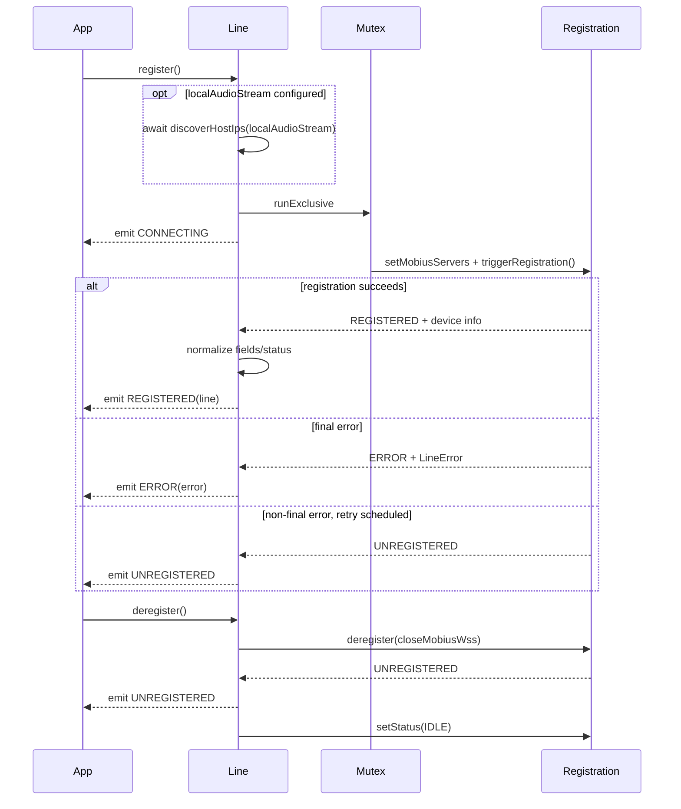
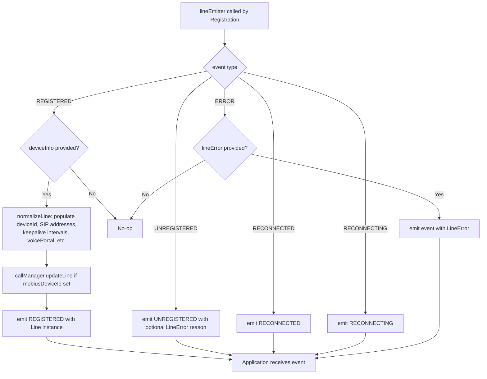
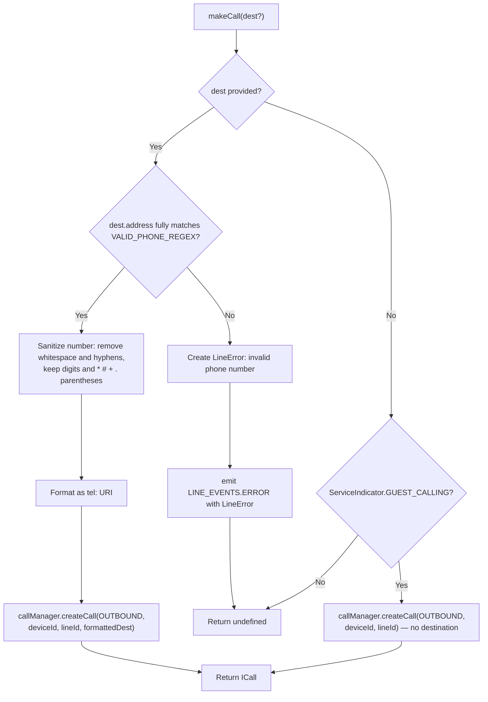
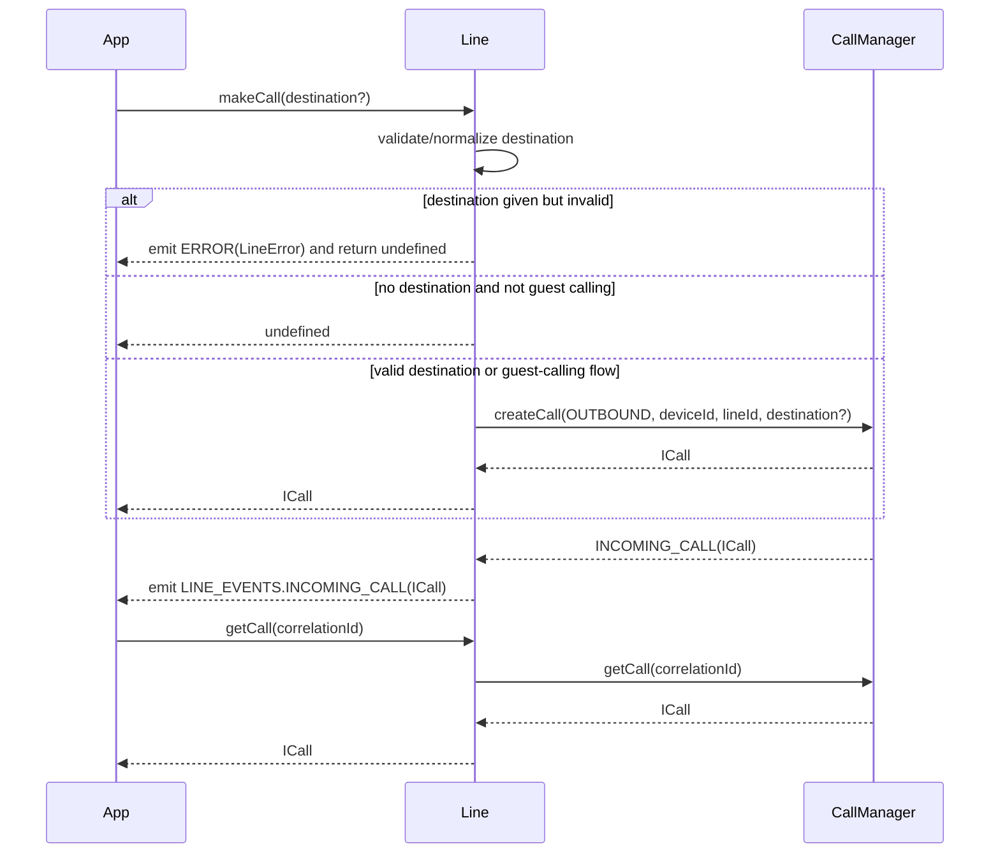
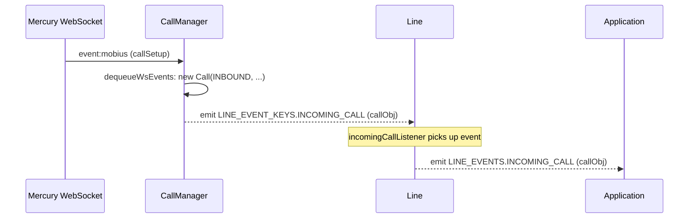
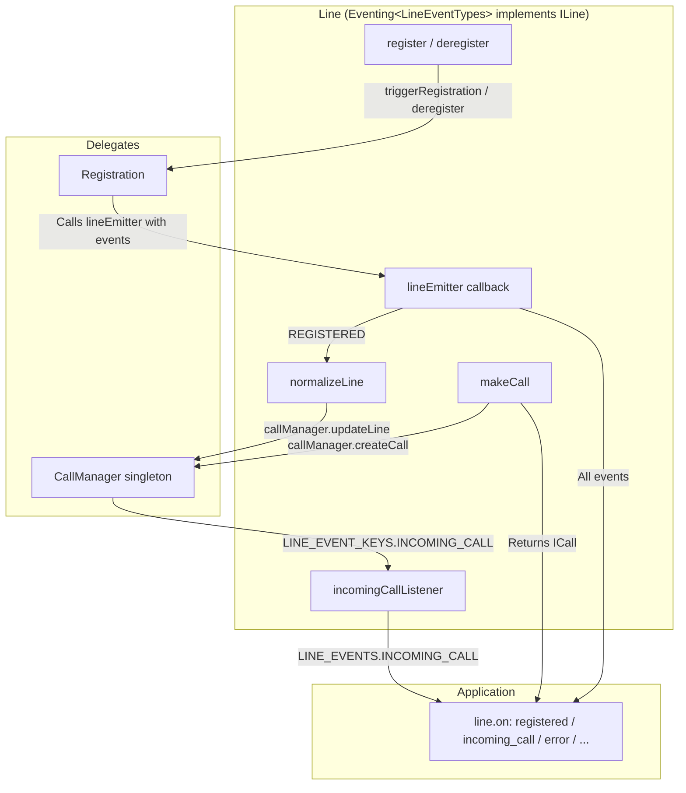
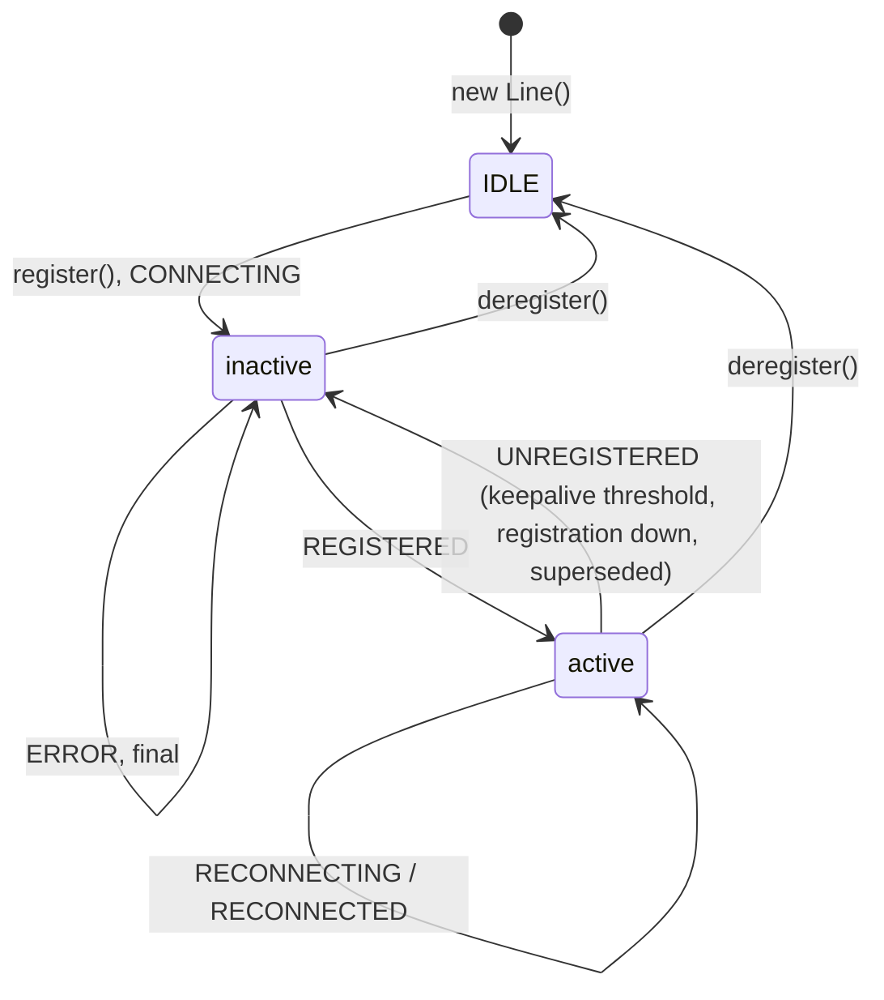

<!-- sdd-generated-metadata
doc_kind: module-spec
generated_from: module-spec@0.3.0
generated_by: claude-code
approved_by: rarajes2@cisco.com
updated_at: 2026-11-17T03:23:21Z
validation_status: pass-with-warnings
-->

# Line

This source-local document at `src/CallingClient/line/docs/README.md` owns the stable
specification for **Line**: the published `ILine` object that represents one telephony line,
exposes its registration controls and status, creates outbound calls, and re-emits registration and
incoming-call events to the application. Ground every claim in package evidence and link to the
[package architecture](../../../../docs/architecture.md) instead of repeating broader facts. No
service specification exists because this package is a library. The parent module is specified in
the [CallingClient spec](../../docs/README.md).

Related context: [documentation index](../../../../docs/index.md) ·
[package agent instructions](../../../../AGENTS.md)

## Metadata

| Field             | Value |
| ----------------- | ----- |
| Owner             | @webex/web-sdk (CODEOWNERS default rule) |
| Source path       | `src/CallingClient/line` |
| Resource kind     | module (published SDK object) |
| Status            | Active |
| Last verified     | 2026-11-16 at `0b8c34db7f` |
| Module id         | `line` |
| Parent spec       | [CallingClient spec](../../docs/README.md) |
| Doc kind          | Module spec |
| Coverage score    | Pending coverage assessment |
| Validation status | pass-with-warnings — validator `01a1e76e-1dbd-7680-94e4-46d29d2946d4`, assessed 2026-11-17; 0 Blocking, 1 Important (SDKConnector placeholder tests) |

## Applicability

| Condition ID                         | Status     | Evidence or reason | Owned section |
| ------------------------------------ | ---------- | ------------------ | ------------- |
| `module.has_tiers`                   | N/A        | No tier policy exists in this package or its `package.json` | Tier |
| `module.has_ui`                      | N/A        | No view or screen; the module is an SDK object | UI use-case flow |
| `module.crosses_service_boundaries`  | N/A        | Manifest flag false: `src/CallingClient/line/index.ts` makes no network call; Mobius traffic belongs to Registration and the calling module | Cross-boundary use-case flow |
| `module.holds_client_state`          | Applicable | `src/CallingClient/line/index.ts` holds line identity, device fields copied from the registration response, and its event subscriptions | Client state model |
| `module.enforces_domain_rules`       | Applicable | Destination validation and the guest-calling exception in makeCall (`src/CallingClient/line/index.ts`, `src/CallingClient/constants.ts`) | Business rules and invariants |
| `module.is_concurrent_async`         | Applicable | register runs host IP discovery and then the shared mutex; events arrive asynchronously from Registration and CallManager (`src/CallingClient/line/index.ts`) | Concurrency and reactive flow |
| `module.owns_persistence`            | N/A        | Nothing is stored; all fields live on the instance (`src/CallingClient/line/index.ts`) | Data, schema, and migration discipline |
| `module.stateful_transitions`        | Applicable | The line moves through the registration statuses with the matching events (`src/CallingClient/line/index.ts`, `src/common/types.ts`) | State machine |
| `module.exposes_wire_protocol`       | N/A        | No serialized format is produced or parsed here | Protocol and wire format |
| `module.ui_multi_screen`             | N/A        | No UI | UI flow |
| `module.large_data_model`            | N/A        | The ILine field set in `src/CallingClient/line/types.ts` is flat | Data model |
| `module.returns_caller_errors`       | Applicable | LineError events and the constructor's service-indicator check (`src/CallingClient/line/index.ts`, `src/common/Utils.ts`) | Caller-visible failure modes |
| `module.module_specific_conventions` | Applicable | Events reach the application only through Line, and Registration reports only through lineEmitter (`src/CallingClient/line/index.ts`) | Module-specific rules |
| `module.published_package`           | Applicable | `src/index.ts` re-exports ILine and LINE_EVENTS; `package.json` publishes @webex/calling | Export stability |
| `module.embedded_in_host`            | N/A        | No host theme or embed API | Host integration and theming |
| `module.has_design_tradeoff`         | Applicable | Thin facade over Registration and CallManager (`src/CallingClient/line/index.ts`) | Key design trade-off |
| `module.has_submodules`              | N/A        | Computed false by the Repo Annotation module_tree.py script: no module is nested under this path | Sub-modules |

## Evidence register

| Evidence | What it establishes |
| -------- | ------------------- |
| `src/CallingClient/line/index.ts` | The `Line` class: construction, `register`, `deregister`, `lineEmitter`, `normalizeLine`, `makeCall`, `getCall`, getters, and the incoming-call listener |
| `src/CallingClient/line/types.ts` | `ILine`, `LINE_EVENTS`, `LineEmitterCallback`, `LineErrorEmitterCallback` |
| `src/Events/types.ts` | `LineEventTypes` payload signatures and `LINE_EVENT_KEYS.INCOMING_CALL` |
| `src/index.ts`, `package.json` | The published exports `ILine`, `LINE_EVENTS`, `LINE_EVENT_KEYS`, and `LineError` |
| `src/CallingClient/CallingClient.ts` | `createLine()` builds the only `Line` and `getLines()` returns it |
| `src/CallingClient/registration/register.ts` | The registration that `Line` creates and the `lineEmitter` calls it makes |
| `src/CallingClient/calling/callManager.ts` | `createCall`, `getCall`, `updateLine`, and the `incoming_call` emission |
| `src/CallingClient/constants.ts` | `VALID_PHONE_REGEX`, `LINE_FILE`, and method names |
| `src/common/callUtils.ts` | `discoverHostIps`, which never rejects |
| `src/common/Utils.ts` | `validateServiceData` and `createLineError` use |
| `src/Errors/catalog/LineError.ts`, `src/Errors/types.ts` | `LineError`, `createLineError`, `LineErrorObject`, and `ERROR_TYPE` |
| `src/CallingClient/line/line.test.ts` | Behavioral tests cited under Verification |
| `src/CallingClient/line/types.ts` | Justifies the Public surface subsections Properties, Methods, and Events Emitted: each lists a distinct part of the declared `ILine` and `LINE_EVENTS` contract |
| `src/CallingClient/line/index.ts` | Justifies the Public surface subsection Constructor parameters: the constructor is not part of `ILine` and has its own argument list |
| `src/CallingClient/CallingClient.ts`, `src/CallingClient/calling/types.ts` | Justifies the Use cases and flows subsections Fetching Created Line Objects and Invoking Registration Methods, Listening for Line Events, and Making and Handling Outbound Calls: consumer examples checked against `getLines()`, `ILine`, and `ICall` |

## Purpose and boundary

- Responsibility: The `Line` class represents a single telephony line registered with the Webex
  Calling (Mobius) backend. It is the primary interface through which applications interact with
  calling capabilities — making calls, receiving incoming calls, and monitoring registration state.
  A `Line` is created internally by `CallingClient.createLine()` during initialization. Applications
  access it via `callingClient.getLines()`.
- In scope — the Line module is responsible for:
  - **Exposing public registration API** — `register()` and `deregister()` for applications to control line registration state
  - **Emitting line events to the application** — Provides the `lineEmitter` callback that `Registration` uses to signal state changes, which Line then re-emits as `LineEventTypes`
  - **Incoming call forwarding** — Listens for `incoming_call` from `CallManager` and re-emits as `LINE_EVENTS.INCOMING_CALL`
  - **Outbound call initiation** — Creates calls via `CallManager.createCall()` and returns the `ICall` object
  - **Line normalization** — Populates line properties (device ID, SIP addresses, keepalive and rehoming intervals, voice portal) from the device registration response
  - **Registration orchestration** — Delegates to `Registration` but manages the mutex to prevent concurrent registration
- Out of scope: registration, keepalive, failover, and recovery (the
  [Registration spec](../../registration/docs/README.md)), call state and media (the
  [calling spec](../../calling/docs/README.md)), Mobius discovery and line creation (the
  [CallingClient spec](../../docs/README.md)), and host IP discovery itself (`src/common/callUtils.ts`,
  described in the package architecture).
- Consumers: applications, through `callingClient.getLines()` and the `ILine` type exported from
  `src/index.ts`; `Registration`, which calls `lineEmitter`; `CallManager`, which receives the line
  through `updateLine`. Line owns the behavior rooted at `src/CallingClient/line/` and exposes it
  through the typed `@webex/calling` package boundary; shared infrastructure remains owned by
  `Errors`, `Events`, `Logger`, and `common`.

## Structure and key files

| Path | Responsibility |
| ---- | -------------- |
| `src/CallingClient/line/index.ts` | Line class implementation (default export `Line`) |
| `src/CallingClient/line/types.ts` | ILine interface, LINE_EVENTS enum, callback types |
| `src/CallingClient/line/line.test.ts` | Unit tests |

## Public surface

Contract `line-sdk` (publication `published`, native source `package.json`): `src/index.ts`
re-exports `ILine` and `LINE_EVENTS` from `src/CallingClient/line/types.ts` and `LINE_EVENT_KEYS`
from `src/Events/types.ts`. `ILine` extends `Eventing<LineEventTypes>`, so applications subscribe
with `line.on(event, listener)`; the payload of each event is declared in `LineEventTypes`
(`src/Events/types.ts`). The `Line` class itself is the default export of
`src/CallingClient/line/index.ts` and is not exported from the package entry.

| Surface | Consumer | Compatibility commitment | Source |
| ------- | -------- | ------------------------ | ------ |
| `line-sdk`: `ILine` properties and methods | Applications | Semver-controlled; see Export stability | `src/CallingClient/line/types.ts` |
| `line-sdk`: `LINE_EVENTS` values and payloads | Applications | Event names and payload shapes are semver-controlled | `src/Events/types.ts` |
| `line-sdk`: `LINE_EVENT_KEYS.INCOMING_CALL` (`incoming_call`) | `CallManager` and applications | Internal event that `Line` turns into `line:incoming_call` | `src/Events/types.ts` |
| `lineEmitter(event, deviceInfo?, lineError?)` | `Registration` | Declared on `ILine` with `@ignore`; not an application API (`MOD-004`) | `src/CallingClient/line/types.ts` |
| `getLoggingLevel()` | Applications holding a `Line` | Present on the class, not declared on `ILine` | `src/CallingClient/line/index.ts` |

### Constructor parameters

`new Line(...)` is called only by `CallingClient.createLine()`, which passes the first nine
arguments; `phoneNumber`, `extension`, and `voicemail` are accepted but not supplied there.

| Parameter | Type | Purpose |
| --------- | ---- | ------- |
| `userId` | `string` | Webex user ID |
| `clientDeviceUri` | `string` | Device URL from `webex.internal.device.url` |
| `mutex` | `Mutex` | Shared mutex for registration serialization |
| `primaryMobiusUris` | `string[]` | Primary Mobius server URIs |
| `backupMobiusUris` | `string[]` | Backup Mobius server URIs |
| `logLevel` | `LOGGER` | Log verbosity |
| `serviceDataConfig` | `CallingClientConfig['serviceData']`, optional | Backend config; defaults to `{indicator: 'calling', domain: ''}` when it has no indicator |
| `jwe` | `string`, optional | Optional JWE token, passed to Registration |
| `localAudioStream` | `LocalMicrophoneStream`, optional | Optional mic stream, used by `register()` for host ip discovery |
| `phoneNumber` | `string`, optional | Optional initial phone number |
| `extension` | `string`, optional | Optional initial extension |
| `voicemail` | `string`, optional | Optional voicemail number |

### Properties

| Property | Type | Description |
|----------|------|-------------|
| `userId` | `string` | User ID associated with the line |
| `clientDeviceUri` | `string` | Device URI from Webex SDK |
| `lineId` | `string` | Unique line identifier (UUID) |
| `mobiusDeviceId` | `string?` | Mobius device ID (set after registration) |
| `phoneNumber` | `string?` | Phone number; optional constructor argument that `CallingClient.createLine()` does not pass, so it is unset in practice |
| `extension` | `string?` | Extension number |
| `sipAddresses` | `string[]?` | SIP addresses |
| `voicemail` | `string?` | Voicemail number |
| `lastSeen` | `string?` | Last seen timestamp |
| `keepaliveInterval` | `number?` | Keepalive interval in seconds |
| `callKeepaliveInterval` | `number?` | Call keepalive interval |
| `rehomingIntervalMin` | `number?` | Min rehoming interval |
| `rehomingIntervalMax` | `number?` | Max rehoming interval |
| `voicePortalNumber` | `number?` | Voice portal number |
| `voicePortalExtension` | `number?` | Voice portal extension |
| `registration` | `IRegistration` | Registration instance for this line |

### Methods

| Method | Signature | Description |
|--------|-----------|-------------|
| `register` | declared `(): void`; implemented `async`, returning `Promise<void>` | Registers the line with Mobius (discovers host IPs when a stream is configured, acquires mutex, emits CONNECTING, delegates to Registration) |
| `deregister` | declared `(): void`; implemented `async (closeMobiusWss = false)`, returning `Promise<void>` | Deregisters the line (delegates to Registration, sets status IDLE) |
| `getActiveMobiusUrl` | `(): string` | Returns the currently active Mobius server URL |
| `getStatus` | `(): RegistrationStatus` | Returns current registration status (`IDLE`, `active`, `inactive`) |
| `getDeviceId` | `(): MobiusDeviceId \| undefined` | Returns the Mobius device ID |
| `makeCall` | `(dest?: CallDetails): ICall \| undefined` | Initiates an outbound call |
| `getCall` | `(correlationId: CorrelationId): ICall` | Retrieves a call by correlation ID |

### Events Emitted

| Event | Enum | Payload | Trigger |
|-------|------|---------|---------|
| `connecting` | `LINE_EVENTS.CONNECTING` | _(none)_ | `register()` acquired the mutex, after host IP discovery |
| `registered` | `LINE_EVENTS.REGISTERED` | `ILine` | Device registration succeeded |
| `unregistered` | `LINE_EVENTS.UNREGISTERED` | `LineError` (optional) | Device deregistered, registration down, or session superseded. The `LineError` is present only when the SDK will not re-register — currently a `409 Conflict` on keepalive, reported as `ERROR_TYPE.SESSION_SUPERSEDED` |
| `reconnecting` | `LINE_EVENTS.RECONNECTING` | _(none)_ | Keepalive failure, attempting recovery |
| `reconnected` | `LINE_EVENTS.RECONNECTED` | _(none)_ | A keepalive succeeded after one or more failures |
| `error` | `LINE_EVENTS.ERROR` | `LineError` | Registration or line error |
| `line:incoming_call` | `LINE_EVENTS.INCOMING_CALL` | `ICall` | Incoming call from Mobius |

`LineEmitterCallback` takes `event` (a `LINE_EVENTS` value), an optional `deviceInfo`
(`IDeviceInfo`), and an optional `clientError` (`LineError`), and returns nothing.
`LineErrorEmitterCallback` is the callback used for emitting errors related to the `Line` class: it
takes `err`, the error represented by a `LineError` object (its `getError()` returns a
`LineErrorObject`), and an optional `finalError` boolean that indicates if this is the terminal
error state for the operation, and returns nothing. Both are declared in
`src/CallingClient/line/types.ts`.

## Dependencies

| Dependency | Why it is required | Failure behavior |
| ---------- | ------------------ | ---------------- |
| Registration and Calling submodules: `Registration` (`registration-internal`) | Created per line with `lineEmitter`; performs every Mobius registration operation | Failures arrive as `lineEmitter` events (`MOD-004`) |
| Registration and Calling submodules: `CallManager` (`call-sdk`) | `createCall`, `getCall`, `updateLine`, and the `incoming_call` event | `createCall` errors propagate from `makeCall` |
| `SDKConnector` for the Webex SDK instance (`sdk-connector-internal`); Line uses no SDKConnector event bridge | Supplies the `webex` object passed to `createRegistration` and `getCallManager` | The constructor fails if no SDK instance was set |
| `MetricManager` (`metrics-internal`) | Used through Registration only; `Line` submits no metric itself | — |
| `discoverHostIps` and `validateServiceData` from `src/common` (package architecture) | Host IP refresh before registration; service indicator check at construction | Discovery never rejects; validation throws |
| `Eventing` from `src/Events/impl` and the `Logger` (package architecture) | Typed event emitter base class and logging | — |

## Requirements

| ID | WHAT | WHY | Source evidence | Test or example evidence | Assumptions or gaps | Confidence |
| -- | ---- | --- | --------------- | ------------------------ | ------------------- | ---------- |
| `MOD-001` | Construction assigns a new UUID `lineId`, stores identity and the optional `phoneNumber`, `extension`, and `voicemail`, defaults service data to `{indicator: calling, domain: ''}` when none is given, throws from `validateServiceData` on an unknown indicator, creates one `Registration` with `lineEmitter`, takes the `CallManager` for the indicator, and starts the incoming-call listener. | One per-device Line contract gives applications a stable place to register, deregister, inspect status, and create or find calls. | `src/CallingClient/line/index.ts`, `src/common/Utils.ts` | `src/CallingClient/line/line.test.ts` "verify successful Registration cases and keepalive", "... for a guest user" | — | Present |
| `MOD-002` | When constructed with a `localAudioStream`, `register()` awaits `discoverHostIps(localAudioStream)` before entering the mutex and triggering the registration, so the registration reports the addresses the client's interfaces carry at that moment. Without a stream the discovery is skipped and the registration reports `hostIps: []`. Inside the mutex it emits `CONNECTING`, calls `setMobiusServers(primary, backup)`, and awaits `triggerRegistration()`. | `Registration.postRegistration` reads the addresses synchronously, so they must be stored before the registration is triggered or it would race the discovery. Doing this per `register()` keeps the addresses current and keeps the cost off the automatic retry paths, which drive `Registration` directly; keeping it outside `runExclusive` avoids holding a mutex shared with failback and keepalive recovery for the duration of the negotiation. | `src/CallingClient/line/index.ts`, `src/common/callUtils.ts` | `src/CallingClient/line/line.test.ts` "discovers the host ips before triggering the registration"; `src/CallingClient/CallingClient.test.ts` | Automatic re-registrations bypass `register()` and reuse the last stored addresses | Present |
| `MOD-003` | `deregister(closeMobiusWss = false)` awaits `registration.deregister(closeMobiusWss)` and then sets the registration status to `IDLE`. | `IDLE` marks a deliberate deregistration, unlike the `inactive` status Registration leaves after a failure: `CallingClient` skips connection restoration for an `IDLE` line after a network flap, so the line is not re-registered behind the application. | `src/CallingClient/line/index.ts`, `src/CallingClient/registration/register.ts`, `src/CallingClient/CallingClient.ts` | `src/CallingClient/line/line.test.ts` "verify successful de-registration cases" | `closeMobiusWss` is not on the `ILine` declaration | Present |
| `MOD-004` | `lineEmitter(event, deviceInfo?, lineError?)` maps Registration events: `REGISTERED` with device info runs `normalizeLine` and emits `REGISTERED` with the line (without device info, nothing); `UNREGISTERED` emits with `lineError` or `undefined`; `RECONNECTED` and `RECONNECTING` emit with no payload; `ERROR` emits only when `lineError` is present; every other event, including the `CONNECTING` Registration reports per server attempt, is dropped. | Typed events let applications react to registration recovery and incoming calls without polling Line or Registration internals. | `src/CallingClient/line/index.ts` | `src/CallingClient/line/line.test.ts` "Line event emission tests" | — | Present |
| `MOD-005` | `normalizeLine(deviceInfo)` copies the fields listed under Design overview, sets `sipAddresses` to `device.addresses` or `[]`, and calls `callManager.updateLine(mobiusDeviceId, line)` when a device ID is present. No default values are applied. | The line object the application receives on `REGISTERED` must describe the device Mobius registered, and CallManager needs the line to route incoming calls. | `src/CallingClient/line/index.ts` | `src/CallingClient/line/line.test.ts` "verify successful Registration cases and keepalive" | — | Present |
| `MOD-006` | `makeCall(dest)` with a destination accepts it only when `VALID_PHONE_REGEX` (`[\d\s()*#+.-]+`) matches the whole address, removes whitespace and hyphens, prefixes `tel:`, and returns `callManager.createCall(OUTBOUND, deviceId, lineId, {type, address})`. Any other address emits `LINE_EVENTS.ERROR` with a `LineError` (message "An invalid phone number was detected. Check the number and try again.", type `call_error`, status `active`) and returns `undefined`. | Only dialable numbers reach Mobius, and the application learns synchronously and through the error event that a number was rejected. | `src/CallingClient/line/index.ts`, `src/CallingClient/constants.ts` | `src/CallingClient/line/line.test.ts` "Return a successful call object while making call", "Remove spaces ...", "Remove hyphen ...", "attempt to create call with incorrect number format 1" and "2" | SIP URIs and e-mail-style addresses are rejected | Present |
| `MOD-007` | `makeCall()` without a destination creates a call with no destination only for `ServiceIndicator.GUEST_CALLING`; for every other indicator it returns `undefined` and emits nothing. | A guest call's destination is fixed by its JWE token, so the guest flow must work without one. | `src/CallingClient/line/index.ts` | `src/CallingClient/line/line.test.ts` "attempt to create call with guest calling service indicator" | No test covers the no-destination case for `calling` | Present |
| `MOD-008` | Each `LINE_EVENT_KEYS.INCOMING_CALL` (`incoming_call`) from the `CallManager` is re-emitted as `LINE_EVENTS.INCOMING_CALL` with the same `ICall`. | `CallManager` stays unaware of applications, and the application gets every line event from one object. | `src/CallingClient/line/index.ts`, `src/CallingClient/calling/callManager.ts` | none found in `src/CallingClient/line/line.test.ts` | Forwarding is exercised only through calling-module tests | Weak |
| `MOD-009` | `getStatus()`, `getActiveMobiusUrl()`, and `getDeviceId()` read the registration synchronously (`getDeviceId` returns `device.deviceId` of the registration's device info); `getCall(correlationId)` returns `callManager.getCall(correlationId)`; `getLoggingLevel()` returns the logger level. | Status and identity come from the owner of registration state, so the line never reports a stale copy. | `src/CallingClient/line/index.ts` | `src/CallingClient/line/line.test.ts` "verify successful Registration cases and keepalive", "Return a successful call object while making call" | — | Present |

## Design overview

The `Line` class acts as the bridge between the application, the `Registration` subsystem, and the
`CallManager`. It does not perform registration or call management itself — instead, it
orchestrates these subsystems and provides a unified event interface to the application.

**File:** `src/CallingClient/line/index.ts`

**Class:** `Line extends Eventing<LineEventTypes> implements ILine`

The `lineEmitter` is the critical callback passed from `Line` to `Registration` during
construction. It is the **only mechanism** by which `Registration` communicates state changes back
to `Line`. How it works:

1. `Line` constructor creates `Registration` and passes `this.lineEmitter` as a callback
2. `Registration` calls `lineEmitter(event, deviceInfo?, lineError?)` at key points
3. `lineEmitter` handles each event type (`MOD-004`)

When `REGISTERED` is received, `normalizeLine(deviceInfo)` extracts following fields from the
registration response. `phoneNumber`, `extension`, and `voicemail` are constructor arguments, not
read from the registration response.

| Field                     | Source                                          |
| ------------------------- | ----------------------------------------------- |
| `mobiusDeviceId`          | deviceInfo.device.deviceId                    |
| `mobiusUri`               | deviceInfo.device.uri                         |
| `lastSeen`                | deviceInfo.device.lastSeen                    |
| `sipAddresses`            | deviceInfo.device.addresses, or an empty array |
| `keepaliveInterval`       | deviceInfo.keepaliveInterval (no default in Line) |
| `callKeepaliveInterval`   | deviceInfo.callKeepaliveInterval (no default in Line) |
| `rehomingIntervalMin/Max` | From deviceInfo, no default in Line (Registration falls back to 60 and 120 minutes for failback timing) |
| `voicePortalNumber`       | deviceInfo.voicePortalNumber                  |
| `voicePortalExtension`    | deviceInfo.voicePortalExtension               |

The `incomingCallListener()` method subscribes to `CallManager`'s `incoming_call` event and
re-emits it as a `LINE_EVENTS.INCOMING_CALL`. This indirection ensures that:

- `CallManager` remains decoupled from `Line`
- `Line` controls which events reach the application
- The application gets a consistent `LINE_EVENTS` interface

## Data flow and sequence coverage

Every operation is an in-process call; `Line` reaches the network only through `Registration` and
the calls `CallManager` creates.

| Operation group | Entry and outcome | Diagram or evidence | Failure and recovery coverage |
| --------------- | ----------------- | ------------------- | ----------------------------- |
| Register and deregister | `register()` → `CONNECTING` then `REGISTERED`; `deregister()` → `UNREGISTERED`, status `IDLE` | Register and deregister sequence | Final error → `ERROR`; non-final → `UNREGISTERED` while Registration retries |
| Forward registration events | Registration → `lineEmitter` → application | lineEmitter flowchart | Dropped events listed in `MOD-004` |
| Make or retrieve an outbound call | `makeCall(dest?)` → `ICall` or `undefined` | makeCall flowchart, create and receive calls sequence | Invalid number → `ERROR`; no destination for non-guest → `undefined` |
| Receive a call | `CallManager` `incoming_call` → `line:incoming_call` | Incoming call sequence | — |





Any other event, including the `CONNECTING` that Registration reports for each server attempt,
falls through to the no-op branch.

The behavior of `makeCall` varies by `ServiceIndicator`:

- **`ServiceIndicator.CALLING`** (licensed users): `destination` is required. A `CallDetails` object must be provided; only its `address` is validated, and `type` is passed through.
- **`ServiceIndicator.GUEST_CALLING`**: Destination is optional. It's omitted, and a call is created without a destination (the destination is determined through the jwe token).
- **`ServiceIndicator.CONTACT_CENTER`**: Destination **must** be provided. There is no special handling for this indicator in `makeCall` — if `dest` is omitted, `makeCall` returns `undefined` and no call is created.



The returned `Call` object is then used by the application to `dial()`, listen for events, and
control the call.





The diagram shows the HTTP transport; with the Mobius WebSocket enabled, `CallingClient` hands the
socket's call events to `CallManager.dequeueWsEvents` instead, and the `Line` side is unchanged
(`src/CallingClient/calling/callManager.ts`).

## Class and component relationships

`Line` extends `Eventing<LineEventTypes>`; it owns one `Registration` and uses the `CallManager`
singleton for its service indicator. `CallManager` owns the `Call` objects, and `Registration`
reaches Mobius through `APIRequest`.



## Use cases and flows

| Use case | Actor or caller | Primary steps and outcome | Failure or boundary behavior | Evidence |
| -------- | --------------- | ------------------------- | ---------------------------- | -------- |
| `UC-001` Register and watch the line | Application | `getLines()`, `line.on(...)`, `await line.register()` (`MOD-002`) | `error` or `unregistered` events | `src/CallingClient/line/index.ts`, `src/CallingClient/line/line.test.ts` |
| `UC-002` Place a call | Application | `makeCall(dest)` then `call.dial(stream)` (`MOD-006`) | Invalid number → `error`, no call | `src/CallingClient/line/index.ts`, `src/CallingClient/line/line.test.ts` |
| `UC-003` Guest call | Guest application | `makeCall()` without destination (`MOD-007`) | Other indicators get `undefined` | `src/CallingClient/line/index.ts`, `src/CallingClient/line/line.test.ts` |
| `UC-004` Answer a call | Application | `line:incoming_call` then `call.answer(stream)` (`MOD-008`) | — | `src/CallingClient/line/index.ts` |
| `UC-005` Sign out | Application | `await line.deregister()` (`MOD-003`) | DELETE failure still ends with `unregistered` | `src/CallingClient/line/index.ts`, `src/CallingClient/registration/register.ts` |

This section covers three key aspects:

1. **Fetching and Managing Line Objects / Registration**
2. **Listening for Line Events**
3. **Working with Calls (Call API)**

### Fetching Created Line Objects and Invoking Registration Methods

```typescript
// Get all line objects (if lines already exist)
const lines = callingClient.getLines();
const line = Object.values(lines)[0];

// Register the line: triggers connection to Mobius, acquiring mutex, emitting events, etc.
await line.register();

// Optionally, check registration status and get IDs
const status = line.getStatus(); // 'IDLE' | 'active' | 'inactive'
const deviceId = line.getDeviceId();
const mobiusUrl = line.getActiveMobiusUrl();

// Deregister the line
await line.deregister();
```

### Listening for Line Events

```typescript
// Attach event listeners for registration lifecycle, errors, and incoming calls
line.on('connecting', () => {
  console.log('Registration in progress...');
});

line.on('registered', (lineInfo) => {
  console.log('Registered! Phone:', lineInfo.phoneNumber);
  console.log('Extension:', lineInfo.extension);
  console.log('SIP:', lineInfo.sipAddresses);
});

line.on('reconnecting', () => {
  console.log('Lost connection, reconnecting...');
});

line.on('reconnected', () => {
  console.log('Reconnected successfully');
});

line.on('error', (error) => {
  console.error('Line error:', error.getError());
});

line.on('line:incoming_call', (call) => {
  console.log('Incoming call!');
  call.answer(localAudioStream);
});
```

### Making and Handling Outbound Calls

```typescript
// Initiate an outbound call after registration
const call = line.makeCall({type: 'uri', address: '+1 555 123 4567'});

if (call) {
  call.on('established', () => console.log('Call connected'));
  call.on('disconnect', () => console.log('Call ended'));
  call.dial(localAudioStream);
}
```

> **Note:** For detailed information on handling of the outbound call flow refer to the following references:
>
> 1. `line.makeCall()` — validates the destination and delegates to `callManager.createCall()`. See `src/CallingClient/line/index.ts` (`makeCall` method).
> 2. `callManager.createCall()` — instantiates a new `Call` object via the `createCall` factory. See `src/CallingClient/calling/callManager.ts` (`createCall` method).
> 3. `call.dial()` — initiates the media session with a `LocalMicrophoneStream`. See `src/CallingClient/calling/call.ts` (`dial` method).
> 4. Outbound call state machine handlers in `src/CallingClient/calling/call.ts`:
>    - `handleOutgoingCallSetup` — sends the initial call setup request to Mobius
>    - `handleOutgoingCallAlerting` — processes the alerting/ringing state
>    - `handleOutgoingCallConnect` — handles call establishment
>    - `handleOutgoingCallDisconnect` — handles call teardown
>    - `handleOutgoingRoapOffer` / `handleOutgoingRoapAnswer` — WebRTC ROAP media negotiation

## Client state model

A `Line` owns provisioned line/device fields, registration status through its `Registration`
instance, and its event subscriptions to Registration and CallManager. Active call objects remain
owned by CallManager.

| State or slice | Owner | Initial state | Transition triggers | Reset or persistence boundary |
| -------------- | ----- | ------------- | ------------------- | ----------------------------- |
| `lineId`, `userId`, `clientDeviceUri` | `Line` | Set at construction | — | For the life of the instance |
| `phoneNumber`, `extension`, `voicemail` | `Line` | Constructor arguments, unset when `CallingClient` creates the line | — | Never updated by the module |
| Device fields (`mobiusDeviceId`, `sipAddresses`, intervals, voice portal) | `Line` | unset; `sipAddresses` is `[]` | `REGISTERED` with device info (`MOD-005`) | Overwritten on each registration, not cleared on deregistration |
| Registration status | `Registration` | `IDLE` | State machine section | Read through `getStatus()` |
| `serviceData` | `Line` | From the constructor or the `calling` default | — | For the life of the instance |
| Incoming-call subscription | `Line` on `CallManager` | Registered at construction | — | Never removed |

## Business rules and invariants

| ID | Invariant | WHY | Enforcement source | Test evidence |
| -- | --------- | --- | ------------------ | ------------- |
| `INV-001` | `register()` is mutex-protected and emits CONNECTING before delegating to Registration. | One registration flow at a time across the line, failback, and recovery. | `src/CallingClient/line/index.ts` | `src/CallingClient/line/line.test.ts` "discovers the host ips before triggering the registration" |
| `INV-002` | `makeCall()` validates/normalizes the destination and uses CallManager; guest calling may omit a destination because the JWE supplies it. | Only dialable numbers reach Mobius (`MOD-006`, `MOD-007`). | `src/CallingClient/line/index.ts` | `src/CallingClient/line/line.test.ts` |
| `INV-003` | Incoming calls and registration events are re-emitted with the declared `LINE_EVENTS` payloads. | Applications depend on the payload types in `LineEventTypes`. | `src/CallingClient/line/index.ts`, `src/Events/types.ts` | `src/CallingClient/line/line.test.ts` "Line event emission tests" |
| `INV-004` | `ERROR` is never emitted without a `LineError`. | Listeners can call `error.getError()` without a null check. | `src/CallingClient/line/index.ts` | `src/CallingClient/line/line.test.ts` "does not emit error when no line error is provided" |
| `INV-005` | A line always has valid service data: construction throws on an unknown indicator. | Registration and CallManager are keyed by the indicator. | `src/CallingClient/line/index.ts`, `src/common/Utils.ts` | none found |

## Concurrency and reactive flow

- Execution model: event loop only. The shared mutex prevents overlapping registration entry. Registration callbacks and incoming-call events can arrive asynchronously; Line updates status/device fields before emitting the corresponding typed event.
- Ordering guarantees: host IP discovery completes before the mutex is requested, and `CONNECTING` is emitted only after the mutex is acquired, so a `register()` queued behind failback or recovery emits `CONNECTING` late. `normalizeLine` runs before `REGISTERED` is emitted.
- Idempotency and retry: `register()` is not deduplicated; a second call queues on the mutex, and Registration returns at once when already registered. Retries belong to Registration.
- Shared-state protection: the mutex is created by `CallingClient` and shared with Registration; `Line` holds no lock of its own.
- Blocking restrictions: `lineEmitter` and `makeCall` are synchronous and must not await; `makeCall` returns the call before any network activity.

## State machine

`Line` stores no status of its own; it reports the `RegistrationStatus` of its registration and
emits the matching event. The application sees these states and transitions:



Guards and terminal states: `getStatus()` returns `active` only after `REGISTERED`; there is no
terminal state, and a superseded session (an `UNREGISTERED` carrying a `LineError`) stays
`inactive` until the application calls `register()` again. Recovery details are in the
[Registration spec](../../registration/docs/README.md).

## Caller-visible failure modes

The `LineError` object encapsulates structured information about errors occurring during Line
operations. It typically includes:

- A human-readable error message (e.g., explaining the user-level issue, such as invalid numbers).
- An error data payload (for debugging or UI).
- A specific error type (`ERROR_TYPE`), identifying the domain of the failure (e.g., registration, call errors).
  - See `ERROR_TYPE` enum in `src/Errors/types.ts`.
- A registration status describing the state when the error occurred.
  - See `RegistrationStatus` enum in `src/common/types.ts`.

> **File references:**
> - `LineError` class and `createLineError` factory — `src/Errors/catalog/LineError.ts`
> - `LineErrorObject` type definition — `src/Errors/types.ts`

Inside [`src/CallingClient/line/index.ts`](../index.ts):

- Major operations (such as `makeCall` and `register`) have structured error handling: `makeCall` is synchronous and reports an invalid destination as a `LineError`, and registration failures reach `Line` from `Registration` through `lineEmitter` rather than from a try/catch in `register`.
  - See `makeCall` in `src/CallingClient/line/index.ts` (invalid phone number path).
- When an error occurs that should be signaled to clients, a `LineError` object is constructed with descriptive details and relevant context.
  - See `new LineError(...)` in `src/CallingClient/line/index.ts`.
  - See `createLineError(...)` in `src/common/Utils.ts` (used by `handleRegistrationErrors` and `emitFinalFailure`).
- This error object is emitted via the `LINE_EVENTS.ERROR` event, using the `lineEmitter` method as the emission pathway.
  - See `lineEmitter` switch case for `LINE_EVENTS.ERROR` in `src/CallingClient/line/index.ts`.
  - See registration error callbacks in `src/CallingClient/registration/register.ts` (`attemptRegistrationWithServers`, keepalive worker `onmessage`).
- Listeners on the `Line` instance (using `line.on(LINE_EVENTS.ERROR, ...)`) can receive, log, display, or escalate these errors through the callback signature shown above.
  - See listener examples in `src/CallingClient/line/line.test.ts`.

For example, in the implementation of `makeCall`:

- If the destination phone number is invalid, a `LineError` is created with a message and detail, and emitted to listeners using the error event directly (not through `lineEmitter`), and `makeCall` returns `undefined`. The `finalError` flag of `LineErrorEmitterCallback` applies to registration errors, not to this path.
  - See `src/CallingClient/line/index.ts` — the `else` branch of the phone number regex check in `makeCall`.

**Summary:** Error handling in the `Line` class centers on the use of the `LineError` object, with
propagation through a typed emitter callback. This enables robust, structured, and type-safe error
reporting to SDK consumers or UI components.

| Condition | Signal or result | Caller behavior | Retry or recovery | Evidence |
| --------- | ---------------- | --------------- | ----------------- | -------- |
| Invalid destination in `makeCall` | `undefined` and `error` with a `LineError` of type `call_error` | Ask the user to correct the number | None | `src/CallingClient/line/index.ts`, `src/CallingClient/line/line.test.ts` |
| No destination for a non-guest line | `undefined`, no event | Supply a destination | None | `src/CallingClient/line/index.ts` |
| Unknown service indicator | Constructor throws `Invalid service indicator, Allowed values are: ...` | Fix the client configuration | None | `src/common/Utils.ts`, `src/CallingClient/line/index.ts` |
| Registration fails finally | `error` with the Registration `LineError` | Show the error | New `register()` | `src/CallingClient/registration/register.ts` |
| Registration lost or retrying | `unregistered` without payload | Show disconnected state | Registration retries | `src/CallingClient/registration/register.ts` |
| Session superseded | `unregistered` with a `LineError` of type `session_superseded` | Do not auto-register | Explicit `register()` only | `src/CallingClient/registration/register.ts`, `src/CallingClient/line/line.test.ts` |

## Pitfalls and constraints

- Do not bypass the module boundary or duplicate the line constants owned by `src/CallingClient/constants.ts` (`VALID_PHONE_REGEX`, `LINE_FILE`).
- Do not assume remote events are ordered or that network operations cannot fail.
- `makeCall` accepts only phone-style addresses: a SIP URI such as `sip:bob@example.com` is rejected with an `error` event, and parentheses and dots are kept in the `tel:` URI because only whitespace and hyphens are removed.
- `ILine` declares `register()` and `deregister()` as returning `void` while the class returns promises, and `deregister`'s `closeMobiusWss` parameter is not declared; TypeScript callers that `await` them rely on the class.
- `phoneNumber`, `extension`, and `voicemail` stay unset for lines created by `CallingClient`, so a `registered` listener that reads them gets `undefined`.
- `Line.deregister()` leaves status `IDLE`; `Registration.deregister()` alone leaves `inactive` (see the Registration spec).

## Module-specific rules

- Do: use the factories, typed events, constants, and adapters already used by `src/CallingClient/line/index.ts`.
- Do: route every Registration state change through `lineEmitter`, and emit application events only from `Line`.
- Do not: add direct network or SDK access when the module already provides an adapter.
- Do not: log credentials. Registration credentials/JWE are delegated to Registration/APIRequest and must not be logged by Line.
- Do: update this spec with behavior changes in the same merge.

## Export stability

Compatibility notes:

- Public factories, interfaces, types, and events are semver-controlled through `src/index.ts`; removals or incompatible signature changes require an approved migration and release plan.

| Export or entry point | Consumer | Stability | Versioning and deprecation rule | Declaration or API report |
| --------------------- | -------- | --------- | ------------------------------- | ------------------------- |
| ILine | Applications | Stable | Removing or changing a member is a breaking change | `src/CallingClient/line/types.ts` |
| LINE_EVENTS | Applications | Stable | Event string values are part of the contract | `src/CallingClient/line/types.ts` |
| LINE_EVENT_KEYS | Applications and CallManager | Stable | Exported from the package entry with the other event keys | `src/Events/types.ts` |
| Package entry | Package managers | Stable | Published as @webex/calling | `package.json` |

## Key design trade-off

| Chosen trade-off | Preserved invariant or benefit | Cost or limitation | Decision evidence |
| ---------------- | ------------------------------ | ------------------ | ----------------- |
| Line is a thin per-device facade over Registration and CallManager. | Keeps consumer registration/call operations and events on one stable object while complex retry and call state remain in their owners. | This adds delegation; status and device data are read from Registration rather than owned here. | `src/CallingClient/line/index.ts` |

## Verification

Unit tests are co-located under `src/CallingClient/line/` and exercise positive, negative, error,
retry, and cleanup behavior as applicable. Package journeys under `playwright/` cover cross-module
flows. Run them with `yarn test:unit` from the package directory; on 2026-11-16 with Node.js 22.14
the package run passed 32 suites and 908 tests.

| Requirement or invariant | Test level | Positive evidence | Negative or boundary evidence | Gap |
| ------------------------ | ---------- | ----------------- | ----------------------------- | --- |
| `MOD-001`, `MOD-005`, `MOD-009` | Unit | `src/CallingClient/line/line.test.ts` registration cases | none found | Invalid service indicator not tested here |
| `MOD-002`, `INV-001` | Unit | `src/CallingClient/line/line.test.ts`, `src/CallingClient/CallingClient.test.ts` | none found | Ordering against `triggerRegistration()` is asserted; the skip-without-a-stream case is covered from `CallingClient.test.ts` |
| `MOD-003` | Unit | `src/CallingClient/line/line.test.ts` "verify successful de-registration cases" | none found | `closeMobiusWss = true` not tested |
| `MOD-004`, `INV-003`, `INV-004` | Unit | `src/CallingClient/line/line.test.ts` "Line event emission tests" | "does not emit error when no line error is provided" | `CONNECTING` drop not asserted |
| `MOD-006`, `INV-002` | Unit | `src/CallingClient/line/line.test.ts` calling tests | Incorrect number format cases | Parentheses in a number not tested |
| `MOD-007` | Unit | `src/CallingClient/line/line.test.ts` guest case | none found | No-destination `calling` case not tested |
| `MOD-008` | none | none found | none found | Incoming-call forwarding has no line test |
| `INV-005` | none | none found | none found | Constructor throw not tested |
