<!-- sdd-generated-metadata
doc_kind: module-spec
generated_from: module-spec@0.3.0
generated_by: claude-code
approved_by: rarajes2@cisco.com
updated_at: 2026-11-17T03:23:21Z
validation_status: pass-with-warnings
-->

# Registration

This source-local document at `src/CallingClient/registration/docs/README.md` owns the stable
specification for **Registration**: the internal class that registers one `Line` with the Webex
Calling Mobius backend, keeps the registration alive, moves it between primary and backup Mobius
servers, recovers it after network loss, and tears it down. Ground every claim in package evidence
and link to the [package architecture](../../../../docs/architecture.md) instead of repeating
broader facts. No service specification exists because this package is a library. The parent
module is specified in the [CallingClient spec](../../docs/README.md).

Related context: [documentation index](../../../../docs/index.md) ·
[package agent instructions](../../../../AGENTS.md)

## Metadata

| Field             | Value |
| ----------------- | ----- |
| Owner             | @webex/web-sdk (CODEOWNERS default rule) |
| Source path       | `src/CallingClient/registration` |
| Resource kind     | module (internal class, not exported from the package entry) |
| Status            | Active |
| Last verified     | 2026-11-16 at `0b8c34db7f` |
| Module id         | `registration` |
| Parent spec       | [CallingClient spec](../../docs/README.md) |
| Doc kind          | Module spec |
| Coverage score    | Pending coverage assessment |
| Validation status | pass-with-warnings — validator `01a1e76e-1dbd-7680-94e4-46d29d2946d4`, assessed 2026-11-17; 0 Blocking, 1 Important (SDKConnector placeholder tests) |

## Applicability

| Condition ID                         | Status     | Evidence or reason | Owned section |
| ------------------------------------ | ---------- | ------------------ | ------------- |
| `module.has_tiers`                   | N/A        | No tier policy exists in this package or its `package.json` | Tier |
| `module.has_ui`                      | N/A        | No view or screen; the module is an internal SDK class | UI use-case flow |
| `module.crosses_service_boundaries`  | Applicable | `src/CallingClient/registration/register.ts` calls Mobius over HTTP or the Mobius WebSocket through `src/CallingClient/utils/request.ts` | Cross-boundary use-case flow |
| `module.holds_client_state`          | Applicable | `src/CallingClient/registration/register.ts` holds status, device info, server lists, timers, retry flags, the keepalive worker, and a localStorage failover cache | Client state model |
| `module.enforces_domain_rules`       | Applicable | Fatal versus retryable error classification, the active-call deferral, and the superseded-session latch (`src/CallingClient/registration/register.ts`, `src/common/Utils.ts`) | Business rules and invariants |
| `module.is_concurrent_async`         | Applicable | Every Mobius call is a promise, retries and failback run on timers, keepalive runs in a Web Worker, and a shared mutex serializes flows (`src/CallingClient/registration/register.ts`, `src/CallingClient/registration/webWorkerStr.ts`) | Concurrency and reactive flow |
| `module.owns_persistence`            | N/A        | Manifest flag false: the only stored data is a transient failover cache entry in browser localStorage, described under Client state model (`src/CallingClient/registration/register.ts`) | Data, schema, and migration discipline |
| `module.stateful_transitions`        | Applicable | RegistrationStatus moves between IDLE, active, and inactive (`src/common/types.ts`, `src/CallingClient/registration/register.ts`) | State machine |
| `module.exposes_wire_protocol`       | Applicable | Mobius device requests and the keepalive worker message contract (`src/CallingClient/registration/register.ts`, `src/CallingClient/registration/webWorkerStr.ts`) | Protocol and wire format |
| `module.ui_multi_screen`             | N/A        | No UI | UI flow |
| `module.large_data_model`            | N/A        | The module reads one Mobius device response shape declared in `src/common/types.ts` | Data model |
| `module.returns_caller_errors`       | Applicable | Failures reach Line as LineError payloads on LINE_EVENTS.ERROR and LINE_EVENTS.UNREGISTERED (`src/common/Utils.ts`, `src/CallingClient/registration/register.ts`) | Caller-visible failure modes |
| `module.module_specific_conventions` | Applicable | Transport only through APIRequest, events only through lineEmitter, and the 3050 permanent-close convention (`src/CallingClient/registration/register.ts`) | Module-specific rules |
| `module.published_package`           | N/A        | Manifest flag false: `src/index.ts` does not export Registration or IRegistration | Export stability |
| `module.embedded_in_host`            | N/A        | No host theme or embed API | Host integration and theming |
| `module.has_design_tradeoff`         | Applicable | Keepalive timing in a Web Worker with network I/O on the main thread (`src/CallingClient/registration/register.ts`, `src/CallingClient/registration/webWorkerStr.ts`) | Key design trade-off |
| `module.has_submodules`              | N/A        | Computed false by the Repo Annotation module_tree.py script: no module is nested under this path | Sub-modules |

## Evidence register

| Evidence | What it establishes |
| -------- | ------------------- |
| `src/CallingClient/registration/register.ts` | The `Registration` class and `createRegistration` factory: registration loop, failover and failback timers, 429 paths, keepalive worker handling, reconnection, deregistration, and hard-stop cleanup |
| `src/CallingClient/registration/types.ts` | `IRegistration`, `HardStop`, `HARD_STOP_REASON`, the callback aliases, `RegistrationErrorHandlers`, `RegistrationErrorResult`, and `FailoverCacheState` |
| `src/CallingClient/registration/webWorkerStr.ts` | The keepalive worker source that is actually run (Blob URL) and its message handling |
| `src/CallingClient/registration/webWorker.ts` | The same worker logic as a typed module, used by `src/CallingClient/registration/webWorker.test.ts` |
| `src/CallingClient/registration/index.ts` | Re-exports `src/CallingClient/registration/register.ts` |
| `src/CallingClient/registration/registerFixtures.ts` | Mobius discovery and device response fixtures used by the tests |
| `src/common/Utils.ts` | `handleRegistrationErrors` status-code classification, `emitFinalFailure`, and `uploadLogs` |
| `src/common/callUtils.ts` | `getHostIps` (read by registration) and `discoverHostIps` (run by `Line`) |
| `src/common/types.ts` | `RegistrationStatus`, `WorkerMessageType`, `IDeviceInfo`, `Devices`, `ServiceIndicator` |
| `src/CallingClient/constants.ts` | Timer constants, util caller names, `FAILOVER_CACHE_PREFIX`, `URL_ENDPOINT`, `DEVICES_ENDPOINT_RESOURCE`, and `SESSION_SUPERSEDED_MESSAGE` |
| `src/CallingClient/utils/request.ts` | `APIRequest`: `makeRequest`, `isSocketEnabled`, `setSocketEnabled`, `connectToMobiusSocket`, `disconnectFromMobiusSocket`, `getConnectedWebSocketUrl` |
| `src/CallingClient/CallingClient.ts` | The callers of `handleConnectionRestoration`, `reconnectOnFailure`, `handleRegistrationDownEvent`, `clearKeepaliveTimer`, and `setDeviceInfo` |
| `src/CallingClient/line/index.ts` | `Line` creates the registration, owns `lineEmitter`, and wraps `triggerRegistration` and `deregister` |
| `src/Metrics/index.ts`, `src/Metrics/types.ts` | `submitRegistrationMetric` event names, actions, and fields |
| `src/CallingClient/registration/register.test.ts`, `src/CallingClient/registration/webWorker.test.ts` | Behavioral tests cited under Verification |
| `src/CallingClient/registration/types.ts` | Justifies the Public surface subsection IRegistration Interface: a per-method summary of the declared interface, distinct from the contract table |
| `src/CallingClient/line/index.ts`, `src/CallingClient/CallingClient.ts` | Justifies the Use cases and flows subsections Registration is Triggered by Line, Checking Registration State, Handling Reconnection, and Clean Deregistration: each example mirrors a call site in these files |
| `src/CallingClient/registration/register.ts` | Justifies the Data flow and sequence coverage subsections Registration and failover, Keepalive, Reconnection, 429 retry, and Hard stops: each is a separate operation group with its own entry point in this file |

## Purpose and boundary

- Responsibility: The `Registration` class manages the lifecycle of a device registration with the
  Webex Calling Mobius backend. It handles initial registration, keepalive heartbeats (via a Web
  Worker), server failover/failback, reconnection after network disruption, and clean
  deregistration.
- In scope — the Registration module handles:
  - **Device Registration** — `POST /calling/web/device` to Mobius to register the client device (via `APIRequest.makeRequest` — HTTP or WSS depending on `apiRequest.isSocketEnabled()`)
  - **Host IP Reporting** — Includes this client's local interface addresses in the device descriptor as `hostIps`, read from `getHostIps()` (`common/callUtils.ts`). See the [CallingClient spec](../../docs/README.md) for host IP discovery
  - **Keepalive** — Periodic `POST /devices/{deviceId}/status` via a dedicated Web Worker (routed through `APIRequest.makeRequest` — HTTP when WSS is off, WebSocket when WSS is on)
  - **Registration Failover** — Automatic switch from primary to backup Mobius servers on failure
  - **Registration Failback** — Automatic return to primary servers when they become available
  - **Reconnection** — Re-register after network disruption or Mercury disconnection
  - **429 Retry** — Respect `Retry-After` with context-specific registration, failback, and keepalive scheduling
  - **Deregistration** — `DELETE /devices/{deviceId}` to clean up the device on Mobius, with optional Mobius WebSocket teardown
  - **Registration-Down Cleanup** — End the first active call, clear registration-side timers/retry state, optionally close WSS, and emit `UNREGISTERED` without sending a redundant device DELETE
  - **Session-Superseded Hard Stop** — A keepalive answered with `409 Conflict` stops the keepalive worker, skips re-registration, closes WSS, and emits `UNREGISTERED` carrying the superseded reason
  - **Mobius WSS Lifecycle (when `apiRequest.isSocketEnabled()`)** — Connect to the per-server WSS URL before `POST /device`, and disconnect with `{code: 3050, reason: 'done (permanent)'}` on failover, failback, registration-down cleanup, restore-previous-registration, and `deregister(closeMobiusWss = true)`. The close-code policy belongs to the [mobius-socket spec](../../../mobius-socket/docs/README.md).
- Out of scope: Mobius server discovery and the HTTP versus WSS feature flag (the
  [CallingClient spec](../../docs/README.md)), the Mobius WebSocket itself (the
  [mobius-socket spec](../../../mobius-socket/docs/README.md)), host IP discovery (run by `Line`),
  call objects (the [calling spec](../../calling/docs/README.md)), and the consumer-facing line
  events (the [Line spec](../../line/docs/README.md) — Line owns Registration via `lineEmitter`).
- Consumers: `Line`, which creates one `Registration` per line and re-emits its events, and
  `CallingClient`, which drives recovery and the registration-down path through
  `line.registration`. Registration owns the behavior rooted at `src/CallingClient/registration`
  and reaches applications only through `ILine`; shared infrastructure remains owned by `Errors`,
  `Events`, `Logger`, and `common`.

## Structure and key files

| Path | Responsibility |
| ---- | -------------- |
| `src/CallingClient/registration/index.ts` | Re-exports from register.ts (`Registration`, `createRegistration`) |
| `src/CallingClient/registration/register.ts` | Registration class (main logic) and the `createRegistration` factory |
| `src/CallingClient/registration/types.ts` | IRegistration, the hard-stop union, callback type aliases, and the failover cache shape |
| `src/CallingClient/registration/webWorkerStr.ts` | Stringified worker for Blob URL; this is the worker that runs |
| `src/CallingClient/registration/webWorker.ts` | Keepalive worker (direct module) with the same logic, exercised by its unit test |
| `src/CallingClient/registration/registerFixtures.ts` | Test fixtures |
| `src/CallingClient/registration/register.test.ts` | Unit tests |
| `src/CallingClient/registration/webWorker.test.ts` | Web Worker unit tests |

## Public surface

The surface is internal: contract `registration-internal` (publication `internal`), declared in
`src/CallingClient/registration/types.ts`. See full interface in
`src/CallingClient/registration/types.ts`. Applications reach registration through the public
`ILine` methods/events; they do not import Registration directly. The callback aliases
(`restoreRegistrationCallBack`, `retry429CallBack`, `sessionSupersededCallBack`), `Header`, and
`FailoverCacheState` are declared in the same file and are not restated here.

| Surface | Consumer | Compatibility commitment | Source |
| ------- | -------- | ------------------------ | ------ |
| `registration-internal`: `IRegistration` and `createRegistration(webex, serviceData, mutex, lineEmitter, logLevel, jwe?)` | `Line`, `CallingClient` | Internal; not exported from `src/index.ts`; may change with its two callers in the same change | `src/CallingClient/registration/types.ts` |
| `lineEmitter(event, deviceInfo?, lineError?)` calls into `Line` | `Line` | The only outbound event path (`MOD-012`) | `src/CallingClient/line/types.ts` |

### IRegistration Interface

The declaration in `src/CallingClient/registration/types.ts` is the contract; the class in
`src/CallingClient/registration/register.ts` implements it. Where the two differ the row says so.

| Method | Signature | Description |
|--------|-----------|-------------|
| `setMobiusServers` | `(primary: string[], backup: string[]): void` | Sets primary and backup Mobius URIs |
| `triggerRegistration` | `(): Promise<void>` | Starts registration (or resumes failover if in progress); clears the superseded-session latch first |
| `isDeviceRegistered` | `(): boolean` | Returns `true` if status is `ACTIVE` |
| `setStatus` | `(value: RegistrationStatus): void` | Sets registration status |
| `getStatus` | `(): RegistrationStatus` | Returns current status (`IDLE`, `active`, `inactive`) |
| `getDeviceInfo` | `(): IDeviceInfo` | Returns device info from last successful registration (or from `setDeviceInfo`, or the 403 device-limit restore) |
| `clearKeepaliveTimer` | `(): void` | Stops the keepalive Web Worker |
| `deregister` | declared `(closeMobiusWss: boolean): void`; implemented `async (closeMobiusWss = false)` returning `Promise<void>` | Deletes device from Mobius and stops keepalive. When `closeMobiusWss = true`, also tears down the Mobius WebSocket with close `{code: 3050, reason: 'done (permanent)'}` after the DELETE returns; the call is made without checking `apiRequest.isSocketEnabled()`. Defaults to `false`. |
| `setActiveMobiusUrl` | `(url: string): void` | Sets the active Mobius URL and passes it to `CallManager.updateActiveMobius` |
| `getActiveMobiusUrl` | `(): string` | Returns current active Mobius URL |
| `reconnectOnFailure` | `(caller: string): Promise<void>` | Re-registers or defers if calls are active |
| `isReconnectPending` | `(): boolean` | Returns `true` if reconnect is deferred |
| `handleConnectionRestoration` | `(retry: boolean): Promise<boolean>` | Re-registers after network/Mercury recovery |
| `setDeviceInfo` | `(body: Devices): void` | Hydrates device info from a Devices response |
| `handleRegistrationDownEvent` | `(event?: MobiusAsyncEvent): Promise<void>` | Handles a Mobius `REGISTRATION_DOWN` async event; immediately ends the first active call (if any) then runs registration-side cleanup. |

## Dependencies

| Dependency | Why it is required | Failure behavior |
| ---------- | ------------------ | ---------------- |
| Mobius registration APIs through APIRequest (`mobius-http`) | Device POST, keepalive POST, and device DELETE, over HTTP or the Mobius WebSocket | Rejections are classified by `handleRegistrationErrors` (Caller-visible failure modes) |
| `webex.request` from the SDK instance (`sdk-connector-internal`) | The primary health check `GET {base}ping` used before failback, which bypasses `APIRequest` | A rejection marks that primary server down; failback is deferred |
| Web Worker keepalive timer (`webWorkerStr.ts` through a Blob URL) | Heartbeat scheduling that main-thread work cannot starve | The worker is replaced on every new keepalive start; results from a replaced worker are dropped |
| `CallManager` (`call-sdk`) | Active-call checks for reconnect and failback deferral, ending the call on registration down, and `updateActiveMobius` | — |
| `MetricManager` (`metrics-internal`) | Registration, registration-error, and keepalive-error metrics | Metric submission does not affect the registration result |
| Browser `localStorage` storage for the failover cache, and metrics through `MetricManager` | Survives a reload during a primary retry window | Read and write errors are caught and logged at warn |
| `src/common/Utils.ts` and `src/common/callUtils.ts` (package architecture) | Error classification, final-failure emission, log upload, host IP read | — |
| Shared async-mutex instance from `CallingClient` | Serializes registration flows with `Line.register()` and `CallingClient` handlers | — |

Registration events are instrumented with detailed metrics for observability and troubleshooting:

| Metric Event | When Submitted | Key Properties                           |
|--------------|---------------|------------------------------------------|
| `METRIC_EVENT.REGISTRATION` (`web-calling-sdk-registration`), action `register` | On successful registration | Server type, trackingId, caller (`reg_source`), device and Mobius URLs |
| `METRIC_EVENT.REGISTRATION_ERROR` (`web-calling-sdk-registration-error`), action `register` | On a registration failure that `handleRegistrationErrors` reports (not 429, not an ignored 409, not 403 device-limit) | Error message and type, server type, trackingId, caller |
| `METRIC_EVENT.KEEPALIVE_ERROR` (`web-calling-sdk-keepalive-error`), action `keepaliveFailure` | Keepalive fails, and once for a keepalive `409` | Error message and type, keepalive retry count, server type, trackingId |

Every record also carries the device id, service indicator, and SDK version
(`src/Metrics/index.ts`). Tracking these metrics enables effective monitoring of registration
reliability and fast detection of service issues.

## Requirements

| ID | WHAT | WHY | Source evidence | Test or example evidence | Assumptions or gaps | Confidence |
| -- | ---- | --- | --------------- | ------------------------ | ------------------- | ---------- |
| `MOD-001` | `triggerRegistration()` clears the superseded latch, resumes a cached failover window if one exists (`MOD-004`), and otherwise attempts the configured primary Mobius servers in order. On the first success it posts the device descriptor, stores the response as device info, sets status to `ACTIVE`, sets the active URL, emits `LINE_EVENTS.REGISTERED` through `lineEmitter`, submits the registration metric, starts keepalive, and starts failback when the server is a backup. With no primary URIs it only logs a warning. | Keeping registration state, device data, timers, and the consumer event in one success path prevents a partially initialized line from appearing registered. | `src/CallingClient/registration/register.ts` | `src/CallingClient/registration/register.test.ts` "verify successful registration" | — | Present |
| `MOD-002` | `postRegistration()` always includes a `hostIps` array in the device descriptor, read synchronously from `getHostIps()`. The array is empty when no addresses were stored, and the field is never omitted. `Line.register()` refreshes the addresses; every attempt that `Registration` drives on its own (failover across servers, failback, 429 retry, keepalive recovery, network-flap restoration) reports the addresses of the last explicit registration. | Mobius requires the client's local interface addresses to correlate media routing for regions that need it, and its schema declares `hostIps` with `minItems: 0`, so an empty array is valid and avoids a conditional payload shape. Registration cannot gather addresses itself without delaying the request once per server in the failover loop. | `src/CallingClient/registration/register.ts`, `src/common/callUtils.ts` | `src/CallingClient/registration/register.test.ts` (empty and populated hostIps); `src/CallingClient/line/line.test.ts` "discovers the host ips before triggering the registration" | Addresses can be stale on an automatic re-registration after a network change; tolerated because `/call` and `/media` derive theirs from a fresh SDP | Present |
| `MOD-003` | After all primary servers fail with a non-final error, `startFailoverTimer(attempt, timeElapsed)` retries the primary list under the mutex at `30 + 2^attempt + U(1..10)` seconds, capped so the cumulative time stays within 114 seconds, and honoring a stored `Retry-After`. When the next interval would be 30 seconds or less, or a contact-center keepalive failure forces it, it switches to the backup list, retries the backup list once more after a new interval, and then emits a final failure. With no backup list it emits the final failure at once. | Bounded primary retries preserve availability by moving to backup servers within a fixed window, and the jitter spreads retries from many clients. | `src/CallingClient/registration/register.ts`, `src/CallingClient/constants.ts` | `src/CallingClient/registration/register.test.ts` "Registration failover tests" | The 114-second window is a constant with no recorded derivation | Present |
| `MOD-004` | Each scheduled primary retry and each switch to backup stores `{attempt, timeElapsed, retryScheduledTime, serverType}` under `wxc-failover-state.{userId}` in `localStorage`; a success, `deregister()`, and hard-stop cleanup remove it. `triggerRegistration()` resumes a cached window as one serialized step inside the shared registration mutex: after acquiring the mutex it re-reads the entry, proceeds only while the device is still unregistered, clears the cached entry, and then starts the resumed timer from the stored attempt with the elapsed time extended by the gap since it was stored. Because the read, the registration re-check, and the clear all run under the mutex, a concurrent registration or resume cannot act on a stale entry or resume the same cache entry twice. | Persisted failover progress preserves the retry window without restarting it after a reload or transient interruption, and reading and clearing the entry atomically under the mutex keeps the resume race-safe. | `src/CallingClient/registration/register.ts` | `src/CallingClient/registration/register.test.ts` "persists failover state in localStorage when primary retry is scheduled", "resumes failover from localStorage on triggerRegistration" | A stored `serverType` of `backup` is resumed through the same primary-first timer | Present |
| `MOD-005` | While registered on backup, failback runs after a random whole number of minutes between the rehoming bounds (defaults 60 and 120, replaced by the values a primary server returns). Under the mutex it pings each primary server; only when one answers 200 and no call is active does it deregister from backup, close the WSS when enabled, and register with the primary list, falling back to the previous server and then a full restart. Otherwise it reschedules itself. | Deferring rehoming during an active call avoids disrupting media while still returning healthy clients to their preferred primary cluster. | `src/CallingClient/registration/register.ts` | `src/CallingClient/registration/register.test.ts` "Registration failback tests", "Primary server status checks" | — | Present |
| `MOD-006` | `handleConnectionRestoration(retry)` and `reconnectOnFailure(caller)` first try the previous active Mobius server, restart registration from the primary list when that does not register and is not final, and `reconnectOnFailure` defers (sets `reconnectPending`) while calls remain active. | Reusing the last working server minimizes recovery time, while active-call deferral prevents registration repair from interrupting a call. | `src/CallingClient/registration/register.ts`, `src/CallingClient/CallingClient.ts` | `src/CallingClient/registration/register.test.ts` "verify failure keep-alive case with active call present: Restore Success after call ends", "handleConnectionRestoration 429 handling tests" | — | Present |
| `MOD-007` | HTTP `429` responses honor `Retry-After` by caller context: registration and restoration store it and either delay, switch to backup, or restart; failback retries at most 5 times with a backoff interval; keepalive restarts its worker after `Retry-After` minus the keepalive interval. | Context-specific throttling prevents request storms without applying a failback or keepalive retry policy to an incompatible registration path. | `src/CallingClient/registration/register.ts` | `src/CallingClient/registration/register.test.ts` "429 handling tests", "restorePreviousRegistration 429 handling tests", "checks for keep-alive failure with 429" | — | Present |
| `MOD-008` | `deregister(closeMobiusWss = false)` sends the device DELETE to the active URL, sets status `INACTIVE` and emits `LINE_EVENTS.UNREGISTERED` whether or not the DELETE succeeds (a failure uploads logs), then closes the Mobius WebSocket when `closeMobiusWss` is true, stops keepalive, and clears the failover cache. | Complete cleanup prevents stale device registrations, timers, retry state, or transport sessions from surviving deregistration. | `src/CallingClient/registration/register.ts` | `src/CallingClient/line/line.test.ts` "verify successful de-registration cases"; failback cases in `src/CallingClient/registration/register.test.ts` | No test isolates `deregister(true)` or a DELETE failure | Present |
| `MOD-009` | Each server group selects HTTP or Mobius WSS from the first URI's scheme (`wss://` enables the socket). With the socket enabled, each server attempt connects the WSS first (a trailing `/` stripped), and the active URL becomes the connected URL plus `/`. Transitions that need a new session disconnect with code `3050` / reason `done (permanent)`. | Aligning transport selection with the active server group prevents HTTP endpoints from being routed over WSS and avoids carrying an obsolete socket across failover, failback, or cleanup. | `src/CallingClient/registration/register.ts`, `src/CallingClient/utils/request.ts` | `src/CallingClient/registration/register.test.ts` "attemptRegistrationWithServers transport alignment" | — | Present |
| `MOD-010` | A `registration.down` event ends the first active call, then under the shared mutex clears registration timers and transient retry state, clears the failover cache, sets status to `INACTIVE`, closes WSS when enabled (a close failure is logged), and emits `LINE_EVENTS.UNREGISTERED` without deleting a device already removed by Mobius. | Immediate, serialized cleanup prevents the SDK from retaining a registration or call that the server has declared invalid. | `src/CallingClient/registration/register.ts` | `src/CallingClient/registration/register.test.ts` "handleRegistrationDownEvent tests" | — | Present |
| `MOD-011` | A keepalive answered with `409 Conflict` is a hard stop on first occurrence: the superseded latch is set before any wait, the worker is terminated, a `KEEPALIVE_ERROR` metric is submitted, hard-stop cleanup runs (`MOD-010` steps), the consumer receives one `LINE_EVENTS.UNREGISTERED` carrying a `SESSION_SUPERSEDED` `LineError`, and logs are uploaded. While latched, `attemptRegistrationWithServers` returns a final result for every caller, so no automatic path re-registers or reschedules; only `triggerRegistration()` clears it. A `409` in a flow without the session-superseded handler is logged and ignored. | Mobius returns `409` when the same user registered elsewhere (typically a second browser tab), so re-registering would unregister that other device and start a registration ping-pong between the two. | `src/CallingClient/registration/register.ts`, `src/common/Utils.ts`, `src/CallingClient/registration/types.ts` | `src/CallingClient/registration/register.test.ts` "409 Conflict on keepalive (session superseded)", "409 Conflict outside the keepalive flow" | — | Present |
| `MOD-012` | Registration never emits to the application. It reports `CONNECTING` (per server attempt), `REGISTERED` with device info, `UNREGISTERED` (optionally with a `LineError`), `RECONNECTING`, `RECONNECTED`, and `ERROR` with a `LineError` only by calling the `lineEmitter` callback that `Line` passed to the constructor. | `Line` controls which events reach the application and normalizes device fields before `REGISTERED` is emitted. | `src/CallingClient/registration/register.ts`, `src/CallingClient/line/index.ts` | `src/CallingClient/registration/register.test.ts` (lineEmitter assertions) | `Line` drops the `CONNECTING` call (see the Line spec) | Present |
| `MOD-013` | The keepalive worker sends `SEND_KEEPALIVE` every keepalive interval only when no request is in flight and the retry count is below the threshold (4 for contact center, 5 otherwise); the main thread sends `POST {deviceUri}/status` and returns `KEEPALIVE_RESULT`. Below the threshold a failure emits `RECONNECTING`; a success after failures emits `RECONNECTED`; reaching the threshold or a final error stops keepalive, sets `INACTIVE`, emits `UNREGISTERED`, and starts recovery (`MOD-006`, or a fresh registration on 404). | Moving scheduling off the main thread protects heartbeat timing while retaining authenticated network access and lifecycle decisions on the SDK thread. | `src/CallingClient/registration/register.ts`, `src/CallingClient/registration/webWorkerStr.ts`, `src/CallingClient/registration/webWorker.ts` | `src/CallingClient/registration/register.test.ts` "Keep-alive Tests"; `src/CallingClient/registration/webWorker.test.ts` | `webWorker.test.ts` tests the typed copy, not the string that runs | Present |

## Design overview

The `Registration` class is the most complex subsystem in the CallingClient module. It manages the
full lifecycle of device registration with Mobius, including initial registration, keepalive
heartbeats, server failover, failback, 429 retry handling, and reconnection after network
disruption. This section provides an overview of the core concepts and flows managed by the
`Registration` module, covering registration, keepalive, reconnection, error handling, and metrics.

**File:** `src/CallingClient/registration/register.ts`

**Class:** `Registration implements IRegistration`

**Factory:** `createRegistration(...)` — called internally by the `Line` constructor

`Registration` does **not** emit events directly to the application. Instead, it communicates state
changes back to `Line` via the `lineEmitter` callback pattern (`MOD-012`). Every registration
attempt — initial, restore, restart, scheduled failover retry, and failback — funnels through one
private method, `attemptRegistrationWithServers(caller, servers)`, which returns `true` when the
caller must not retry. All other flows are thin orchestration around it.

| Concern | Implementation |
|---------|---------------|
| Initial registration | `triggerRegistration()` → `attemptRegistrationWithServers()` |
| Keepalive | Web Worker schedules; the main thread sends the periodic `POST /status` |
| Failover (primary → backup) | `startFailoverTimer()` with exponential backoff |
| Failback (backup → primary) | `initiateFailback()` → `executeFailback()` |
| 429 handling | `Retry-After` header with retry budget |
| 409 handling on keepalive | `handleRegistrationErrors()` → `sessionSupersededCb` → `handle409KeepaliveFailure()` → hard stop, no re-registration |
| Reconnection | `handleConnectionRestoration()` / `reconnectOnFailure()` |
| Deregistration | `DELETE /devices/{id}` + worker termination |
| Mobius WSS connect/disconnect (when `apiRequest.isSocketEnabled()`) | Per-server `apiRequest.connectToMobiusSocket(wssNormalizedUrl)` inside `attemptRegistrationWithServers`; `apiRequest.disconnectFromMobiusSocket({code: 3050, reason: 'done (permanent)'})` on failover, failback, registration-down, restore-previous-registration, and deregister-with-`closeMobiusWss=true`. |

The timers use these constants from `src/CallingClient/constants.ts`:

| Constant | Value | Description |
|----------|-------|-------------|
| `DEFAULT_KEEPALIVE_INTERVAL` | 30s | Keepalive interval stored when a 403 device-limit restore rebuilds device info; otherwise the interval comes from the Mobius response |
| `REG_TRY_BACKUP_TIMER_VAL_IN_SEC` | 114s | Time before trying backup servers |
| `REG_FAILBACK_429_MAX_RETRIES` | 5 | Max 429 retries during failback before it stops retrying and stays on backup |
| `BASE_REG_RETRY_TIMER_VAL_IN_SEC` | 30 | Base retry timer (seconds) |
| `BASE_REG_TIMER_MFACTOR` | 2 | Multiplication factor for exponential backoff |
| `REG_RANDOM_T_FACTOR_UPPER_LIMIT` | 10000 | Randomization upper bound (milliseconds) |
| `RETRY_TIMER_UPPER_LIMIT` | 60 | `Retry-After` values below this (seconds) are honored with a delayed retry; larger values switch servers |

## Data flow and sequence coverage

Every Mobius call is an HTTP-shaped request sent through `APIRequest.makeRequest`, which uses
`webex.request` or the Mobius WebSocket (`MOD-009`). The primary ping uses `webex.request`
directly. Timers are `setTimeout`, and keepalive ticks come from the worker.

| Operation group | Entry and outcome | Diagram or evidence | Failure and recovery coverage |
| --------------- | ----------------- | ------------------- | ----------------------------- |
| Initial registration and server iteration | `triggerRegistration()` → `ACTIVE` and `REGISTERED`, or `ERROR` | Internal flow, Initial Registration Sequence, Final vs non-final error flow | Fatal errors abort; recoverable errors advance to the next server or schedule a retry |
| Failover and failback | `startFailoverTimer()`, `executeFailback()` | Failover Flow, Failback Flow | Backup retry then final failure; failback deferred while calls are active |
| Keepalive | Worker tick → `POST /status` → silent, `RECONNECTING`, `RECONNECTED`, or `UNREGISTERED` | Keepalive worker sequence | Threshold, 404 re-registration, 429 pause, 409 hard stop |
| Reconnection | `reconnectOnFailure()`, `handleConnectionRestoration()` | Two flowcharts | Deferral while calls are active; restore then restart |
| 429 retry | `handle429Retry(retryAfter, caller)` | 429 flowchart | Per-context delay, backoff, or cap |
| Hard stops and deregistration | `handleRegistrationDownEvent()`, keepalive 409, `deregister()` | registration.down and 409 sequences | Calls, timers, worker, cache, and WSS are cleaned; no re-registration |

### Registration and failover

The registration flow handles initial registration, reconnection after disruption, failover, and
failback. It is robust against server failures and network interruptions.

- **Initial Registration:** Attempts registration on the configured primary Mobius servers via `attemptRegistrationWithServers`.
- **Retry with Primary:** On non-fatal failure, `startFailoverTimer` retries primary servers with exponential backoff until the cumulative time threshold (`REG_TRY_BACKUP_TIMER_VAL_IN_SEC`) is exceeded.
- **Failover:** After the time threshold is exceeded and backup servers exist, attempts registration on backup servers. If backup also fails, retries backup once more before emitting a final failure.
- **Failback:** When registered on backup, `initiateFailback` periodically pings primary; if primary is up and no active calls, deregisters from backup and re-registers with primary.
- **Fatal errors (400, 401, 404, 403-disabled):** Abort immediately — no retry is scheduled.

| Phase | Servers Used | When |
|-------|-------------|------|
| Primary | `primaryMobiusUris` | Initial registration attempt |
| Failover | `backupMobiusUris` | Primary retries reach the `REG_TRY_BACKUP_TIMER_VAL_IN_SEC` window, or at once after a contact-center keepalive failure |
| Failback | `primaryMobiusUris` | While on backup, periodically check if primary is up |

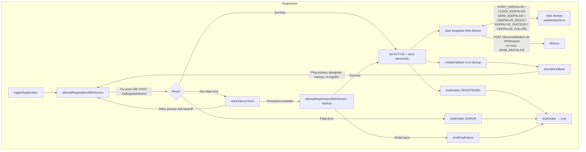

```mermaid
sequenceDiagram
    participant Line as Line
    participant Reg as Registration
    participant API as APIRequest
    participant MS as MobiusSocket
    participant Mobius as Mobius API
    participant Worker as Web Worker

    Line->>Reg: triggerRegistration()
    activate Reg

    Reg->>Reg: attemptRegistrationWithServers(primaryUris)
    loop For each URI in primaryMobiusUris
        opt apiRequest.isSocketEnabled()
            Reg->>API: connectToMobiusSocket(wssNormalizedUrl)
            API->>MS: isConnected() ? reuse : MobiusSocket.connect(wssUri)
            MS-->>API: connected URL
            API-->>Reg: connectedWebSocketUrl
        end

        Reg->>API: makeRequest(POST /calling/web/device)
        alt WSS path
            API->>MS: sendWssRequest({type:'register', ...})
            MS-->>API: response_event subtype=register
            API-->>Reg: normalised WebexRequestPayload
        else HTTP path
            API->>Mobius: webex.request(POST /device)
            Mobius-->>API: 200 OK
            API-->>Reg: WebexRequestPayload
        end

        alt 200 OK
            Reg->>Reg: setStatus(ACTIVE)<br/>setActiveMobiusUrl(connectedWebSocketUrl || url)
            Reg->>Reg: Store deviceInfo

            Reg->>Worker: START_KEEPALIVE {interval, retryCountThreshold}
            activate Worker
            Note over Worker: Starts periodic SEND_KEEPALIVE ticks

            Reg->>Line: lineEmitter(REGISTERED, deviceInfo)
            Reg-->>Line: Registration complete
            deactivate Reg
        else Error (handled by handleRegistrationErrors)
            opt WSS path && shouldDisconnect && !final-server
                Reg->>API: disconnectFromMobiusSocket({code:3050, reason:'done (permanent)'})
                API->>MS: disconnect({code:3050, reason:'done (permanent)'})
            end
            Note over Reg: 429: stored Retry-After; 401/403(102)/404/400: abort;<br/>others: continue loop or schedule retry
        end
    end
```

> **WSS URL normalisation:** `Registration` strips any trailing `/` from the server URL before passing it to `apiRequest.connectToMobiusSocket(...)`. The connected URL returned by `MobiusSocket` is then re-suffixed with `/` and stored as `activeMobiusUrl` so subsequent comparisons (e.g. in `restorePreviousRegistration`) line up with the URI list.

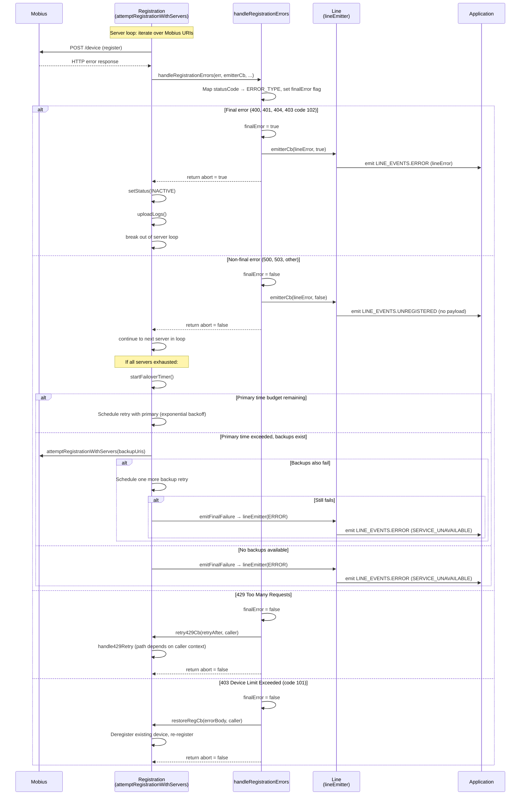

Source references:

- Server loop and error branching: `attemptRegistrationWithServers` in `src/CallingClient/registration/register.ts`
- Error classification and callback invocation: `handleRegistrationErrors` in `src/common/Utils.ts`
- Failover timer and final failure: `startFailoverTimer` in `register.ts`, `emitFinalFailure` in `src/common/Utils.ts`
- `lineEmitter` branching on `finalError`: the `emitterCb` closure in `attemptRegistrationWithServers` — emits `LINE_EVENTS.ERROR` for `finalError = true`, `LINE_EVENTS.UNREGISTERED` for `finalError = false`

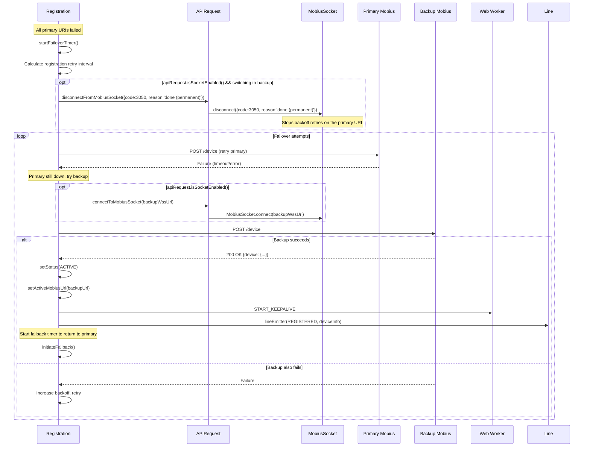

```mermaid
sequenceDiagram
    participant Reg as Registration
    participant API as APIRequest
    participant MS as MobiusSocket
    participant Mobius1 as Primary Mobius
    participant Mobius2 as Backup Mobius (current)
    participant Worker as Web Worker
    participant Line as Line

    Note over Reg: Currently on backup, failback timer fires

    Reg->>Reg: executeFailback()
    Reg->>Mobius1: GET {primaryBase}ping (isPrimaryActive)

    alt Primary is back AND no active calls
        Mobius1-->>Reg: 200 OK
        Reg->>Reg: deregister()<br/>(DELETE /devices/{id} + clearKeepaliveTimer)
        Reg->>Mobius2: DELETE /devices/{id}

        opt apiRequest.isSocketEnabled()
            Reg->>API: disconnectFromMobiusSocket({code:3050, reason:'done (permanent)'})
            API->>MS: disconnect on backup WSS
        end

        Reg->>Reg: attemptRegistrationWithServers(FAILBACK_UTIL, primaryUris)
        opt registration succeeds
            Reg->>API: connectToMobiusSocket(primaryWssUrl)<br/>(if WSS enabled, inside attempt loop)
            Reg->>Reg: setActiveMobiusUrl(primaryUrl)
            Reg->>Worker: START_KEEPALIVE (on primary)
            Reg->>Line: lineEmitter(REGISTERED, deviceInfo)
        end
    else Primary still down or active calls present
        Mobius1-->>Reg: Failure
        Reg->>Reg: Reschedule failback timer
        Note over Reg: Stay on backup; do NOT disconnect WSS
    end
```

### Keepalive

A dedicated Web Worker manages keepalive requests to ensure a responsive and reliable heartbeat
loop, even when the main thread is inactive.

- Worker posts `KEEPALIVE_SUCCESS` **only when recovering** from a previous failure (`retryCount > 0` before the success). Normal successes silently reset the counter.
- On **429**: `handle429Retry` clears the current worker and schedules a new keepalive timer after the `Retry-After` delay, shortened by one keepalive interval so the first new tick lands at `Retry-After`.
- On **409**: `handleRegistrationErrors` invokes the keepalive-only `sessionSupersededCb`, so `handle409KeepaliveFailure` treats the failure as a hard stop on the very first occurrence — the retry count is ignored, the worker is terminated, no registration is attempted, and the consumer receives `UNREGISTERED` carrying the superseded reason. A terminal `409` makes the keepalive branch return before its generic failure handling, and latches `sessionSuperseded` immediately — before cleanup waits on the shared mutex — so that no automatic recovery path (network flap, calls cleared, an already-scheduled failover or failback) re-registers the session. The latch is checked in one place, `attemptRegistrationWithServers`, which every registration attempt funnels through; it returns `abort = true` there, and because each caller's `if (!abort …)` guard short-circuits, no failover timer is rescheduled either. Only an explicit `triggerRegistration()` clears it.
- A keepalive whose result arrives after its worker was replaced (failback, connection restoration) is discarded, so a stale `409` cannot tear down the registration that replaced it.
- On **fatal error** (abort) or **retries exceeded** (retryCount >= threshold, 4 for CC / 5 otherwise): the worker is terminated and the main thread either calls `reconnectOnFailure` under the shared registration mutex (non-fatal threshold) or attempts fresh registration (404).
- On **non-fatal error below threshold**: only `LINE_EVENTS.RECONNECTING` is emitted; the worker keeps running.

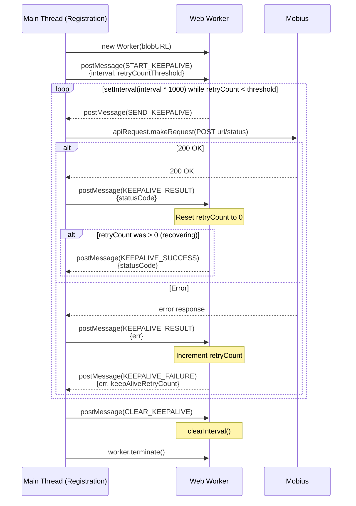

When the main thread receives `KEEPALIVE_FAILURE`:

1. **Submit metrics** and run `handleRegistrationErrors` to classify the error (fatal vs. non-fatal vs. 429); a `409` runs the hard stop and returns here.
2. **If abort (fatal) OR retryCount ≥ threshold** (`4` for contact-center, `5` otherwise):
   - Set status to `INACTIVE`, terminate the keepalive worker, clear the failback timer, and for contact center mark the next attempt to fail over immediately
   - Emit `LINE_EVENTS.UNREGISTERED` via `lineEmitter` and upload logs
   - If **non-fatal threshold exceeded** (not `abort`): call `reconnectOnFailure()` under the shared registration mutex for full re-registration, consistent with the calls-cleared reconnect, so the reconnect cannot race a concurrent registration or reconnect
   - If **fatal + 404**: call `handle404KeepaliveFailure()` for a fresh registration attempt
3. **If below threshold** (non-fatal and retryCount < threshold): emit `LINE_EVENTS.RECONNECTING` via `lineEmitter` and wait for the next keepalive cycle

### Reconnection

`reconnectOnFailure()` is called when keepalive failures exceed the threshold or when CallingClient
detects all calls have cleared after a network disruption.

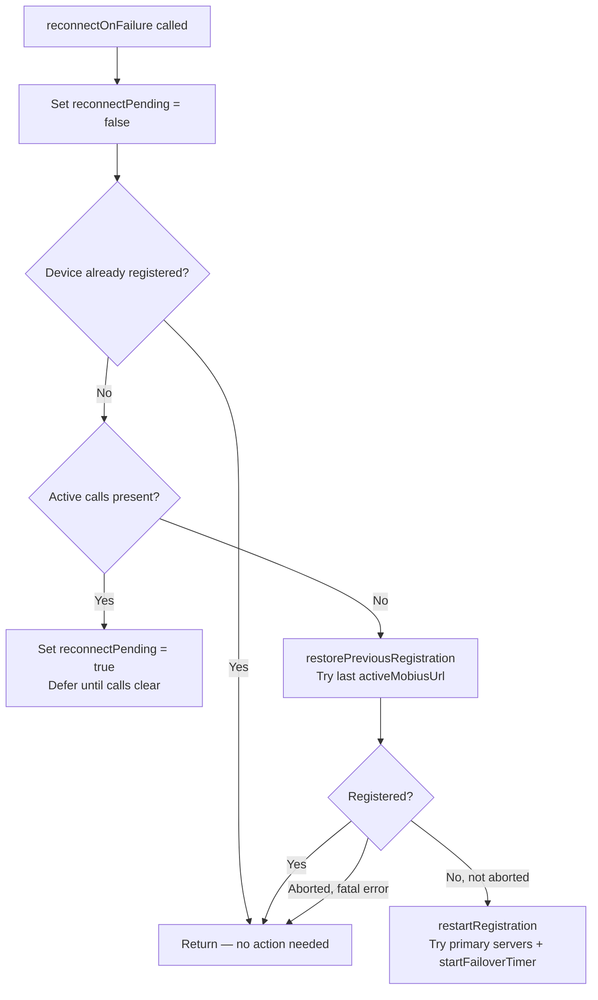

`handleConnectionRestoration()` is called by `CallingClient` after Mercury reconnection, once no
call is active. Runs inside `mutex.runExclusive`.

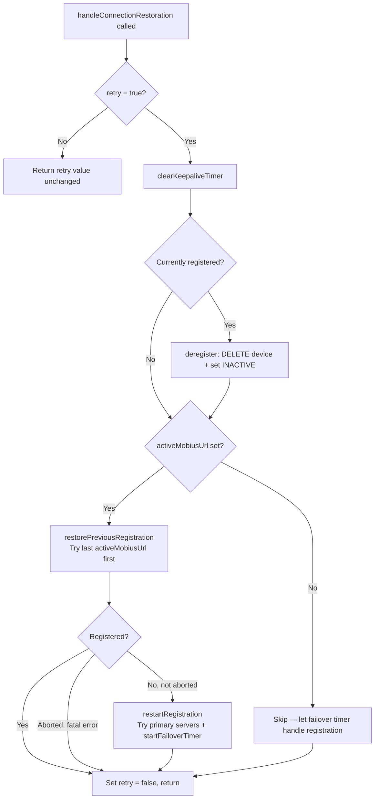

### 429 retry

The keepalive worker error handoff and shared registration error handler accept `retry-after`
and `Retry-After`, with the lowercase value taking precedence.

When Mobius responds with HTTP 429, the `handle429Retry` callback routes to one of three distinct
paths depending on the caller context:

**Initial / General Registration (default path):**

1. Store the `Retry-After` value on the instance (`this.retryAfter`)
2. `restorePreviousRegistration` consumes the stored value:
   - If `Retry-After` < `RETRY_TIMER_UPPER_LIMIT` (60s): schedule a delayed `restartRegistration`
   - If on primary and backups exist: switch to backup servers immediately
   - If already on backup: restart full registration
3. No retry counter or cap — the flow moves forward after one attempt

Outside a restore, `startFailoverTimer` reads the same stored value: the next primary retry waits at
least `Retry-After`, and a `Retry-After` that would carry the cumulative time past the 114-second
window switches to backup at once. Each new attempt clears the stored value.

**Failback (rehoming from backup → primary):**

1. Extract `Retry-After` header value
2. Increment `failback429RetryAttempts` counter
3. Retry up to `REG_FAILBACK_429_MAX_RETRIES` (5) times with exponential backoff via `getRegRetryInterval`
4. On each retry, attempt `restorePreviousRegistration`; if that fails, `restartRegistration`
5. On exhaustion (counter >= 5), silently stop retrying

**Keepalive:**

1. Pause the keepalive timer
2. Resume keepalive after the `Retry-After` delay
3. No retry counter or cap — keepalive simply resumes once

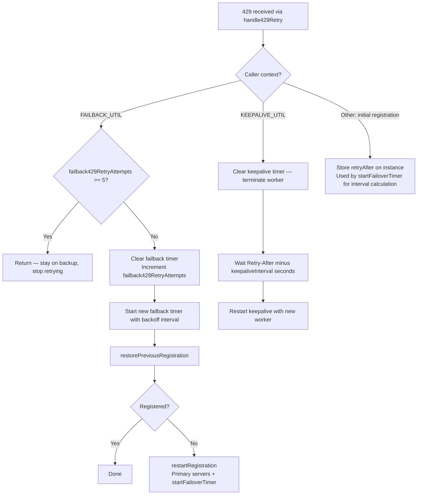

### Hard stops

When Mobius emits a `REGISTRATION_DOWN` async event, `CallingClient` forwards it to
`Registration.handleRegistrationDownEvent`:

1. Retrieves the first active call (if any) from `CallManager` and immediately calls `activeCall?.end()` to tear it down.
2. Calls `registrationCleanup` unconditionally — there is no deferral, no `registrationDownPending` flag, and no polling interval.

Cleanup (under the shared mutex) performs:

- `clearFailbackTimer()` and `clearKeepaliveTimer()`
- Resets transient flags (`reconnectPending`, `scheduled429Retry`, `failoverImmediately`, `retryAfter`, `registerRetry`)
- `clearFailoverState()` and `setStatus(RegistrationStatus.INACTIVE)`
- Disconnects the Mobius WebSocket when `apiRequest.isSocketEnabled()` (code `3050`, reason `'done (permanent)'`)
- Emits `LINE_EVENTS.UNREGISTERED` via `lineEmitter` so the SDK consumer is notified
- For a superseded session, that event carries the `LineError` describing why the line stays unregistered

No `DELETE /devices/{id}` is sent because Mobius has already signaled that the registration is gone.

`registrationCleanup(caller, hardStop)` is shared with the keepalive `409 Conflict` path. The
`HardStop` discriminated union (`src/CallingClient/registration/types.ts`) selects the log label
(`registration-down` / `session-superseded`) and requires the `LineError` for a superseded session,
so the terminal event and its payload cannot be mismatched.

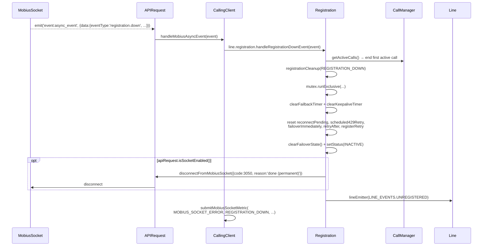

> **Note:** The synthetic `MOBIUS_SOCKET_4001_EVENT` envelope emitted when the server closes the socket with code `4001` carries `eventType: 'registration.down'` and therefore drives the **same** cleanup path as a server-pushed async `registration.down`. The close-code matrix belongs to the [mobius-socket spec](../../../mobius-socket/docs/README.md).

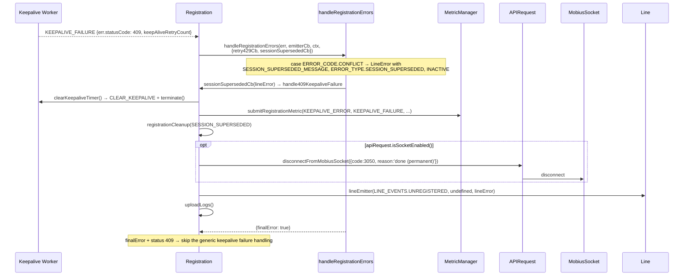

## Class and component relationships

`Line` constructs one `Registration` through `createRegistration` and passes its own `lineEmitter`
and the mutex shared with `CallingClient`. `Registration` takes the `APIRequest`, `CallManager`, and
`MetricManager` singletons for its Webex SDK instance, and creates and replaces the keepalive
worker itself.

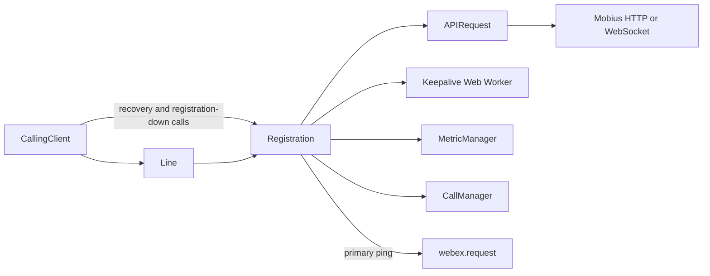

## Use cases and flows

| Use case | Actor or caller | Primary steps and outcome | Failure or boundary behavior | Evidence |
| -------- | --------------- | ------------------------- | ---------------------------- | -------- |
| `UC-001` Register a line | `Line.register()` | `setMobiusServers` then `triggerRegistration` (`MOD-001`) → `REGISTERED` | Final error → `ERROR`; otherwise failover (`MOD-003`) | `src/CallingClient/registration/register.ts`, `src/CallingClient/registration/register.test.ts` |
| `UC-002` Keep the registration alive | Keepalive worker | `MOD-013` | 429 pause, 404 re-registration, 409 hard stop (`MOD-011`) | `src/CallingClient/registration/register.ts`, `src/CallingClient/registration/register.test.ts` |
| `UC-003` Recover after network loss | `CallingClient` | `handleConnectionRestoration(true)` (`MOD-006`) | Skipped until initial registration has an active URL | `src/CallingClient/CallingClient.ts`, `src/CallingClient/registration/register.ts` |
| `UC-004` Reconnect after calls clear | `CallingClient` calls-cleared handler | `reconnectOnFailure` when `isReconnectPending()` | — | `src/CallingClient/CallingClient.ts`, `src/CallingClient/registration/register.test.ts` |
| `UC-005` Server declares the registration down | `CallingClient` Mobius async event handler | `MOD-010` | No DELETE; no re-registration | `src/CallingClient/registration/register.ts`, `src/CallingClient/registration/register.test.ts` |
| `UC-006` Deregister | `Line.deregister()`, failback, restoration | `MOD-008` | DELETE failure still ends `INACTIVE` with `UNREGISTERED` | `src/CallingClient/registration/register.ts`, `src/CallingClient/line/index.ts` |

### Registration is Triggered by Line

```typescript
// Inside Line.register()
await this.registration.triggerRegistration();
```

### Checking Registration State

```typescript
const isRegistered = registration.isDeviceRegistered(); // true if ACTIVE
const status = registration.getStatus(); // 'IDLE' | 'active' | 'inactive'
const deviceInfo = registration.getDeviceInfo();
const activeMobiusUrl = registration.getActiveMobiusUrl();
```

### Handling Reconnection

```typescript
// CallingClient calls this after network/Mercury recovery
const success = await registration.handleConnectionRestoration(true);

// Or defer reconnect if calls are active
await registration.reconnectOnFailure('mercuryReconnect');
```

### Clean Deregistration

```typescript
await registration.deregister();
// Sends DELETE /devices/{id} to Mobius
// Stops keepalive Web Worker
// Sets status to INACTIVE (not IDLE)
```

### Cross-boundary use-case flow

When `apiRequest.isSocketEnabled()` is true (driven by `isMobiusWssEnabled(webex)` — transport
selection is described in the [CallingClient spec](../../docs/README.md)), the `Registration` class
becomes responsible for sequencing the Mobius WebSocket connection alongside the registration POST /
DELETE. Ordering per server is connect, then POST; on success the keepalive and failback timers
start. No request carries its own timeout here; transport timeouts belong to `APIRequest` and the
socket.

| Flow | WSS action | Code path |
|---|---|---|
| `attemptRegistrationWithServers` (each server iteration) | `apiRequest.connectToMobiusSocket(wssNormalizedUrl)` before `postRegistration` | `src/CallingClient/registration/register.ts` (attemptRegistrationWithServers) |
| Registration error with `shouldDisconnect = true` (more than one server in the list, not 429, not 403 device-limit; always for 403 code 102) | `apiRequest.disconnectFromMobiusSocket({code: 3050, reason: 'done (permanent)'})` | `src/CallingClient/registration/register.ts` (attemptRegistrationWithServers), `src/common/Utils.ts` (handleRegistrationErrors) |
| `restorePreviousRegistration` when the connected WSS URL differs from `activeMobiusUrl` | disconnect first, then re-attempt | `src/CallingClient/registration/register.ts` (restorePreviousRegistration) |
| `startFailoverTimer` switching primary → backup | disconnect primary WSS before backup re-registration | `src/CallingClient/registration/register.ts` (startFailoverTimer) |
| `executeFailback` primary recovered + no active calls | disconnect backup WSS before primary re-registration | `src/CallingClient/registration/register.ts` (executeFailback) |
| `deregister(closeMobiusWss = true)` | disconnect WSS after DELETE returns | `src/CallingClient/registration/register.ts` (deregister) |
| `registrationCleanup` (after Mobius async `registration.down`, or a keepalive `409 Conflict`) | disconnect WSS as final cleanup step | `src/CallingClient/registration/register.ts` (registrationCleanup) |

## Client state model

Registration owns primary/backup server lists, active URL, device info/status, retry/failover/failback
counters and timers, the `localStorage` failover cache, reconnect deferral, the keepalive worker, and
Mobius-socket connection sequencing for the line. All state is per instance and in memory except
the cache entry.

| State or slice | Owner | Initial state | Transition triggers | Reset or persistence boundary |
| -------------- | ----- | ------------- | ------------------- | ----------------------------- |
| `registrationStatus` | `Registration` | `IDLE` | State machine section | In memory |
| `deviceInfo` | `Registration` | `{}` | Registration response, `setDeviceInfo`, 403 device-limit restore | Replaced, never cleared |
| `activeMobiusUrl` | `Registration` | unset | Each success, `setActiveMobiusUrl`, 403 device-limit restore | Kept across deregistration so restoration can reuse it |
| `primaryMobiusUris`, `backupMobiusUris` | `Registration` | `[]` | `setMobiusServers` | Replaced on each `Line.register()` |
| `failbackTimer`, `failback429RetryAttempts`, rehoming bounds | `Registration` | none, 0, 60 and 120 minutes | `initiateFailback`, primary responses, 429 during failback | Cleared by restart, cleanup, and `initiateFailback` when not needed |
| `retryAfter`, `failoverImmediately`, `scheduled429Retry`, `registerRetry`, `reconnectPending` | `Registration` | unset or `false` | 429 handling, contact-center keepalive failure, 403 restore, active-call deferral | Reset by hard-stop cleanup; `retryAfter` also at the start of each attempt |
| `sessionSuperseded` | `Registration` | `false` | Keepalive `409` | Survives cleanup; cleared only by `triggerRegistration()` |
| `webWorker` | `Registration` | none | Keepalive start | Terminated by `clearKeepaliveTimer()` |
| Failover cache `wxc-failover-state.{userId}` | Browser `localStorage` | absent | Scheduled primary retry, switch to backup | Removed on success, deregister, cleanup, and resume; the resume reads, re-checks, and clears it as one step under the mutex; survives a page reload |

## Business rules and invariants

| ID | Invariant | WHY | Enforcement source | Test evidence |
| -- | --------- | --- | ------------------ | ------------- |
| `INV-001` | Only one registration/failover mutation runs inside the registration mutex. The mutex is shared with `Line.register()` and `CallingClient`, and guards scheduled failover retries, failback, connection restoration, keepalive worker start, the cached failover-state resume (read, re-check, and clear as one step), the keepalive-failure reconnect, the calls-cleared reconnect, and hard-stop cleanup. | Concurrent attempts would post duplicate devices, tear down a registration that another flow just made, or act on a stale failover-cache entry. | `src/CallingClient/registration/register.ts`, `src/CallingClient/CallingClient.ts` | `src/CallingClient/registration/register.test.ts` "latches the superseded state before waiting on the shared mutex" |
| `INV-002` | Active calls defer reconnection where required: `reconnectOnFailure` and failback do nothing while `CallManager` reports an active call. | Registration repair or rehoming must not interrupt a call. | `src/CallingClient/registration/register.ts` | `src/CallingClient/registration/register.test.ts` "verify unsuccessful failback attempt due to active call" |
| `INV-003` | Deregistration and registration-down cleanup terminate keepalive and optionally close WSS with the documented 3050 reason. | A dead registration must not keep sending heartbeats or hold a socket. | `src/CallingClient/registration/register.ts` | `src/CallingClient/registration/register.test.ts` "disconnects the Mobius WebSocket when socket is enabled" |
| `INV-004` | While `sessionSuperseded` is set, `attemptRegistrationWithServers` returns `true` before touching the network. | Prevents the registration ping-pong between two sessions of one user (`MOD-011`). | `src/CallingClient/registration/register.ts` | `src/CallingClient/registration/register.test.ts` "stays terminal when the network recovers after a superseded session" |
| `INV-005` | `attemptRegistrationWithServers` returns without an attempt when the device is already registered or a contact-center immediate failover is pending. | Callers can invoke it from timers without checking state first. | `src/CallingClient/registration/register.ts` | `src/CallingClient/registration/register.test.ts` "cc: verify failover to backup server after 4 keep alive failure with primary server" |
| `INV-006` | A worker message is acted on only when it comes from the current worker, including after an awaited keepalive request. | A stale result, such as a `409`, must not tear down the registration that replaced it. | `src/CallingClient/registration/register.ts` | `src/CallingClient/registration/register.test.ts` "discards a 409 delivered by a keepalive worker that has been replaced" |

## Concurrency and reactive flow

- Execution model: browser event loop plus one dedicated worker. The keepalive mechanism runs in a dedicated **Web Worker** to avoid being blocked by main-thread activity. The worker does **not** call Mobius directly — it sends a `SEND_KEEPALIVE` signal to the main thread, which calls `apiRequest.makeRequest(POST /devices/{id}/status)` and returns the result via `KEEPALIVE_RESULT`. The keepalive runs in a **Web Worker** to ensure heartbeats are not blocked by main-thread work (long computations, UI rendering, etc.).
- Ordering guarantees: within one server group attempts run in list order and stop at the first success; the worker never has more than one keepalive in flight. Mobius events are not assumed to be ordered with respect to timers.
- Idempotency and retry: retries are owned by this module (`MOD-003`, `MOD-005`, `MOD-007`); `attemptRegistrationWithServers` is safe to call when already registered (`INV-005`).
- Shared-state protection: the shared mutex (`INV-001`); the worker identity check (`INV-006`); the superseded latch is set before any `await` (`MOD-011`).
- Blocking restrictions: keepalive work must not wait on the main thread's long tasks, so only the timer lives in the worker. `startKeepaliveTimer` and the 404 recovery are started without `await` from their callers.

The worker is created from a stringified JavaScript source to avoid separate file bundling:

```typescript
// webWorkerStr.ts contains the worker code as a string
const blob = new Blob([webWorkerStr], {type: 'application/javascript'});
const blobUrl = URL.createObjectURL(blob);
const worker = new Worker(blobUrl);
this.webWorker = worker;
URL.revokeObjectURL(blobUrl);
```

## State machine

Registration uses the `RegistrationStatus` enum rather than a separate XState machine. Retry,
failover, failback, and reconnect are guarded operations around these three stored states; they are
not additional status values.

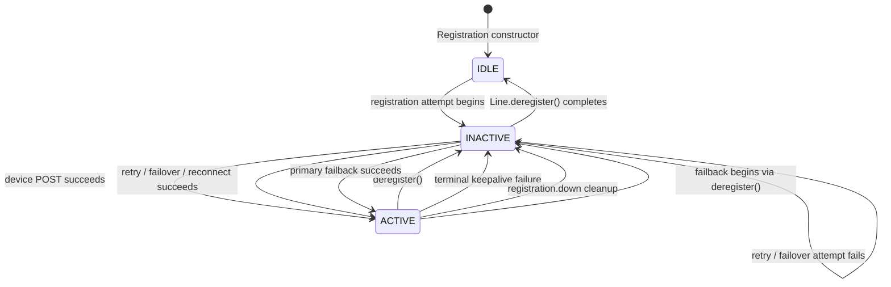

Guards: `isDeviceRegistered()` is true only in `ACTIVE`; an active call defers reconnect and
failback; the shared mutex serializes registration, failback, connection restoration, the cached
failover-state resume, the keepalive-failure reconnect, the calls-cleared reconnect, keepalive
worker start, and registration-down cleanup (`INV-001`). A 403
device-limit restore sets `ACTIVE` directly from the existing device before it deregisters and
re-registers. There is no terminal state: `triggerRegistration()` can start again from any status.

## Protocol and wire format

Registration expresses Mobius operations as HTTP-shaped requests. `APIRequest` sends them with
`webex.request` or maps them onto Mobius WSS according to the active server group's URI scheme.

| Operation | Request shape | Routing / response behavior |
|---|---|---|
| Register device | `POST {mobiusUrl}device`; headers `cisco-device-url` and `spark-user-agent`; body `{userId, clientDeviceUri, serviceData, hostIps}` where guest calling adds `serviceData.jwe`. `hostIps` comes from `getHostIps()`, which `Line.register()` populates before triggering the registration, and is always present, empty when no addresses were stored. | Sent through `APIRequest.makeRequest()`. A successful body supplies device identity and intervals, changes status to `ACTIVE`, starts keepalive, and emits `REGISTERED`. |
| Deregister device | `DELETE {activeMobiusUrl}devices/{deviceId}` with the same identity headers. The WSS form additionally carries `{deviceId}` in the body. | Sent through `APIRequest.makeRequest()`. Cleanup proceeds to `INACTIVE` and emits `UNREGISTERED`; `deregister(true)` also closes WSS. |
| Device keepalive | `POST {deviceUri}/status`; body `{deviceId}` with identity headers. | The worker emits `SEND_KEEPALIVE`; the main thread sends the request and returns `KEEPALIVE_RESULT {statusCode}` or `{err}` to the worker. |
| Primary health check | `GET {primaryMobiusBaseUrl}ping` with identity headers. | Uses `webex.request()` to decide whether failback may proceed; status `200` means primary is available. |
| WSS lifecycle control | Connect to the normalized `wss://` server before registration; disconnect with `{code: 3050, reason: 'done (permanent)'}` when the lifecycle requires a new session. | `Registration` calls the transport only through `APIRequest`; it does not import `MobiusSocket` directly. |

The primary base URL is the server URI with `/calling/web/` replaced by `/` and `wss://` by
`https://`. The worker message contract is `START_KEEPALIVE {interval, retryCountThreshold}`,
`SEND_KEEPALIVE`, `KEEPALIVE_RESULT {statusCode}` or `{err}`, `KEEPALIVE_SUCCESS {statusCode}`,
`KEEPALIVE_FAILURE {err, keepAliveRetryCount}`, and `CLEAR_KEEPALIVE`. Only the main thread
performs network I/O. The `err` the main thread forwards keeps only `headers.trackingid`,
`headers['retry-after']`, `statusCode`, `statusText`, and `type`. Worker messages use the
`WorkerMessageType` enum (values are string constants):

- **Start:** Worker receives `WorkerMessageType.START_KEEPALIVE` (`'START_KEEPALIVE'`) with `{interval, retryCountThreshold}`
- **Tick:** Worker sends `WorkerMessageType.SEND_KEEPALIVE` (`'SEND_KEEPALIVE'`) to main thread every `keepaliveInterval` seconds (when no request is in flight and retryCount is below threshold)
- **Result:** Main thread sends `WorkerMessageType.KEEPALIVE_RESULT` (`'KEEPALIVE_RESULT'`) back to worker with `{statusCode}` on success or `{err}` on failure
- **Success:** Worker posts `WorkerMessageType.KEEPALIVE_SUCCESS` (`'KEEPALIVE_SUCCESS'`) with `{statusCode}` to main thread — only when recovering from a prior failure (`retryCount > 0` before the success); normal successes are silent
- **Failure:** Worker posts `WorkerMessageType.KEEPALIVE_FAILURE` (`'KEEPALIVE_FAILURE'`) with `{err, keepAliveRetryCount}` to main thread
- **Stop:** Main thread sends `WorkerMessageType.CLEAR_KEEPALIVE` (`'CLEAR_KEEPALIVE'`), Worker clears the interval; main thread also calls `worker.terminate()`

| Message | Direction | Payload | Description |
|---------|-----------|---------|-------------|
| `START_KEEPALIVE` | Main → Worker | `{interval, retryCountThreshold}` | Start the keepalive interval timer |
| `SEND_KEEPALIVE` | Worker → Main | _(none)_ | Timer fired — main thread should send the keepalive POST |
| `KEEPALIVE_RESULT` | Main → Worker | `{statusCode}` on success, `{err}` on failure | Result of the keepalive POST (sent by main thread after `apiRequest.makeRequest` resolves/rejects) |
| `CLEAR_KEEPALIVE` | Main → Worker | _(none)_ | Stop the keepalive interval; main thread also calls `worker.terminate()` |
| `KEEPALIVE_SUCCESS` | Worker → Main | `{statusCode}` | Keepalive succeeded **after a prior failure** (`retryCount > 0`); normal successes are silent |
| `KEEPALIVE_FAILURE` | Worker → Main | `{err, keepAliveRetryCount}` | Keepalive POST failed; `err` is the WebexRequestPayload-shaped error |

| Value | Meaning |
|---|---|
| `{code: 3050, reason: 'done (permanent)'}` | The convention `CallingClient` and `Registration` pass to `apiRequest.disconnectFromMobiusSocket(...)` to indicate a permanent teardown. `MobiusSocket` treats this as `offline.permanent` (no auto-reconnect) — distinct from `'idle'` / `'done (forced)'` which are transient and reconnectable. |
| `URL replace 'https://' → 'wss://'` | Used in `getExistingDevice` (403/101 device-limit branch) to keep `activeMobiusUrl` aligned with the WSS scheme when the socket is enabled. |
| `url.endsWith('/') ? slice(0,-1) : url` | URL normalisation applied by `attemptRegistrationWithServers` before calling `connectToMobiusSocket`, then re-suffixed with `/` for `setActiveMobiusUrl`. |

## Caller-visible failure modes

Robust error handling is built in for registration and keepalive via `handleRegistrationErrors`.
Registration errors are mapped through `handleRegistrationErrors()`. Fatal errors (`abort = true`)
stop the registration loop and emit `LINE_EVENTS.ERROR`. Non-fatal errors allow the loop to continue
to the next server or schedule a retry via the failover timer. Fatal 400/401/404 and selected 403
responses abort; 429 honors Retry-After; recoverable 5xx/transport errors advance failover.

- **400 / 401 / 404:** Fatal errors — `handleRegistrationErrors` returns `abort = true`, registration stops, and `LINE_EVENTS.ERROR` is emitted to `Line`.
- **403 (Device Limit Exceeded, code 101):** Non-fatal — triggers `restoreRegistrationCallBack` which deregisters the existing device and re-registers. If successful, status becomes `ACTIVE`.
- **403 (Device Creation Disabled, code 102):** Fatal — `abort = true`.
- **429 Too Many Requests:** Non-fatal — stores `Retry-After` value via `handle429Retry`. During initial registration, the loop continues to the next server; the stored value influences `startFailoverTimer` interval. During failback, retries up to `REG_FAILBACK_429_MAX_RETRIES` (5). No event or metric is emitted for a 429.
- **500 / 503 / Other:** Non-fatal — the loop in `attemptRegistrationWithServers` continues to the next server. If all servers fail, `startFailoverTimer` schedules retries with exponential backoff.
- **409 Conflict (keepalive only):** Hard stop — `handleRegistrationErrors` builds the `SESSION_SUPERSEDED` error and hands it to `handle409KeepaliveFailure` through `sessionSupersededCb`, so no server loop, failover, or restore is attempted. Flows that do not pass that handler (registration, restoration, failover, failback) log the `409` and ignore it — non-final, no consumer event, no metric — and continue to the next server.

Status-code classification stays in `handleRegistrationErrors`; the hard stop is scoped to keepalive
because only that flow passes `sessionSupersededCb`. Registration, restoration, failover, and
failback have nothing to act on, so for them a `409` is logged and ignored: no
`LINE_EVENTS.UNREGISTERED`, no registration-error metric, and `shouldDisconnect` stays `false`. The
error is non-final, so the server loop and failover proceed as they would for any non-fatal status.
Keepalive `404` / `429` / `5xx` handling is unchanged.

| HTTP Status | ERROR_TYPE | Fatal? | Action |
|-------------|-----------|--------|--------|
| 400 | `BAD_REQUEST` | Yes | Abort — emit error |
| 401 | `TOKEN_ERROR` | Yes | Abort — emit error (token expired/invalid) |
| 403 (code 101) | `FORBIDDEN_ERROR` | No | Device limit exceeded — `restoreRegistrationCallBack`: deregister existing + re-register |
| 403 (code 102) | `FORBIDDEN_ERROR` | Yes | Device creation disabled — abort, emit error |
| 403 (code 103/other) | `FORBIDDEN_ERROR` | No | Device creation failed — continue retry |
| 404 | `NOT_FOUND` | Yes | Abort — emit error |
| 409 | `SESSION_SUPERSEDED` | Yes on keepalive, ignored elsewhere | Keepalive hard stop (`MOD-011`); other flows log and continue |
| 429 | `TOO_MANY_REQUESTS` | No | Call `handle429Retry` with `Retry-After` value |
| 500 | `SERVER_ERROR` | No | Continue to next server or schedule retry |
| 503 | `SERVICE_UNAVAILABLE` | No | Continue to next server or schedule retry |
| Other | `DEFAULT` | No | Continue to next server or schedule retry |

| Condition | Signal or result | Caller behavior | Retry or recovery | Evidence |
| --------- | ---------------- | --------------- | ----------------- | -------- |
| Fatal status during registration | `LINE_EVENTS.ERROR` with a `LineError` (status `inactive`) | Show the error; the user must sign in again or fix configuration | None scheduled | `src/common/Utils.ts`, `src/CallingClient/registration/register.ts` |
| Every server failed after the failover window | `LINE_EVENTS.ERROR` with `ERROR_TYPE.SERVICE_UNAVAILABLE` from `emitFinalFailure` | Treat the line as unavailable | A new `Line.register()` starts over | `src/common/Utils.ts`, `src/CallingClient/registration/register.ts` |
| Non-final failure | `LINE_EVENTS.UNREGISTERED` with no payload | Show disconnected state without an error dialog | Retry is scheduled by this module | `src/common/Utils.ts` |
| Keepalive misses below the threshold | `LINE_EVENTS.RECONNECTING`, then `RECONNECTED` on recovery | Show reconnecting state | Worker keeps running | `src/CallingClient/registration/register.ts` |
| Session superseded | `LINE_EVENTS.UNREGISTERED` with a `LineError` of type `session_superseded` | Do not auto-register; offer an explicit register | Only `triggerRegistration()` | `src/CallingClient/registration/register.ts`, `src/CallingClient/constants.ts` |
| Device DELETE fails | `LINE_EVENTS.UNREGISTERED`; logs uploaded | None | None | `src/CallingClient/registration/register.ts` |

## Pitfalls and constraints

- Do not bypass the module boundary or duplicate the registration constants owned by `src/CallingClient/constants.ts`.
- Do not assume remote events are ordered or that network operations cannot fail.
- `Registration.deregister()` sets the status to `RegistrationStatus.INACTIVE`. The higher-level `Line.deregister()` wrapper calls `registration.deregister()` and then explicitly sets the status to `RegistrationStatus.IDLE`. If you are calling `Registration.deregister()` directly (e.g., for reconnection or diagnostics), the resulting status will be `INACTIVE`, not `IDLE`.
- `IRegistration.deregister` is declared with a required `closeMobiusWss` and a `void` return, while the class defaults it to `false` and returns a promise; callers that `await` it rely on the class, not the interface (`src/CallingClient/registration/types.ts`).
- `restorePreviousRegistration` returns `true` after any 429 branch, so callers treat a throttled restore as final and do not restart on their own; the scheduled or switched attempt is the only follow-up.
- The keepalive worker that runs is the string in `webWorkerStr.ts`; `webWorker.ts` is a typed copy used by its unit test. Change both together or the test stops describing production.
- The failover cache lives in browser `localStorage`; where storage is unavailable the failover window restarts after a reload.

## Module-specific rules

- Do: change the Mobius WSS transport (connect/disconnect, the registration-down close code 4001, the close-code matrix) in the mobius-socket module and its spec; `Registration` goes through `APIRequest` (see `src/CallingClient/utils/request.ts`) — it never imports `MobiusSocket` directly.
- Do: use the factories, typed events, constants, and adapters already used by `src/CallingClient/registration/register.ts`, and report every state change through `lineEmitter`.
- Do: pass `{code: 3050, reason: 'done (permanent)'}` for every teardown this module performs.
- Do not: add direct network or SDK access when the module already provides an adapter; the primary ping through `webex.request` is the one existing exception.
- Do not: log tokens or the JWE. Tokens/JWE are handled through APIRequest, never through worker messages, and must not be logged as raw credentials.
- Do: update this spec with behavior changes in the same merge.

## Key design trade-off

| Chosen trade-off | Preserved invariant or benefit | Cost or limitation | Decision evidence |
| ---------------- | ------------------------------ | ------------------ | ----------------- |
| Keepalive timing runs in a Web Worker so main-thread work cannot starve heartbeats, while network I/O stays on the main thread through APIRequest. | Heartbeat timing survives busy UI threads; SDK access and auth stay out of the worker. | This adds a message protocol but keeps SDK access and auth out of the worker; results can arrive after the worker was replaced (`INV-006`). | `src/CallingClient/registration/register.ts`, `src/CallingClient/registration/webWorkerStr.ts` |
| One choke point, `attemptRegistrationWithServers`, for every attempt | The superseded latch and the already-registered check apply to every path (`INV-004`, `INV-005`) | Callers interpret one boolean for both "final error" and "superseded" | `src/CallingClient/registration/register.ts` |

## Verification

Unit tests are co-located under `src/CallingClient/registration/` and exercise positive, negative,
error, retry, and cleanup behavior as applicable. Package journeys under `playwright/` cover
cross-module flows. Run them with `yarn workspace @webex/calling test:unit`; on 2026-11-17 with
Node.js 22.14 the package run passed 32 suites and 908 tests.

| Requirement or invariant | Test level | Positive evidence | Negative or boundary evidence | Gap |
| ------------------------ | ---------- | ----------------- | ----------------------------- | --- |
| `MOD-001`, `MOD-002` | Unit | `src/CallingClient/registration/register.test.ts` | `src/CallingClient/registration/register.test.ts` "verify failure registration" | Empty primary list not tested |
| `MOD-003`, `MOD-004` | Unit | `src/CallingClient/registration/register.test.ts` | Unreachable primary and backup case | Resume of a stored `backup` state not tested |
| `MOD-005` | Unit | `src/CallingClient/registration/register.test.ts` | Active call and primary-down cases | none |
| `MOD-006`, `INV-002` | Unit | `src/CallingClient/registration/register.test.ts` | Active-call deferral case | none |
| `MOD-007` | Unit | `src/CallingClient/registration/register.test.ts` | Threshold-exceeding Retry-After cases | Failback 429 cap of 5 not asserted |
| `MOD-008` | Unit | `src/CallingClient/line/line.test.ts` | none found | Add isolated coverage for `deregister(false)` and `deregister(true)`, including WSS teardown failure |
| `MOD-009` | Unit | `src/CallingClient/registration/register.test.ts`, `src/CallingClient/utils/request.test.ts` | Empty server group case | none |
| `MOD-010`, `INV-003` | Unit | `src/CallingClient/registration/register.test.ts` | Socket disconnect failure case | none |
| `MOD-011`, `INV-004`, `INV-006` | Unit | `src/CallingClient/registration/register.test.ts` | 409 outside keepalive case | none |
| `MOD-012` | Unit | `src/CallingClient/registration/register.test.ts` | none found | none |
| `MOD-013`, `INV-005` | Unit | `src/CallingClient/registration/register.test.ts`, `src/CallingClient/registration/webWorker.test.ts` | 404 and threshold cases | The string worker in `webWorkerStr.ts` has no direct test |
| `INV-001` | Unit | `src/CallingClient/registration/register.test.ts` | none found | Mutex ordering between `Line.register()` and timers not tested |

No coverage gap above blocks current behavior; the `MOD-008` and `webWorkerStr.ts` gaps are the
first follow-ups before changing deregistration or the worker.
