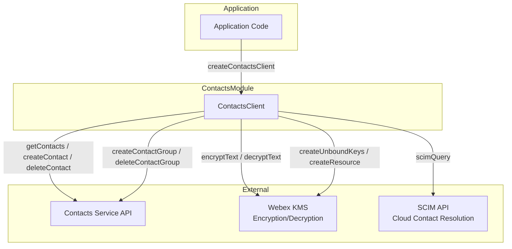
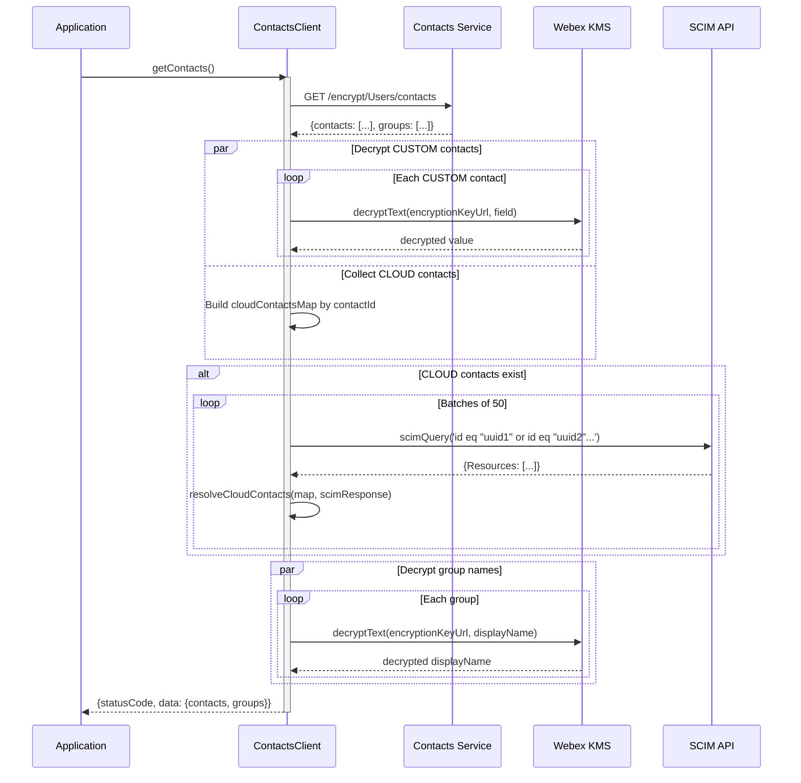
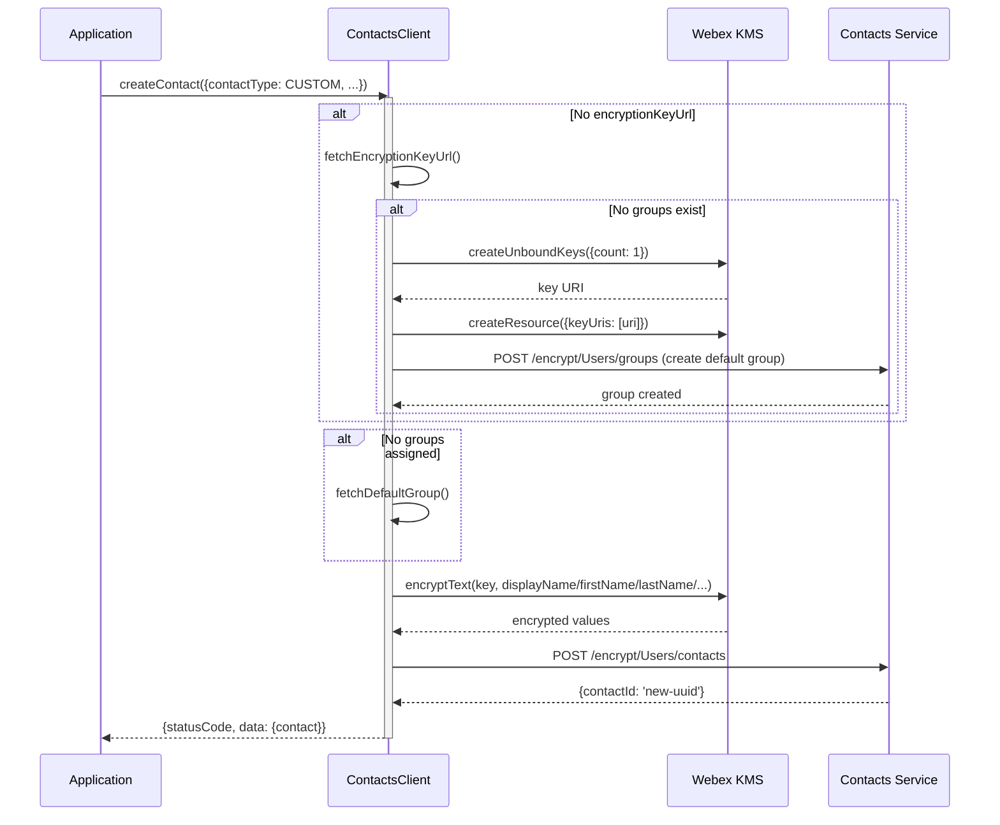
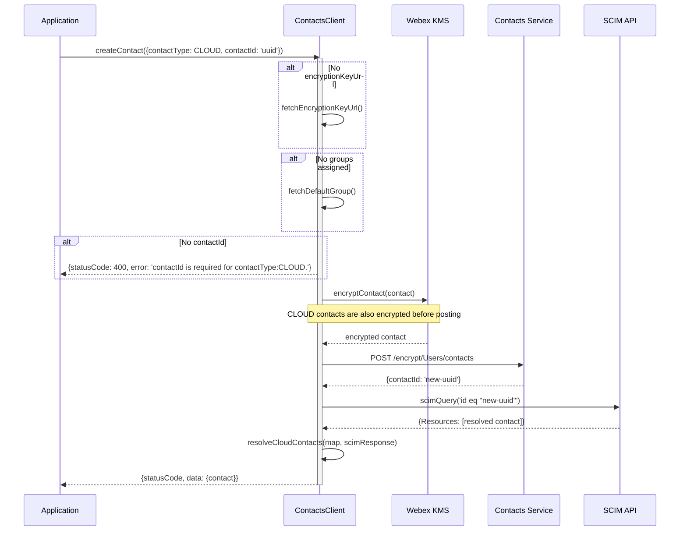
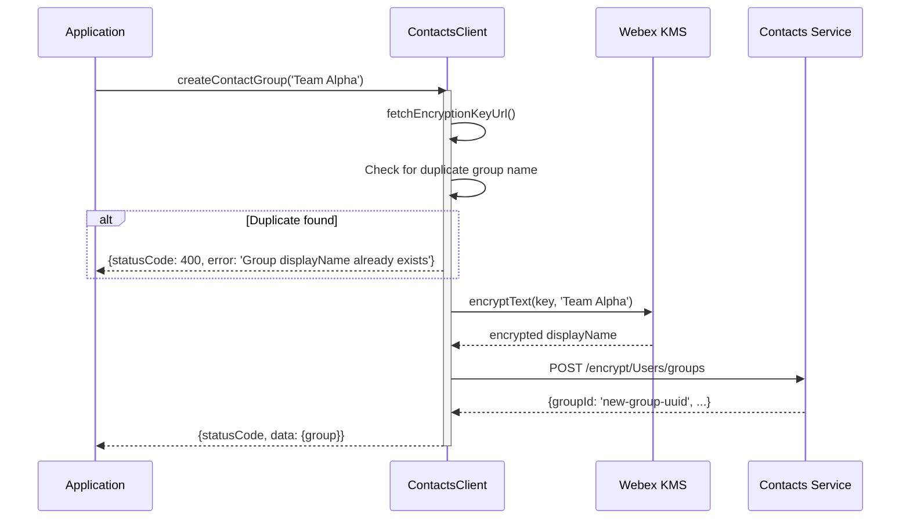
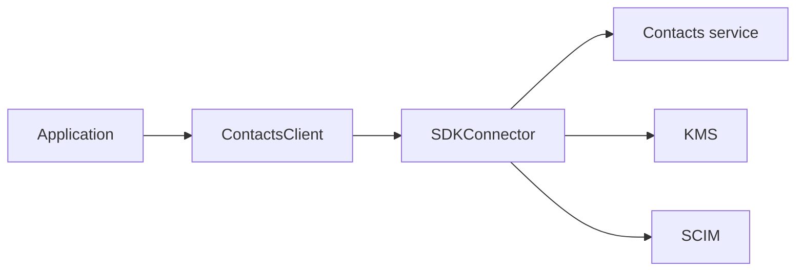

<!-- sdd-generated-metadata
doc_kind: module-spec
generated_from: module-spec@0.3.0
generated_by: claude-code
approved_by: rarajes2@cisco.com
updated_at: 2026-11-17T03:02:22Z
validation_status: blocked
-->

# Contacts

This source-local document at `src/Contacts/docs/README.md` owns the stable specification for
**Contacts**: the `ContactsClient` that reads and writes a user's personal contacts and contact
groups in the Webex contacts service, encrypting their fields with Webex KMS and enriching CLOUD
contacts from SCIM. Ground every claim in package evidence and link to the
[package architecture](../../../docs/architecture.md) instead of repeating broader facts. No service
specification exists because this package is a library.

Related context: [documentation index](../../../docs/index.md) ·
[package agent instructions](../../../AGENTS.md)

## Metadata

| Field | Value |
| ----- | ----- |
| Owner | @webex/web-sdk (CODEOWNERS default rule) |
| Source path | `src/Contacts` |
| Resource kind | module |
| Status | Active |
| Last verified | 2026-11-16 at `0b8c34db7f` |
| Module id | `contacts` |
| Parent spec | — |
| Doc kind | Module spec |
| Coverage score | Pending coverage assessment |
| Validation status | blocked — validator `01a1e76e-1dbd-7680-94e4-46d29d2946d4`, assessed 2026-11-17; 2 Blocking, 1 Important (questionnaire gate evidence, UC config contract index, SDKConnector test coverage) |

## Applicability

| Condition ID                         | Status     | Evidence or reason | Owned section |
| ------------------------------------ | ---------- | ------------------ | ------------- |
| `module.has_tiers`                   | N/A        | No tier policy exists in this package or its `package.json` | Tier |
| `module.has_ui`                      | N/A        | No view or screen; the module is a TypeScript client (`src/Contacts/ContactsClient.ts`) | UI use-case flow |
| `module.crosses_service_boundaries`  | Applicable | HTTPS calls to the contacts service and SCIM, and KMS calls through the SDK encryption plugin (`src/Contacts/ContactsClient.ts`, `src/common/Utils.ts`) | Cross-boundary use-case flow |
| `module.holds_client_state`          | Applicable | In-memory contact, group, key, and default-group caches on each client (`src/Contacts/ContactsClient.ts`) | Client state model |
| `module.enforces_domain_rules`       | Applicable | Field encryption, CLOUD contact ID requirement, duplicate group names, and the default group (`src/Contacts/ContactsClient.ts`, `src/Contacts/constants.ts`) | Business rules and invariants |
| `module.is_concurrent_async`         | Applicable | Every public method is async and fans out KMS calls with Promise.all (`src/Contacts/ContactsClient.ts`) | Concurrency and reactive flow |
| `module.owns_persistence`            | N/A        | Records are stored by the contacts service and keys by KMS; the client keeps memory caches only (`src/Contacts/ContactsClient.ts`) | Data, schema, and migration discipline |
| `module.stateful_transitions`        | N/A        | Caches are filled and mutated but have no named states or guarded transitions (`src/Contacts/ContactsClient.ts`) | State machine |
| `module.exposes_wire_protocol`       | N/A        | The request and response bodies belong to the Webex contacts service and SCIM; the client mirrors them (`src/Contacts/types.ts`) | Protocol and wire format |
| `module.ui_multi_screen`             | N/A        | No UI | UI flow |
| `module.large_data_model`            | N/A        | Three record shapes and two enums, summarised under Public surface (`src/Contacts/types.ts`) | Data model |
| `module.returns_caller_errors`       | Applicable | Methods resolve failure statuses and one path rejects (`src/Contacts/ContactsClient.ts`, `src/common/Utils.ts`) | Caller-visible failure modes |
| `module.module_specific_conventions` | Applicable | The encrypted-field enum drives encryption and decryption, and SCIM goes through the shared query helper (`src/Contacts/constants.ts`, `src/common/Utils.ts`) | Module-specific rules |
| `module.published_package`           | Applicable | `src/index.ts` re-exports the factory and contact types of @webex/calling (`package.json`) | Export stability |
| `module.embedded_in_host`            | N/A        | No host theme or embed API | Host integration and theming |
| `module.has_design_tradeoff`         | Applicable | Client-side field encryption with SCIM enrichment (`src/Contacts/ContactsClient.ts`) | Key design trade-off |
| `module.has_submodules`              | N/A        | Computed false by the Repo Annotation module_tree.py script: no module is nested under src/Contacts | Sub-modules |

## Evidence register

Requirements cite stable implementation and test file paths; no line-number anchors or local
run-report paths are canonical evidence.

| Evidence | What it establishes |
| -------- | ------------------- |
| `src/Contacts/ContactsClient.ts` | `ContactsClient`, `createContactsClient`, the caches, encryption and decryption, key and default-group resolution, SCIM batching, and error handling |
| `src/Contacts/types.ts` | `IContacts`, `Contact`, `ContactGroup`, `ContactResponse`, `ContactList`, `ContactIdContactInfo`, and the `ContactType` and `GroupType` enums |
| `src/Contacts/constants.ts` | Path segments, `DEFAULT_GROUP_NAME`, `CONTACTS_SCHEMA`, SCIM filter constants, the `encryptedFields` enum, and method names for logs |
| `src/common/Utils.ts` | `scimQuery` (SCIM URL, environment choice, headers), `serviceErrorCodeHandler` (status mapping), and `uploadLogs`, which submits its metric through `getMetricManager()` |
| `src/common/constants.ts` | `SUCCESS_MESSAGE`, `FAILURE_MESSAGE`, and the SCIM extension schema keys |
| `src/common/types.ts` | `Address`, `PhoneNumber`, `URIAddress`, `ContactDetail`, `SCIMListResponse` |
| `src/index.ts`, `src/api.ts` | Package-entry exports and the typedoc entry exports for this module |
| `src/Contacts/ContactsClient.test.ts` | Fetch success and failure statuses, group and contact create and delete, the KMS key path, the duplicate-name and missing-contactId 400s, SCIM parsing, and the failed SCIM batch |
| `src/Contacts/contactFixtures.ts` | Contacts-service, group, KMS, and SCIM response fixtures used by the unit tests |
| `playwright/test-groups/contacts.ts` | Browser journeys CONT-001 to CONT-017 against the sample app: fetch, group create and delete, duplicate name, contact create (CUSTOM and CLOUD) and delete |
| Code reading of `src/Contacts/ContactsClient.ts`, 2026-11-16 | No test pins: the unawaited `createResource` call, the in-place mutation of caller contact details during encryption, and the plaintext group names in logs (Pitfalls and constraints) |

## Purpose and boundary

The `ContactsClient` module provides APIs for managing personal contacts and contact groups within
the Webex ecosystem. It handles create/read/delete operations for contacts (both CUSTOM and CLOUD
types), contact group management, and transparently encrypts/decrypts contact data using Webex KMS
(Key Management Service). CLOUD contacts are resolved via SCIM (System for Cross-domain Identity
Management) queries.

- Responsibility: Contacts owns the behavior rooted at `src/Contacts/` and exposes it through the
  typed `@webex/calling` package boundary; shared infrastructure remains owned by `Errors`, `Events`,
  `Logger`, and `common`.
- Package: `@webex/calling`. Entry point: `src/Contacts/ContactsClient.ts`. Factory:
  `createContactsClient(webex, logger)` returns `IContacts`.
- In scope: contact and group create, fetch, and delete (`MOD-001` to `MOD-005`), field encryption
  (`MOD-006`), SCIM enrichment (`MOD-007`), default-group management (`MOD-008`), failure statuses
  (`MOD-009`), and service URL resolution (`MOD-010`).
- Out of scope: contact or group update (no API exists), contact storage and key custody (contacts
  service and KMS), directory data (SCIM), and the shared SCIM, error-mapping, and log-upload helpers
  in `src/common/Utils.ts`, which the package architecture owns.
- Consumers: web applications through `createContactsClient`, including the sample app driven by
  `playwright/test-groups/contacts.ts`.

## Structure and key files

The module is TypeScript source in the `@webex/calling` package, tested with Jest unit tests and
Playwright package journeys; its remote transports are listed under Cross-boundary use-case flow.

| File | Holds |
| ---- | ----- |
| `src/Contacts/ContactsClient.ts` | Implementation: the `ContactsClient` class with all public and private methods, and the `createContactsClient` factory |
| `src/Contacts/constants.ts` | Constants: endpoint filters, encrypted fields enum, SCIM constants, default group name, schema, and log method names |
| `src/Contacts/types.ts` | Types: `IContacts`, `Contact`, `ContactGroup`, `ContactResponse`, and the enums |
| `src/Contacts/ContactsClient.test.ts` | Test/characterization evidence: the Jest unit tests |
| `src/Contacts/contactFixtures.ts` | Test fixtures for the unit tests |

## Public surface

Declarations live in `src/Contacts/types.ts` and `src/Contacts/ContactsClient.ts`; this section
summarises them and does not restate signatures. The contract index is the
[package architecture](../../../docs/architecture.md).

| Contract ID | Type | Surface | Purpose | Compatibility / deprecation | Schema / detail link | Root index |
|---|---|---|---|---|---|---|
| `contacts-sdk` | SDK | `createContactsClient(webex, logger)` returns a new `IContacts` | Create a contacts client for encrypted contact/group CRUD and directory enrichment. | Semver-controlled through `@webex/calling` | `src/index.ts`, `src/Contacts/ContactsClient.ts` | [package architecture](../../../docs/architecture.md) |
| `contacts-sdk` | SDK | Contact and group create, fetch, and delete with typed contact models (`Contact`, `ContactResponse`, `GroupType`, `IContacts`) | Encrypted contact/group CRUD and directory enrichment for one user. | Semver-controlled through `@webex/calling` | `src/index.ts`, `src/Contacts/types.ts` | [package architecture](../../../docs/architecture.md) |

`IContacts` methods (all except `getSDKConnector` are async and resolve a `ContactResponse`):

| Method | Signature | Description |
| ------ | --------- | ----------- |
| `getContacts` | No parameters; resolves `ContactResponse` with `contacts` and `groups` | Fetch all contacts and groups (`MOD-001`) |
| `createContact` | One required `Contact` (`contactInfo`); resolves `ContactResponse` with `contact` | Create a new contact (`MOD-002`) |
| `deleteContact` | One required `contactId` string; resolves `ContactResponse` with empty `data` | Delete a contact (`MOD-003`) |
| `createContactGroup` | Required `displayName` string, optional `encryptionKeyUrl` string, optional `GroupType` (default `NORMAL`); resolves `ContactResponse` with `group` | Create a contact group (`MOD-004`) |
| `deleteContactGroup` | One required `groupId` string; resolves `ContactResponse` with empty `data` | Delete a contact group (`MOD-005`) |
| `getSDKConnector` | No parameters; synchronous, returns `ISDKConnector` | Returns the SDK connector singleton |

`ContactType` values:

| Value | Description |
| ----- | ----------- |
| `CUSTOM` | User-created custom contact with encrypted fields |
| `CLOUD` | Cloud-based contact resolved via SCIM |

`GroupType` values:

| Value | Description |
| ----- | ----------- |
| `NORMAL` | Standard contact group |
| `EXTERNAL` | External contact group |

Record shapes, all in `src/Contacts/types.ts`:

- `Contact`: required `contactId` string, `contactType` (`ContactType`), `encryptionKeyUrl` string,
  `groups` string array, and `resolved` boolean; optional `addressInfo` (`Address`), `avatarURL`,
  `avatarUrlDomain`, `companyName`, `department`, `displayName`, `emails` (`URIAddress[]`),
  `firstName`, `kmsResourceObjectUrl`, `lastName`, `manager`, `ownerId`, `phoneNumbers`
  (`PhoneNumber[]`), `primaryContactMethod`, `schemas`, and `sipAddresses` (`URIAddress[]`).
- `ContactGroup`: required `displayName`, `encryptionKeyUrl`, `groupId` strings and `groupType`
  (`GroupType`); optional `members` string array and `ownerId`.
- `ContactResponse`: `statusCode` number, `data` with optional `contacts` (`Contact[]`), `groups`
  (`ContactGroup[]`), `contact`, `group`, and `error` string, and `message` string or null
  (`SUCCESS` or `FAILURE` in practice).

Factory configuration:

| Parameter | Type | Required | Description |
| --------- | ---- | -------- | ----------- |
| `webex` | `WebexSDK` | Yes | Initialized Webex SDK with access to `request`, `internal.encryption`, `internal.encryption.kms`, `internal.services`, `internal.device` (SCIM), and `internal.support` (log upload) |
| `logger` | `LoggerInterface` | Yes | Logger interface with a `level` property |

The `contactsServiceUrl` is resolved once at construction from
`webex.internal.services._serviceUrls.contactsService`, falling back to
`webex.internal.services.get(webex.internal.services._activeServices.contactsService)` (`MOD-010`).

## Dependencies

| Dependency | Why it is required | Failure behavior |
| ---------- | ------------------ | ---------------- |
| Webex contacts service (`contacts-service-http`) | Stores the encrypted contact and group records | Errors map to a failure status (`MOD-009`) |
| Webex KMS encryption (`kms-encryption`) | Key creation and field encryption and decryption | Inside a try block: failure status; in `createContactGroup` before its request: rejection (`MOD-009`) |
| SCIM people lookup (`contacts-service-http`, SCIM identity) | Enriches CLOUD contacts | A failed batch is logged and skipped (`MOD-007`) |
| SDKConnector (`sdk-connector-internal`) | Binds and returns the shared SDK instance | `setWebex` errors throw out of the factory |

Runtime dependency:

| Package | Purpose |
| ------- | ------- |
| `webex` (SDK) | HTTP requests via `webex.request()`, KMS encryption/decryption via `webex.internal.encryption`, SCIM queries, service URL resolution |

Internal dependencies (shared code described in the package architecture):

| Module | Purpose |
| ------ | ------- |
| `SDKConnector` | Singleton bridge to Webex SDK |
| `Logger` | Structured logging with file/method context |
| `scimQuery` | Utility for querying SCIM to resolve CLOUD contacts (from `common/Utils.ts`) |
| `serviceErrorCodeHandler` | Standardized error response formatting |
| `uploadLogs` | Uploads diagnostic logs on errors |

Common types (`Address`, `PhoneNumber`, `URIAddress`, `ContactDetail`, `SCIMListResponse`) come
from `src/common/types.ts`. The constructor also calls the shared logger's `setLogger` with the
`logger.level` it receives, which sets the level for the whole package.

## Requirements

| ID | WHAT | WHY | Source Evidence | Test / Example Evidence | Assumptions / Gaps | Confidence |
|---|---|---|---|---|---|---|
| `MOD-001` | Retrieves all contacts and contact groups for the user, decrypting CUSTOM contacts and resolving CLOUD contacts via SCIM in sequential batches of 50, and decrypting every group display name. On success both caches are replaced and the call resolves the service status, `{contacts, groups}`, and `SUCCESS`. | Decrypting custom records and enriching cloud records before return gives consumers one usable contact model regardless of storage representation. | `src/Contacts/ContactsClient.ts` | `src/Contacts/ContactsClient.test.ts` success cases 1 to 3 | CLOUD records without `contactId` are dropped; order of CUSTOM contacts follows decryption completion. | Present |
| `MOD-002` | Creates a new CUSTOM or CLOUD contact with transparent encryption (both types are encrypted). Fills `encryptionKeyUrl` (`MOD-008`) and auto-assigns to the default group if none specified, sets `schemas` to `CONTACTS_SCHEMA`, and POSTs. CLOUD contacts are additionally resolved via SCIM after creation for the cache. A CLOUD contact without `contactId` and an unknown `contactType` resolve 400. | Encrypt-before-write protects contact fields and default-group assignment ensures every created contact remains discoverable in the service model. | `src/Contacts/ContactsClient.ts`, `src/Contacts/constants.ts` | `src/Contacts/ContactsClient.test.ts` "create a contact with an existing group", "create a contact without a group and encryptionKey", "create a cloud contact with no existing groups" | The response `contact` is the caller's input plus the new `contactId`, not the SCIM-resolved record. | Present |
| `MOD-003` | Deletes a contact by contactId and removes it from the local cache. | Removing the deleted contact from the local cache prevents stale results after the remote delete succeeds. | `src/Contacts/ContactsClient.ts` | `src/Contacts/ContactsClient.test.ts` "successful deletion of contacts", "delete a contact - service unavailable" | none | Present |
| `MOD-004` | Creates a new contact group with an encrypted display name and `groupType` (default `NORMAL`). Without a supplied key it resolves one through `MOD-008`, which creates a KMS key and resource and the default group when no group exists. Prevents duplicate group names by exact match against the cached, decrypted names. | A bound KMS resource protects the group name, while duplicate prevention avoids ambiguous group assignment in later contact operations. | `src/Contacts/ContactsClient.ts` | `src/Contacts/ContactsClient.test.ts` "create a contact group without encryptionKey", "create a contact group with existing key info", "create a contact group with same displayName" | The name comparison is case-sensitive. | Present |
| `MOD-005` | Deletes a contact group by groupId and removes it from the local cache; when no group remains, the cached default group ID is cleared. | Evicting a deleted group locally keeps cached group membership aligned with the contacts service. | `src/Contacts/ContactsClient.ts` | `src/Contacts/ContactsClient.test.ts` "successful deletion of contact group", "delete a contact group - service unavailable" | The cached key URL is not cleared. | Present |
| `MOD-006` | Transparently encrypts and decrypts contact fields: `displayName`, `firstName`, `lastName`, `emails`, `phoneNumbers`, `sipAddresses`, `addressInfo`, `avatarURL`, `companyName`, `title`, with the contact's own `encryptionKeyUrl`; absent fields are skipped. | Field-level encryption prevents names, addresses, organization data, and contact routes from being stored as plaintext by the contacts service. | `src/Contacts/ContactsClient.ts`, `src/Contacts/constants.ts` | `src/Contacts/ContactsClient.test.ts` fetch success cases (decrypt) and create cases (encrypt) | Encryption rewrites the caller's detail objects in place (Pitfalls and constraints). | Present |
| `MOD-007` | Resolves CLOUD contacts via SCIM to fetch display names, phone numbers, SIP addresses, department, manager, and avatar information. Processes in batches of 50; an ID missing from the SCIM response yields the stored record with `resolved: false`, and a failed batch is logged and its contacts omitted. | Batching SCIM resolution limits request size while enriching cloud contacts with directory-authoritative profile data. | `src/Contacts/ContactsClient.ts`, `src/common/Utils.ts` | `src/Contacts/ContactsClient.test.ts` resolveContacts cases and "logs error for chunk when scimQuery API call fails in the loop for getContacts" | none | Present |
| `MOD-008` | Automatically creates a default "Other contacts" group when no groups exist, and finds it by name otherwise. | An automatic default group gives ungrouped contacts a valid service container and avoids special-case handling by consumers. | `src/Contacts/ContactsClient.ts`, `src/Contacts/constants.ts` | `src/Contacts/ContactsClient.test.ts` "create a contact without a group and encryptionKey" | none | Present |
| `MOD-009` | Every public method except `getSDKConnector` resolves rather than rejects on a service or KMS failure inside its try block: it logs, maps the error through `serviceErrorCodeHandler` (400, 401, 403, 404, 408, 500, 501, 503, otherwise the status or 422), uploads logs, and resolves that `{statusCode, data: {error}, message: 'FAILURE'}`. | Standardized error response formatting lets callers branch on `statusCode` alone. | `src/Contacts/ContactsClient.ts`, `src/common/Utils.ts` | `src/Contacts/ContactsClient.test.ts` error-code table for getContacts; service-unavailable cases for each mutation | `createContactGroup` key resolution and name encryption run before its try block and reject instead; log upload needs an existing MetricManager (Caller-visible failure modes). | Present |
| `MOD-010` | The constructor binds the shared SDK through SDKConnector when none is bound, reads the contacts service URL from `_serviceUrls.contactsService` or the active-services fallback, and initializes empty caches. | The `contactsServiceUrl` is resolved automatically so callers pass only the SDK and a log level. | `src/Contacts/ContactsClient.ts` | `src/Contacts/ContactsClient.test.ts` client creation case | The fallback branch is not tested. | Present |

## Design overview

One `ContactsClient` instance holds the bound SDK, the service URL, and four caches (Client state
model). Every public method is a self-contained async operation that builds a contacts-service URL,
calls `webex.request`, and maps the result into a `ContactResponse`.

Both `CUSTOM` and `CLOUD` contacts are encrypted before posting (`INV-001`); the two contact types
differ after that:

- **CUSTOM**: Fully encrypted, then stored. Retrieved and decrypted locally.
- **CLOUD**: Encrypted and posted, then additionally resolved via SCIM to populate display details
  (`displayName`, `phoneNumbers`, `sipAddresses`, etc.).

`fetchEncryptionKeyUrl()` follows this logic:

1. If `this.encryptionKeyUrl` is already cached, return it
2. If `this.groups` is undefined, await `getContacts()` to populate
3. If groups exist, use `groups[0].encryptionKeyUrl` (returned, not cached)
4. If no groups exist:
   - Create unbound KMS key via `this.webex.internal.encryption.kms.createUnboundKeys({count: 1})`
   - Create KMS resource via `this.webex.internal.encryption.kms.createResource({keyUris: [uri]})`
     (not awaited)
   - Cache the new key URL, create default group named "Other contacts" with it, and cache its ID

`fetchDefaultGroup()` returns the cached default group ID, else the ID of a cached group named
`Other contacts` (and caches it), else creates that group and returns its ID without caching it,
or an empty string when creation fails.

## Data flow and sequence coverage

All operations use `this.webex.request()` exclusively (no browser `fetch`). Auth is handled
automatically by the SDK. KMS calls go through `webex.internal.encryption`; every call is a promise.



Sequence coverage:

| Operation group | Diagram / coverage | Failure / recovery coverage |
|---|---|---|
| Fetch/decrypt/enrich contacts | 1. Fetching Contacts and Groups | Service and KMS failures return normalized errors; a failed SCIM batch is logged and its contacts are omitted |
| Create custom contact | 2. Creating a CUSTOM Contact | Encryption and default-group prerequisites are explicit |
| Create cloud contact | 3. Creating a CLOUD Contact | SCIM enrichment follows encrypted service creation; a missing contactId returns 400 after the key and default-group prerequisites |
| Create/delete groups and contacts | 4. Creating a Contact Group; delete shares the same service/cache actors | Remote success precedes local cache mutation |

**1. Fetching Contacts and Groups**



**2. Creating a CUSTOM Contact**



**3. Creating a CLOUD Contact**



**4. Creating a Contact Group**



Deletes issue one DELETE and then splice the cache (`MOD-003`, `MOD-005`); every failure path
inside a try block ends in `MOD-009`.

## Class and component relationships

The Contacts module manages encrypted personal contacts and groups via the contacts-service API,
with CLOUD contact resolution through SCIM. Architecture: **Application -> ContactsClient ->
Contacts Service / KMS / SCIM**.



| Layer | Component | File | Key Responsibilities |
|-------|-----------|------|---------------------|
| **Client** | `ContactsClient` | `src/Contacts/ContactsClient.ts` | CRUD for contacts/groups, encryption/decryption, SCIM resolution, default group management |
| **SDK Bridge** | `SDKConnector` | `src/SDKConnector/index.ts` | Webex SDK access for HTTP requests, KMS, and the SCIM helper |

| Component | Access Pattern | Lifecycle |
|-----------|---------------|-----------|
| `ContactsClient` | `createContactsClient(webex, logger)` factory | A new instance per call, each with its own caches; one per application is the intended use |
| `SDKConnector` | Frozen singleton via `import SDKConnector` | Global, set once via `setWebex()` |

## Use cases and flows

| Use case | Actor or caller | Primary steps and outcome | Failure or boundary behavior | Evidence |
| -------- | --------------- | ------------------------- | ---------------------------- | -------- |
| `UC-001` | Application | Create a client, then `getContacts()` to show contacts and groups | Failure status per `MOD-009` | `src/Contacts/ContactsClient.ts`, `playwright/test-groups/contacts.ts` |
| `UC-002` | Application | `createContact` for a CUSTOM contact without groups; the client fills key and default group | Failure status; plaintext detail objects become ciphertext (Pitfalls and constraints) | `src/Contacts/ContactsClient.test.ts` |
| `UC-003` | Application | `createContact` for a CLOUD contact with a SCIM user ID | 400 without `contactId` | `src/Contacts/ContactsClient.test.ts` |
| `UC-004` | Application | `createContactGroup` then `deleteContactGroup` | 400 on a duplicate name | `src/Contacts/ContactsClient.test.ts`, `playwright/test-groups/contacts.ts` |
| `UC-005` | Application | `deleteContact(contactId)` | Failure status; cache unchanged | `src/Contacts/ContactsClient.test.ts` |

Consumer examples, in JavaScript like the repository's sample app (`ContactType` is not exported by
the package entry, so plain `'CUSTOM'` and `'CLOUD'` strings are passed; see Export stability):

```javascript
import {createContactsClient} from '@webex/calling';

const contactClient = createContactsClient(webex, {level: 'info'});
```

```javascript
const response = await contactClient.getContacts();
if (response.statusCode === 200) {
  console.log('Contacts:', response.data.contacts);
  console.log('Groups:', response.data.groups);
}
```

```javascript
const response = await contactClient.createContact({
  contactId: 'custom-contact-uuid',
  contactType: 'CUSTOM',
  encryptionKeyUrl: 'kms://cisco.com/keys/example-custom-key',
  groups: ['default-group-uuid'],
  displayName: 'Jane Doe',
  firstName: 'Jane',
  lastName: 'Doe',
  emails: [{type: 'work', value: 'jane@example.com'}],
  phoneNumbers: [{type: 'mobile', value: '+15551234567'}],
  resolved: false,
});

if (response.statusCode === 201) {
  console.log('Custom contact created:', response.data.contact);
}
```

```javascript
const response = await contactClient.createContact({
  contactType: 'CLOUD',
  contactId: 'scim-user-uuid',
  encryptionKeyUrl: 'kms://cisco.com/keys/example-cloud-key',
  groups: ['default-group-uuid'],
  resolved: false,
});

if (response.statusCode === 201) {
  console.log('Cloud contact created:', response.data.contact);
}
```

```javascript
await contactClient.deleteContact('contact-uuid');
```

```javascript
const groupResponse = await contactClient.createContactGroup('Work Colleagues');
const groupId = groupResponse.data.group?.groupId;

if (!groupId) {
  throw new Error('Group creation failed: missing groupId');
}

await contactClient.deleteContactGroup(groupId);
```

### Cross-boundary use-case flow

All API URLs follow the pattern:

```
{contactsServiceUrl}/encrypt/Users/{resource}[/{id}]
```

| Operation | URL | Method |
| --------- | --- | ------ |
| Get contacts | `/encrypt/Users/contacts` | GET |
| Create contact | `/encrypt/Users/contacts` | POST |
| Delete contact | `/encrypt/Users/contacts/{contactId}` | DELETE |
| Create group | `/encrypt/Users/groups` | POST |
| Delete group | `/encrypt/Users/groups/{groupId}` | DELETE |

Note: `USERS` constant is `'Users'` (capital U), not lowercase.

| Constant | Value | Description |
|----------|-------|-------------|
| `ENCRYPT_FILTER` | `'encrypt'` | Encryption-aware API path segment |
| `USERS` | `'Users'` | Users path segment (capital U) |
| `CONTACT_FILTER` | `'contacts'` | Contacts resource path |
| `GROUP_FILTER` | `'groups'` | Groups resource path |
| `DEFAULT_GROUP_NAME` | `'Other contacts'` | Name for auto-created default group |
| `CONTACTS_SCHEMA` | `'urn:cisco:codev:identity:contact:core:1.0'` | Schema for contact/group creation |
| `SCIM_ID_FILTER` | `'id eq'` | SCIM filter prefix for ID queries |
| `OR` | `' or '` | SCIM filter OR operator |
| Max contacts per query | `50` | Batch size for SCIM resolution |

CLOUD contacts are resolved via SCIM with filter queries:

```
id eq "uuid1" or id eq "uuid2" or id eq "uuid3"...
```

Batched in groups of 50. Uses the `scimQuery` utility from `common/Utils.ts`, which GETs the
identity SCIM Users endpoint for the device's organization on the production or integration Webex
API host (chosen from the WDM device URL) with the URL-encoded filter.

Resolved SCIM fields mapped to Contact:

- `displayName` → `contact.displayName`
- `name.givenName` → `contact.firstName`
- `name.familyName` → `contact.lastName`
- `emails` → `contact.emails`
- `phoneNumbers` → `contact.phoneNumbers`
- `photos[0].value` → `contact.avatarURL`
- `urn:scim:schemas:extension:cisco:webexidentity:2.0:User.sipAddresses` → `contact.sipAddresses`
- `urn:ietf:params:scim:schemas:extension:enterprise:2.0:User.manager.displayName` → `contact.manager`
- `urn:ietf:params:scim:schemas:extension:enterprise:2.0:User.department` → `contact.department`

Resolved contacts keep `contactType`, `avatarUrlDomain`, `encryptionKeyUrl`, `ownerId`, and
`groups` from the stored record and get `resolved: true`. Unresolved contacts (SCIM ID not found in
response) are returned with `resolved: false`.

| Boundary | Transport | Ordering | Timeout | Retry and recovery | Compatibility |
| -------- | --------- | -------- | ------- | ------------------ | ------------- |
| Webex contacts service | HTTPS through `webex.request` | One request per public call; key and default-group creation may add a group POST first | SDK default | None; the caller retries on a failure status | Paths and schema URN above |
| Webex KMS | SDK encryption plugin | Field calls run in parallel per contact | SDK default | None | Key URLs are KMS URIs |
| SCIM identity | HTTPS GET through `scimQuery` | Batches of 50 run one after another | SDK default | A failed batch is skipped, not retried | SCIM core plus the Cisco and enterprise extensions |

## Client state model

| State or slice | Owner | Initial state | Transition triggers | Reset or persistence boundary |
| -------------- | ----- | ------------- | ------------------- | ----------------------------- |
| `this.contacts: Contact[]` | `ContactsClient` instance | `undefined` | Replaced on get; pushed on create (only once the cache exists); spliced on delete. Full contact list (both CUSTOM and resolved CLOUD) | Instance lifetime; no clear API |
| `this.groups: ContactGroup[]` | `ContactsClient` instance | `undefined` | Replaced on get; pushed on create (only once the cache exists); spliced on delete. All contact groups, with decrypted names | Instance lifetime |
| `this.encryptionKeyUrl: string` | `ContactsClient` instance | Empty string | Cached only when the client creates a new KMS key (`MOD-008`); a key taken from the first group is not cached | Never cleared |
| `this.defaultGroupId: string` | `ContactsClient` instance | Empty string | Cached default group ID: set when the client creates the default group with a new key or finds it by name | Cleared when the last group is deleted |
| `contactsServiceUrl` | `ContactsClient` instance | Resolved at construction (`MOD-010`) | None | Instance lifetime |

The `ContactsClient` maintains in-memory state that is updated during CRUD operations. On delete
operations, the item is removed from the local cache by `findIndex` + `splice`.

ContactsClient owns in-memory contact/group maps, the selected contacts-service URL, KMS key/resource
references, and cached resolution data for the current client. The contacts service owns persisted
records; KMS owns encryption keys. Evidence: `src/Contacts/ContactsClient.ts`.

## Business rules and invariants

| ID | Invariant | WHY | Enforcement source | Test evidence |
| -- | --------- | --- | ------------------ | ------------- |
| `INV-001` | The `encryptContact()` method is called for **both** `CUSTOM` and `CLOUD` contact types before posting to the contacts service. | This is important: CLOUD contacts are stored encrypted server-side, then resolved via SCIM client-side for display purposes. | `src/Contacts/ContactsClient.ts` | `src/Contacts/ContactsClient.test.ts` "create a cloud contact with no existing groups" |
| `INV-002` | Encrypt every configured contact field before create and decrypt before returning custom contacts; group display names are encrypted on create and decrypted on fetch. | No plaintext contact data reaches the contacts service (`MOD-006`). | `src/Contacts/ContactsClient.ts`, `src/Contacts/constants.ts` | `src/Contacts/ContactsClient.test.ts` |
| `INV-003` | Resolve cloud contacts through SCIM in batches of 50. | Bounds the SCIM filter length (`MOD-007`). | `src/Contacts/ContactsClient.ts` | `src/Contacts/ContactsClient.test.ts` |
| `INV-004` | Prevent duplicate group names and create the default Other contacts group when needed. A CLOUD contact must carry a `contactId`. | Group names identify groups to users; a CLOUD contact is a reference to a SCIM user (`MOD-004`, `MOD-008`, `MOD-002`). | `src/Contacts/ContactsClient.ts` | `src/Contacts/ContactsClient.test.ts` "create a contact group with same displayName", "create a cloud contact with no existing groups" |
| `INV-005` | Update local maps only in step with successful remote mutations; do not log decrypted contact fields or encryption material. Evidence: `src/Contacts/ContactsClient.ts`, `src/Contacts/ContactsClient.test.ts`. | A failed request must not leave the cache ahead of the service; logs leave the process through log upload. | `src/Contacts/ContactsClient.ts` | `src/Contacts/ContactsClient.test.ts` service-unavailable cases keep the group cache unchanged |

The encrypted field set is the `encryptedFields` enum:

| Field | Constant | Description |
|-------|----------|-------------|
| `addressInfo` | `encryptedFields.ADDRESS_INFO` | Contact address (each sub-field encrypted) |
| `avatarURL` | `encryptedFields.AVATAR_URL` | Avatar URL |
| `companyName` | `encryptedFields.COMPANY` | Company name |
| `displayName` | `encryptedFields.DISPLAY_NAME` | Display name |
| `emails` | `encryptedFields.EMAILS` | Email addresses (each value encrypted) |
| `firstName` | `encryptedFields.FIRST_NAME` | First name |
| `lastName` | `encryptedFields.LAST_NAME` | Last name |
| `phoneNumbers` | `encryptedFields.PHONE_NUMBERS` | Phone numbers (each value encrypted) |
| `sipAddresses` | `encryptedFields.SIP_ADDRESSES` | SIP addresses (each value encrypted) |
| `title` | `encryptedFields.TITLE` | Contact title |

## Concurrency and reactive flow

- Execution model: contact-service, KMS, and SCIM calls are asynchronous promises on the browser
  event loop.
- Ordering guarantees: batch resolution is awaited before returning the enriched result; SCIM
  batches run one after another, while field encryption and decryption run in parallel.
- Idempotency and retry: none; local map mutations occur after successful service operations so
  rejected requests do not leave optimistic stale state.
- Shared-state protection: none. Two concurrent first calls on an empty account can each create a
  KMS key and an "Other contacts" group, because nothing serializes key or default-group creation.
- Blocking restrictions: none; no method blocks the event loop. Evidence:
  `src/Contacts/ContactsClient.ts`.

## Caller-visible failure modes

| Condition | Signal | Caller recovery |
|---|---|---|
| Invalid input: CLOUD contact without `contactId`, unknown `contactType`, or duplicate group name | Resolves `statusCode: 400` with `data.error` (`contactId is required for contactType:CLOUD.`, `Unknown contactType received.`, `Group displayName already exists`) from `src/Contacts/ContactsClient.ts` | Correct input/state; do not retry blindly |
| Remote or transport failure (contacts service, or KMS inside a try block) | Resolves the mapped failure status and `FAILURE` message (`MOD-009`); logs are uploaded | Apply the caller's own retry/fallback by status; the module does not retry |
| Cleanup after failure | Nothing to release: the module holds no listeners or timers and leaves its caches unchanged | Call again; recreate through the public factory only to drop the caches |
| KMS key creation or group-name encryption fails in `createContactGroup` | The promise rejects with the KMS error | Catch the rejection |
| SCIM batch fails during `getContacts` | Success status; that batch's CLOUD contacts are missing | Call `getContacts` again |
| Any failure path when no calling module has created the shared MetricManager | `uploadLogs` throws a TypeError, so the method rejects instead of resolving a failure status | Create a calling client (or another module that obtains the manager) first, or catch the rejection |

Evidence: `src/Contacts/ContactsClient.ts`, `src/common/Utils.ts`,
`src/Contacts/ContactsClient.test.ts`.

## Pitfalls and constraints

| Symptom | Possible causes | Fix or note |
| ------- | --------------- | ----------- |
| `getContacts` returns empty contacts array | No contacts exist for the user; every SCIM batch failed, so CLOUD contacts were omitted; CLOUD records without a `contactId` are skipped | — |
| `getContacts` returns a failure status | Contacts service URL not resolved, so the request goes to an invalid URI; Decryption failures (KMS key issues) fail the whole fetch with 422 | — |
| CLOUD contacts show `resolved: false`: CLOUD contacts have no display name, phone numbers, etc. | SCIM returned no record for that contact's ID; Contact was deleted from the organization directory | A SCIM service failure is non-fatal but drops the batch instead of returning `resolved: false` |
| `createContactGroup` returns `statusCode: 400` | Duplicate group name already exists; the service answered 400 | KMS key creation failed: the call rejects instead of returning 400 |
| Contact fields appear as encrypted ciphertext or operations fail | `encryptionKeyUrl` is invalid or expired; KMS service unreachable; Webex SDK encryption plugin not initialized; after `createContact`, the caller's `emails`, `phoneNumbers`, and `sipAddresses` objects hold ciphertext | Copy detail objects before calling `createContact` |
| `createContact` with `contactType: CLOUD` returns error | Missing `contactId` | Fix: Ensure `contactId` is provided — it is required for CLOUD contacts. |

- Encryption rewrites the `value` of each email, phone number, and SIP address object in place, so
  the caller's input, the returned `contact`, and the CUSTOM cache entry carry ciphertext for those
  fields while the other fields stay plaintext (code reading; no test pins it).
- `createResource` is called without `await`, so a KMS resource failure is neither awaited nor
  reported, and the key URL is used before its resource exists.
- Group display names are logged in plaintext at info and warn level by `createContactGroup`, which
  sits against `INV-005`.
- On a CLOUD create without `contactId`, the key and default group are created before the 400 is
  returned (diagram 3).
- Every failure path awaits `uploadLogs` from `src/common/Utils.ts`, which calls `getMetricManager()`
  with no arguments; in an application that uses only Contacts no MetricManager exists, so that call
  throws and the method rejects (code reading; the unit tests stub `uploadLogs`).
- Without groups, a requested group named `Other contacts` collides with the default group that
  key resolution creates first, and resolves 400.

## Module-specific rules

- Do: change the encrypted field set only in the `encryptedFields` enum in
  `src/Contacts/constants.ts`; for encryption-related changes, review the encrypt/decrypt methods in
  `ContactsClient.ts`, which iterate that enum.
- Do: for SCIM resolution of CLOUD contacts, change `resolveCloudContacts` together with the
  `scimQuery` utility in `common/Utils.ts`.
- Do: use the factories, constants, and adapters already owned by `src/Contacts/`, and the common
  types from `src/common/types.ts`.
- DON'T add direct network or SDK access when the module already provides an adapter.
- Do not: log decrypted contact fields, group names, or key material (`INV-005`).

## Export stability

| Export or entry point | Consumer | Stability | Versioning and deprecation rule | Declaration or API report |
| --------------------- | -------- | --------- | ------------------------------- | ------------------------- |
| `createContactsClient`, `IContacts`, `Contact`, `ContactResponse`, `GroupType` | Applications importing @webex/calling | Public | Public factories, interfaces, and types are semver-controlled through `src/index.ts`; removals or incompatible signature changes require an approved migration and release plan. | `src/index.ts` |
| `ContactsClient` class, `ContactGroup`, `IContacts`, `Contact`, `createContactsClient` | Generated API reference | Public in documentation | Same rule | `src/api.ts` |
| `ContactType`, `ContactList`, `ContactIdContactInfo` | Package internals | Not exported | `ContactType` is required by `Contact` but not exported by the package entry, so TypeScript callers cannot name its members | `src/Contacts/types.ts` |

## Key design trade-off

| Chosen trade-off | Preserved invariant or benefit | Cost or limitation | Decision evidence |
| ---------------- | ------------------------------ | ------------------ | ----------------- |
| The client encrypts contact fields before service storage and decrypts on read | Preserving confidentiality (`INV-002`) | KMS calls and client-side transformation on every read and write | `src/Contacts/ContactsClient.ts` |
| Cloud contacts add batched SCIM enrichment | Retain directory-authoritative data | An extra SCIM round trip per 50 cloud contacts; a failed batch drops those contacts | `src/Contacts/ContactsClient.ts` |

## Verification

Unit tests are co-located under `src/Contacts/` and exercise positive, negative, and error
behavior; the module has no retry or cleanup paths. Package journeys in
`playwright/test-groups/contacts.ts` cover the sample-app flows.

| Behavior / Requirement | Existing test evidence | Gap |
|---|---|---|
| `MOD-001` | `src/Contacts/ContactsClient.test.ts` | KMS decryption failure during fetch not tested |
| `MOD-002`, `INV-001` | `src/Contacts/ContactsClient.test.ts` | Unknown contactType and the detail-object mutation not tested |
| `MOD-003` | `src/Contacts/ContactsClient.test.ts` | none |
| `MOD-004`, `INV-004` | `src/Contacts/ContactsClient.test.ts` | KMS rejection before the request not tested |
| `MOD-005` | `src/Contacts/ContactsClient.test.ts` | Default group ID reset not asserted |
| `MOD-006`, `INV-002` | `src/Contacts/ContactsClient.test.ts` | Address sub-field encryption not asserted |
| `MOD-007`, `INV-003` | `src/Contacts/ContactsClient.test.ts` | More than 50 CLOUD contacts not tested |
| `MOD-008` | `src/Contacts/ContactsClient.test.ts` | Concurrent first use not tested |
| `MOD-009` | `src/Contacts/ContactsClient.test.ts` | Log upload on failure not asserted |
| `MOD-010` | `src/Contacts/ContactsClient.test.ts` | Active-services fallback not tested |
| `INV-005` | `src/Contacts/ContactsClient.test.ts` | Log content not asserted |
