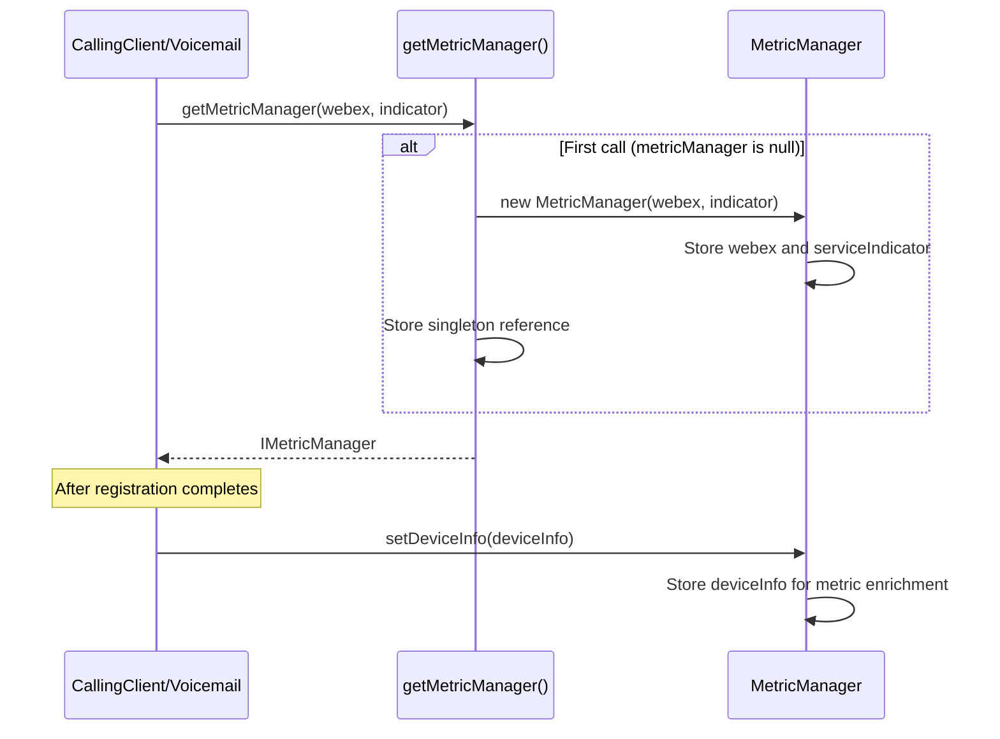
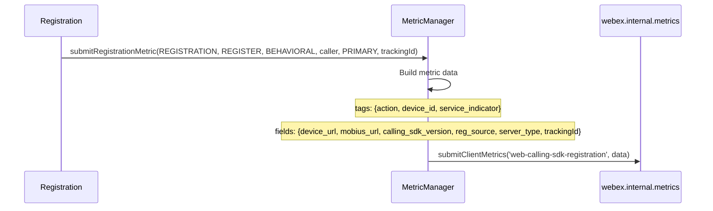
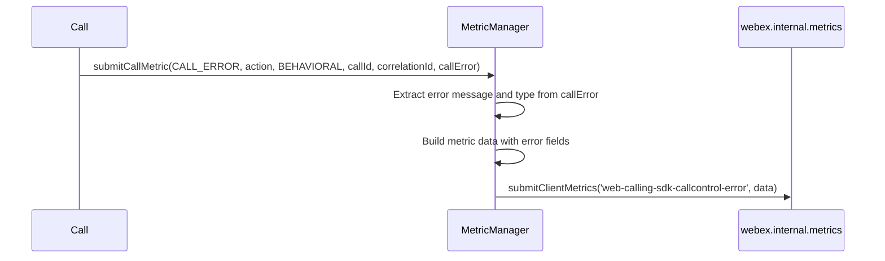
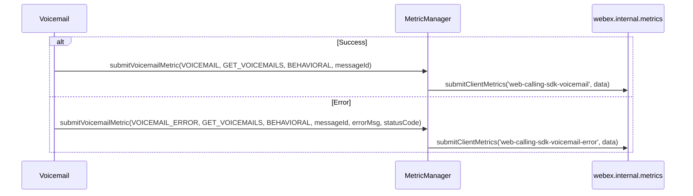
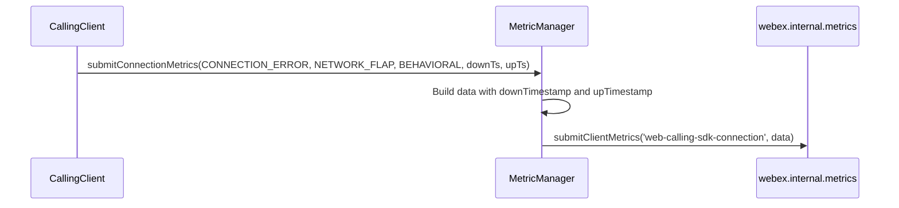
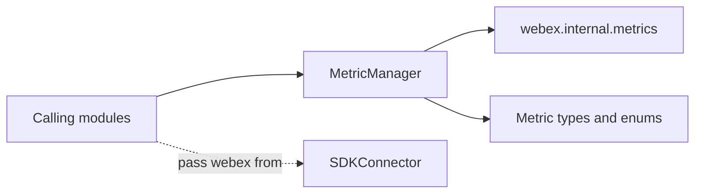

<!-- sdd-generated-metadata
doc_kind: module-spec
generated_from: module-spec@0.3.0
generated_by: claude-code
approved_by: rarajes2@cisco.com
updated_at: 2026-11-17T03:23:21Z
validation_status: pass-with-warnings
-->

# Metrics

This source-local document at `src/Metrics/docs/README.md` owns the stable specification for
**Metrics**: the package-internal `MetricManager` singleton that builds calling telemetry payloads
and hands them to the Webex metrics plugin. Ground every claim in package evidence and link to the
[package architecture](../../../docs/architecture.md) instead of repeating broader facts. No service
specification exists because this package is a library.

Related context: [documentation index](../../../docs/index.md) ·
[package agent instructions](../../../AGENTS.md)

## Metadata

| Field | Value |
| ----- | ----- |
| Owner | @webex/web-sdk (CODEOWNERS default rule) |
| Source path | `src/Metrics` |
| Resource kind | module |
| Status | Active |
| Last verified | 2026-11-16 at `0b8c34db7f` |
| Module id | `metrics` |
| Parent spec | — |
| Doc kind | Module spec |
| Coverage score | Pending coverage assessment |
| Validation status | pass-with-warnings — validator `01a1e76e-1dbd-7680-94e4-46d29d2946d4`, assessed 2026-11-17; 0 Blocking, 1 Important (SDKConnector placeholder tests) |

## Applicability

| Condition ID                         | Status     | Evidence or reason | Owned section |
| ------------------------------------ | ---------- | ------------------ | ------------- |
| `module.has_tiers`                   | N/A        | No tier policy exists in this package or its `package.json` | Tier |
| `module.has_ui`                      | N/A        | No view or screen (`src/Metrics/index.ts`) | UI use-case flow |
| `module.crosses_service_boundaries`  | Applicable | Every payload leaves through the SDK metrics plugin to the Webex metrics service (`src/Metrics/index.ts`) | Cross-boundary use-case flow |
| `module.holds_client_state`          | Applicable | Module-level singleton with the SDK reference, service indicator, and device info (`src/Metrics/index.ts`) | Client state model |
| `module.enforces_domain_rules`       | Applicable | Event-name validation, error-only submission guards, and fixed payload keys (`src/Metrics/index.ts`) | Business rules and invariants |
| `module.is_concurrent_async`         | Applicable | Callers from independent async flows share one manager; the plugin batches asynchronously (`src/Metrics/index.ts`) | Concurrency and reactive flow |
| `module.owns_persistence`            | N/A        | No queue or storage; payloads are handed off immediately (`src/Metrics/index.ts`) | Data, schema, and migration discipline |
| `module.stateful_transitions`        | N/A        | The singleton is created once and device info is overwritten; no state machine (`src/Metrics/index.ts`) | State machine |
| `module.exposes_wire_protocol`       | N/A        | Payload keys are summarised under Design overview; the wire format belongs to the metrics plugin and service (`src/Metrics/index.ts`) | Protocol and wire format |
| `module.ui_multi_screen`             | N/A        | No UI | UI flow |
| `module.large_data_model`            | N/A        | Enums and one payload shape (`src/Metrics/types.ts`) | Data model |
| `module.returns_caller_errors`       | N/A        | Every method returns nothing; invalid names are logged and dropped (`src/Metrics/index.ts`) | Caller-visible failure modes |
| `module.module_specific_conventions` | Applicable | Each metric uses its own METRIC_EVENT names, error accessors, and payload keys (`src/Metrics/index.ts`, `src/Metrics/types.ts`) | Module-specific rules |
| `module.published_package`           | N/A        | Nothing from this module is exported by `src/index.ts` or `src/api.ts` | Export stability |
| `module.embedded_in_host`            | N/A        | No host theme or embed API | Host integration and theming |
| `module.has_design_tradeoff`         | Applicable | One process-wide manager with shared device context (`src/Metrics/index.ts`) | Key design trade-off |
| `module.has_submodules`              | N/A        | Computed false by the Repo Annotation module_tree.py script: no module is nested under src/Metrics | Sub-modules |

## Evidence register

Requirements cite stable implementation and test file paths; no line-number anchors or local
run-report paths are canonical evidence.

| Evidence | What it establishes |
| -------- | ------------------- |
| `src/Metrics/index.ts` | `MetricManager`, every submit method and its payload, name validation, and the `getMetricManager` singleton accessor |
| `src/Metrics/types.ts` | `IMetricManager`, `METRIC_TYPE`, `METRIC_EVENT`, and the action enums and types |
| `src/Metrics/index.test.ts` | Exact payloads for every submit method, invalid-name warnings, the undefined-process guard, the version fallback, and both upload-log variants |
| `src/CallingClient/constants.ts` | `METRIC_FILE` and `VERSION` (`'unknown'`) |
| `src/common/types.ts` | `IDeviceInfo`, `MobiusServers`, `ServiceIndicator` (`calling`, `contactcenter`, `guestcalling`), `CallId`, `CorrelationId` |
| `src/CallingClient/CallingClient.ts` | Caller of connection, region info, Mobius servers, registration, and Mobius socket metrics |
| `src/CallingClient/registration/register.ts` | Caller of registration metrics and of `setDeviceInfo` after registration |
| `src/CallingClient/calling/call.ts` | Caller of call, media, and BNR metrics |
| `src/CallingClient/utils/request.ts` | Caller of Mobius socket metrics; obtains the manager without a service indicator |
| `src/Voicemail/Voicemail.ts` | Caller of voicemail metrics; obtains the manager with an undefined indicator |
| `src/common/Utils.ts` | `uploadLogs` submits upload-log metrics through `getMetricManager()` with no arguments |
| `src/SDKConnector/types.ts` | The `WebexSDK` type, including `internal.metrics.submitClientMetrics` |
| Sibling workspace @webex/internal-plugin-metrics, file src/metrics.js (outside this package) | `submitClientMetrics` queues the payload in a batcher and returns its request promise |

## Purpose and boundary

The `Metrics` module provides a centralized `MetricManager` singleton for collecting and submitting
client-side telemetry metrics to the Webex cloud via `@webex/internal-plugin-metrics`. The calling
modules (CallingClient, registration, call, the Mobius request layer, Voicemail, and the shared log
upload helper) use MetricManager to report operational and behavioral events including registration,
call control, media negotiation, voicemail operations, network connectivity, BNR toggles, log
uploads, Mobius server discovery, and the Mobius WebSocket lifecycle.

- Responsibility: Metrics owns the behavior rooted at `src/Metrics/` and serves it to the other
  modules of the `@webex/calling` package; shared infrastructure remains owned by `Errors`, `Events`,
  `Logger`, and `common`.
- Package: `@webex/calling`. Entry point: `src/Metrics/index.ts`. Factory:
  `getMetricManager(webex?, indicator?)` returns `IMetricManager`.
- In scope: payload construction and name validation for each metric family (`MOD-001` to
  `MOD-008`, `MOD-010`), the singleton (`MOD-009`), and device enrichment (`MOD-011`).
- Out of scope: batching, transport, and retry (the metrics plugin), deciding when an event happens
  (each calling module), and metric dashboards (Webex).
- Consumers: package modules only; see the Evidence register for the callers.

## Structure and key files

The module is TypeScript source in the `@webex/calling` package, tested with Jest unit tests; its
remote transport is the metrics plugin (see Cross-boundary use-case flow).

| File | Holds |
| ---- | ----- |
| `src/Metrics/index.ts` | Implementation: the `MetricManager` class and the `getMetricManager` factory (default export too) |
| `src/Metrics/types.ts` | Types and constants: the `IMetricManager` interface, all enums, `SERVER_TYPE`, and `UPLOAD_LOGS_ACTION` |
| `src/Metrics/index.test.ts` | Test/characterization evidence: Jest unit tests with exact payload assertions |

## Public surface

Declarations live in `src/Metrics/types.ts` and `src/Metrics/index.ts`; this section summarises them
and does not restate signatures. The contract index is the
[package architecture](../../../docs/architecture.md).

| Contract ID | Type | Surface | Purpose | Compatibility / deprecation | Schema / detail link | Root index |
|---|---|---|---|---|---|---|
| `metrics-internal` | Internal telemetry collaborator | `getMetricManager(webex?, indicator?)` returns the shared `IMetricManager` | Reuse one manager for typed calling telemetry and shared device enrichment | Internal; not exported from `src/index.ts` | `src/Metrics/index.ts`, `src/Metrics/types.ts` | [package architecture](../../../docs/architecture.md) |
| `metrics-internal` | Internal telemetry collaborator | `IMetricManager` submission methods | Submit registration, call, media, connection, voicemail, BNR, upload, region, discovery, and Mobius socket metrics | Internal operational contract | `src/Metrics/types.ts` | [package architecture](../../../docs/architecture.md) |

No MetricManager class, accessor, metric enum, or metric payload type is exported from
`src/index.ts`.

`IMetricManager` methods (all synchronous; all return nothing):

| Method | Signature | Description |
| ------ | --------- | ----------- |
| `setDeviceInfo` | `deviceInfo` (`IDeviceInfo`) | Sets device info for all subsequent metrics |
| `submitRegistrationMetric` | `name`, `metricAction` (`REG_ACTION`), `type`, `caller`, `serverType` (`SERVER_TYPE`), `trackingId`, optional `keepaliveCount`, optional `error` (`LineError` or `CallingClientError`) | Submit registration/keepalive metrics (`MOD-001`) |
| `submitCallMetric` | `name`, `metricAction`, `type`, `callId`, `correlationId`, optional `callError` (`CallError`) | Submit call control metrics (`MOD-002`) |
| `submitMediaMetric` | `name`, `metricAction`, `type`, `callId`, `correlationId`, optional `localSdp`, `remoteSdp`, `state`, `callError` | Submit media negotiation metrics (`MOD-003`) |
| `submitConnectionMetrics` | `name`, `metricAction` (`CONNECTION_ACTION`), `type`, `downTimestamp`, `upTimestamp` | Submit network connectivity metrics (`MOD-004`) |
| `submitVoicemailMetric` | `name`, `metricAction`, `type`, optional `messageId`, `voicemailError`, `statusCode` | Submit voicemail metrics (`MOD-005`) |
| `submitBNRMetric` | `name`, `type`, `callId`, `correlationId` | Submit BNR enable/disable metrics (`MOD-006`) |
| `submitUploadLogsMetric` | `name`, `metricAction` (`action` in the class), `type`, optional `trackingId`, `feedbackId`, `correlationId`, `stack`, `callId`, `broadworksCorrelationInfo` | Submit log upload metrics (`MOD-007`) |
| `submitRegionInfoMetric` | `name`, `metricAction`, `type`, `mobiusHost`, `clientRegion`, `countryCode`, `trackingId` (optional in the class) | Submit region discovery metrics (`MOD-008`) |
| `submitMobiusServersMetric` | `name`, `metricAction`, `type`, `mobiusServers` (`MobiusServers`), `trackingId` (optional in the class) | Submit Mobius server discovery metrics (`MOD-008`) |
| `submitMobiusSocketMetric` | `name`, `metricAction` (`MOBIUS_SOCKET_ACTION`), `type`, optional `wssUrl`, `trackingId`, `error`, `eventType` | Submit Mobius WebSocket lifecycle metrics (`MOD-010`) |

`METRIC_TYPE` values (`operational`, `behavioral`):

| Value | Description |
| ----- | ----------- |
| `OPERATIONAL` | Operational metric for system health monitoring |
| `BEHAVIORAL` | Behavioral metric for user/application action tracking |

`METRIC_EVENT` values:

| Value | String | Description |
| ----- | ------ | ----------- |
| `BNR_ENABLED` | `web-calling-sdk-bnr-enabled` | BNR was enabled |
| `BNR_DISABLED` | `web-calling-sdk-bnr-disabled` | BNR was disabled |
| `CALL` | `web-calling-sdk-callcontrol` | Call control action succeeded |
| `CALL_ERROR` | `web-calling-sdk-callcontrol-error` | Call control action failed |
| `CONNECTION_ERROR` | `web-calling-sdk-connection` | Connection/network event |
| `MEDIA` | `web-calling-sdk-media` | Media negotiation succeeded |
| `MEDIA_ERROR` | `web-calling-sdk-media-error` | Media negotiation failed |
| `REGISTRATION` | `web-calling-sdk-registration` | Registration succeeded |
| `REGISTRATION_ERROR` | `web-calling-sdk-registration-error` | Registration failed |
| `KEEPALIVE_ERROR` | `web-calling-sdk-keepalive-error` | Keepalive failed |
| `VOICEMAIL` | `web-calling-sdk-voicemail` | Voicemail operation succeeded |
| `VOICEMAIL_ERROR` | `web-calling-sdk-voicemail-error` | Voicemail operation failed |
| `UPLOAD_LOGS_SUCCESS` | `web-calling-sdk-upload-logs-success` | Log upload succeeded |
| `UPLOAD_LOGS_FAILED` | `web-calling-sdk-upload-logs-failed` | Log upload failed |
| `MOBIUS_DISCOVERY` | `web-calling-sdk-mobius-discovery` | Mobius discovery event |
| `MOBIUS_SOCKET` | `web-calling-sdk-mobius-socket` | Mobius WebSocket action succeeded |
| `MOBIUS_SOCKET_ERROR` | `web-calling-sdk-mobius-socket-error` | Mobius WebSocket action failed |

`REG_ACTION` values (`register`, `deregister`, `keepaliveFailure`):

| Value | Description |
| ----- | ----------- |
| `REGISTER` | Registration action |
| `DEREGISTER` | Deregistration action |
| `KEEPALIVE_FAILURE` | Keepalive failure action |

`CONNECTION_ACTION` values (`network_flap`, `mercury_down`, `mercury_up`):

| Value | Description |
| ----- | ----------- |
| `NETWORK_FLAP` | Network went offline and back online |
| `MERCURY_DOWN` | Mercury WebSocket disconnected |
| `MERCURY_UP` | Mercury WebSocket reconnected |

`VOICEMAIL_ACTION` values (lower-case snake strings):

| Value | Description |
| ----- | ----------- |
| `GET_VOICEMAILS` | List voicemails |
| `GET_VOICEMAIL_CONTENT` | Get voicemail content |
| `GET_VOICEMAIL_SUMMARY` | Get voicemail summary |
| `MARK_READ` | Mark as read |
| `MARK_UNREAD` | Mark as unread |
| `DELETE` | Delete voicemail |
| `TRANSCRIPT` | Get transcript |

Other action enums and types:

| Enum | Values | Description |
| ---- | ------ | ----------- |
| `TRANSFER_ACTION` | `BLIND`, `CONSULT` | Call transfer types |
| `MOBIUS_SERVER_ACTION` | `REGION_INFO`, `MOBIUS_SERVERS` | Mobius discovery actions |
| `MOBIUS_SOCKET_ACTION` | `CONNECT`, `DISCONNECT`, `LISTENER_REGISTERED`, `LISTENER_UNREGISTERED`, `REGISTRATION_DOWN` | Mobius WebSocket actions |
| `MEDIA_CONNECTION_ACTION` | `ICE_GATHERING_STATE_CHANGED`, `PEER_CONNECTION_STATE_CHANGED`, `ICE_CONNECTION_STATE_CHANGED`, `ICE_CANDIDATE_ERROR`, `ROAP_FAILURE` | Media connection actions sent with media metrics by the call module |

| Type | Definition | Description |
| ---- | ---------- | ----------- |
| `SERVER_TYPE` | `'PRIMARY' \| 'BACKUP' \| 'UNKNOWN'` | Server type for registration metrics |
| `UPLOAD_LOGS_ACTION` | `'upload_logs'` (const) | Action string for log upload metrics |

## Dependencies

| Dependency | Why it is required | Failure behavior |
| ---------- | ------------------ | ---------------- |
| Webex metrics plugin (`webex-metrics-plugin`): @webex/internal-plugin-metrics through Webex SDK | The only submission path | The returned promise is discarded; a missing plugin throws a TypeError to the caller |
| `WebexSDK` type (`sdk-connector-internal`) | Types the SDK reference the first caller passes in | Compile-time only; the module never calls the connector |
| Calling error types | Error message and type for error metrics | — |

Runtime dependency:

| Package | Purpose |
| ------- | ------- |
| `@webex/internal-plugin-metrics` | Underlying metrics submission via `webex.internal.metrics.submitClientMetrics(name, data)` |

Internal dependencies (shared code described in the package architecture):

| Module | Purpose |
| ------ | ------- |
| `SDKConnector` | Provides the `WebexSDK` type; callers pass the instance they got from the connector |
| `Logger` | Warning logs for invalid metric names |
| `Errors` (CallError, CallingClientError, LineError) | Error objects parsed for error message and type fields |
| `CallingClient/constants` | Provides `METRIC_FILE` and `VERSION` constants |
| `common/types` | Provides `CallId`, `CorrelationId`, `IDeviceInfo`, `MobiusServers`, `ServiceIndicator` |

## Requirements

| ID | WHAT | WHY | Source Evidence | Test / Example Evidence | Assumptions / Gaps | Confidence |
|---|---|---|---|---|---|---|
| `MOD-001` | Tracks registration success/error and keepalive failures with server type, tracking ID, and error details: `REGISTRATION`, `REGISTRATION_ERROR`, and `KEEPALIVE_ERROR` carry `reg_source`, `server_type`, `trackingId`, and, for errors, `error` and `error_type` from `getError()`; keepalive adds `keepalive_count`. | Server type, tracking id, and error context are required to distinguish endpoint failover from device or keepalive failures during diagnosis. | `src/Metrics/index.ts` | `src/Metrics/index.test.ts` "submit registration success metric", "submit registration failure metric", "submit keepalive failure metric" | none | Present |
| `MOD-002` | Reports call lifecycle events and errors with call ID and correlation ID (`call_id`, `correlation_id`); `CALL_ERROR` adds `error` and `error_type` from `getCallError()`. | Call and correlation identifiers join asynchronous signaling events into one diagnosable call lifecycle. | `src/Metrics/index.ts` | `src/Metrics/index.test.ts` "submit call success metric", "submit call failure metric" | none | Present |
| `MOD-003` | Captures media negotiation events (ROAP offer/answer) and errors, including local and remote SDP details (`local_media_details`, `remote_media_details`); `MEDIA` also carries `state`, `MEDIA_ERROR` carries `error` and `error_type` instead. | ROAP and SDP context is needed to separate signaling success from media-negotiation failure, subject to the module's sensitive-data restrictions. | `src/Metrics/index.ts` | `src/Metrics/index.test.ts` "submit media success metric", "submit media failure metric" | none | Present |
| `MOD-004` | Records network connectivity events: network flaps, Mercury up/down transitions with timestamps (`downTimestamp`, `upTimestamp`). | Separate network and Mercury timestamps identify whether recovery delay came from connectivity or the signaling channel. | `src/Metrics/index.ts` | `src/Metrics/index.test.ts` "submit connection metric for network flap", "submit connection metric for mercury down" | none | Present |
| `MOD-005` | Tracks voicemail operations (list, read, delete, transcript) and their errors with message IDs and status codes. | Operation, message id, and status context make voicemail failures attributable without relying on unstructured logs. | `src/Metrics/index.ts` | `src/Metrics/index.test.ts` voicemail success, failure, and undefined-process cases | none | Present |
| `MOD-006` | Reports Background Noise Reduction enable/disable events for specific calls. | Per-call BNR state records whether an audio-processing change coincided with call quality behavior. | `src/Metrics/index.ts` | `src/Metrics/index.test.ts` "submit bnr enabled metric", "submit bnr disabled metric" | none | Present |
| `MOD-007` | Records success/failure of diagnostic log uploads with tracking IDs and correlation info (`tracking_id`, `feedback_id`, `correlation_id`, `call_id`, `broadworksCorrelationInfo`); failure adds `error` from `stack`. | Tracking diagnostic uploads confirms whether failure evidence reached support and correlates the upload to the affected call or client. | `src/Metrics/index.ts`, `src/common/Utils.ts` | `src/Metrics/index.test.ts` upload logs success and failure cases | none | Present |
| `MOD-008` | Captures region information and Mobius server discovery results including primary/backup server URIs (comma-joined) and regions, always tagged `service_indicator: calling`. | Region and primary/backup discovery metrics expose endpoint selection and redundancy decisions that otherwise occur before registration logs are available. | `src/Metrics/index.ts` | `src/Metrics/index.test.ts` region info and Mobius servers cases, with and without tracking ID | Neither method validates `name`. | Present |
| `MOD-009` | `getMetricManager(webex?, indicator?)` creates the module-level manager on the first call that passes `webex` and returns that same instance on every later call, ignoring later arguments; before that it returns `undefined`. | Reuse one manager for typed calling telemetry and shared device enrichment. | `src/Metrics/index.ts` | `src/Metrics/index.test.ts` "initialize metric manager" | The `undefined` return is typed as `IMetricManager`; reuse across calls is not asserted. | Present |
| `MOD-010` | `submitMobiusSocketMetric` sends `MOBIUS_SOCKET` with `wss_url`, `tracking_id`, and `event_type`, and `MOBIUS_SOCKET_ERROR` with `error` as well; other names are warned and dropped. | The Mobius WebSocket transport carries call events when enabled, so its connect, disconnect, listener, and registration-down events need the same diagnosability as Mercury up/down. | `src/Metrics/index.ts`, `src/CallingClient/utils/request.ts` | `src/Metrics/index.test.ts` Mobius socket cases | none | Present |
| `MOD-011` | `setDeviceInfo(deviceInfo)` replaces the stored device info; later payloads read `device_id`, `device_url`, and `mobius_url` from it at submission time. | The MetricManager stores this for all subsequent metrics, so callers do not pass device fields. | `src/Metrics/index.ts`, `src/CallingClient/registration/register.ts` | `src/Metrics/index.test.ts` "update deviceInfo in metric manager" | none | Present |

## Design overview

`MetricManager` is a class with one method per metric family; each builds a plain payload and calls
`webex.internal.metrics.submitClientMetrics(name, data)` with the `name` it was given. The module
keeps no queue and returns nothing to callers.

The `MetricManager` is configured through:

1. **Constructor parameters:** `webex` SDK instance and optional `ServiceIndicator`.
2. **Device info:** Set via `setDeviceInfo()` after registration, populates device fields in all metrics.
3. **SDK version:** Resolved from `process.env.CALLING_SDK_VERSION` with fallback to `VERSION` constant.

Every payload is `{tags, fields, type}`: `tags` carry `action`, `device_id`, and
`service_indicator` plus method-specific keys; `fields` carry `device_url`, `mobius_url`, and
`calling_sdk_version` plus method-specific keys; `type` is `operational` or `behavioral`.

Most metrics include these base fields (exceptions noted below):

| Field | Location | Source | Description |
|-------|----------|--------|-------------|
| `device_id` | tags | deviceInfo.device.deviceId | Registered device identifier |
| `device_url` | fields | deviceInfo.device.clientDeviceUri | Client device URI |
| `mobius_url` | fields | deviceInfo.device.uri | Mobius server URI |
| `calling_sdk_version` | fields | process.env.CALLING_SDK_VERSION \|\| VERSION | SDK version string |
| `service_indicator` | tags | Constructor indicator param | Service type (CALLING, etc.) |
| `action` | tags | metricAction parameter | Action being performed |

**Exceptions per method:**

| Method | Differences from common fields |
|--------|-------------------------------|
| `submitVoicemailMetric` | No `mobius_url`, no `service_indicator`. Adds `message_id` to tags. Uses `typeof process !== 'undefined'` guard for SDK version. Error puts `error` and `status_code` in **tags** (not fields). |
| `submitConnectionMetrics` | Tag key is `metricAction` (not `action`). |
| `submitBNRMetric` | No `action` tag at all. |
| `submitRegionInfoMetric` | Always uses `ServiceIndicator.CALLING` (ignores constructor `indicator`). Adds `mobius_host`, `client_region`, `country_code`, and `tracking_id`. |
| `submitMobiusServersMetric` | Always uses `ServiceIndicator.CALLING` (ignores constructor `indicator`). Adds primary and backup region and comma-joined URIs, and `tracking_id`. |
| `submitRegistrationMetric` | Field key is `trackingId` (camelCase, not `tracking_id`). |
| `submitUploadLogsMetric` | Field key is `tracking_id` (snake_case). No default case warning for invalid names. |
| `submitMobiusSocketMetric` | Adds `wss_url`, `tracking_id` (snake_case), and `event_type`. |
| `submitMediaMetric` | `MEDIA` adds `state`; `MEDIA_ERROR` does not. |

## Data flow and sequence coverage

Call style: synchronous in-process calls from the calling modules; each method hands its payload to
the SDK metrics plugin, which batches and sends it asynchronously.

```mermaid
flowchart TB
    subgraph CallingModules
        CC[CallingClient]
        Reg[Registration]
        Call[Call]
        VM[Voicemail]
        Req[Mobius request layer]
        Utils[common uploadLogs]
    end

    subgraph MetricsModule
        MM[MetricManager\nsingleton]
    end

    subgraph WebexSDK
        Metrics[webex.internal.metrics\nsubmitClientMetrics]
    end

    subgraph Cloud
        WebexCloud[Webex Metrics Service]
    end

    CC -->|submitRegistrationMetric\nsubmitConnectionMetrics\nsubmitRegionInfoMetric\nsubmitMobiusServersMetric\nsubmitMobiusSocketMetric| MM
    Reg -->|submitRegistrationMetric\nsetDeviceInfo| MM
    Call -->|submitCallMetric\nsubmitMediaMetric\nsubmitBNRMetric| MM
    VM -->|submitVoicemailMetric| MM
    Req -->|submitMobiusSocketMetric| MM
    Utils -->|submitUploadLogsMetric| MM

    MM -->|submitClientMetrics(name, data)| Metrics
    Metrics --> WebexCloud
```

Every metric submitted follows this pattern:

```mermaid
flowchart LR
    subgraph MetricPayload
        Tags[tags:\naction, device_id,\nservice_indicator]
        Fields[fields:\ndevice_url, mobius_url,\ncalling_sdk_version,\n+ metric-specific fields]
        Type[type:\noperational | behavioral]
    end
```

Sequence coverage:

| Operation group | Diagram / coverage | Failure / recovery coverage |
|---|---|---|
| Initialize manager/device context | 1. MetricManager Initialization | Missing context is visible through undefined fields; a missing plugin throws a TypeError at the first submission |
| Submit registration/call/media metrics | 2–3; media follows the call-error shape | Invalid event names are rejected and errors are normalized |
| Submit voicemail/connection metrics | 4–5 | Operation-specific error fields are retained |
| Submit upload/region/server/BNR/Mobius socket metrics | Same caller→MetricManager→metrics-plugin ordering | BNR, upload, and Mobius socket validate the event name; region and server metrics submit any name |

**1. MetricManager Initialization**



**2. Registration Metric Submission**



**3. Call Error Metric Submission**



**4. Voicemail Metric Submission**



**5. Connection Metric Submission**



## Class and component relationships

The Metrics module is a centralized telemetry singleton used by the calling modules. Architecture:
**Calling Modules -> MetricManager -> webex.internal.metrics -> Webex Cloud**.



| Layer | Component | File | Key Responsibilities |
|-------|-----------|------|---------------------|
| **Manager** | `MetricManager` | `src/Metrics/index.ts` | Metric data construction, device info enrichment, metric submission |
| **Types** | Enums and interfaces | `src/Metrics/types.ts` | `IMetricManager`, `METRIC_EVENT`, `METRIC_TYPE`, action enums |

| Component | Access Pattern | Lifecycle |
|-----------|---------------|-----------|
| `MetricManager` | `getMetricManager(webex?, indicator?)` module-level singleton | Created on first call with `webex`, reused thereafter |

## Use cases and flows

| Use case | Actor or caller | Primary steps and outcome | Failure or boundary behavior | Evidence |
| -------- | --------------- | ------------------------- | ---------------------------- | -------- |
| `UC-001` | CallingClient, call, registration, Voicemail constructors | Obtain the shared manager with the SDK and a service indicator | The first caller fixes the indicator (Pitfalls and constraints) | `src/CallingClient/CallingClient.ts`, `src/Voicemail/Voicemail.ts` |
| `UC-002` | Registration | `setDeviceInfo` after registration, then registration and keepalive metrics | Before it, device fields are undefined | `src/CallingClient/registration/register.ts` |
| `UC-003` | Call | Call, media, and BNR metrics per call with call and correlation IDs | Error metrics are dropped without an error object | `src/CallingClient/calling/call.ts` |
| `UC-004` | Log upload helper | `getMetricManager()` with no arguments, then the success or failure metric | Throws if no manager exists yet | `src/common/Utils.ts` |

Package-internal usage examples (inside `src`, the accessor is imported from the module path; it is
not exported by the package entry):

```typescript
import {getMetricManager} from '../Metrics';

const metricManager = getMetricManager(webex, ServiceIndicator.CALLING);
// Subsequent calls return the same instance
const same = getMetricManager();
```

```typescript
metricManager.setDeviceInfo(deviceInfo);
```

```typescript
metricManager.submitRegistrationMetric(
  METRIC_EVENT.REGISTRATION,
  REG_ACTION.REGISTER,
  METRIC_TYPE.BEHAVIORAL,
  'Registration',
  'PRIMARY',
  trackingId
);
```

```typescript
metricManager.submitCallMetric(
  METRIC_EVENT.CALL,
  'S_SEND_CALL_SETUP',
  METRIC_TYPE.BEHAVIORAL,
  callId,
  correlationId
);
```

```typescript
metricManager.submitConnectionMetrics(
  METRIC_EVENT.CONNECTION_ERROR,
  CONNECTION_ACTION.NETWORK_FLAP,
  METRIC_TYPE.BEHAVIORAL,
  downTimestamp,
  upTimestamp
);
```

### Cross-boundary use-case flow

| Boundary | Transport | Ordering | Timeout | Retry and recovery | Compatibility |
| -------- | --------- | -------- | ------- | ------------------ | ------------- |
| Webex metrics plugin and service | `webex.internal.metrics.submitClientMetrics(name, data)`; the plugin batches and sends client metrics | Hand-off order per call; batching is the plugin's | Plugin default | None in this module; the plugin's request promise is discarded | Event names are the `METRIC_EVENT` strings; payload keys per Design overview |

## Client state model

| State or slice | Owner | Initial state | Transition triggers | Reset or persistence boundary |
| -------------- | ----- | ------------- | ------------------- | ----------------------------- |
| `metricManager` | Module scope of `src/Metrics/index.ts` | Unset | First `getMetricManager` call with `webex` | No reset; module lifetime |
| `webex`, `serviceIndicator` | `MetricManager` instance | Set by the constructor | None | Fixed for the manager's lifetime |
| `deviceInfo` | `MetricManager` instance | `undefined` | Each `setDeviceInfo` call replaces it | Module lifetime |

The singleton MetricManager owns the initialized Webex SDK reference, service indicator, and latest
device metadata reused to enrich subsequent submissions. Metric payloads are submitted immediately;
the module does not persist a queue. Evidence: `src/Metrics/index.ts`.

## Business rules and invariants

| ID | Invariant | WHY | Enforcement source | Test evidence |
| -- | --------- | --- | ------------------ | ------------- |
| `INV-001` | Submission methods that validate accept only their documented METRIC_EVENT names and warn/reject invalid names; action values are not validated. | One method per metric family keeps names and payload shapes paired. | `src/Metrics/index.ts` | `src/Metrics/index.test.ts` "submit unknown ... metric" cases |
| `INV-002` | Call/correlation/tracking identifiers remain attached to the matching lifecycle. | Joins events of one call or request in analysis (`MOD-002`). | `src/Metrics/index.ts` | `src/Metrics/index.test.ts` |
| `INV-003` | Device metadata is set after registration before metrics that require it. | Device fields come only from `setDeviceInfo` (`MOD-011`). | `src/CallingClient/registration/register.ts` | `src/Metrics/index.test.ts` "update deviceInfo in metric manager" |
| `INV-004` | SDP, caller identifiers, error details, and device metadata are sensitive telemetry: submit only fields defined by the metric contract and never add authorization tokens, credentials, or unrelated payloads. Evidence: `src/Metrics/index.ts`, `src/Metrics/index.test.ts`. | Metrics leave the client for Webex analytics. | `src/Metrics/index.ts` | `src/Metrics/index.test.ts` exact payload assertions |

Most `MetricManager` methods validate the `name` parameter against expected `METRIC_EVENT` values
(via `switch` or explicit checks). If an invalid name is received, they log a warning and do not
submit the metric.

**Exceptions:**

- `submitUploadLogsMetric` does not log a warning for invalid names; it silently skips submission because `data` remains `undefined`.
- `submitConnectionMetrics` has no runtime name validation and always builds/submits metric data with the provided `name`.
- `submitRegionInfoMetric` and `submitMobiusServersMetric` have no runtime name validation either.

Some methods only submit error metrics when an error object is provided:

- `submitCallMetric` with `CALL_ERROR`: only submits if `callError` is non-null
- `submitMediaMetric` with `MEDIA_ERROR`: only submits if `callError` is non-null

## Concurrency and reactive flow

- Execution model: metric submission is synchronous delegation to
  `webex.internal.metrics.submitClientMetrics`; the plugin queues the payload and sends it later.
- Ordering guarantees: callers from independent registration, call, media, connection, and voicemail
  flows may interleave; the module adds no ordering.
- Idempotency and retry: none; the plugin's returned promise is not awaited or handled here.
- Shared-state protection: shared device info is read at submission time, so initialization must
  precede dependent metrics; `setDeviceInfo` overwrites it without coordination.
- Blocking restrictions: payload building is synchronous and small. Evidence: `src/Metrics/index.ts`.

## Pitfalls and constraints

| Symptom | Possible causes | Fix or note |
| ------- | --------------- | ----------- |
| Metrics not visible in Webex metrics dashboard | `MetricManager` not initialized with `webex` parameter; `webex.internal.metrics` plugin not loaded; `setDeviceInfo()` not called (device fields will be undefined) | Without a manager, `getMetricManager()` returns `undefined` and the caller throws |
| Metrics show `device_id: undefined`, `device_url: undefined` | Registration has not completed | Fix: Ensure `setDeviceInfo(deviceInfo)` is called after successful device registration. |
| Log warning: "Invalid metric name received. Rejecting request to submit metric." | Cause: A `METRIC_EVENT` value was passed that doesn't match the expected switch/check cases for that submit method. This applies to methods that implement runtime validation. | Pass a name from that method's family |
| `calling_sdk_version` field is `'unknown'` | Cause: `process.env.CALLING_SDK_VERSION` is not set. This is expected in certain build environments. The `VERSION` constant from `CallingClient/constants.ts` provides the fallback. | — |

- The first `getMetricManager` call with `webex` fixes the service indicator for the process:
  Voicemail passes `undefined` and the Mobius request layer passes none, so if either runs before
  CallingClient, `service_indicator` stays undefined in every later metric.
- `uploadLogs` in `src/common/Utils.ts` calls `getMetricManager()` with no arguments; when no
  calling module has created the manager (for example an application that uses only Contacts), the
  call throws a TypeError from both its success and failure branches.
- Media metrics carry complete local and remote SDP, which includes network candidates (`INV-004`).

## Module-specific rules

- Do: add a new metric family as one `METRIC_EVENT` group and one submit method that validates its
  names, matching the existing switch pattern.
- Do: read error details with the accessor each error type provides. Different error types expose
  their data through different methods:
  - `CallError`: `callError.getCallError().message` / `.type`
  - `LineError` / `CallingClientError`: `clientError.getError().message` / `.type`
- Do: use the factories, metric enums, constants, and adapters already owned by `src/Metrics/`.
- DON'T add direct network or SDK access when the module already provides an adapter.
- Do not: rename payload keys; dashboards key on them (`INV-004`, Design overview).

## Key design trade-off

| Chosen trade-off | Preserved invariant or benefit | Cost or limitation | Decision evidence |
| ---------------- | ------------------------------ | ------------------ | ----------------- |
| A singleton centralizes event names and common enrichment | Modules emit consistent telemetry | The shared device context reduces duplication but makes initialization order observable and requires strict payload minimization for sensitive fields | `src/Metrics/index.ts` |

## Verification

Unit tests are co-located under `src/Metrics/` and exercise positive and negative (invalid-name)
behavior with exact payload assertions; the module has no retry or cleanup paths, and no Playwright
journey asserts metrics.

| Behavior / Requirement | Existing test evidence | Gap |
|---|---|---|
| `MOD-001` | `src/Metrics/index.test.ts` | Missing error object on error names not tested |
| `MOD-002` | `src/Metrics/index.test.ts` | `CALL_ERROR` without `callError` not tested |
| `MOD-003` | `src/Metrics/index.test.ts` | `state` field and `MEDIA_ERROR` without `callError` not tested |
| `MOD-004` | `src/Metrics/index.test.ts` | `MERCURY_UP` not tested |
| `MOD-005` | `src/Metrics/index.test.ts` | none |
| `MOD-006` | `src/Metrics/index.test.ts` | none |
| `MOD-007` | `src/Metrics/index.test.ts` | Invalid name (silent skip) not tested |
| `MOD-008` | `src/Metrics/index.test.ts` | Arbitrary-name submission not tested |
| `MOD-009` | `src/Metrics/index.test.ts` | Second call returning the same instance, and the no-webex first call, not tested |
| `MOD-010`, `MOD-011` | `src/Metrics/index.test.ts` | none |
| `INV-001` to `INV-004` | `src/Metrics/index.test.ts` | none beyond the rows above |
