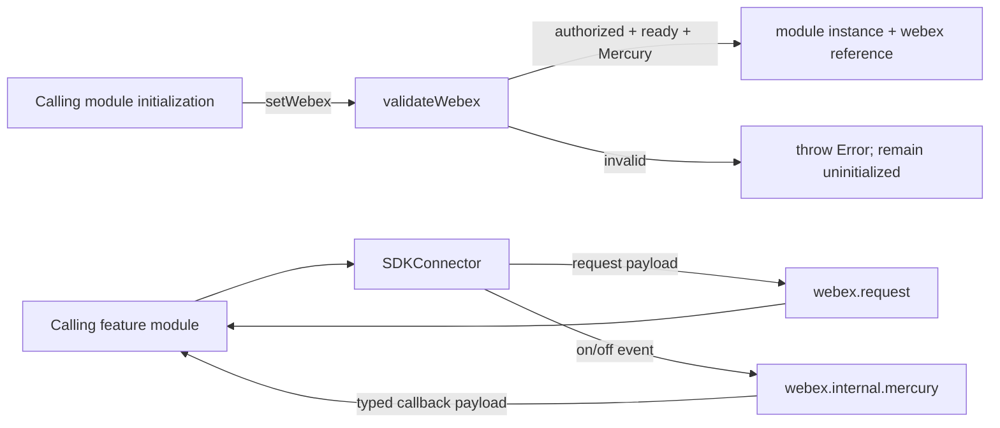
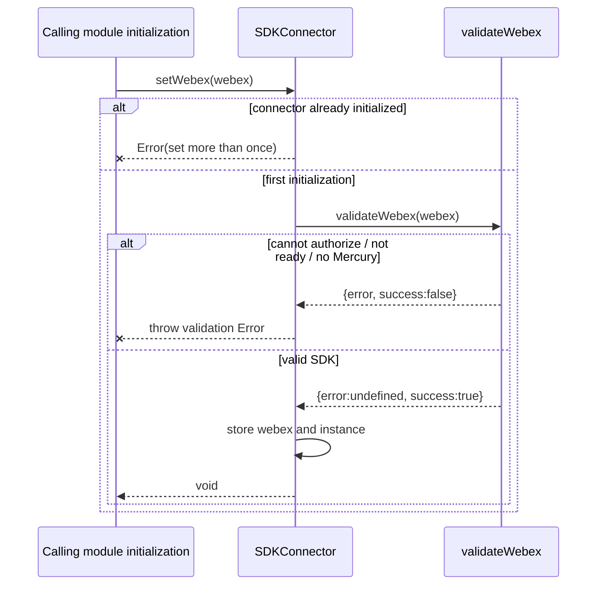
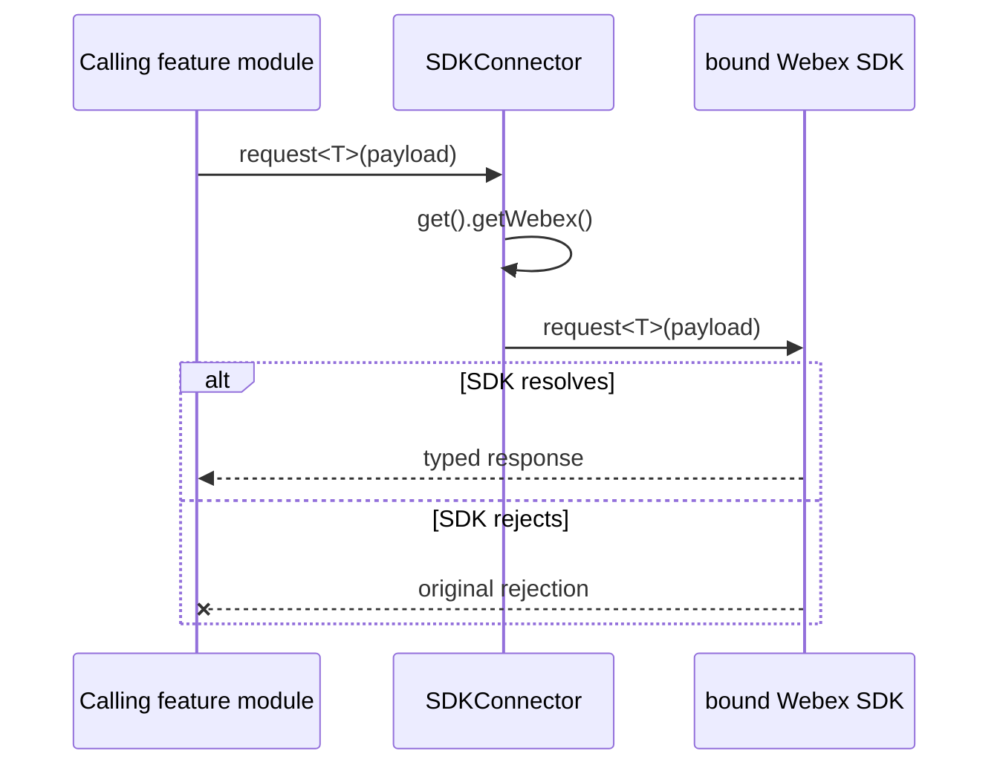
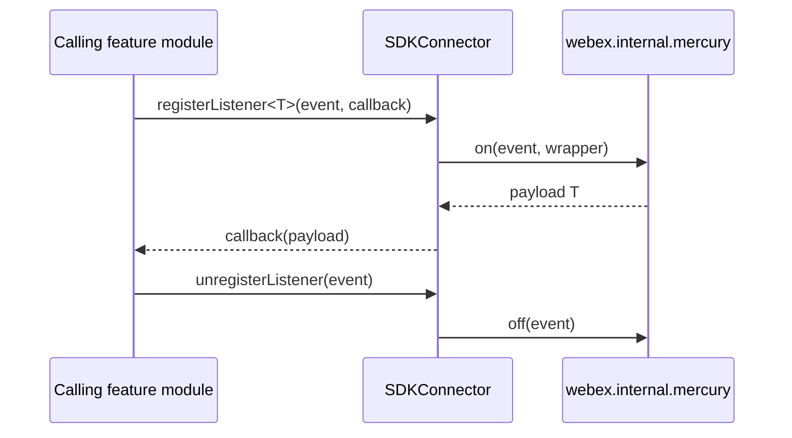
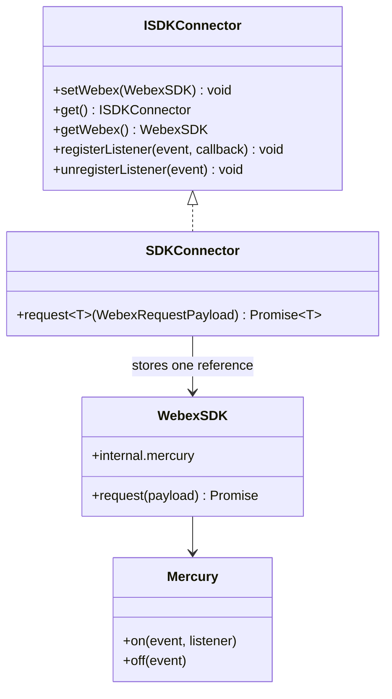

<!-- sdd-generated-metadata
doc_kind: module-spec
generated_from: module-spec@0.3.0
generated_by: claude-code
approved_by: rarajes2@cisco.com
updated_at: 2026-11-17T03:02:22Z
validation_status: blocked
-->

# SDKConnector

This source-local document at `src/SDKConnector/docs/README.md` owns the stable specification for
**SDKConnector**: the package-internal singleton that validates and holds the one Webex SDK instance
every `@webex/calling` module uses, forwards HTTP requests to it, and bridges Mercury listeners.
Ground every claim in package evidence and link to the
[package architecture](../../../docs/architecture.md) instead of repeating broader facts. No service
specification exists because this package is a library.

Related context: [documentation index](../../../docs/index.md) ·
[package agent instructions](../../../AGENTS.md)

## Metadata

| Field | Value |
| ----- | ----- |
| Owner | @webex/web-sdk (CODEOWNERS default rule) |
| Source path | `src/SDKConnector` |
| Resource kind | module |
| Status | Active |
| Last verified | 2026-11-16 at `0b8c34db7f` |
| Module id | `sdk-connector` |
| Parent spec | — |
| Doc kind | Module spec |
| Coverage score | Pending coverage assessment |
| Validation status | blocked — validator `01a1e76e-1dbd-7680-94e4-46d29d2946d4`, assessed 2026-11-17; 2 Blocking, 1 Important (questionnaire gate evidence, UC config contract index, SDKConnector test coverage) |

## Applicability

| Condition ID                         | Status     | Evidence or reason | Owned section |
| ------------------------------------ | ---------- | ------------------ | ------------- |
| `module.has_tiers`                   | N/A        | No tier policy exists in this package or its `package.json` | Tier |
| `module.has_ui`                      | N/A        | No view or screen; the module is a TypeScript adapter (`src/SDKConnector/index.ts`) | UI use-case flow |
| `module.crosses_service_boundaries`  | N/A        | The connector calls only the in-process SDK object; the network calls belong to the Webex SDK and to the calling modules that build the payloads (`src/SDKConnector/index.ts`) | Cross-boundary use-case flow |
| `module.holds_client_state`          | Applicable | Module-level instance and webex bindings in `src/SDKConnector/index.ts` | Client state model |
| `module.enforces_domain_rules`       | Applicable | One-shot binding and the readiness guards in `src/SDKConnector/index.ts` and `src/SDKConnector/utils.ts` | Business rules and invariants |
| `module.is_concurrent_async`         | Applicable | The request method returns the SDK promise and Mercury invokes callbacks asynchronously (`src/SDKConnector/index.ts`) | Concurrency and reactive flow |
| `module.owns_persistence`            | N/A        | No stored data; the bindings live in module memory (`src/SDKConnector/index.ts`) | Data, schema, and migration discipline |
| `module.stateful_transitions`        | N/A        | Two states only (unbound, bound) with no reset; covered by the client state model (`src/SDKConnector/index.ts`) | State machine |
| `module.exposes_wire_protocol`       | N/A        | Payloads and events pass through unchanged; their formats belong to the calling modules and Webex (`src/SDKConnector/index.ts`) | Protocol and wire format |
| `module.ui_multi_screen`             | N/A        | No UI | UI flow |
| `module.large_data_model`            | N/A        | The module declares the host SDK shape it reads, not a domain model (`src/SDKConnector/types.ts`) | Data model |
| `module.returns_caller_errors`       | Applicable | setWebex throws on a second call and on each failed guard (`src/SDKConnector/index.ts`, `src/SDKConnector/utils.ts`) | Caller-visible failure modes |
| `module.module_specific_conventions` | N/A        | No convention beyond the package rules; the consumer idiom is recorded as a use case (`src/CallingClient/CallingClient.ts`) | Module-specific rules |
| `module.published_package`           | Applicable | `package.json` publishes @webex/calling, and `src/index.ts` re-exports the WDMDevice type from this module | Export stability |
| `module.embedded_in_host`            | N/A        | No host theme or embed API | Host integration and theming |
| `module.has_design_tradeoff`         | Applicable | A frozen process-wide singleton with one-shot initialization (`src/SDKConnector/index.ts`) | Key design trade-off |
| `module.has_submodules`              | N/A        | Computed false by the Repo Annotation module_tree.py script: no module is nested under src/SDKConnector | Sub-modules |

## Evidence register

Requirements cite stable implementation and test file paths; no line-number anchors or local
run-report paths are canonical evidence.

| Evidence | What it establishes |
| -------- | ------------------- |
| `src/SDKConnector/index.ts` | The `SDKConnector` class, the module-level `instance` and `webex` bindings, the one-shot `setWebex`, request forwarding, Mercury `on`/`off` bridging, and the frozen default export |
| `src/SDKConnector/utils.ts` | `validateWebex`: the `canAuthorize`, `ready`, and `internal.mercury` guards and their messages |
| `src/SDKConnector/types.ts` | `ISDKConnector`, the `WebexSDK` host shape the package reads, and `WDMDevice`, `ServiceHost`, `ServiceCatalog`, `ClientRegionInfo`, `Logger`, `Model` |
| `src/common/types.ts` | `WebexRequestPayload`, the request shape forwarded unchanged |
| `src/index.ts` | Only the `WDMDevice` type is re-exported from this module; `SDKConnector` itself is not exported |
| `src/CallingClient/CallingClient.ts`, `src/CallHistory/CallHistory.ts`, `src/Contacts/ContactsClient.ts`, `src/CallSettings/CallSettings.ts`, `src/CallingClient/registration/register.ts`, `src/CallingClient/calling/callManager.ts` | Consumers bind through `if (!sdkConnector.getWebex()) SDKConnector.setWebex(webex)` and then read `getWebex()`; `callManager.ts` and `CallHistory.ts` register Mercury listeners through the connector |
| Package-wide search of src for request calls on the connector, 2026-11-16 | No package module calls the connector's `request<T>`; modules call `webex.request` on the reference returned by `getWebex()` |
| `src/CallingClient/calling/callManager.test.ts` | Indirect coverage: `registerListener('event:mobius', ...)` reaches `mercury.on` with a wrapper and `unregisterListener('event:mobius')` reaches `mercury.off` with the event only |
| `src/common/Utils.test.ts` | A test-suite caller binds a mock SDK with `SDKConnector.setWebex(webex)` at module load |
| `src/SDKConnector/index.test.ts`, `src/SDKConnector/utils.test.ts` | Placeholders that assert only `true === true` |

## Purpose and boundary

SDKConnector is the capability boundary rooted at `src/SDKConnector/`. Maintainers start with
`src/SDKConnector/index.ts` and use the canonical requirements and flows below before changing its
public or internal behavior.

- Responsibility: SDKConnector owns the behavior rooted at `src/SDKConnector/` and serves it to the
  other modules of the `@webex/calling` package; shared infrastructure remains owned by `Errors`,
  `Events`, `Logger`, and `common`.
- In scope: binding and validating the Webex SDK instance (`MOD-001`, `MOD-002`), returning it
  (`MOD-003`), forwarding requests (`MOD-004`), Mercury listener bridging (`MOD-005`, `MOD-006`), and
  the TypeScript declaration of the host SDK shape in `src/SDKConnector/types.ts`.
- Out of scope: authentication, service routing, retries, and response handling, which stay in the
  Webex SDK and in each calling module; the meaning of Mercury events, owned by the subscribing module.
- Configuration/rollout is N/A: the connector has no feature flag or environment configuration; the
  only lifecycle input is the first validated Webex SDK instance.
- Consumers: every calling module factory or constructor (CallingClient, call, call manager,
  registration, line, CallerId, CallHistory, CallSettings and its backend connectors, Voicemail and
  its backend connectors, Contacts), and package-consumer TypeScript code through `WDMDevice`.

## Structure and key files

The module is TypeScript source in the `@webex/calling` package, tested with Jest unit tests; it has
no module-specific remote transport (see Dependencies).

| File | Holds |
| ---- | ----- |
| `src/SDKConnector/index.ts` | Adapter implementation: the `SDKConnector` class, the module-level `instance` and `webex` bindings, and the frozen default export |
| `src/SDKConnector/types.ts` | Adapter types: `ISDKConnector`, the `WebexSDK` host shape, and the exported `WDMDevice` type |
| `src/SDKConnector/utils.ts` | Adapter validation behavior: `validateWebex` |
| `src/SDKConnector/index.test.ts` | Test placeholder; no characterization evidence (see Verification) |
| `src/SDKConnector/utils.test.ts` | Test placeholder; no characterization evidence (see Verification) |

## Public surface

Declarations live in `src/SDKConnector/types.ts` and `src/SDKConnector/index.ts`; this section
summarises them and does not restate signatures. The contract index is the
[package architecture](../../../docs/architecture.md).

| Contract ID | Type | Surface | Purpose | Compatibility / deprecation | Schema / detail link | Root index |
|---|---|---|---|---|---|---|
| `sdk-connector-internal` | Internal SDK boundary | `setWebex(webexInstance)`: synchronous, returns nothing, takes one required `WebexSDK` | Validate and bind the single Webex SDK instance used by package modules (`MOD-001`, `MOD-002`) | Internal; changing initialization affects all calling modules | `src/SDKConnector/index.ts`, `src/SDKConnector/types.ts` | [package architecture](../../../docs/architecture.md) |
| `sdk-connector-internal` | Internal SDK boundary | `get()` returns the bound `ISDKConnector`; `getWebex()` returns the bound `WebexSDK`; both synchronous with no parameters | Return the initialized connector or bound SDK reference (`MOD-003`) | Internal | `src/SDKConnector/index.ts` | [package architecture](../../../docs/architecture.md) |
| `sdk-connector-internal` | Internal SDK boundary | `request<T>(request)`: one required `WebexRequestPayload`, returns `Promise<T>`; declared on the class only | Forward package HTTP requests through the bound Webex SDK (`MOD-004`) | Internal | `src/SDKConnector/index.ts`, `src/common/types.ts` | [package architecture](../../../docs/architecture.md) |
| `sdk-connector-internal` | Internal SDK boundary | `registerListener<T>(event, cb)` with a string event and a callback receiving an optional `T`; `unregisterListener(event)`; both synchronous, return nothing | Bridge package callbacks to Mercury `on`/`off` (`MOD-005`, `MOD-006`) | Internal | `src/SDKConnector/index.ts`, `src/SDKConnector/types.ts` | [package architecture](../../../docs/architecture.md) |
| `sdk-connector-sdk` | Published type | `WDMDevice`: device `url`, `userId`, `orgId`, `version`, `callingBehavior`, `features`, and optional `registered`, `webSocketUrl`, `register`, `refresh`, `settings` | Lets consumers type the WDM device the SDK exposes | See Export stability | `src/SDKConnector/types.ts`, `src/index.ts` | [package architecture](../../../docs/architecture.md) |

`SDKConnector` itself is not exported from `src/index.ts`; only the `WDMDevice` type from
`src/SDKConnector/types.ts` is a package-consumer export.

The `WebexSDK` interface in `src/SDKConnector/types.ts` is the package's declaration of the host SDK
shape it reads (contract `webex-sdk-host`): `request`, `credentials`, `canAuthorize`, `ready`,
`config`, `logger`, `people`, `boundedStorage`, and the `internal` plugins `mercury`, `device`,
`services`, `encryption`, `metrics`, `support`, and `feature`. A field the package starts reading is
added there.

## Dependencies

| Dependency | Why it is required | Failure behavior |
| ---------- | ------------------ | ---------------- |
| Host Webex SDK (`webex-sdk-host`): One Webex SDK instance with `canAuthorize === true`, `ready === true`, and `internal.mercury` | The only object the connector binds and dereferences | A failed guard throws from `setWebex` (`MOD-002`) |
| The SDK's `request`, Mercury `on`, and Mercury `off` contracts (`mercury-events` for the event stream) | Request forwarding and listener bridging (`MOD-004` to `MOD-006`) | Rejections and errors propagate unchanged |
| `WebexRequestPayload` from `src/common/types.ts` | The forwarded request type | Compile-time only |

The connector owns no remote service contract; it forwards calls to the already initialized SDK.

## Requirements

| ID | WHAT | WHY | Source Evidence | Test / Example Evidence | Assumptions / Gaps | Confidence |
|---|---|---|---|---|---|---|
| `MOD-001` | `setWebex` accepts exactly one authorized, ready Webex SDK whose Mercury plugin exists; a second call throws, whatever instance it passes. | One process-wide binding prevents requests and listeners from mixing SDK instances after shared package modules initialize. | `src/SDKConnector/index.ts`, `src/SDKConnector/utils.ts` | none found; `src/SDKConnector/index.test.ts` is a placeholder | Existing tests are placeholders and do not assert the invariant. | Weak |
| `MOD-002` | `validateWebex` rejects when `canAuthorize` is false, `ready` is false, or `internal.mercury` is unavailable, checked in that order; it returns `{error, success: false}` and `setWebex` throws that error. | Failing before binding avoids later request/listener failures from a partially initialized SDK. | `src/SDKConnector/utils.ts` | none found; `src/SDKConnector/utils.test.ts` is a placeholder | Negative tests are missing. | Weak |
| `MOD-003` | `get` returns the initialized connector and `getWebex` returns the bound SDK reference. | Package modules need one shared access path so SDK ownership and validation are not duplicated. | `src/SDKConnector/index.ts` | `src/Contacts/ContactsClient.test.ts` reads getWebex() through getSDKConnector() | Pre-initialization return values: see Pitfalls and constraints. | Weak |
| `MOD-004` | `request<T>` delegates the payload to `webex.request` and returns its promise unchanged. | Preserving the SDK request promise keeps auth, service routing, response typing, and rejection behavior in the Webex SDK boundary. | `src/SDKConnector/index.ts`, `src/common/types.ts` | none found | No forwarding/rejection tests exist, and no package module calls it today. | Weak |
| `MOD-005` | `registerListener<T>` subscribes to Mercury and forwards each payload to the supplied callback through a new wrapper function per call. | Central listener registration lets feature modules consume Mercury without owning the SDK instance directly. | `src/SDKConnector/index.ts`, `src/SDKConnector/types.ts` | `src/CallingClient/calling/callManager.test.ts` (indirect, through mercury.on) | No direct delivery test in this module. | Weak |
| `MOD-006` | `unregisterListener(event)` delegates to `mercury.off(event)`. | Feature cleanup must remove the remote-event subscription through the same shared SDK boundary to prevent stale callbacks. | `src/SDKConnector/index.ts`, `src/SDKConnector/types.ts` | `src/CallingClient/calling/callManager.test.ts` (indirect, through mercury.off) | The WebexSDK type models `off` with an event only; tests do not pin listener granularity. | Weak |

## Design overview

`SDKConnector` is a frozen object exported only inside the package. Module-level `instance` and
`webex` variables become populated by the first successful `setWebex`. Validation occurs before
assignment; requests and Mercury listener operations then dereference that bound instance. The
boundary centralizes SDK ownership but does not add retry, caching, response translation, or event
buffering. Evidence: `src/SDKConnector/index.ts`, `src/SDKConnector/utils.ts`.

Connector-owned observability is N/A: it emits no logs or metrics and forwards failures unchanged, so
each owning feature module supplies contextual logging/metrics without exposing credentials at this
boundary. Evidence: `src/SDKConnector/index.ts`.

## Data flow and sequence coverage

Call style: synchronous in-process method calls on the frozen connector; `request` returns the SDK's
promise and Mercury delivers events through callbacks.

The connector forwards data unchanged; auth and service routing remain Webex SDK responsibilities.
Evidence: `src/SDKConnector/index.ts`.

Sequence coverage:

| Operation group | Diagram / coverage | Failure / recovery coverage |
|---|---|---|
| Validate and bind SDK | Initialization diagram | validation and duplicate-binding failures throw before state changes |
| Forward request | Request diagram | SDK rejection propagates unchanged; uninitialized access fails |
| Register/unregister Mercury callback | Listener diagram | requires initialized Mercury; cleanup delegates to `off(event)` |

**Initialization diagram — validate and bind once**

**Request diagram — forward an SDK request**

**Listener diagram — bridge Mercury listeners**

There is no connector-owned retry or recovery. Callers must initialize once before these operations
and handle the SDK's request failures. Evidence: `src/SDKConnector/index.ts`,
`src/SDKConnector/utils.ts`.

## Class and component relationships

`request<T>` exists on the concrete internal connector but is currently absent from `ISDKConnector`;
consumers call the frozen default instance inside the package. Evidence: `src/SDKConnector/index.ts`,
`src/SDKConnector/types.ts`.

## Use cases and flows

| Use case | Actor or caller | Primary steps and outcome | Failure or boundary behavior | Evidence |
| -------- | --------------- | ------------------------- | ---------------------------- | -------- |
| `UC-001` | Initialize the package bridge: CallingClient or another package owner (every calling factory) | Calls `setWebex` once with an authorized, ready SDK before feature modules use the connector, guarded by `if (!getWebex())` so later factories reuse the binding | A failed guard throws out of the factory (`MOD-002`) | `src/CallingClient/CallingClient.ts`, `src/Contacts/ContactsClient.ts` |
| `UC-002` | Forward a service request: a feature module | Supplies a `WebexRequestPayload`; the connector returns the underlying `webex.request` promise unchanged | Rejections propagate (`MOD-004`) | `src/SDKConnector/index.ts` |
| `UC-003` | Consume Mercury events: a feature module | Registers a typed callback and later unregisters the event during cleanup | Unregistering removes every listener for the event (Pitfalls and constraints) | `src/CallingClient/calling/callManager.ts`, `src/CallHistory/CallHistory.ts` |
| `UC-004` | Reject invalid lifecycle use: any caller | Invalid SDK state or a second initialization throws immediately; the connector does not silently replace the shared SDK reference | Recovery per Caller-visible failure modes | `src/SDKConnector/index.ts`, `src/SDKConnector/utils.ts` |

## Client state model

| State or slice | Owner | Initial state | Transition triggers | Reset or persistence boundary |
| -------------- | ----- | ------------- | ------------------- | ----------------------------- |
| `instance` | Module scope of `src/SDKConnector/index.ts` | Unset at module load | Set to the connector only after successful validation in the first `setWebex` | No reset API; lives as long as the loaded module |
| `webex` | Module scope of `src/SDKConnector/index.ts` | Unset at module load | Set to the validated SDK in the same `setWebex` call | No reset API; the reference is not frozen and the SDK keeps changing underneath it |

The module has two process-wide variables, both populated only after successful validation. `get`,
`getWebex`, request forwarding, and listener operations all rely on this initialized state.

## Business rules and invariants

| ID | Invariant | WHY | Enforcement source | Test evidence |
| -- | --------- | --- | ------------------ | ------------- |
| `INV-001` | `setWebex` succeeds at most once for the loaded module; a second call always throws. | Keeps one SDK binding for every module (`MOD-001`). | `src/SDKConnector/index.ts` | none found |
| `INV-002` | Assignment occurs only after `canAuthorize`, `ready`, and Mercury validation passes. Failed validation leaves `instance` and `webex` unset. | A partially initialized SDK is never shared (`MOD-002`). | `src/SDKConnector/index.ts`, `src/SDKConnector/utils.ts` | none found |
| `INV-003` | Requests and Mercury operations are pass-throughs; the connector must not rewrite payloads, responses, event names, or callback data. | Auth, routing, and event semantics stay with the SDK and the owning module (`MOD-004` to `MOD-006`). | `src/SDKConnector/index.ts` | `src/CallingClient/calling/callManager.test.ts` (listener events only) |
| `INV-004` | The bound SDK carries credentials and identity-bearing service data. Never log the SDK object, request authorization metadata, tokens, or raw Mercury payloads at this boundary. | Logs leave the process through the SDK logger and log upload. | `src/SDKConnector/index.ts` (no log calls) | none found |

## Concurrency and reactive flow

- Execution model: initialization is synchronous and has no lock: callers must coordinate the single
  `setWebex` call before concurrent feature work begins.
- Ordering guarantees: after initialization, request promises may resolve concurrently and Mercury
  may invoke callbacks asynchronously; the connector adds no ordering of its own.
- Idempotency and retry: the connector holds no queue, retry state, or callback registry beyond
  Mercury's own listener storage; unregister delegates directly to `off(event)`.
- Shared-state protection: the two bindings are written once (`INV-001`) and only read afterwards.
- Blocking restrictions: none; no connector method waits. Evidence: `src/SDKConnector/index.ts`.

## Caller-visible failure modes

| Condition | Signal | State after failure | Caller recovery |
|---|---|---|---|
| `setWebex` called after initialization | throws `Error('You cannot set the SDKConnector instance more than once')` | original instance/reference retained | reuse the existing connector; do not rebind |
| `canAuthorize` is false | throws `Error('webex.canAuthorize is not true')` | uninitialized | authorize/configure the SDK before retrying once |
| `ready` is false | throws `Error('webex.ready is not true')` | uninitialized | await SDK readiness before retrying once |
| Mercury missing | throws `Error('webex.internal.mercury is not available')` | uninitialized | initialize the Mercury plugin |
| unexpected validation result | throws setup `Error` | uninitialized | treat as initialization failure |
| SDK request rejects | original rejection propagates | connector remains initialized | apply the owning module's error/retry policy |
| request/listener operation before initialization | dereference failure/undefined state | uninitialized | call `setWebex` through the package initialization path first |

The module currently uses native `Error`, not the package's typed error hierarchy. Evidence:
`src/SDKConnector/index.ts`, `src/SDKConnector/utils.ts`.

## Pitfalls and constraints

- `Object.freeze` freezes the connector object, not the referenced Webex SDK.
- `get()` and `getWebex()` have non-optional TypeScript return types even though module state is
  unset before `setWebex`: both return `undefined`, while `request`, `registerListener`, and
  `unregisterListener` throw a `TypeError` from dereferencing the unset `instance`.
- `unregisterListener(event)` delegates to `mercury.off(event)` without a callback; listener
  granularity follows the SDK implementation, so one module's cleanup also removes another module's
  listener on the same event.
- Because the first binding wins, a later factory call with a different SDK instance silently keeps
  the first one: consumers skip `setWebex` when `getWebex()` is already set (`UC-001`).

Evidence: `src/SDKConnector/index.ts`, `src/SDKConnector/types.ts`, `src/SDKConnector/index.test.ts`,
`src/SDKConnector/utils.test.ts`.

## Export stability

| Export or entry point | Consumer | Stability | Versioning and deprecation rule | Declaration or API report |
| --------------------- | -------- | --------- | ------------------------------- | ------------------------- |
| `WDMDevice` type | TypeScript consumers of @webex/calling | Public | Removing or narrowing a field is breaking for consumers; follows the package release line in the architecture | `src/index.ts` |
| `SDKConnector`, `ISDKConnector`, `WebexSDK`, `validateWebex` | Package modules only | Internal | `SDKConnector` is internal and must not be described as exported from `src/index.ts`; changes need no deprecation but affect every module | `src/SDKConnector/index.ts` |

## Key design trade-off

| Chosen trade-off | Preserved invariant or benefit | Cost or limitation | Decision evidence |
| ---------------- | ------------------------------ | ------------------ | ----------------- |
| A frozen process-wide connector centralizes SDK validation, requests, and Mercury access | Feature modules do not each own a Webex SDK reference (`INV-001`) | Global one-shot initialization: there is no rebinding/reset path and lifecycle misuse fails at runtime | `src/SDKConnector/index.ts` |

## Verification

The current files `src/SDKConnector/index.test.ts` and `src/SDKConnector/utils.test.ts` assert only
`true === true`; they are placeholders, not characterization coverage.

Required characterization cases before coverage promotion (all unit level, Jest):

| Requirement | Positive case | Negative/error case | Current evidence |
|---|---|---|---|
| `MOD-001`, `INV-001` | first valid `setWebex` binds connector/SDK | second call throws and retains original | missing |
| `MOD-002`, `INV-002` | authorized + ready + Mercury validates | each failed guard returns its exact error | missing |
| `MOD-003` | `get`/`getWebex` return bound references | pre-init behavior is characterized | missing |
| `MOD-004`, `INV-003` | request payload/result forwarded unchanged | SDK rejection propagates unchanged | missing |
| `MOD-005` | Mercury payload reaches typed callback | no callback before event delivery | indirect only: `src/CallingClient/calling/callManager.test.ts` |
| `MOD-006` | unregister delegates the exact event | listener behavior after unregister is characterized | indirect only: `src/CallingClient/calling/callManager.test.ts` |
| `INV-004` | no log call at this boundary | none | missing |

Do not claim positive, negative, retry, or cleanup coverage until those tests exist.
