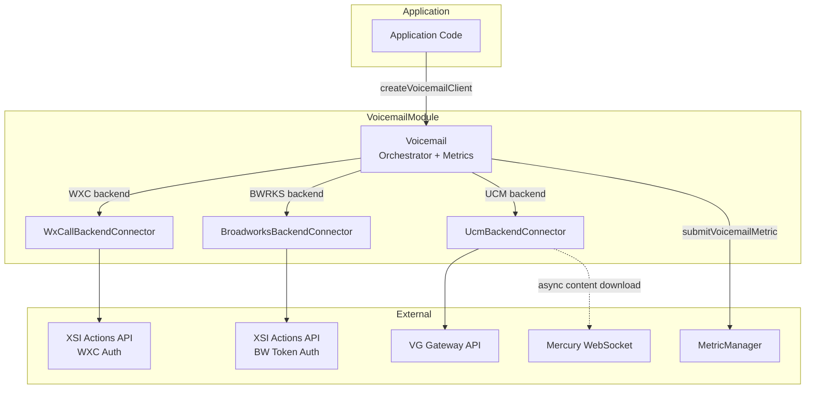
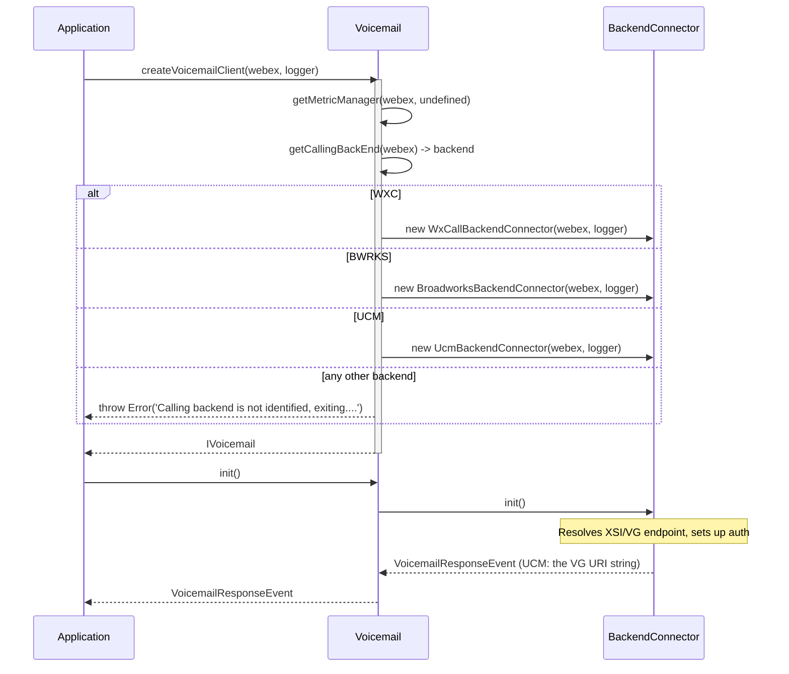
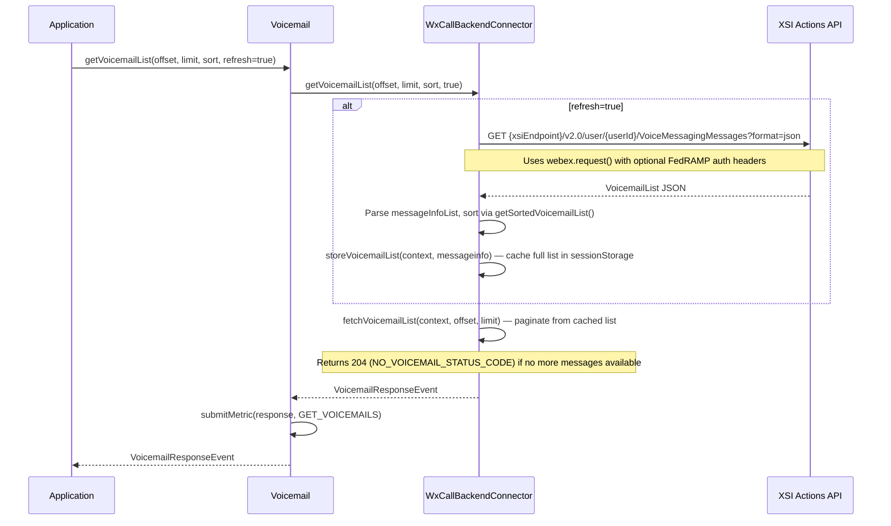
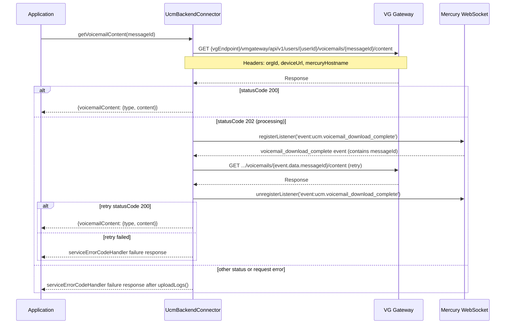
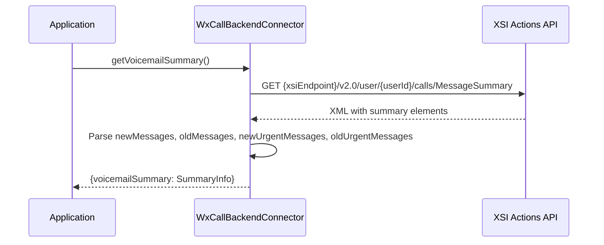
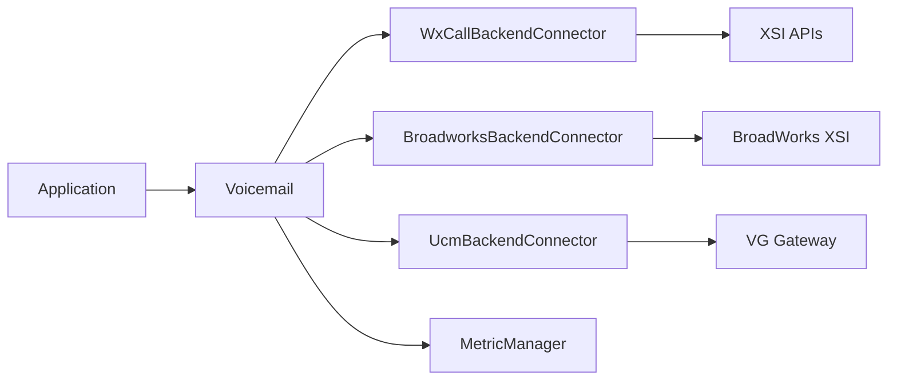
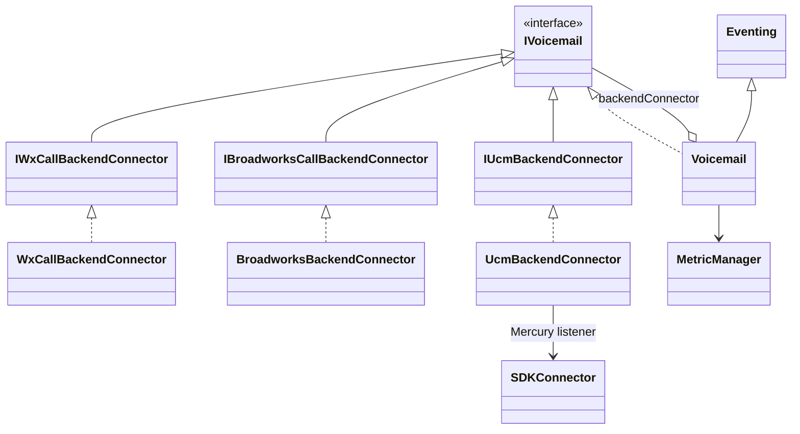

<!-- sdd-generated-metadata
doc_kind: module-spec
generated_from: module-spec@0.3.0
generated_by: claude-code
approved_by: rarajes2@cisco.com
updated_at: 2026-11-17T03:02:22Z
validation_status: blocked
-->

# Voicemail

This source-local document at `src/Voicemail/docs/README.md` owns the stable specification for
**Voicemail**: the `@webex/calling` client that lists, plays, marks, deletes, summarizes, and
transcribes a user's voicemail messages and resolves the caller behind each one, through a
backend-specific connector. Ground every claim in package evidence and link to the
[package architecture](../../../docs/architecture.md) instead of repeating package-wide facts such
as the shared logger, error formatting, metrics plumbing, and backend detection. No service
specification exists because this package is a library.

Related context: [documentation index](../../../docs/index.md) ·
[package agent instructions](../../../AGENTS.md)

## Metadata

| Field             | Value |
| ----------------- | ----- |
| Owner             | @webex/web-sdk (CODEOWNERS default rule) |
| Source path       | `src/Voicemail` |
| Resource kind     | module |
| Status            | Active |
| Last verified     | 2026-11-16 at `0b8c34db7f` |
| Module id         | `voicemail` |
| Parent spec       | — |
| Doc kind          | Module spec |
| Coverage score    | Pending coverage assessment |
| Validation status | blocked — validator `01a1e76e-1dbd-7680-94e4-46d29d2946d4`, assessed 2026-11-17; 2 Blocking, 1 Important (questionnaire gate evidence, UC config contract index, SDKConnector test coverage) |

## Applicability

| Condition ID                         | Status     | Evidence or reason | Owned section |
| ------------------------------------ | ---------- | ------------------ | ------------- |
| `module.has_tiers`                   | N/A        | No tier policy exists for this package or module | Tier |
| `module.has_ui`                      | N/A        | No view or screen; the module is a TypeScript library | UI use-case flow |
| `module.crosses_service_boundaries`  | Applicable | The connectors call XSI Actions, the BroadWorks token proxy, the UCM voicemail gateway, SCIM, and People search, and listen on Mercury (`src/Voicemail/WxCallBackendConnector.ts`, `src/Voicemail/BroadworksBackendConnector.ts`, `src/Voicemail/UcmBackendConnector.ts`) | Cross-boundary use-case flow |
| `module.holds_client_state`          | Applicable | Connectors hold endpoints, tokens, and auth headers set by init(), and the XSI connectors cache the voicemail list in session storage (`src/Voicemail/WxCallBackendConnector.ts`, `src/common/Utils.ts`) | Client state model |
| `module.enforces_domain_rules`       | Applicable | Backend selection, null for unsupported capabilities, and the 204 last-page rule (`src/Voicemail/Voicemail.ts`, `src/Voicemail/BroadworksBackendConnector.ts`) | Business rules and invariants |
| `module.is_concurrent_async`         | Applicable | Every operation returns a promise and UCM content can complete on a Mercury event (`src/Voicemail/UcmBackendConnector.ts`) | Concurrency and reactive flow |
| `module.owns_persistence`            | N/A        | The session-storage list is a per-tab cache that a refresh rebuilds; the mailbox is owned by the backend (`src/common/Utils.ts`) | Data, schema, and migration discipline |
| `module.stateful_transitions`        | N/A        | init() populates fields once; there are no guarded lifecycle transitions (`src/Voicemail/Voicemail.ts`) | State machine |
| `module.exposes_wire_protocol`       | Applicable | XSI, VG gateway, and Mercury payloads are parsed and built in the connectors and declared in `src/Voicemail/types.ts` | Protocol and wire format |
| `module.ui_multi_screen`             | N/A        | No UI | UI flow |
| `module.large_data_model`            | N/A        | A handful of message, summary, and response shapes that mirror remote payloads (`src/Voicemail/types.ts`) | Data model |
| `module.returns_caller_errors`       | Applicable | The factory throws on an unidentified backend and operations resolve failure responses (`src/Voicemail/Voicemail.ts`, `src/common/Utils.ts`) | Caller-visible failure modes |
| `module.module_specific_conventions` | Applicable | Backend-specific code stays in its connector and metrics are submitted only by the facade (`src/Voicemail/Voicemail.ts`) | Module-specific rules |
| `module.published_package`           | Applicable | `package.json` publishes @webex/calling and `src/index.ts` re-exports the factory and types | Export stability |
| `module.embedded_in_host`            | N/A        | No host theme or embed API | Host integration and theming |
| `module.has_design_tradeoff`         | Applicable | One interface over three backends, client-side versus server-side pagination, and event-driven UCM content (`src/Voicemail/WxCallBackendConnector.ts`, `src/Voicemail/UcmBackendConnector.ts`) | Key design trade-off |
| `module.has_submodules`              | N/A        | Computed false by the Repo Annotation module_tree.py script: no other module path lies under the Voicemail folder | Sub-modules |

## Evidence register

| Evidence | What it establishes |
| -------- | ------------------- |
| `src/Voicemail/Voicemail.ts` | The facade, its backend switch, metric submission per operation, the error handling of `init` and `getVoicemailList`, and the `createVoicemailClient` factory |
| `src/Voicemail/WxCallBackendConnector.ts` | WXC behavior: FedRAMP auth headers cached at `init`, the XSI URI, the cached list, content, summary, mark, delete, transcript, and contact resolution |
| `src/Voicemail/BroadworksBackendConnector.ts` | BWRKS behavior: the BroadWorks token fetch and decode, the `bearer` XSI token, `fetch`-based operations, and null summary, transcript, and contact resolution |
| `src/Voicemail/UcmBackendConnector.ts` | UCM behavior: the VG gateway URI, server-side pagination, the UCM-to-`MessageInfo` mapping, the 202 Mercury download flow, and null summary, transcript, and contact resolution |
| `src/Voicemail/types.ts` | `IVoicemail`, `VoicemailResponseEvent`, `MessageInfo`, `CallingPartyInfo`, `SummaryInfo`, and the UCM and Mercury payload shapes |
| `src/Voicemail/constants.ts` | Path segments, query fragments, the 204 status and message, the summary tag names, and the `METHODS` log-context names |
| `src/common/Utils.ts` | `getCallingBackEnd`, `getXsiActionEndpoint` for WXC and BWRKS (it returns the caught error instead of throwing), `getVgActionEndpoint`, `getSortedVoicemailList`, `storeVoicemailList`, `fetchVoicemailList`, `resolveContact`, `serviceErrorCodeHandler`, and `uploadLogs` |
| `src/common/constants.ts` | Shared path segments, `RAW_REQUEST`, `BEARER` (lowercase), and `SUCCESS_STATUS_CODE` |
| `src/Metrics/index.ts`, `src/Metrics/types.ts` | The `getMetricManager` singleton, `submitVoicemailMetric`, the two voicemail metric events, and `VOICEMAIL_ACTION` |
| `src/SDKConnector/index.ts` | The frozen singleton and its Mercury `registerListener` and `unregisterListener` |
| `src/Events/types.ts`, `src/Events/impl/index.ts` | `VoicemailEventTypes` and the `Eventing` base class; the module emits no event today |
| `src/index.ts`, `src/api.ts`, `package.json` | The published exports and the TypeDoc entry |
| `src/Voicemail/Voicemail.test.ts` | Backend selection for each entitlement and invalid input, and the metric action for each operation |
| `src/Voicemail/WxCallBackendConnector.test.ts` | WXC list sorting, paging, empty and malformed lists, list without refresh, summary, transcript (including PENDING), mark, delete, contact resolution, failures, and FedRAMP headers |
| `src/Voicemail/BroadworksBackendConnector.test.ts` | BWRKS token handling, XSI URL trimming, list sorting and paging, mark, delete, content and list failures, and the null capabilities |
| `src/Voicemail/UcmBackendConnector.test.ts` | UCM list, content (200 only), mark, delete, failures, and the null capabilities |
| `src/Voicemail/voicemailFixture.ts` | XSI and UCM payloads used by the tests |
| `playwright/test-groups/voicemail.ts` | The end-to-end journey: an unanswered call leaves a voicemail that is listed, played, and marked read |

## Purpose and boundary

- Responsibility: give an application one `IVoicemail` client for the signed-in user's mailbox on
  whichever backend the user is entitled to. Voicemail owns the behavior rooted at `src/Voicemail/`
  and exposes it through the typed `@webex/calling` package boundary; shared infrastructure remains
  owned by `SDKConnector`, `Events`, `Logger`, `Metrics`, and `common`.
- In scope: backend detection at construction, the WXC, Broadworks, and UCM connectors, the session
  list cache for XSI backends, the UCM asynchronous download, metric submission, and the response
  shape returned to callers.
- Out of scope: the voicemail services themselves, voicemail routing settings (the CallSettings
  module), call handling (CallingClient), and package-wide logging, error formatting, and metrics
  plumbing described in the [package architecture](../../../docs/architecture.md).
- Consumers: applications that call `createVoicemailClient` from `@webex/calling`; in this
  repository, the Playwright sample journeys under `playwright/`.

The `Voicemail` module provides APIs for managing voicemail messages across multiple calling
backends. It supports listing voicemails, retrieving voicemail content and transcripts, marking
messages as read/unread, deleting messages, fetching voicemail summaries, and resolving caller
contact information. The module uses a **strategy pattern** to delegate operations to
backend-specific connectors (WXC, Broadworks, UCM) and automatically submits metrics for all
operations.

| Capability | Description |
| ----------- | ----------- |
| **Initialize** | Initializes the voicemail connector, resolving XSI endpoints (WXC, Broadworks) or the VG Gateway endpoint (UCM) and authentication for the selected backend. |
| **List Voicemails** | Retrieves paginated, sorted voicemail lists. WXC/BWRKS use XSI VoiceMessagingMessages API; UCM uses VG Gateway API. |
| **Voicemail Content** | Fetches the audio content (media type + base64 content) for a specific voicemail message. |
| **Voicemail Summary** | Retrieves quantitative summary (new, old, urgent message counts) via XSI `MessageSummary` endpoint. Only supported on WXC; BWRKS and UCM return `null`. |
| **Mark Read/Unread** | Updates the read status of a voicemail message. |
| **Delete Voicemail** | Deletes a voicemail message by its messageId. |
| **Voicemail Transcript** | Retrieves the text transcript of a voicemail via XSI. Only supported on WXC; BWRKS and UCM return `null`. |
| **Contact Resolution** | Resolves caller identity from `CallingPartyInfo` using `userExternalId` (SCIM query) and `name` (People search API). Only supported on WXC; BWRKS and UCM return `null`. |
| **Metrics Integration** | Automatically submits success/error metrics for every list, content, mark, and delete operation, and for non-null summary and transcript results, via MetricManager. |
| **Multi-Backend Support** | Delegates to WXC, Broadworks, or UCM connectors based on user entitlements. |

## Structure and key files

| Path | Responsibility |
| ---- | -------------- |
| `src/Voicemail/Voicemail.ts` | Main entrypoint class with public APIs, and the `createVoicemailClient` factory |
| `src/Voicemail/WxCallBackendConnector.ts` | WXC backend |
| `src/Voicemail/BroadworksBackendConnector.ts` | Broadworks backend |
| `src/Voicemail/UcmBackendConnector.ts` | UCM backend |
| `src/Voicemail/types.ts` | IVoicemail, response types, backend interfaces |
| `src/Voicemail/constants.ts` | Endpoints, method names |
| `src/Voicemail/voicemailFixture.ts` | Test fixtures |
| `src/Voicemail/Voicemail.test.ts` | Unit tests for the main module |
| `src/Voicemail/WxCallBackendConnector.test.ts` | WXC tests |
| `src/Voicemail/BroadworksBackendConnector.test.ts` | Broadworks tests |
| `src/Voicemail/UcmBackendConnector.test.ts` | UCM tests |

## Public surface

Declarations live in `src/Voicemail/types.ts` and `src/Voicemail/Voicemail.ts`; the package entry
`src/index.ts` re-exports them and the declaration build writes `dist/types/index.d.ts`. This
section summarises them and does not restate signatures.

| Surface | Consumer | Compatibility commitment | Source |
| ------- | -------- | ------------------------ | ------ |
| `createVoicemailClient` factory | Applications through `@webex/calling` | Synchronous; returns a new `IVoicemail` per call (`MOD-001`) | `src/Voicemail/Voicemail.ts` |
| `IVoicemail` interface | Applications | Ten methods (`MOD-002` to `MOD-011`) | `src/Voicemail/types.ts` |
| `VoicemailResponseEvent`, `SummaryInfo` types | Applications | Re-exported from the package entry | `src/index.ts` |
| `SORT` enum and `DisplayInformation` type used by the interface | Applications | Re-exported from the package entry | `src/common/types.ts` |
| `Voicemail` class | TypeDoc reference build | Listed only in the TypeDoc entry, not in the package entry | `src/api.ts` |

**Package:** `@webex/calling`

**Entry point:** `src/Voicemail/Voicemail.ts` in the `packages/calling` workspace

**Factory:** `createVoicemailClient(webex, logger) -> IVoicemail`

| Method | Signature | Description |
| ------ | --------- | ----------- |
| `init` | `(): VoicemailResponseEvent \| Promise<VoicemailResponseEvent>` | Initialize the voicemail connector |
| `getVoicemailList` | `(offset: number, offsetLimit: number, sort: SORT, refresh?: boolean): Promise<VoicemailResponseEvent>` | Fetch paginated voicemail list |
| `getVoicemailContent` | `(messageId: string): Promise<VoicemailResponseEvent>` | Fetch voicemail audio content |
| `getVoicemailSummary` | `(): Promise<VoicemailResponseEvent \| null>` | Fetch voicemail counts summary |
| `voicemailMarkAsRead` | `(messageId: string): Promise<VoicemailResponseEvent>` | Mark voicemail as read |
| `voicemailMarkAsUnread` | `(messageId: string): Promise<VoicemailResponseEvent>` | Mark voicemail as unread |
| `deleteVoicemail` | `(messageId: string): Promise<VoicemailResponseEvent>` | Delete a voicemail |
| `getVMTranscript` | `(messageId: string): Promise<VoicemailResponseEvent \| null>` | Fetch voicemail transcript |
| `resolveContact` | `(callingPartyInfo: CallingPartyInfo): Promise<DisplayInformation \| null>` | Resolve caller contact info |
| `getSDKConnector` | `(): ISDKConnector` | Returns the SDK connector |

| Parameter | Type | Required | Description |
| --------- | ---- | -------- | ----------- |
| `webex` | `WebexSDK` | Yes | Initialized Webex SDK instance |
| `logger` | `LoggerInterface` | Yes | Logger interface with a `level` property |

| Feature | WXC | Broadworks | UCM |
|---------|-----|------------|-----|
| getVoicemailList | Yes | Yes | Yes |
| getVoicemailContent | Yes | Yes | Yes (async with Mercury event) |
| getVoicemailSummary | Yes | null | null |
| voicemailMarkAsRead | Yes | Yes | Yes |
| voicemailMarkAsUnread | Yes | Yes | Yes |
| deleteVoicemail | Yes | Yes | Yes |
| getVMTranscript | Yes | null | null |
| resolveContact | Yes | null | null |

Response and message shapes (declared in `src/Voicemail/types.ts`):

- `VoicemailResponseEvent` has a numeric `statusCode`, a `data` object with the optional
  `voicemailList` (`MessageInfo[]`), `voicemailContent` (`type` and `content`, each a string or
  `null`), `voicemailSummary` (`SummaryInfo`), `voicemailTranscript` (string or `null`), and `error`
  (string), and a `message` that is a string or `null`.
- `SummaryInfo` has four numbers: `newMessages`, `oldMessages`, `newUrgentMessages`, and
  `oldUrgentMessages`.
- `MessageInfo` (voicemail list item) has `duration` (`ResponseString$`), `callingPartyInfo`
  (`CallingPartyInfo`), `time` (`ResponseNumber$`), `messageId` (`ResponseString$`), and `read`
  (`ResponseString$` or an object). `ResponseString$` is `{$: string}` and `ResponseNumber$` is
  `{$: number}`. An empty object `{}` in `read` means read=true; the UCM connector sets it only when
  the UCM `Read` field is `'true'` and omits `read` otherwise.
- `CallingPartyInfo` has a required `name` and `address` and the optional `userId` and
  `userExternalId`, each a `ResponseString$`.

Note: Fields use `ResponseString$`/`ResponseNumber$` wrapper types with a `$` property to match the
XSI JSON format. Access values as `message.messageId.$`, `message.time.$`, etc.

## Dependencies

| Dependency | Why it is required | Failure behavior |
| ---------- | ------------------ | ---------------- |
| `SDKConnector` singleton (`sdk-connector-internal`) | Shared Webex SDK instance, and the Mercury listener used for UCM downloads | `setWebex` throws when the instance fails validation; the error propagates from the factory |
| `MetricManager` (`metrics-internal`) | Voicemail success and error metrics (`MOD-011`) | Submission is fire-and-forget through the metrics plugin |
| Hydra (`hydra-http`) | The organization lookup that yields the WXC XSI Actions endpoint, and People search for contact resolution | A failed lookup is cached as the endpoint (see Pitfalls and constraints) |
| XSI Actions `VoiceMessagingMessages` and `MessageSummary` | WXC and BWRKS list, content, mark, delete, summary, and transcript | Rejections and non-OK statuses become failure responses (`MOD-012`) |
| BroadWorks token proxy `broadworksIdpProxy` (`broadworks-http`) and the WDM devices list | BWRKS bearer token and XSI endpoint | A token failure makes `init()` resolve 401 |
| UCM voicemail gateway, service `ucmgmt-gateway` (`ucm-gateway-http`) | UCM list, content, mark, and delete | Rejections become failure responses |
| SCIM identity search (`contacts-service-http`) | WXC contact resolution by `userExternalId` | Handled by the shared contact helpers |
| Browser `sessionStorage`, `DOMParser`, `fetch`, and `Buffer` | List cache, XML parsing, and BWRKS transport | A missing cache yields an empty page (`MOD-003`) |

- Webex Calling, BroadWorks, and UCM voicemail services
- Contacts resolution and Metrics

| Package | Purpose |
| ------- | ------- |
| `webex` (SDK) | HTTP requests via `webex.request()`, Mercury WebSocket event subscription |

| Module | Purpose |
| ------ | ------- |
| `SDKConnector` | Singleton bridge to Webex SDK, Mercury listener registration/unregistration (UCM content) |
| `Eventing<T>` | Typed event emitter base class (Voicemail extends `Eventing<VoicemailEventTypes>`) |
| `MetricManager` | Submits voicemail success/error metrics via `getMetricManager(webex)` |
| `Logger` | Structured logging with file/method context |
| `getCallingBackEnd` | Determines calling backend (WXC, UCM, BWRKS) |
| `getXsiActionEndpoint` | Resolves XSI Actions endpoint (WXC, BWRKS) |
| `getVgActionEndpoint` | Resolves VG Gateway endpoint (UCM) |
| `getSortedVoicemailList` | Sorts voicemail messages by time |
| `storeVoicemailList` / `fetchVoicemailList` | Client-side pagination cache for WXC/BWRKS |
| `resolveContact` | Contact resolution utility (WXC only) |
| `serviceErrorCodeHandler` | Standardized error response formatting |
| `uploadLogs` | Uploads diagnostic logs on errors |

## Requirements

| ID | WHAT | WHY | Source evidence | Test or example evidence | Assumptions or gaps | Confidence |
| -- | ---- | --- | --------------- | ------------------------ | ------------------- | ---------- |
| `MOD-001` | `createVoicemailClient(webex, logger)` gets the metric manager, resolves the backend with `getCallingBackEnd`, and builds a `WxCallBackendConnector` for `WXC`, a `BroadworksBackendConnector` for `BWRKS`, or a `UcmBackendConnector` for `UCM`; any other result throws `Error('Calling backend is not identified, exiting....')` | Entitlement-based connector selection keeps one public interface while honoring materially different WXC, BroadWorks, and UCM capabilities. | `src/Voicemail/Voicemail.ts` | `src/Voicemail/Voicemail.test.ts` | none | Present |
| `MOD-002` | `init()` prepares the connector: WXC caches FedRAMP auth headers, resolves the XSI endpoint, and builds the `VoiceMessagingMessages` URI; BWRKS fetches and decodes the BroadWorks token for the user id, resolves the XSI endpoint from the device list, and resolves 401 when the token is missing or invalid; UCM builds the VG gateway URI from the `ucmgmt-gateway` service URL | Initialization resolves the backend-specific endpoint and credential path before operations so later calls do not mix WXC, BroadWorks, and UCM contracts. | `src/Voicemail/WxCallBackendConnector.ts`, `src/Voicemail/BroadworksBackendConnector.ts`, `src/Voicemail/UcmBackendConnector.ts` | `src/Voicemail/BroadworksBackendConnector.test.ts`, `src/Voicemail/UcmBackendConnector.test.ts` | UCM `init()` returns the URI string, not a `VoicemailResponseEvent` | Present |
| `MOD-003` | On WXC and BWRKS, `getVoicemailList(offset, offsetLimit, sort, refresh)` fetches the whole list only when `refresh` is true, sorts it by time (`ASC` or `DESC`; any other value sorts `DESC`), stores it in `sessionStorage`, and returns the slice from `offset` of length `offsetLimit` with status 200 when more messages follow or 204 'No additional voicemails' when they do not | Backend-aware pagination and sorting provide a stable list contract despite XSI and VG Gateway returning data differently. | `src/Voicemail/WxCallBackendConnector.ts`, `src/Voicemail/BroadworksBackendConnector.ts`, `src/common/Utils.ts` | `src/Voicemail/WxCallBackendConnector.test.ts`, `src/Voicemail/BroadworksBackendConnector.test.ts` | none | Present |
| `MOD-004` | On UCM, `getVoicemailList` passes `offset`, `limit`, and `sortOrder` to the VG gateway, ignores `refresh`, and maps each UCM message to `MessageInfo` (`Duration`, numeric `ArrivalTime`, `MsgId`, `read: {}` when `Read` is `'true'`, and the caller name and number) | Mapping UCM messages into the XSI-shaped `MessageInfo` lets one list consumer render every backend. | `src/Voicemail/UcmBackendConnector.ts` | `src/Voicemail/UcmBackendConnector.test.ts` | none | Present |
| `MOD-005` | `getVoicemailContent(messageId)` returns the media type and content: WXC and BWRKS read the `messageMediaContent` XML element at `{xsiEndpoint}{messageId}`; UCM reads the VG `content` resource and, on 202, waits for the Mercury `event:ucm.voicemail_download_complete` event and fetches again | Audio content is fetched separately so list responses stay small and consumers request media only for the selected message. | `src/Voicemail/WxCallBackendConnector.ts`, `src/Voicemail/BroadworksBackendConnector.ts`, `src/Voicemail/UcmBackendConnector.ts` | `src/Voicemail/WxCallBackendConnector.test.ts`, `src/Voicemail/UcmBackendConnector.test.ts` | The UCM 202 path has no unit test | Present |
| `MOD-006` | On WXC, `getVoicemailSummary()` reads the XSI `MessageSummary` XML and returns the four counts, 0 for any missing element; BWRKS and UCM resolve `null` | Returning null for unsupported backends distinguishes unavailable summary capability from an empty mailbox. | `src/Voicemail/WxCallBackendConnector.ts`, `src/Voicemail/BroadworksBackendConnector.ts`, `src/Voicemail/UcmBackendConnector.ts` | `src/Voicemail/WxCallBackendConnector.test.ts`, `src/Voicemail/BroadworksBackendConnector.test.ts`, `src/Voicemail/UcmBackendConnector.test.ts` | none | Present |
| `MOD-007` | `voicemailMarkAsRead` and `voicemailMarkAsUnread` PUT `{xsiEndpoint}{messageId}/MarkAsRead` or `/MarkAsUnread` on WXC and BWRKS, and PUT `{read: 'true'}` or `{read: 'false'}` to the VG message on UCM, resolving an empty `data` | Persisting read state remotely keeps message indicators consistent across clients and devices. | `src/Voicemail/WxCallBackendConnector.ts`, `src/Voicemail/BroadworksBackendConnector.ts`, `src/Voicemail/UcmBackendConnector.ts` | `src/Voicemail/WxCallBackendConnector.test.ts`, `src/Voicemail/BroadworksBackendConnector.test.ts`, `src/Voicemail/UcmBackendConnector.test.ts` | The session list cache is not updated | Present |
| `MOD-008` | `deleteVoicemail(messageId)` sends DELETE to `{xsiEndpoint}{messageId}` on WXC and BWRKS and to the VG message on UCM, resolving an empty `data` | Deletion must target the authoritative backend message id so local state cannot diverge from the mailbox. | `src/Voicemail/WxCallBackendConnector.ts`, `src/Voicemail/BroadworksBackendConnector.ts`, `src/Voicemail/UcmBackendConnector.ts` | `src/Voicemail/WxCallBackendConnector.test.ts`, `src/Voicemail/BroadworksBackendConnector.test.ts`, `src/Voicemail/UcmBackendConnector.test.ts` | The session list cache is not updated | Present |
| `MOD-009` | On WXC, `getVMTranscript(messageId)` GETs `{xsiEndpoint}{messageId}/transcript` and returns the `content` element text as `voicemailTranscript` and the `status` element text (for example `PENDING`) as `message`; BWRKS and UCM resolve `null` | Returning null where transcription is unsupported gives callers an explicit capability result rather than a transport-shaped failure. | `src/Voicemail/WxCallBackendConnector.ts` | `src/Voicemail/WxCallBackendConnector.test.ts`, `src/Voicemail/BroadworksBackendConnector.test.ts`, `src/Voicemail/UcmBackendConnector.test.ts` | none | Present |
| `MOD-010` | On WXC, `resolveContact(callingPartyInfo)` resolves by SCIM `id eq` on `userExternalId` when present, otherwise by People search on `name`, otherwise `null`; BWRKS and UCM resolve `null` | SCIM/People enrichment converts backend caller identifiers into display information useful to voicemail consumers without changing the stored message. | `src/Voicemail/WxCallBackendConnector.ts`, `src/common/Utils.ts` | `src/Voicemail/WxCallBackendConnector.test.ts`, `src/Voicemail/UcmBackendConnector.test.ts` | none | Present |
| `MOD-011` | The facade submits `VOICEMAIL` for a 2xx result and `VOICEMAIL_ERROR` with the error text and status code otherwise, tagged with the operation's `VOICEMAIL_ACTION` and the message id when there is one; summary and transcript submit only when not `null`, and `init` and `resolveContact` submit nothing | Success/error metrics make backend and operation failures observable across asynchronous voicemail workflows. | `src/Voicemail/Voicemail.ts`, `src/Metrics/index.ts` | `src/Voicemail/Voicemail.test.ts` | A 204 last page counts as success | Present |
| `MOD-012` | When a remote request fails, each connector method logs the error, calls `uploadLogs()`, and resolves the `serviceErrorCodeHandler` response instead of rejecting | Standardized error response formatting lets callers branch on `statusCode` for every backend instead of handling transport-specific exceptions. | `src/Voicemail/WxCallBackendConnector.ts`, `src/Voicemail/BroadworksBackendConnector.ts`, `src/Voicemail/UcmBackendConnector.ts` | `src/Voicemail/WxCallBackendConnector.test.ts`, `src/Voicemail/BroadworksBackendConnector.test.ts`, `src/Voicemail/UcmBackendConnector.test.ts` | none | Present |

## Design overview

The Voicemail module uses a **strategy pattern** with three backend connectors. Architecture:
**Application -> Voicemail (orchestration layer) -> BackendConnector (WXC/BWRKS/UCM) -> Backend
API**. The orchestration layer also integrates with MetricManager for telemetry.

The facade logs each call, forwards it to the connector, submits the metric for the result, and
returns the connector's response. It extends `Eventing<VoicemailEventTypes>`, but no code path emits
a voicemail event. The XSI connectors compute their user URI in `init()`; every later call builds on
it. Pagination differs by backend:

WXC fetches the **entire** voicemail list from XSI on `refresh=true`, sorts it, and stores it in
`sessionStorage` (base64-encoded) keyed by a random `context` string. Subsequent calls paginate from
this session-scoped cache using `fetchVoicemailList(context, offset, limit)`. The list response
returns status 204 whenever there are no additional pages (`moreVMAvailable=false`), including cases
where the current page still contains messages. The Broadworks connector uses the same cache.

UCM passes `offset`, `limit`, and `sortOrder` as query parameters to the VG Gateway, which handles
pagination server-side.

The facade submits metrics for every list, content, mark, and delete call, and for non-null summary
and transcript results, via `MetricManager`:

- Success (2xx): `METRIC_EVENT.VOICEMAIL` with `METRIC_TYPE.BEHAVIORAL`
- Failure (non-2xx): `METRIC_EVENT.VOICEMAIL_ERROR` with status code and error message

Metric actions: `get_voicemails`, `get_voicemail_content`, `get_voicemail_summary`, `mark_read`,
`mark_unread`, `delete`, `transcript`

## Data flow and sequence coverage

All operations are promise-returning HTTP requests: `webex.request()` for WXC, UCM, and the
BroadWorks bootstrap, and browser `fetch` for BroadWorks voicemail operations. UCM content can
additionally wait for one Mercury WebSocket event. The module adds no timeout or retry of its own.

| Operation group | Entry and outcome | Diagram or evidence | Failure and recovery coverage |
| --------------- | ----------------- | ------------------- | ----------------------------- |
| Initialize selected backend | `createVoicemailClient` picks the connector; `init()` resolves endpoints and credentials | Backend selection and initialization below; `src/Voicemail/Voicemail.ts` | An unidentified backend throws; a BroadWorks token failure resolves 401 |
| List messages | `getVoicemailList` returns one page | Get voicemail list (WXC) below; `src/Voicemail/WxCallBackendConnector.ts` | Refresh and cache paths, the 204 last page, and service errors are explicit |
| Mutate messages | Mark read, mark unread, and delete use the list's connector and endpoint | `src/Voicemail/BroadworksBackendConnector.ts` | Service errors resolve failure responses |
| Fetch UCM content | `getVoicemailContent` on UCM | Get voicemail content (UCM, async) below; `src/Voicemail/UcmBackendConnector.ts` | 200, 202 with Mercury completion, and gateway errors are distinct |
| Summary, transcript, and contact resolution | WXC reads; other backends return `null` | Voicemail summary (WXC only) below; `src/Voicemail/WxCallBackendConnector.ts` | Unsupported backends return null rather than false data |

Backend selection and delegation:



Initialization:



Get voicemail list (WXC):



Get voicemail content (UCM, async):



Voicemail summary (WXC only):



## Class and component relationships

| Layer | Component | File | Key Responsibilities |
|-------|-----------|------|---------------------|
| **Orchestrator** | `Voicemail` | `Voicemail.ts` | Backend detection, connector initialization, API delegation, metric submission |
| **WXC Connector** | `WxCallBackendConnector` | `WxCallBackendConnector.ts` | XSI-based voicemail operations, summary, transcript, contact resolution |
| **BWRKS Connector** | `BroadworksBackendConnector` | `BroadworksBackendConnector.ts` | BW token auth, XSI-based voicemail operations |
| **UCM Connector** | `UcmBackendConnector` | `UcmBackendConnector.ts` | VG Gateway voicemail operations, Mercury event for async content |

| Component | Access Pattern | Lifecycle |
|-----------|---------------|-----------|
| `Voicemail` | `createVoicemailClient(webex, logger)` factory | A new instance per factory call; typically one per application |
| `SDKConnector` | Frozen singleton | Global |
| `MetricManager` | `getMetricManager(webex, undefined)` singleton | Module-level |



Each connector implements a backend interface that extends `IVoicemail`, and the facade holds it
through `IVoicemail`:



## Use cases and flows

| Use case | Actor or caller | Primary steps and outcome | Failure or boundary behavior | Evidence |
| -------- | --------------- | ------------------------- | ---------------------------- | -------- |
| `UC-001` | Application | Create the client, then await `init()` before any other call | Throws on an unidentified backend; BWRKS `init()` resolves 401 without a token | `src/Voicemail/Voicemail.test.ts` |
| `UC-002` | Application | Fetch the first page with `refresh` true, then later pages with `refresh` false | 204 marks the last page; failures resolve mapped status codes | `src/Voicemail/WxCallBackendConnector.test.ts` |
| `UC-003` | Application | Fetch the audio of one message and play it | UCM may wait for a Mercury download event | `src/Voicemail/UcmBackendConnector.test.ts` |
| `UC-004` | Application | Mark a message read or unread, or delete it | Failures resolve mapped status codes; refresh the list afterwards | `src/Voicemail/BroadworksBackendConnector.test.ts` |
| `UC-005` | Application on WXC | Read the summary counts and a transcript | Other backends resolve `null` | `src/Voicemail/WxCallBackendConnector.test.ts` |
| `UC-006` | Application on WXC | Resolve the caller of a message to display information | `null` when nothing matches, and on other backends | `src/Voicemail/WxCallBackendConnector.test.ts` |
| `UC-007` | Application | Leave, list, play, and mark a voicemail end to end | Requires live test accounts | `playwright/test-groups/voicemail.ts` |

Create and initialize the voicemail client:

```typescript
import {createVoicemailClient, SORT} from '@webex/calling';

const voicemail = createVoicemailClient(webex, {level: 'info'});
await voicemail.init();
```

Fetch the voicemail list:

```typescript
const response = await voicemail.getVoicemailList(0, 10, SORT.DESC, true);
if (response.statusCode === 200) {
  console.log('Voicemails:', response.data.voicemailList);
}
```

The list above checks only for 200; on WXC and BWRKS the last page arrives with 204 and still
carries messages (`MOD-003`).

Get voicemail content:

```typescript
const content = await voicemail.getVoicemailContent(messageId);
console.log('Type:', content.data.voicemailContent?.type);
console.log('Content:', content.data.voicemailContent?.content);
```

Mark as read and delete:

```typescript
await voicemail.voicemailMarkAsRead(messageId);
await voicemail.deleteVoicemail(messageId);
```

Get summary and transcript:

```typescript
const summary = await voicemail.getVoicemailSummary();
console.log('New messages:', summary?.data.voicemailSummary?.newMessages);

const transcript = await voicemail.getVMTranscript(messageId);
console.log('Transcript:', transcript?.data.voicemailTranscript);
```

### Cross-boundary use-case flow

- XSI Actions on WXC (`UC-002`, `UC-003`, `UC-004`, `UC-005`): the endpoint comes from the Hydra
  organization lookup at `init()`; each call is one `webex.request()` with the FedRAMP auth headers
  captured at `init()`. Responses are JSON for the list and XML (read from `rawRequest`) for content,
  summary, and transcript.
- XSI Actions on BWRKS (`UC-002`, `UC-003`, `UC-004`): `init()` fetches the BroadWorks token from
  `broadworksIdpProxy` and the XSI URL from the WDM devices list (both through `webex.request()`);
  each voicemail call is one browser `fetch` with that token, and a non-OK status is turned into a
  failure response by status code.
- UCM voicemail gateway (`UC-002`, `UC-003`, `UC-004`): one `webex.request()` per call with an
  `orgId` header; content requests add `deviceUrl` and `mercuryHostname` so the gateway can announce
  a finished download on Mercury. There is no timeout on the wait for that event.
- Contact resolution (`UC-006`): SCIM identity search or People search through the shared contact
  helpers.

## Client state model

The Voicemail facade owns one backend connector and MetricManager reference. WXC/BroadWorks
connectors own endpoint/auth context and a session-scoped list cache; UCM async content completion
is delivered through Mercury. Remote mailbox state remains backend-owned.

| State or slice | Owner | Initial state | Transition triggers | Reset or persistence boundary |
| -------------- | ----- | ------------- | ------------------- | ----------------------------- |
| Backend connector and metric manager | `Voicemail` | Set in the constructor | None | Lives as long as the client |
| WXC `authHeaders` | `WxCallBackendConnector` | `null` | `init()` stores `{Authorization}` on FedRAMP, otherwise `{}` | Not refreshed until `init()` runs again |
| `xsiEndpoint` and `xsiVoiceMessageURI` | WXC and BWRKS connectors | Unset | `init()` | Recomputed by another `init()` |
| `bwtoken`, `userId`, and `xsiAccessToken` | `BroadworksBackendConnector` | Unset | `init()` | Not refreshed until `init()` runs again |
| Voicemail list cache | WXC and BWRKS connectors, in `sessionStorage` under a random `context` key per connector | Absent | `getVoicemailList` with `refresh` true | Survives for the browser tab session; mark and delete calls do not update it |
| `vgVoiceMessageURI` | `UcmBackendConnector` | Unset | `init()` | Recomputed by another `init()` |
| Mercury download listener | `UcmBackendConnector` through `SDKConnector` | None | A 202 content response registers it | Removed when the retry completes, for every listener on that event |

## Business rules and invariants

| ID | Invariant | WHY | Enforcement source | Test evidence |
| -- | --------- | --- | ------------------ | ------------- |
| `INV-001` | Select WXC, BroadWorks, or UCM strictly from backend resolution. | Each backend has its own endpoints and credentials | `src/Voicemail/Voicemail.ts` | `src/Voicemail/Voicemail.test.ts` |
| `INV-002` | Return null for documented unsupported summary/transcript/contact-resolution capabilities. | Callers can tell an unsupported capability from an empty result | `src/Voicemail/BroadworksBackendConnector.ts` | `src/Voicemail/UcmBackendConnector.test.ts` |
| `INV-003` | The session cache changes only on a refresh; mark and delete calls do not update it, so callers refresh after mutations to keep cache pagination consistent with remote state. | Paging reads the cached list, not the mailbox | `src/Voicemail/WxCallBackendConnector.ts` | `src/Voicemail/WxCallBackendConnector.test.ts` |
| `INV-004` | On WXC and BWRKS a page returns 200 only when messages remain beyond it; otherwise it returns 204 'No additional voicemails', even when the page itself holds messages. | The status doubles as the has-more flag for client-side paging | `src/Voicemail/WxCallBackendConnector.ts` | `src/Voicemail/BroadworksBackendConnector.test.ts` |
| `INV-005` | WXC and BWRKS operations address a message by the `messageId` from the list, which is a full XSI path appended to the XSI endpoint. | The connectors build no message path of their own | `src/Voicemail/WxCallBackendConnector.ts` | `src/Voicemail/WxCallBackendConnector.test.ts` |

## Concurrency and reactive flow

- Execution model: browser event loop; every operation is `async`, and UCM content can wait on a
  Mercury event through `SDKConnector.registerListener`.
- Ordering guarantees: List/content/mutation calls return independent promises. Within one call a
  refresh is awaited before the session cache is sliced. Separate calls are not ordered: a page read
  that runs while another call refreshes can see the old or the new list. Metrics are emitted per
  operation outcome.
- Idempotency and retry: reads and mark calls are idempotent; delete is not. The only automatic
  repeat is the one UCM content fetch after the Mercury event.
- Shared-state protection: none. Concurrent UCM 202 downloads share one Mercury event name; every
  registered listener fetches the message named in the first event, and the first completion
  unregisters all of them, so concurrent pending downloads can resolve with another message's
  content or never settle.
- Blocking restrictions: XML parsing and base64 encoding of the cached list run synchronously on the
  main thread; very large mailboxes make the refresh slower.

## Protocol and wire format

| Message or frame | Version | Producer or serializer | Consumer or parser | Compatibility and ordering rule |
| ---------------- | ------- | ---------------------- | ------------------ | ------------------------------- |
| XSI voicemail list, JSON | XSI `v2.0`, `?format=json` | XSI Actions | `src/Voicemail/WxCallBackendConnector.ts`, `src/Voicemail/BroadworksBackendConnector.ts` | An empty `messageInfoList` object means no messages; a single `messageInfo` object is wrapped in an array |
| XSI content, summary, and transcript, XML | XSI `v2.0` | XSI Actions | `src/Voicemail/WxCallBackendConnector.ts` | Content reads child nodes 1 and 2 of `messageMediaContent`; summary reads the four count tags under `summary`; transcript reads `status` and `content` |
| VG gateway list and content, JSON | `api/v1` | UCM voicemail gateway | `src/Voicemail/UcmBackendConnector.ts` | `Message` is read as an array; content type comes from the `mediatype` response header |
| Mercury `event:ucm.voicemail_download_complete` | — | UCM voicemail gateway through Mercury | `src/Voicemail/UcmBackendConnector.ts` | `data.messageId` names the downloaded message |
| BroadWorks token, JSON | — | `broadworksIdpProxy` | `src/Voicemail/BroadworksBackendConnector.ts` | `token.bearer` is a JWT whose payload `sub` is the XSI user id |

WXC voicemail list:

```
{xsiEndpoint}/v2.0/user/{userId}/VoiceMessagingMessages?format=json
```

WXC voicemail operations (content, mark read, delete, transcript):

```
{xsiEndpoint}{messageId}[/MarkAsRead|MarkAsUnread|transcript]
```

Note: `messageId` from the voicemail list is a **full path** starting with `/` (e.g.,
`/v2.0/user/{id}/VoiceMessagingMessages/{msgId}`). It is concatenated directly to `xsiEndpoint`
without an additional slash. In WXC/BWRKS, the `messageId` returned from `getVoicemailList` is a
**full XSI path** (e.g., `/v2.0/user/{userId}/VoiceMessagingMessages/{id}`). Operations concatenate
it directly to `xsiEndpoint`:

```typescript
// Content:  {xsiEndpoint}{messageId}
// Mark read: {xsiEndpoint}{messageId}/MarkAsRead
// Delete:   {xsiEndpoint}{messageId} (DELETE method)
// Transcript: {xsiEndpoint}{messageId}/transcript
```

WXC voicemail summary:

```
{xsiEndpoint}/v2.0/user/{userId}/calls/MessageSummary
```

UCM voicemail list:

```
{vgEndpoint}/vmgateway/api/v1/users/{userId}/voicemails/?offset={offset}&limit={limit}&sortOrder={sort}
```

UCM voicemail operations:

```
{vgEndpoint}/vmgateway/api/v1/users/{userId}/voicemails/{messageId}[/content]
```

WXC and UCM use `this.webex.request()`. Broadworks voicemail operations (`getVoicemailList`,
`getVoicemailContent`, mark read/unread, delete) use browser `fetch` with
`Authorization: bearer {bwtoken}` headers, while Broadworks bootstrap/auth discovery still uses
`this.webex.request()`.

| Backend | Auth Mechanism | Notes |
| ------- | -------------- | ----- |
| WXC | FedRAMP: `Authorization` header via `getUserToken()`; otherwise: none | Auth headers cached at `init()` time |
| Broadworks | BW token fetched from `broadworksIdpProxy` service, used as `bearer {bwtoken}` | Token decoded to extract userId |
| UCM | Implicit SDK auth | Adds an `orgId` header to every request, and `deviceUrl` and `mercuryHostname` headers for content requests |

Path and query constants from `src/Voicemail/constants.ts`:

| Constant | Value | Description |
|----------|-------|-------------|
| `VOICE_MESSAGING_MESSAGES` | `'VoiceMessagingMessages'` | XSI voicemail messages path |
| `JSON_FORMAT` | `'?format=json'` | JSON format query param for XSI |
| `MARK_AS_READ` | `'MarkAsRead'` | XSI mark as read endpoint |
| `MARK_AS_UNREAD` | `'MarkAsUnread'` | XSI mark as unread endpoint |
| `MESSAGE_MEDIA_CONTENT` | `'messageMediaContent'` | XML tag for voicemail content |
| `MESSAGE_SUMMARY` | `'MessageSummary'` | XSI message summary path |
| `CALLS` | `'calls'` | XSI calls path segment (for summary URL) |
| `BW_TOKEN_FETCH_ENDPOINT` | `'/idp/bwtoken/fetch'` | Broadworks token endpoint |
| `VMGATEWAY` | `'vmgateway'` | UCM VG Gateway path segment |
| `API_V1` | `'api/v1'` | UCM VG API version |
| `VOICEMAILS` | `'voicemails'` | UCM voicemails path segment |
| `OFFSET` | `'?offset'` | UCM offset query param (includes `?`) |
| `LIMIT` | `'&limit'` | UCM limit query param (includes `&`) |
| `SORT_ORDER` | `'&sortOrder'` | UCM sort order query param (includes `&`) |
| `OFFSET_INDEX` | `0` | Declared default pagination offset; the connectors do not apply it (callers pass `offset`) |
| `OFFSET_LIMIT` | `100` | Declared default pagination limit; the connectors do not apply it (callers pass `offsetLimit`) |
| `NO_VOICEMAIL_STATUS_CODE` | `204` | Status when no more voicemails |

Shared values from `src/common/constants.ts`:

| Constant | Value | Description |
|----------|-------|-------------|
| `BW_XSI_ENDPOINT_VERSION` | `'v2.0'` | XSI API version used in URLs |
| `USER` | `'user'` | XSI user path segment (singular) |
| `USERS` | `'users'` | UCM VG users path segment (plural, lowercase) |
| `CONTENT` | `'content'` | UCM voicemail content path segment |
| `TRANSCRIPT` | `'transcript'` | WXC transcript path segment |
| `RAW_REQUEST` | `'rawRequest'` | Key to access raw XML response from `webex.request()` |

## Caller-visible failure modes

| Condition | Signal or result | Caller behavior | Retry or recovery | Evidence |
| --------- | ---------------- | --------------- | ----------------- | -------- |
| Backend is not WXC, BWRKS, or UCM | `createVoicemailClient` throws `Error('Calling backend is not identified, exiting....')` | Do not offer voicemail for this user | Fix the device calling behavior or entitlements, then create a new client | `src/Voicemail/Voicemail.test.ts` |
| BWRKS token missing, unreadable, or without a user id | `init()` resolves `statusCode: 401` 'User is unauthorised, possible token expiry' | Do not call other methods | Call `init()` again after the user re-authenticates | `src/Voicemail/BroadworksBackendConnector.test.ts` |
| WXC on FedRAMP and the user token fetch rejects | `init()` rejects with that error | Catch the rejection | Call `init()` again | `src/Voicemail/WxCallBackendConnector.ts` |
| Remote request rejects or returns non-OK | Resolves the mapped status: 400, 401, 403, 404, 408, 500, 501, or 503 with a fixed message, otherwise the code itself or 422 | Branch on `statusCode` | Caller-owned; 401 suggests a token refresh | `src/Voicemail/WxCallBackendConnector.test.ts` |
| Content XML has no `messageMediaContent` element | Resolves 422 | Treat the message as unplayable | Fetch the list again | `src/Voicemail/WxCallBackendConnector.test.ts` |
| List page with no further messages | Resolves 204 'No additional voicemails' with the page in `data.voicemailList` | Render the page and stop paging | None needed | `src/Voicemail/BroadworksBackendConnector.test.ts` |
| Summary, transcript, or contact resolution on BWRKS or UCM | Resolves `null`; no metric | Hide the feature | None | `src/Voicemail/UcmBackendConnector.test.ts` |
| UCM content still downloading and the Mercury event never arrives | The promise never settles | Apply an application timeout | Call again later | `src/Voicemail/UcmBackendConnector.ts` |
| Unexpected exception inside `getVoicemailList` outside the connector's guarded block | The facade logs, uploads logs, and rethrows | Catch the rejection | Call again | `src/Voicemail/Voicemail.ts` |

## Pitfalls and constraints

- **Init Fails.** **Symptoms:** `init()` throws or returns error. **Possible Causes:**
  - XSI endpoint not resolvable (WXC/BWRKS): `getXsiActionEndpoint` returns its caught error, so
    `init()` still resolves 200 and the later voicemail calls fail
  - Broadworks token fetch failed (BWRKS): `init()` resolves 401
  - VG endpoint not resolvable (UCM): `init()` does not fail; the URI is built from an undefined
    `ucmgmt-gateway` URL and the later calls fail
- **Voicemail List Empty.** **Symptoms:** `getVoicemailList` returns empty list.
  **Possible Causes:**
  - `refresh` parameter not set to `true` on first call (WXC/BWRKS cache is empty until first refresh)
  - No voicemails exist for the user
  - XSI/VG service unavailable
  - Response `messageInfoList` is an empty object (`Object.keys().length === 0`)

  **WXC/BWRKS behavior:** Returns `statusCode: 204` with `message: 'No additional voicemails'`
  whenever there are no further pages (`moreVMAvailable=false`), including cases where the current
  page still contains messages.
- **UCM Content Returns 202.** **Symptoms:** `getVoicemailContent` takes long to resolve on UCM.
  **Explanation:** UCM may return 202 (processing) when content needs to be downloaded from the
  voicemail server. The connector registers a Mercury listener for
  `event:ucm.voicemail_download_complete` and retries automatically. The wait has no timeout, and
  concurrent pending downloads interfere (see Concurrency and reactive flow).
- **Summary/Transcript Returns null.** **Symptoms:** `getVoicemailSummary` or `getVMTranscript`
  returns null. **Explanation:** These features are only supported on WXC. Broadworks and UCM
  connectors return `null`.
- **Contact Resolution Returns null.** **Symptoms:** `resolveContact` returns null.
  **Explanation:** Only the WXC connector implements contact resolution. BWRKS and UCM return
  `null`. On WXC it is also `null` when the calling party has neither `userExternalId` nor `name`.
- **Await `init()` before anything else.** The facade does not await the connector's `init()`
  inside its own `try`, so an asynchronous `init()` failure reaches the caller as a rejection, and
  calls made before `init()` completes use undefined endpoints.
- **FedRAMP and BroadWorks credentials are captured once.** WXC auth headers and the BroadWorks
  token are read at `init()` and reused; call `init()` again after a token refresh.
- **Only the first sort order is cached.** `sort` is applied when the list is refreshed; paging with
  `refresh` false and a different `sort` returns the cached order.

## Module-specific rules

- Do: For WXC-specific logic, refer to `WxCallBackendConnector.ts`.
- Do: For Broadworks-specific logic, refer to `BroadworksBackendConnector.ts`.
- Do: For UCM-specific logic, refer to `UcmBackendConnector.ts`.
- Do: For metric submission integration, refer to `Metrics/types.ts` and `Metrics/index.ts`; only
  the facade submits voicemail metrics, so connectors stay metric-free.
- Do: use the factories, constants, and adapters already owned by `src/Voicemail/`: build URLs from
  `constants.ts`, reach the SDK and Mercury through `SDKConnector`, and add each new method name to
  `METHODS` for its log context.
- Do: catch remote failures in the connector, call `uploadLogs()`, and resolve
  `serviceErrorCodeHandler(...)` (`MOD-012`); return `null` for a capability a backend lacks.
- Do not: add direct network or SDK access when the module already provides an adapter. The
  BroadWorks connector's `fetch` calls are the existing exception and must carry the BroadWorks
  token themselves.
- Do not: log or persist BroadWorks bearer tokens, Webex user tokens, voicemail audio/transcripts, or
  caller identity outside the documented session cache/SDK path; they are sensitive.

## Export stability

| Export or entry point | Consumer | Stability | Versioning and deprecation rule | Declaration or API report |
| --------------------- | -------- | --------- | ------------------------------- | ------------------------- |
| `createVoicemailClient` | Applications | Stable | Semver through `@webex/calling` | `src/index.ts` |
| `IVoicemail`, `SummaryInfo`, `VoicemailResponseEvent` | Applications | Stable | Semver through `@webex/calling` | `src/Voicemail/types.ts` |
| `Voicemail` class | TypeDoc readers | Documentation only | Not in the package entry; do not depend on it | `src/api.ts` |

- Public factories, interfaces, types, and events are semver-controlled through `src/index.ts`;
  removals or incompatible signature changes require an approved migration and release plan.

`MessageInfo` and `CallingPartyInfo` appear in `IVoicemail` signatures but are not exported by name
from `src/index.ts`; consumers reach them through the interface types.

## Key design trade-off

| Chosen trade-off | Preserved invariant or benefit | Cost or limitation | Decision evidence |
| ---------------- | ------------------------------ | ------------------ | ----------------- |
| One `IVoicemail` interface over three backends, with `null` for missing capabilities | One entry point and one response shape | Consumers must handle explicit null/unsupported results | `src/Voicemail/Voicemail.ts` |
| Client-side paging for XSI backends, server-side paging for UCM | Cheap page turns on XSI, which has no paging parameters | The XSI cache goes stale after mutations and holds caller data in `sessionStorage` | `src/Voicemail/WxCallBackendConnector.ts` |
| UCM content waits for a Mercury event instead of polling | No repeated gateway requests while the server downloads | No timeout, and one event name for all pending downloads | `src/Voicemail/UcmBackendConnector.ts` |

A strategy facade keeps one voicemail API while connectors preserve backend-specific auth,
endpoints, caching, and unsupported capabilities. Consumers gain a stable interface but must handle
explicit null/unsupported results.

## Verification

| Requirement or invariant | Test level | Positive evidence | Negative or boundary evidence | Gap |
| ------------------------ | ---------- | ----------------- | ----------------------------- | --- |
| `MOD-001`, `INV-001` | Unit | `src/Voicemail/Voicemail.test.ts` | `src/Voicemail/Voicemail.test.ts` | none |
| `MOD-002` | Unit | `src/Voicemail/BroadworksBackendConnector.test.ts` | `src/Voicemail/BroadworksBackendConnector.test.ts` | No test that a failed XSI lookup still reports success |
| `MOD-003`, `INV-003`, `INV-004` | Unit | `src/Voicemail/WxCallBackendConnector.test.ts` | `src/Voicemail/BroadworksBackendConnector.test.ts` | No test of the cache after a mark or delete |
| `MOD-004` | Unit | `src/Voicemail/UcmBackendConnector.test.ts` | `src/Voicemail/UcmBackendConnector.test.ts` | none |
| `MOD-005` | Unit, end-to-end | `src/Voicemail/WxCallBackendConnector.test.ts`, `playwright/test-groups/voicemail.ts` | `src/Voicemail/UcmBackendConnector.test.ts` | The UCM 202 Mercury path and concurrent downloads are untested |
| `MOD-006` | Unit | `src/Voicemail/WxCallBackendConnector.test.ts` | `src/Voicemail/BroadworksBackendConnector.test.ts` | none |
| `MOD-007`, `MOD-008` | Unit, end-to-end | `src/Voicemail/BroadworksBackendConnector.test.ts`, `playwright/test-groups/voicemail.ts` | `src/Voicemail/WxCallBackendConnector.test.ts` | none |
| `MOD-009` | Unit | `src/Voicemail/WxCallBackendConnector.test.ts` | `src/Voicemail/UcmBackendConnector.test.ts` | none |
| `MOD-010`, `INV-002` | Unit | `src/Voicemail/WxCallBackendConnector.test.ts` | `src/Voicemail/BroadworksBackendConnector.test.ts` | No test for a calling party with neither id nor name |
| `MOD-011` | Unit | `src/Voicemail/Voicemail.test.ts` | `src/Voicemail/Voicemail.test.ts` | No test that `null` summary or transcript results skip the metric |
| `MOD-012`, `INV-005` | Unit | `src/Voicemail/WxCallBackendConnector.test.ts` | `src/Voicemail/UcmBackendConnector.test.ts` | none |

Unit tests are co-located under `src/Voicemail/` and exercise positive, negative, and error behavior
for every connector; the UCM Mercury retry is the one asynchronous path without a test. Package
journeys under `playwright/` cover cross-module flows: `playwright/test-groups/voicemail.ts` leaves a
voicemail from a real call, then lists, plays, and marks it read.
