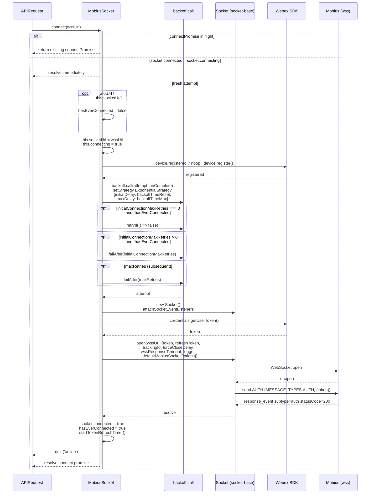
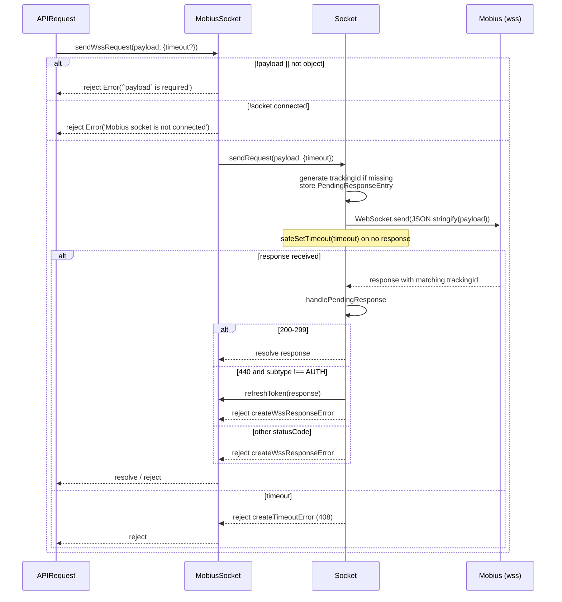
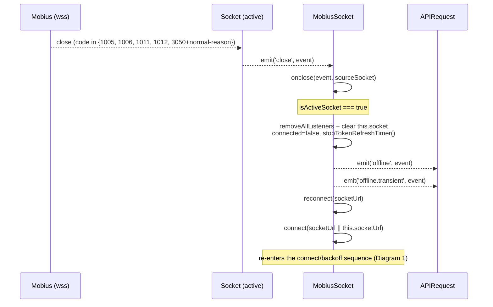
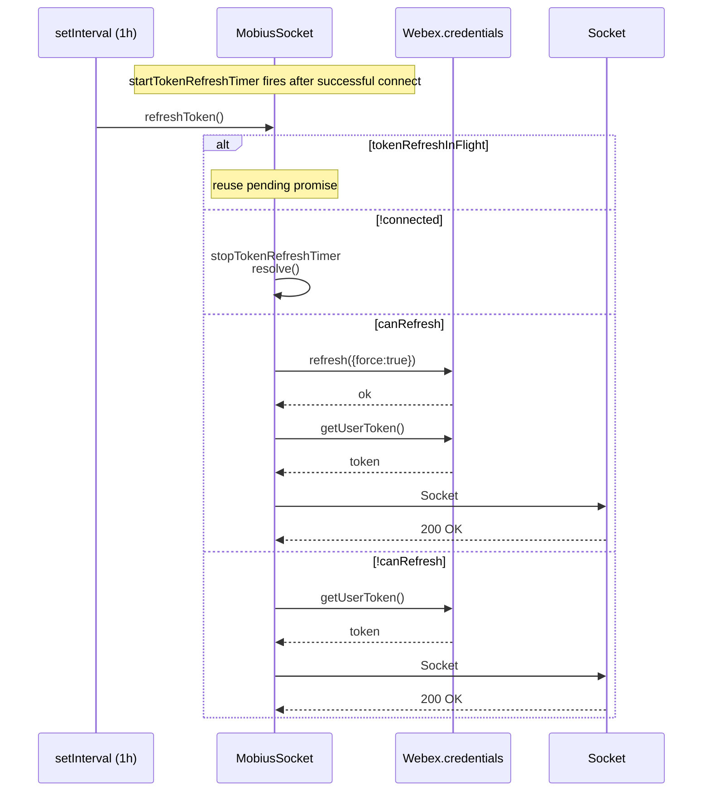
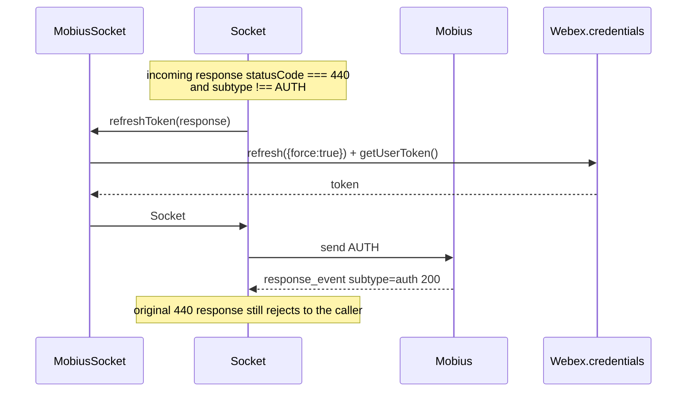
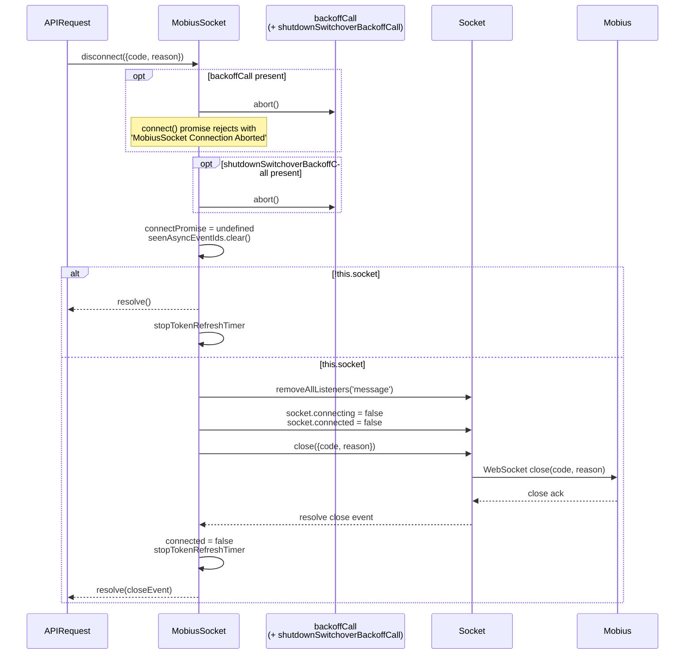
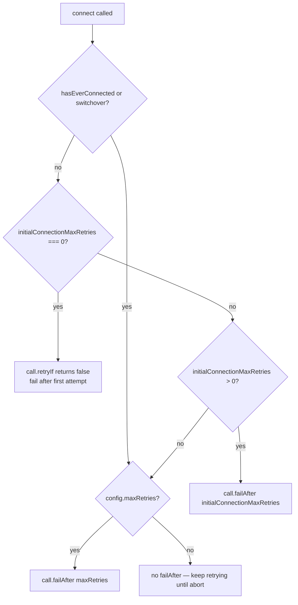
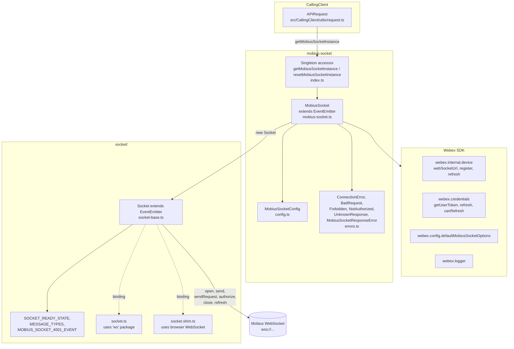
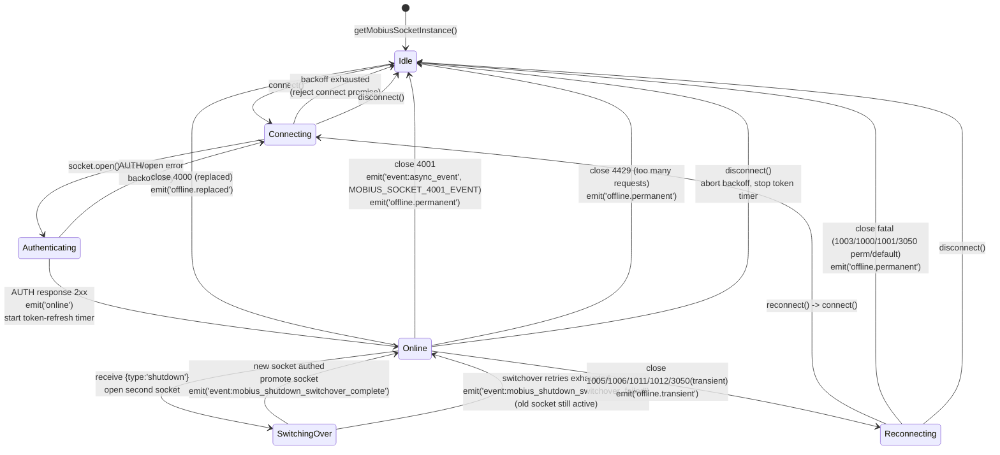

<!-- sdd-generated-metadata
doc_kind: module-spec
generated_from: module-spec@0.3.0
generated_by: claude-code
approved_by: rarajes2@cisco.com
updated_at: 2026-11-17T03:02:22Z
validation_status: blocked
-->

# mobius-socket

This source-local document at `src/mobius-socket/docs/README.md` owns the stable specification for
**mobius-socket**: the package-internal Mobius WebSocket client that keeps one authenticated socket
per process, correlates requests and responses over it, delivers Mobius asynchronous events, and
recovers from closes, token expiry, and planned server shutdown. Ground every claim in package
evidence and link to the [package architecture](../../../docs/architecture.md) instead of repeating
broader facts. No service specification exists because this package is a library.

Related context: [documentation index](../../../docs/index.md) ·
[package agent instructions](../../../AGENTS.md)

## Metadata

| Field | Value |
| ----- | ----- |
| Owner | @webex/web-sdk (CODEOWNERS default rule) |
| Source path | `src/mobius-socket` |
| Resource kind | module |
| Status | Active |
| Last verified | 2026-11-16 at `0b8c34db7f` |
| Module id | `mobius-socket` |
| Parent spec | — |
| Doc kind | Module spec |
| Coverage score | Pending coverage assessment |
| Validation status | blocked — validator `01a1e76e-1dbd-7680-94e4-46d29d2946d4`, assessed 2026-11-17; 2 Blocking, 1 Important (questionnaire gate evidence, UC config contract index, SDKConnector test coverage) |

## Applicability

| Condition ID                         | Status     | Evidence or reason | Owned section |
| ------------------------------------ | ---------- | ------------------ | ------------- |
| `module.has_tiers`                   | N/A        | No tier policy exists in this package or its `package.json` | Tier |
| `module.has_ui`                      | N/A        | No view or screen; the module is a transport client (`src/mobius-socket/mobius-socket.ts`) | UI use-case flow |
| `module.crosses_service_boundaries`  | Applicable | Opens a WebSocket to Mobius and exchanges requests, responses, and events (`src/mobius-socket/socket/socket-base.ts`) | Cross-boundary use-case flow |
| `module.holds_client_state`          | Applicable | The singleton holds the active socket, flags, backoff calls, token timer, and dedup cache (`src/mobius-socket/index.ts`, `src/mobius-socket/mobius-socket.ts`) | Client state model |
| `module.enforces_domain_rules`       | Applicable | Host allowlist before token transmission, trackingId correlation, and close-code policy (`src/mobius-socket/socket/socket-base.ts`, `src/mobius-socket/mobius-socket.ts`) | Business rules and invariants |
| `module.is_concurrent_async`         | Applicable | Promise-based connect and requests, timers, two backoff controllers, and event fan-out (`src/mobius-socket/mobius-socket.ts`) | Concurrency and reactive flow |
| `module.owns_persistence`            | N/A        | No stored data; all state is in process memory (`src/mobius-socket/mobius-socket.ts`) | Data, schema, and migration discipline |
| `module.stateful_transitions`        | Applicable | Connecting, authenticating, online, switchover, reconnecting, and idle transitions driven by close codes (`src/mobius-socket/mobius-socket.ts`) | State machine |
| `module.exposes_wire_protocol`       | Applicable | JSON request, response, auth, acknowledgement, async-event, and shutdown frames (`src/mobius-socket/socket/socket-base.ts`, `src/mobius-socket/socket/constants.ts`) | Protocol and wire format |
| `module.ui_multi_screen`             | N/A        | No UI | UI flow |
| `module.large_data_model`            | N/A        | A handful of envelope and option shapes (`src/mobius-socket/socket/types.ts`) | Data model |
| `module.returns_caller_errors`       | Applicable | connect, sendWssRequest, and disconnect reject with typed errors (`src/mobius-socket/errors.ts`) | Caller-visible failure modes |
| `module.module_specific_conventions` | Applicable | Single-consumer access through the request wrapper and token-handling rules (`src/CallingClient/utils/request.ts`, `src/mobius-socket/mobius-socket.ts`) | Module-specific rules |
| `module.published_package`           | N/A        | Nothing from this module is exported from `src/index.ts` | Export stability |
| `module.embedded_in_host`            | N/A        | No host theme or embed API | Host integration and theming |
| `module.has_design_tradeoff`         | Applicable | A long-lived process-wide socket with make-before-break switchover (`src/mobius-socket/mobius-socket.ts`) | Key design trade-off |
| `module.has_submodules`              | N/A        | Computed false by the Repo Annotation module_tree.py script: the socket and test folders are part of this module | Sub-modules |

## Evidence register

Requirements cite stable implementation and test file paths; no line-number anchors or local
run-report paths are canonical evidence.

| Evidence | What it establishes |
| -------- | ------------------- |
| `src/mobius-socket/index.ts` | The singleton accessor and reset function, the default and named `MobiusSocket` export, and side-effect imports of the device, feature, and metrics plugins |
| `src/mobius-socket/mobius-socket.ts` | `MobiusSocket`: connect, disconnect, request delegation, backoff policy, close-code handling, message dispatch, async-event dedup, token refresh, shutdown switchover, the `off` override, safe emission, and the `console` logger fallback |
| `src/mobius-socket/socket/socket-base.ts` | `Socket`: open guards including the trusted-host check, the AUTH handshake, request correlation and timeouts, event acknowledgement, close and forced close, and close-code repair |
| `src/mobius-socket/socket/socket.ts`, `src/mobius-socket/socket/socket.shim.ts`, `src/mobius-socket/socket/index.ts`, `package.json` | The Node.js binding uses `ws` 8.17.1; the `browser` field of `package.json` swaps in the shim, which returns the global `WebSocket` or `MozWebSocket` |
| `src/mobius-socket/socket/constants.ts`, `src/mobius-socket/socket/types.ts` | Ready states, the `auth` and `event_ack` message types, the synthetic 4001 event, and the envelope, option, and pending-entry shapes |
| `src/mobius-socket/config.ts`, `src/mobius-socket/types.ts`, `src/mobius-socket/errors.ts` | Configuration defaults, the request and close option types, the response error type, and the connection error classes |
| `src/common/Utils.ts`, `src/common/constants.ts` | `isMobiusWssHostAllowed`, the allowlist `webex.com`, `wbx2.com`, `webexapis.com`, `cisco.com` (exact host or subdomain), and `filterMobiusUris` |
| `src/CallingClient/utils/request.ts`, `src/CallingClient/utils/wsFeatureFlag.ts` | The only non-test importer: `APIRequest` and the WSS feature flag |
| `src/mobius-socket/mobius-socket.test.ts` | Singleton config, connect and retry policy, error classes, proxy agent options, disconnect, requests, URL fallback, switchover, dedup, and the 4001 and 4429 closes |
| `src/mobius-socket/mobius-socket-events.test.ts` | `off` without a listener, `online` and `offline`, the close-code actions for 1000, 1001, 1003, 1005, 1006, 1011, 4000, and no code, and envelope fan-out |
| `src/mobius-socket/socket.test.ts`, `src/mobius-socket/errors.test.ts` | Socket open requirements, the allowlist, auth success and failure, close codes and forced close, send state, close-code repair, acknowledgements, and `ConnectionError` fields |
| `src/mobius-socket/test/mocha-helpers.ts`, `src/mobius-socket/test/promise-tick.ts` | Test-only helpers: a skip wrapper and a promise-tick delay |
| Package-wide search of src, 2026-11-16 | Outside tests only `src/CallingClient/utils/request.ts` imports the module; only tests call `resetMobiusSocketInstance` |

## Purpose and boundary

The `mobius-socket` module implements the **Mobius WebSocket transport** used by `CallingClient`. It provides a single, long-lived WebSocket connection to a Mobius node and exposes a request/response and async-event API on top of it. When the WSS feature flag (`webrtc-calling-over-ws-CALL-219562`) is enabled in WDM (or via the samples-page `localStorage` override), most Mobius REST traffic (registration, call setup, keepalive, supplementary services) is routed through this socket instead. Discovery (`CallingClient.getMobiusServers`), device listing (`getDevices`), and failback health pings (`Registration.isPrimaryActive`) always use `webex.request()` directly regardless of the flag.

This module is **transport-only**. It does not know about calls, lines, registration, or any calling-business logic — those concerns live in the `CallingClient` module. The socket emits raw envelopes and the `APIRequest` layer in `CallingClient/utils/request.ts` translates them into `WebexRequestPayload`-shaped responses for the rest of the SDK.

**Package:** `@webex/calling`

**Entry point:** `src/mobius-socket/index.ts`

**Class:** `MobiusSocket extends EventEmitter`

**Factories:**
- `getMobiusSocketInstance(webex, config?) → MobiusSocket` — module-level singleton accessor
- `resetMobiusSocketInstance(): void` — drops the cached singleton (used by the unit tests)

- Responsibility: mobius-socket owns the behavior rooted at `src/mobius-socket/` and serves it to
  the CallingClient request layer of the `@webex/calling` package; shared infrastructure remains
  owned by `Errors`, `Events`, `Logger`, and `common`.
- In scope: the singleton, connection lifecycle and retries, request/response correlation, event
  delivery and dedup, token refresh, shutdown switchover, and close-code policy (`MOD-001` to
  `MOD-016`), including the internal `socket/` folder.
- Out of scope: the WSS feature flag, Mobius discovery, choosing which server to connect to, and
  mapping envelopes to calling events, which belong to the
  [CallingClient specification](../../CallingClient/docs/README.md) and the
  [registration specification](../../CallingClient/registration/docs/README.md).
- Consumers: `CallingClient` consumes this module through the `APIRequest` wrapper in
  `src/CallingClient/utils/request.ts`; it does not import `MobiusSocket` directly outside that
  wrapper (Use cases and flows).

## Structure and key files

The module is TypeScript source in the `@webex/calling` package, tested with Jest unit tests; its
remote transport is the Mobius WebSocket (see Dependencies).

| File | Holds |
|---|---|
| `src/mobius-socket/index.ts` | Singleton accessor `getMobiusSocketInstance`, `resetMobiusSocketInstance`, and the `MobiusSocket` re-exports |
| `src/mobius-socket/mobius-socket.ts` | `MobiusSocket` (connect/disconnect/sendWssRequest/event fan-out, retries, token refresh, switchover) |
| `src/mobius-socket/config.ts` | `MobiusSocketConfig` and its defaults |
| `src/mobius-socket/errors.ts` | `ConnectionError` and subclasses, `createWssResponseError`, `createTimeoutError` |
| `src/mobius-socket/types.ts` | `MobiusSocketRequestPayload`, `MobiusSocketRequestOptions`, `MobiusSocketCloseOptions`, `MobiusSocketResponseError`, `MobiusSocketDisconnectResult` |
| `src/mobius-socket/socket/index.ts` | Re-exports the environment-appropriate `Socket` |
| `src/mobius-socket/socket/socket.ts` | Node.js binding (`ws` package) |
| `src/mobius-socket/socket/socket.shim.ts` | Browser binding (global `WebSocket` or `MozWebSocket`) |
| `src/mobius-socket/socket/socket-base.ts` | Generalised `Socket` abstraction (open/close/send/sendRequest/authorize/refresh) |
| `src/mobius-socket/socket/constants.ts` | `SOCKET_READY_STATE`, `MESSAGE_TYPES`, `MOBIUS_SOCKET_4001_EVENT` |
| `src/mobius-socket/socket/types.ts` | `SocketCloseEvent`, `SocketResponse`, `SocketOpenOptions`, `PendingResponseEntry`, and transport types |
| `src/mobius-socket/test/mocha-helpers.ts` | Test-only skip helper |
| `src/mobius-socket/test/promise-tick.ts` | Test-only promise-tick helper |
| `src/mobius-socket/mobius-socket.test.ts` | Connect/disconnect/retry/request/dedup/switchover tests |
| `src/mobius-socket/mobius-socket-events.test.ts` | Event fan-out, close-code actions, and emitter override tests |
| `src/mobius-socket/socket.test.ts` | `Socket` tests (open/close/send/authorize/acknowledge) |
| `src/mobius-socket/errors.test.ts` | Error class smoke test |

The `socket/` folder is internal to this module. Outside `mobius-socket/`, only the `MobiusSocket` class and the singleton accessors are part of the module's surface.

## Public surface

Declarations live in `src/mobius-socket/index.ts`, `src/mobius-socket/mobius-socket.ts`,
`src/mobius-socket/config.ts`, and `src/mobius-socket/types.ts`; this section summarises them and does
not restate signatures. The contract index is the [package architecture](../../../docs/architecture.md).

| Contract ID | Type | Surface | Purpose | Compatibility / deprecation | Schema / detail link | Root index |
|---|---|---|---|---|---|---|
| `mobius-socket-internal` | Internal transport | `getMobiusSocketInstance(webex, config?)` returns the singleton `MobiusSocket`; `resetMobiusSocketInstance()` drops it; both synchronous | Own the package's singleton Mobius WebSocket lifecycle (`MOD-001`) | Internal; class/accessors are not exported from `src/index.ts` | `src/mobius-socket/index.ts`, `src/mobius-socket/mobius-socket.ts` | [package architecture](../../../docs/architecture.md) |
| `mobius-socket-internal` | Internal transport | `connect`, `disconnect`, `sendWssRequest`, connection/event methods | Carry CallingClient registration/call requests and async events over Mobius WSS (`MOD-002` to `MOD-015`) | Internal transport contract | `src/mobius-socket/mobius-socket.ts`, `src/mobius-socket/types.ts` | [package architecture](../../../docs/architecture.md) |
| `calling-client-sdk` | Public type/value | `MOBIUS_SOCKET_DISCONNECT_REASON`; `MobiusSocketDisconnectedEvent` | Let package consumers interpret CallingClient disconnect notifications without exporting MobiusSocket; CallingClient maps this module's `offline.permanent`, `offline.transient`, and `offline.replaced` events to them | Semver-controlled; owned by the CallingClient specification | `src/Events/types.ts`, `src/CallingClient/utils/constants.ts`, `src/index.ts` | [package architecture](../../../docs/architecture.md) |

The MobiusSocket class and singleton accessors are package-internal and nothing from this module is
re-exported; the disconnect reason and payload contracts above are declared by CallingClient and
Events.

**`getMobiusSocketInstance(webex, mobiusSocketConfig?)`** — synchronous; `webex` is required and
`mobiusSocketConfig` is an optional `Partial<MobiusSocketConfig>`; returns a `MobiusSocket`.

- Returns the cached singleton if it exists; otherwise constructs a new `MobiusSocket` using `{...config.mobiusSocket, ...mobiusSocketConfig}`.
- The `webex` argument is **only** consulted on the first call; subsequent calls ignore both `webex` and `mobiusSocketConfig` and return the cached instance.
- Throws (from the `MobiusSocket` constructor) if `webex` is missing on the first call.

**`resetMobiusSocketInstance()`** — synchronous, no parameters, returns nothing.

- Drops the cached singleton so the next `getMobiusSocketInstance()` call constructs a new one. Only the unit tests call it today.

**`MobiusSocket` methods**

| Method | Signature | Description |
|---|---|---|
| `connect` | `(webSocketUrl?: string): Promise<void>` | Opens (or reuses) the Mobius socket. Idempotent while a `connectPromise` is in flight, and resolves at once while the active socket is connected or connecting, even when `webSocketUrl` names another server. If `webSocketUrl` differs from the previously-cached `socketUrl`, the next attempt is treated as a fresh initial connection for retry-budget purposes (`hasEverConnected = false`). When `webSocketUrl` is omitted, falls back to the cached URL, then to `webex.internal.device.webSocketUrl`. |
| `disconnect` | `(options?: MobiusSocketCloseOptions): MobiusSocketDisconnectResult` | Aborts both the primary and shutdown-switchover backoff calls, clears state, stops the token-refresh timer, removes the socket's message listeners, and closes the underlying socket; the close event is still handled (`MOD-007`). Safe to call when no socket is open. |
| `sendWssRequest` | `(payload: MobiusSocketRequestPayload, options?: MobiusSocketRequestOptions): Promise<SocketResponse>` | Sends a JSON request and resolves with the matching response (correlated by `trackingId`). Rejects when the socket is not connected or the payload is invalid. |
| `isConnected` | `(): boolean` | Returns the cached `connected` flag (true after the first successful auth handshake until the active socket closes). |
| `getConnectedWebSocketUrl` | `(): string \| undefined` | Returns the URL of the currently-connected socket, or `undefined` when no socket is connected. |
| `on` / `off` / `emit` | inherited from `EventEmitter` | `off(eventName)` without a listener removes **all** listeners for that event (override). |

**Events emitted**

| Event | Payload | When |
|---|---|---|
| `online` | _(none)_ | First successful authenticated connection (or post-reconnect success). Emitted only for the primary connection path, not for shutdown switchover (switchover emits `event:mobius_shutdown_switchover_complete` instead). |
| `offline` | `SocketCloseEvent` | The active socket has closed. Emitted only when the closing socket is the currently-active one. |
| `offline.permanent` | `SocketCloseEvent` | Close codes that must not trigger reconnect: `1000`, `1001`, `1003`, `4001` (active socket only), `4429` (active socket only), `3050` (with a non-normal reason), default branch. |
| `offline.replaced` | `SocketCloseEvent` | Close code `4000` — the server replaced the connection. |
| `offline.transient` | `SocketCloseEvent` | Close codes `1005`, `1006`, `1011`, `1012`, and `3050` with `reason ∈ {'idle', 'done (forced)'}`. Triggers automatic `reconnect`. |
| `connection_failed` | `(error, {retries})` | A non-1006 attempt failed and at least one retry has already been spent on this backoff cycle. |
| `event` | raw envelope | Catch-all: every non-shutdown, non-duplicate envelope is also re-emitted as `event` for legacy listeners. |
| `event:<envelope.type>` | envelope | Emitted for every typed envelope that is not a shutdown notice or a suppressed duplicate, e.g. `event:response_event` for request responses and `event:async_event`. The async-event payload is the **deduped** envelope. |
| `event:<namespace>` | envelope | Emitted from `eventType.split('.')[0]` — e.g. `event:registration`, `event:call`. |
| `event:<eventType>` | envelope | Emitted with the full `eventType` when it differs from its namespace, e.g. `event:registration.down`. |
| `event:async_event` | envelope **or** `MOBIUS_SOCKET_4001_EVENT` | Emitted in two distinct situations: **(1) Normal path** — every real Mobius async envelope (`envelope.type === 'async_event'`) triggers this via the generic `event:<envelope.type>` handler; the payload is the deduped envelope. **(2) Synthetic path** — also emitted on close code `4001` (regardless of whether the closing socket is the currently-active one) with the fixed `MOBIUS_SOCKET_4001_EVENT` payload, so consumers always see a `registration.down` event. When the closing socket is active, `offline` and `offline.permanent` are also emitted alongside it. |
| `event:mobius_shutdown_imminent` | shutdown envelope | Fired when Mobius signals an imminent shutdown (`{type: 'shutdown'}`). Reserved for future consumers — not currently subscribed in `CallingClient`. |
| `event:mobius_shutdown_switchover_complete` | `{url}` | The make-before-break replacement socket finished authenticating and was promoted. |
| `event:mobius_shutdown_switchover_failed` | `{reason}` | The switchover backoff exhausted its retries or threw synchronously. |

`event:async_event` is the event `CallingClient` uses for Mobius data, through
`APIRequest.registerMobiusSocketListener`; `APIRequest.registerMobiusSocketConnectionListener` also
subscribes to `online`, `offline.permanent`, `offline.transient`, and `offline.replaced`.

**Configuration**

`MobiusSocketConfig` in `src/mobius-socket/config.ts` has seven required numeric fields; the
singleton merges the package defaults with any partial override passed on the first
`getMobiusSocketInstance` call. `APIRequest` passes none, so production uses the defaults.

| Property | Default | Notes |
|---|---|---|
| `wssResponseTimeout` | `10000` ms | Per-request timeout. Falls through to `Socket#sendRequest` which uses `10000` ms when neither the per-call override nor this default is set. |
| `backoffTimeMax` | `32000` ms | Exponential backoff ceiling. |
| `backoffTimeReset` | `1000` ms | Initial backoff delay. |
| `initialConnectionMaxRetries` | `0` | `0` disables retries on the very first connect (`call.retryIf(() => false)`); positive values cap retries with `call.failAfter(n)`. |
| `maxRetries` | `3` | Applied to subsequent connects/reconnects when `hasEverConnected === true`, to shutdown switchover, and to an initial connect when `initialConnectionMaxRetries` is unset or negative. `0` sets no cap, so retries continue until aborted. |
| `forceCloseDelay` | `2000` ms | Time the `Socket` waits for a close event before synthesising one. |
| `dedupCacheMaxSize` | `1000` | LRU eviction threshold for the seen `async_event` `eventId` map; `0` disables eviction. |

`MobiusSocket` reads an SDK-level escape hatch from `webex.config.defaultMobiusSocketOptions`. When set, those options are merged into the per-attempt options passed to `Socket#open` after the SDK-provided `token`, `refreshToken`, `trackingId`, `logger`, `forceCloseDelay`, and `wssResponseTimeout`, so they win on conflict; the unit tests use it for a proxy `agent`. It is intended for advanced diagnostic tuning (Module-specific rules).

## Dependencies

| Dependency | Why it is required | Failure behavior |
| ---------- | ------------------ | ---------------- |
| Mobius WebSocket (`mobius-websocket`) | Request/response and asynchronous call events; the URL comes from the caller, the cache, or the device | Closes drive the close-code policy (State machine) |
| WebSocket implementation: `ws` 8.17.1 in Node.js, the global `WebSocket` or `MozWebSocket` in browsers | Transport, chosen by the `browser` field of `package.json` | A missing constructor fails `Socket#open` |
| Webex credentials and device (`webex-sdk-host`) | `credentials.getUserToken`, `credentials.refresh` and `canRefresh`; `internal.device.registered`, `register`, `refresh`, and `webSocketUrl`; `config.defaultMobiusSocketOptions`; `logger`; `sessionId` | A rejected token or device call fails the attempt and enters the retry policy (`MOD-005`) |
| `backoff` 2.5.0 | Exponential retry with `failAfter` and `retryIf` (`MOD-004`) | — |
| `@webex/common`, `@webex/common-timers`, `lodash` | `Exception` base class and `checkRequired`; `safeSetTimeout`; `defaults`, `has`, `isObject` | — |
| Trusted-host check in `src/common/Utils.ts` | `isMobiusWssHostAllowed` before any WebSocket is created (`INV-006`) | Rejects the attempt with `ConnectionError` code 4000 |

## Requirements

| ID | WHAT | WHY | Source Evidence | Test / Example Evidence | Assumptions / Gaps | Confidence |
|---|---|---|---|---|---|---|
| `MOD-001` | One `MobiusSocket` instance per process via `getMobiusSocketInstance()`. `resetMobiusSocketInstance()` clears the cache. The first call constructs it with the package defaults overlaid by the optional partial config; later calls return the cached instance and ignore both arguments; the constructor throws `A Webex instance is required when initializing MobiusSocket` without `webex`. | A process-wide socket avoids competing Mobius sessions, while the explicit reset supports controlled reinitialization and isolated tests. | `src/mobius-socket/index.ts`, `src/mobius-socket/mobius-socket.ts` | `src/mobius-socket/mobius-socket.test.ts` "uses package config when consumer config is not provided", "uses consumer config when it is provided" | Caching across calls and the constructor error are not asserted | Present |
| `MOD-002` | `connect(webSocketUrl?)` opens (or reuses) a socket to the supplied URL, falling back to `webex.internal.device.webSocketUrl`. It returns the in-flight connect promise when one exists, resolves at once while the active socket is connected or connecting, resets the retry history when an explicit URL differs from the cached one, caches an explicit URL, registers the device when it is not registered, and then runs the backoff flow (`MOD-004`). | Idempotent connect prevents duplicate sockets, retry loops, listeners, or token timers from surviving a lifecycle transition. | `src/mobius-socket/mobius-socket.ts` | `src/mobius-socket/mobius-socket.test.ts` "lazily registers the device", "can safely be called multiple times", "resolves immediately", "connects to MobiusSocket with provided url", "falls back to device webSocketUrl when no URL is provided" | A `connect` to another URL while connected is a no-op (Pitfalls and constraints) | Present |
| `MOD-003` | Each attempt creates a new `Socket`, attaches its close and message listeners, makes it the active socket (normal path only), reads `credentials.getUserToken()`, strips a leading `Bearer `, and opens it with `forceCloseDelay`, `wssResponseTimeout`, the token, a `refreshToken` callback, `trackingId` set to the SDK session ID and the current time, and the logger, merged with `defaultMobiusSocketOptions`. On success the socket and the client are marked connected, `hasEverConnected` is set, the token timer starts, and `online` is emitted. | The token sent in the AUTH frame must be the bare access token, and a socket must be reachable by `disconnect()` while it opens. | `src/mobius-socket/mobius-socket.ts` | `src/mobius-socket/mobius-socket.test.ts` "should open socket with correct options for normal connection", "strips the Bearer prefix from connect-time auth token", "connects to MobiusSocket using proxy agent"; `src/mobius-socket/mobius-socket-events.test.ts` "emits the online event" | — | Present |
| `MOD-004` | `backoff.ExponentialStrategy` with `initialDelay = backoffTimeReset`, `maxDelay = backoffTimeMax`, capped retries based on `initialConnectionMaxRetries` (first attempt) and `maxRetries` (subsequent reconnects). An initial connect with `initialConnectionMaxRetries` 0 disables retries; a positive value caps them; otherwise `maxRetries`, when non-zero, caps them; with no cap the call retries until aborted. | Separate initial and reconnect retry budgets bound startup delay while allowing established clients to recover from transient closure; failing the first attempt fast lets the caller try another server. | `src/mobius-socket/mobius-socket.ts`, `src/mobius-socket/config.ts` | `src/mobius-socket/mobius-socket.test.ts` "backs off exponentially", "rejects immediately on failure without retrying", "uses config-driven initial retry behavior in the shared backoff strategy", "treats a different explicit URL as a fresh initial connect" | — | Present |
| `MOD-005` | A failed attempt is handled by error class: `UnknownResponse` refreshes the device and retries, `NotAuthorized` refreshes credentials with `force: true` and retries, `BadRequest` and `Forbidden` abort the backoff call so `connect()` rejects with `MobiusSocket Connection Aborted`, and any other error retries. `connection_failed` is emitted with the error and the retry count when the code is not 1006 and at least one retry was spent. | The error class encodes whether a refresh can fix the cause; the class messages state that a 4400 implies service account credentials and a 4403 missing entitlement. | `src/mobius-socket/mobius-socket.ts`, `src/mobius-socket/errors.ts` | `src/mobius-socket/mobius-socket.test.ts` "with BadRequest", "with UnknownResponse", "with NotAuthorized", "with Forbidden" | `connection_failed` is not asserted | Present |
| `MOD-006` | `Socket#open` rejects without a URL, on a second call, without the `forceCloseDelay`, `token`, `trackingId`, and `logger` options, and for a host outside the allowlist (`INV-006`). A close before authentication maps 1005 to `UnknownResponse`, 4400 to `BadRequest`, 4401 to `NotAuthorized`, 4403 to `Forbidden`, and anything else to `ConnectionError`. After the transport opens it sends the AUTH request and resolves only on a 2xx response with subtype `auth`. | A socket that could leak the token or is not authenticated never becomes usable. | `src/mobius-socket/socket/socket-base.ts` | `src/mobius-socket/socket.test.ts` "requires a url", "requires a token option", "cannot be called more than once", "socket.open rejects non-allowlisted host before authorize", "rejects with a BadRequest", "rejects upon receiving a non-2xx auth response_event" | — | Present |
| `MOD-007` | `disconnect(options?)` aborts retries, removes listeners, and closes the underlying socket. Precisely: it aborts both backoff calls, clears the connect promise and the dedup cache, and with no socket marks the client offline, stops the timer, and resolves. Otherwise it removes the socket's message listeners, clears the socket flags, and calls `Socket#close` (default code 1000 `Done`; other codes must be 3000 to 4999). The close event still reaches the close handler, which emits `offline` and the close-code event: 3050 with `done (permanent)` emits `offline.permanent`, and 3050 with `idle` reconnects. Then the client is marked offline and the timer stopped. | Complete disconnect cleanup prevents duplicate sockets, retry loops, listeners, or token timers from surviving a lifecycle transition. | `src/mobius-socket/mobius-socket.ts`, `src/mobius-socket/socket/socket-base.ts` | `src/mobius-socket/mobius-socket.test.ts` "disconnects the WebSocket", "disconnects the WebSocket with code 3050", "stops emitting message events", "stops the attempt when disconnect called"; `src/mobius-socket/socket.test.ts` "only accepts valid close codes" | Close-event emission during `disconnect` is not asserted | Present |
| `MOD-008` | `sendWssRequest(payload, options?)` sends a JSON envelope keyed by `trackingId` and resolves with the matching `SocketResponse`. It rejects a non-object or array payload and a disconnected active socket. `Socket#sendRequest` generates a `trackingId` when missing, rejects a `trackingId` already pending, sets the timeout from the per-call option, then `wssResponseTimeout`, then 10 000 ms, and settles on the first response whose `trackingId` matches and whose `subtype` equals the request `type`. Closing the socket rejects every pending request with `ConnectionError`. | Tracking-id correlation lets concurrent WebSocket requests resolve the correct promise and gives each request a bounded timeout. | `src/mobius-socket/mobius-socket.ts`, `src/mobius-socket/socket/socket-base.ts` | `src/mobius-socket/mobius-socket.test.ts` "resolves when a matching response_event arrives", "rejects when the matching response does not arrive before timeout", "rejects pending requests when the active socket closes", "rejects array payloads" | — | Present |
| `MOD-009` | Mobius async events (`async_event` envelopes) are deduped by `eventId` (LRU cache, see `dedupCacheMaxSize`) and re-emitted to listeners as `event:async_event`, `event:<type>`, and `event:<namespace>`. `Socket` acknowledges every async event that has an `eventId` before dedup, so duplicates are acknowledged too; the dedup cache survives socket replacement and is cleared only by `disconnect()`. | Event-id deduplication prevents redelivered async envelopes from driving duplicate registration or call state transitions. | `src/mobius-socket/mobius-socket.ts`, `src/mobius-socket/socket/socket-base.ts`, `src/mobius-socket/config.ts` | `src/mobius-socket/mobius-socket.test.ts` "suppresses duplicate async_event messages", "suppresses duplicate async_event messages across socket replacement without disconnect", "evicts only the oldest eventId when the dedup cache exceeds max size", "clears the dedup cache on disconnect"; `src/mobius-socket/socket.test.ts` "acknowledges async_event messages only" | — | Present |
| `MOD-010` | Hourly `setInterval` while connected (`TOKEN_REFRESH_INTERVAL_MS = 60 * 60 * 1000`). Also triggered inline when the underlying socket surfaces a `statusCode 440` on a non-AUTH response. Calls `webex.credentials.refresh({force: true})` (when `canRefresh`) and re-authenticates the live socket via `Socket#refresh`. A refresh already in flight is reused; when the client is offline the timer stops and the call resolves; an empty token rejects; an offline active socket skips re-authentication with a warning. Failures are logged and do not close the socket. | Refreshing credentials before expiry and on a 440 response keeps a live socket authorized without forcing consumers to rebuild the client. | `src/mobius-socket/mobius-socket.ts`, `src/mobius-socket/socket/socket-base.ts` | none found | No unit test drives the timer, the 440 path, or `Socket#refresh` | Present |
| `MOD-011` | On receipt of a server-initiated `{type: 'shutdown'}` envelope, a second socket is opened in parallel. When the new socket authenticates, it is promoted and the old socket is left in place to be closed by Mobius with code `4001`. A switchover already in progress makes the notice a no-op; the replacement opens the device `webSocketUrl`, retries under `maxRetries`, and emits `event:mobius_shutdown_switchover_complete` with the URL or `event:mobius_shutdown_switchover_failed` with the reason. It emits no `online` and does not restart the token timer. | Make-before-break switchover preserves service during planned server shutdown and avoids dropping the active socket before its replacement authenticates. | `src/mobius-socket/mobius-socket.ts` | `src/mobius-socket/mobius-socket.test.ts` "should be idempotent - no-op if already in progress", "should emit success event when switchover completes", "should emit failure event when switchover exhausts retries", "should not set socket reference before opening for shutdown switchover" | The device URL is used, not the cached Mobius URL (Pitfalls and constraints) | Present |
| `MOD-012` | Standard WebSocket close codes plus Mobius-specific codes (1003 / 4000 / 4001 / 1005-1012 / 3050 / 4401 / 4403 / 4404 / 4429) drive `offline`, `offline.permanent`, `offline.replaced`, `offline.transient`, and re-auth flows. Only a close of the active socket clears connection state and emits `offline.*`; the per-code actions are the close-code matrix in State machine. | Close-code-specific outcomes distinguish permanent, replaced, transient, authentication, and throttling cases so retry behavior is safe and predictable. | `src/mobius-socket/mobius-socket.ts`, `src/mobius-socket/socket/constants.ts` | `src/mobius-socket/mobius-socket-events.test.ts` "takes the close action" and related cases; `src/mobius-socket/mobius-socket.test.ts` 4001 and 4429 cases | 1012, 3050, 4401, 4403, and 4404 closes are not tested | Present |
| `MOD-013` | `Socket#close` waits `forceCloseDelay` for the close frame and then runs the close handler itself with the requested code and reason (or `Done (unknown)`), or code 1000 `Done (forced)` when no code was given. A socket still connecting is closed by running the handler at once with the requested code. | Callers always observe a close, and calling `close()` on a connecting socket may not preserve custom codes in browsers. | `src/mobius-socket/socket/socket-base.ts` | `src/mobius-socket/socket.test.ts` "signals closure if no close frame is received within the specified window", "manually triggers close handler when socket is still connecting" | — | Present |
| `MOD-014` | A close with code 1005 and reason `replaced` is treated as 4000; reasons `authentication failed` and the 30-second authentication timeout text are treated as 1008. | Some browsers drop close codes but keep close reasons, per the in-code comment. | `src/mobius-socket/socket/socket-base.ts` | `src/mobius-socket/socket.test.ts` "when it receives close code 1005" cases | — | Present |
| `MOD-015` | Every module event goes through a guard that catches and logs an exception thrown by a listener. `off(eventName)` without a listener removes all listeners for that event. | A faulty consumer listener must not break close handling or cleanup, per the in-code comment. | `src/mobius-socket/mobius-socket.ts` | `src/mobius-socket/mobius-socket.test.ts` "emits Error-safe events and log the error with the call parameters"; `src/mobius-socket/mobius-socket-events.test.ts` "removes all listeners for an event when off() is called without a listener" | — | Present |
| `MOD-016` | The client logs through `webex.logger` and falls back to `console` when it is missing. | Log lines should route through the SDK's appender chain. | `src/mobius-socket/mobius-socket.ts` | none found | — | Present |

## Design overview

`MobiusSocket` owns policy (retries, close codes, token refresh, switchover, dedup, fan-out) and
`Socket` owns one transport (open, AUTH, correlation, acknowledgement, close). The singleton keeps a
single active socket reference; every close or promotion decision compares a socket against it,
which is what lets a switchover keep the old socket alive without letting its close tear down the
new connection. Normal connects and switchovers run under separate backoff calls so `disconnect()`
can abort both.

| Constant | Value | Source | Description |
|---|---|---|---|
| `TOKEN_REFRESH_INTERVAL_MS` | 1 hour | `src/mobius-socket/mobius-socket.ts` | Token refresh cadence while connected. |
| `normalReconnectReasons` | `['idle', 'done (forced)']` | `src/mobius-socket/mobius-socket.ts` | Lower-cased close-reason values that flip a `3050` close into a transient/reconnectable case. |
| `MOBIUS_SOCKET_NAMESPACE` | `'MobiusSocket'` | `src/mobius-socket/mobius-socket.ts` | Log-prefix string for module logs. |
| `SOCKET_READY_STATE` | `{CONNECTING:0, OPEN:1, CLOSING:2, CLOSED:3}` | `src/mobius-socket/socket/constants.ts` | WebSocket ready-state ranges used by `Socket` guards. |
| `MESSAGE_TYPES.AUTH` | `'auth'` | `src/mobius-socket/socket/constants.ts` | Type used for the authentication handshake message. |
| `MESSAGE_TYPES.EVENT_ACK` | `'event_ack'` | `src/mobius-socket/socket/constants.ts` | Type used to acknowledge an async event. |
| `MOBIUS_SOCKET_4001_EVENT` | `{type:'async_event', trackingId:'4001-event', eventId:'4001-event-id', data:{eventType:'registration.down', ...}}` | `src/mobius-socket/socket/constants.ts` | Synthetic envelope emitted when the server closes the socket with code `4001`. |
| `dedupCacheMaxSize` (config) | `1000` | `src/mobius-socket/config.ts` | Max number of `eventId`s retained in the dedup `Map`. |

## Data flow and sequence coverage

Transport: one WebSocket per active connection (two during a switchover) carrying JSON text frames;
requests are promises correlated by `trackingId`, and events are Node.js `EventEmitter` events.

Sequence coverage:

| Operation group | Diagram / coverage | Failure / recovery coverage |
|---|---|---|
| Initial connect/auth | 1. Initial Connect with Backoff | Retry exhaustion rejects the connect promise |
| Request/response | 2. Send Request | Disconnected, invalid payload, timeout, and error response reject |
| Async dispatch/dedup | 3. Incoming Message Dispatch | Duplicate event ids are dropped |
| Planned shutdown switchover | 4. Shutdown Switchover | Old socket remains active if replacement fails |
| Transient/auth reconnect | 5–6 | Close-code and credential-refresh branches are explicit |
| Periodic/inline token refresh | 7–8 | Refresh failure is logged; the socket stays open and a 440 request still rejects |
| Disconnect | 9. Disconnect | Backoffs, timers, listeners, and pending state are cleared |

**Internal architecture**

```mermaid
graph TD
    subgraph MobiusSocket[MobiusSocket]
        C[connect] -->|prepare token + URL| PO[prepareAndOpenSocket]
        PO --> AS[Socket.open]
        AS --> AUTH[Socket.authorize<br/>(MESSAGE_TYPES.AUTH)]
        AUTH --> READY{Auth OK?}
        READY -->|yes| ONLINE[emit 'online'<br/>start token refresh<br/>set socket.connected=true]
        READY -->|no| ERRBR{Error type}

        ERRBR -->|UnknownResponse| DEV[webex.internal.device.refresh]
        ERRBR -->|NotAuthorized| TOK[webex.credentials.refresh force:true]
        ERRBR -->|BadRequest/Forbidden| ABORT[backoffCall.abort]
        ERRBR -->|other| RETRY[backoff retry]

        DEV --> RETRY
        TOK --> RETRY
        RETRY --> AS

        OM[onmessage] --> SHUTDOWN{type=='shutdown'?}
        SHUTDOWN -->|yes| SW[handleImminentShutdown<br/>open replacement socket]
        SHUTDOWN -->|no| DEDUP{trackAsyncEventAndShouldSuppressDuplicate}
        DEDUP -->|duplicate| DROP[drop envelope]
        DEDUP -->|new/none| FAN[emit event:type / event:namespace / event:eventType / event]

        OC[onclose] --> ACT{isActiveSocket?}
        ACT -->|yes| TEARDOWN[set offline,<br/>stop token timer,<br/>emit 'offline']
        ACT -->|no| OLD[non-active old socket —<br/>ignore state change;<br/>clean up listeners]

        TEARDOWN --> CC[switch on event.code]
        OLD --> CC

        CC -->|1003,1000,1001,default| PERM[emit offline.permanent<br/>— active socket only]
        CC -->|4000| REPL[emit offline.replaced<br/>— active socket only]
        CC -->|4001| EVT[emit event:async_event MOBIUS_SOCKET_4001_EVENT<br/>— always, both active and non-active<br/>emit offline.permanent — active socket only]
        CC -->|1005,1006,1011,1012| TR[emit offline.transient + reconnect<br/>— active socket only]
        CC -->|3050+normal reason| TR
        CC -->|3050+other reason| PERM
        CC -->|4401,4403,4404| RTH[refreshToken<br/>reconnect]
        CC -->|4429| TOOMANY[emit offline.permanent<br/>— active socket only;<br/>no reconnect]
    end
```

**1. Initial Connect with Backoff**



**2. Send Request (sendWssRequest)**



**3. Incoming Message Dispatch**

```mermaid
sequenceDiagram
    participant Mob as Mobius (wss)
    participant S as Socket
    participant MS as MobiusSocket
    participant App as APIRequest / CallingClient

    Mob-->>S: WebSocket message (JSON)
    S->>S: JSON.parse(event.data)
    opt data.type === 'async_event'
        S->>Mob: send EVENT_ACK {trackingId, eventId}
    end
    S->>S: handlePendingResponse (correlate by trackingId)
    S-->>MS: emit('message', {data})

    MS->>MS: onmessage(envelope)

    alt envelope.type === 'shutdown'
        MS-->>App: emit('event:mobius_shutdown_imminent', envelope)
        MS->>MS: handleImminentShutdown()
    else trackAsyncEventAndShouldSuppressDuplicate(envelope) === true
        Note over MS: drop — duplicate async_event
    else
        opt envelope.type
            MS-->>App: emit('event:<envelope.type>', envelope)
        end
        MS-->>App: emit('event', envelope)
        opt eventType present
            MS-->>App: emit('event:<namespace>', envelope)
            opt namespace !== eventType
                MS-->>App: emit('event:<eventType>', envelope)
            end
        end
    end
```



**4. Shutdown Switchover (Make-Before-Break)**

```mermaid
sequenceDiagram
    participant Mob as Mobius (wss)
    participant MS as MobiusSocket
    participant Old as Socket (old)
    participant New as Socket (new)
    participant App as APIRequest

    Mob-->>Old: {type: 'shutdown'}
    Old-->>MS: emit('message')
    MS-->>App: emit('event:mobius_shutdown_imminent', envelope)
    MS->>MS: handleImminentShutdown()

    alt shutdownSwitchoverBackoffCall in flight
        Note over MS: no-op
    else
        MS->>New: new Socket() — connecting=true<br/>(NOT promoted to this.socket yet)
        MS->>New: prepareAndOpenSocket(switchover=true)
        New->>Mob: WebSocket open + AUTH
        Mob-->>New: AUTH 200
        New-->>MS: onSuccess callback
        MS->>MS: promote new socket<br/>this.socket = New<br/>connected = true
        MS-->>App: emit('event:mobius_shutdown_switchover_complete', {url})
        Note over MS: old socket retained;<br/>server will close it with 4001

        Mob-->>Old: close 4001
        Old-->>MS: onclose(event, oldSocket)
        Note over MS: isActiveSocket === false<br/>do NOT flip connection state
        MS-->>App: emit('event:async_event', MOBIUS_SOCKET_4001_EVENT)
    end

    alt switchover backoff exhausted
        MS-->>App: emit('event:mobius_shutdown_switchover_failed', {reason})
        Note over MS: normal reconnect path will eventually re-establish<br/>once old socket is closed
    end
```

**5. Reconnect on Transient Close**



**6. Reconnect on Auth Close (4401 / 4403 / 4404)**

```mermaid
sequenceDiagram
    participant Mob as Mobius (wss)
    participant S as Socket (active)
    participant MS as MobiusSocket
    participant App as APIRequest

    Mob-->>S: close 4401/4403/4404
    S-->>MS: emit('close', event)
    MS->>MS: onclose(event, sourceSocket)
    Note over MS: isActiveSocket === true:<br/>removeAllListeners(), this.socket = undefined,<br/>emit('offline'), connected = false
    MS->>MS: refreshToken()
    Note over MS: !this.connected → early return<br/>(socket already gone; no credential<br/>refresh or Socket#refresh attempted)
    MS->>MS: reconnect(this.socket?.url)<br/>→ connect(this.socketUrl)
    Note over MS: this.socket is undefined so url arg is<br/>undefined; connect() falls back to<br/>cached this.socketUrl
    MS->>App: re-enters connect/backoff sequence (Diagram 1)
```

**7. Periodic Token Refresh**



**8. Inline Token Refresh (status 440)**



**9. Disconnect**



**Async-event dedup cache**

```mermaid
flowchart LR
    A[onmessage envelope] --> B{type === 'async_event'<br/>&& eventId?}
    B -- no --> Z[continue: not a dedup candidate]
    B -- yes --> C{seenAsyncEventIds.has eventId?}
    C -- yes --> D[delete + set again<br/>(refresh LRU)]
    D --> SUP[return true → drop envelope]
    C -- no --> E[seenAsyncEventIds.set eventId, true]
    E --> F{size > dedupCacheMaxSize?}
    F -- yes --> G[evict oldest (Map.keys().next())]
    F -- no --> Z2[fall through]
    G --> Z2
    Z2 --> H[continue dispatch]
```

- Backed by a JavaScript `Map`, exploiting its insertion-order iteration to behave as an LRU.
- Cleared on `disconnect()`.
- Each repeated `eventId` refreshes its LRU position by `delete` + `set`.

**Initial-connect retry policy**



> With the package defaults (`initialConnectionMaxRetries=0`, `maxRetries=3`), the **first** `connect()` rejects on its first attempt failure (so callers can fall back to a different URI), while subsequent reconnects retry up to 3 times.

## Class and component relationships

`mobius-socket` is a thin transport package layered on top of a generalised WebSocket abstraction. The class diagram below summarises the layering:



| Layer | Component | File | Responsibility |
|---|---|---|---|
| **Singleton** | `getMobiusSocketInstance`, `resetMobiusSocketInstance` | `index.ts` | Cache and expose a single `MobiusSocket` per process. |
| **Orchestration** | `MobiusSocket` | `mobius-socket.ts` | Connect lifecycle, retry/backoff, reconnect policy, token refresh, shutdown switchover, dedup, event fan-out. |
| **Configuration** | `MobiusSocketConfig` | `config.ts` | Timer/retry/cache defaults; merge target for caller overrides. |
| **Error model** | `ConnectionError` subclasses, `MobiusSocketResponseError` | `errors.ts` | Type-discriminated handling of `Socket#open` failures and per-request errors. |
| **Public types** | `MobiusSocketRequestPayload`, `MobiusSocketRequestOptions`, `MobiusSocketCloseOptions`, `MobiusSocketDisconnectResult` | `types.ts` | API contract for `sendWssRequest` and `disconnect`. |
| **Transport core** | `Socket` | `socket/socket-base.ts` | WebSocket connection, request/response correlation by `trackingId`, AUTH handshake, force-close, token re-auth. |
| **Env binding** | `Socket.getWebSocketConstructor` | `socket/socket.ts` (Node), `socket/socket.shim.ts` (Browser) | Returns the appropriate `WebSocket` constructor. |
| **Constants** | `SOCKET_READY_STATE`, `MESSAGE_TYPES`, `MOBIUS_SOCKET_4001_EVENT` | `socket/constants.ts` | Ready states, AUTH / EVENT_ACK type strings, synthetic 4001 envelope. |

## Use cases and flows

| Use case | Actor or caller | Primary steps and outcome | Failure or boundary behavior | Evidence |
| -------- | --------------- | ------------------------- | ---------------------------- | -------- |
| `UC-001` | `CallingClient.init` with WSS enabled | Registers the connection listener, connects to the first discovered WSS URI, then registers the async-event listener | A failed first attempt rejects at once so the caller can try the next URI (`MOD-004`) | `src/CallingClient/CallingClient.ts`, `src/CallingClient/utils/request.ts` |
| `UC-002` | Registration connecting per server | `connectToMobiusSocket(url)` returns the connected URL, or the current one when already connected | A different URL while connected is not switched (Pitfalls and constraints) | `src/CallingClient/registration/register.ts`, `src/CallingClient/utils/request.ts` |
| `UC-003` | `APIRequest.makeRequest` with WSS enabled | Sends `{type, trackingId, metadata, data}` and normalizes the response to the HTTP payload shape | Rejections are normalized to the same shape | `src/CallingClient/utils/request.ts` |
| `UC-004` | Mobius pushes call or registration events | `event:async_event` reaches `CallingClient`, which routes registration-down events to Registration and the rest to the call manager | Duplicates are dropped (`MOD-009`); a 4001 close produces a synthetic `registration.down` | `src/CallingClient/CallingClient.ts`, `src/mobius-socket/mobius-socket.ts` |
| `UC-005` | Registration teardown on failover, failback, deregister, or cleanup | `disconnectFromMobiusSocket({code: 3050, reason: 'done (permanent)'})` | Disconnect errors are logged and swallowed by `APIRequest` | `src/CallingClient/registration/register.ts`, `src/CallingClient/utils/request.ts` |
| `UC-006` | Mobius planned shutdown | Switchover keeps service on a new socket (`MOD-011`) | Failure leaves the old socket active | `src/mobius-socket/mobius-socket.ts` |

`mobius-socket` is **not** imported directly anywhere outside `src/CallingClient/utils/request.ts`. All access goes through the `APIRequest` singleton:

| `APIRequest` method | Delegates to | Used by |
|---|---|---|
| `isSocketEnabled()` | The transport flag cached by `APIRequest`, seeded at construction from `isMobiusWssEnabled(webex)` (in `utils/wsFeatureFlag.ts`) and changed by `setSocketEnabled` | `CallingClient`, `Registration`, `CallManager` (to skip the Mercury `event:mobius` listener when WSS is on). |
| `setSocketEnabled(enabled)` | The cached transport flag only | `Registration.attemptRegistrationWithServers`, which picks WSS only when the first server URI starts with `wss://`. |
| `connectToMobiusSocket(wssUrl)` | `MobiusSocket#isConnected`, `MobiusSocket#connect`, `MobiusSocket#getConnectedWebSocketUrl` | `CallingClient.connectToMobiusSocket` (post-discovery), `Registration.attemptRegistrationWithServers` (per server URI). |
| `disconnectFromMobiusSocket(options?)` | `MobiusSocket#disconnect` | `Registration.restorePreviousRegistration` / `startFailoverTimer` / `executeFailback` / `deregister` / `registrationCleanup` / `attemptRegistrationWithServers` error branch. |
| `getConnectedWebSocketUrl()` | `MobiusSocket#getConnectedWebSocketUrl` | `Registration` (to decide whether the current connection still matches `activeMobiusUrl`). |
| `makeRequest(request)` | `MobiusSocket#sendWssRequest` when WSS is enabled, otherwise `webex.request` | Mobius REST traffic routed through `APIRequest`: register, deregister, call setup/state/media/status, supplementary services, keepalive 404 recovery, etc. **Not** used for Mobius server discovery (`getMobiusServers`), device listing (`getDevices`), or failback health pings (`Registration.isPrimaryActive`) — those call `webex.request()` directly. |
| `registerMobiusSocketListener(cb)` | `MobiusSocket#on('event:async_event', cb)` | `CallingClient.init` (when WSS is enabled), invoking `handleMobiusAsyncEvent` to fan out to `CallManager.dequeueWsEvents` or `Registration.handleRegistrationDownEvent`. |
| `unregisterMobiusSocketListener()` | `MobiusSocket#off('event:async_event')` | Currently only invoked from tests/cleanup paths. |
| `isSocketConnected()` | `MobiusSocket#isConnected` | `CallingClient`, to report the current connection state to late subscribers. |
| `registerMobiusSocketConnectionListener(listener)` / `unregisterMobiusSocketConnectionListener()` | `MobiusSocket#on` / `MobiusSocket#off` for `online`, `offline.permanent`, `offline.transient`, `offline.replaced` | `CallingClient.init`, which emits its connected and disconnected events with `MOBIUS_SOCKET_DISCONNECT_REASON`. |

**Disconnect close code convention:** `CallingClient` uses `{code: 3050, reason: 'done (permanent)'}` when it wants the socket to stay torn down across a permanent state change (e.g. failover, failback, registration-down). Close code `3050` with reason `'idle'` or `'done (forced)'` is treated as transient by `MobiusSocket` and triggers reconnect on receipt.

Internal usage, as in `src/CallingClient/utils/request.ts`:

```typescript
import {getMobiusSocketInstance} from '../../mobius-socket';

const socket = getMobiusSocketInstance(webex);
await socket.connect('wss://mobius.example.webex.com/calling/api/v1');

if (socket.isConnected()) {
  log.info(`Connected to ${socket.getConnectedWebSocketUrl()}`, logContext);
}
```

```typescript
const response = await socket.sendWssRequest(
  {
    type: 'register',
    trackingId: `webex-js-sdk_${crypto.randomUUID()}`,
    metadata: {userAgent, authorization: bearerToken},
    data: {userId, serviceData, clientDeviceUri},
  },
  {timeout: 8000}
);

// Resolves only for a 2xx statusCode; any other status rejects with MobiusSocketResponseError.
handleSuccess(response);
```

```typescript
socket.on('event:async_event', (envelope) => {
  // envelope.data is a Mobius async event (e.g. registration.down, call.setup)
});
```

### Cross-boundary use-case flow

| Boundary | Transport | Ordering | Timeout | Retry and recovery | Compatibility |
| -------- | --------- | -------- | ------- | ------------------ | ------------- |
| Mobius WebSocket | WSS through `ws` or the browser `WebSocket`, JSON frames | Responses matched by `trackingId` and subtype, not by order; events in arrival order after dedup | 10 s per request by default, 408 on expiry; `forceCloseDelay` 2 s for close | Backoff per `MOD-004`; reconnect per the close-code matrix; switchover per `MOD-011` | Envelope fields per Protocol and wire format; unknown fields pass through |

## Client state model

The singleton owns the active Socket, cached URL, connected/connecting flags, connect promise, primary and switchover backoff calls, pending request map in Socket, token-refresh timer, and bounded async-event dedup cache. Reset drops the singleton for controlled reinitialization. Evidence: `src/mobius-socket/index.ts`, `src/mobius-socket/mobius-socket.ts`, `src/mobius-socket/socket/socket-base.ts`.

| State or slice | Owner | Initial state | Transition triggers | Reset or persistence boundary |
| -------------- | ----- | ------------- | ------------------- | ----------------------------- |
| Active socket and its flags | `MobiusSocket` | None | Set by each normal attempt and by switchover promotion; cleared by an active close | Process lifetime of the singleton |
| `connected`, `connecting`, `hasEverConnected` | `MobiusSocket` | All false | Success, active close, `disconnect`, a new explicit URL | Same |
| `socketUrl` | `MobiusSocket` | Unset | Every explicit `connect` URL | Never cleared |
| Backoff calls | `MobiusSocket` | None | Created per connect or switchover, cleared on completion or abort | Same |
| Token timer and in-flight refresh | `MobiusSocket` | None | Started on normal success; stopped on active close, `disconnect`, or an offline refresh | Same |
| Dedup cache | `MobiusSocket` | Empty | Each new `eventId`; LRU eviction | Cleared only by `disconnect` |
| Pending requests | Each `Socket` | Empty | `sendRequest`, response, timeout, close | Socket lifetime |

## Business rules and invariants

| ID | Invariant | WHY | Enforcement source | Test evidence |
| -- | --------- | --- | ------------------ | ------------- |
| `INV-001` | Reuse an in-flight connect promise and one process-wide MobiusSocket. | One session per process (`MOD-001`, `MOD-002`). | `src/mobius-socket/index.ts`, `src/mobius-socket/mobius-socket.ts` | `src/mobius-socket/mobius-socket.test.ts` |
| `INV-002` | Correlate responses by trackingId and time out every pending request. | No request waits forever or resolves with another request's response (`MOD-008`). | `src/mobius-socket/socket/socket-base.ts` | `src/mobius-socket/mobius-socket.test.ts` |
| `INV-003` | Deduplicate async events by eventId with bounded LRU eviction. | Bounded memory with replay protection (`MOD-009`). | `src/mobius-socket/mobius-socket.ts` | `src/mobius-socket/mobius-socket.test.ts` |
| `INV-004` | Treat close codes according to the documented permanent/replaced/transient/auth/throttle matrix. | Retry only where recovery is possible (`MOD-012`). | `src/mobius-socket/mobius-socket.ts` | `src/mobius-socket/mobius-socket-events.test.ts` |
| `INV-005` | Authorization/token values exist only in socket metadata/refresh flows and must never be emitted or logged. Evidence: `src/mobius-socket/` implementation and tests. | Tokens grant access to the user's calling service. | `src/mobius-socket/mobius-socket.ts`, `src/mobius-socket/socket/socket-base.ts` | none found |
| `INV-006` | **Trusted-host allowlist before token transmission (AC-2 / CAI-8461):** `Socket#open` (`socket-base.ts`) validates the target hostname against `MOBIUS_WSS_ALLOWED_DOMAINS` (`src/common/constants.ts`) before the WebSocket is created. If the host is not allowlisted the promise rejects with a typed `ConnectionError` and `authorize(token)` is never called, ensuring the bearer token cannot be exfiltrated to an arbitrary discovery-named host. `filterMobiusUris` (`src/common/Utils.ts`) provides a second layer by dropping non-allowlisted WSS entries from discovery responses before they reach the socket layer. | A discovery response must not be able to direct the token to another host. | `src/mobius-socket/socket/socket-base.ts`, `src/common/Utils.ts`, `src/common/constants.ts` | `src/mobius-socket/socket.test.ts` |

## Concurrency and reactive flow

Connect/reconnect and shutdown-switchover have separate backoff controllers. Only the active socket may change global connection state; old-socket close events are filtered. Pending requests resolve by tracking id, token refresh is timer-driven or response-driven, and dedup protects async consumers from replay. Evidence: `src/mobius-socket/mobius-socket.ts`, `src/mobius-socket/socket/socket-base.ts`.

- Execution model: the JavaScript event loop; WebSocket callbacks, `setInterval`, `safeSetTimeout`,
  and backoff timers drive all work.
- Ordering guarantees: responses settle by `trackingId`, not by arrival order; message handling for
  one frame runs to completion (acknowledgement, response matching, fan-out) before the next.
- Idempotency and retry: concurrent `connect` calls share one promise; concurrent token refreshes
  share one promise; a second shutdown notice during a switchover is ignored.
- Shared-state protection: identity comparison with the active socket guards every state change
  from a close event.
- Blocking restrictions: none; `onclose` awaits refresh and reconnect for the 4401, 4403, and 4404
  closes but nothing waits on it.

## State machine

`MobiusSocket` does not define a formal state enum or XState machine. Its lifecycle is implicit in the active `Socket`, the `connected` / `connecting` flags, the shared `connectPromise`, and the normal and shutdown-switchover backoff controllers. The lifecycle diagram below models those source-level transitions in detail.



| Conceptual state | Source indicator | Entry / exit behavior |
|---|---|---|
| Idle | No connected active socket; connected is false. | Initial state and the result of `disconnect()`, a permanent/replaced/throttled close, or exhausted initial retries. |
| Connecting | connectPromise and the normal backoff flow coordinate connection attempts; the candidate Socket is marked connecting. | `connect()` reuses an in-flight promise and does not start another attempt when the socket is already connected or connecting. |
| Authenticating | The transport is open and Socket#authorize() has sent an auth request. | The candidate is not promoted to Online until the correlated auth response has a 2xx `statusCode`; connection errors follow the configured retry or abort path. |
| Online | The active Socket and MobiusSocket are marked connected; the token-refresh timer is active. | Requests and events use the active socket. Transient closes enter Reconnecting; terminal closes enter Idle. |
| SwitchingOver | shutdownSwitchoverBackoffCall is active while the old socket remains the active socket. | A replacement is promoted only after it opens and authenticates. Exhausted switchover retries retain the old socket for normal server-close handling. |
| Reconnecting | An active socket received a transient close and invoked reconnect() / the normal backoff flow. | A successful open and auth return to Online; exhausted or terminal handling returns to Idle. |

Guards and invariants: only the active socket (`sourceSocket === this.socket`) may clear global connection state; an old switchover socket closing only removes its own listeners. A new explicit websocket URL resets the initial-connection retry history. `disconnect()` aborts both backoff controllers, clears the shared connect promise and event-dedup cache, and stops token refresh. Evidence: `src/mobius-socket/mobius-socket.ts`, `src/mobius-socket/socket/socket-base.ts`.

**Close-code matrix**

| Close code(s) | Source | `MobiusSocket` action | Events emitted (active socket only unless noted) |
|---|---|---|---|
| `1000`, `1001` | clean close, going away | mark offline | `offline`, `offline.permanent` |
| `1003` | service rejected last message | no reconnect | `offline`, `offline.permanent` |
| `1005`, `1006`, `1011`, `1012` | abnormal / endpoint error | reconnect | `offline`, `offline.transient` |
| `3050` (`'idle'` / `'done (forced)'`) | normal disconnect with idle/forced reason | reconnect | `offline`, `offline.transient` |
| `3050` (other reason) | permanent disconnect | no reconnect | `offline`, `offline.permanent` |
| `4000` | server replaced the connection | no reconnect | `offline`, `offline.replaced` |
| `4001` | Mobius-specific registration-down signal | no reconnect; synthesise async event | `offline` (active only), `offline.permanent` (active only), `event:async_event` (always — both active and non-active sockets) |
| `4401`, `4403`, `4404` | auth-class failures during the session | refresh token, then reconnect | `offline` (active only) — no specific offline.* variant |
| `4429` | too many requests | no reconnect | `offline` (active only), `offline.permanent` (active only) |
| `4400` | bad request (caught during Socket#open) | aborts the backoff call (via `BadRequest`) | none — surfaced as `connect()` rejection |
| default | any other code | no reconnect | `offline`, `offline.permanent` |

## Protocol and wire format

Messages are JSON objects serialized and parsed by `Socket`. The TypeScript envelope is intentionally extensible, but correlation and control-message fields have concrete behavior:

| Message | Implemented shape | Routing / handling |
|---|---|---|
| Application request | `MobiusSocketRequestPayload`: `type: string`, `trackingId: string`, plus optional envelope fields. | `sendWssRequest()` requires an object and a connected active socket, then delegates to `Socket#sendRequest()`. At the socket layer a missing `trackingId` is generated, and duplicate in-flight IDs are rejected. |
| Response | `SocketResponse` fields include `trackingId`, `subtype`, `statusCode`, `statusMessage`, `reason`, and extensible data. | A pending request is handled only when `trackingId` matches and `response.subtype === request.type`. A 2xx status resolves it; a missing or non-2xx status rejects it. |
| Authentication | `{type: 'auth', data: {token}, trackingId: <generated>}` | `Socket#authorize()` sends the token in `data.token` through the normal correlated-request path. Authentication values must never be logged or emitted. |
| Async event | `{type: 'async_event', trackingId?, eventId?, data?: {...}}` | When `eventId` is present, `Socket` sends `{type: 'event_ack', trackingId: <incoming-or-generated>, eventId}` and `MobiusSocket` suppresses repeated IDs before public event fan-out. A missing `eventId` prevents acknowledgement and deduplication. |
| Shutdown notice | `{type: 'shutdown', ...}` | Emits `event:mobius_shutdown_imminent` and starts make-before-break switchover; it is not processed as a normal application event. |
| Close control event | `{code?: number, reason?: string}` from the WebSocket close callback. | Drives reconnect, replacement, permanent-close, auth-refresh, and throttle behavior according to the close-code matrix in State machine. Code `4001` also emits the synthetic `MOBIUS_SOCKET_4001_EVENT`. |

The default response timeout is 10 seconds unless `wssResponseTimeout` or a per-request timeout overrides it; timeout rejection uses status `408`. A non-auth response with status `440` initiates token refresh and still rejects the original request. Full failure behavior is specified in Caller-visible failure modes. Evidence: `src/mobius-socket/types.ts`, `src/mobius-socket/socket/types.ts`, `src/mobius-socket/socket/constants.ts`, `src/mobius-socket/socket/socket-base.ts`, `src/mobius-socket/mobius-socket.ts`.

## Caller-visible failure modes

| Condition | Signal or result | Caller behavior | Retry or recovery | Evidence |
| --------- | ---------------- | --------------- | ----------------- | -------- |
| First connect attempt fails with default config | `connect()` rejects with the attempt error | Try the next server URI | Caller-driven | `src/mobius-socket/mobius-socket.ts` |
| `BadRequest`, `Forbidden`, or `disconnect()` during connect | `connect()` rejects with `MobiusSocket Connection Aborted` | Do not retry the same credentials (`BadRequest`, `Forbidden`) | None in the module | `src/mobius-socket/mobius-socket.ts` |
| `disconnect()` with a code other than 1000 or 3000 to 4999 | Rejects with the close-code range error; the socket stays open | Pass a valid code | — | `src/mobius-socket/socket/socket-base.ts` |
| Switchover fails | `event:mobius_shutdown_switchover_failed` with `{reason}` | Keep using the old socket | Its later close follows the close-code matrix | `src/mobius-socket/mobius-socket.ts` |

All connection-level errors extend `@webex/common`'s `Exception`.

| Trigger | Class | Effect inside `attemptConnection` |
|---|---|---|
| close `1005` before auth | `UnknownResponse` | `webex.internal.device.refresh()` then `callback(err)` → backoff retry |
| close `4400` | `BadRequest` | `backoffCall.abort()` — connect promise rejects |
| close `4401` | `NotAuthorized` | `webex.credentials.refresh({force:true})` then `callback(err)` → backoff retry |
| close `4403` | `Forbidden` | `backoffCall.abort()` — connect promise rejects |
| any other | `ConnectionError` | `callback(err)` → backoff retry (subject to `failAfter`) |

> Errors whose `code === 1006` are not emitted as `connection_failed` (they are treated as common transient browser errors).

`MobiusSocketResponseError` is a plain `Error` (not an `Exception`) created by `createWssResponseError` / `createTimeoutError` when a websocket request fails or times out. It carries `statusCode`, `statusMessage`, `response`, and `trackingId`.

| Trigger | Error | Notes |
|---|---|---|
| `!isObject(data)` | `Error('\`data\` is required')` | Caller bug. |
| Existing `trackingId` already pending | `Error('socket request already sent for trackingId ...')` | Caller must not reuse `trackingId`s for in-flight requests. |
| Timeout (`safeSetTimeout` expiry) | `createTimeoutError(request)` → `MobiusSocketResponseError` with `statusCode 408`, `statusMessage 'Mobius websocket response timed out'` | Cleared from `pendingResponses` before rejecting. |
| Response `statusCode === undefined` | `createWssResponseError(response, undefined, statusMessage \|\| 'Socket response missing status code')` | Rejected as `MobiusSocketResponseError`. |
| Response `statusCode < 200` or `>= 300` | `createWssResponseError(response, statusCode, statusMessage)` | Rejected as `MobiusSocketResponseError`. |
| Response `statusCode === 440` and `subtype !== auth` | `createWssResponseError(...)` rejection **plus** asynchronous `refreshToken(response)` call | Original request rejects; refreshed token is used for subsequent requests. |
| Socket not in the OPEN state when sending | `Error('INVALID_STATE_ERROR')` | Pending entry cleared before rejecting. |
| Socket closes with the request pending | `ConnectionError` carrying the close code and reason | Every pending request rejects. |
| `sendWssRequest` with a non-object or array payload, or with the active socket disconnected | ``Error('`payload` is required')`` or `Error('Mobius socket is not connected')` | Rejected before reaching `Socket`. |

## Pitfalls and constraints

- **Singleton scope:** `getMobiusSocketInstance` ignores subsequent `webex` and `config` arguments. Tests that need a fresh instance must call `resetMobiusSocketInstance()`.
- **`event:async_event` dedup:** Duplicates are suppressed by `eventId` and the cache is LRU-evicted at `dedupCacheMaxSize`. `disconnect()` clears the cache.
- **Token bearer prefix:** `normalizeMobiusAuthToken` strips a leading `Bearer ` before handing the token to `Socket#open`. Callers should not strip it themselves.
- **`connect()` URL change semantics:** Calling `connect(newUrl)` with a URL that differs from the previously-cached `socketUrl` resets `hasEverConnected` so the retry budget is re-evaluated as an initial connect.
- **`disconnect()` while connecting:** Aborts the in-flight backoff and rejects the awaiting `connect()` with `MobiusSocket Connection Aborted`.
- **Shutdown switchover:** The old socket is **not** closed by the SDK after switchover — Mobius is expected to close it with `4001`. `MobiusSocket#onclose` ignores closes from non-active sockets so the new connection's state is preserved.
- **440 response code:** A `statusCode === 440` on a non-AUTH response triggers `refreshToken()` via the `Socket#handlePendingResponse` path; the original response is still rejected to the caller, but the next request will use the refreshed token.
- **Logger:** When the supplied `webex.logger` is missing, the module falls back to `console`. Callers are still expected to provide the SDK logger so log lines route through the SDK's appender chain.
- **Switchover URL:** the replacement socket opens `webex.internal.device.webSocketUrl`, not the cached
  Mobius URL; an in-code comment defers this until Mobius implements the switchover (`MOD-011`). After a
  switchover `getConnectedWebSocketUrl()` returns that URL.
- **No server change while connected:** `connect(otherUrl)` resolves without switching while the
  active socket is connected or connecting; disconnect first (`MOD-002`).
- **Auth closes from an old socket:** a 4401, 4403, or 4404 close of a non-active socket still
  refreshes the token and calls `reconnect`, which resolves at once when the active socket is up.
- **Disconnect emits events:** `disconnect()` still produces `offline` and the close-code event for the
  code it sends, and a 3050 close with reason `idle` reconnects (`MOD-007`).
- **Debug logging:** every incoming envelope is logged at debug level; keep tokens out of server
  payloads and do not raise that log level in production (`INV-005`).
- **Test gaps:** no test covers token refresh, the 440 path, or the 1012, 3050, 4401, 4403, and 4404
  closes (Verification).

## Module-specific rules

- DO use the factories, typed events, constants, and adapters already owned by `src/mobius-socket/`.
- DON'T add direct network or SDK access when the module already provides an adapter.
- Do: reach this module only through `APIRequest` in `src/CallingClient/utils/request.ts`.
- Do: keep all documentation for the `socket/` and `test/` subdirectories in this single file; all relevant
  detail lives here, and no per-subdirectory spec is created inside `mobius-socket/` because they are
  not separate modules.
- Do not: use `defaultMobiusSocketOptions` to override `token` or `refreshToken`; it is merged last
  and would replace them.
- Do not: strip the `Bearer ` prefix before calling the module; it normalizes the token itself.
- Do not: reuse a `trackingId` for a request that is still pending; it is rejected.

## Key design trade-off

| Chosen trade-off | Preserved invariant or benefit | Cost or limitation | Decision evidence |
| ---------------- | ------------------------------ | ------------------ | ----------------- |
| A long-lived singleton multiplexes requests and events to avoid repeated handshakes | One authenticated session carries all Mobius traffic (`INV-001`) | Global state needs explicit reset for tests and identity checks against the active socket | `src/mobius-socket/index.ts`, `src/mobius-socket/mobius-socket.ts` |
| Make-before-break shutdown switchover and bounded dedup improve continuity | Service continues across a planned shutdown; replays are dropped (`MOD-011`, `INV-003`) | Requires active-socket identity checks and explicit reset/cleanup; two sockets exist briefly | `src/mobius-socket/mobius-socket.ts` |

## Verification

Unit checks run with Jest from the package directory; the target files are the four `*.test.ts`
files in `src/mobius-socket/`.

| Behavior / Requirement | Existing test evidence | Gap |
|---|---|---|
| `MOD-001` | `src/mobius-socket/mobius-socket.test.ts` | Caching across calls and the missing-webex error are not asserted |
| `MOD-002`, `MOD-003`, `INV-001` | `src/mobius-socket/mobius-socket.test.ts` | `connect` to another URL while connected is not tested |
| `MOD-008`, `INV-002` | `src/mobius-socket/mobius-socket.test.ts`, `src/mobius-socket/socket.test.ts` | Duplicate pending `trackingId` and the INVALID_STATE_ERROR path are not tested |
| `MOD-009`, `INV-003` | `src/mobius-socket/mobius-socket.test.ts`, `src/mobius-socket/mobius-socket-events.test.ts` | Acknowledgement of duplicates is not asserted |
| `MOD-004`, `MOD-005` | `src/mobius-socket/mobius-socket.test.ts` | `connection_failed` emission is not asserted |
| `MOD-010` | none found | Timer, 440 inline refresh, and `Socket#refresh` are untested |
| `MOD-011` | `src/mobius-socket/mobius-socket.test.ts` | The URL used by the replacement socket is not asserted; negative and error coverage stops at retry exhaustion and a synchronous throw |
| `MOD-012`, `INV-004` | `src/mobius-socket/mobius-socket.test.ts`, `src/mobius-socket/socket.test.ts`, `src/mobius-socket/mobius-socket-events.test.ts` | 1012, 3050, 4401, 4403, and 4404 closes are untested |
| `MOD-006`, `MOD-013`, `MOD-014`, `INV-006` | `src/mobius-socket/socket.test.ts` | none |
| `MOD-007`, `MOD-015`, `MOD-016`, `INV-005` | `src/mobius-socket/mobius-socket.test.ts`, `src/mobius-socket/mobius-socket-events.test.ts` | Close events during `disconnect`, the logger fallback, and log content are not asserted |

Tests that need a fresh instance reset the singleton first:

```typescript
// In the mobius-socket unit tests; the @webex/calling package entry does not export it.
import {resetMobiusSocketInstance} from './index';

resetMobiusSocketInstance();
```
