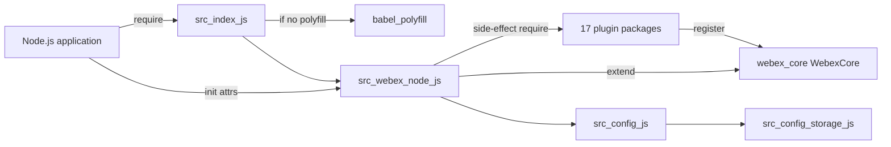
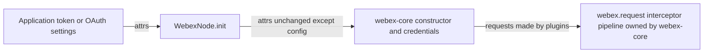

<!-- sdd-generated-metadata
doc_kind: standing-doc
generated_from: architecture@0.3.0
generated_by: claude-cowork
approved_by: akulakum@cisco.com
updated_at: 2026-10-15T23:00:24Z
validation_status: pass-with-warnings
-->

# webex-node architecture

Canonical architecture for this package. Module behavior lives in the
[webex-node SDK entry specification](../src/docs/README.md). This page owns package boundaries, the
contract index, and how the package meets the rest of the SDK.

Related context: [specification registry](specs/README.md) ·
[package agent instructions](../AGENTS.md)

## Applicability

| Condition ID                         | Status     | Evidence or reason | Owned section |
| ------------------------------------ | ---------- | ------------------ | ------------- |
| `repo.owns_datastore`                | N/A        | No database, file store, or migration in `src/` | Repository data and schema |
| `repo.holds_client_state`            | N/A        | `src/` defines no state; instance state belongs to webex-core and the plugins | Client state model |
| `repo.components_interact`           | N/A        | One module. The load order is shown under Interaction and execution flows. | Dependency and interaction topology |
| `repo.domain_data_across_components` | N/A        | No domain data in `src/` | Object and data ownership |
| `repo.caches_data`                   | N/A        | No cache in `src/` | Caching catalog |
| `repo.observability_convention`      | N/A        | `src/` has no logger, metric, or trace call; logging comes from the plugin-logger plugin it loads | Observability patterns |
| `repo.deploys_to_infra`              | N/A        | Library published to npm. No service runtime. | Runtime and infrastructure |
| `repo.shared_base_libs`              | Applicable | Extends `WebexCore` and uses the legacy build, lint, and test stack | Shared and base libraries |
| `repo.is_monorepo`                   | N/A        | This SDD root is one package. The workspace around it is out of scope. | Package map and inter-package dependencies |
| `repo.multi_platform`                | N/A        | Node.js only: `package.json` has no `browser` field and the README says the package is not meant for browsers | Platform matrix |
| `repo.published_package`             | Applicable | `package.json` `name` is `webex-node` and `deploy:npm` publishes it | Release and versioning |
| `repo.embedded_in_host`              | N/A        | No host theme or embed API | Host integration and theming |
| `repo.exposes_commands_or_artifacts` | Applicable | `build:src` writes the build output directory | Commands and generated artifacts |
| `repo.cross_repo_deps_material`      | Applicable | Behavior is supplied by webex-core and 17 sibling plugin packages | Cross-repository topology |
| `repo.security_arch_warranted`       | Applicable | Applications pass access tokens to `init`, and the package declares credential and domain-validation defaults | Security architecture |

## Design overview

`webex-node` is a published library with one module. Loading it installs the Babel polyfill when no
polyfill is present, loads 17 Webex plugin packages so that they register with webex-core, and
exports `WebexNode`, a `WebexCore` subclass with a static `init` factory that merges Node.js
configuration with the caller's configuration.

The package adds no behavior of its own after construction. Credentials, the service catalog,
requests, storage, events, and every plugin API belong to the sibling packages it loads. The
configuration it declares is currently nested under `config.default` and does not take effect; the
module spec records this under `MOD-007` and Pitfalls.

## Resource inventory and responsibilities

| Resource | Kind | Responsibility | Owner | Source | Detailed specification |
| -------- | ---- | -------------- | ----- | ------ | ---------------------- |
| webex-node SDK entry | module | Polyfill guard, plugin loading, `WebexNode` class, `init`, configuration object | @webex/web-sdk | `src/` | `src/docs/README.md` |
| Published package | package | npm entry points and `exports` | @webex/web-sdk | `package.json` | `docs/architecture.md` |

## Interaction and execution flows

| From | To | Interaction or transport | Purpose | Failure or compatibility behavior |
| ---- | -- | ------------------------ | ------- | --------------------------------- |
| Application | `src/index.js` | CommonJS `require` | Get the `WebexNode` class | A missing or unbuilt dependency throws at load |
| `src/index.js` | `@babel/polyfill` | side-effect `require` | Global polyfills when none are present | Load-time only |
| `src/webex-node.js` | Plugin packages | side-effect `require`, in order | Register plugins with webex-core | Load-time only; see the module spec Module-specific rules |
| `src/webex-node.js` | webex-core | `WebexCore.extend` and the constructor | Create the class and instances | Constructor behavior is webex-core's |
| Application | `WebexNode.init` | in-process call | Configured instance | See the module spec `INV-001` |

## Dependency topology

| Dependency | Type | Used by | Purpose | Version, failure, or fallback policy |
| ---------- | ---- | ------- | ------- | ------------------------------------ |
| `@webex/webex-core` | Internal | `src` | `WebexCore` base class, constructor, configuration, plugin registration | Workspace version |
| Plugin packages: `@webex/plugin-authorization`, `@webex/internal-plugin-calendar`, `@webex/internal-plugin-device`, `@webex/internal-plugin-presence`, `@webex/internal-plugin-support`, `@webex/internal-plugin-llm`, `@webex/plugin-attachment-actions`, `@webex/plugin-device-manager`, `@webex/plugin-logger`, `@webex/plugin-messages`, `@webex/plugin-memberships`, `@webex/plugin-people`, `@webex/plugin-rooms`, `@webex/plugin-teams`, `@webex/plugin-team-memberships`, `@webex/plugin-webhooks`, `@webex/plugin-encryption` | Internal | `src` | Side-effect registration | Workspace versions; load order in the module spec |
| `@babel/polyfill` | External | `src` | Global polyfills | Range in `package.json` |
| `@babel/runtime-corejs2` | External | build output | Babel runtime helpers | Range in `package.json` |
| `lodash` | External | `src` | `merge` in `init` | Range in `package.json` |
| `@webex/common`, `@webex/internal-plugin-voicea`, `@webex/storage-adapter-local-storage` | Internal | none | Declared, not required by `src/` | Workspace versions |

Registered names come from each plugin's own `registerPlugin` or `registerInternalPlugin` call in
that package's entry file: src/index.js, except src/index.ts in internal-plugin-llm and
plugin-encryption. plugin-authorization re-exports plugin-authorization-node in Node.js, and the
`authorization` call is in plugin-authorization-node, file src/index.js.

- Public: `authorization`, `attachmentActions`, `devicemanager`, `logger` (replacing webex-core's
  built-in logger), `messages`, `memberships`, `people`, `rooms`, `teams`, `teamMemberships`,
  `webhooks`, and `cypher` (plugin-encryption).
- Internal: `calendar`, `device`, `presence`, `support`, and `llm`.

Those packages import further plugins, such as internal-plugin-conversation and
internal-plugin-mercury, which register as well. No dependency cycle exists inside the package.

## Public and consumer surfaces

| Surface | Type | Owner | Consumers | Compatibility policy | Source |
| ------- | ---- | ----- | --------- | -------------------- | ------ |
| `webex-node-sdk` (published) | SDK | webex-node SDK entry | Node.js applications; sibling package test-webex-node (manual smoke script) | See Release and versioning | `package.json` |
| `webex-core-plugin-host` (required) | SDK | sibling package webex-core | webex-node SDK entry | External | `@webex/webex-core` |
| `webex-sdk-plugins` (required) | SDK | the 17 plugin packages | webex-node SDK entry | External; each plugin owns its API | the plugin packages |
| `babel-polyfill` (required) | SDK | npm | Package entry | See Dependency topology | npm |
| `lodash` (required) | SDK | npm | webex-node SDK entry | See Dependency topology | npm |

`webex-node-sdk` entry points: `main` and `exports["."]` point at the build output, `devMain` at
`src/index.js`, and `exports["./package"]` at `package.json`. No HTTP surface is served, so
`api-specs/openapi.yaml` is omitted.

## Cross-cutting architecture

### Security

- Trust boundaries and identity flow: see Security architecture.
- Sensitive surfaces and data classes: access tokens and OAuth client settings that applications
  pass to `init`; handling is in Security architecture.
- Encryption and secret boundaries: the package stores no secret; see Security architecture.

### Observability and operations

- Logging and correlation: none in this package (see the `repo.observability_convention` row).
- Metrics, traces, and audit signals: N/A — none emitted by this package.
- Ownership and operational entry points: no runtime to deploy or monitor; owners are listed in
  References and maintenance.

### Quality attributes

- Compatibility: `require('webex-node')` returns the class, and the plugin set and `init` merge
  order are relied on by applications.
- Footprint: loading the package loads every listed plugin and its transitive plugins.
- Correctness: the declared configuration does not take effect today (module spec `MOD-007`).

## Shared and base libraries

| Library | Inherited responsibility | Consumers | Version floor | Compatibility rule |
| ------- | ------------------------ | --------- | ------------- | ------------------ |
| `WebexCore` from `@webex/webex-core` | Construction, credentials, configuration merge, plugin registry, storage, and request pipeline | `src/webex-node.js` | workspace | Follow webex-core conventions; do not reimplement them here |
| `@webex/babel-config-legacy`, `@webex/jest-config-legacy` | Build and Jest config passthroughs | `babel.config.js`, `jest.config.js` | workspace | Change upstream, not in the passthrough files |
| Workspace root `.eslintrc.js` | Lint rules for `test:style`; `@webex/eslint-config-legacy` is a devDependency that no file in this package references | `package.json` `test:style` | workspace | Change at the workspace root |
| `@webex/legacy-tools` | `webex-legacy-tools` build and test runners | `package.json` scripts | workspace | Scripts call it; do not replace locally |

## Release and versioning

| Artifact | Publish target | Versioning rule | Deprecation window | Changelog or migration obligation |
| -------- | -------------- | --------------- | ------------------ | --------------------------------- |
| `webex-node` | npm, through the `deploy:npm` script (manifest `commands.deploy`) | Workspace release tooling; `package.json` in the repository has no `version` field | None declared in code | No package-local changelog; workspace tooling owns it |

## Commands and generated artifacts

| Command or artifact | Owner | Inputs | Output or side effect | Compatibility boundary |
| ------------------- | ----- | ------ | --------------------- | ---------------------- |
| `yarn install` | workspace | root `package.json` and lockfile | workspace `node_modules` | Run from the workspace root |
| `yarn workspace webex-node build` | package | `src/` | build output through `build:src` | Build output is never edited by hand |
| `yarn workspace webex-node build:src` | package | `src/` (`.js` and `.ts`) | build output with source maps | Markdown under `src/` is not processed |
| `yarn workspace webex-node test:unit` | package | `test/unit/spec/` | Jest result | — |
| `yarn workspace webex-node test:style` | package | files under `src/` | eslint result | Markdown is reported as ignored |
| `yarn workspace webex-node deploy:npm` | package | build output, `package.json` | Publishes the package to the npm registry | Release pipeline only |

## Cross-repository topology

| Repository or external system | Relationship | Exchanged contract or artifact | Owner | Sequencing constraint |
| ----------------------------- | ------------ | ------------------------------ | ----- | --------------------- |
| Sibling package webex-core | Consumes | `webex-core-plugin-host` | @webex/web-sdk (CODEOWNERS default rule) | Built before this package's tests run |
| The 17 sibling plugin packages | Consumes | `webex-sdk-plugins` | @webex/web-sdk (CODEOWNERS default rule) | Required before `WebexCore.extend`; built before use |
| Sibling package test-webex-node | Provides | `webex-node-sdk` | @webex/web-sdk (CODEOWNERS default rule) | None |

These are sibling workspace packages outside this package-scoped SDD root.

## Security architecture

Threats addressed: an access token passed by the application reaching a host it should not, and
weaker client or domain settings than the package intends.

Controls and boundaries:

- The package source in `src/` never reads, stores, or sends a token (one unit test reads an
  optional `token` environment variable). `init` passes `credentials` and other
  non-`config` attributes to the webex-core constructor unchanged; webex-core normalizes them
  (sibling package webex-core, file src/webex-core.js).
- This package sends no request. Authorization, host validation, and redirect handling for the
  requests that the loaded plugins make belong to the webex-core request pipeline; the module spec
  Dependencies row for webex-core records what this package assumes.
- Gap: `src/config.js` declares `credentials.clientType: 'confidential'` and
  `device.validateDomains: true`, but these values are nested under `config.default` and are not
  applied (module spec `MOD-007`). The values in effect are webex-core's and the plugins' defaults
  unless the application sets them in `config`.
- `HYDRA_SERVICE_URL` is read from the environment by `src/config.js`; because of the same nesting,
  that value is not applied either.

The workspace root `SECURITY.md` is the security policy; this package adds none.

## Domain language

| Term | Repository-specific meaning | Authoritative source |
| ---- | --------------------------- | -------------------- |
| WebexNode | The `WebexCore` subclass exported by this package | `src/webex-node.js` |
| Plugin set | The 17 packages required by `src/webex-node.js` for their registration side effects | `src/webex-node.js` |
| `init` | The static factory that merges configuration and constructs an instance | `src/webex-node.js` |
| Package configuration | The object exported by `src/config.js` | `src/config.js` |
| `sdkType` | Configuration key that `init` sets to `webex-node` by default | `src/webex-node.js` |

## References and maintenance

- Decisions: [adr/](adr/), including [ADR 0001](adr/0001-retain-product-readme.md)
- Instantiated specifications and routing: [specs/README.md](specs/README.md)
- Module spec: `src/docs/README.md`
- Owner: `@webex/web-sdk` through the monorepo `.github/CODEOWNERS` default rule
- Manifest: `.sdd/manifest.json`
- Update this document in the same change that alters package boundaries, contracts, or
  cross-cutting behavior.
