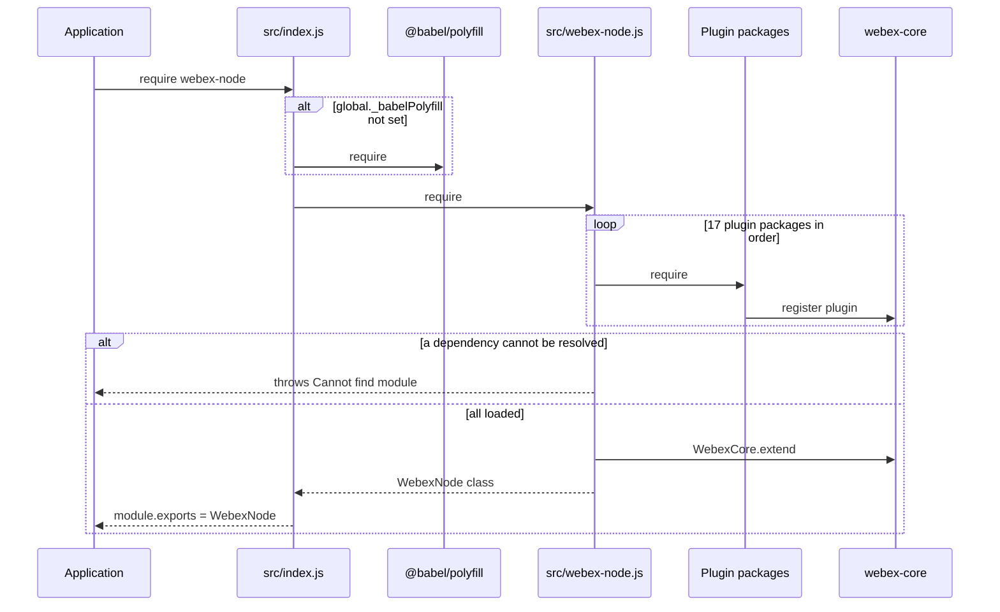
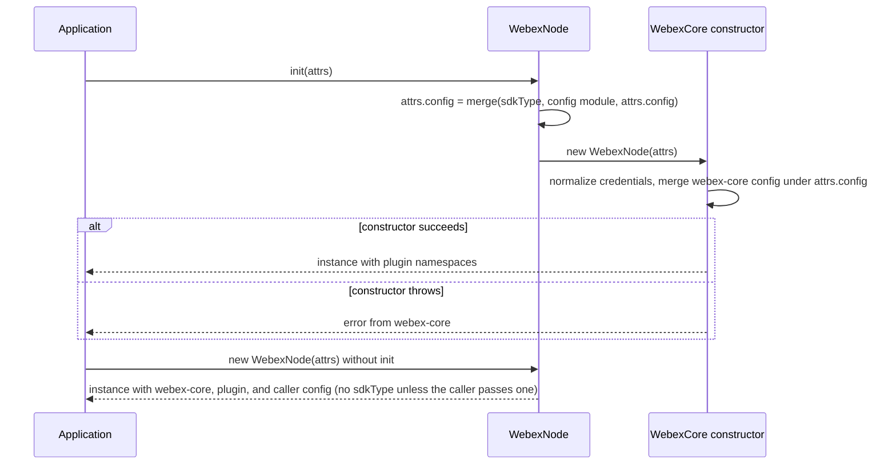
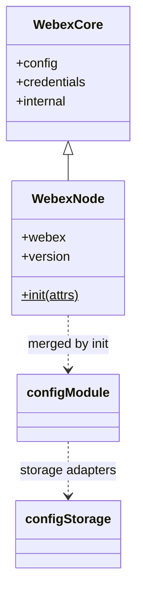

<!-- sdd-generated-metadata
doc_kind: module-spec
generated_from: module-spec@0.3.0
generated_by: claude-cowork
approved_by: akulakum@cisco.com
updated_at: 2026-10-15T23:00:24Z
validation_status: pass-with-warnings
-->

# webex-node SDK entry

This source-local document at `src/docs/README.md` owns the stable specification for **the
webex-node SDK entry**: the Node.js build of the Webex JS SDK that loads a fixed set of Webex
plugins, extends `WebexCore`, and adds an `init` factory with Node-oriented configuration. Ground
every claim in package evidence and link to the [package architecture](../../docs/architecture.md)
instead of repeating broader facts. No service specification exists because this package is a
library.

Related context: [documentation index](../../docs/index.md) ·
[package agent instructions](../../AGENTS.md)

## Metadata

| Field             | Value |
| ----------------- | ----- |
| Owner             | @webex/web-sdk (CODEOWNERS default rule) |
| Source path       | `src` |
| Resource kind     | package |
| Status            | Draft |
| Last verified     | 2026-10-15 at `db802dc99d` |
| Module id         | `webex-node` |
| Parent spec       | — |
| Doc kind          | Module spec |
| Coverage score    | 93.3% assessed 2026-10-15 — 14 of 15 mandatory fields PRESENT, critical 8 of 8; test strategy is WEAK (the 5 unit tests do not assert the package configuration, plugin registration, or the polyfill guard; gaps listed under Verification) and no characterization baseline exists. Independent validation: see the Validation status row |
| Validation status | pass-with-warnings; assessed 2026-10-16 by current-session (different-runtime); 0 Blocking, 2 Minor tooling warnings |

## Applicability

| Condition ID                         | Status     | Evidence or reason | Owned section |
| ------------------------------------ | ---------- | ------------------ | ------------- |
| `module.has_tiers`                   | N/A        | No tier policy exists in this package or its `package.json` | Tier |
| `module.has_ui`                      | N/A        | No view or screen. The module builds an SDK class. | UI use-case flow |
| `module.crosses_service_boundaries`  | N/A        | The src directory sends no request and opens no socket. Requests made by an instance belong to webex-core and the loaded plugins. | Cross-boundary use-case flow |
| `module.holds_client_state`          | N/A        | `src/webex-node.js` adds no props or session state; instance state is defined by webex-core and the plugins | Client state model |
| `module.enforces_domain_rules`       | Applicable | The configuration merge order in init and the plugin load order in `src/webex-node.js` | Business rules and invariants |
| `module.is_concurrent_async`         | N/A        | The src directory has no promise, timer, or event handler; init is synchronous. The ready and loaded events belong to webex-core. | Concurrency and reactive flow |
| `module.owns_persistence`            | N/A        | Nothing is stored. `src/config-storage.js` only names storage adapters (see Pitfalls). | Data, schema, and migration discipline |
| `module.stateful_transitions`        | N/A        | No state machine in the src directory | State machine |
| `module.exposes_wire_protocol`       | N/A        | No serialized format is produced or parsed in the src directory | Protocol and wire format |
| `module.ui_multi_screen`             | N/A        | No UI | UI flow |
| `module.large_data_model`            | N/A        | The only data is the configuration object in `src/config.js` | Data model |
| `module.returns_caller_errors`       | N/A        | The src directory throws and rejects nothing itself; load-time errors from a missing dependency and constructor errors come from Node.js module loading and webex-core | Caller-visible failure modes |
| `module.module_specific_conventions` | Applicable | CommonJS in `src/webex-node.js` and `src/index.js`, side-effect plugin loading before extend, and the polyfill guard | Module-specific rules |
| `module.published_package`           | Applicable | `package.json` names the package webex-node and deploy:npm publishes it | Export stability |
| `module.embedded_in_host`            | N/A        | No host theme or embed API | Host integration and theming |
| `module.has_design_tradeoff`         | Applicable | Eager loading of a fixed plugin set, the CommonJS entry, and a global polyfill | Key design trade-off |
| `module.has_submodules`              | N/A        | Computed false by the Repo Annotation module_tree.py script: the manifest has one module | Sub-modules |

## Evidence register

| Evidence | What it establishes |
| -------- | ------------------- |
| `src/index.js` | The polyfill guard and the CommonJS re-export of `WebexNode` |
| `src/webex-node.js` | The plugin load list, `WebexCore.extend`, and `WebexNode.init` |
| `src/config.js` | The configuration object this package declares |
| `src/config-storage.js` | The storage adapter object referenced by `src/config.js` |
| `package.json` | Name, entry points, `exports`, dependencies, scripts, and the `engines` floor |
| `test/unit/spec/webex-node.test.js` | Five Jest tests for `init` merging and the fedramp setting |
| `README.md` | Retained product documentation, not the behavioral authority. See ADR 0001. |
| Sibling package webex-core, file src/webex-core.js | The constructor's credential normalization, `initialize` merging the webex-core config under `attrs.config`, and the default interceptor set |
| Sibling package webex-core, files src/config.js and src/lib/webex-core-plugin-mixin.js | webex-core configuration defaults (including `fedramp`, `services`, `device`, and `storage`) and plugin registration merging each plugin's config into them |
| Sibling package webex-core, file src/index.js | `MemoryStoreAdapter` is a named export, not a property of the default export |
| Sibling package webex-core, file src/lib/services/services.js | `initConfig` replaces `services.discovery` with the FedRAMP set when `config.fedramp` is truthy |
| Sibling package internal-plugin-device, SDD module spec src/docs/README.md and file src/config.js | The device plugin's `ephemeral` default (`false`) and how it is used |
| Sibling package plugin-authorization, file src/index.js | In Node.js it re-exports plugin-authorization-node |
| Sibling package babel-config-legacy (packages/legacy/babel), file static/plugins/inject-package-version.js | The build-time `version` value |
| Sibling package jest-config-legacy (packages/legacy/jest), file static/index.js | Jest settings: Node test environment, test match pattern, and no coverage collection |
| Sibling package test-webex-node, files package.json and src/index.js | A manual smoke script that imports this package by name |

## Purpose and boundary

- Responsibility: give Node.js applications one package that, when loaded, provides a Webex SDK
  class with the public plugins (rooms, messages, memberships, people, teams, team memberships,
  webhooks, attachment actions, device manager, authorization, logger, encryption) and several
  internal plugins already registered, plus an `init` factory.
- In scope: the four files under `src/`, the plugin load list, the `WebexNode` class and its `init`
  method, and the configuration object in `src/config.js`.
- Out of scope: everything the instance does after construction. Credentials, the request
  pipeline, the service catalog, storage, and events belong to the sibling package webex-core; each
  plugin's API and configuration belong to that plugin's package. Browser use is out of scope: the
  README states the package is not meant for browsers.
- Consumers: Node.js applications that install `webex-node` from npm. In this workspace only the
  sibling package test-webex-node lists it, as a manual smoke script.

## Structure and key files

| Path | Responsibility |
| ---- | -------------- |
| `src/index.js` | Package entry (`devMain`). Loads `@babel/polyfill` unless `global._babelPolyfill` is set, then sets `module.exports` to the `WebexNode` class from `src/webex-node.js`. Also holds the `isoDate` and `email` JSDoc typedefs. |
| `src/webex-node.js` | Requires the plugin packages for their side effects, creates `WebexNode` with `WebexCore.extend`, defines `WebexNode.init`, and exports the class with `module.exports` |
| `src/config.js` | Default export: `hydra`, `hydraServiceUrl`, `credentials.clientType`, `device.validateDomains`, `device.ephemeral`, and `storage` adapters |
| `src/config-storage.js` | Default export: `boundedAdapter` and `unboundedAdapter`, both read from the default import of `@webex/webex-core` |
| `test/unit/spec/webex-node.test.js` | The only spec |
| `package.json` | `main` points at the build output `index.js`; `exports` exposes `.` and `./package` |

## Public surface

Declarations live in `src/index.js` and `src/webex-node.js`. This section summarises them and does
not restate signatures.

| Surface | Consumer | Compatibility commitment | Source |
| ------- | -------- | ------------------------ | ------ |
| Package export (`require('webex-node')`) | Node.js applications | The export is the `WebexNode` class itself, with no named exports (`MOD-001`) | `src/index.js` |
| Load side effects | Every importer | Loading installs the Babel polyfill when absent (`MOD-001`) and registers the plugin set (`MOD-002`) | `src/index.js`, `src/webex-node.js` |
| `WebexNode.init(attrs)` | Applications | Returns a new instance with the merged configuration (`MOD-004`, `INV-001`) | `src/webex-node.js` |
| `new WebexNode(attrs)` | Applications and tests | A plain `WebexCore` subclass constructor; does not add `sdkType` or the package configuration (`MOD-005`) | `src/webex-node.js` |
| Instance properties `webex` and `version` | Code that identifies the SDK build | `webex` is `true`; `version` is injected at build time (`MOD-003`) | `src/webex-node.js` |
| Plugin namespaces on an instance | Applications | Provided by the loaded plugins, whose names and APIs those packages own (`MOD-002`) | `src/webex-node.js` |
| `./package` export | Tooling | Exposes `package.json` | `package.json` |

Contract `webex-node-sdk` is published with native artifact `package.json`. Required contracts:
`webex-core-plugin-host`, `webex-sdk-plugins`, `babel-polyfill`, and `lodash`.

## Dependencies

| Dependency | Why it is required | Failure behavior |
| ---------- | ------------------ | ---------------- |
| `@webex/webex-core` (`webex-core-plugin-host`) | `WebexCore` to extend, its constructor, its configuration defaults, and plugin registration | A load error propagates to the importer. Everything an instance does after construction (credentials, catalog, requests, storage, events) is webex-core or plugin behavior. Error classes (`WebexHttpError` through `HttpStatusInterceptor`), host checks, auth, and redirects on requests made by the loaded plugins assume webex-core's default interceptor set; a host-supplied `config.interceptors` set replaces it, and the default set itself varies with `config.services.validateCatalogUrls` and the network-logging environment variables (sibling package webex-core, file src/webex-core.js). This package adds no interceptor. |
| The 17 plugin packages required in `src/webex-node.js` (`webex-sdk-plugins`) | Registration side effects that put the plugin namespaces on instances | A missing or unbuilt package makes loading this package throw "Cannot find module"; see Module-specific rules for the list and order |
| `@babel/polyfill` (`babel-polyfill`) | Global ECMAScript polyfills, loaded only when `global._babelPolyfill` is not set | Load-time only |
| `lodash` (`lodash`) | `lodash/merge` in `init` | — |
| `@babel/runtime-corejs2` | Helpers imported by the build output (Babel `transform-runtime`) | Load error without it |
| `@webex/common`, `@webex/internal-plugin-voicea`, `@webex/storage-adapter-local-storage` | Listed under `dependencies` but not required by `src/` | None here. A runtime check of an `init` instance found no `voicea` internal plugin (see Pitfalls) |

## Requirements

| ID | WHAT | WHY | Source evidence | Test or example evidence | Assumptions or gaps | Confidence |
| -- | ---- | --- | --------------- | ------------------------ | ------------------- | ---------- |
| `MOD-001` | Loading the entry requires `@babel/polyfill` when `global._babelPolyfill` is falsy, then exports the `WebexNode` class as `module.exports`. | Older Node.js consumers get the ECMAScript features the build expects; CommonJS consumers get the class with a plain `require`. | `src/index.js` | none found; the unit spec imports `src/webex-node.js` directly | `@babel/polyfill` sets `global._babelPolyfill` itself; this package only reads it | Present |
| `MOD-002` | Loading `src/webex-node.js` requires the 17 plugin packages listed under Module-specific rules, in that order, before `WebexCore.extend` runs. | Each plugin registers itself with webex-core when loaded, so the plugins exist on WebexNode instances without the application loading them. | `src/webex-node.js` | none found | Plugin names come from each plugin's own registration call (see architecture Dependency topology). Other plugins are registered transitively by those packages. | Present |
| `MOD-003` | `WebexNode` is `WebexCore.extend({webex: true, version: PACKAGE_VERSION})`; instances read `webex === true`. | Marks the instance as the full SDK and carries the build's version. | `src/webex-node.js` | `test/unit/spec/webex-node.test.js` "should create an instance of WebexNode with default configuration" asserts the webex property | `PACKAGE_VERSION` is replaced at build time by the inject-package-version Babel plugin with `package.json` `version`, or `0.0.0` when, as in the repository, that field is absent | Present |
| `MOD-004` | `init(attrs = {})` sets `attrs.config` to the `INV-001` merge result and returns `new WebexNode(attrs)`. Other `attrs` keys, such as `credentials`, are passed to the constructor unchanged. | One call creates a configured instance; webex-core's constructor normalizes credential forms such as a token string or `credentials.access_token`. | `src/webex-node.js` | `test/unit/spec/webex-node.test.js` "should merge user provided config with the default configuration" and "should override default config with user provided configuration" | Credential normalization is webex-core behavior (sibling package webex-core, file src/webex-core.js) | Present |
| `MOD-005` | `new WebexNode(attrs)` does not run the `init` merge, so this package adds neither `sdkType` nor the `src/config.js` object. webex-core's `initialize` still merges its configuration (with registered plugin configuration) under `attrs.config`, so values the caller passes in `attrs.config`, including `sdkType`, are kept at merge time (`INV-001` semantics; later webex-core and plugin initialization can still change them). With no arguments, `sdkType` is unset. | Direct construction is a plain webex-core subclass constructor. | `src/webex-node.js` | `test/unit/spec/webex-node.test.js` "is set false by default" constructs directly | — | Present |
| `MOD-006` | `src/config.js` declares `hydra` and `hydraServiceUrl` (both `process.env.HYDRA_SERVICE_URL` or `https://webexapis.com/v1`, read once when the module loads), `credentials.clientType: 'confidential'`, `device.validateDomains: true`, `device.ephemeral: true`, and `storage.boundedAdapter` and `storage.unboundedAdapter` set to the `src/config-storage.js` object. | States the intended Node.js defaults: a confidential OAuth client, ephemeral device registration, and memory storage. | `src/config.js` | none found | The declared values do not reach the top-level configuration; see `MOD-007` | Present |
| `MOD-007` | Because `src/webex-node.js` loads `src/config.js` with `require` and that module has only a default export, `init` merges the module object: the declared values land under `config.default`, not at the top level. The effective top-level values are webex-core's defaults with registered plugin configuration, `sdkType`, and the caller's `config`. | Records current behavior, which differs from the intent in `MOD-006`. | `src/webex-node.js`, `src/config.js` | none found; confirmed by a scratch run of the build output on 2026-10-15 (top-level device.ephemeral was false, credentials.clientType and hydra were unset, and config.default held the five keys) | Fixing it changes runtime defaults for every consumer; see Pitfalls | Present |
| `MOD-008` | `src/config-storage.js` reads `MemoryStoreAdapter` from the default import of `@webex/webex-core`, which is the `WebexCore` class and does not carry it, so both adapter values are `undefined`. | Records current behavior; the effective storage adapters are those in webex-core's configuration unless a registered plugin's configuration or the caller's `config` sets them. | `src/config-storage.js` | none found; confirmed by the same scratch run | — | Present |

## Design overview

`WebexNode` is a thin subclass. `src/webex-node.js` first loads 17 plugin packages for their side
effects; each one registers itself with webex-core when loaded (`MOD-002`). It then calls
`WebexCore.extend` with two prototype values (`MOD-003`) and attaches the static `init` factory
(`MOD-004`). Apart from `init` and those two prototype values, the class adds no methods, props, or plugins of its own.

`init` builds the configuration in one `lodash/merge` call (`INV-001`) and hands it to the webex-core
constructor, whose `initialize` merges the webex-core configuration under it. The configuration file
was meant to supply Node.js defaults, but the CommonJS `require` of an ES-module default export puts
them under `config.default` instead (`MOD-007`), and the storage file names adapters that resolve to
`undefined` (`MOD-008`).

`src/index.js` is the package entry. It installs the Babel polyfill when no polyfill is present and
re-exports the class with `module.exports`, so `require('webex-node')` returns the class itself.

## Data flow and sequence coverage

Transport: in-process module loading and synchronous calls. This module sends nothing over the
network; requests that an instance makes belong to webex-core and the plugins.

| Operation group | Entry and outcome | Diagram or evidence | Failure and recovery coverage |
| --------------- | ----------------- | ------------------- | ----------------------------- |
| Package load | `require('webex-node')` → polyfill check → plugin loads → class export | Package load diagram below | A missing or unbuilt dependency throws at load |
| Instance creation | `WebexNode.init(attrs)` → merged `attrs.config` → `new WebexNode(attrs)`; or `new WebexNode(attrs)` directly | Instance creation diagram below | Constructor errors are webex-core's |

Package load:

Instance creation:

## Class and component relationships

| Component | Relationship |
| --------- | ------------ |
| `WebexNode` | Subclass of `WebexCore` from `src/webex-node.js`; `init` is a static method |
| `WebexCore` | Default export of the sibling package webex-core; owns construction and instance behavior |
| config module | The module object of `src/config.js`, merged by `init` (`MOD-007`) |
| config-storage | The object in `src/config-storage.js`, referenced from `src/config.js` |
| Plugin packages | Loaded before `extend`; not referenced by name in code after loading |

## Use cases and flows

| Use case | Actor or caller | Primary steps and outcome | Failure or boundary behavior | Evidence |
| -------- | --------------- | ------------------------- | ---------------------------- | -------- |
| `UC-001` | Node.js application with an access token | Calls `WebexNode.init({credentials: {access_token}})`, then uses plugin namespaces such as `rooms`, `memberships`, and `messages` | Plugin calls and their errors belong to those packages | `README.md`, `src/webex-node.js` |
| `UC-002` | Bot | Calls `WebexNode.init({credentials: token})` with the token as a string, as the JSDoc example shows | webex-core turns a string `credentials` into `credentials.supertoken` | `src/webex-node.js` |
| `UC-003` | Application overriding configuration | Passes `config` to `init`; caller values win over the package values, with the merge semantics in `INV-001` | A caller `sdkType` replaces `webex-node` | `test/unit/spec/webex-node.test.js` |
| `UC-004` | FedRAMP application | Passes `config.fedramp: true` to `init` | Discovery URLs are set by webex-core services, not by this package | `test/unit/spec/webex-node.test.js` |

## Business rules and invariants

| ID | Invariant | WHY | Enforcement source | Test evidence |
| -- | --------- | --- | ------------------ | ------------- |
| `INV-001` | `init` merges in this order, later sources winning, with deep merging of plain objects: `{sdkType: 'webex-node'}`, then the `src/config.js` module object (`MOD-007`), then `attrs.config`. webex-core's `initialize` then merges its configuration under the result, so in both merges a defined caller value wins. These are lodash `merge` semantics: a caller value that is `undefined` is ignored, and arrays merge by index. | In those two merges a caller value replaces the package and webex-core defaults, including `sdkType`. Later initialization owned by webex-core and the plugins can still change configuration; for example, webex-core services replaces `services.discovery` with its FedRAMP set when `fedramp` is truthy (sibling package webex-core, file src/lib/services/services.js). | `src/webex-node.js` | `test/unit/spec/webex-node.test.js` "should merge user provided config with the default configuration", "should override default config with user provided configuration" |
| `INV-002` | `init` assigns the merged object to `attrs.config` on the object the caller passed, replacing any previous `config` property. | Avoids a copy; the caller's object is reused as the constructor argument. | `src/webex-node.js` | Gap: no test |
| `INV-003` | Every plugin package in the list is required before `WebexCore.extend` runs. | `extend` copies the public plugin map when the class is created, so public plugins registered later are absent from WebexNode instances. Internal plugins, plugin configuration, and interceptors are registered on shared webex-core objects and apply either way. | `src/webex-node.js` | Gap: no test |

## Pitfalls and constraints

- Configuration nesting (`MOD-007`): the values in `src/config.js` sit under `config.default`. Unless
  the caller sets them in `config`, devices are not ephemeral (the device plugin default is `ephemeral: false`), the top-level
  `credentials.clientType` is not set to `confidential`, and there are no top-level `hydra` or
  `hydraServiceUrl` keys. A search of `src/` in the workspace `@webex` packages found no reader of
  a top-level `config.hydra` or `config.hydraServiceUrl`; webex-core reads discovery URLs from
  `services.discovery`. Found by code reading and a scratch run; no test covers it.
- Storage adapters (`MOD-008`): `src/config-storage.js` produces `undefined` adapters, and
  `src/config.js` nests that whole object under each adapter key. Today this is masked because the
  package configuration is nested (`MOD-007`). Fixing `MOD-007` alone would deep-merge an object of
  two `undefined` values into webex-core's `MemoryStoreAdapter` default; lodash `merge` keeps the
  existing adapter functions, so storage still works, but each adapter gains two stray keys.
- `HYDRA_SERVICE_URL` is read when `src/config.js` loads, so setting it later has no effect on that
  module's values.
- `init` mutates its argument (`INV-002`). Reusing one `attrs` object for two `init` calls merges
  the earlier result into the next one.
- `new WebexNode(attrs)` does not add `sdkType` or the package configuration; only webex-core, plugin, and caller configuration apply (`MOD-005`).
- Loading the package installs `@babel/polyfill` into the process globals when no polyfill is
  present (`MOD-001`).
- `@webex/internal-plugin-voicea` is a declared dependency, but `src/` does not require it, and a
  runtime check of an `init` instance had no `voicea` internal plugin. `@webex/common` and
  `@webex/storage-adapter-local-storage` are also declared and not required by `src/`.
- The unit tests construct real instances. With webex-core's default services settings, once an
  instance emits `ready` and no cached catalog exists, webex-core services requests the service
  catalog (the preauth catalog when no token is set); without network access the requests fail,
  errors are logged, and the tests still pass. The
  fedramp test asserts webex-core behavior and reads `process.env.token`.
- The package has no browser guard in code; the README states browser use is not supported.

## Module-specific rules

The plugin load list in `src/webex-node.js`, in order: `@webex/plugin-authorization`,
`@webex/internal-plugin-calendar`, `@webex/internal-plugin-device`,
`@webex/internal-plugin-presence`, `@webex/internal-plugin-support`, `@webex/internal-plugin-llm`,
`@webex/plugin-attachment-actions`, `@webex/plugin-device-manager`, `@webex/plugin-logger`,
`@webex/plugin-messages`, `@webex/plugin-memberships`, `@webex/plugin-people`,
`@webex/plugin-rooms`, `@webex/plugin-teams`, `@webex/plugin-team-memberships`,
`@webex/plugin-webhooks`, `@webex/plugin-encryption`.

- Do: keep `src/webex-node.js` and `src/index.js` in CommonJS; the file comment says this
  simplifies consumption.
- Do: add a plugin by adding a `require` before `WebexCore.extend` (`INV-003`) and a matching
  `package.json` dependency.
- Do: add a unit case for any change to `init` or `src/config.js`, asserting top-level values.
- Do not: add methods or state to `WebexNode`; behavior belongs to webex-core or a plugin.
- Do not: rely on `src/config.js` values being applied until `MOD-007` is fixed.

## Export stability

| Export or entry point | Consumer | Stability | Versioning and deprecation rule | Declaration or API report |
| --------------------- | -------- | --------- | ------------------------------- | ------------------------- |
| CommonJS export of `WebexNode` | Node.js applications | Public | Workspace release tooling; no package-local rule | `src/index.js` |
| `WebexNode.init` | Applications | Public | Changing the merge order or argument is breaking | `src/webex-node.js` |
| The plugin set | Applications using plugin namespaces | Public | Removing a plugin is breaking; adding one is compatible | `src/webex-node.js` |
| `./package` subpath | Tooling | Public | Removing it is breaking | `package.json` |

No TypeScript declaration or API report exists for this package.

## Key design trade-off

| Chosen trade-off | Preserved invariant or benefit | Cost or limitation | Decision evidence |
| ---------------- | ------------------------------ | ------------------ | ----------------- |
| Load a fixed plugin set eagerly at import | One `require` gives a ready SDK class (`MOD-002`) | Every consumer loads every plugin and its transitive plugins | `src/webex-node.js` |
| CommonJS entry with `module.exports` | `require('webex-node')` returns the class | The `require` of `src/config.js` gives the ES module object (`MOD-007`) | `src/webex-node.js`, `src/index.js` |
| Conditional global polyfill | Works on runtimes that lack the polyfilled features | Changes the host process globals (`MOD-001`) | `src/index.js` |

## Verification

| Requirement or invariant | Test level | Positive evidence | Negative or boundary evidence | Gap |
| ------------------------ | ---------- | ----------------- | ----------------------------- | --- |
| `MOD-003` | Unit | `test/unit/spec/webex-node.test.js` "should create an instance of WebexNode with default configuration" | none found | version not asserted |
| `MOD-004`, `INV-001` | Unit | "should merge user provided config with the default configuration", "should override default config with user provided configuration" | sdkType override | No assertion of any `src/config.js` value |
| `MOD-005` | Unit | "is set false by default" constructs directly with no arguments | none found | sdkType absence and caller-config retention not asserted |
| webex-core FedRAMP discovery | Unit | "sets correct services when fedramp is true" | none found | Asserts webex-core behavior, not this package |
| `MOD-001` | none | `src/index.js` | none found | No polyfill guard or export test |
| `MOD-002`, `INV-003` | none | `src/webex-node.js` | none found | No plugin registration test |
| `MOD-006`, `MOD-007`, `MOD-008` | none | `src/config.js`, `src/config-storage.js` | none found | No test of the effective configuration |
| `INV-002` | none | `src/webex-node.js` | none found | No mutation test |

Unit checks run with `yarn workspace webex-node test:unit`; the expected result is in
[Getting started](../../docs/getting-started.md). No integration specs exist.
