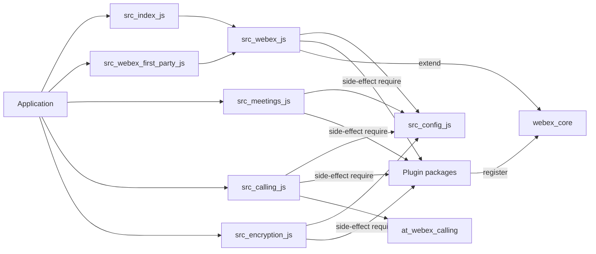
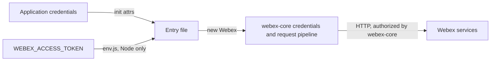

<!-- sdd-generated-metadata
doc_kind: standing-doc
generated_from: architecture@0.3.0
generated_by: claude-cowork
approved_by: akulakum@cisco.com
updated_at: 2026-10-15T15:50:41Z
validation_status: pass-with-warnings
-->

# webex architecture

Canonical architecture for this package. Entry-file behavior lives in the
[webex bundle entry points specification](../src/docs/README.md). This page owns package
boundaries, the published artifacts, the contract index, and how the package meets the rest of the
SDK.

Related context: [specification registry](specs/README.md) ·
[package agent instructions](../AGENTS.md)

## Applicability

| Condition ID                         | Status     | Evidence or reason | Owned section |
| ------------------------------------ | ---------- | ------------------ | ------------- |
| `repo.owns_datastore`                | N/A        | No database, file store, or migration; storage adapters are chosen, not owned | Repository data and schema |
| `repo.holds_client_state`            | N/A        | Only `Calling` holds state, which the module spec Client state model covers | Client state model |
| `repo.components_interact`           | N/A        | One module. The load graph is shown under Interaction and execution flows. | Dependency and interaction topology |
| `repo.domain_data_across_components` | N/A        | No domain data | Object and data ownership |
| `repo.caches_data`                   | N/A        | No cache in `src/` | Caching catalog |
| `repo.observability_convention`      | N/A        | Only `src/calling.js` logs, through the calling or webex logger with a file and method context; logging conventions belong to plugin-logger | Observability patterns |
| `repo.deploys_to_infra`              | N/A        | Library published to npm. No service runtime. | Runtime and infrastructure |
| `repo.shared_base_libs`              | Applicable | Extends `WebexCore` and inherits the legacy build, test, and lint stack | Shared and base libraries |
| `repo.is_monorepo`                   | N/A        | This SDD root is one package. The workspace around it is out of scope. | Package map and inter-package dependencies |
| `repo.multi_platform`                | Applicable | `package.json` `browser` field, the Node-only `env.js`, `browser.js`, and the UMD bundles | Platform matrix |
| `repo.published_package`             | Applicable | `package.json` `name` is `webex` and `deploy:npm` publishes it | Release and versioning |
| `repo.embedded_in_host`              | N/A        | No host theme or embed API | Host integration and theming |
| `repo.exposes_commands_or_artifacts` | Applicable | `build:src` writes `dist/`; `umd/` holds committed bundles | Commands and generated artifacts |
| `repo.cross_repo_deps_material`      | Applicable | Every instance capability comes from sibling workspace packages | Cross-repository topology |
| `repo.security_arch_warranted`       | Applicable | Entry points accept access tokens and `env.js` reads one from the environment | Security architecture |

## Design overview

`webex` is a published library with one module. Each entry file in `src/` requires a list of
plugin packages, which register themselves with webex-core, and then extends webex-core's
`WebexCore` into a `Webex` constructor with an `init` helper. The entries differ in the packages
they load and in their `init` defaults (`sdkType`, plus `meetings.disableHydraId` for meetings; module
spec `INV-001`). `src/calling.js` instead wraps an SDK instance in a
`Calling` class that also drives device registration, Mercury, and calling-client creation.

The package itself sends no request, stores nothing, and defines no plugin. What an instance can do
is owned by webex-core and the loaded plugins. Committed UMD bundles under `umd/` repackage the
entries for script-tag use.

## Resource inventory and responsibilities

| Resource | Kind | Responsibility | Owner | Source | Detailed specification |
| -------- | ---- | -------------- | ----- | ------ | ---------------------- |
| webex bundle entry points | module | Entry files, package config, storage choice, `Calling` | @webex/web-sdk | `src/` | `src/docs/README.md` |
| Package-root helpers | files | `env.js`, `browser.js`, `process` | @webex/web-sdk | package root | `src/docs/README.md` |
| UMD bundles | package artifact | Script-tag builds of the entries | @webex/web-sdk | `umd/` | `docs/architecture.md` |
| Published package | package | npm entry points, `exports`, `browser` field | @webex/web-sdk | `package.json` | `docs/architecture.md` |

## Interaction and execution flows

| From | To | Interaction or transport | Purpose | Failure or compatibility behavior |
| ---- | -- | ------------------------ | ------- | --------------------------------- |
| Application | An entry file | module load | Obtain a constructor | Missing dependency fails the load |
| Entry file | Plugin packages | side-effect `require` | Register namespaces with webex-core | Shared registry per loaded webex-core copy; first registration wins unless the plugin passes `replace` (module spec `INV-002`) |
| Entry file | webex-core | `WebexCore.extend`, `new` | Build the instance | Instance runtime behavior is owned by webex-core and by each loaded plugin package |
| `Calling` | device and Mercury plugins, `@webex/calling` | promise calls | Register, connect, create clients | Failures logged and swallowed (module spec `INV-005`) |

## Dependency topology

| Dependency | Type | Used by | Purpose | Version, failure, or fallback policy |
| ---------- | ---- | ------- | ------- | ------------------------------------ |
| `@webex/webex-core` | Internal | `src` | Constructor base and plugin registry | Workspace version |
| Public plugin packages (`@webex/plugin-*`) | Internal | `src` | Side-effect registration | Workspace versions |
| Internal plugin packages (`@webex/internal-plugin-*`) | Internal | `src` | Side-effect registration | Workspace versions; three are required but undeclared (module spec Pitfalls) |
| `@webex/common` | Internal | `src/meetings.js`, `env.js` | Utility module (`inBrowser` in `env.js`); `src/meetings.js` requires it without using a binding. It registers no plugin | Workspace version |
| `@webex/calling`, `@webex/contact-center` | Internal | `src/calling.js`, `src/webex.js` | Calling clients; contact-center registration | Workspace versions |
| `@webex/storage-adapter-local-storage` | Internal | `src/config-storage.shim.js` | Browser bounded storage | Workspace version |
| `@babel/polyfill`, `@babel/runtime-corejs2`, `lodash`, `safe-buffer` | External | `src` and build output | Polyfill, runtime helpers, config merge | Ranges in `package.json`; `safe-buffer` is not required by `src/` |

Ordering constraint: each entry file requires its public plugin packages before it calls
`WebexCore.extend`, and internal plugins before any instance is built; the module spec invariant
`INV-002` records why both orders matter. No dependency cycle exists inside the
package. `package.json` lists `webex` itself as a devDependency so tests can import it by name.

## Public and consumer surfaces

| Surface | Type | Owner | Consumers | Compatibility policy | Source |
| ------- | ---- | ----- | --------- | -------------------- | ------ |
| `webex-sdk` (published) | SDK | webex bundle entry points | Applications on npm; workspace samples and integration tests | See Release and versioning | `package.json` |
| `webex-umd-bundles` (published) | File | webex bundle entry points | Script-tag pages | Globals `Webex` and `Calling` | `umd/` |
| `webex-core-plugin-host` (required) | RPC | sibling package webex-core | All entries | External | `@webex/webex-core` |
| `webex-public-plugins` (required) | SDK | sibling plugin packages | Entry files | External | `package.json` |
| `webex-internal-plugins` (required) | SDK | sibling internal plugin packages | Entry files | External; the Mercury and device plugins are specified in their own SDD module specs | `package.json` |
| `webex-calling-sdk` (required) | SDK | sibling package calling | `src/calling.js` | External | `@webex/calling` |
| `webex-contact-center-sdk` (required) | SDK | sibling package contact-center | `src/webex.js` | External | `@webex/contact-center` |
| `storage-adapter-local-storage` (required) | SDK | sibling package storage-adapter-local-storage | Browser storage shim | External | `@webex/storage-adapter-local-storage` |
| `babel-polyfill`, `lodash` (required) | SDK | npm | Entry files | See Dependency topology | npm |

`webex-sdk` entry points: `main` and `.` point at `dist/index.js`, `./meetings` and `./calling` at
their `dist/` files, `./package` at `package.json`, and `devMain` at `src/index.js`.

Public members per published flavour (behavior stays in the module spec or the owning package):

| Flavour | Members | Behavioral route |
| ------- | ------- | ---------------- |
| npm `webex` (`.`); UMD `webex` and `webex-first-party` | `new Webex(attrs)`, `Webex.init(attrs)`, static `Webex.version`, instance `version` | Module spec `MOD-003`, `MOD-004`, `MOD-006`; first-party selection `MOD-007` |
| npm `webex/meetings`; UMD `meetings` | `new Webex(attrs)`, `Webex.init(attrs)`, static `Webex.version`, instance `version` | Module spec `MOD-004`, `MOD-008`, `INV-001` |
| UMD `encryption` | `new Webex(attrs)`, `Webex.init(attrs)`, static `Webex.version`, instance `version` | Owned by the sibling package plugin-encryption, file src/webex.js; its `init` merges its own config and sets no `sdkType`, so module spec `MOD-009` does not apply |
| npm `webex/calling`; UMD `calling` | See the next paragraph | Module spec `MOD-010` to `MOD-014` |

Under `./calling`, `webex-sdk` also
exposes the `Calling` class operations `new Calling`, `register`, `deregister`, `initializeClients`,
`Calling.init`, `Calling.createMicrophoneStream`, and `Calling.createNoiseReductionEffect`, and the
`ready` event that `Calling` emits when it builds its own SDK instance; behavior is in the module spec
(`MOD-010` to `MOD-014`, `INV-004`, `INV-005`). No HTTP surface is served, so `api-specs/openapi.yaml`
is omitted.

## Cross-cutting architecture

### Security

- Trust boundaries and identity flow: see Security architecture.
- Sensitive surfaces and data classes: access tokens passed to `init` or read by `env.js`; controls
  are in Security architecture.
- Encryption and secret boundaries: owned by webex-core and the encryption plugins; see Security
  architecture.

### Observability and operations

- Logging and correlation: see the `repo.observability_convention` row; `Calling` log lines are
  described in the module spec.
- Metrics, traces, and audit signals: N/A — none emitted by this package.
- Ownership and operational entry points: no runtime to deploy or monitor; owners are listed in
  References and maintenance.

### Quality attributes

- Compatibility: the `exports` map, the `browser` field, and the UMD globals are relied on by
  consumers.
- Footprint: each entry requires its listed packages directly; what those packages load in turn is
  owned by them, and another entry in the same process can add plugins (module spec `INV-002`).
- Portability: Node and browsers, split as the Platform matrix shows.

## Shared and base libraries

| Library | Inherited responsibility | Consumers | Version floor | Compatibility rule |
| ------- | ------------------------ | --------- | ------------- | ------------------ |
| `WebexCore` from `@webex/webex-core` | Constructor, config merge in `initialize`, plugin registry, request pipeline | Every entry file | workspace | Follow webex-core plugin conventions |
| `@webex/babel-config-legacy`, `@webex/jest-config-legacy` | Build and Jest config passthroughs, including `PACKAGE_VERSION` injection | `babel.config.js`, `jest.config.js` | workspace | Change upstream, not in the passthrough files |
| `@webex/legacy-tools` | `webex-legacy-tools` build and test runners | `package.json` scripts | workspace | Scripts call it; do not replace locally |
| Workspace root eslint configuration | Lint rules and the `*.md` ignore | `test:style` | workspace | The package adds no eslint config |

## Platform matrix

| Platform | Shared versus platform-specific boundary | Entry or build | Support and compatibility constraints |
| -------- | ---------------------------------------- | -------------- | ------------------------------------- |
| Node | `src/config-storage.js` (memory storage) | `dist/index.js` and subpaths | `engines` `>=18`; `env.js` is Node-only |
| Browser via bundler | `browser` field maps `config-storage` to `src/config-storage.shim.js` (localStorage bounded storage) | `dist/index.js` and subpaths | `browser.js` sets `window.webex` |
| Browser via script tag | Bundled per entry | `umd/*.min.js` | Globals `Webex` and `Calling`; built by the workspace root webpack config |

## Release and versioning

| Artifact | Publish target | Versioning rule | Deprecation window | Changelog or migration obligation |
| -------- | -------------- | --------------- | ------------------ | --------------------------------- |
| `webex` | npm, through the `deploy:npm` script (manifest `commands.deploy`) | Workspace release tooling; the committed `package.json` has no `version` field | None declared in code | No package-local changelog; workspace tooling owns it |
| `umd/` bundles | Published inside the npm package | Rebuilt by the workspace root webpack config; the committed bundles report `version` as `"undefined"` (module spec `MOD-004`), and the committed `umd/webex.min.js` predates the current `src/webex.js` (module spec Pitfalls) | None declared | Must match the entry files at release; rebuild in a separate artifact change |

## Commands and generated artifacts

| Command or artifact | Owner | Inputs | Output or side effect | Compatibility boundary |
| ------------------- | ----- | ------ | --------------------- | ---------------------- |
| `yarn install` | workspace | root `package.json` and lockfile | workspace `node_modules` | Run from the workspace root |
| `yarn workspace webex build` | package | `src/` | `dist/` through `build:src` | Build output is never edited by hand |
| `yarn workspace webex build:src` | package | `src/` (`.js` and `.ts`) | `dist/` with source maps | Markdown under `src/` is not processed |
| `yarn workspace webex test:unit` | package | `test/unit/spec/` | Jest result | — |
| `yarn workspace webex test:integration` | package | `test/integration/spec/` | Mocha result | Needs test users and network |
| `yarn workspace webex test:browser:broken` | package | `test/integration/spec/` | karma result | Name marks it broken |
| `yarn workspace webex test:style` | package | files under `src/` | eslint result | Markdown is reported as ignored |
| `yarn workspace webex eslint ./env.js ./browser.js ./process` | package | `env.js`, `browser.js`, `process` | eslint result | Covers the package-root helpers that `test:style` skips |
| `yarn workspace webex deploy:npm` | package | `dist/`, `umd/`, `package.json` | Publishes the package to the npm registry | Release pipeline only |
| `yarn prebuild:modules` | workspace root | root `package.json` script | Installs, then builds the legacy tools, webex-core, and the `build:src` output of the workspace packages that define it | Run from the workspace root before `test:unit` on a fresh clone |
| `yarn build:script` | workspace root | root `package.json` script, workspace root webpack config | Runs the `--umd` webpack build that writes `umd/` | Run from the workspace root; refreshes the committed bundles. It can exit 0 after a failed webpack build, so check its output and the rewritten files (module spec Pitfalls) |
| `umd/*.min.js` | workspace root webpack config | entry files | Committed bundles and source maps | Do not edit by hand |

## Cross-repository topology

| Repository or external system | Relationship | Exchanged contract or artifact | Owner | Sequencing constraint |
| ----------------------------- | ------------ | ------------------------------ | ----- | --------------------- |
| Sibling package webex-core | Consumes | `webex-core-plugin-host` | @webex/web-client, @webex/web-sdk (explicit CODEOWNERS rule) | Loaded before any entry builds a constructor |
| Sibling plugin packages | Consumes | `webex-public-plugins`, `webex-internal-plugins` | Per-package CODEOWNERS rules, else the default rule | See the Dependency topology ordering constraint |
| Sibling package calling | Consumes | `webex-calling-sdk` | @webex/web-sdk (CODEOWNERS default rule) | None |
| Sibling package contact-center | Consumes | `webex-contact-center-sdk` | @webex/web-sdk (CODEOWNERS default rule) | None |
| Workspace root webpack config | Coordinates | `webex-umd-bundles` | @webex/web-sdk | Builds `umd/` from the entry files |
| npm consumers and CDNs | Provides | `webex-sdk`, `webex-umd-bundles` | External | None |

These are sibling workspace packages and external consumers outside this package-scoped SDD root.

## Security architecture

Threats addressed: leaking an access token from a script environment or committed file, and
credentials reaching hosts outside the catalog through the SDK instance.

Controls and boundaries:

- This package never reads, stores, or sends a token itself, except that `env.js` passes
  `process.env.WEBEX_ACCESS_TOKEN` to the constructor and the test helper `src/_setup.js` passes a
  test-user token. Token storage, refresh, and the authorization header are owned by webex-core
  (sibling package webex-core, file src/webex-core.js, the src/lib/credentials/ directory, and file
  src/interceptors/auth.js). Token acquisition (OAuth redirect parsing and code exchange) is owned by
  whichever plugin-authorization package is loaded.
- `env.js` refuses to load in browsers (module spec `MOD-016`).
- The package sends no request itself. Request host checks and redirects for an instance follow
  webex-core's interceptor set, as the module spec Dependencies row for webex-core records.
- The browser storage shim would persist bounded data in `localStorage` under the `webex`
  namespace; the module spec Pitfalls record why the package config that selects it does not
  currently take effect.

No security policy file exists in this package or at the workspace root; Stage 0 creates none.

## Domain language

| Term | Repository-specific meaning | Authoritative source |
| ---- | --------------------------- | -------------------- |
| Entry file | A file in `src/` that loads a plugin set and defines or re-exports a `Webex` constructor | `src/webex.js` |
| Side-effect registration | Requiring a plugin package so that it registers itself with webex-core | `src/webex.js` |
| `sdkType` | The config value each `init` sets: `webex`, `meetings`, or `encryption` | `src/webex.js`, `src/meetings.js`, `src/encryption.js` |
| First party | The variant that loads the first-party browser authorization plugin first | `src/webex-first-party.js` |
| `Calling` | The wrapper class exported by `webex/calling` | `src/calling.js` |
| UMD bundle | A committed script-tag build under `umd/` | `umd/` |

## References and maintenance

- Decisions: [adr/](adr/), including [ADR 0001](adr/0001-retain-product-readme.md)
- Instantiated specifications and routing: [specs/README.md](specs/README.md)
- Module spec: `src/docs/README.md`
- Owner: `@webex/web-sdk` through the monorepo `.github/CODEOWNERS` default rule
- Manifest: `.sdd/manifest.json`
- Update this document in the same change that alters package boundaries, contracts, or
  cross-cutting behavior.
