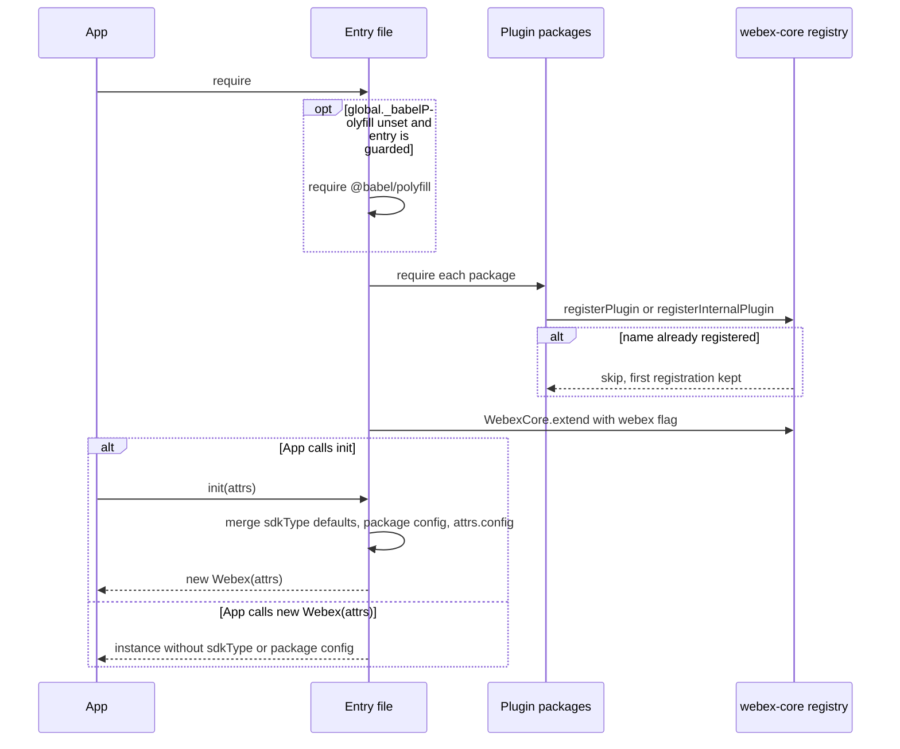
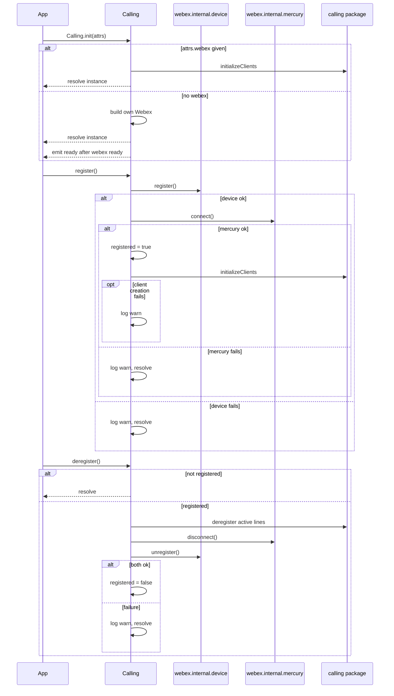
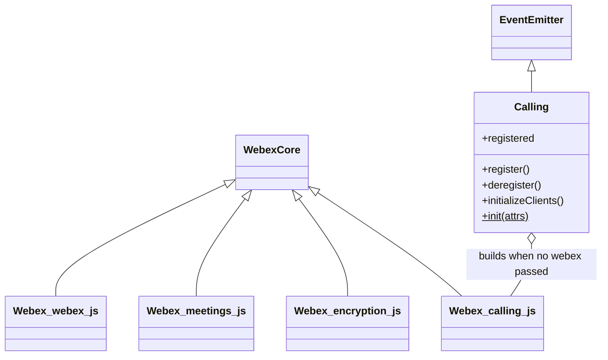

<!-- sdd-generated-metadata
doc_kind: module-spec
generated_from: module-spec@0.3.0
generated_by: claude-cowork
approved_by: akulakum@cisco.com
updated_at: 2026-10-15T15:50:41Z
validation_status: pass-with-warnings
-->

# webex bundle entry points

This source-local document at `src/docs/README.md` owns the stable specification for **the webex
bundle entry points**: the files in `src/` that assemble Webex SDK constructors from the sibling
package webex-core and a chosen set of plugin packages. Ground every claim in package evidence and
link to the [package architecture](../../docs/architecture.md) instead of repeating broader facts.
No service specification exists because this package is a library.

Related context: [documentation index](../../docs/index.md) ·
[package agent instructions](../../AGENTS.md)

## Metadata

| Field             | Value |
| ----------------- | ----- |
| Owner | @webex/web-sdk (CODEOWNERS default rule) |
| Source path | `src` |
| Resource kind | package |
| Status | Draft |
| Last verified | 2026-10-13 at `93ff5c8645` |
| Module id | `webex` |
| Parent spec | — |
| Doc kind | Module spec |
| Coverage score | 93.3% assessed 2026-10-13 — 14 of 15 mandatory fields PRESENT, critical 8 of 8; test strategy is WEAK (gaps listed under Verification) and no characterization baseline exists |
| Validation status | PASS-WITH-WARNINGS; validator current-session; assessed 2026-10-15; source 8d56e3b; findings: 0 Blocking, 1 Important, 0 Medium, 1 Minor. |

## Applicability

| Condition ID                         | Status     | Evidence or reason | Owned section |
| ------------------------------------ | ---------- | ------------------ | ------------- |
| `module.has_tiers` | N/A | No tier policy exists in this package or its `package.json` | Tier |
| `module.has_ui` | N/A | No view or screen. `browser.js` only assigns a global. | UI use-case flow |
| `module.crosses_service_boundaries` | Applicable | Calling#register and Calling#deregister in `src/calling.js` drive device registration and the Mercury connection, which reach Webex services | Cross-boundary use-case flow |
| `module.holds_client_state` | Applicable | A Calling instance holds registered, the client references, and its logger | Client state model |
| `module.enforces_domain_rules` | Applicable | Config merge precedence, side-effect plugin registration, polyfill guard, and Calling client flags | Business rules and invariants |
| `module.is_concurrent_async` | Applicable | Calling.init, register, deregister, and initializeClients are promise-based; ready is an event | Concurrency and reactive flow |
| `module.owns_persistence` | N/A | Storage adapters are selected in `src/config-storage.js` and its shim, but storage is owned by webex-core and the adapter packages | Data, schema, and migration discipline |
| `module.stateful_transitions` | N/A | The only state is the registered flag, covered by Client state model | State machine |
| `module.exposes_wire_protocol` | N/A | No serializer or message format in src/; the user-agent header is built by webex-core | Protocol and wire format |
| `module.ui_multi_screen` | N/A | No UI | UI flow |
| `module.large_data_model` | N/A | No data model; config objects only | Data model |
| `module.returns_caller_errors` | Applicable | `env.js` throws in browsers; Calling throws TypeErrors on missing config and on deregister without a calling client | Caller-visible failure modes |
| `module.module_specific_conventions` | Applicable | CommonJS entry files, the polyfill guard, and WebexCore.extend with webex: true | Module-specific rules |
| `module.published_package` | Applicable | `package.json` names the package webex, declares an exports map, and deploy:npm publishes it | Export stability |
| `module.embedded_in_host` | N/A | No host theme or embed API | Host integration and theming |
| `module.has_design_tradeoff` | Applicable | Side-effect registration on a shared registry, CommonJS entry files, and committed UMD bundles | Key design trade-off |
| `module.has_submodules` | N/A | Computed false by the Repo Annotation module_tree.py script: the manifest has one module | Sub-modules |

## Evidence register

| Evidence | What it establishes |
| -------- | ------------------- |
| `src/index.js` | Main entry: polyfill guard, then re-export of `src/webex.js` |
| `src/webex.js` | Full plugin set by side-effect `require`, the `Webex` constructor, and `Webex.init` |
| `src/webex-first-party.js` | First-party authorization plugin loaded before `src/webex.js` |
| `src/meetings.js` | Meetings plugin set and `Webex.init` with `sdkType` `meetings` |
| `src/calling.js` | The `Calling` class, its own `Webex` constructor, and `Calling.init` |
| `src/encryption.js` | Encryption plugin set and `Webex.init` with `sdkType` `encryption` |
| `src/config.js`, `src/config-storage.js`, `src/config-storage.shim.js` | Package config defaults and the storage adapter choice per platform |
| `src/_setup.js` | Mocha `before` hook that creates a test user and `global.webex` |
| `env.js`, `browser.js`, `process` | Package-root helper files outside `src/` |
| `package.json` | Name, `exports`, `browser` field, dependencies, and scripts |
| `test/unit/spec/webex.js` | Four Jest cases: static and instance `version`, and the `fedramp` config |
| `test/integration/spec/commonjs.js`, `test/integration/spec/init.js`, `test/integration/spec/request.js`, `test/integration/spec/env.js` | Mocha integration cases against real Webex services with test users; `env.js` requires the unexported `webex/env` subpath |
| Workspace files packages/@webex/webex-core/src/webex-core.js and packages/@webex/webex-core/src/lib/webex-core-plugin-mixin.js | `WebexCore.extend`, `initialize` config merge, the shared plugin registry, and first-registration-wins |
| Workspace file packages/@webex/webex-core/src/interceptors/webex-user-agent.js | The `webex` flag selects the `webex` library name in the `spark-user-agent` header |
| Workspace files packages/@webex/webex-core/src/lib/webex-core-plugin-mixin.js and packages/@webex/webex-core/src/lib/webex-internal-core-plugin-mixin.js | Public and internal registration both skip a name that is already registered unless `replace` is passed |
| Installed dependency file node_modules/ampersand-state/ampersand-state.js (its extend function; installed by the workspace, not a tracked repository source) | A subclass copies the parent's children map when it is extended |
| Workspace file packages/legacy/babel/static/plugins/inject-package-version.js | For `build:src` and Jest, `PACKAGE_VERSION` becomes the version in the `package.json` of the working directory, or `0.0.0` when that file has no version |
| Workspace file packages/@webex/webex-core/src/webex-core.js | `WebexCore.version = PACKAGE_VERSION` as a static, compiled with webex-core's own version |
| Workspace root files babel.config.json and tooling/babel-plugin-inject-package-version.js | The UMD build injects versions with a different plugin; the committed `umd/webex.min.js` contains `version:"undefined"` for `WebexCore` and `Webex` |
| Workspace files packages/calling/src/index.ts, packages/calling/src/CallingClient/CallingClient.ts, and packages/calling/src/Voicemail/Voicemail.ts | `createClient` and the other client factories that `Calling#initializeClients` calls |
| Workspace root file webpack.config.js | UMD entries, library names, and output paths for `umd/` |
| `README.md` | Retained product documentation, not the behavioral authority. See ADR 0001. |

## Purpose and boundary

- Responsibility: give applications one npm package that returns a ready-to-configure Webex SDK
  constructor, in several flavours that differ in which plugin packages they load and in their `init`
  defaults (`INV-001`).
- In scope: the entry files in `src/`, the config they merge, the storage adapter choice, the
  `Calling` wrapper, and the package-root helpers `env.js` and `browser.js`.
- Out of scope: everything the constructed instance does at runtime. Credentials, service catalog,
  request pipeline, storage, and the plugin lifecycle belong to the sibling package webex-core; each
  plugin's behavior belongs to its own package; calling clients belong to the sibling package
  calling. The UMD build is configured in the workspace root webpack config.
- Consumers: applications that install `webex` from npm or load a `umd/` bundle, and the workspace
  samples and integration tests that import it by name. No other workspace package lists `webex` as
  a dependency.

## Structure and key files

| Path | Responsibility |
| ---- | -------------- |
| `src/index.js` | `main` and `.` export target: loads `@babel/polyfill` unless `global._babelPolyfill` is set, then exports `src/webex.js` |
| `src/webex.js` | Requires 21 plugin packages for their side effects and defines `Webex` and `Webex.init` (sdkType `webex`) |
| `src/webex-first-party.js` | Polyfill guard, requires `@webex/plugin-authorization-browser-first-party`, then exports `src/webex.js` |
| `src/meetings.js` | `./meetings` export target: polyfill guard, 11 side-effect requires, `Webex.init` (sdkType `meetings`) |
| `src/calling.js` | `./calling` export target: ES default export `Calling` |
| `src/encryption.js` | Polyfill guard, 3 side-effect requires, `Webex.init` (sdkType `encryption`); no `exports` entry |
| `src/config.js` | Package config object (ES default export): hydra URLs, `credentials.clientType`, `device`, `storage` |
| `src/config-storage.js` | Node and default storage choice: `MemoryStoreAdapter` for bounded and unbounded |
| `src/config-storage.shim.js` | Browser storage choice: `LocalStorageStoreAdapter('webex')` bounded, `MemoryStoreAdapter` unbounded |
| `src/_setup.js` | Mocha test helper; no script or test in this package references it |
| `env.js` | Node-only helper that exports a `Webex` instance built from `WEBEX_ACCESS_TOKEN` |
| `browser.js` | Assigns `require('webex')` to `window.webex` and exports it |
| `process` | Module exporting `{browser: true}`; not referenced by `package.json` or `src/` |
| umd/ (directory) | Committed minified bundles and source maps built by the workspace root webpack config |

## Public surface

Declarations live in the files above. This section summarises them and does not restate signatures.

| Surface | Consumer | Compatibility commitment | Source |
| ------- | -------- | ------------------------ | ------ |
| `webex` (`.` export, `main`) | Applications | Exports the full `Webex` constructor (`MOD-001`, `MOD-002`) | `src/index.js`, `src/webex.js` |
| `Webex.init(attrs)` and `new Webex(attrs)` | Applications | `init` applies `INV-001`; `new` does not (`MOD-003`, `MOD-006`) | `src/webex.js` |
| `Webex.version` and instance `version` | Applications, user-agent header | Build-time versions (`MOD-004`, `MOD-005`) | `src/webex.js` |
| `webex/meetings`: `new Webex(attrs)`, `Webex.init(attrs)`, static `Webex.version`, instance `version` | Meetings applications | Meetings constructor and init defaults (`MOD-008`, `INV-001`); versions as `MOD-004` | `src/meetings.js` |
| UMD `webex-first-party`: same members as `webex` | Script-tag first-party pages | First-party authorization selection (`MOD-007`); otherwise as `MOD-003`, `MOD-004`, `MOD-006` | `src/webex-first-party.js` |
| UMD `encryption`: `new Webex(attrs)`, `Webex.init(attrs)`, static and instance `version` | Script-tag pages | Built from the sibling package plugin-encryption (file src/webex.js), which owns its behavior; not `src/encryption.js` or `MOD-009` (`MOD-019`) | `umd/encryption.min.js` |
| `webex/calling`: default export `Calling` | Calling applications | ES default export of the class below | `src/calling.js` |
| `new Calling({webex, webexConfig, callingConfig})` | Calling applications | Shared-instance or own-instance construction (`MOD-010`) | `src/calling.js` |
| `Calling#register()` | Calling applications | Device, Mercury, then clients (`MOD-011`, `INV-005`) | `src/calling.js` |
| `Calling#deregister()` | Calling applications | Lines, Mercury, then device (`MOD-012`) | `src/calling.js` |
| `Calling#initializeClients()` | Calling applications | Flag-gated client creation (`MOD-013`, `INV-004`) | `src/calling.js` |
| `Calling.init(attrs)` | Calling applications | Async factory (`MOD-014`) | `src/calling.js` |
| `Calling.createMicrophoneStream` (static accessor) and `Calling.createNoiseReductionEffect(options)` | Calling applications | Re-exposed calling-package factories (`MOD-014`) | `src/calling.js` |
| `ready` event on `Calling` | Calling applications that let Calling build its own SDK instance | Emitted once that instance is ready; not emitted when a `webex` instance is passed in (`MOD-010`) | `src/calling.js` |
| `webex/package` | Tooling | The package manifest | `package.json` |
| `src/webex-first-party.js`, `src/encryption.js`, `env.js`, `browser.js` | UMD build, samples, tests | Shipped files with no `exports` entry (see Export stability) | `package.json` |
| `umd/*.min.js` | Script-tag users | Globals named by the root webpack config (`MOD-019`) | `umd/webex.min.js`, `umd/calling.min.js` |

Contracts provided: `webex-sdk` (native artifact `package.json`) and `webex-umd-bundles`
(native artifact `umd/`). Required contracts: `webex-core-plugin-host`, `webex-public-plugins`,
`webex-internal-plugins`, `webex-calling-sdk`, `webex-contact-center-sdk`,
`storage-adapter-local-storage`, `babel-polyfill`, and `lodash`.

## Dependencies

| Dependency | Why it is required | Failure behavior |
| ---------- | ------------------ | ---------------- |
| `@webex/webex-core` (`webex-core-plugin-host`) | `WebexCore.extend`, the plugin registry, `MemoryStoreAdapter`, and the instance runtime behavior that webex-core owns (plugin behavior belongs to each plugin package) | This package sends no request itself. Requests made through an instance use webex-core's request pipeline: error classes (`WebexHttpError` via `HttpStatusInterceptor`), host checks, auth, and redirects assume webex-core's default interceptor set (which registered plugins can extend), and a host-supplied `config.interceptors` set replaces it |
| Public plugin packages (`webex-public-plugins`) | Side-effect registration of `authorization`, `rooms`, `messages`, `meetings`, and the other public namespaces | A missing package fails the `require` at load time |
| Internal plugin packages (`webex-internal-plugins`) | Side-effect registration under `webex.internal` | Same as above. `@webex/internal-plugin-encryption`, `@webex/internal-plugin-metrics`, and `@webex/internal-plugin-user` are required by `src/` but not declared in `package.json` (see Pitfalls) |
| `@webex/calling` (`webex-calling-sdk`) | Client factories, `Logger`, `createMicrophoneStream`, `NoiseReductionEffect` | Rejections from `createClient` propagate out of `initializeClients` (`MOD-013`) |
| `@webex/contact-center` (`webex-contact-center-sdk`) | Side-effect registration in `src/webex.js` | Load-time only |
| `@webex/storage-adapter-local-storage` | Browser bounded storage in the shim | Only through the `browser` field mapping |
| `@babel/polyfill` | Loaded by the guarded entry files (`INV-003`) | Load-time only |
| `lodash` | `merge` for config | — |

## Requirements

| ID | WHAT | WHY | Source evidence | Test or example evidence | Assumptions or gaps | Confidence |
| -- | ---- | --- | --------------- | ------------------------ | ------------------- | ---------- |
| `MOD-001` | The main entry applies `INV-003` and exports the constructor from `src/webex.js`. | Consumers get one constructor regardless of polyfill state. | `src/index.js` | `test/integration/spec/commonjs.js` requires webex | — | Present |
| `MOD-002` | `src/webex.js` requires the 21 plugin packages listed under Structure and key files for their side effects before defining `Webex`, so instances expose those namespaces. | The full SDK is a sum of registered plugins (`INV-002`). | `src/webex.js` | `test/integration/spec/commonjs.js` asserts canAuthorize, credentials, meetings, memberships, messages, people, rooms, teamMemberships, teams, webhooks | Not every namespace is asserted | Present |
| `MOD-003` | `Webex.init(attrs)` replaces `attrs.config` by `INV-001` and returns `new Webex(attrs)`; `attrs` defaults to `{}`. | One call configures and constructs. | `src/webex.js` | `test/integration/spec/init.js` "merges config correctly"; `test/unit/spec/webex.js` fedramp | `attrs` is mutated | Present |
| `MOD-004` | Instances carry `version` equal to this package's `PACKAGE_VERSION` (the `WebexCore.extend` prototype value). Static `Webex.version` is copied from webex-core's `WebexCore.version` by ampersand-state `extend`, so it is webex-core's version. In `dist/` and Jest the legacy babel plugin injects the working-directory `package.json` version, or `0.0.0` when it has none. | Version reporting and the user-agent header. | `src/webex.js` | `test/unit/spec/webex.js` ".version" and "#version" assert 0.0.0 | Both values are `0.0.0` in the test, so the spec cannot tell them apart; the committed `package.json` has no `version` field; the UMD bundles carry `"undefined"` | Present |
| `MOD-005` | `Webex` is extended with `webex: true`. When the active interceptor set includes webex-core's `WebexUserAgentInterceptor` (see the webex-core Dependencies row), that interceptor reads the flag so that `spark-user-agent` starts with `webex/<instance version> (node or web)`, subject to that interceptor's URL exclusions, a caller-supplied header, and its `appName` and `appPlatform` suffixes. | Lets services attribute SDK traffic (assumption: how services use the header is not defined in this repository). | `src/webex.js` | `test/integration/spec/request.js` "includes webex in the spark-user-agent header" | Header logic is owned by webex-core. That case expects `webex/${pkg.version}`; with no `version` in `package.json` it expects `webex/undefined` while the build injects `0.0.0`, so it fails on such a checkout (see Pitfalls) | Present |
| `MOD-006` | `new Webex(attrs)` passes `attrs` straight to webex-core; no `sdkType` and no package config is added. | `init` is the configured path; `new` is the bare constructor. | `src/webex.js` | `test/unit/spec/webex.js` uses "new Webex()" for fedramp false | No test asserts the absent `sdkType` | Present |
| `MOD-007` | `src/webex-first-party.js` registers `@webex/plugin-authorization-browser-first-party` before `src/webex.js` requires `@webex/plugin-authorization`, then exports the same `Webex`. | First-party browser apps need the first-party authorization flow under the same `authorization` name (`INV-002`). | `src/webex-first-party.js` | none found | Effective only when it is the first entry that registers `authorization` | Present |
| `MOD-008` | `src/meetings.js` loads the 11 meetings-related packages and its `init` applies `INV-001` with defaults `sdkType: 'meetings'` and `meetings.disableHydraId: true`. | A smaller constructor for meetings-only apps. | `src/meetings.js` | none found | — | Present |
| `MOD-009` | `src/encryption.js` loads `@webex/plugin-authorization`, `@webex/internal-plugin-encryption`, and `@webex/plugin-encryption`, and its `init` applies `INV-001` with `sdkType: 'encryption'`. | A constructor for encryption-only use. | `src/encryption.js` | none found | Not reachable through `exports`; the UMD `encryption` bundle uses a different entry (see Pitfalls) | Present |
| `MOD-010` | `new Calling({webex, webexConfig, callingConfig})` sets the Calling logger level from `callingConfig.logger.level`. With `webex`, it reuses that instance and overrides its logger level when one is given. Without `webex`, it merges `webexConfig.config` by `INV-001` (no `sdkType`), builds its own `Webex`, and on that instance's `ready` sets the logger, emits `ready`, and switches `log` to `webex.logger`. | Lets calling apps either share an SDK instance or own one. | `src/calling.js` | none found | — | Present |
| `MOD-011` | `register()` runs `INV-005` and sets `registered` to true after Mercury `connect()` resolves. | Calling needs device registration and a resolved Mercury `connect()` before clients start; connection state is owned by the Mercury plugin (sibling package internal-plugin-mercury, file src/mercury.js). | `src/calling.js` | none found | — | Present |
| `MOD-012` | `deregister()` resolves at once when `registered` is false. Otherwise it calls `deregister(true)` on every line whose status is `active`, disconnects Mercury, unregisters the device, and sets `registered` to false; a failure in the last two is logged at warn and the promise resolves. | Ends the SDK's line, Mercury, and device sessions in order (assumption: the services release the matching resources). | `src/calling.js` | none found | Throws without a calling client (see Pitfalls) | Present |
| `MOD-013` | `initializeClients()` creates each client by `INV-004` and stores it on the instance. | Apps enable only the clients they need. | `src/calling.js` | none found | — | Present |
| `MOD-014` | `Calling.init(attrs)` constructs `Calling`; when `attrs.webex` is given it also awaits `initializeClients()` before resolving. `Calling.createMicrophoneStream` returns the factory that the calling package re-exports from `@webex/media-helpers` and `Calling.createNoiseReductionEffect(options)` returns a new `NoiseReductionEffect`. | With a shared instance, the enabled client references exist on resolve; otherwise the app calls `register`. Readiness of each client is owned by `@webex/calling`: its `createClient` awaits the calling client's own `init()`, while `createVoicemailClient` returns a voicemail client whose `init()` the app must still call. | `src/calling.js` | none found | — | Present |
| `MOD-015` | Through the `browser` field, bundlers map `config-storage` to the shim; Node uses `MemoryStoreAdapter` for both storage kinds. | Browser persistence of bounded data under the `webex` namespace. | `package.json`, `src/config-storage.js`, `src/config-storage.shim.js` | none found | Not applied at runtime (see Pitfalls) | Present |
| `MOD-016` | `env.js` throws `webex/env cannot be used in browser environments` when `inBrowser` is true; otherwise it exports `new Webex({credentials: process.env.WEBEX_ACCESS_TOKEN})`. | Shell and script quick start. | `env.js` | none found | `test/integration/spec/env.js` requires `webex/env`, which the `exports` map does not list, so Node's exports resolution rejects that require; the spec was not run here (see Pitfalls) | Present |
| `MOD-017` | `browser.js` assigns the constructor to `window.webex` and exports it. | Global access for bundled pages. | `browser.js` | none found | The UMD global is `Webex` | Present |
| `MOD-018` | `src/_setup.js` creates one test user in a Mocha `before` hook and sets `global.webex` when it is unset. | Shared integration fixture. | `src/_setup.js` | none found | Built into the package output with the runtime files | Present |
| `MOD-019` | The `umd/` bundles expose global `Webex` for `webex`, `webex-first-party`, `meetings`, and `encryption`, and global `Calling` (default export) for `calling`. | Script-tag consumers. | `umd/webex.min.js`, `umd/calling.min.js`, and the workspace root webpack config | none found | Rebuilt outside this package's scripts | Present |

## Design overview

Each entry file is a short CommonJS script with the same shape: guard-load the polyfill
(`INV-003`), `require` plugin packages for their side effects, extend webex-core's `WebexCore`
with `webex: true` (plus `version` everywhere except `src/calling.js`), and attach an `init` that
merges config (`INV-001`). Because webex-core keeps one plugin registry per loaded copy of webex-core, the namespaces
an instance gets are decided by which packages had been required when the constructor was extended
and when the instance was built, not only by the entry file that defined the constructor
(`INV-002`).

`src/calling.js` differs: it is an ES module whose default export wraps, rather than extends, an
SDK instance. It owns a small amount of state (Client state model) and sequences device
registration, Mercury, and client creation. Its log lines go through the calling package `Logger`
or `webex.logger` with one fixed context (file `Calling`, method `calling.register`) for every
message, including those from `deregister`.

Package config lives in `src/config.js`, which picks storage adapters through `src/config-storage.js`
or its browser shim. The entry files read it with `require`, which is why the values do not take
effect today (see Pitfalls).

## Data flow and sequence coverage

Transport: in-process module loading and synchronous construction for every entry; promise calls
into the device and Mercury plugins (which reach Webex services) for `Calling`.

| Operation group | Entry and outcome | Diagram or evidence | Failure and recovery coverage |
| --------------- | ----------------- | ------------------- | ----------------------------- |
| Load and construct | `require` an entry, then `init` or `new` → instance | Load and construct diagram below | Missing package fails `require`; `env.js` throws in browsers |
| Calling lifecycle | `Calling.init`, `register`, `deregister` | Calling lifecycle diagram below | Errors logged at warn and swallowed; TypeErrors listed under Caller-visible failure modes |

Load and construct:

Calling lifecycle:

## Class and component relationships

| Component | Relationship |
| --------- | ------------ |
| `Webex` in each entry file | A separate `WebexCore` subclass; all share the registry of the webex-core copy they load (`INV-002`) |
| `Calling` | Extends Node `EventEmitter`; holds a webex instance, its own or the caller's |
| `config` | One object from `src/config.js`, read by `src/webex.js`, `src/meetings.js`, `src/encryption.js`, and `src/calling.js` |

## Use cases and flows

| Use case | Actor or caller | Primary steps and outcome | Failure or boundary behavior | Evidence |
| -------- | --------------- | ------------------------- | ---------------------------- | -------- |
| `UC-001` | Node or bundled app | Requires `webex`, calls `Webex.init({credentials})`, uses `webex.rooms` and other namespaces | Credentials handling is webex-core's | `src/webex.js`, `test/integration/spec/init.js` |
| `UC-002` | Meetings-only app | Imports `webex/meetings` and calls `init` | The 11 packages and what they load; another entry loaded earlier can add public plugins (`INV-002`) | `src/meetings.js` |
| `UC-003` | Calling app with its own SDK | `Calling.init({webexConfig, callingConfig})`, waits for `ready`, calls `register()` | Register failures are only logged; a client failure leaves `registered` true | `src/calling.js` |
| `UC-004` | Calling app sharing an SDK | `Calling.init({webex, callingConfig})`; the enabled client references exist on resolve | Assumption: `@webex/calling` clients read `webex.internal.device` state, so register the shared instance first; the voicemail client still needs its own `init()` (`MOD-014`) | `src/calling.js` |
| `UC-005` | Script-tag page | Loads `umd/webex.min.js` and uses global `Webex` | — | `umd/webex.min.js`, `umd/calling.min.js` |
| `UC-006` | Shell script in Node | Sets `WEBEX_ACCESS_TOKEN` and requires the package file `env.js` by path | Throws in browsers; the `webex/env` subpath is not exported | `env.js` |

### Cross-boundary use-case flow

| Boundary | Transport | Ordering | Timeout and retry | Recovery |
| -------- | --------- | -------- | ----------------- | -------- |
| Device registration | In-process call into `webex.internal.device` | Before Mercury (`INV-005`) | None here; owned by the device plugin | Logged at warn; caller must call `register` again |
| Mercury connection | In-process call into `webex.internal.mercury` | After device; before client creation | None here; owned by the Mercury plugin | Same as above |
| Calling clients | In-process factories in `@webex/calling` | After Mercury `connect()` resolves and `registered` is set | None here | Logged at warn; `registered` stays true |

## Client state model

| State or slice | Owner | Initial state | Transition triggers | Reset or persistence boundary |
| -------------- | ----- | ------------- | ------------------- | ----------------------------- |
| `registered` | `Calling` | `false` | `true` after Mercury `connect()` resolves; `false` after device unregister | In memory only |
| `callingClient`, `contactClient`, `callHistoryClient`, `voicemailClient`, `callSettingsClient`, `callRecordingClient` | `Calling` | unset | `initializeClients()` per `INV-004` | Each call assigns the fields in order (`callingClient` first, awaited); a field whose flag is falsy is set to `undefined`, clearing an earlier client. If `createClient` rejects, the call stops and the later fields keep their previous values. In memory only |
| `log` | `Calling` | calling package `Logger` | Switched to `webex.logger` on `ready` when Calling built its own instance | In memory only |
| `webex` | `Calling` | Caller's or a new instance | Constructor only | In memory only |

## Business rules and invariants

| ID | Invariant | WHY | Enforcement source | Test evidence |
| -- | --------- | --- | ------------------ | ------------- |
| `INV-001` | Config merge order, later wins: the entry's defaults (`sdkType`, plus `meetings.disableHydraId` in meetings), then the `src/config.js` module object, then the caller's `attrs.config`. `src/calling.js` merges `{}`, the module object, and `webexConfig.config` into `webexConfig.config`. | Caller config overrides package defaults. | `src/webex.js`, `src/meetings.js`, `src/encryption.js`, `src/calling.js` | `test/integration/spec/init.js` "merges config correctly" |
| `INV-002` | Registration is global to the loaded copy of webex-core (one per workspace install; Jest gives each test file its own), and the first registration of a name wins unless the plugin passes `replace`. A public namespace exists on a constructor's instances only if its plugin was registered before that entry file called `WebexCore.extend`, because ampersand-state copies the parent's children map at extend time. An internal namespace exists if its plugin was registered before the instance was constructed, because each instance builds a new webex-core `WebexInternalCore`. | Entry files differ in which packages they load (and in their `init` defaults, `INV-001`), and their load order decides what a later or earlier entry sees. | `src/webex.js`, `src/meetings.js`, `src/encryption.js`, `src/calling.js`; workspace files packages/@webex/webex-core/src/lib/webex-core-plugin-mixin.js and packages/@webex/webex-core/src/lib/webex-internal-core-plugin-mixin.js; installed dependency file node_modules/ampersand-state/ampersand-state.js | none found; `test/integration/spec/commonjs.js` checks presence only |
| `INV-003` | `src/index.js`, `src/webex-first-party.js`, `src/meetings.js`, and `src/encryption.js` require `@babel/polyfill` only when `global._babelPolyfill` is falsy. `src/webex.js` and `src/calling.js` do not load it. | Avoid loading the polyfill twice. | `src/index.js`, `src/webex-first-party.js`, `src/meetings.js`, `src/encryption.js` | none found |
| `INV-004` | Each Calling client is created only when its `clientConfig` flag is truthy: `calling` (awaited `createClient(webex, callingClientConfig)`), `contact`, `callHistory`, `voicemail`, `callSettings`, `callRecording`. An undefined `callRecording` is first set to `false` on the caller's object. | Apps opt in per client. | `src/calling.js` | none found |
| `INV-005` | `register()` runs device `register`, then Mercury `connect`, sets `registered` to true, then runs `initializeClients`; each failure is logged at warn and the returned promise resolves. | Calling requires both before clients start. | `src/calling.js` | none found |

## Concurrency and reactive flow

- Execution model: single JavaScript event loop. Entry loading and every `Webex.init` are
  synchronous. `Calling.init`, `register`, `deregister`, and `initializeClients` return promises.
  The static helpers are synchronous: `Calling.createMicrophoneStream` returns the factory and
  `Calling.createNoiseReductionEffect` returns a new instance.
- Ordering guarantees: `INV-005` inside one `register()` call. Nothing prevents concurrent
  `register()` or `deregister()` calls on one instance.
- Idempotency and retry: `deregister()` is a no-op when not registered. `register()` has no guard
  and no retry.
- Shared-state protection: none; the webex-core plugin registry and config object are shared by
  every constructor that uses the same webex-core copy (`INV-002`).
- Blocking restrictions: none in this module.

## Caller-visible failure modes

| Condition | Signal or result | Caller behavior | Retry or recovery | Evidence |
| --------- | ---------------- | --------------- | ----------------- | -------- |
| `env.js` loaded in a browser | Synchronous `Error('webex/env cannot be used in browser environments')` | Use `Webex.init` instead | None | `env.js` |
| `new Calling` or `Calling.init` without `callingConfig.logger` | TypeError reading `level` (a rejected promise from `init`) | Always pass `callingConfig.logger` | None | `src/calling.js` |
| `Calling` without `webex` and without `webexConfig` | TypeError reading `config` | Pass one of the two | None | `src/calling.js` |
| `deregister()` while registered and no calling client | TypeError from `Object.values(undefined)`, a rejected promise | Enable `clientConfig.calling` or guard the call | None | `src/calling.js` |
| Device registration or Mercury connection fails in `register()` | Warn log only; promise resolves; `register()` never sets `registered` back to false, so it keeps its previous value: false on a first call, true on a repeated call after an earlier success | `registered` alone does not reveal the failure on a repeated call; track the call outcome through logs or call `deregister()` first | Call `register()` again; see the Pitfall on the missing guard | `src/calling.js` |
| Client creation fails in `register()` after Mercury `connect()` resolved | Warn log only; promise resolves; `registered` is already true | `registered` does not reveal it; check the client fields | Call `initializeClients()` again rather than `register()` | `src/calling.js` |
| A required plugin package is missing | `require` throws at load | Install the workspace dependency | None | `src/webex.js` |

## Pitfalls and constraints

- Package config is not applied. `src/config.js` uses `export default`, but the entry files read it
  with `require('./config')`. The legacy babel config has no default-interop plugin, so `require`
  returns the module object and `lodash.merge` copies it under a `default` key. A generator-side run
  of `Webex.init({})` showed `config.default` set and `config.hydra`, `config.hydraServiceUrl`, and
  `config.credentials.clientType` undefined, with `config.device.ephemeral` false. The same applies to
  `src/meetings.js`, `src/encryption.js`, and `src/calling.js`. The UMD build was not checked.
- The `storage` values in `src/config.js` set each adapter key to the whole storage choice object
  (`{boundedAdapter, unboundedAdapter}`), not to an adapter. This is hidden today by the previous
  pitfall.
- `src/calling.js`, `src/encryption.js`, and `src/meetings.js` require `@webex/internal-plugin-encryption`,
  `@webex/internal-plugin-metrics`, and `@webex/internal-plugin-user`, which are not in
  `dependencies`. They resolve inside the workspace; a standalone install depends on other packages
  bringing them in.
- `deregister()` calls `Object.values(this.callingClient?.getLines())`; the optional chain does not
  protect `Object.values`, which causes the failure-mode row for a missing calling client.
- `initializeClients()` writes `callRecording: false` into the caller's `clientConfig`, and the
  `Calling` constructor writes the merged config back into the caller's `webexConfig.config`.
  `Webex.init` likewise replaces `attrs.config` on the caller's object.
- The `Calling` `Webex` has no `version` of its own, so it inherits the `version` that webex-core's
  `WebexCore` defines.
- `exports` lists only `.`, `./calling`, `./meetings`, and `./package`. `webex/env`, named in the
  README and used by `test/integration/spec/env.js`, and `src/encryption.js` and
  `src/webex-first-party.js` cannot be imported by subpath where the `exports` map is enforced.
- The UMD `encryption` bundle is built from the sibling package plugin-encryption, file
  src/webex.js, not from `src/encryption.js`.
- `browser.js` sets `window.webex`; the UMD global and the README use `Webex`.
- Loading two entry files in one process makes the result depend on load order (`INV-002`): an entry
  loaded second gets the first entry's public plugins too, an entry loaded first does not get the
  second's public plugins, and both get every internal plugin registered before construction.
  `webex-first-party` only takes effect when it loads before any other entry that registers
  `authorization`.
- `src/_setup.js` is a Mocha test helper inside `src/`, so `build:src` emits it with the runtime files, and it requires `@webex/test-helper-test-users`, which is only a devDependency.
- `deregister()` does not await `line.deregister(true)`, so a rejection there is unhandled rather than logged.
- The UMD bundles report `version` as `"undefined"` (see `MOD-004`).
- The manifest `umd-refresh` command (root `build:script`) is not a pass/fail check. The workspace
  root file tooling/lib/build.js deletes `umd/webex*`, starts webpack without awaiting it, and only
  debug-logs a non-zero exit, so the command can exit 0 with missing or stale bundles. Read the
  webpack output and confirm the `umd/` files were rewritten. Fixing the wrapper is a root tooling
  change outside this package.
- The committed `umd/webex.min.js` and its source map predate the current `src/webex.js`: they do not
  include `@webex/internal-plugin-task`, which `src/webex.js` now requires, while
  `umd/webex-first-party.min.js` does. The committed bundles are not proof of source parity; rebuild
  them with the manifest `umd-refresh` command in a separate release-artifact change, never by hand.
- Run untargeted, the manifest integration command also runs `test/integration/spec/env.js`, which requires the unexported `webex/env` subpath, so the whole tier fails whenever that spec runs. Target `commonjs.js` and `init.js` instead (see Verification); `request.js` has its own caveat below.
- `test/integration/spec/request.js` builds its expected user agent from `package.json` `version`. With
  no `version` field it expects `webex/undefined`, while the legacy babel plugin injects `0.0.0`, so its
  user-agent case fails on such a checkout (static reading; not run here without credentials).
- The unit spec constructs real instances, which attempt service-catalog requests through webex-core.
  Without network access those requests fail and are logged, and the tests still pass (observed in a
  generator run; behavior with network access is not asserted).

## Module-specific rules

- Do: keep entry files as CommonJS `require` and `module.exports`, except `src/calling.js`, whose
  UMD entry uses `export: 'default'`.
- Do: keep the polyfill guard (`INV-003`) at the top of any new guarded entry.
- Do: extend `WebexCore` with `webex: true` and `version: PACKAGE_VERSION` in new entries.
- Do: add a plugin by requiring its package in the entry file and declaring it in `dependencies`.
- Do not: put runtime behavior in this package; it belongs in the owning plugin.
- Do not: edit `umd/` by hand; it is build output of the root webpack config.

## Export stability

| Export or entry point | Consumer | Stability | Versioning and deprecation rule | Declaration or API report |
| --------------------- | -------- | --------- | ------------------------------- | ------------------------- |
| `.` (`dist/index.js`) | Applications | Public | Workspace release tooling; no package-level policy in code | `package.json` |
| `./calling` (`dist/calling.js`) | Calling apps | Public | Same | `package.json` |
| `./meetings` (`dist/meetings.js`) | Meetings apps | Public | Same | `package.json` |
| `./package` | Tooling | Public | Same | `package.json` |
| `browser` field mapping of `config-storage` | Bundlers | Public | Same | `package.json` |
| `umd/*.min.js` and globals `Webex`, `Calling` | Script-tag users | Public | Same | `umd/webex.min.js`, `umd/calling.min.js` |
| `env.js`, `browser.js`, `src/encryption.js`, `src/webex-first-party.js` | Samples, tests, UMD build | Shipped, not exported | No `exports` entry | `package.json` |

No TypeScript declaration or API report exists for this package.

## Key design trade-off

| Chosen trade-off | Preserved invariant or benefit | Cost or limitation | Decision evidence |
| ---------------- | ------------------------------ | ------------------ | ----------------- |
| Plugins added by side-effect `require` on a shared registry | One-line entry files; plugins stay independent | Entry files cannot isolate their plugin sets from each other (`INV-002`) | `src/webex.js`, `src/meetings.js` |
| CommonJS entry files | The source comment cites simpler consumption | ES default exports read through `require` (first Pitfall) | `src/webex.js` |
| `Calling` wraps an SDK instead of extending it | Can share an existing instance | Two lifecycles to manage | `src/calling.js` |
| Committed UMD bundles | Available from npm CDNs without a build | Can drift from `src/` between releases | `umd/webex.min.js`, `umd/calling.min.js` |

## Verification

| Requirement or invariant | Test level | Positive evidence | Negative or boundary evidence | Gap |
| ------------------------ | ---------- | ----------------- | ----------------------------- | --- |
| `MOD-004` | Unit | `test/unit/spec/webex.js` .version, #version | none found | — |
| `MOD-003`, `MOD-006` | Unit | `test/unit/spec/webex.js` fedramp (webex-core default and services) | none found | No assertion of `sdkType` or of package config values |
| `MOD-001`, `MOD-002` | Integration | `test/integration/spec/commonjs.js` | none found | — |
| `INV-002` | none | Source only | none found | Load order, extend-time copy, and replace untested |
| `MOD-003`, `INV-001` | Integration | `test/integration/spec/init.js` | none found | Precedence against package defaults untested |
| `MOD-005` | Integration | `test/integration/spec/request.js` | none found | Fails while `package.json` has no version; suffixes and exclusions are webex-core's |
| `MOD-016` | none | Source only | none found | `test/integration/spec/env.js` requires the unexported webex/env subpath |
| `MOD-007` to `MOD-015`, `MOD-017` to `MOD-019`, `INV-003` to `INV-005` | none | Source only | none found | No test for meetings, encryption, first-party, Calling, storage choice, or UMD |

After a `src/` change, run `yarn workspace webex build:src` first: the specs import `webex`, which
resolves to `dist/index.js`, and the test runner does not rebuild it, so a stale `dist/` can pass
without exercising the change. Unit checks run with `yarn workspace webex test:unit` (4 tests). Integration checks need test users
and network access; run `yarn workspace webex test:integration --targets commonjs.js`
and `yarn workspace webex test:integration --targets init.js` (manifest `integration-commonjs` and `integration-init`); `request.js` is not a
required target while `package.json` has no `version` (see Pitfalls). A change to
the main entry's plugin set also needs an assertion for the namespace it adds or removes:
`test/integration/spec/commonjs.js` asserts ten public namespaces only. No existing
test loads `src/meetings.js`, `src/encryption.js`, `src/webex-first-party.js`, or `src/calling.js`, so a
change to one of them needs a new focused test that loads that entry. The tiers are described in
[Getting started](../../docs/getting-started.md).
